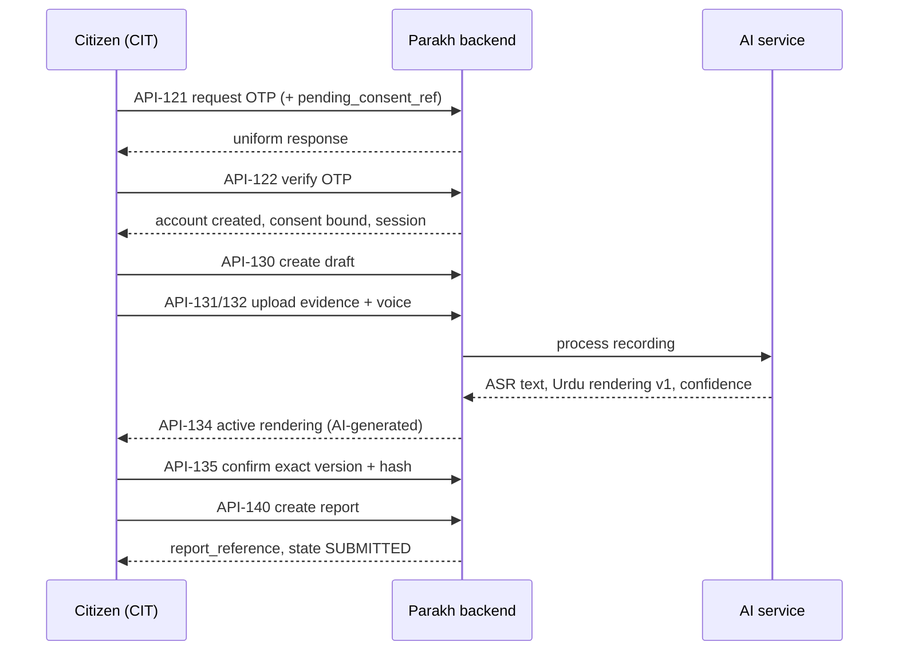

# Parakh — Cross-Portal End-to-End Workflows

| Field | Value |
|---|---|
| **Version** | **1.0** |
| **Date** | 2 September 2026 |
| **Status** | **Specified; not implemented; not tested.** |
| **Authority** | CR-61 rev 1.3 · RBAC v1.3 · Data Model v1.3 · Screen Inventory v1.3 · API Contract v3.0 |
| **Workflows** | `WF-01` … `WF-23` |

> **The written steps are authoritative.** Mermaid diagrams are included only where they materially help; where a diagram and the text differ, **the text governs**.

---

## Index

| ID | Workflow | Portals |
|---|---|---|
| `WF-01` | Citizen account creation and first report | CIT |
| `WF-02` | Report from submission to final closure | CIT · REP · UCO · CON |
| `WF-03` | Clarification request and citizen response | REP/UCO · CIT |
| `WF-04` | Representative verification to UC Officer review | REP · UCO |
| `WF-05` | UC Officer acceptance and contractor assignment | UCO · CON |
| `WF-06` | Contractor acceptance, progress and completion | CON · UCO |
| `WF-07` | Completion verification and reporter confirmation | CON · REP · CIT |
| `WF-08` | Citizen disputes the claimed resolution | CIT · UCO |
| `WF-09` | Contractor declines and UC Officer reassigns | CON · UCO |
| `WF-10` | Staff official reports an issue | any staff |
| `WF-11` | Multi-role staff reports and is conflict-excluded | UCO/REP |
| `WF-12` | UC Officer invites a Street Representative | UCO · REP |
| `WF-13` | Mayor/Ops provisions a UC Officer | MAY · UCO |
| `WF-14` | Mayor/Ops approves an organisation and provisions a Contractor | MAY · CON |
| `WF-15` | First Mayor bootstrap and later Mayor invitation | MAY |
| `WF-16` | Password reset and session revocation | any staff |
| `WF-17` | Staff account suspension while logged in | MAY · any staff |
| `WF-18` | Citizen changes mobile number | CIT |
| `WF-19` | AI rendering fails before report submission | CIT / staff |
| `WF-20` | Offline citizen draft later synchronises | CIT |
| `WF-21` | Duplicate submission / idempotency protection | CIT / staff |
| `WF-22` | Formal appeal | CIT · UCO · MAY |
| `WF-23` | Protected citizen contact without disclosing the number | MAY · CIT |

---

## WF-01 — Citizen account creation and first report

**Actors:** Citizen · SMS service · AI processing service
**Preconditions:** App installed; no account; network available at the authentication and upload steps

| # | Actor | Screen | Action | API | Entities | Capability | State | Audit |
|---|---|---|---|---|---|---|---|---|
| 1 | Citizen | `CIT-01` | Selects Urdu or English | — | local preference | — | — | — |
| 2 | Citizen | `CIT-02` | Reads the privacy, number and voice explanation | — | — | — | — | — |
| 3 | Citizen | `CIT-03` | Ticks two required and one optional consent | **none — no account exists** | device-held `pending_consent` | — | — | **none** |
| 4 | Citizen | `CIT-04` | Enters the mobile number, taps Send code | `API-121` | `OTPChallenge` | — | — | `otp_requested` |
| 5 | System | — | Sends the SMS; **response is uniform whether or not the number is registered** | — | — | — | — | — |
| 6 | Citizen | `CIT-05` | Enters and verifies the code | `API-122` | `CitizenAccount` · `CitizenPhoneCredential` · **3× `ConsentRecord`** · `AuthSession` · `RefreshTokenFamily` · `DeviceSession` | — | account → `ACTIVE` | `citizen_account_created`, `phone_verified`, `consent_recorded` ×3 |
| 7 | Citizen | `CIT-07` | Chooses a category | `API-130` | `ClientSubmission` `LOCAL_DRAFT` | — | `LOCAL_DRAFT` | — |
| 8 | Citizen | `CIT-08` | Captures live photos | — | `EvidenceObject` staged | — | — | — |
| 9 | Citizen | `CIT-09` | Records their voice | — | `EvidenceObject` `voice_original` | — | — | — |
| 10 | System | `CIT-09` | Uploads chunks; **recomputes every hash server-side** | `API-131`, `API-132` | evidence committed | — | `UPLOADING` | `evidence_committed` |
| 11 | AI service | `CIT-09` | Produces `source_asr_text`, then the **Urdu civic rendering**, with per-field confidence and `rendering_content_hash` | — | `VoiceTranscriptionArtifact` v1 | — | `TRANSCRIPTION_PROCESSING` → `AWAITING_REPORTER_REVIEW` | — |
| 12 | Citizen | `CIT-09` | Answers a low-confidence question → **v2 supersedes v1** | — | artefact v2 | — | — | `rendering_corrected` |
| 13 | Citizen | `CIT-10` | Confirms the location | `GET /geo/reverse` | — | — | — | — |
| 14 | Citizen | `CIT-11` | **Confirms the exact rendering version** | `API-135` | `RenderingConfirmation` | **`CAP_RENDERING_CONFIRM_OWN`** | → `READY_TO_SUBMIT` | `rendering_confirmed` |
| 15 | System | — | **One atomic transaction:** verify confirmation · verify evidence · create report · **issue the reference in the same transaction** · bind artefact and version · record ownership | `API-140` | **`CivicReport`** · `ReportOwnership` | — | *(none)* → **`SUBMITTED`** | `report_submitted` |
| 16 | Citizen | `CIT-13` | Sees the official reference | — | — | — | `SUBMITTED` | — |

**Privacy boundaries:** the number exists only in `CitizenPhoneCredential`, encrypted; **no operational role ever receives it**. **No citizen name is collected** — the field does not exist.
**Failure branches:** OTP wrong/expired/rate-limited → uniform message *(`UC-CIT-012`)* · AI failure → `WF-19` · offline at step 15 → `WF-20` · stale rendering → `409`, re-fetch *(`UC-CIT-032`)*.
**Final outcome:** an authenticated citizen holds one `CivicReport` in `SUBMITTED` with an official reference.

---

## WF-02 — Report from submission to final closure

**Actors:** Citizen · Street Representative · UC Officer · Contractor · system routing

| # | Actor | Screen | Action | API | Capability | State transition | Audit |
|---|---|---|---|---|---|---|---|
| 1 | System | — | Routes the new report | — | automatic | `SUBMITTED` → `UNDER_VERIFICATION` | `report_routed` |
| 2 | Representative | `REP-02` | Field verification with evidence and a **mandatory reason** | `API-160` | `CAP_FIELD_VERIFY` | `UNDER_VERIFICATION` → `VERIFIED` | `field_verified` |
| 3 | System | — | Queues for review | — | automatic | `VERIFIED` → `UC_REVIEW` | `case_queued_for_review` |
| 4 | UC Officer | `UCO-02` | **Accept** | `API-161` | `CAP_CASE_ACCEPT` | `UC_REVIEW` → **`ACCEPTED`** | `case_accepted` |
| 5 | UC Officer | `UCO-03` | Assign an **eligible** contractor, **step-up required** | `API-163` | `CAP_CASE_ASSIGN` | `ACCEPTED` → `CONTRACTOR_ASSIGNED` | `contractor_assigned` |
| 6 | Contractor | `CON-02` | Accept work; **eligibility re-checked at the point of action** | `API-164` | `CAP_WORK_ACCEPT` | → `IN_PROGRESS` | `work_accepted` |
| 7 | Contractor | `CON-03` | Post progress with evidence | `API-165` | `CAP_WORK_PROGRESS` | unchanged | `progress_updated` |
| 8 | Contractor | `CON-04` | Submit completion with **required** evidence | `API-166` | `CAP_WORK_COMPLETE` | → `COMPLETION_SUBMITTED` | `completion_submitted` |
| 9 | System | — | Routes to a **conflict-free** Representative | — | automatic | → `COMPLETION_VERIFICATION` | `completion_routed` |
| 10 | Representative | `REP-03` | Verify completion — **not the completer, not the reporter** | `API-167` | `CAP_COMPLETION_VERIFY` | → `PENDING_CITIZEN_CONFIRMATION` | `completion_verified` |
| 11 | Citizen | `CIT-18` | **Yes — fixed** | `API-153` | ownership | → `RESOLVED_CONFIRMED` | `resolution_confirmed` |
| 12 | UC Officer | `UCO-06` | **Ordinary closure** with a mandatory reason, **step-up** | `API-168` | **`CAP_CASE_CLOSE` — `UCO` only** | → **`CLOSED`** | `case_closed` |

**Twelve canonical states, `DRAFT` is not among them.** **Mayor & Operations appears nowhere in this workflow**, because it holds no ordinary closure, rejection or assignment authority.
**Failure branches:** verification fails → `UC_REVIEW` with a reason · rejection → `WF` ends at `REJECTED` · contractor declines → `WF-09` · completion rejected → back to `IN_PROGRESS` · citizen disputes → `WF-08`.

---

## WF-03 — Clarification request and citizen response

**Actors:** Street Representative or UC Officer · Citizen

| # | Actor | Screen | Action | API | State | Audit |
|---|---|---|---|---|---|---|
| 1 | REP or UCO | `REP-02` / `UCO-02` | Requests clarification with a **mandatory question** | clarification route | **unchanged** | `clarification_requested` |
| 2 | Citizen | `CIT-20` | Receives a notification | — | unchanged | — |
| 3 | Citizen | `CIT-16` | Reads the question — **translated and playable aloud** | — | — | — |
| 4 | Citizen | `CIT-16` | Replies **by voice**, or types, or adds a photo | `API-152` | unchanged | clarification answered |
| 5 | REP or UCO | queue | Reads the reply and continues | — | — | — |

**Privacy:** the reply reaches staff as content; **the citizen's number is never attached**. **Offline:** the reply **queues** — it is report content, not authentication. **Accessibility:** "Not sure" is an explicit, blame-free option.

---

## WF-04 — Representative verification to UC Officer review

**Preconditions:** state `UNDER_VERIFICATION`; item in the Representative's ward; **the acting account is not the reporter**

| # | Step | Detail |
|---|---|---|
| 1 | The item appears at `REP-01` | **The Representative's own reports never appear in this queue** |
| 2 | `REP-02` shows the privacy-filtered record | Confirmed Urdu rendering **labelled AI-generated** · evidence · **original recording, scope-limited, for verification** · **no citizen identity** |
| 3 | Representative visits the site and captures field evidence | — |
| 4 | Selects one of five outcomes with a **mandatory reason** | verified · not verified · **duplicate suspected** · inaccessible · needs clarification |
| 5 | Server checks `CAP_FIELD_VERIFY`, geographic scope and **account-level conflict at the point of action** | Conflict → `403 E_CONFLICT_EXCLUDED` |
| 6 | `VERIFIED` → system routes → `UC_REVIEW` | `field_verified`, `case_queued_for_review` |

**Duplicate handling:** **flagged with a linked reference, never silently deleted.**

---

## WF-05 — UC Officer acceptance and contractor assignment

| # | Step | Guard |
|---|---|---|
| 1 | `UCO-02` — **Accept** → `ACCEPTED` | `CAP_CASE_ACCEPT`, scope, conflict, `state_version` |
| 2 | `UCO-03` renders **only eligible contractors** | account `ACTIVE` · organisation `APPROVED` and active · within `valid_from … valid_until` · category matches · area matches |
| 3 | **Step-up OTP** at `STF-08` if `recent_auth_at` older than 10 minutes | `401 E_STEP_UP_REQUIRED` otherwise |
| 4 | **Assign** — **the server re-runs all five eligibility checks regardless of what the client rendered** | `API-163` |
| 5 | `ACCEPTED` → `CONTRACTOR_ASSIGNED`, `CaseAssignment` created with a `response_deadline` | `contractor_assigned` |

**Prohibited:** assignment from `UC_REVIEW`. **Acceptance cannot be skipped.**
**Open decision:** **D-06** — if the reporter belonged to a contractor organisation, **that organisation is not currently excluded**. `TBD — Hassan decision required`.

---

## WF-06 — Contractor acceptance, progress and completion

| # | Step | Guard |
|---|---|---|
| 1 | `CON-01` lists jobs for **this organisation only** | organisational scope; cross-organisation request → **same `404` as non-existent** |
| 2 | `CON-02` shows the **privacy-filtered work packet** | **no `voice_original`, no `source_asr_text`, no citizen number, no `citizen_account_id`, no name, no staff notes, no audit narrative** |
| 3 | **Accept** → eligibility re-checked at the point of action → `IN_PROGRESS` | organisation suspended since assignment → **refused despite a valid session** |
| 4 | `CON-03` progress updates, append-only | `CAP_WORK_PROGRESS` |
| 5 | `CON-04` completion with **required** evidence → `COMPLETION_SUBMITTED` | `CAP_WORK_COMPLETE` |
| 6 | System routes to a **conflict-free** Representative | **the completer is excluded from verifying** |

**No response within `response_deadline`** → **system** returns the report to `ACCEPTED`, audited `assignment_lapsed`.

---

## WF-07 — Completion verification and reporter confirmation

| # | Actor | Step | State |
|---|---|---|---|
| 1 | System | Selects a Representative who is **neither the completer nor the reporter** | `COMPLETION_VERIFICATION` |
| 2 | Representative | `REP-03` — visits, photographs, **Confirm completion** with a mandatory reason | → `PENDING_CITIZEN_CONFIRMATION` |
| 3 | Citizen | `CIT-17` reviews before/after evidence | — |
| 4 | Citizen | `CIT-18` — **Yes — fixed** | → `RESOLVED_CONFIRMED` |

**Alternate:** Representative rejects completion → back to `IN_PROGRESS` with a mandatory reason.
**Exception:** no conflict-free Representative → escalate; if still none, **flag unresolvable and hold**.

> **Open decision D-01 — Blocker.** If the report was filed by a **staff official**, step 3–4 has **no citizen to act** and the case **stalls permanently at `PENDING_CITIZEN_CONFIRMATION`**.
> **Branch A (recommended, not approved):** rename the state `PENDING_REPORTER_CONFIRMATION` and generalise `CitizenConfirmation` to carry `subject_type` + `subject_id`, so the reporter — citizen or staff — confirms.
> **Branch B:** auto-advance staff-official reports to `RESOLVED_CONFIRMED`. **Rejected as a recommendation** — it removes the reporter's right to dispute.
> **`TBD — Hassan decision required`.**

---

## WF-08 — Citizen disputes the claimed resolution

| # | Actor | Screen | Action | API | State | Audit |
|---|---|---|---|---|---|---|
| 1 | Citizen | `CIT-18` | **Not fixed** | — | — | — |
| 2 | Citizen | `CIT-19` | Reason picker + **voice or text explanation** + optional evidence | `API-154` | `PENDING_CITIZEN_CONFIRMATION` → **`REOPENED`** | `resolution_disputed` |
| 3 | UC Officer | `UCO-05` | Reads the dispute; chooses **Rework**, **Reassign** or **Escalate**; **step-up** | dispute route | `REOPENED` → `IN_PROGRESS` or `ACCEPTED` | `dispute_handled` |
| 4 | Citizen | `CIT-20` | Sees *"Being looked at again"* | — | — | — |

**If the citizen is dissatisfied with the officer's handling** → `WF-22` formal appeal, decided by an **independent Mayor/Ops actor**.
**Open:** **`TBD — Hassan decision required`: is repeated reopening capped, and what happens at the cap?**

---

## WF-09 — Contractor declines and UC Officer reassigns

| # | Step | State | Audit |
|---|---|---|---|
| 1 | Contractor declines at `CON-02` with an **allowed reason** | `CONTRACTOR_ASSIGNED` → **`ACCEPTED`** | `work_declined` |
| 2 | *(Alternate)* No response within the window → **system** returns it | `CONTRACTOR_ASSIGNED` → `ACCEPTED` | `assignment_lapsed` |
| 3 | The report reappears in the UC Officer's assignment queue | `ACCEPTED` | — |
| 4 | Officer assigns a different eligible contractor, **step-up required** | → `CONTRACTOR_ASSIGNED` | `contractor_assigned` |
| 5 | *(Exception)* **No eligible contractor remains** → escalate one level; if still none, **flag unresolvable and hold** | held | `case_escalated`, `case_unresolvable` |

**Never auto-approved. Never routed back to a conflicted account.**

---

## WF-10 — Staff official reports an issue

**Actors:** any staff user holding `CAP_REPORT_OFFICIAL` — Representative, UC Officer, Contractor or Mayor/Ops

| # | Step | Detail |
|---|---|---|
| 1 | `STF-10` — **one shared screen for all four roles** | **Four duplicate reporting systems do not exist** |
| 2 | The screen states, before submission, that **the reporter will be excluded from acting on this report** | — |
| 3 | Category · evidence · voice recording | **Online only** — see **D-11** |
| 4 | AI produces an Urdu rendering, **labelled AI-generated**, with a version indicator | `VoiceTranscriptionArtifact` |
| 5 | The staff reporter **confirms their own rendering** | **`CAP_RENDERING_CONFIRM_OWN`** — **never another person's** |
| 6 | Atomic creation at `SUBMITTED`; reference issued in the same transaction; `official_reporter_account_id` and `official_reporter_role_assignment_id` recorded | `API-141` |
| 7 | **`ConflictExclusion` written, keyed on the account** | permanent |
| 8 | The report enters the normal lifecycle — `WF-02` from step 1 | — |

**Open decisions:** **D-02 / D-03** — there is **no staff screen showing a staff user their own reports**, so after step 8 the reporter **cannot follow their own report**. **D-09** — staff receive **no versioned voice-processing notice**, and `ConsentRecord` cannot hold a staff consent. **D-01** — step 10 of `WF-02` will stall.

---

## WF-11 — Multi-role staff user reports and is conflict-excluded

**The scenario the architecture exists to prevent.**

| # | Step | Result |
|---|---|---|
| 1 | An account holds **both** a UC Officer assignment and a Street Representative assignment | — |
| 2 | Acting as `UCO`, it files an official report through `STF-10` | `ConflictExclusion` written on **`excluded_staff_account_id`** |
| 3 | It signs out and back in, and at `STF-06` selects the **Street Representative** assignment | `acting_role_selected` |
| 4 | The report appears in the ward queue | **It does not.** Own reports never appear in `REP-01` |
| 5 | It requests the report directly and attempts field verification | **`403 E_CONFLICT_EXCLUDED`** — *"You reported this issue, so you cannot act on it"* |
| 6 | It later gains a **new** Mayor/Ops assignment and tries again | **Still refused.** The exclusion applies to **every assignment the account holds, present and future** |

> *"A UC Officer who submits an official report remains excluded from verifying, accepting, assigning, approving, closing or deciding a dispute on that report — even after switching to a Street Representative or Mayor/Ops assignment."*
>
> **Role-level checking would have permitted step 5. Account-level checking denies it.**

**Also enforced:** **capabilities are never combined.** Acting as `REP`, the account has no `CAP_CASE_ACCEPT`; acting as `UCO`, it has no `CAP_FIELD_VERIFY`.

---

## WF-12 — UC Officer invites a Street Representative

| # | Step | Guard |
|---|---|---|
| 1 | `UCO-07` — intended number, ward, **mandatory expiry** | `CAP_REP_INVITE` — **`UCO` only, own scope** |
| 2 | **Step-up OTP** | `401 E_STEP_UP_REQUIRED` otherwise |
| 3 | **Server verifies the ward is contained within the officer's own scope** | wider → **refused and audited** |
| 4 | `StaffAccount` `INVITED`, `RoleAssignment` `PENDING` with `valid_until`, single-use hashed **phone-bound** invitation | `rep_invited` |
| 5 | Representative activates — `STF-01` → `STF-02` OTP → `STF-03` **own password** → `ACTIVE` | **the officer never sets a credential** |
| 6 | Representative logs in and selects the acting role | `WF` complete |

**Mayor & Operations does not invite Representatives in routine operation.**

---

## WF-13 — Mayor/Ops provisions a UC Officer

| # | Step | Guard |
|---|---|---|
| 1 | `MAY-03` / `MAY-04` — intended number, Union Council, **mandatory expiry** | **`CAP_ACCOUNT_ADMIN` + `CAP_ROLE_ASSIGN`** — **explicitly granted, never automatic** |
| 2 | **Step-up OTP** | — |
| 3 | Scope check: **not wider than the assigner's own** | refused and audited otherwise |
| 4 | Account, assignment and phone-bound invitation created | `officer_provisioned`, `role_assigned` |
| 5 | Officer activates and sets **their own** password | `password_set` |

**A UC Officer with `CAP_CASE_TRIAGE` cannot do any of this.** *Case-management authority never implies account-administration authority.*

---

## WF-14 — Mayor/Ops approves an organisation and provisions a Contractor

| # | Step | Guard |
|---|---|---|
| 1 | An organisation record exists in `PENDING_APPROVAL` | **`TBD` — no self-service registration route exists in any approved source** |
| 2 | `MAY-05` — approval reference, categories, service areas, validity dates, **step-up** | `CAP_ACCOUNT_ADMIN` |
| 3 | `PENDING_APPROVAL` → **`APPROVED`** | `organisation_approved` |
| 4 | **Only now** `MAY-03` may invite a contractor staff account with `organization_id` | **refused if the organisation is not `APPROVED`** |
| 5 | Contractor activates and sets **their own** password | — |
| 6 | Contractor appears in `UCO-03` eligibility **only** when every one of the five checks passes | — |

**A UC Officer can never create or approve a contractor organisation.**

---

## WF-15 — First Mayor bootstrap and later Mayor invitation

| # | Step | Status |
|---|---|---|
| 1 | The first Mayor/Ops account is created **out of band, through the deployment environment** | **Specified in principle** |
| 2 | The exact procedure, its authorisation evidence and its audit treatment | **`TBD — Hassan decision required`. No procedure is invented here** |
| 3 | **Even at bootstrap, the human owner must set their own password through `STF-03`** | **No administrator may choose, view, transmit or store it** |
| 4 | That account, holding `CAP_ACCOUNT_ADMIN`, invites later Mayor/Ops accounts through `MAY-03` | `account_invited` |
| 5 | Later accounts activate normally: `STF-01` → `STF-02` → `STF-03` → `STF-04` → `STF-05` → `STF-06` | — |

**Prohibited at every step:** public signup · a shared or default credential · a password sent by SMS, email, WhatsApp, spreadsheet or paper.

---

## WF-16 — Password reset and session revocation

| # | Step | Detail |
|---|---|---|
| 1 | `STF-07` — the user enters their mobile number | **Uniform response whether or not it is registered** |
| 2 | OTP *(`purpose = password_reset`)* verified | — |
| 3 | The user sets a **new password of their own choosing** | **No administrator resets it to a value they choose** |
| 4 | **All existing sessions are revoked** | `session_revoked` |
| 5 | The staff member **and the appropriate administrator** are notified | — |
| 6 | **A suspended, revoked or expired account cannot be reactivated this way** | login still refused |

**Open decision D-07 PROPOSED:** the reset ticket should be **stamped with `purpose = password_reset`** and **rejected if presented to a step-up or activation endpoint**.

---

## WF-17 — Staff account suspension while logged in

| # | Step | Result |
|---|---|---|
| 1 | A UC Officer is signed in and mid-review at `UCO-02` | session valid |
| 2 | Mayor/Ops suspends the account at `MAY-03` with a reason and **step-up** | `account_suspended` |
| 3 | The officer clicks **Accept** | **The next action fails**, not the next login |
| 4 | The server checks account status **at the point of action** | `403` and the session is revoked |
| 5 | The officer is returned to `STF-04` with a plain message | — |

**The same applies to an expired `RoleAssignment`** — the session **downgrades on the next request** with `403 E_ROLE_ASSIGNMENT_INVALID`, and to a **contractor organisation suspension**, which **cascades to its accounts immediately**.

---

## WF-18 — Citizen changes mobile number

| # | Step | Guard |
|---|---|---|
| 1 | `CIT-22` explains the two steps in plain language | — |
| 2 | OTP to the **old** number *(`purpose = citizen_phone_change_old`)* | **impossible offline** |
| 3 | OTP to the **new** number *(`purpose = citizen_phone_change_new`)* | **impossible offline** |
| 4 | Both verified → `CitizenPhoneCredential` updated; `previous_phone_lookup_hmac` and `changed_at` recorded | `phone_changed` — **never the number** |
| 5 | *(Failure)* Either OTP fails, **or the new number is already registered** → **uniform failure revealing nothing** | — |

**The account, its reports and its history are unchanged.** Only the credential moves.

---

## WF-19 — AI rendering fails before report submission

**The rule that resolves the old contradiction.**

| # | Step | Detail |
|---|---|---|
| 1 | AI processing fails | `processing_status = FAILED` |
| 2 | **The encrypted draft and the original recording are preserved** | nothing is lost |
| 3 | **The draft remains a `ClientSubmission`** | **no `CivicReport` is created** |
| 4 | The reporter may **retry** or **re-record** | — |
| 5 | Where authorised human review exists, a reviewer holding `CAP_TRANSCRIPT_REVIEW` may **produce or correct a new rendering version** | `API-136`, `transcript_reviewed` |
| 6 | **The new version returns to the original reporter for confirmation** | — |
| 7 | **No staff reviewer confirms on the reporter's behalf** | `CAP_RENDERING_CONFIRM_OWN` is **not delegable** |
| 8 | A `CivicReport` is created **only after the original reporter confirms the current active version** | — |
| 9 | **No plausible replacement text is ever generated** | — |
| 10 | **Audio-only official submission is not part of Release 0** | — |

**`REVIEW_REQUIRED` is a `VoiceTranscriptionArtifact.processing_status` and a draft-review status only. It never becomes a `CivicReport` lifecycle state and never bypasses confirmation.** The rev 1.2 `TRANSCRIPTION_REVIEW_REQUIRED` submission path is **withdrawn**.

---

## WF-20 — Offline citizen draft later synchronises

| # | Step | Detail |
|---|---|---|
| 1 | The citizen is already authenticated and loses connectivity | — |
| 2 | Category, photos, voice recording and pin placement **all work offline** | draft is local |
| 3 | `CIT-12` shows **"Waiting to send"** with what is queued, and **Retry now / Edit / Cancel** | **no report reference; no `CivicReport` exists** |
| 4 | **AI processing does not happen** — the screen says so plainly | **no on-device model exists** |
| 5 | Connectivity returns; the client retries with the **same** `client_submission_id` | `API-131`/`132` upload |
| 6 | AI processes; the rendering appears for review | `AWAITING_REPORTER_REVIEW` |
| 7 | The citizen confirms the **active** version | `API-135` |
| 8 | Report created atomically at `SUBMITTED`; the reference is issued **now, not earlier** | `report_submitted` |

**What never happens offline:** OTP request · OTP verify · AI processing · `CivicReport` creation.
**Open decision D-10:** the stack asserts encrypted local storage but **names no mechanism**. **This workflow does not claim a specific protection.**

---

## WF-21 — Duplicate submission and idempotency protection

| Concern | Key | Behaviour |
|---|---|---|
| Draft creation | `client_submission_id` | A repeat returns the **existing** draft |
| Evidence chunks | chunk index | Chunk `n` is idempotent; **the server recomputes the hash** |
| **Rendering confirmation** | confirmation idempotency key | A replay returns the **original** result |
| **Report creation** | `client_submission_id` **+** submission idempotency key | **A replay can never create a second `CivicReport`** |
| Workflow transitions | `state_version` | Stale → `409 E_STALE_STATE` |
| Concurrency | serialised on `client_submission_id` | **Exactly one `CivicReport` results** |
| Lost response | same ids retried | The original `report_reference` is returned. **No recovery secret, no anonymous grant — the account is the recovery mechanism** |

> **Open decision D-12 — PROPOSED.** API Contract v3.0 names `X-Idempotency-Key` for **both** confirmation and creation, while `RenderingConfirmation.idempotency_key` is **UNIQUE**. If the same value is reused, a legitimate creation retry collides with the confirmation constraint. **Recommendation: two distinct headers** — `X-Confirmation-Idempotency-Key` and `X-Submission-Idempotency-Key`. **Not approved.**

---

## WF-22 — Formal appeal

| # | Actor | Step | State |
|---|---|---|---|
| 1 | Citizen | Disputes at `CIT-19` | `PENDING_CITIZEN_CONFIRMATION` → `REOPENED` |
| 2 | UC Officer | Handles the dispute at `UCO-05` | `dispute_handled` |
| 3 | Citizen | Remains dissatisfied; a formal appeal is filed | `Dispute.appeal_status: NOT_FILED → FILED` |
| 4 | Mayor/Ops | `MAY-09` — **the server checks the actor is not a prior actor on that case** | `FILED → UNDER_REVIEW` |
| 5 | Mayor/Ops | Reviews and records the decision, **step-up** | `UNDER_REVIEW → DECIDED`, `appeal_decided` |
| 6 | Mayor/Ops | **Records the resulting case transition explicitly** — rework, reassignment, or closure by a UC Officer | never implicit |

**The case itself remains `REOPENED` throughout.** **There is no `(appeal)` state** — a parenthesised phrase is not a state code.
**A UC Officer who handled the dispute cannot decide the appeal.** **A Mayor/Ops user who previously intervened cannot either** — the exclusion is account-level and survives role switching.

---

## WF-23 — Protected citizen contact without disclosing the number

| # | Step | Detail |
|---|---|---|
| 1 | A Mayor/Ops user needs to tell a citizen that site access is required | — |
| 2 | `MAY-08` — **no citizen phone number is rendered anywhere on this screen: not masked, not partial, not on hover** | `CAP_IDENTITY_VIEW_MASKED` was **withdrawn** |
| 3 | Selects a purpose code and a template, or writes permitted text | — |
| 4 | **Step-up OTP** | `CAP_PROTECTED_CONTACT` |
| 5 | **The notification service sends it.** The staff user never holds a dialable number | `ProtectedContactRequest` |
| 6 | **If the citizen consented to SMS notification, it may go by SMS. Otherwise in-app only** | consent respected |
| 7 | Audit records actor, acting assignment, report, purpose, channel and timestamp | **`protected_contact_sent` — no phone number in the event** |

**Why this replaced the old design:** a masked number cannot be dialled, so offering one as a contact method was a contradiction. **The system contacts the citizen; the human never sees the number.**
**Open:** emergency or legally required messaging **without** consent is **`TBD — legal or institutional review required`**.

---

## Privacy boundaries that hold across every workflow

| Boundary | Enforced where |
|---|---|
| **No operational role receives a citizen phone number, in any form** | Server-side serialiser, every response |
| **No citizen name exists** — the field is absent from the data model | Data model. **D-13** |
| **No contractor receives `voice_original` or `source_asr_text`** | Server-side serialiser, `CON-02` |
| **No citizen sees `source_asr_text`** | Server-side serialiser |
| **No audit event contains a number, OTP, password, token or unrestricted rendering** | Audit service |
| **No actor edits or deletes an `AuditEvent`** | Append-only, including for the audit service itself |
| **Not-found, not-owned and no-permission are indistinguishable** | Uniform `404`, same body and timing class |

---

*Specified; not implemented; not tested. No workflow in this document has been executed end to end, or at all.*
