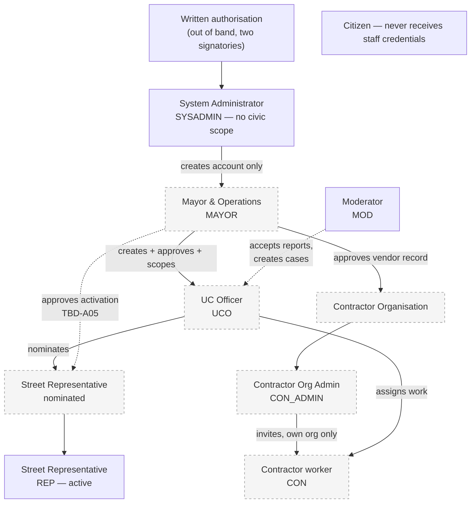
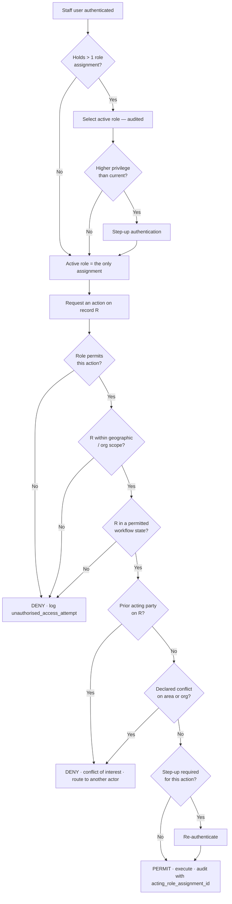
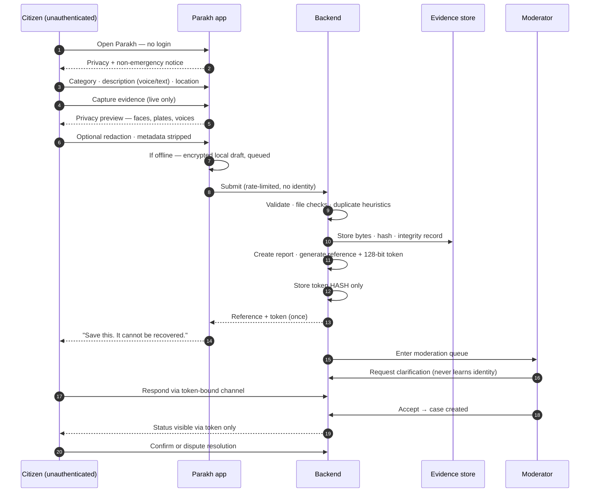
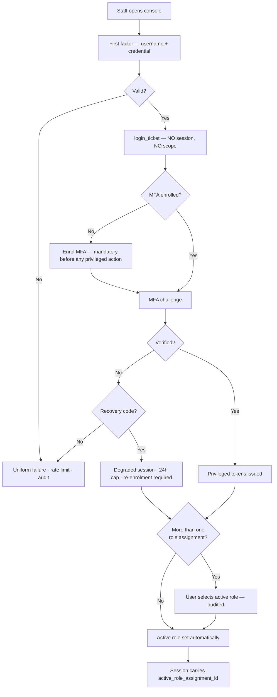
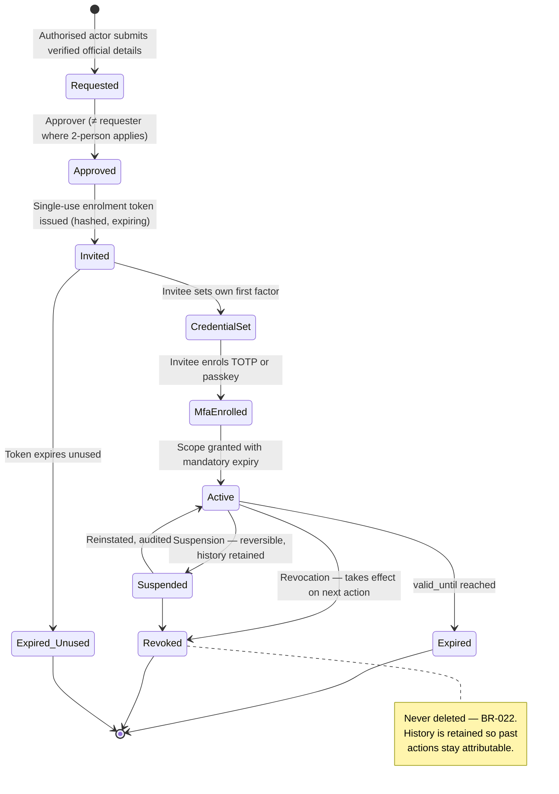

# Parakh — Authentication, Role Assignment and Anonymous Incident Reporting

| Field | Value |
|---|---|
| **Document title** | Authentication, Role Assignment and Anonymous Incident Reporting |
| **Version** | **1.2** |
| **Date** | 20 August 2026 *(v1.0 — CR-59 and CR-60 applied)* |
| **Status** | **APPROVED — anonymous reporting adopted by Hassan Jalal (CR-59) and enacted in SRS v1.4.0.** The v0.1 blocker is **resolved**. §3 and §8 are now buildable design. **Still not implemented, not tested, not independently reviewed** |
| **Owner** | Hassan Jalal — Founder & Project Lead |
| **Prepared by** | Security / privacy / systems architecture review |
| **Governing source** | `Parakh_Prototype_SRS_v1.4.2.md` — **governs where this document differs** |
| **Related documents** | `Parakh_Release_0_Build_Specification_v1.2.7.md` · `Parakh_v1.3.7_Consistency_Audit.md` · `Parakh_Use_Case_Document_v1.0.pdf` (sources: `usecase/uc1.md`, `usecase/uc2.md`) · `DATABASE_ARCHITECTURE.md` v2.4 |
| **Source-control note** | Created at `docs/security/AUTHENTICATION_ROLE_ASSIGNMENT_AND_ANONYMOUS_REPORTING.md`. **No existing specification, use-case document or repository file was modified in producing it.** The companion use-case file is at `docs/use-cases/AUTHENTICATION_AND_INCIDENT_REPORTING_USE_CASES.md`; integration into the master Use Case Document remains **pending** — see §0.5 |

> **Nothing in this document has been built, deployed, tested against a real attacker, or reviewed by an independent security assessor. No government body has approved it. No user has used it. Every control described is a design proposal.**

---

## §0 — Conflict register: read this before anything else

I inspected the latest authoritative documents in the repository before writing. **Your brief conflicts with the governing SRS in four places, three of them blocking.** Your instruction was to follow the latest authoritative specification and not to invent resolutions, so I have designed what you asked for while marking clearly what cannot be built without your decision.

### C-1 — Anonymous reporting · **RESOLVED at SRS v1.4.0 (CR-59)**

> **Status: CLOSED.** Hassan Jalal approved identity-free anonymous reporting on 20 August 2026. `C-6` is superseded by **`C-6a`**, `BR-007` by **`BR-007a`**, `FR-AUTH-004` is amended, and `TEST-AUTH-004` / `TEST-PRV-004` were **rewritten** — they previously asserted the absence of the approved capability. New requirements `FR-ANON-001`…`008`, new decision `DR-20`, new entity `AnonymousAccessGrant`. **The analysis below is retained as the historical record of why the change was needed.**

#### Historical conflict analysis (v0.1)

Your brief's stated core design decision is that citizens must be able to report anonymously without an account.

**SRS v1.3.7 forbids exactly this, in four places, with two P0 tests enforcing it:**

| Source artefact | Exact position |
|---|---|
| Constraint **`C-6`** | *"**No anonymous reporting**; verified identity for every reporter"* |
| Business rule **`BR-007`** | *"**No anonymous reporting.** Every report shall be linked to a verified participant"* — tested by `TEST-AUTH-004` |
| Requirement **`FR-AUTH-004`** (P0, Must) | *"The system shall reject any report submission from a participant whose identity has not been attested and activated, and **shall provide no anonymous reporting path**"* |
| Requirement **`FR-CIT-001`** (P0) | Server-side eligibility invariant mapped to `BR-007` |
| Test **`TEST-PRV-004`** (P0) | *"Attempt API-030 as an unauthenticated caller"* — must be refused |
| Decision **`DR-9`** (binding, approved) | Dual-track identity; *"OTP is authentication only, never sufficient identity"* |

This is not a documentation inconsistency. **It inverts the identity model, the evidence-attribution model and the audit chain.** Under v1.3.7 every report is bound to a `Participant` with an `IdentityVaultRecord` and an `AttestationRecord`; anonymous reporting removes that binding entirely.

> ### **TBD-A01 — CLOSED. Approved by Hassan Jalal, 20 August 2026.** *(Original wording retained below.)*
> **Does Parakh adopt anonymous citizen reporting, and does the SRS change to permit it?**
>
> This document **cannot** resolve this. §3 and §8 design anonymous reporting **conditionally**. If you adopt it, §3.6 lists the exact SRS amendments required. If you do not, §3.7 gives a lower-cost alternative that satisfies most of your privacy goals without amending `C-6`.
>
> **Until this is decided, anonymous reporting must not be built, and Release 0 must not be described as supporting it.**

### C-2 — Three of your five "operational roles" are Future, not Release 0 · **BLOCKING for scope**

| Your brief | SRS v1.3.7 |
|---|---|
| Five operational roles: Citizen, Street Representative, UC Officer, Contractor, Mayor & Ops | **§3.4 Future — not built:** `SC-FUT-01` UC Officer portal · `SC-FUT-02` Contractor portal · `SC-FUT-03` Mayor & Operations Command portal |
| — | **§3.5 Explicitly out of scope for the prototype:** `SC-OUT-01` Full UC Officer portal · `SC-OUT-02` Full Contractor portal · `SC-OUT-03` Full Mayor & Operations Command portal |
| — | Release 0 has **four actors**: `CZ` Citizen · `REP` Street Representative · `MOD` Moderator · `ADM` Administrator, plus capability `CAP_PROXY_COMPLETION` |

The Use Case Document already reflects this: **UC-03, UC-04 and UC-05 are tagged `FUTURE INSTITUTIONAL CAPABILITY`.**

This document therefore designs all five roles **and** marks each one's phase honestly. It does not present UC Officer, Contractor or Mayor & Ops as Release 0 capabilities.

### C-3 — Your brief omits the Moderator, a P0 role · **BLOCKING**

Your five-role list has no **Moderator (`MOD`)**. In SRS v1.3.7 the Moderator is a Release 0 actor who owns the entire acceptance workflow: `FR-MOD-001`…`FR-MOD-005`, screens `MO-01`…`MO-14`, endpoints `API-051` / `API-052` / `API-055`, and transition **T3a** (`AI_PROCESSED → ACCEPTED`).

**Without the Moderator there is no path from a submitted report to a case.** I have added `MOD` to the role model. If you intended to rename or merge this role, say so — do not let it be dropped silently.

### C-4 — "Hidden technical System Administrator" contradicts the SRS Administrator · **NON-BLOCKING but material**

Your brief says the System Administrator *"must not make civic verification, contractor assignment, or closure decisions."*

In SRS v1.3.7 the Administrator (`ADM`) **does** affect the civic workflow, deliberately and by design:

- Holds `CAP_PROXY_COMPLETION` and records action-owner steps **by proxy** (`SC-03`, `SC-LIM-01`, `FR-FIX-001`, `API-071`, `API-078`) — precisely *because* no UC Officer or Contractor portal exists.
- Acts as **fallback appeal decider** (`FR-ADM-102`) when no independent Moderator is available.
- Has its own console, `AD-01` … `AD-12`.

So the SRS Administrator is an **operational role with civic reach**, not a hidden technical account.

> ### `TBD — Hassan decision required` **(TBD-A02)**
> **Do you want to split the SRS `ADM` into two roles** — a hidden `SYSADMIN` (accounts, credentials, configuration, no civic reach) and an operational `OPS_ADMIN` (proxy completion, appeals fallback) — **or keep the single combined `ADM`?**
>
> **My recommendation: split them for production, keep them combined for Release 0.** Reasoning in §5.4. Splitting now adds a role, a console and a set of tests to a prototype that has one seeded Administrator and a frozen 37-entity data model.

### C-5 — The master Use Case Document is a built PDF, not a directly editable source

`Parakh_Use_Case_Document_v1.0.pdf` (3.2 MB, 8 Aug 2026) is generated from `usecase/uc1.md` and `usecase/uc2.md`, which contain embedded HTML (``) belonging to a build pipeline.

Editing those fragments risks breaking the PDF build and creating a second source of truth — which your brief explicitly prohibits.

**Action taken:** new use cases were written to `docs/use-cases/AUTHENTICATION_AND_INCIDENT_REPORTING_USE_CASES.md` using IDs **UC-07 … UC-26**, which do not collide with the existing UC-01 … UC-06. **No existing use case was renumbered.** Integration into the master document is **pending** and is listed in §14.5.

---

## §1 — Scope and terminology

Four distinct concepts, kept separate throughout. Conflating them is the most common source of authorisation defects.

| Concept | Question it answers | Failure if wrong |
|---|---|---|
| **Authentication** | *Who is this staff user?* | Impersonation |
| **Authorisation** | *What is this user permitted to do?* | Privilege escalation |
| **Scope** | *Where, and on which records, may they do it?* | A Representative in one UC acting on another UC's cases |
| **Anonymous access grant** | *May this bearer of a secret token read and act on exactly one report, without the system knowing who they are?* | Enumeration of other citizens' reports |

**An anonymous access grant is not authentication.** It proves possession of a secret bound to one report. It establishes no identity, carries no role, and must never be exchangeable for a session.

### 1.1 Deny by default

Every authorisation decision starts from **deny**. A permission exists only where this document grants it explicitly. Absence of a rule is a denial, not an omission.

### 1.2 Frontend hiding is not a control

Hiding a button changes what a user sees, not what the server accepts. **Every rule in §9 must be enforced server-side**, and must be covered by a test that calls the endpoint directly with a token that should not be permitted. This mirrors `TEST-SEC-001`, which already requires every route to be assigned to exactly one transport class.

---

## §2 — Role model, reconciled with the governing SRS

| Role | Code | Phase per SRS v1.3.7 | Civic decision authority | Authentication floor |
|---|---|---|---|---|
| **Citizen** | `CZ` | **Release 0** | Confirm or dispute resolution on own report only | Phone OTP; **no MFA** (`API-001`/`API-002`) |
| **Street Representative** | `REP` | **Release 0** | Independent verification of a case in scope | First factor **+ mandatory MFA** (`DR-9`, `NFR-SEC-010`) |
| **Moderator** | `MOD` | **Release 0** — *absent from your brief, see C-3* | Accept report → create case; close verification; appeals | First factor **+ mandatory MFA** |
| **Administrator** | `ADM` | **Release 0** | Accounts, grants, attestation, audit; **plus proxy completion** (`CAP_PROXY_COMPLETION`) | First factor **+ mandatory MFA** |
| **UC Officer** | `UCO` | **Future — `SC-FUT-01` / `SC-OUT-01`** | Routing, assignment, closure | Official identifier + mandatory MFA |
| **Contractor** | `CON` | **Future — `SC-FUT-02` / `SC-OUT-02`** | Accept assignment, submit work proof | Approved vendor identity + MFA |
| **Contractor Org Admin** | `CON_ADMIN` | **Future** — proposed, §5.6 | Invite own workers only | As `CON`, plus step-up for invitations |
| **Mayor & Operations** | `MAYOR` | **Future — `SC-FUT-03` / `SC-OUT-03`** | Approve officers and vendors; oversight | Official identity + **phishing-resistant MFA** |
| **System Administrator** | `SYSADMIN` | **Proposed, not in SRS** — see C-4, TBD-A02 | **None.** Accounts and credentials only | Strongest available; hardware-bound passkey |

**Release 0 builds four roles.** Everything else is designed here so the model does not have to be rebuilt later — not because it will exist in October.

---

## §3 — Anonymous citizen reporting · **CONDITIONAL DESIGN**

> **TBD-A01 is closed and this section is approved design under SRS v1.4.0.** It is **specified, not implemented**. No control here has been built, tested or independently reviewed.

### 3.1 What "anonymous" honestly means here

Your brief is right to insist on precision, and the precision needs to go further than "we do not collect a name."

| Claim | Status |
|---|---|
| The reporter's **identity is not collected** — no name, phone, email, CNIC, username or password | **Achievable** |
| The report **contains no identifying information** | **False, and must never be claimed.** A photograph of a specific drain outside a specific house, plus a voice recording, plus GPS coordinates, may identify the reporter to anyone who knows the neighbourhood |
| The reporter **cannot be re-identified** | **Not achievable, and must not be claimed.** Voice is biometric. Location plus time plus content is often sufficient. Content-based re-identification is outside the system's control |
| Parakh **cannot** link two reports to one person | **Weakly achievable.** No account link; but writing style, voice and location may correlate |
| A hostile party with device access **cannot** find the report | **False if the citizen keeps the receipt.** The receipt is the only recovery path, and it is also the only evidence a hostile party needs |

> **The honest formulation for the interface, and for any document describing Parakh:**
> *"Parakh does not ask who you are. It cannot promise that what you send will not identify you. Your photographs, your voice and the place you describe may show who you are to someone who knows the area."*

This must be shown **before** capture, not buried in a privacy policy.

### 3.2 The tracking token

**Do not use a short PIN.** Your brief already rules this out; here is the specification that replaces it.

| Property | Specification | Reasoning |
|---|---|---|
| **Entropy** | **≥ 128 bits**, from a cryptographically secure RNG. 160 bits recommended | Must resist offline brute force with no rate limit to rely on |
| **Encoding** | Base32, unambiguous alphabet (no `0`/`O`, `1`/`I`/`l`), grouped for transcription | It will be written on paper, read aloud, and typed by someone who may not read Latin script fluently |
| **Storage** | **Hash only.** SHA-256 of the token, stored alongside the report reference. **The plaintext token is never stored, never logged, never in an error message** | A database read must not yield report access |
| **Why SHA-256 and not Argon2id** | Argon2 is for **low-entropy** secrets that must resist brute force. A 128-bit random token cannot be brute-forced; a slow hash would only add latency to every legitimate lookup | This is a real design distinction and worth stating in the code comment |
| **Transport** | Never in a URL path or query string — **request body or header only** | URLs leak into browser history, server logs, proxy logs and `Referer` headers |
| **Reference vs token** | The **report reference** (`PKH-7Q4M-2XR9`) is a non-sequential public label shown in the UI. The **token** is the secret. They are different values | The citizen can quote a reference to staff without granting access |
| **Rotation** | The citizen may rotate the token from an authenticated-by-token session, invalidating the old one | The only mitigation available if the receipt is seen by the wrong person |
| **Expiry** | Grant expires a configurable period after case closure — **duration is `TBD — Hassan decision required` (TBD-A03)** | Indefinite validity is a standing risk; too short strands the reporter |

**Lookup must be constant-time-ish and rate-limited by IP and by report reference**, with a uniform response for "wrong token" and "no such report." Distinguishing them turns the endpoint into an oracle for which references exist.

### 3.3 Anti-abuse without identification

The hard part of anonymous reporting is not the token; it is abuse control without identity.

| Control | Mechanism | Privacy cost |
|---|---|---|
| **Rate limiting** | **`HMAC(rotating_server_secret, normalized_IP)`**, per coarse geographic cell | **A plain unsalted IP hash is prohibited** — the IPv4 space is small enough to reverse exhaustively. Short retention · rotating secret · abuse prevention only · **never exposed in a staff interface, never used to establish identity or to link reports beyond the abuse window** |
| **Proof of work / CAPTCHA** | Only on rate-limit breach, never by default | Accessibility cost is high for low-literacy users; use as a last resort |
| **Duplicate detection** | Location proximity + time window + category, **surfaced to a Moderator, never auto-rejected** | None |
| **File validation** | Type, size, magic-byte check, dimension caps (mirrors `TEST-SEC-017`, which already tests a ZIP disguised as JPEG) | None |
| **Content moderation** | Human Moderator review before a case is created — this already exists as T3a | None |
| **Device attestation** | **Not recommended.** Play Integrity ties a report to a device identity | **High.** Defeats the purpose |

> **Accept openly that anonymous reporting is harder to defend against spam.** The honest trade is: anonymity increases abuse risk, and the compensating control is human moderation, which does not scale. State that limit rather than implying the controls are equivalent.

### 3.4 Metadata and redaction

| Stage | Action |
|---|---|
| **On capture** | Strip EXIF **except** capture time and, if the citizen consents to it, coarse location. Record what was stripped in the evidence provenance record |
| **Privacy preview** | Show the citizen the actual frames and warn about faces, number plates, house numbers, distinctive clothing, and audible voices |
| **Optional redaction** | Citizen-applied blur on faces and plates. **Applied as a derived evidence item** — the original is retained under restricted access, never overwritten. This follows `DATABASE_ARCHITECTURE.md` §12.5, where a redaction is a new evidence item with its own hash |
| **Voice** | Warn that a voice recording is biometric. Offer text entry as an alternative — **but note this conflicts with `FR-VOI-001`**, which makes audio the primary description. `TBD — Hassan decision required` **(TBD-A04)** |
| **Location precision** | Offer the citizen a choice between precise and coarsened location, and explain the trade: coarse location protects them and may make the report unactionable |

### 3.5 What the anonymous interface may and may not do

| Permitted | Prohibited |
|---|---|
| Create a new incident report | Browse any internal report list |
| Save an offline draft on-device | View private officer notes |
| Upload permitted evidence | Verify any incident |
| Receive a receipt | Assign a contractor |
| Track **that one report** via its token | Change report status |
| Respond to a clarification request on that report | Access a staff portal |
| Confirm resolution on that report | Access another citizen's report |
| Dispute resolution on that report | Search by predictable identifier |
| Rotate its own token | Claim any staff role |

**Enforcement rule:** every token-bound endpoint resolves the token to **exactly one report identifier** and ignores any report identifier supplied by the client. A token holder cannot ask about a different report, because the request never carries one.

### 3.6 If you adopt anonymous reporting — the amendments required

**These are formal specification changes, not documentation edits.**

| Artefact | Change required |
|---|---|
| `C-6` | Amend from *"No anonymous reporting"* to a scoped constraint permitting an anonymous path with stated limits |
| `BR-007` | Amend or add `BR-007a` for the anonymous path |
| `FR-AUTH-004` | Amend — it currently mandates *"no anonymous reporting path"* |
| `FR-CIT-001` | Revisit the eligibility invariant |
| `TEST-AUTH-004`, `TEST-PRV-004` | Rewrite — both currently **assert the absence** of what you want to build |
| New requirements | Anonymous grant issuance, token rotation, token-bound clarification, anonymous dispute |
| `DATABASE_ARCHITECTURE.md` | Add `AnonymousAccessGrant`; **P0A is frozen at 37 entities, so this requires a formal architecture revision** — v2.4 §27.1 |
| `DR-9` | Confirm whether dual-track identity still holds when a third, identity-free track exists |

**Estimated effect on Release 0:** this is not a small change. It touches identity, evidence attribution, audit attribution and the frozen data model.

### 3.7 If you do not adopt it — the lower-cost alternative

**Pseudonymous reporting with minimal enrolment**, which keeps `C-6` intact:

- Citizen authenticates by phone OTP as today (`API-001`/`API-002`) — **the phone number is used for authentication only and is held in the identity vault**, unreadable by the application role.
- Reporter identity is **already absent from Representative-facing queries** — this is invariant `I-3` in the architecture and is enforced at the query level, not by filtering.
- The citizen gets the same receipt, the same tracking, the same dispute rights.

**What this gives up:** a reporter who fears the phone number itself is enough to identify them is not protected. In a civic accountability context where the complaint is against a local authority, **that fear is reasonable**, and it is the strongest argument for TBD-A01 resolving in favour of anonymity.

---

## §4 — Staff authentication, role by role

Recommendations follow current primary guidance: [NIST SP 800-63B-4 (final, July 2025)](https://csrc.nist.gov/pubs/sp/800/63/b/4/final), which mandates phishing-resistant MFA at AAL2/AAL3 and integrates passkeys; [OWASP ASVS 5.0 (May 2025)](https://owasp.org/www-project-application-security-verification-standard/); and the [Django security documentation](https://docs.djangoproject.com/en/stable/topics/security/).

### 4.1 Requirements by role

| | Street Representative | UC Officer | Contractor | Mayor & Ops | System Admin |
|---|---|---|---|---|---|
| **Phase** | **Release 0** | Future | Future | Future | Proposed |
| **Identity verified by** | Institutional attestation recorded by ADM (`AttestationRecord`) | Official government identifier, verified by Mayor/Ops | Approved vendor record + authorised contact | Formal written authorisation | Formal written authorisation, two signatories |
| **Creation initiated by** | Moderator or Administrator | Mayor & Ops | Mayor & Ops | System Administrator | Existing System Administrator |
| **Approved by** | **`TBD — Hassan decision required` (TBD-A05)** — see §5.5 | Mayor & Ops | Mayor & Ops | Written authorisation, out of band | Second System Administrator |
| **Invitation** | Single-use enrolment token (`API-098` → `API-104`) | Same pattern | Same pattern, to the vendor's authorised contact | Same pattern, delivered out of band | Same pattern, in person where possible |
| **First factor** | Password or passkey | Password or passkey | Password or passkey | **Passkey preferred** | **Passkey required** |
| **Second factor** | **TOTP or passkey, mandatory** (`DR-9`, `NFR-SEC-010`) | **Mandatory** | **Mandatory** | **Phishing-resistant (FIDO2/WebAuthn) where feasible** | **Hardware-bound, phishing-resistant** |
| **Scope** | One or more UC / ward areas | District / tehsil / UC | Own organisation + assigned cases only | City / district | **None — no civic scope at all** |
| **Scope changed by** | Moderator or Admin, audited | Mayor & Ops | Mayor & Ops | Written authorisation | N/A |
| **Expiry** | **Mandatory** — grants carry a required expiry (`FR-ADM-002`) | Term-bounded | Contract-bounded | Term-bounded | Reviewed quarterly |
| **Suspension / revocation** | Immediate; takes effect **on next action**, history retained (`FR-ADM-004`, `BR-022`) | Same | Same, on contract end | Same | Requires second administrator |
| **Recovery** | Single-use recovery code (`API-101`), then admin-initiated reset (`API-102`) | Same | Same | Same + out-of-band verification | **Sealed offline code, two-person** |
| **Audited** | Every creation, enrolment, login, failure, scope change, suspension, revocation, recovery | Same | Same | Same | Same, plus reviewed by a second person |

### 4.2 Rules that apply to every role

1. **Administrators never choose, see, set or transmit a user's password.** `API-098` creates the account with a username; `API-104` lets the invited person set their own first factor. This is already the SRS design and it is correct.
2. **The Administrator can reset a second factor but can never read one** — already stated in the SRS at `API-102`.
3. **MFA enrolment precedes any privileged action** (`FR-ADM-003`). An account that has not enrolled can do nothing.
4. **Enrolment tokens are single-use, short-lived, hashed at rest, and bound to one account.**
5. **Step-up authentication** is required for the actions marked in §9 even within a live session.
6. **A recovery session is a degraded session** — the SRS already caps it at 24 hours via `Session.assurance_expires_at` and requires re-enrolment. Keep this.

> ### `TBD — Hassan decision required` **(TBD-A06)**
> **`TBD-053` in the SRS remains open and is directly relevant: a sole Administrator who loses their second factor cannot be recovered by anyone.** The SRS lists this as blocking P1. My recommendation is the simplest one available: **appoint a second Administrator before field test.** A sealed offline recovery code is the alternative, and it introduces a physical secret someone must guard.

---

## §5 — Account-creation hierarchy

### 5.1 Evaluation of your proposed hierarchy

| Your step | Assessment |
|---|---|
| 1. SysAdmin creates initial Mayor/Ops account | **Sound in principle, not applicable to Release 0** — Mayor & Ops is `SC-FUT-03` |
| 2. Mayor/Ops creates UC Officers and defines scope | **Sound.** Correct separation: the authority that appoints is not the authority that operates |
| 3. Mayor/Ops creates or approves contractor organisations | **Sound and important** — see step 4 |
| 4. UC Officers may only assign to approved contractors | **Correct and the strongest rule in your list.** Prevents an officer inventing a vendor and assigning work to it. Keep this exactly as written |
| 5. UC Officers nominate Street Representatives | **Sound**, with the approval question at step 6 |
| 6. Does REP activation need Mayor/Ops approval? | **Decision required — TBD-A05.** My recommendation in §5.5 |
| 7. Contractor Org Admin invites its own workers | **Recommend yes**, with hard constraints — §5.6 |
| 8. Citizens never receive staff credentials | **Correct and non-negotiable** |

### 5.2 The two principles that should govern the final hierarchy

**Principle 1 — Separation of appointment from operation.**
The person who grants authority must not be the person who exercises it on the same records. A UC Officer who could create their own contractor could route public work to a vendor nobody verified. Your step 4 already encodes this; extend it everywhere.

**Principle 2 — Authority may only be delegated downward and within scope.**
No actor may grant a scope broader than their own, or a role more privileged than their own. A UC Officer scoped to one UC cannot create a Representative in a different UC. This must be a server-side check, not a UI constraint.

### 5.3 Recommended hierarchy — production

*Dashed / grey = Future per SRS §3.4. Only `SYSADMIN`, `MOD`, `REP` and `CZ` have a Release 0 path.*

### 5.4 Recommended hierarchy — Release 0

Because UC Officer, Contractor and Mayor & Ops do not exist in Release 0, the chain collapses:

1. **Administrator** (`ADM`) is seeded once, out of band, and enrols MFA through `API-104` → `API-099`.
2. **Administrator creates Moderator and Representative accounts** via `API-098`; each invitee sets their own first factor (`API-104`) and enrols MFA (`API-099`) before doing anything.
3. **Administrator grants scope** with a mandatory expiry (`API-091`, `FR-ADM-002`).
4. **Administrator or Moderator records participant attestation** and activates citizens (`API-090a`/`API-090b`) — **and note these are refused outside `local`, `ci` and `demo` environments**, which is correct and should stay.
5. **No contractor or officer accounts exist.** Action-owner steps are recorded by proxy under `CAP_PROXY_COMPLETION`, and the record says so.

**On C-4 / TBD-A02:** I recommend **keeping the combined `ADM` for Release 0** and splitting it for production. Splitting now would add a role, a console, a permission surface and a test set to a prototype with one seeded Administrator — cost without benefit, since the mitigating control (two people) does not exist yet either.

### 5.5 Street Representative activation — recommendation

> ### `TBD — Hassan decision required` **(TBD-A05)**

**Recommendation: two-person activation in production; single-approver in Release 0.**

**Why two-person in production.** A Street Representative performs *independent verification* — the control that makes a Parakh case more than an unverified claim. If one UC Officer can both nominate and activate a Representative, that officer can manufacture an independent verifier for their own area. That defeats the property the whole system exists to provide.

**Why single-approver in Release 0.** There is one Administrator and no UC Officer. A two-person rule with one person is theatre.

**Middle option if two-person proves unworkable:** UC Officer nominates and activates, but Mayor & Ops receives an automatic notification and can suspend within a defined window. Weaker, and honestly so.

### 5.6 Contractor Organisation Administrator — recommendation

**Recommend permitting it, bounded hard:**

| Constraint | Rule |
|---|---|
| Scope | May invite **only** into their own `organization_id`. Server-side, not UI |
| Role ceiling | May grant only `CON`. **Never** `CON_ADMIN`, never any civic role |
| Case access | Invited workers see **only cases assigned to that organisation** |
| Cascade | Suspending the organisation suspends every worker in it, immediately |
| Step-up | Every invitation requires re-authentication |
| Audit | Invitation, activation, suspension recorded with both actors named |

**Why permit it:** the alternative is a Mayor & Ops office creating individual worker accounts for every contractor, which does not scale and will be worked around informally — usually by password sharing, which is worse than the risk being avoided.

---

## §6 — Role and scope assignment

### 6.1 Why RBAC alone is insufficient

Role alone cannot answer *"may this Representative verify **this** case?"* Six dimensions combine:

| Dimension | Example |
|---|---|
| **Role** | Is this a Representative? |
| **Geographic scope** | Is the case in a UC they cover? |
| **Organisational scope** | Is the case assigned to their contractor organisation? |
| **Ownership / assignment** | Is this case assigned to them specifically? |
| **Workflow state** | Is the case in a state where verification is permitted? |
| **Conflict of interest** | Did they submit or previously decide this report? |

**All six must pass.** Failing any one is a denial.

### 6.2 The assignment record

Conceptual only — no schema, no data types.

| Field | Purpose |
|---|---|
| `user_id` | The account holding the assignment |
| `role` | One of the codes in §2 |
| `scope_type` | `city` · `district` · `tehsil` · `union_council` · `ward` · `organisation` · `global` |
| `scope_id` | The specific area or organisation |
| `organization_id` | Contractor organisation, where applicable |
| `assigned_by` | Who initiated |
| `approved_by` | Who approved — **may not equal `assigned_by`** where two-person approval applies |
| `status` | `pending_approval` · `pending_enrolment` · `active` · `suspended` · `expired` · `revoked` |
| `valid_from` / `valid_until` | **`valid_until` is mandatory** — matches `FR-ADM-002` |
| `suspended_at` · `revoked_at` · `revocation_reason` | Non-destructive lifecycle; history retained per `BR-022` |

**Invariant:** an assignment authorises an action only when `status = active` **and** the action time falls within `[valid_from, valid_until)`. Expiry is evaluated **at the point of action**, never at session issue — this matches the existing architecture invariant `I-7`.

### 6.3 Multiple roles on one account

A person may legitimately hold more than one assignment — a Representative who is also a Moderator in a different UC, for example.

**Design:**

- One `user_id`; **many** assignment records.
- On login the user selects an **active role assignment** for the session. If they hold exactly one, it is selected automatically.
- The session carries `active_role_assignment_id`.
- **Switching roles requires re-selection and is an audited event.** For any assignment involving a higher privilege than the current one, switching requires **step-up authentication**.
- **Permissions are never unioned across assignments.** A user acting as `REP` has Representative permissions only, even if they also hold `MOD`. Unioning is how privilege escalation happens quietly.

> **Every audit event records `acting_role_assignment_id`, not merely `user_id`.** Without it, "who did this and under what authority?" is unanswerable — and that question is the entire point of an accountability platform.

### 6.4 Release 0 requirement

Release 0 must demonstrate **one account holding two role assignments**, switching between them, with both the switch and the subsequent actions correctly attributed in the audit log.

---

## §7 — Conflict of interest

### 7.1 The rule

> **No person may act as reviewer, approver or decider on a record where they were a prior acting party.**

The SRS already encodes parts of this: `FR-FIX-006` (separation of duties on completion vs confirmation), `BR-030` (an appeal is decided by a moderator who was not a prior decision actor), `DeclaredConflict` as a P0 entity, and `TEST-REP-010`, which asserts a Representative cannot close their own verification.

### 7.2 Prohibited self-actions

| A person who… | May not… | Enforcement |
|---|---|---|
| Submitted the report | Verify it | Compare acting participant against the report's submitting participant |
| Uploaded evidence | Approve that evidence | Compare against evidence uploader |
| — | Assign the case to themselves without separate authorisation | Assigner ≠ assignee, unless an explicit authorised exception is recorded |
| Performed the work | Approve its completion | Completion submitter ≠ completion approver — this is `FR-FIX-006` |
| Submitted the report | Close it | Same comparison |
| Was a prior decision actor | Decide the resulting dispute or appeal | `BR-030` |
| Holds a declared conflict on the area or organisation | Act on affected records | `DeclaredConflict` lookup |

### 7.3 Staff reporting an incident

A Representative who finds a broken drain should report it. The design:

- The staff user stays logged in and enters an explicit **"Report an incident"** mode.
- The report is stored with `reported_by_role_assignment_id` and a flag `submitted_by_official = true`. **It is visibly labelled as officially submitted** — to reviewers and in the audit history.
- The submitting person is **automatically excluded** from every reviewer role on that record for its lifetime. Exclusion is a stored fact, not a runtime check that a future refactor could drop.
- **Routing:** the report goes to a different qualified actor in scope. If none exists, it escalates one level up. If no eligible actor exists at all, the case is **flagged unresolvable and held** — it is not auto-approved, and it is not silently assigned back.

This mirrors the existing pattern at `FR-ADM-102`, where an unresolvable appeal is flagged rather than forced.

> ### `TBD — Hassan decision required` **(TBD-A07)**
> **In Release 0 there is one Moderator.** If that Moderator submits a report, no independent Moderator exists to accept it. Options: (a) the Administrator accepts it, (b) it is held unresolvable, (c) seed a second Moderator. **My recommendation: (c) — seed a second Moderator account.** It costs one seed record and makes the conflict-of-interest demonstration real rather than notional.

### 7.4 Multi-role and conflict-of-interest flow

---

## §8 — Anonymous incident-reporting workflow · **CONDITIONAL on TBD-A01**

### 8.1 Sequence

### 8.2 Edge cases

| Scenario | Behaviour |
|---|---|
| **Citizen loses the token** | **Access is unrecoverable, by design.** There is no identity to verify against, so any recovery mechanism is an attack path. The report still progresses; the citizen simply cannot track it. **This must be stated before submission, not after.** Mitigation: offer to display a printable receipt and to store the token in the device keystore where the citizen consents |
| **Token is stolen** | The holder gains read access and the ability to confirm or dispute — **a real harm**. Mitigations: token rotation from an active session; short post-closure expiry; no token in URLs or logs; no confirmation of report existence to a wrong token. **Residual risk is accepted and must be disclosed** |
| **Report is duplicated** | Detected by proximity, time window and category. **Surfaced to a Moderator, never auto-merged.** Each report keeps its own reference and token; linking is a human decision. This matches `DATABASE_ARCHITECTURE.md` §9.3, where attachment is deferred to P1 |
| **Upload fails** | Bytes are an uncommitted upload; **no report exists.** The client resumes the same upload session. Per the architecture, an evidence item is committed only with its context, atomically |
| **Submitted offline** | Encrypted on-device draft in the app's own storage, never in shared storage — this already exists as `FR-OFF-002`. Queued, transmitted on reconnection, deduplicated by client-generated idempotency key (`FR-OFF-006`) |
| **Evidence contains personal information** | Privacy preview before submission; optional redaction as a derived item; Moderator may restrict evidence visibility; **the original is retained, never deleted** — `BR-022` |
| **Emergency or immediate danger** | **Parakh is not an emergency service and must say so on the first screen.** Display local emergency numbers prominently. If the category or content indicates danger, show the emergency notice again before submission and flag the report for priority moderation. **Do not imply anyone is watching in real time** |
| **Abusive, malicious or spam report** | Human moderation rejects it with a coded reason. **Rejection is P1** (`FR-MOD-006`) — in Release 0 there is no reject path, so such a report simply remains unaccepted. Repeated abuse from one source is handled by rate limiting, which is coarse and imperfect without identity |
| **Outside the assigned area** | Accepted, then flagged out-of-scope, and either routed to a covering authority or held. **Never silently discarded** — the citizen was not wrong to report it |
| **Location permission refused** | Report proceeds. Citizen places the location manually on a map; the record is marked `location_unverified`. This already exists as `FR-EVD-102` |
| **No clarification response** | The request expires after a configured period; the case proceeds on available evidence with the non-response recorded. **The report is never closed *because* the citizen did not answer** |
| **Reported by authenticated staff** | §7.3 applies — labelled, submitter excluded from review, routed elsewhere |

---

## §9 — Permission matrix

**Deny by default.** A blank cell is a denial. `—` means the role has no path to that action at any scope.

| # | Permission | CZ | REP | MOD | ADM | UCO † | CON † | MAYOR † | SYSADMIN | Scope required | Workflow state | Conflict rule | Step-up | Audit event |
|---|---|:--:|:--:|:--:|:--:|:--:|:--:|:--:|:--:|---|---|---|:--:|---|
| 1 | Submit incident | ✓ | ✓ | ✓ | ✓ | ✓ | ✓ | ✓ | — | Any | — | Staff submissions labelled §7.3 | — | `report_submitted` |
| 2 | View report | Own only | In scope | In scope | ✓ | In scope | Assigned only | In scope | — | Geo / assignment | Any | — | — | `report_viewed` |
| 3 | View reporter-sensitive evidence | Own | **✗** | Restricted | Break-glass | **✗** | **✗** | **✗** | **✗** | Vault role | Any | — | ✓ | `vault_access` |
| 4 | Request clarification | — | ✓ | ✓ | ✓ | ✓ | — | — | — | In scope | Pre-acceptance / open | Not the submitter | — | `clarification_requested` |
| 5 | Edit classification | — | — | ✓ | ✓ | ✓ | — | — | — | In scope | Pre-close | Not the submitter | — | `classification_changed` |
| 6 | Verify report | — | ✓ | — | — | — | — | — | — | Assigned UC | `OPEN_UNVALIDATED` | **Not the submitter** | ✓ | `verification_recorded` |
| 7 | Reject report **(P1)** | — | — | ✓ | ✓ | — | — | — | — | In scope | Pre-acceptance | Not the submitter | ✓ | `moderation_decision` |
| 8 | Assign contractor † | — | — | — | Proxy | ✓ | — | — | — | In scope | `VERIFIED` | Not self; **approved vendors only** | ✓ | `assignment_created` |
| 9 | Accept assignment † | — | — | — | Proxy | — | ✓ | — | — | Own org | Assigned | — | — | `assignment_accepted` |
| 10 | Upload work proof † | — | — | Proxy | Proxy | — | ✓ | — | — | Own org | `IN_PROGRESS` | — | — | `completion_submitted` |
| 11 | Review contractor proof † | — | ✓ | ✓ | ✓ | ✓ | **✗** | — | — | In scope | `PENDING_CONFIRMATION` | **Not the submitter** | — | `completion_reviewed` |
| 12 | Approve completion | — | — | ✓ | ✓ | ✓ | **✗** | — | — | In scope | `PENDING_CONFIRMATION` | **Not the work submitter** — `FR-FIX-006` | ✓ | `completion_approved` |
| 13 | Confirm resolution | **Reporter only** | — | — | — | — | — | — | — | Own report | `PENDING_CONFIRMATION` | Reporter ≠ completion submitter | — | `resolution_confirmed` |
| 14 | Dispute resolution | **Reporter only** | — | — | — | — | — | — | — | Own report | `PENDING_CONFIRMATION` | Same | — | `resolution_disputed` |
| 15 | Close report | — | — | ✓ | ✓ | ✓ | — | — | — | In scope | Confirmed / expired | **Not the submitter** | ✓ | `case_closed` |
| 16 | Reopen report | — | — | ✓ | ✓ | ✓ | — | — | — | In scope | Closed / disputed | Explicit reason required | ✓ | `case_reopened` |
| 17 | View analytics | — | Own scope | ✓ | ✓ | Own scope | Own org | ✓ | — | Scope-limited | — | — | — | `analytics_viewed` |
| 18 | Manage users | — | — | — | ✓ | Nominate only | Own org only | ✓ | ✓ | Downward only | — | Cannot self-elevate | ✓ | `operator_created` |
| 19 | Assign roles | — | — | — | ✓ | — | — | ✓ | ✓ | **Never above own** | — | Assigner ≠ approver where 2-person | ✓ | `role_assigned` |
| 20 | Change geographic scope | — | — | — | ✓ | — | — | ✓ | — | Never above own | — | Cannot widen own scope | ✓ | `scope_changed` |
| 21 | Suspend accounts | — | — | — | ✓ | — | Own org | ✓ | ✓ | Downward only | — | — | ✓ | `account_suspended` |
| 22 | View audit logs | — | **✗** | ✓ | ✓ | Own scope | **✗** | ✓ | ✓ | Scope-limited | — | Read-only, no role may write | ✓ | `audit_log_viewed` |
| 23 | Export data | — | — | — | ✓ | — | — | ✓ | — | Scope-limited | — | De-identification checklist mandatory | ✓ | `export_generated` |

† Future roles — `SC-FUT-01`…`03`. "Proxy" = performed by MOD/ADM under `CAP_PROXY_COMPLETION` and recorded as a proxy action.

**Three properties this matrix enforces:**

- **No role can both do work and approve it** — rows 10/12 and 6/1 never overlap for one person.
- **No role can widen its own authority** — rows 19, 20 are downward-only.
- **No role can write the audit log** — row 22 is read-only for every role, matching `FR-AUD-004` and `BR-022`.

---

## §10 — Data model and API security

### 10.1 Conceptual entities

**No schema, no data types, no code.** Entities marked **NEW** are not in the frozen 37-entity P0A inventory and require a formal architecture revision.

| Entity | Purpose | Status |
|---|---|---|
| `Participant` | One human, opaque reference | Existing |
| `IdentityVaultRecord` | Personal identifiers, separate schema and DB role | Existing |
| `AttestationRecord` | Institutional identity attestation | Existing |
| `OperatorCredential` | Staff first factor — **hash only** | Existing |
| `RoleAssignment` | §6.2 — extended with `approved_by`, `organization_id` | Existing, **extension needed** |
| `CapabilityGrant` | Scoped, time-bounded capability | Existing |
| `DeclaredConflict` | Recorded conflict of interest | Existing |
| `EnrolmentToken` · `AuthTicket` · `AuthFlowSession` | Invitation and step-wise auth | Existing |
| `MfaEnrolment` · `MfaRecoveryCode` | Second factor — secret encrypted; codes hashed, single-use | Existing |
| `AuthChallenge` | Citizen OTP — **the passcode itself is never durably stored** | Existing |
| `Session` | Issued session — **token not stored, hash and metadata only** | Existing |
| `CivicReport` · `EvidenceItem` · `EvidenceManifest` · `UploadSession` | Report and evidence | Existing |
| `AuditEvent` · `AuditCheckpoint` | Segmented tamper-evident chain | Existing |
| **`AnonymousAccessGrant`** | One report · token hash · issued · expires · rotated-from · revoked | **NEW — TBD-A01** |
| **`Organisation`** | Contractor organisation | Existing at **P2** |
| **`ClarificationRequest`** | Request, response, expiry | **NEW — P1** |

### 10.2 Secret handling

| Secret | Rule |
|---|---|
| Staff password | **Hashed with a memory-hard algorithm** — Argon2id preferred; Django's `PBKDF2` default is acceptable but weaker. Never logged, never recoverable, never displayed |
| Citizen OTP | Hashed, short-lived, **discarded after use or expiry**. A durable OTP record is a liability |
| Anonymous tracking token | **SHA-256 hash only** — §3.2 explains why a fast hash is correct here |
| Session / refresh token | Hash and metadata only. Rotating refresh family; replay of a consumed token revokes the family — already `TEST-SEC-004` |
| Enrolment / reset token | Hashed, single-use, short-lived, account-bound |
| MFA secret | Encrypted at rest; **an Administrator may reset but never read** |
| Recovery codes | Hashed, single-use, count of remaining codes exposed but never the values |

### 10.3 Session and access control

- **Expiry:** short access token; rotating refresh; recovery sessions capped at 24 h with mandatory re-enrolment.
- **Logout** (`API-004`) revokes the refresh family server-side. A client-side token discard is not a logout.
- **Lost device:** recovery code → degraded session → mandatory re-enrolment; or administrator-initiated reset (`API-102`), which revokes the existing enrolment.
- **Brute force:** rate limit per account and per IP; uniform responses; lockout after repeated MFA failure — **duration is `TBD-052`, still open in the SRS**.
- **Object-level authorisation:** every request re-resolves the record and re-evaluates all six dimensions of §6.1. **Never trust an identifier supplied by the client as evidence of entitlement.**
- **Function-level authorisation:** every endpoint declares its required role, scope and state; a route with no declaration fails the build.
- **Evidence access:** short-lived, single-use, authenticated URLs bound to the requesting session. **No public bucket URLs, ever.**
- **Audit protection:** append-only; no role holds update or delete grants; segmented hash chains with checkpoints — `FR-AUD-002`, `FR-AUD-004`.

### 10.4 API groups

Conceptual grouping only. **No implementation.**

| Group | Transport class | Examples |
|---|---|---|
| **Public anonymous reporting** | Unauthenticated, rate-limited | Create report · open upload session · finalise · issue receipt |
| **Anonymous token-bound tracking** | Token-bound; resolves to exactly one report | Read status · respond to clarification · confirm · dispute · rotate token |
| **Staff authentication** | Public → ticket-bound → bearer | First factor · MFA enrol · MFA challenge · recovery · enrolment · refresh · logout |
| **Role and scope administration** | Bearer + MFA + step-up | Create operator · assign role · change scope · suspend · revoke · reset MFA |
| **Internal workflow** | Bearer + MFA + scope + state + conflict checks | Moderation queue · accept · assign · verify · completion · close · reopen · audit history |

**The four transport classes already exist in the SRS** (`TEST-SEC-001` requires every route to belong to exactly one). Keep that discipline; add the token-bound class only if TBD-A01 resolves in favour of anonymity.

---

## §11 — Remaining diagrams

### 11.1 Staff login and role selection

### 11.2 Credential lifecycle, invitation to revocation

---

## §12 — Release 0 versus production

### 12.1 Release 0 — what must be demonstrated

| Capability | Status against SRS v1.3.7 |
|---|---|
| Anonymous citizen reporting | **BLOCKED — TBD-A01.** Prohibited by `C-6`, `BR-007`, `FR-AUTH-004` |
| Non-predictable tracking token | **BLOCKED with the above.** The design is ready; the permission is not |
| Staff invitation flow | **Buildable now** — `API-098` → `API-104` → `API-099` already specified |
| Authenticated role access | **Buildable now** |
| Role and UC scope assignment | **Buildable now** — `API-091`, `FR-ADM-002` |
| Server-side permission enforcement | **Buildable now** |
| One multi-role account | **Buildable now** — requires a second seeded assignment |
| Prevention of self-verification | **Buildable now** — `FR-FIX-006`, `TEST-REP-010`; needs TBD-A07 for the Moderator case |
| Account suspension / revocation | **Buildable now** — `API-091b`, `FR-ADM-004` |
| Audit history | **Buildable now** — `FR-AUD-002`, on-host unsigned checkpoints |
| One complete incident workflow | **Buildable now** — T1 → T3a → T4 → T5 → T7 → T8 → T9 |

> **Two of your eleven Release 0 demonstration items are blocked on one decision.** Everything else can proceed today.

### 12.2 Production requirements not met by Release 0

**Do not describe any of these as production-ready.** They are not built.

- Phishing-resistant MFA (FIDO2/WebAuthn) for high-privilege roles.
- Off-host **signed** audit checkpoints and documented key custody — currently on-host and unsigned (`SC-LIM-04`), which the SRS itself requires the verification tool to disclose.
- Independent security assessment and penetration test — **none has been performed**.
- Two-person control for administrator recovery (`TBD-053`, blocking).
- Infrastructure isolation for the identity vault — currently schema and role isolation only, which does not defend against host compromise or a stolen backup.
- Formal legal determination of lawful basis, retention periods and disclosure procedure.
- Real UC Officer, Contractor and Mayor & Ops portals.

---

## §13 — Decisions, assumptions and risks

### 13.1 Decisions made in this document

| # | Decision | Reasoning |
|---|---|---|
| D-1 | Design all five roles **plus Moderator**, marking Future roles honestly | The Moderator is P0 and was missing from the brief |
| D-2 | Anonymous reporting specified as **conditional**, not as approved design | It contradicts a binding constraint with two P0 tests enforcing it |
| D-3 | Tracking token ≥ 128 bits, hashed with SHA-256, never in a URL | Adequate against offline brute force; a slow hash adds latency without benefit at this entropy |
| D-4 | **Never union permissions across role assignments** | Unioning is a quiet privilege-escalation path |
| D-5 | Every audit event records `acting_role_assignment_id` | "Under what authority?" is otherwise unanswerable |
| D-6 | Contractor Org Admin permitted, bounded to own organisation | The alternative is informal credential sharing, which is worse |
| D-7 | Keep the combined `ADM` for Release 0; split for production | Splitting a role in a one-administrator prototype is cost without control |
| D-8 | Lost token is **unrecoverable by design** | Any recovery path for an identity-free grant is an attack path |
| D-9 | Duplicates surfaced to a human, never auto-merged | Consistent with the frozen architecture, where attachment is P1 |
| D-10 | New use cases numbered **UC-07 … UC-26** in a separate file | Avoids renumbering and avoids a second source of truth |

### 13.2 Assumptions

1. SRS v1.3.7 and Release 0 Build Specification v1.2.7 are the latest authoritative versions — verified by file inspection on 20 August 2026.
2. `Parakh_Use_Case_Document_v1.0.pdf` is generated from `usecase/uc1.md` and `usecase/uc2.md`.
3. `DATABASE_ARCHITECTURE.md` v2.4 has a **frozen** 37-entity P0A inventory; new entities require a formal architecture revision.
4. No production infrastructure exists; no real user data has been collected.
5. Punjab-specific legal requirements for civic complaint handling **have not been determined** and are outside this document.

### 13.3 Security risks

| # | Risk | Severity | Mitigation | Residual |
|---|---|---|---|---|
| S-1 | Stolen tracking token grants report access | **High** | Rotation; expiry; no URL exposure; uniform error responses | **Accepted — no identity exists to re-verify against** |
| S-2 | Anonymous reporting increases spam and abuse | **High** | Rate limiting; human moderation; file validation | **Real.** Human moderation does not scale |
| S-3 | Sole Administrator loses second factor | **High** | Second Administrator, or sealed offline code | **Open — `TBD-053`, blocking** |
| S-4 | Privilege escalation via unioned multi-role permissions | **High** | D-4: never union; step-up on switch | Mitigated by design |
| S-5 | Officer creates an unverified contractor and assigns work | **High** | Approved-vendor rule; assignment restricted to approved organisations | Mitigated by design |
| S-6 | On-host unsigned audit checkpoints | **Medium** | Segmented chains; verification tool discloses the limitation | **Open until P0B** |
| S-7 | Enumeration of report references | **Medium** | Non-sequential references; uniform responses; rate limiting | Mitigated |
| S-8 | Vault exposure via host compromise or backup theft | **Medium-High** | Schema + role + credential isolation | **Not mitigated** — infrastructure isolation not proposed |
| S-9 | No independent security assessment | **Medium** | — | **Open.** No control here has been externally tested |

### 13.4 Privacy risks

| # | Risk | Mitigation | Residual |
|---|---|---|---|
| P-1 | Evidence content identifies the reporter | Privacy preview; redaction; restricted access | **Cannot be eliminated.** Must be disclosed to the citizen before capture |
| P-2 | Voice is biometric | Warning; text alternative — **conflicts with `FR-VOI-001`, TBD-A04** | Open |
| P-3 | Precise location plus time re-identifies | Coarsening option; access restriction | Partially mitigated |
| P-4 | IP-based rate limiting processes personal data | Hash; short retention window | Mitigated |
| P-5 | Correlation of multiple reports by one anonymous reporter | No account link; **but content and style may correlate** | **Not mitigated** |
| P-6 | Retaliation against a reporter | Identity not collected; strict access control | **Cannot be eliminated by technical means** |
| P-7 | Reporter believes "anonymous" means untraceable | Honest wording per §3.1 | Mitigated only if the wording is actually used |

---

## §14 — Traceability, TBDs and Definition of Done

### 14.1 Requirements-to-use-case traceability

**Verified against the use-case file after it was written.** An earlier draft of this table was misaligned; these mappings match the delivered `UC-07 … UC-26`.

| Requirement / rule | Use case | Section here |
|---|---|---|
| **`C-6`, `BR-007`, `FR-AUTH-004`** | **UC-07 — CONFLICT, BLOCKING** | §0 C-1, §3.6 |
| `FR-EVD-001`, `FR-EVD-004`, `FR-EVD-102`, `FR-EVD-201`, `FR-EVD-202` | UC-07 | §3.4, §8.2 |
| `FR-VOI-001` *(voice primary)* | UC-07 | §3.4, TBD-A04 |
| `FR-OFF-002`, `FR-OFF-006`, `FR-OFF-007`, `FR-OFF-010`, `NFR-REL-004` | UC-08 | §8.2 |
| `FR-CIT-105` *(tracking reference)* | UC-09 | §3.2 |
| `FR-CASE-101`, `FR-CASE-103`, `TEST-PRV-007` | UC-10 | §3.5 |
| `FR-MOD-004` *(needs-info, P1)* | UC-11 | §8.2 |
| `FR-FIX-006`, `FR-FIX-101`, `FR-FIX-102`, `FR-CASE-002` | UC-12 | §7.2, §9 row 13 |
| `FR-FIX-103`, `FR-CASE-104`, `BR-017`, `BR-035` | UC-13 | §9 row 14 |
| `FR-ADM-003`, `FR-AUTH-009` | UC-14 | §4.2, §5.4 |
| `FR-AUTH-003`, `FR-AUTH-006`, `NFR-SEC-010`, `DR-9` | UC-15 | §4.1, §11.1 |
| `FR-AUTH-007` *(MFA enrolment)* | UC-16 | §4.1 |
| `FR-ADM-002` *(mandatory grant expiry)* | UC-17 | §6.2 |
| `FR-AUTH-002` *(roles at authentication)*, `FR-AUD-001` | UC-18 | §6.3 |
| `FR-ADM-004`, `BR-022` *(no-deletion)* | UC-19 | §6.2, §11.2 |
| `FR-AUTH-008` *(recovery)* | UC-20 | §4.2 |
| `SC-FUT-02`, `SC-OUT-02`, `SC-OUT-05`, `DR-2` | UC-21 | §2, §5.6 |
| `FR-ADM-001`, `FR-REP-101`, `FR-REP-105` | UC-22 | §5.5 |
| `BR-029`, `FR-ADM-102` *(unresolvable-case precedent)* | UC-23 | §7.3 |
| `FR-FIX-006`, `BR-030`, `TEST-REP-010` | UC-24 | §7.2, §7.4 |
| `FR-PRV-004`, `TEST-SEC-001` *(transport classes)* | UC-25 | §1.2, §10.3 |
| `FR-AUD-001`…`FR-AUD-005`, `SC-LIM-04` | UC-26 | §10.3, §12.2 |

### 14.2 Unresolved decisions

| ID | Decision | Blocks | Recommendation |
|---|---|---|---|
| **TBD-A01** | **Adopt anonymous reporting and amend `C-6`/`BR-007`/`FR-AUTH-004`?** | **Anonymous reporting; the tracking token; 2 of 11 Release 0 items** | None — this is a product and governance decision. §3.7 offers a lower-cost alternative |
| **TBD-A02** | Split `ADM` into `SYSADMIN` + `OPS_ADMIN`? | Role model | Split for production; combined for Release 0 |
| **TBD-A03** | Anonymous grant expiry after case closure | Token lifecycle | 90 days, reviewed — **not proposed as authoritative** |
| **TBD-A04** | Text-only reporting alternative vs `FR-VOI-001` voice-primary | Privacy option | Offer text as an accessibility alternative; keep voice primary |
| **TBD-A05** | Does Street Representative activation need Mayor/Ops approval? | Hierarchy | Two-person in production; single-approver in Release 0 |
| **TBD-A06** | `TBD-053` — sole Administrator recovery | **P1, per SRS** | Appoint a second Administrator |
| **TBD-A07** | Who accepts a report submitted by the only Moderator? | Conflict-of-interest demo | Seed a second Moderator |
| **TBD-A08** | Is the reporter's own submission visible to them after closure indefinitely? | Retention | Follow the retention decision in the architecture document |
| **TBD-A09** | Use Case Document toolchain — extend `usecase/uc2.md` and rebuild the PDF, or promote the master to maintained Markdown? | **Integration of all 20 new use cases** | Promote to Markdown. A PDF generated from fragments cannot be the authoritative source for a document that will change every release |
| **TBD-A10** | Clarification-request expiry period | UC-11 | 14 days, then proceed on available evidence — **proposed, not authoritative** |
| **TBD-A11** | Citizen confirmation window duration | UC-12 | Follow `FR-CASE-002`, which already defines a window; confirm the value |
| **TBD-A12** | Cap on repeated disputes for one case | UC-13 | **No cap.** A cap would silence a reporter whose problem genuinely was not fixed; repeated disputes are visible in history and are themselves evidence |

### 14.3 Definition of Done for this document

- [x] Latest authoritative documents inspected before writing
- [x] Conflicts identified, quoted with identifiers, and **not silently resolved**
- [x] All five brief roles designed, plus the omitted Moderator
- [x] Anonymous design specified **conditionally**, with the amendment list
- [x] Permission matrix with scope, state, conflict, step-up and audit per row
- [x] Five Mermaid diagrams
- [x] Release 0 separated from production, with blocked items named
- [x] Security guidance cited to primary sources with links
- [ ] **TBD-A01 resolved** — blocking
- [ ] Use cases integrated into the master Use Case Document
- [ ] Independent security review — **not performed**

### 14.4 Definition of Done for implementation

Implementation of any part of this document is complete only when: every §9 row has a server-side test that calls the endpoint directly with a token that must be refused; no permission is enforced only in the frontend; every audit event carries `acting_role_assignment_id`; no secret in §10.2 is stored in plaintext; and the multi-role, self-verification-prevention and revocation demonstrations pass end to end.

### 14.5 Integration pending

The 20 new use cases are at `docs/use-cases/AUTHENTICATION_AND_INCIDENT_REPORTING_USE_CASES.md`, numbered **UC-07 … UC-26**. **They are not yet part of `Parakh_Use_Case_Document_v1.0.pdf`.** Integration requires either extending `usecase/uc2.md` and rebuilding the PDF, or promoting the master document to a directly maintained Markdown source. **That is a decision about the documentation toolchain, and I have not made it for you.**

---

## Sources

- [NIST SP 800-63B-4, Digital Identity Guidelines: Authentication and Authenticator Management (final, July 2025)](https://csrc.nist.gov/pubs/sp/800/63/b/4/final)
- [NIST SP 800-63-4 suite](https://pages.nist.gov/800-63-4)
- [OWASP Application Security Verification Standard (ASVS) 5.0](https://owasp.org/www-project-application-security-verification-standard/) · [GitHub](https://github.com/OWASP/ASVS)
- [Django — Security in Django](https://docs.djangoproject.com/en/stable/topics/security/)
- [Django — Password management](https://docs.djangoproject.com/en/stable/topics/auth/passwords/)
- [OWASP Cheat Sheet Series — Authentication](https://cheatsheetseries.owasp.org/cheatsheets/Authentication_Cheat_Sheet.html)
- [OWASP Cheat Sheet Series — Authorization](https://cheatsheetseries.owasp.org/cheatsheets/Authorization_Cheat_Sheet.html)

---

*Draft for review. No control described here has been implemented, deployed, independently assessed or tested against a real adversary. Parakh has no government adoption, no signed partnership, no real users and no demonstrated impact. Where this document differs from `Parakh_Prototype_SRS_v1.3.7.md`, the SRS governs.*

---

## §15 — v1.0 amendment record (CR-59, CR-60)

| Change | Detail |
|---|---|
| **Blocker resolved** | TBD-A01 closed. Anonymous reporting approved and enacted in SRS v1.4.0 |
| **Reporter entitlement** | Replaces "reporter identity check" throughout. Satisfied by authenticated ownership **or** a valid `AnonymousAccessGrant` |
| **SYSADMIN authority corrected** | A technical System Administrator **must not** verify, accept, assign, approve completion, close, decide disputes, activate operational authority without the required operational approver, or view unrestricted civic-case content merely by being a technical admin. **Release 0 keeps the combined `ADM`; production splits `SYSADMIN` / `OPS_ADMIN`** (TBD-A02, approved) |
| **MFA/passkey terminology** | **One passkey is not two factors.** A passkey with verified user activation may act as a multi-factor cryptographic authenticator where the assurance policy supports it; **the same passkey is never performed twice**. TOTP **is** MFA but is **not** phishing-resistant. A passkey public key is **not** a shared MFA secret. TOTP secrets are encrypted at rest |
| **Abuse identifier** | Rotating-key HMAC, not a plain hash |
| **Offline draft language** | A draft is bound to the **application installation**, not a participant |
| **Evidence retention** | Audit history · evidence provenance · raw media are three separate layers — Database Architecture v2.5 §35.6 |
| **HTTP status** | Absolute "never 401" withdrawn; indistinguishability is the actual requirement |
| **Mobile stack** | React Native / TypeScript per DR-19 (CR-60) |

### Approved TBD resolutions

| TBD | Resolution |
|---|---|
| A01 | **Anonymous reporting adopted**; SRS amended to v1.4.0 |
| A02 | Combined `ADM` for Release 0; `SYSADMIN` / `OPS_ADMIN` split for production |
| A03 | Grant valid while the case is active; **expires 90 days after final closure** |
| A04 | Voice primary; **text supported** as accessibility/privacy alternative |
| A05 | Single approver in Release 0; **two-person REP activation in production** |
| A06 | **Second Administrator required before field test** |
| A07 | **Second Moderator seeded before field test** |
| A08 | Anonymous reporter access ends **90 days after final closure** |
| A09 | **Markdown authoritative; PDF is generated output** |
| A10 | Clarification request expires after a configurable **14 days**; case proceeds on available evidence |
| A11 | Follow existing `FR-CASE-002`; no conflicting window invented |
| A12 | **No hard dispute cap**; abuse handled through moderation and security controls |

### Still genuinely open

| Item | Why it stays open |
|---|---|
| **Raw-media retention period** | **Legal determination.** No duration is invented here — `TBD — Hassan decision required` |
| **Audit retention period** | `TBD — Hassan decision required` |
| **Lawful basis for processing** | `TBD — Hassan decision required` |
| **Designated data-governance authority** | SRS `TBD-057` — `TBD — Hassan decision required` |
| **Quarantined-evidence disposition** | `TBD — Hassan decision required` |
| **Android signing-credential custody** | `TBD — Hassan decision required` |
| **Developer React Native experience** | `TBD — Hassan decision required` |

---

## §16 — v1.1 alignment with SRS v1.4.1

| Change | Detail |
|---|---|
| **Three concepts named canonically** | **`AnonymousAccessGrant`** — secret bearer capability for exactly one report; **not** a session, identity, role or account. **`StaffAccount`** — invitation-only, institutionally verified, MFA-protected. **`RoleAssignment`** — role + scope + validity, attached to a `StaffAccount` |
| **Active-role rule** | Every privileged request carries or resolves **exactly one `acting_role_assignment_id`**. **Permissions are never unioned** — `BR-036`, `FR-ROLE-001` |
| **Lifecycle ownership** | System Administrator creates/invites accounts · Authorised Administrator assigns/changes/suspends/revokes roles and scopes · **the staff member sets their own password and enrols TOTP** · **no one creates citizen credentials, because anonymous citizens have none** · **the system** generates the tracking token only after successful report creation |
| **SYSADMIN authority bounded** | A technical System Administrator **must not** verify, accept, assign, approve completion, close, decide disputes, activate operational authority without the required operational approver, **or view unrestricted civic-case content merely by being a technical admin**. Release 0 keeps the combined `ADM`; production splits `SYSADMIN` / `OPS_ADMIN` |
| **Anonymous-path staff limitation** | **The server cannot detect that an anonymous reporter is also a staff member.** Handled by self-recusal warning and policy (`BR-038`), **not** by weakening anonymity. Official reporting is required where system-enforced recusal is needed |
| **`Authorization` header on anonymous endpoints** | **Ignored and stripped, never rejected, never logged** — rejecting would create a validity oracle and make staff presence observable. See API contract §1.1 |
| **Abuse identifier** | `HMAC(rotating_server_secret, normalized_IP)`; bounded retention; **never surfaced, never identity** |
| **MFA terminology** | **One passkey is not two factors.** TOTP **is** MFA but is **not** phishing-resistant. A passkey public key is **not** a shared MFA secret |
| **HTTP status** | Absolute "never 401" withdrawn. Requirement is **indistinguishability** of wrong-username and wrong-password outcomes |
| **Evidence retention** | Audit history · evidence provenance · raw media are **three separate layers**. Raw-media duration is **`TBD — Hassan decision required`** |
| **Mobile stack** | React Native / TypeScript, Expo SDK 57 (DR-19). **Specified; configuration files present; not installed; not built; not tested** |

### Still genuinely open

`TBD — Hassan decision required` — **CR numbering conflict** (register holds CR-01…CR-55; CR-56–58 absent) · raw-media retention period · audit retention period · lawful basis for processing · designated data-governance authority · quarantined-evidence disposition · Android signing-credential custody · developer React Native experience.

---

## §17 — v1.2: account-level conflict and the acting-role header

### 17.1 The three concepts, canonically

| Concept | Definition | Never |
|---|---|---|
| **`StaffAccount`** | Invitation-only, institutionally verified, MFA-protected. **The unit of identity and of conflict exclusion** | Not a role |
| **`RoleAssignment`** | Role + scope + validity window, attached to one `StaffAccount`. One account may hold several | Not an identity |
| **`AnonymousAccessGrant`** | Secret capability scoped to exactly one report | **Never a session, identity, role or account** |

### 17.2 `X-Acting-Role-Assignment-ID` — a claim, not a grant

Every privileged request carries the header. The server runs **all six checks** and denies on the first failure: ownership by the authenticated account · active and unexpired · role permitted for the endpoint · scope covers the target · **account not conflicted** · MFA assurance and step-up satisfied.

> **The header is never trusted because the client sent it.** An assignment ID belonging to another account fails check 1 and is audited as `unauthorised_access_attempt`.

### 17.3 Conflict is enforced at the account, not the assignment

**v1.1 had a real hole.** It excluded the *acting RoleAssignment* that submitted a report. A UC Officer could submit officially, switch to a Moderator assignment, and moderate their own report.

**v1.2 stores `official_reporter_account_id` and denies every assignment belonging to that account** — moderation, assignment, verification, completion, approval, closure and appeal — now and for any assignment granted later. Tested by `TEST-CONF-002` and `TEST-CONF-003`.

**Official reporting requires `CAP_REPORT_OFFICIAL`.** Service accounts and automated integrations are excluded unless separately approved. **Public and Representative-facing views never reveal the reporter's staff identity** unless separately authorised.

### 17.4 Anonymous staff reporting — the limit, stated plainly

Isolated anonymous mode sends **no** staff access token, refresh token, account ID, RoleAssignment ID or staff analytics identity, and creates **no** identity link.

**Therefore the server cannot prove an anonymous reporter is a staff member, and cannot enforce author-based recusal on that path.** This is not weakened by fingerprinting or covert linking. The control is a **self-recusal warning plus written policy**, and **official reporting is required whenever system-enforced recusal matters**. The client-side guarantee is asserted by `TEST-ANON-022`; the gateway stripping by `TEST-ANON-023`. **Neither alone is sufficient.**

### 17.5 Corrections to v1.1

| Item | Correction |
|---|---|
| `Authorization` on anonymous routes | v1.1's rationale was **wrong** — rejecting on header *presence* validates nothing and reveals nothing. The real design is **edge stripping before auth middleware, logging, tracing and analytics** |
| Tracking-token transport | Moved from request body to **`Authorization: ReportGrant`**, with redaction asserted at gateway, logger, APM and crash reporter |
| Upload capability | Moved out of the URL to **`Authorization: UploadSession`** |
| `403` on grant routes | **Removed** — it was an enumeration oracle. All failures are a uniform `404` |
