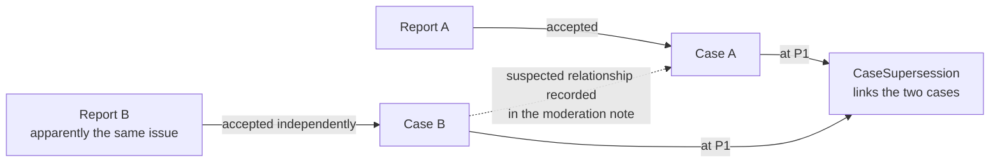

# Parakh Database Architecture

## Document Status

| Field | Value |
|---|---|
| **Version** | 2.4 |
| **Status** | **APPROVED FOR SCHEMA DESIGN** |
| **Implementation Status** | **NOT IMPLEMENTED** |
| **Architecture Freeze** | **P0A FROZEN FOR SCHEMA DESIGN** |
| **Date** | 19 August 2026 |
| **Supersedes** | v2.3, v2.2, v2.1, v2.0, v1.0 |
| **Owner** | Founder / Product Lead |
| **Next phase** | **Database schema design** — not another architecture revision |

### What this approval means, and what it does not

**Approved:** the schema-design phase may now translate this architecture into conceptual tables, attributes, relationships, keys, constraints, indexes and transaction boundaries.

**Not approved by this document:**

| Not authorised | Requires |
|---|---|
| Creating or executing a database | Separate authorisation |
| Running migrations | Separate authorisation |
| Standing up a production instance | Separate authorisation |
| Collecting any real citizen data | **Every item in §32.2** |

> **Approval for schema design is not approval to implement the database, and it is emphatically not approval to point the system at a real person.**

### Architecture freeze

**The P0A persistence entity inventory (§27.1) is frozen at 37 entities.** Entities must not be added during schema design. If schema design uncovers a genuine source contradiction that requires a change, that is a **formal architecture revision** — a new version of this document with its own traceability — not an inline addition.

### Governing sources

| Source | Version | Governance relationship |
|---|---|---|
| `Parakh_Prototype_SRS_v1.3.7.md` | v1.3.7 | **Governs.** Where this document and the SRS differ, the SRS prevails |
| `Parakh_Release_0_Build_Specification_v1.2.7.md` | v1.2.7 | Derived from the SRS. **§9.1 is the authoritative Release 0 entity list** |

**Both files were present in the working folder and were read during this v2.4 pass.** Every SRS identifier cited was checked here, not inherited. **No formal specification amendment is required** — §3.5.

### What this document is

**An architectural specification, not an executable artefact.** No SQL, data types, column definitions, ORM models, migrations, indexes or code of any kind.

---

## Revision Summary — v2.3 → v2.4

### Transition and state ownership

| # | Change |
|---|---|
| **1** | **T3a and T4 restored as two distinct historical transitions (§9.6).** v2.3 compressed acceptance into one atomic operation appending *"the corresponding `CaseStatusEvent` and `AuditEvent`"* — singular — which read as collapsing two source-defined transitions into one record. The source is explicit: **T3a** (`AI_PROCESSED → ACCEPTED`, actor Moderator, audit event `moderation_decision`) and **T4** (`ACCEPTED →` case `OPEN_UNVALIDATED`, actor System, audit event `case_created`) are separate rows with separate actors and separate audit events. **The atomic operation now appends two `CaseStatusEvent` records and two `AuditEvent` records, in ten explicit steps** |
| **2** | **The atomicity claim is now source-backed, not inferred.** The SRS transition table annotates T4 with *"(same transaction as T3a)"*. One transaction, two transitions — v2.4 states both halves |
| **3** | **§9.7 added — the report-to-case state ownership handoff.** `CivicReport` owns current workflow state and version until T4; `Case` owns it afterwards. **The report does not mirror later case states**, and the two never hold one duplicated mutable current-state field |

### Legal and privacy language

| # | Change |
|---|---|
| **4** | **Withdrawal overclaim removed.** v2.3's deletion table asserted *"the civic record is not personal data once the identity link is severed."* **An architecture document cannot establish that.** A retained civic record may contain descriptions, voice, photographs, video, precise locations, timestamps and contextual facts capable of direct or indirect re-identification |
| **5** | **§8.3 added — de-identification, pseudonymisation and anonymisation defined as three different things**, with anonymisation identified as a determination requiring legal and privacy assessment, not a technical consequence of removing a vault link |
| **6** | **D-3 reworded** from *"Does withdrawal anonymise or erase?"* to **"What data treatment occurs when a participant withdraws?"** — and its recommended position now follows the source. `FR-CIT-005` specifies deactivating the account, destroying the device-queue key and **flagging the participant's data as withdrawn**; `FR-OBS-006` excludes withdrawn participants from exports. **The SRS never describes withdrawal as anonymisation**, and neither does this document |
| **7** | **D-9 split.** v2.3 combined the lawful basis for routine processing with the procedure for compelled disclosure of reporter identity. These are different questions with different outputs. **D-9** is now lawful basis and permitted purposes; **D-13** is the lawful-request and compelled-disclosure procedure |

### Closure

| # | Change |
|---|---|
| **8** | **D-1 CLOSED. UC Officer and Contractor remain Future / P2 and do not enter Release 0 / P0A.** They remain designed future roles in the Parakh vision; the decision governs Release 0 scope only — §31.1 |
| **9** | **The P0A schema-design gate now has zero blockers** (§32.1), and the P0A entity inventory is frozen at **37** |
| **10** | **Open decisions recomputed: eleven** — D-2 to D-10, D-12 and D-13. D-1 and D-11 are closed and appear only in §31.1 |
| **11** | **Invariants I-31 to I-34 added** — T3a and T4 remain distinct; acceptance commits both atomically with no committed T3a lacking its T4; state ownership passes at T4 without mirroring; de-linking identity does not by itself render retained data anonymous |
| **12** | **Failure mode 5 strengthened** to enumerate exactly what one winning acceptance produces: one decision, one T3a event, one T3a audit record, one case, one origination, one T4 event, one T4 audit record — and no partial T3a-without-T4 outcome |

**Everything else is preserved unchanged from v2.3.** Entity counts, phasing, evidence lifecycle, traceability, naming and the approval gate's real-user half are untouched except where items 7 and 10 above required it.

---

## 1. Purpose & Scope

> **This document defines the approved database architecture. It does not create or implement the database.**

### 1.1 What this architecture answers

*What server-side data model should Parakh implement, what does it owe to the governing specification, and what must be true before real citizens use it?*

### 1.2 Design constraints taken as given

| Constraint | Consequence |
|---|---|
| **One developer, small team** | Every entity must justify its maintenance burden |
| **Pilot scale** | Tens of participants, low hundreds of reports. Partitioning, sharding and replicas are not warranted |
| **Evidence-first** | Integrity and provenance take precedence over convenience |
| **Human decision authority** | No automated actor may make a consequential civic decision |
| **Synthetic data first** | Real citizen data requires a separate, larger set of controls — §27.2 |
| **The SRS governs** | The architecture may propose changes; it may not make them — §3.5 |

### 1.3 The three remaining disagreements between the product brief and the SRS

**The fourth — role scope — is closed by D-1 (§31.1).** The rest remain product decisions.

| Brief assumes | SRS states | Position |
|---|---|---|
| ~~Five current roles including UC Officer and Contractor~~ | ~~§3.4 classifies those portals as Future~~ | **CLOSED — D-1.** UC Officer and Contractor stay Future / **P2** for Release 0 |
| AI does duplicate detection, similarity, classification | P0 AI is transcription only; duplicate detection is a recorded source conflict (`SC-04`) outside prototype scope | Designed, at **P2** |
| Reports carry category, priority, severity | `FR-MOD-003` puts category and severity on the **accept decision** | Taxonomy at **P1**; current-value pattern at P0A — §18 |
| Jurisdiction determined geographically | Scope is a **text value** on grants and profiles | Geography at **P1** — §23 |

---

## 2. Glossary

| Term | Meaning | Not to be confused with |
|---|---|---|
| **SRS / product entity** | A concept in the governing specification's entity dictionary. May be device-local, derived or conceptual | Database entity. **The vocabularies are not one-to-one** — §3.1 |
| **Server-persisted entity** | A concept this architecture holds durably in PostgreSQL | SRS entity |
| **Report** | One citizen's submission — an assertion plus evidence | Case |
| **Case** | An institutional work item created by transition T4 following a human acceptance decision | Report |
| **Workflow lifecycle** | The single state progression from report submission through to case resolution — §10 | Case lifecycle alone. It begins before any case exists |
| **T3a** | `AI_PROCESSED → ACCEPTED`. Actor: **Moderator**. Audit event `moderation_decision` | T4. **A different transition with a different actor** |
| **T4** | `ACCEPTED →` case `OPEN_UNVALIDATED`. Actor: **System**. Audit event `case_created` | T3a |
| **Originating report** | The report whose acceptance created the case. **Exactly one per case, permanent, never reassigned** | Attached report |
| **Attached report** | A later report linked by human confirmation to an existing case. **P1** | Originating report |
| **Evidence item** | One captured artefact with integrity metadata | The bytes, in object storage |
| **`EvidenceManifest`** | The persisted set of evidence items sealed together, with its hash, purpose, evidence context and verification state. **The SRS entity name, retained** | "Evidence batch" — explanatory prose, not a separate entity |
| **Evidence context** | The single domain object a manifest attaches to — §12.2 | Purpose |
| **De-identification / unlinking** | The direct identity relationship is removed | Anonymisation — §8.3 |
| **Pseudonymisation** | Direct identifiers are replaced, and **re-identification may remain possible** | Anonymisation |
| **Anonymisation** | A **determination** that re-identification risk is sufficiently addressed under the applicable policy or legal standard | De-identification. **Not a technical consequence of removing a vault link** |
| **Assignment** | A conceptual pattern, not one entity — §16.2 | Ownership |
| **Completion claim** | An assertion that work is finished, with evidence. **Repeatable** | Resolution |
| **Reopening** | A case returning to active work. **Reuses the existing case** | Case creation |
| **Supersession** | Two existing cases linked, one canonical. **P1** | Attachment, which links a *report* to a case |
| **Synthetic technical prototype** | P0A. Synthetic data only | Real-user pilot |
| **Real-user pilot** | Any use involving a real person's data. Requires everything in §32.2 | Prototype |

### 2.1 Three record classes

| Class | Definition | Examples |
|---|---|---|
| **Operational record** | Durable infrastructure or workflow metadata describing an *attempt* or *mechanism*, not a civic fact | `UploadSession` in any state including `expired` and `quarantined` · `IdempotencyRecord` · `Session` · `AuthChallenge` |
| **Evidence of record** | A committed evidence item whose integrity was verified **and** whose valid domain context is committed in the same atomic operation | `EvidenceItem` + its `EvidenceManifest` + its context relationship |
| **Civic record** | Reports, cases, human decisions and authoritative workflow history | `CivicReport` · `Case` · `ModerationDecision` · `VerificationDecision` · `CaseStatusEvent` |

**The rule:** *"nothing of record was created"* is never written without saying which class.

---

## 3. SRS-to-Database Traceability

### 3.1 Two vocabularies, deliberately different

The SRS describes **system concepts**; this document describes **server persistence**. A concept can be real, required and specified while having no database entity of its own — because it lives on the device, because it is derived, or because it is best persisted within another entity.

> **A formal specification change is required only where the architecture changes product semantics, required behaviour, lifecycle semantics, externally visible contracts, required information, workflow authority, or a source-defined invariant.**
>
> **Normalising differently in PostgreSQL is none of those things.**

### 3.2 Traceability matrix — the 38 Release 0 P0 entities

| SRS Entity | Architectural Treatment | PostgreSQL? | Architecture Entity | Reason |
|---|---|:--:|---|---|
| `Participant` | Own entity | **Yes** | `Participant` | Unchanged |
| `IdentityVaultRecord` | Own entity | **Yes** | `IdentityVaultRecord` | Vault schema, separate role — §15 |
| `AttestationRecord` | Own entity | **Yes** | `AttestationRecord` | Unchanged |
| `RoleAssignment` | Own entity | **Yes** | `RoleAssignment` | Unchanged |
| `CapabilityGrant` | Own entity | **Yes** | `CapabilityGrant` | Unchanged |
| `DeclaredConflict` | Own entity | **Yes** | `DeclaredConflict` | Unchanged |
| `RepresentativeProfile` | Own entity | **Yes** | `RepresentativeProfile` | Unchanged |
| `OperatorCredential` | Own entity | **Yes** | `OperatorCredential` | Annex §24 |
| `EnrolmentToken` | Own entity | **Yes** | `EnrolmentToken` | Annex §24 |
| `AuthTicket` | Own entity | **Yes** | `AuthTicket` | Annex §24 |
| `AuthFlowSession` | Own entity | **Yes** | `AuthFlowSession` | Annex §24 |
| `MfaEnrolment` | Own entity | **Yes** | `MfaEnrolment` | Annex §24 |
| `MfaRecoveryCode` | Own entity | **Yes** | `MfaRecoveryCode` | Annex §24 |
| `AuthChallenge` | Own entity | **Yes** | `AuthChallenge` | Challenge state persists; **the passcode does not** |
| `Session` | Own entity | **Yes** | `Session` | Token not stored; hash and metadata only |
| `CivicReport` | Own entity | **Yes** | `CivicReport` | **Owns current workflow state and version until T4** — §8.2, §9.7 |
| `EvidenceItem` | Own entity | **Yes** | `EvidenceItem` | Also persists the `VoiceRecording` concept |
| **`EvidenceManifest`** | **Own entity — SRS name retained** | **Yes** | **`EvidenceManifest`** | Carries purpose, evidence context, manifest hash and verification state. These do not alter its source-defined semantics (`FR-EVD-004`, `FR-EVD-201`). "Evidence batch" is prose only |
| `UploadSession` | Own entity | **Yes** | `UploadSession` | States `open` / `verified` / `quarantined` / `expired`. **An operational record** |
| `IdempotencyRecord` | Own entity | **Yes** | `IdempotencyRecord` | Scoped to submissions per `FR-OFF-006` |
| `MachineTranscript` | Own entity | **Yes** | `MachineTranscript` | Unchanged |
| `HumanTranscriptCorrection` | Own entity | **Yes** | `HumanTranscriptCorrection` | Unchanged |
| `ModelInputRecord` | Own entity | **Yes** | `ModelInputRecord` | Unchanged |
| `ModerationDecision` | Own entity | **Yes** | `ModerationDecision` | P0 enum is `accept` only (`FR-MOD-003`, `API-052`) |
| `Case` | Own entity | **Yes** | `Case` | **Owns current operational state and version from T4 onward.** Carries the immutable originating report reference — §9.2, §9.7 |
| `RepresentativeAssignment` | Own entity | **Yes** | `RepresentativeAssignment` | SRS name |
| `VerificationDecision` | Own entity | **Yes** | `VerificationDecision` | Subject is the **case** (`FR-REP-101`). P0 outcome enum is `validated` only |
| `ProxyAction` | Own entity | **Yes** | `ProxyAction` | `CAP_PROXY_COMPLETION` actions |
| `CompletionClaim` | Own entity | **Yes** | `CompletionClaim` | Repeatable per case — §16.3 |
| `CitizenResolutionDecision` | Own entity | **Yes** | `CitizenResolutionDecision` | The P0 response to a completion claim |
| `Dispute` | Own entity | **Yes** | `Dispute` | Carries a P0 evidence context (`API-041`) |
| `ReopenEvent` | Own entity | **Yes** | `ReopenEvent` | Reopening never creates a case — §9.1 |
| `SafeguardingFlag` | Own entity | **Yes** | `SafeguardingFlag` | Seed-created at P0A |
| `AuditEvent` | Own entity | **Yes** | `AuditEvent` | Segmented chains — §20. **T3a and T4 write one each** — §9.6 |
| **`CaseStatusEvent`** | **Own entity — SRS name retained** | **Yes** | **`CaseStatusEvent`** | **Subject is the report, with an optional case reference — §10.** Despite its name it records report-lifecycle transitions before a case exists, which the source requires at `FR-EVD-202` (T1) and `FR-MOD-003` (T3a) |
| **`VoiceRecording`** | **Part of another entity** | **Yes, within `EvidenceItem`** | `EvidenceItem` *(purpose `report_description`)* | **The product concept is persisted through `EvidenceItem`.** It is not removed from the system. The 3–90 s bound of `FR-VOI-001` is a validation rule on items of this purpose |
| **`DevicePreference`** | **Device-local only** | **No** | — | `FR-LOC-001` concerns rendering. **A real product concept requiring no server table** |
| **`SyncQueueItem`** | **Device-local only** | **No** | — | `FR-OFF-002` requires the queue *"encrypted at rest on the device"* |

### 3.3 The 11 later-release SRS entities

| SRS Entity | PostgreSQL? | Architecture Phase | Reason |
|---|:--:|---|---|
| `ConsentRecord` | **Yes** | **P0B** *(SRS: P1)* | **Architecture position.** Records programme-participation consent — §27.2 |
| `WithdrawalRecord` | **Yes** | **P0B** *(SRS: P1)* | **Architecture position.** A withdrawal route must exist before a real person is enrolled |
| `EscalationRecord` | **Yes** | **P0B** *(SRS: P1)* | **Architecture position.** A welfare concern from a real person must have somewhere to go |
| `VaultAccessRecord` | **Yes** | **P0B** *(SRS: P1)* | **Architecture position.** Once identities are real, access must be recorded |
| `Restriction` | **Yes** | **P1** *(SRS: P1)* | Bound to `FR-AUTH-005` (P1) and the rejection/appeal path |
| `Appeal` | **Yes** | **P1** *(SRS: P1)* | Appeals contest rejection (T12a); **rejection is P1** |
| `AppealAssignment` | **Yes** | **P1** *(SRS: P1)* | Routes an appeal to an independent decider |
| `Notification` | **Yes** | **P1** | SRS name retained |
| `Configuration` | **Yes** | **P1** | Governs the managed taxonomy and runtime settings |
| `AnalyticsEvent` | **Yes** | **P2** | Requires separate approval |
| `ResearchExport` | **Yes** | **P2** | Export privacy rules apply, including `TBD-029` coarsening and the `FR-OBS-005` de-identification checklist |

**One further SRS concept outside §9.1:** `CompletionEvidence` is persisted as an `EvidenceManifest` with purpose `completion`.

### 3.4 Counts — reported separately

| Measurement | Value |
|---|---|
| **Source Release 0 P0 entity count** *(Release 0 §9.1)* | **38** |
| Device-local, therefore not server-persisted | **2** — `SyncQueueItem`, `DevicePreference` |
| Persisted within another entity | **1** — `VoiceRecording` within `EvidenceItem` |
| **SRS P0 entities persisted as their own database entity** | **35** |
| **Architecture-added persistence-support entities at P0A** | **2** — `ReportDescription`, `AuditCheckpoint` |
| **Proposed server-persisted P0A entity count — FROZEN** | **37** |

*38 − 2 − 1 = 35; 35 + 2 = 37.*

> **Two measurements of different things; neither validates the other.** Alignment is established by §3.2 and §4, not by arithmetic.

### 3.5 Classification of the claimed divergences

| ID | Item | Classification | Why |
|---|---|---|---|
| **S-1** | `ReportDescription` | **Persistence-only design decision** | Normalises two attributes that could sit on `CivicReport`. Changes no behaviour, contract, required information or lifecycle |
| **S-2** | `AuditCheckpoint` | **Persistence support for an existing requirement** | `SC-LIM-04` already requires Release 0 checkpoints *"stored on-host and unsigned"* |
| **S-3** | `EvidenceBatch` name | **Withdrawn — `EvidenceManifest` retained** | The rename bought nothing |
| **S-4** | `VoiceRecording` consolidation | **Persistence mapping decision** | The product concept is **not removed**; it is persisted through `EvidenceItem` |
| **S-5** | `CompletionVerification` withdrawal | **No change required** | Withdrawing an unsupported entity restores alignment |

> **No formal specification amendment is required.** The SRS entity dictionary may optionally be annotated to note that `VoiceRecording` is persisted through `EvidenceItem` and that `CaseStatusEvent` spans report and case lifecycle — **an annotation is a convenience, not a gate.**

---

## 4. Architecture-to-Source Traceability

| Architecture Entity | Phase | Source Basis | Type |
|---|---|---|---|
| `ReportDescription` | **P0A** | `FR-VOI-001`; P1 typed and assisted input | **Normalised persistence support** |
| `AuditCheckpoint` | **P0A** | `SC-LIM-04`; `FR-AUD-002` chain segments | **Source requirement requiring persistent support** |
| `EvidenceManifest` *(purpose + context)* | **P0A** | `FR-EVD-004`, `FR-EVD-201`; `CompletionEvidence` in the `FR-FIX-002` matrix | **Alias/generalisation of source concept** |
| `EvidenceItem` *(purpose `report_description`)* | **P0A** | `FR-VOI-001`, `FR-EVD-003` | **Alias/generalisation** — persists the `VoiceRecording` concept |
| `CaseReportLink` | **P1** | No source requirement. Needed only if attachment is built — §9.3 | **Future architecture proposal** |
| `CaseSupersession` | **P1** | `SC-04`; no P0 requirement | **Future architecture proposal** |
| `AdministrativeUnit` | **P1** | Product brief — geographic jurisdiction; SRS uses text scope | **Product-brief-derived** |
| `JurisdictionAssignment` | **P1** | Product brief — routing by authority | **Product-brief-derived** |
| `Category` | **P1** | `FR-MOD-003` human-entered category; `SC-05` | **Source requirement requiring persistent support** at P1 |
| `CaseUpdate` | **P1** | `FR-CASE-201` notification content rules | **Normalised persistence support** |
| `Organisation` | **P2** | Product brief; SRS §3.4 classifies those portals **Future**. **D-1 confirms P2** | **Product-brief-derived** |
| `OrganisationMembership` | **P2** | Product brief | **Product-brief-derived** |
| `WorkAssignment` | **P2** | Product brief — contractor work allocation. **D-1 confirms P2** | **Product-brief-derived** |
| `WorkProgressNote` | **P2** | Product brief — contractor progress reporting | **Product-brief-derived** |
| `CompletionVerification` | **P2** | Arises only when a contractor organisation submits claims a distinct party verifies. **No P0 basis** | **Future architecture proposal** |
| `EvidenceEmbedding` | **P2** | `SC-04`; product brief similarity detection | **Product-brief-derived** |
| `DuplicateSuggestion` | **P2** | `SC-04` | **Product-brief-derived** |
| `ClassificationSuggestion` | **P2** | `SC-05` | **Product-brief-derived** |

**Every P2 entity is product-brief-derived or a future proposal, and none is claimed as an SRS requirement.**

---

## 5. Persistence Boundary

| Concept | Durable PostgreSQL | Object storage | Device-local | Redis / transient |
|---|:--:|:--:|:--:|:--:|
| `CivicReport`, `Case`, decisions, `CaseStatusEvent` | ✓ | | | |
| Evidence **metadata**, hashes, provenance | ✓ | | | |
| Evidence **bytes** | | ✓ | | |
| `EvidenceManifest` hash and verification state | ✓ | | | |
| `UploadSession` *(operational record)* | ✓ | | | |
| Uncommitted uploaded objects | | ✓ | | |
| Identity values (vault schema, separate role) | ✓ | | | |
| Audit events and checkpoints | ✓ | | | |
| Machine transcripts and human corrections | ✓ | | | |
| Offline submission queue *(`SyncQueueItem`)* | | | ✓ | |
| Language preference *(`DevicePreference`)* | | | ✓ | |
| Draft form state, scroll position, retry counters | | | ✓ | |
| Celery job payloads and results | | | | ✓ |
| Rate-limit counters, query caches | | | | ✓ |
| Signed URLs | | | | ✓ *(per request, never stored)* |
| One-time passcode value | | | | ✓ *(hashed, short-lived, discarded)* |
| Notification **delivery state** | ✓ | | | |
| Notification **delivery attempt job** | | | | ✓ |
| Embeddings *(P2)* | ✓ *(pgvector, derived)* | | | |
| Thumbnails and derived renditions | | ✓ *(regenerable)* | | |

---

## 6. System Data Boundaries

**PostgreSQL owns facts and relationships; object storage owns bytes; Redis owns nothing durable; pgvector owns derived vectors.**

### 6.1 PostgreSQL — the durable relational system of record

Everything whose loss would prevent the system answering *what happened, who did it, and when*. **If object storage were lost entirely, the record of what was submitted, decided and by whom would survive.**

### 6.2 Object storage — bytes only

The SRS specifies a **write-once evidence store** (`INT-003`); the write-once mechanism is this architecture's proposal — §17.1.

### 6.3 Redis — transient only

**Rule: if Redis is flushed, no operational record, evidence of record or civic record is lost.**

### 6.4 pgvector — derived, rebuildable, co-located

| Concept | Position |
|---|---|
| Architecture compatibility | Vectors co-located in PostgreSQL. **Decided** |
| Extension installation | **Not required at P0A or P0B** |
| Feature activation | **P2, requiring separate approval** |

### 6.5 Boundary violations to avoid

| Never | Because |
|---|---|
| Media bytes in PostgreSQL | Bloats the write-ahead log, ruins backup and restore, places evidence outside the write-once store |
| Evidence hashes only in object storage | Storage metadata is mutable by whoever holds storage credentials |
| Identity values in Redis | Weaker access control, no audit trail |
| Durable state in task payloads | A lost queue would lose the fact, not merely the attempt |
| Vectors as the only copy of a transcript | Embeddings are lossy and model-dependent |

---

## 7. What Is *Not* In The Database

| Not a PostgreSQL entity | Where it lives | Why |
|---|---|---|
| **Offline sync queue** *(`SyncQueueItem`)* | **Device-local, encrypted** | `FR-OFF-002` |
| **Language preference** *(`DevicePreference`)* | **Device-local** | `FR-LOC-001` |
| Mobile UI state — scroll position, draft fields, wizard step | Device | Not a fact about the world |
| Local upload retry counters and backoff | Device | Device-side scheduling |
| Media bytes | Object storage | §6.2 |
| Thumbnails and derived renditions | Object storage, regenerable | Derived |
| Temporary signed URLs | Never stored | Storing them extends their security window |
| Celery payloads and results | Redis | Transient by design |
| **One-time passcode values** | **Hashed, short-lived, discarded** | Only the challenge's existence, attempts and outcome persist |
| Session tokens themselves | Hash and metadata only | A stored token is a stealable credential |

**Neither `SyncQueueItem` nor `DevicePreference` has been removed from the system. They have been located.**

---

## 8. Key Architecture Decisions

| Decision | Recommended Approach | Why | Trade-off |
|---|---|---|---|
| **Single PostgreSQL instance** | One database; domains separated by schema and naming | A small team cannot operate distributed transactions correctly | Vertical scaling only |
| **Identity separated by schema and role** | Vault schema reached by a **different database role** | Identity exposure becomes a deliberate act — §15 states the limits | Two-step lookup; break-glass must be built and audited |
| **Report and Case as separate entities** | A submission is distinct from the institutional work item | A report is an assertion; a case is a commitment | One extra join |
| **Acceptance is one transaction containing two transitions** | §9.6 | The source annotates T4 *"(same transaction as T3a)"* while defining them as separate transitions with separate actors and audit events | Acceptance is a protected operation, not a simple write |
| **State ownership passes at T4** | `CivicReport` owns current state until T4; `Case` owns it after — §9.7 | Neither aggregate mirrors the other | Timelines are assembled from `CaseStatusEvent`, not from two current-state fields |
| **One workflow lifecycle spanning report and case** | `CaseStatusEvent` records transitions from submission onward — §10 | The SRS state machine runs report states into case states continuously | The entity name is a source-defined misnomer, documented rather than renamed |
| **Evidence metadata in PostgreSQL, bytes in object storage** | Hash computed on device, recomputed server-side, both recorded | The integrity reference must live where a storage administrator cannot silently change it | A mismatch quarantines and retains |
| **Opaque storage identifiers, hashes as metadata** | **No global deduplication** | §12.6 | Byte-identical uploads occupy storage twice |
| **Segmented audit chains** | Per-stream chains with periodic checkpoints | `FR-AUD-002` — gapless sequence *within each chain segment* | Verification walks several chains |
| **Optimistic concurrency on versioned workflow aggregates** | §8.2 | Two reviewers must not silently overwrite each other | Clients must handle a stale-state refusal |
| **Idempotency on retry-sensitive operations only** | Report submission | `FR-OFF-006` scopes this to submissions | Other operations rely on optimistic concurrency |
| **AI output stored beside, never over** | Corrections append | Correcting a transcript must not destroy what the model produced | Decisions reference the transcript version the human saw |
| **No hard deletion of accountability records through normal product workflows** | §8.1 | Deletion and accountability are in tension | Requires a lawful-request procedure — D-13 |
| **Categories as stable codes, then as data** | P0A uses release-defined codes; P1 wraps the same codes | §18.1 | P1 must adopt the P0A codes |
| **Contractor domain deliberately thin, and deferred** | Assignment, acceptance, claim, verification. Nothing else, and **not in Release 0** — D-1 | Parakh must not become procurement or ERP | **Intended** |

### 8.1 Deletion and disposal semantics — seven different things

> **No hard deletion of accountability records through normal product workflows.** No product role holds a delete capability on reports, evidence, cases, decisions or audit records.

**There is no blanket soft-delete model.** These are genuinely different and must not share one mechanism:

| Case | Mechanism | Not a deletion because |
|---|---|---|
| **Staff account no longer active** | **Deactivation.** Status change, record retained | Past decisions must remain attributable |
| **Participant withdrawal** | **The treatment approved under D-3.** `FR-CIT-005` specifies deactivating the account, destroying the device-queue key and **flagging the participant's data as withdrawn**; `FR-OBS-006` excludes withdrawn participants from exports | **The retained civic record is not thereby anonymous** — its classification is a legal and privacy determination, not a technical consequence — §8.3 |
| **Report suppressed for abuse or safeguarding** | **Restriction (P1)** — visibility withdrawn, record retained | Suppression is a decision with an actor and a reason |
| **Expired authentication artefacts** | **Ordinary expiry and disposal** | Short-lived security artefacts are not accountability records |
| **Uncommitted uploaded objects** | **Reconciliation sweep** — removed | They were never evidence of record — §13.4 |
| **Quarantined uncommitted objects** | **Retained, excluded from the sweep, disposition per approved policy — D-12** | The SRS requires that a mismatch never deletes — §17.4 |
| **Embeddings and derived renditions** | **Free disposal and regeneration** | Derived and reproducible |

### 8.2 Concurrency — which aggregates are versioned

> **Every mutation of a versioned workflow aggregate carries the expected version. Other operations do not.**

**Two versioned workflow aggregates, sequential rather than simultaneous:**

| Aggregate | Versioned from | Until | Guards |
|---|---|---|---|
| **`CivicReport`** | Submission (T1) | **T4** | Moderation of a report that has no case. **`API-052` is a report endpoint and carries `expected_state_version`** |
| **`Case`** | Creation (T4) | Terminal state | Assignment, verification closure, proxy actions, completion, dispute, reopening |

**Not governed by workflow optimistic concurrency:** authentication flows · upload sessions and chunk transfer · transcription and annotation writes · audit writes · notification delivery. Each has its own correctness mechanism.

**A source observation, not a conflict.** `FR-CASE-004` names `Case` as its entity while requiring `expected_state_version` on *"every mutating endpoint"*, and `API-052` — a report endpoint — carries it. Versioning both aggregates is what makes the requirement coherent.

### 8.3 De-identification, pseudonymisation and anonymisation — three different things

**This architecture makes no anonymity determination, and no statement in it should be read as one.**

| Term | Meaning | Who determines it |
|---|---|---|
| **De-identification / unlinking** | The direct identity relationship is removed — for example, the vault record is erased while the opaque participant reference and the civic record remain | **A technical operation.** The architecture can perform it |
| **Pseudonymisation** | Direct identifiers are replaced by an opaque reference, and **re-identification may remain possible** | **A technical operation with a residual risk that is not thereby measured** |
| **Anonymisation** | A **determination** that re-identification risk is sufficiently addressed under the applicable policy or legal standard | **Legal and privacy review.** Not this document, and not an automatic consequence of the two operations above |

**Why the distinction is load-bearing here.** A Parakh civic record retained after de-identification may still contain a free-text or spoken description of an incident, photographs and video of a specific location, precise coordinates, timestamps, and contextual facts about a neighbourhood — **any of which may permit direct or indirect re-identification.** Removing the vault link removes one path, not every path.

> **Withdrawal may de-link or erase direct identity-vault information while retaining the civic record where that is approved. The remaining civic record must not automatically be labelled anonymous or non-personal. Its classification depends on the approved withdrawal policy, the applicable law, and the re-identification risk — none of which this document determines.**

**Consistent with the source.** The SRS uses "anonymised" only of the P2 research export (`FR-OBS-005`, screen `AD-07`), and only behind a **mandatory de-identification checklist every item of which must be confirmed before generation**. It never describes withdrawal as anonymisation, and neither does this document.

---

## 9. Report and Case Architecture

### 9.1 The single case-creation rule

> **A case is created only by transition T4, which follows a human acceptance decision, and exactly one case is created per acceptance. Nothing else creates a case.**

Verified against `FR-CASE-001`, transition **T4** (*"Exactly one case per accepted report"*), and `TEST-CASE-006`.

1. **A report with no acceptance decision has no case.**
2. **Reopening never creates a case.** It returns an existing case to active work, with an explicit reason.
3. **Attachment never creates a case** — and at P0A, attachment does not exist (§9.3).
4. **Supersession never creates a case.**

**On rejection.** `FR-MOD-003` and the `API-052` contract: **the P0 moderation enumeration contains one value, `accept`.** Rejection (`FR-MOD-006`) and needs-info (`FR-MOD-004`) are **P1**.

### 9.2 The originating relationship — permanent, structurally separate

> **When acceptance of report R creates case C, R is permanently the originating report of C. That fact is never removed, never reassigned and never overwritten.**

The **case** carries an immutable reference to its originating report, set at T4.

| Event | Effect on the originating relationship |
|---|---|
| Reopening | **None** |
| Supersession beneath a canonical case | **None** |
| Attachment or detachment of another report (P1) | **None.** Different structure — §9.4 |
| Any terminal state | **None** |

> **A report that has ever created a case through acceptance never creates a second case through another acceptance.**

The guard is a property of the report's history, not its current state.

### 9.3 Attachment — deferred to P1

The source does not require it — Release 0 §9.1 contains no attachment entity, duplicate detection is a recorded source conflict (`SC-04`) outside prototype scope, and `TEST-CASE-006` tests the *prevention* of a second case.

**P0A behaviour:**

**The cost is visible rather than concealed: two cases exist for one issue until P1.** AI duplicate suggestion remains P2 and has no authority at any phase.

### 9.4 Why the two relationships must not share one structure

| | Originating | Attached |
|---|---|---|
| Created by | Transition T4 | A separate human linking decision |
| Mutable | **Never** | Yes — attachable, detachable, reattachable |
| Count per case | Exactly one | Zero or more |
| Phase | **P0A** | **P1** |
| Held on | The **case**, immutably | A **separate link record** with its own history |

**If both were held in one "current case link", detaching a mistakenly attached report would erase the fact that some report originated a case.**

### 9.5 Cardinality, stated once

| Statement | Cardinality | Phase |
|---|---|---|
| A case has **exactly one** originating report, permanently | 1 | **P0A** |
| Transition T4 creates **exactly one** case | 1 | **P0A** |
| A report originates **at most one** case, ever | 0..1 lifetime | **P0A** |
| A case has **zero or more** reopenings | 0..n | **P0A** |
| A case has **zero or more** attached reports | 0..n | **P1** |
| A report is attached to **at most one** case at a time | 0..1 | **P1** |
| A case has **at most one** canonical case above it | 0..1 | **P1** |

### 9.6 Acceptance — one transaction, two transitions

**These are two things, and v2.3 blurred them.**

| Boundary | What it means |
|---|---|
| **Atomic transaction boundary** | T3a and T4 execute as **one protected all-or-nothing operation**, for consistency and concurrency. The source annotates T4 *"(same transaction as T3a)"* |
| **Historical transition boundary** | T3a and T4 remain **two logically distinct source transitions** with different actors, different guards, different resulting states and different audit events. **They must remain distinguishable in history forever** |

**What the source defines:**

| | T3a | T4 |
|---|---|---|
| Transition | `AI_PROCESSED → ACCEPTED` | `ACCEPTED →` case `OPEN_UNVALIDATED` |
| Actor | **Moderator** | **System** |
| Guard | `F2`; not the author; not conflicted; reason, category and severity mandatory; state version matches | Exactly one case per accepted report |
| Requirement | `FR-MOD-003` | `FR-MOD-005` |
| Audit event | `moderation_decision` | `case_created` |
| Test | `TEST-MOD-003` | `TEST-CASE-001` |

**The atomic acceptance operation, in ten steps:**

> 1. **Eligibility and expected report version checked** — the report exists, is in an acceptable state, matches the expected version, and **has never originated a case**
> 2. **`ModerationDecision` recorded**, with reason code, category and severity
> 3. **T3a `CaseStatusEvent` appended** — report subject, **no case reference**, transition to `ACCEPTED`
> 4. **T3a `AuditEvent` appended** — `moderation_decision`, actor the Moderator
> 5. **`Case` created**
> 6. **Immutable originating report relationship established**
> 7. **T4 `CaseStatusEvent` appended** — **same report subject, case reference now present**, transition to `OPEN_UNVALIDATED`
> 8. **T4 `AuditEvent` appended** — `case_created`
> 9. **Case receives its initial state and version** — §9.7
> 10. **The report becomes permanently ineligible to originate another case**
>
> **All ten succeed, or none of them happens.**

**Two `CaseStatusEvent` records and two `AuditEvent` records.** Neither pair may be merged, and neither state may be skipped: **a report that reaches a case passed through `ACCEPTED`, and the case began at `OPEN_UNVALIDATED`.**

**The concurrency requirement, without prescribing a mechanism:**

> **Two concurrent acceptance attempts against one report must result in exactly one case. The losing attempt must be refused as stale or already-decided, and must not create a case, a second originating relationship, a second decision, or any partial record — including a committed T3a without its T4.**

Schema design must choose a mechanism making step 1 and step 10 mutually exclusive across concurrent attempts. **This document requires the boundary and the outcome, not the technique** — but a design in which eligibility is checked and the case is created in separately committed steps does not satisfy it.

### 9.7 The report-to-case state ownership handoff

**Two versioned aggregates, and exactly one of them is authoritative at any moment.**

| Period | Who owns **current workflow state and version** | Who holds history |
|---|---|---|
| **Submission (T1) until T4** | **`CivicReport`** | `CaseStatusEvent`, report subject only |
| **Inside the atomic acceptance operation** | The report reaches `ACCEPTED`; T3a is recorded; the case is created at `OPEN_UNVALIDATED`; T4 is recorded | `CaseStatusEvent` — the T3a record has no case reference, the T4 record has one |
| **After T4** | **`Case`** | `CaseStatusEvent`, report subject with case reference |

**The rule that prevents a duplicated mutable field:**

> **After T4, `CivicReport` retains its final report-phase state and its history. It does not continue to change its current state to mirror every later case state.**

`CaseStatusEvent` provides **one continuous historical timeline** across both phases (§10). That is a *history* mechanism. **It does not mean `CivicReport` and `Case` maintain two copies of one mutable current-state field forever** — which would be two sources of truth that can disagree, with no rule for which wins.

**What a reader of a report sees after T4:** the report's own final state (`ACCEPTED`), and — through the originating relationship — the case's current state. **Two facts, each owned once.**

---

## 10. Workflow Lifecycle History — the `CaseStatusEvent` subject

### 10.1 What the source says

| Requirement | Transition | Entities written | Case exists? |
|---|---|---|:--:|
| `FR-EVD-202` | **T1** — report submitted | `CivicReport` · **`CaseStatusEvent`** · `AuditEvent` | **No** |
| `FR-MOD-003` | **T3a** — report accepted | `ModerationDecision` · **`CaseStatusEvent`** · `AuditEvent` · `CivicReport` | **No — T4 has not run** |
| `FR-MOD-005` | **T4** — case created | `Case` · **`CaseStatusEvent`** · `AuditEvent` | **Created here** |
| `FR-REP-105` | **T5** — verification closed | `Case` · **`CaseStatusEvent`** · `AuditEvent` | Yes |
| `FR-FIX-001`, `FR-FIX-102`, `FR-CASE-104` | T7, T9, T11d | `Case` · **`CaseStatusEvent`** · … | Yes |
| `FR-ADM-105` *(P1)* | **T12b/c** — appeal decided | `Appeal` · `CivicReport` · **`CaseStatusEvent`** · `AuditEvent` | **No — a report-level transition** |

The SRS state dictionary runs one continuous progression:

**`SUBMITTED` → `AI_PROCESSED` → `ACCEPTED`** *(report states)* **→ `OPEN_UNVALIDATED` → `VERIFIED` → `IN_PROGRESS` → `RESOLVED…` / `REOPENED`** *(case states)*

### 10.2 The answer

> **`CaseStatusEvent` subject = the `CivicReport`, mandatory and permanent, with an optional `Case` reference that is present only for transitions occurring at or after T4.**

**Despite its name, `CaseStatusEvent` records the whole workflow lifecycle, beginning before any case exists.** The name is a source-defined misnomer, **documented here rather than renamed**, because nine P0 requirements use the source term.

**Why the report is the total subject:**

- Every case has exactly one originating report, immutably (§9.2) — so **a report reference is always available and always correct**.
- The alternative — a subject that is *either* a report *or* a case — is an uncontrolled polymorphic reference, the pattern this architecture rejects for evidence context (§12.3) and assignment (§16.2).
- **A case's timeline is a query, not a separate structure**, and the pre-case history of a case remains reachable — which is what an accountability platform needs.

| Transition | Report reference | Case reference |
|---|:--:|:--:|
| T1 · **T3a** · P1 appeal transitions | **Present** | **Absent** |
| **T4** | **Present** | **Present** — set here |
| T5 onward | **Present** | **Present** |

**The T3a and T4 rows are the reason this table exists.** They are consecutive records written in one transaction, and **the presence or absence of the case reference is what distinguishes them** — §9.6.

---

## 11. Report Description

`FR-VOI-001` treats audio as *"the primary description of the problem"*.

**`ReportDescription`** carries the description's source and its reference to the voice evidence item. **A persistence-only normalisation, 1:1 with `CivicReport` at P0A.**

| Source | Phase | Note |
|---|---|---|
| `voice` | **P0A** | The default and the only source available in the citizen app at P0 |
| `typed` | P1 | The model accommodates it now so P1 is additive |
| `assisted` | P1 | Entered by a helper alongside the citizen, attributed to both |
| `proxy_staff` | P1 | Entered by staff on a citizen's behalf — **must be visibly attributed** |
| `imported` | P2 | Future channels |

**The accessibility commitment is a product rule, not a schema limitation:** the P0 citizen interface offers voice only.

---

## 12. Evidence Architecture

### 12.1 `EvidenceManifest` — the source name, retained

The SRS entity is `EvidenceManifest`: a hash over a declared set of evidence items, verified server-side (`FR-EVD-004`, `FR-EVD-201`). **That entity is kept, under that name.**

It carries: the manifest hash · its **purpose** · its **evidence context** · its **verification state** · the submitting participant and time · a reference to any superseded attempt.

**"Evidence batch" is retained only as explanatory prose.** It is not a second entity and not a rename.

### 12.2 Evidence contexts, by phase

| Context | Endpoint | Phase | Basis |
|---|---|---|---|
| **Report submission** | `API-030` | **P0A** | `FR-EVD-202` |
| **Completion** | `API-071` | **P0A** | `FR-FIX-002`; `CompletionEvidence` |
| **Dispute** | `API-041` | **P0A** | `FR-FIX-102` path; `session_id` is a required input |
| **Verification** | `API-062` | **P1** | **`FR-REP-102` — supplementary live evidence — is P1**, on screen `RP-05` (P1). `FR-REP-101` (P0) writes only `VerificationDecision` and `AuditEvent` |
| Resubmission · appeal · reconsideration | `API-033` · `API-034` · `API-077` | P1 | All P1 requirements |

> **P0A has three evidence contexts: report submission, completion, dispute.**

### 12.3 The exclusive-context invariant

> **Every `EvidenceManifest` has exactly one evidence context. Not zero. Not two.**

**Guidance for schema design:** the invariant must be enforced by a mechanism the database can check — for example a constrained context discriminator paired with context-specific relationships. **It must not be satisfied by an unconstrained generic pointer**, which makes the invariant unenforceable and pushes correctness into application code.

### 12.4 Retry versus a new manifest

| Situation | Upload session | Manifest | Record created |
|---|---|---|---|
| **Network or chunk failure mid-upload** | **Same session**, resumed from the last acknowledged chunk (`FR-OFF-007`) | **Same manifest** | None |
| **Session expires** | **New session**; chunks re-sent | **New manifest** | References the expired attempt |
| **Attempt abandoned** | Session lapses to `expired` | **New manifest** if retried | Superseded-attempt reference |
| **Verification fails** | Session moves to `quarantined` | **Not committed** | Quarantined and retained — §17.4 |

> **A new manifest is never created merely because a network retry occurred.**

### 12.5 Evidence metadata

| Field | Verdict |
|---|---|
| Uploader, context, purpose, storage identifier, media type, size, upload time | **Necessary** |
| **Content hash *and algorithm identifier*** | **Necessary.** `FR-EVD-003` requires algorithm agility |
| **Capture time** | **Necessary, and operative.** Device-set, not overwritten by sync. The SRS carries `E_TIME_UNVERIFIED` |
| Capture location, accuracy, confidence source | **Necessary.** `FR-EVD-102` distinguishes assisted pin-drop and `location_unverified` |
| Capture session reference | **Necessary** |
| **Commitment state** | **Necessary.** Distinguishes an uncommitted upload from evidence of record |
| **Redaction state** | A redaction is a **derived artefact** — a new evidence item with its own identifier and hash. Not a boolean |
| Storage-side lock information | **Retained, not authoritative** |

### 12.6 Storage identifiers — opaque, not content-addressed

**An opaque unique object identifier, with the hash retained separately as integrity metadata, and no global evidence deduplication.**

| Consequence of content addressing | Why it matters here |
|---|---|
| **Cross-report coupling** | Two unrelated citizens submitting byte-identical evidence would share one object. Retention, withdrawal and legal-hold decisions about one report would silently act on the other's evidence |
| **Cross-user correlation** | Possession of a key is possession of a content hash — an oracle for *"is this exact file in the system?"* |
| **Write races** | Two simultaneous uploads computing the same key need a resolution rule with no benefit to getting it right |
| **Retention interaction** | A shared object cannot honour two different retention outcomes |
| **Implicit deduplication** | Deduplication becomes a property of the key scheme rather than a decision anyone made |

**The argument specific to this platform:** two byte-identical submissions from two reporters is **itself a signal**. Content addressing would silently collapse them; opaque identifiers preserve two custody records carrying the same hash, and **equal hashes become a detectable condition a human can examine.**

---

## 13. Evidence Commit Lifecycle

### 13.1 Generic lifecycle — one atomic commitment

| # | Stage | State at the end of it | Source |
|---|---|---|---|
| **1** | **Upload initiated** | An `UploadSession` in state `open` with the device manifest. **An operational record. No evidence** | `FR-OFF-007`; `API-020` |
| **2** | **Bytes received** | Chunks acknowledged; resumable. **Bytes are in object storage and are not evidence** | `FR-OFF-007`; `API-021` |
| **3** | **Integrity recomputed** | The server recomputes each item's hash and compares it to the manifest | `FR-EVD-201` |
| **4** | **Manifest verified** | Verified over the whole set. Session moves to `verified` or `quarantined` | `FR-EVD-201`; `API-022` |
| **5** | **Ready to commit** | A verified session awaits an authorised workflow operation. **No civic record and no evidence of record yet** | — |
| **6** | **Atomic evidence commitment** — *evidence metadata persisted · manifest persisted · **context relationship persisted** · required audit record persisted*. **All or none** | — | `FR-EVD-202` for the report context |
| **7** | **Evidence of record** | The items are committed **and** attached to a valid context | §2.1 |
| **8** | **Write-once and retention policy applied** | Committed evidence enters the regime for its environment | §17.2. **Never earlier** |

> **There is no durable state in which an evidence item is "committed" while it has no valid evidence context.** Context attachment and evidence commitment are one boundary.

**Stages 1–5 create operational records only.**

### 13.2 Specialisation — initial report submission

**For a manifest with purpose `report_submission`, stage 6 additionally creates the context:**

> verified upload → **atomic submission commitment** → `CivicReport` created → immutable submission and evidence relationships created → T1 `CaseStatusEvent` appended *(report subject, no case reference)* → `AuditEvent` written → tracking reference issued

| Element | Source |
|---|---|
| A report is created **only from a completed, verified upload session** | **`FR-EVD-202`** |
| The report enters `SUBMITTED` | Transition `T1` |
| A **human-readable tracking reference** is issued and shown immediately | `FR-CIT-105` |

**This is the only context in which the atomic commitment creates its own context.**

### 13.3 The other contexts — the context exists first

| Context | Order | Phase |
|---|---|---|
| **Completion** | The `CompletionClaim` exists, or is created by the same authorised proxy-completion operation (`API-071`, `CAP_PROXY_COMPLETION`) | **P0A** |
| **Dispute** | The `Dispute` exists, or is created by the same dispute operation (`API-041`, which carries reason and session together) | **P0A** |
| **Verification** | **P1.** `API-062` carries outcome, note and session in **one call**, so the `VerificationDecision` and its evidence commit as **one atomic final verification operation**. The decision is never created in draft merely to give evidence somewhere to attach | **P1** |

**At P0A the verification-ordering question does not arise:** `FR-REP-101` records an outcome and a mandatory note, with no evidence.

### 13.4 Reconciliation of uncommitted uploads

- A **reconciliation sweep** identifies stored objects that no committed evidence item references and whose session has expired.
- Those objects are **removable**, because they were never evidence of record.
- **Quarantined sessions are excluded from the sweep entirely** — §17.4.
- The sweep **never reaches an object referenced by committed evidence.**

---

## 14. Evidence Integrity — What The Mechanisms Actually Prove

| Mechanism | What it supports | What it does **not** support |
|---|---|---|
| **Hash computed on device at capture** | That bytes received match what **that device** hashed at that moment | Authenticity · truthfulness · that the scene is real · that capture time is honest · that location was not spoofed · that nothing was manipulated **before** hashing |
| **Server-side recomputation** | **Transfer integrity** | Anything about origin |
| **Sealed manifest** | That the *set* submitted together has not changed composition | That the set is complete or representative |
| **Write-once application credential** | That normal application paths cannot overwrite or remove stored evidence | That a holder of storage-administrator credentials cannot |
| **Storage-level retention lock** | That the storage system refuses deletion for a configured period | Anything after that period, or against a compromised account permitting privileged bypass |
| **Segmented audit chain** | **Tamper-evidence** | Tamper-*prevention*. Until off-host signed checkpoints exist (§20.3), an actor with full host control can rewrite and recompute |

### 14.1 The honest summary

> **The architecture is designed to make undetected alteration of a stored record difficult and detectable. It does not establish that the original capture was truthful, and it should never be described as doing so.**

A staged scene, a misleading crop, a photograph of a photograph, or a spoofed location will pass every one of these checks. **The mechanisms protect the record's custody, not its content.**

---

## 15. Identity Vault — Honest Threat Model

| Level | Proposed | Protects against | Does **not** protect against |
|---|---|---|---|
| **Logical isolation** *(separate schema)* | **Yes** | Accidental joins; identity selected without intent | Anyone who chooses to reach across |
| **Database-role isolation** | **Yes** | The application's normal credential reading identity at all | Compromise of the vault role; a superuser; a full dump |
| **Application credential isolation** | **Yes** | Application-layer bugs on the operational connection | Compromise of the application host |
| **Infrastructure isolation** | **No — not proposed** | Host compromise, backup theft | — |

> **The vault design substantially reduces accidental and application-layer exposure. It does not meaningfully protect against an attacker who has compromised the database host or obtained a full backup.**

**Why it is still right for a pilot.** The realistic threat is a developer joining identity into a representative-facing response; a debug endpoint returning too much; a support query pasted into a shared channel. **Role isolation addresses all of those**, at a cost a one-developer team can carry. **Revisit before production scale.**

---

## 16. Workflow, Assignment and Completion

### 16.1 State and history

The versioned aggregate carries **current state** and a **version counter** (§8.2, §9.7); `CaseStatusEvent` appends one record per transition (§10). Both happen in one atomic operation.

### 16.2 Assignment — a shared pattern, not a generic entity

A single `Assignment` entity spanning all assignees would need a "participant OR organisation" reference — **an uncontrolled polymorphic pointer**.

**One shared pattern, domain-specific entities.** Each carries: assignee · assigning actor · reason · assigned time · accepted time · target date · end time · end reason · active status.

| Entity | Assignee is | Phase |
|---|---|---|
| **`RepresentativeAssignment`** | A **Participant** | **P0A** |
| **`JurisdictionAssignment`** | An **AdministrativeUnit** | **P1** |
| **`AppealAssignment`** | A **Participant** | **P1** |
| **`WorkAssignment`** | An **Organisation** | **P2** — confirmed by D-1 |

**Invariant:** at most one active assignment per case **within each assignment entity**.

### 16.3 Completion — the P0A loop

The Release 0 completion loop is **proxy completion** (`FR-FIX-002`, `API-071`, `CAP_PROXY_COMPLETION`) followed by **citizen confirmation or dispute** (`FR-FIX-102`, `API-040`/`API-041`), with separation of duties enforced by `FR-FIX-006`.

**There is no staff-side completion verification in P0.** `CompletionVerification` is **P2**.

| Relationship | Cardinality | Phase |
|---|---|---|
| Case → `CompletionClaim` | **Zero or many.** At most one *open* at a time | **P0A** |
| `CompletionClaim` → `EvidenceManifest` | **One or many** | **P0A** |
| `CompletionClaim` → `CitizenResolutionDecision` | **Zero or one** | **P0A** |
| Case → `Dispute` → `ReopenEvent` | **Zero or many** | **P0A** |
| `CompletionClaim` → `CompletionVerification` | **Zero or many** | **P2** |

---

## 17. Storage, Retention and Deletion

### 17.1 What the SRS requires versus what this architecture proposes

**Neither source document mentions Object Lock anywhere.**

| Statement | Status |
|---|---|
| The evidence store is **write-once** | **SRS requirement** — `INT-003` |
| An integrity mismatch **quarantines, retains and flags, and never deletes** | **SRS requirement** — `FR-EVD-004`, `FR-EVD-201`, `E_CAPTURE_INTEGRITY` |
| Deletion prevented for the application's normal credential | **Architecture proposal** |
| A **storage-level retention lock** as the write-once mechanism | **Architecture proposal.** Not named in either source |
| A specific lock mode and duration | **Not decidable here** — D-2 |
| "Permanent retention" | **Not claimed** |

### 17.2 When the write-once regime applies

| Environment | Real personal data | Write-once posture |
|---|---|---|
| **Test / CI** | Never | **No retention lock.** Artefacts must be freely removable |
| **Synthetic technical prototype (P0A)** | Never | **No compliance-grade lock.** Write-once by credential policy, so mistakes stay correctable |
| **Real-user pilot (P0B satisfied)** | Yes | A lock **may** be applied, in a mode and duration approved under D-2 |
| **Production** | Yes | Strongest available mode, approved duration |

| | Uncommitted upload | Committed evidence |
|---|:--:|:--:|
| Retention lock applied | **Never** | Per the environment row above |
| Removable by reconciliation | Yes, unless quarantined | No |

### 17.3 Retention — technical capability versus approved policy

| Data | Capability | Policy status |
|---|---|---|
| Citizen identity in the vault | Erasable independently of operational data | **Legal review required** — D-3 |
| Reports, cases, workflow history | Retainable indefinitely | **Recommended:** retain. **Retention does not make them anonymous** — §8.3 |
| Evidence bytes | Retained for a configured period | **Approval required before real-user capture** — D-2 |
| Audit events and checkpoints | Append-oriented | **Recommended:** retain. Duration — D-10 |
| **Quarantined uncommitted objects** | Retained, excluded from the sweep | **No approved disposition** — **D-12** |
| Idempotency records | Prunable after a window | `TBD-024` **proposes** 30 days, **still open** |
| Staff accounts | Deactivatable | **Architectural:** deactivate, never delete |
| Transcripts and corrections | Retained with the report | **Recommended:** retain |
| Embeddings and renditions | Freely deletable and regenerable | **Architectural:** dispose at will |
| Consent records | Retained separately from product data | **Legal review required** |

> **This document does not state how long anything must be kept**, and does not classify any retained record as anonymous or non-personal.

### 17.4 Quarantined evidence

**The SRS is explicit:** a mismatch leaves the bundle *"quarantined, retained and flagged for human review, never discarded"*, and the citizen is told *"Nothing is deleted."*

| Rule | Basis |
|---|---|
| Quarantined; session moves to `quarantined` | `FR-EVD-201`, `E_CAPTURE_INTEGRITY` |
| **Excluded from evidence of record** | §13.1 |
| **Excluded from the reconciliation sweep** | §13.4 |
| **Flagged for human review**, the specific item named | `FR-EVD-201` |
| **No automatic deletion path exists** | **SRS requirement** |

> **The SRS prohibits automatic deletion; it does not approve indefinite retention.** Disposition follows an approved policy that does not yet exist — **D-12**.

---

## 18. Category, Severity and Classification

| Layer | Holds | Phase |
|---|---|---|
| **Current classification on the case** | Current category code and severity, plus the decision that set them | **P0A** |
| **Decision records** | Each classification act, with actor, time and reason | **P0A** |
| **Managed taxonomy** | Hierarchical categories with stable codes and localised labels | **P1** |

### 18.1 P0A → P1 transition

| Phase | What a category *is* | Where values live |
|---|---|---|
| **P0A** | A **stable release-defined code**, recorded on the decision and mirrored as the case's current value | The release specification. **No `Category` entity at P0A** |
| **P1** | The **same codes**, now rows in a managed taxonomy | The `Category` entity |

**Additive.** P0A codes are stable strings chosen to survive; **P1 adopts them rather than replacing them.** A P1 taxonomy that renumbered categories would silently reinterpret every historical moderation decision.

---

## 19. Domain History, Decision Records and Audit

| Layer | Question it answers | Held as |
|---|---|---|
| **Workflow history** | *What happened in this report's lifecycle?* | `CaseStatusEvent` — §10 |
| **Decision record** | *Why did a human decide that?* | `ModerationDecision`, `VerificationDecision`, `CitizenResolutionDecision` … |
| **Audit event** | *Who performed a sensitive action, and was it permitted?* | `AuditEvent` |

### 19.1 The rule that keeps them distinct

> **The audit log records that an action occurred and by whom. It does not duplicate the operational content of that action.**

**This is the difference between an audit log and a second operational database.**

### 19.2 What each audit event carries

| Include | Exclude |
|---|---|
| Sequence within its chain segment | **Full previous-state snapshot** |
| Actor reference and actor type | **Full new-state snapshot** |
| Action identifier | Free-text reasons |
| Object type and reference | Personal identifiers |
| **Changed-field identifiers** — which fields, not their values | Evidence content or transcript text |
| State transition as **codes only** | — |
| Timestamp and correlation reference | — |
| Payload hash, previous hash, chain hash | — |

### 19.3 Selective snapshots for high-value events only

Vault access, capability grant and revocation, safeguarding escalation, and chain-verification failure justify a **minimal structured snapshot**. **An exception, not the pattern.**

---

## 20. Audit Chain

### 20.1 Why one global chain fails

| Problem | Consequence |
|---|---|
| **Write serialisation** | Every mutating operation would contend on one row |
| **Worker contention** | Transcription workers would contend with interactive moderation |
| **It contradicts the SRS** | `FR-AUD-002` specifies *"a gapless sequence number within each **chain segment**"* |

### 20.2 Recommended structure

| Element | Recommendation |
|---|---|
| **Chain segmentation** | One chain per **stream** — a bounded scope such as a case or a security-event category |
| **Sequence** | Gapless **within a segment** |
| **Chain hash** | Each row incorporates the previous row's chain hash within its segment |
| **`AuditCheckpoint`** | A periodic record capturing each segment's head hash; checkpoints are themselves chained. **Persistence support for `SC-LIM-04`** |
| **Verification** | Recomputes segment chains and validates checkpoints. **Read-only — it repairs nothing** |
| **Auditing audit reads** | Reads of vault access and of the audit log itself |

### 20.3 Off-host signed checkpoints — P0B

| Source | Statement |
|---|---|
| `TBD-004` | Recommendation **"Defer, and state the limitation."** Due: **"Before pilot."** |
| `SC-PIL-09` | Off-host signed checkpoints and key custody listed as a **pilot** requirement |
| `SC-LIM-04` | Records the Release 0 limitation and requires the verification tool to state it |
| `SC-06` | A recorded source conflict on the signed-checkpoint layer |

| Phase | Position |
|---|---|
| **P0A** | **Not required.** On-host, unsigned checkpoints, limitation disclosed |
| **P0B** | **Required.** Checkpoint hashes published where the application cannot write, with documented key custody |

**Why P0B.** A real-user pilot is the first moment the chain protects a real person's account against a real institution — and the party most motivated to rewrite it is one with access.

### 20.4 Threat model

| Threat | Effectiveness |
|---|---|
| An operator edits a decision to hide a mistake | **Detected.** The payload hash no longer matches |
| An operator deletes an audit row | **Detected.** The segment chain breaks |
| A developer runs an ad-hoc update in production | **Detected**, if it touches audited content |
| A bug writes an action without an audit row | **Partially detected** |
| **An attacker with full database and host control rewrites history and recomputes every chain** | **Not detected at P0A.** Addressed at P0B |
| **A backup is stolen and read** | **Not addressed.** The chain protects integrity, not confidentiality |

> **The chain is tamper-evident, not tamper-proof.**

---

## 21. AI Artefact Architecture

### 21.1 Four invariants

1. **AI output never overwrites original evidence** — corrections append.
2. **Model provenance is mandatory** — identifier, version and provider at write time.
3. **AI suggestions are not decisions** — every suggestion carries a status resolved by a named human.
4. **Human decisions remain independently auditable** — referencing the transcript version the human saw.

### 21.2 Why separate entities, not a generic results table

| Entity | Justified because | Phase |
|---|---|---|
| `MachineTranscript` | Text, confidence, language, correction relationship | **P0A** |
| `HumanTranscriptCorrection` | **Not an AI artefact** — a human act, separately attributable | **P0A** |
| `ModelInputRecord` | Records what derivative was sent to a model | **P0A** |
| `EvidenceEmbedding` | A vector with index semantics unlike any other artefact | **P2** |
| `DuplicateSuggestion` | A *pair* and a human resolution status | **P2** |
| `ClassificationSuggestion` | A proposed value for a specific field | **P2** |

### 21.3 Enforcement below the application

**No AI or worker identity may change report or case state.** At the database-grant level. Application logic can be bypassed by the next feature; a missing grant cannot.

---

## 22. Duplicate and Related-Report Architecture

| Concept | Authority | Phase |
|---|---|---|
| **AI duplicate suggestion** | **None.** A candidate only | **P2** |
| **Human attachment** | **Authoritative** | **P1** — `CaseReportLink` |
| **Human case supersession** | **Authoritative** | **P1** — `CaseSupersession` |
| **Related report** | **Human-asserted** | **P1** |
| **Canonical case** | **Human-designated** | **P1** |
| **Issue** — the real-world problem | **Not an entity** | — |

**Rules.** AI similarity is never sufficient to link, merge or supersede · no report is deleted or hidden for duplicating another · linking is reversible and reversal is recorded · reporters are told others reported the same issue but **never who they are**.

---

## 23. Geography, Location and Jurisdiction

| Concept | Nature | Changes when |
|---|---|---|
| **Report location** | A physical fact captured at the scene | **Never** |
| **Administrative unit** | A named area with an optional boundary | Boundaries are redrawn |
| **Jurisdiction assignment** | *Which authority currently owns this case* | Routing corrections, escalation, boundary changes |

Administrative units carry **stable codes and validity dates**; jurisdiction is a **time-bounded assignment** carrying the determination method, actor and reason. **Without validity dates, historical reporting quietly becomes wrong** — and nobody notices, because the query still returns rows.

**PostGIS scope:** point-in-polygon determination and proximity queries only, **advisory** and correctable by a named human. Boundary geometry is a data-acquisition dependency — D-5.

---

## 24. Annex — Authentication Persistence

**Eight P0 entities are authentication plumbing.** Basis: `FR-AUTH-001` to `FR-AUTH-009` and `FR-ADM-003`.

| # | Entity | Purpose | Note |
|---|---|---|---|
| 1 | `OperatorCredential` | First factor for privileged accounts | Hash only |
| 2 | `EnrolmentToken` | Single-use bootstrap token | Hash only, account-bound, expiring |
| 3 | `AuthTicket` | Short-lived ticket between steps | Hash only, single-use, no privilege |
| 4 | `AuthFlowSession` | Carries the second step of a two-step operation | One per source ticket |
| 5 | `MfaEnrolment` | Second-factor enrolment | Secret encrypted |
| 6 | `MfaRecoveryCode` | Recovery codes | Hashed, single-use |
| 7 | `AuthChallenge` | Citizen one-time-passcode challenge | **The passcode is not durably stored** |
| 8 | `Session` | Issued session with an assurance level | Token not stored |

**These are operational records, not civic records**, and none is governed by workflow optimistic concurrency.

---

## 25. Architecture Invariants

| # | Invariant | Enforced by |
|---|---|---|
| **I-1** | Original citizen evidence is not overwritten or replaced by AI output | Separate entities; no update path on machine records |
| **I-2** | A participant does not both perform and independently verify the same protected action | Server-side actor comparison; `FR-FIX-006` |
| **I-3** | Reporter identity is absent from the query building a representative-facing response — **not filtered from the result** | Schema separation, role separation, build-failing schema test |
| **I-4** | Identity access outside the vault role requires an authorised, recorded break-glass action | Role isolation plus a vault-access record |
| **I-5** | Current workflow state agrees with the most recent valid transition | Same-operation writes; reconciliation check |
| **I-6** | Historical status events and decision records are not edited to change what history says | Append-oriented design; no update grant |
| **I-7** | An expired or revoked capability does not authorise an action | Server-side check at the point of action |
| **I-8** | AI and worker identities cannot change report or case state | Database-grant restriction |
| **I-9** | Evidence bytes and their integrity reference remain reconcilable; a mismatch quarantines and retains | Server-side recomputation; no delete grant |
| **I-10** | Every completion attempt, including disputed ones, remains visible | Many claims per case |
| **I-11** | Reports are linked, never deleted or hidden, when found to duplicate | Link records at P1 |
| **I-12** | Communications default to non-citizen-visible | Default on the visibility discriminator |
| **I-13** | Device-local state is not treated as server system-of-record state | Excluded from the server model — §7 |
| **I-14** | An action that cannot be audited does not occur | Audit write shares the action's atomic boundary |
| **I-15** | The audit log does not duplicate the operational content of what it records | §19.2 |
| **I-16** | A claimed completion is not a resolution; no automated path reaches a resolved state | Distinct states; human action required |
| **I-17** | At most one active assignment per case **within each assignment entity** | Uniqueness per entity |
| **I-18** | Model identifier, version and provider present on every AI artefact at write time | Mandatory at write |
| **I-19** | No product role holds a delete capability on reports, evidence, cases, decisions or audit records | Grant restriction |
| **I-20** | **A case exists only as the result of transition T4, following a human acceptance decision** | `FR-CASE-001` — §9.1 |
| **I-21** | **A report that has ever originated a case never originates a second one** | Lifetime guard inside the atomic acceptance operation — §9.6 |
| **I-22** | **Two concurrent acceptance attempts against one report produce exactly one case** | §9.6 |
| **I-23** | **An originating relationship is never removed or reassigned** | Immutable on the case — §9.4 |
| **I-24** | **`CaseStatusEvent` always has a report subject; the case reference is present only from T4 onward** | §10.2 |
| **I-25** | **An `EvidenceManifest` has exactly one evidence context, and never creates that context except in the report-submission specialisation** | §12.3, §13.3 |
| **I-26** | **No durable state exists in which an evidence item is committed without a valid evidence context** | One atomic commitment — §13.1 |
| **I-27** | **Uncommitted uploaded objects are not evidence of record, and reconciliation cannot reach committed evidence** | §13.4 |
| **I-28** | **Quarantined items are excluded from automatic removal and from evidence of record** | SRS requirement — §17.4 |
| **I-29** | **A retention lock is applied only to committed evidence, in a real-data environment, under an approved duration** | §17.2 |
| **I-30** | Real citizen data is not collected until everything in §32.2 is satisfied | **Process gate, not a database control** |
| **I-31** | **T3a and T4 remain two distinct historical transitions.** Acceptance appends two `CaseStatusEvent` records and two `AuditEvent` records; neither pair is ever merged, and neither `ACCEPTED` nor `OPEN_UNVALIDATED` is skipped | §9.6 |
| **I-32** | **Acceptance commits T3a and T4 atomically. No committed T3a exists without its corresponding T4 case creation** | §9.6 |
| **I-33** | **`CivicReport` owns current workflow state and version until T4; `Case` owns it afterwards. Neither mirrors the other's later state** | §9.7 |
| **I-34** | **De-linking or erasing direct identity does not by itself render retained civic or evidence data anonymous or non-personal.** Any such classification is a legal and privacy determination | §8.3 |

**I-30 is the one that will be under pressure**, because a working prototype creates the temptation to try it with a real person. The architecture cannot prevent that; it can only make the requirement explicit.

---

## 26. Failure-Mode Review

| # | Scenario | Must be preserved | Must not be lost | Participating concepts |
|---|---|---|---|---|
| **1** | **Citizen submits the same report three times as connectivity fails** | **One logical report and one tracking reference. No case** | Capture time; evidence; the single evidence commitment | Idempotency record keyed on a client key bound to a payload hash (`FR-OFF-006`). **Idempotency deduplicates the submission; it does not shortcut moderation.** `NFR-REL-004` requires zero duplicate cases from retry — satisfied because no case is created at all |
| **2** | **Bytes upload but the atomic commitment fails** | The stored bytes; a retry path | Nothing the citizen captured | **No evidence item, no manifest, no report** — the commitment is all-or-none. The orphan is reconciled |
| **3** | **Network drops mid-upload** | The acknowledged chunks | The session and manifest | **Same session, same manifest.** No new manifest |
| **4** | **Upload session expires before completion** | **The `UploadSession` as a durable operational record**, in state `expired` | **An operational record exists; no evidence of record and no civic record were created** | **New session and new manifest**, referencing the superseded attempt |
| **5** | **Two moderators attempt to accept the same submitted report simultaneously** | **Exactly one winning `ModerationDecision` · exactly one T3a `CaseStatusEvent` · exactly one T3a `AuditEvent` (`moderation_decision`) · exactly one `Case` · exactly one immutable originating relationship · exactly one T4 `CaseStatusEvent` · exactly one T4 `AuditEvent` (`case_created`)** | The losing moderator's intent, if operationally required | **There is no case yet, so the case version cannot guard this.** The contended aggregate is the **report** (§8.2), and acceptance is one atomic protected operation containing two transitions (§9.6). The losing attempt is refused as stale or already-decided and produces **no case, no second origination, no duplicate decision, and no partial T3a-without-T4 outcome** |
| **6** | **Two moderators act on the same case after T4** | Exactly one decision; both attempts visible | The losing intent | **Case**-version optimistic concurrency; stale-state refusal. **An operational event, not a security event** |
| **7** | **Proxy completion submitted twice** | One open claim; both submissions traceable | Either manifest | At most one *open* claim per case |
| **8** | **Citizen disputes a completion, work is redone** | Every claim, dispute and reopening | The dispute reason | Claim → `CitizenResolutionDecision` → `Dispute` → `ReopenEvent` with an explicit reason → new claim |
| **9** | **Citizen disputes a resolved case with evidence** | The dispute, its evidence, the prior resolution | The earlier resolution decision | `API-041` carries reason and session together, so dispute and evidence commit as one operation. **Reopening reuses the existing case** |
| **10** | **A report is later found to describe an issue already under a case** | Both reports intact, each with its own case and tracking reference | Either submission or status | **At P0A both are accepted independently and the suspicion recorded in the moderation note.** At P1 `CaseSupersession` links the cases. **No AI at any phase** |
| **11** | **A moderator attaches a report to the wrong case (P1)** | The attachment and its reversal, both recorded | **The originating relationship of every case involved** | **Because origination lives on the case and attachment in a link record, detaching cannot erase which report originated anything** |
| **12** | **Staff role revoked while a session is active** | The revocation time; actions taken before it | Attribution of prior actions | Grant marked revoked, retained. **Authorisation is evaluated at the point of action** |
| **13** | **Administrative boundaries change after a case closes** | The jurisdiction assigned at the time | Historical interpretability | Unit validity dates; time-bounded assignment. **A closed case is not retro-assigned** |
| **14** | **Identity-vault access during an investigation** | Justification, actor, time, what was accessed | The access record | Vault access record plus a selective audit snapshot |
| **15** | **Audit chain or checkpoint validation fails** | The failure, and which segment and sequence | The existing records — **the verifier repairs nothing** | Read-only verification; critical alert naming the segment |
| **16** | **Server-side recomputation finds an integrity mismatch** | The session and items, quarantined | The bytes and metadata — **no automatic deletion** | Session moves to `quarantined`. **No context attached, no report created.** Excluded from the sweep. **Disposition awaits D-12.** The citizen sees: *"Nothing is deleted."* |
| **17** | **A participant withdraws after their reports produced cases** | The withdrawal instruction, the civic records, and the audit trail | The instruction itself — `FR-CIT-006` stores it **outside the evidence queue under a distinct key** so it survives the erasure it triggers | Account deactivated; device-queue key destroyed; **participant data flagged as withdrawn** (`FR-CIT-005`); excluded from research exports (`FR-OBS-006`). **The retained civic record is not thereby anonymous** — its classification awaits D-3 and legal review (§8.3) |

**The pattern across all seventeen:** the architecture prefers **retaining an ambiguous record with its ambiguity recorded** over resolving ambiguity by deletion. **No failure path creates a case, resolves a case, bypasses moderation, skips a transition, or turns an unverified upload into evidence of record.**

---

## 27. Phasing

> **P0A is the Synthetic Technical Prototype. P0B is what must be true before the system touches a Real-User Pilot.**

### 27.1 P0A — Synthetic Technical Prototype — **FROZEN**

| Domain | Entities | Count |
|---|---|---|
| Identity & Access | `Participant` · `IdentityVaultRecord` · `AttestationRecord` · `RoleAssignment` · `CapabilityGrant` · `DeclaredConflict` · `RepresentativeProfile` | 7 |
| Authentication (§24) | `OperatorCredential` · `EnrolmentToken` · `AuthTicket` · `AuthFlowSession` · `MfaEnrolment` · `MfaRecoveryCode` · `AuthChallenge` · `Session` | 8 |
| Reports | `CivicReport` · `ReportDescription` · `IdempotencyRecord` | 3 |
| Evidence | `EvidenceItem` · `EvidenceManifest` · `UploadSession` | 3 |
| Workflow | `Case` · `CaseStatusEvent` · `ModerationDecision` · `RepresentativeAssignment` · `VerificationDecision` · `ProxyAction` · `CompletionClaim` · `CitizenResolutionDecision` · `Dispute` · `ReopenEvent` | 10 |
| Safeguarding | `SafeguardingFlag` *(seed-created only)* | 1 |
| AI artefacts | `MachineTranscript` · `HumanTranscriptCorrection` · `ModelInputRecord` | 3 |
| Audit | `AuditEvent` · `AuditCheckpoint` | 2 |
| **Total server-persisted P0A entities — FROZEN** | | **37** |

**Derivation:** 38 SRS P0 entities − 2 device-local − 1 persisted within another + 2 architecture-added = **37**. Working at §3.4.

**P0A posture:** on-host, unsigned audit checkpoints with the limitation disclosed · write-once by credential policy, no retention lock · **three evidence contexts** — report submission, completion, dispute · **four actors** (Citizen, Street Representative, Moderator, Administrator) plus `CAP_PROXY_COMPLETION`, per D-1 · no attachment, supersession, category taxonomy, verification evidence, rejection, appeal or completion-verification entity.

> **Frozen for schema design.** Entities must not be added during schema design. A genuine source contradiction requires a formal architecture revision, not an inline addition.

### 27.2 P0B — Required Before Any Real-User Pilot

| Entity or control | Why it gates real use |
|---|---|
| `ConsentRecord` | Records **programme and pilot participation consent** — that a person agreed to take part, on what date, against which information sheet version. **It does not, by itself, establish a lawful basis for processing personal data, demonstrate compliance, or authorise any downstream processing purpose.** Lawful basis is D-9 |
| `WithdrawalRecord` | A route out of the pilot must exist before a real person is enrolled. Treatment on withdrawal is D-3 |
| `EscalationRecord` | A welfare concern raised by a real person must have somewhere to go |
| `VaultAccessRecord` | Once identities are real, every access must be recorded |
| **Off-host signed audit checkpoints and key custody** | The one **standalone control** — `TBD-004` is already answered, so no open decision precedes it |

**P0B totals: 4 entities and 1 standalone control**, plus the outputs of D-2, D-3, D-8, D-9, D-10, D-12 and D-13 (§32.2), which are not independent requirements.

**All four P0B entities are classified P1 by the SRS.** Placing them in P0B is an architecture position about real-user readiness.

### 27.3 P1 — Operational Expansion

`AdministrativeUnit` · `JurisdictionAssignment` · `Category` · `CaseReportLink` · `CaseSupersession` · `CaseUpdate` · `Notification` · `Configuration` · `Restriction` · `Appeal` · `AppealAssignment` — **11 entities**.

Plus typed and assisted description sources, the rejection and needs-info paths (`FR-MOD-004`, `FR-MOD-006`), and **verification evidence** (`FR-REP-102`, screen `RP-05`).

### 27.4 P2 — Advanced / Future

`Organisation` · `OrganisationMembership` · `WorkAssignment` · `WorkProgressNote` · `CompletionVerification` · `EvidenceEmbedding` · `DuplicateSuggestion` · `ClassificationSuggestion` · `AnalyticsEvent` · `ResearchExport` — **10 entities**.

**The UC Officer and Contractor portals live here, by D-1.** They remain designed future roles in the Parakh vision; the decision governs Release 0 scope only.

---

## 28. Communications

| Kind | Recommendation |
|---|---|
| **Citizen-visible update** | `CaseUpdate` with visibility `citizen` |
| **Internal note** | `CaseUpdate` with visibility `internal` — **the default** |
| **System event** | **Not a `CaseUpdate`.** Derived from `CaseStatusEvent` at read time |

**Visibility defaults to `internal`**, because defaults determine what happens when someone is careless, and someone will be careless.

---

## 29. Privacy & Data Classification

| Data | Classification | Who should access it |
|---|---|---|
| Reporter identity — name, phone | **Personal, highest sensitivity** | Vault role only |
| Participant opaque reference | Internal | The only participant reference in operational data |
| Report description and transcript | **Evidence-sensitive** | Reporter, moderators, assigned representative in scope |
| Evidence media | **Evidence-sensitive** | Same, via short-lived authenticated references |
| **Records of a withdrawn participant** | **Remain evidence-sensitive.** Flagged as withdrawn and excluded from exports — **not reclassified as anonymous** | Unchanged from the above, subject to D-3 |
| **Quarantined uncommitted media** | **Evidence-sensitive, and unresolved** | Named reviewers only. **No approved disposition — D-12** |
| Precise capture coordinates | **Sensitive** | Reviewers in scope. Coarsened for aggregate views — `TBD-029`, D-4 |
| Case status and timeline | Internal, with a citizen-facing subset | Reporter sees plain-language status and roles, never reviewer identities |
| Internal notes | **Internal, never citizen-visible** | Government actors only |
| Reviewer and moderator identity | **Internal** | Administrators and audit. Never the citizen |
| Credentials, tokens, recovery codes | **Security-sensitive** | Nobody. Hashes only |
| Audit records and checkpoints | **Security-sensitive** | Administrators and moderators, read-only |
| Safeguarding flags and escalations | **Sensitive** | Moderators and administrators only |
| Consent records | **Personal** | Stored separately from product data |
| Embeddings | **Sensitive** | A vector derived from personal content can leak information about it |
| Model input records | **Sensitive** | Records what left the system to which provider |

> **De-identification does not downgrade a classification in this table.** Evidence, descriptions and coordinates do not cease being sensitive because direct reporter identity was removed — §8.3.

### 29.1 Never in a citizen or public response

Reporter identity of any report · reviewer or moderator identity · internal notes · another report's precise coordinates or evidence · safeguarding flags · audit records · credentials or MFA material · **any minor's data — minors are excluded from the prototype** · government security information.

---

## 30. Conceptual Relationship Diagram

Conceptual only. No data types, keys, constraints or schema.

```mermaid
erDiagram
    PARTICIPANT ||--o| IDENTITY_VAULT_RECORD : "vault role only"
    PARTICIPANT ||--o| ATTESTATION_RECORD : attested_by
    PARTICIPANT ||--o{ ROLE_ASSIGNMENT : holds
    PARTICIPANT ||--o{ CAPABILITY_GRANT : granted
    PARTICIPANT ||--o{ DECLARED_CONFLICT : declares
    PARTICIPANT ||--o| REPRESENTATIVE_PROFILE : profile

    PARTICIPANT ||--o{ CIVIC_REPORT : submits
    CIVIC_REPORT ||--|| REPORT_DESCRIPTION : described_by
    REPORT_DESCRIPTION ||--o| EVIDENCE_ITEM : "voice source"
    EVIDENCE_MANIFEST ||--o{ EVIDENCE_ITEM : seals
    EVIDENCE_MANIFEST ||--|| UPLOAD_SESSION : committed_via
    CIVIC_REPORT ||--o{ EVIDENCE_MANIFEST : "context: report_submission"
    EVIDENCE_ITEM ||--o| EVIDENCE_ITEM : redaction_of
    IDEMPOTENCY_RECORD ||--o| CIVIC_REPORT : dedupes_submission

    CIVIC_REPORT ||--o{ CASE_STATUS_EVENT : "workflow history (permanent subject)"
    CASE ||--o{ CASE_STATUS_EVENT : "case reference, from T4 onward"

    EVIDENCE_ITEM ||--o{ MACHINE_TRANSCRIPT : annotated_by
    MACHINE_TRANSCRIPT ||--o{ HUMAN_TRANSCRIPT_CORRECTION : corrected_by
    EVIDENCE_ITEM ||--o{ MODEL_INPUT_RECORD : derivative_of

    CIVIC_REPORT ||--o{ MODERATION_DECISION : decided_by
    MODERATION_DECISION ||--o| CASE : "T4 creates, same transaction as T3a"
    CASE ||--|| CIVIC_REPORT : "originated_by (immutable)"
    CASE ||--o{ REPRESENTATIVE_ASSIGNMENT : delegated_via
    REPRESENTATIVE_ASSIGNMENT ||--o| VERIFICATION_DECISION : results_in
    CASE ||--o{ PROXY_ACTION : progressed_by
    CASE ||--o{ COMPLETION_CLAIM : claimed_by
    COMPLETION_CLAIM ||--o{ EVIDENCE_MANIFEST : "context: completion"
    COMPLETION_CLAIM ||--o| CITIZEN_RESOLUTION_DECISION : answered_by
    CASE ||--o{ DISPUTE : disputed_by
    DISPUTE ||--o{ EVIDENCE_MANIFEST : "context: dispute"
    DISPUTE ||--o| REOPEN_EVENT : produces
    CASE ||--o{ REOPEN_EVENT : reopened_by
    CASE ||--o{ SAFEGUARDING_FLAG : restricted_by
    AUDIT_EVENT ||--o| AUDIT_EVENT : chains_within_segment
    AUDIT_CHECKPOINT ||--o{ AUDIT_EVENT : seals_segment_head
    AUDIT_CHECKPOINT ||--o| AUDIT_CHECKPOINT : chains

    PARTICIPANT ||--o{ CONSENT_RECORD : granted_by
    CONSENT_RECORD ||--o| WITHDRAWAL_RECORD : withdrawn_by
    VAULT_ACCESS_RECORD ||--o| IDENTITY_VAULT_RECORD : accessed
    SAFEGUARDING_FLAG ||--o{ ESCALATION_RECORD : escalated_by

    ADMINISTRATIVE_UNIT ||--o{ ADMINISTRATIVE_UNIT : contains
    CASE ||--o{ JURISDICTION_ASSIGNMENT : routed_by
    ADMINISTRATIVE_UNIT ||--o{ JURISDICTION_ASSIGNMENT : receives
    CATEGORY ||--o{ CATEGORY : contains
    CASE ||--o| CATEGORY : classified_as
    CASE ||--o{ CASE_REPORT_LINK : has_attached
    CIVIC_REPORT ||--o{ CASE_REPORT_LINK : attached_via
    CASE ||--o{ CASE_SUPERSESSION : canonical_for
    CASE ||--o{ CASE_UPDATE : communicated_by
    PARTICIPANT ||--o{ NOTIFICATION : notified_by
    CONFIGURATION ||--o| CATEGORY : governs
    PARTICIPANT ||--o{ RESTRICTION : restricted_by
    CIVIC_REPORT ||--o{ APPEAL : appealed_by
    APPEAL ||--o{ APPEAL_ASSIGNMENT : assigned_via
    VERIFICATION_DECISION ||--o{ EVIDENCE_MANIFEST : "context: verification (P1)"

    ORGANISATION ||--o{ ORGANISATION_MEMBERSHIP : employs
    PARTICIPANT ||--o{ ORGANISATION_MEMBERSHIP : member_of
    CASE ||--o{ WORK_ASSIGNMENT : contracted_via
    ORGANISATION ||--o{ WORK_ASSIGNMENT : accepts
    WORK_ASSIGNMENT ||--o{ WORK_PROGRESS_NOTE : progressed_by
    COMPLETION_CLAIM ||--o{ COMPLETION_VERIFICATION : verified_by
    EVIDENCE_ITEM ||--o| EVIDENCE_EMBEDDING : vectorised_as
    CIVIC_REPORT ||--o{ DUPLICATE_SUGGESTION : suggested_for
    CIVIC_REPORT ||--o{ CLASSIFICATION_SUGGESTION : suggested_for
    CASE ||--o{ ANALYTICS_EVENT : measured_by
    RESEARCH_EXPORT ||--o{ CASE : exports
```

### 30.1 Diagram phase key — matches §27 exactly

| Phase | Entities |
|---|---|
| **P0A (37)** | `PARTICIPANT` · `IDENTITY_VAULT_RECORD` · `ATTESTATION_RECORD` · `ROLE_ASSIGNMENT` · `CAPABILITY_GRANT` · `DECLARED_CONFLICT` · `REPRESENTATIVE_PROFILE` · `CIVIC_REPORT` · `REPORT_DESCRIPTION` · `IDEMPOTENCY_RECORD` · `EVIDENCE_ITEM` · `EVIDENCE_MANIFEST` · `UPLOAD_SESSION` · `MACHINE_TRANSCRIPT` · `HUMAN_TRANSCRIPT_CORRECTION` · `MODEL_INPUT_RECORD` · `MODERATION_DECISION` · `CASE` · `CASE_STATUS_EVENT` · `REPRESENTATIVE_ASSIGNMENT` · `VERIFICATION_DECISION` · `PROXY_ACTION` · `COMPLETION_CLAIM` · `CITIZEN_RESOLUTION_DECISION` · `DISPUTE` · `REOPEN_EVENT` · `SAFEGUARDING_FLAG` · `AUDIT_EVENT` · `AUDIT_CHECKPOINT` — **29 drawn, plus the 8 authentication entities of §24 omitted deliberately.** 29 + 8 = **37** |
| **P0B (4)** | `CONSENT_RECORD` · `WITHDRAWAL_RECORD` · `ESCALATION_RECORD` · `VAULT_ACCESS_RECORD` — the standalone control is not an entity |
| **P1 (11)** | `ADMINISTRATIVE_UNIT` · `JURISDICTION_ASSIGNMENT` · `CATEGORY` · `CASE_REPORT_LINK` · `CASE_SUPERSESSION` · `CASE_UPDATE` · `NOTIFICATION` · `CONFIGURATION` · `RESTRICTION` · `APPEAL` · `APPEAL_ASSIGNMENT` |
| **P2 (10)** | `ORGANISATION` · `ORGANISATION_MEMBERSHIP` · `WORK_ASSIGNMENT` · `WORK_PROGRESS_NOTE` · `COMPLETION_VERIFICATION` · `EVIDENCE_EMBEDDING` · `DUPLICATE_SUGGESTION` · `CLASSIFICATION_SUGGESTION` · `ANALYTICS_EVENT` · `RESEARCH_EXPORT` |

**What the diagram cannot show, and where to read it instead.**

Mermaid cannot express transition multiplicity, so the two acceptance records are described in text:

| Record | Report reference | Case reference | Transition |
|---|:--:|:--:|---|
| **T3a `CaseStatusEvent`** | Present | **Absent** | `AI_PROCESSED → ACCEPTED` |
| **T4 `CaseStatusEvent`** | Present | **Present** | `ACCEPTED →` case `OPEN_UNVALIDATED` |
| Every later event | Present | Present | T5 onward |

**Four other relationships worth reading carefully:**

- **`CIVIC_REPORT ||--o{ CASE_STATUS_EVENT`** is the **permanent subject** relationship; **`CASE ||--o{ CASE_STATUS_EVENT`** is the optional case reference. **Pre-case submission history does not hang from a case that does not exist** — §10.
- **`MODERATION_DECISION ||--o| CASE`** is the only case-creating relationship, labelled with its atomicity — §9.6.
- **`CASE ||--|| CIVIC_REPORT : originated_by (immutable)`** — exactly one, permanent.
- **The four `EVIDENCE_MANIFEST` context relationships** hang from four different parents, making the exclusive-context invariant visible. **The verification context is labelled P1.**

---

## 31. Open Decisions

### 31.1 Closed — absent from the open table

| Question | Decision | Where |
|---|---|---|
| **D-1 — Do UC Officer and Contractor enter Release 0?** | **CLOSED. No.** **UC Officer and Contractor remain Future / P2 and do not enter Release 0 / P0A.** The SRS classifies those portals as Future (§3.4); adding them now expands Release 0 scope; the P0A architecture already records officer and contractor steps through audited proxy actions (`ProxyAction`, `CAP_PROXY_COMPLETION`); the contractor and organisation model is already designed for P2 (§27.4); and deferring keeps the synthetic prototype achievable for one developer. **Nothing prevents adding them later. They remain designed future roles in the Parakh vision; this decision governs Release 0 scope only** | §27.1, §27.4 |
| **D-11 — Is moderator attachment in Release 0 scope?** | **CLOSED. No — deferred to P1** | §9.3 |
| Which specification changes require SRS amendment? | **CLOSED. None** | §3.5 |
| `EvidenceBatch` or `EvidenceManifest`? | **`EvidenceManifest`** — the source name, retained | §12.1 |
| What is the subject of `CaseStatusEvent`? | **The report, always; the case reference only from T4 onward** | §10.2 |
| Are T3a and T4 one transition or two? | **Two transitions, one transaction** | §9.6 |
| Off-host audit checkpoints — which phase? | **P0B**, following `TBD-004` and `SC-PIL-09` | §20.3 |
| Should pgvector be installed before use? | **No.** Install at feature activation | §6.4 |
| Content-addressed or opaque storage identifiers? | **Opaque**, **no global deduplication** | §12.6 |
| One generic `Assignment`, or domain-specific? | **Domain-specific**, sharing one conceptual pattern | §16.2 |
| How do P0A categories become the P1 taxonomy? | **Stable codes at P0A, adopted unchanged at P1** | §18.1 |
| Is a completion-verification entity needed at P0A? | **No.** P2 | §16.3 |
| Are `Restriction`, `Appeal` and `AppealAssignment` P0B? | **No — P1** | §27.2 |

### 31.2 Open — eleven decisions, none blocking schema design

**D-2 to D-10, D-12 and D-13. D-1 and D-11 are closed and appear only in §31.1.**

| # | Decision | Source ID | Type | Owner | Needed by | Position if undecided |
|---|---|---|---|---|---|---|
| **D-2** | Evidence retention duration and lock mode | — | **Legal/privacy** | Legal Reviewer, with Founder | Before P0B | **No compliance-grade lock and no real-user evidence capture until a duration is approved. No duration is proposed here** |
| **D-3** | **What data treatment occurs when a participant withdraws?** Potential approved outcomes include de-linking direct identity, erasing specific personal fields, retaining civic and accountability records under an approved basis, restricting further processing, or other legally approved handling | `FR-CIT-005`, `FR-CIT-006`, `FR-OBS-006` | **Legal/privacy** | Legal Reviewer, with Founder | Before P0B | **Architecture recommendation: de-link direct identity while preserving the required civic and accountability records, unless legal and privacy review requires otherwise.** The source treatment — deactivate, destroy the device-queue key, flag the data as withdrawn, exclude from exports — is followed. **The result must not be called anonymous** — §8.3 |
| **D-4** | Coordinate coarsening cell size | `TBD-029` | **Product**, privacy-informed | Founder / Product Lead | Before any aggregate view (P1) | The SRS records the approach: *"set with a re-identification check on the actual dataset."* **Publish no aggregate views until set** |
| **D-5** | Administrative boundary data source and licence | — | **Data dependency** | Technical Lead to source; Founder to accept terms | Before P1 | **Defer geographic routing.** Use text scope |
| **D-6** | Category taxonomy governance | — | **Operational** | Pilot Operations Lead, with Founder | Before P1 | **One shared taxonomy**, centrally owned |
| **D-7** | Is contractor identity ever publicly visible? | — | **Product** | Founder / Product Lead | Before P2 | **Not public.** Publishing is hard to reverse |
| **D-8** | **Designated data-governance authority** | `TBD-057`, `R-5` | **Legal/privacy** | Founder to initiate; legal review to confirm | **Before P0B** | **Must be formally designated before real-user processing, based on legal review** |
| **D-9** | **Lawful basis and permitted purposes for routine personal-data processing** | — | **Legal/privacy** | Legal Reviewer, with Founder / designated governance authority | **Before P0B** | **Determine the lawful basis and the permitted purposes before enrolling anyone. A `ConsentRecord` records participation, not legal basis.** Output: an approved processing basis and allowed-purpose set |
| **D-10** | Audit retention duration | — | **Legal/privacy** | Legal Reviewer, with Founder | Before P0B | **Retain, and prune nothing, until approved.** Retaining is reversible; pruning is not |
| **D-12** | Disposition policy for quarantined uncommitted evidence | related: `FR-EVD-201` | **Legal/privacy + security** | Legal Reviewer, with Technical Lead | Before P0B | **Retain and exclude from automatic removal, as the SRS requires. Take no disposition action until a policy is approved** |
| **D-13** | **Lawful-request and compelled-disclosure procedure for reporter identity** *(new in v2.4, split from the former D-9)* | — | **Legal/privacy** | Legal Reviewer, with Founder / designated governance authority | **Before P0B** | **Decide before the situation arises; improvising under pressure is the failure mode.** Output: an approved break-glass and disclosure procedure specifying, at policy level, the recognised requesting authority, the approval path, the required justification, logging, minimisation and review. **This document provides no legal advice and invents no legal standard** |

---

## 32. Architecture Approval Gate

### 32.1 A — Must be decided before P0A schema design

> ## **NONE.**
>
> **All architecture decisions required to begin P0A schema design are closed.** D-1 was the last, and it is closed in §31.1. No formal specification amendment is required (§3.5), and no persistence-normalisation choice is presented as one.

> ### **Schema design may begin.**

**This does not mean:**

| Not permitted by this approval | Requires |
|---|---|
| Migrations may run | Separate authorisation |
| A production database may be created | Separate authorisation |
| Real citizen data may be collected | **Everything in §32.2** |
| P0B is satisfied | **Everything in §32.2** |

### 32.2 B — Must be satisfied before a real-user pilot

**Decisions, and the controls they produce.** The control is the *output* of the decision, not a separate blocker.

| Decision | Produces the required control |
|---|---|
| **D-2** | An approved evidence-retention duration and lock mode |
| **D-3** | An approved withdrawal data treatment |
| **D-8** | A designated data-governance authority |
| **D-9** | An approved lawful basis and permitted-purpose set for routine processing |
| **D-10** | An approved audit-retention duration |
| **D-12** | An approved disposition policy for quarantined evidence |
| **D-13** | An approved lawful-request and compelled-disclosure procedure |

**Standalone control, with no open decision preceding it:**

| Control | Basis |
|---|---|
| **Off-host signed audit checkpoints and key custody** | `TBD-004` is already answered — §20.3 |

**Supporting persistence:** `ConsentRecord` · `WithdrawalRecord` · `EscalationRecord` · `VaultAccessRecord`.

> **The existence of a `ConsentRecord` does not establish a lawful basis.** That is D-9.

### 32.3 C — May wait until P1

**D-4** coarsening cell size *(before any aggregate view)* · **D-5** boundary data source · **D-6** taxonomy governance.

### 32.4 D — May wait until P2

**D-7** contractor identity visibility.

---

## 33. Architecture Consistency Ledger

Each rule has exactly one authoritative section. **A future edit that changes a rule must change it there.**

| Item | Authoritative section |
|---|---|
| Record classes — "of record" terminology | **§2.1** |
| SRS-to-database traceability | **§3.2, §3.3** |
| Specification-divergence classification | **§3.5** |
| Architecture-to-source traceability | **§4** |
| Entity counts and their derivation | **§3.4** |
| Persistence boundary | **§5** |
| Entity inventory, phase, and **the P0A freeze** | **§27** |
| Diagram phase key | **§30.1** — must equal §27 |
| Deletion and disposal semantics | **§8.1** |
| Concurrency scope and versioned aggregates | **§8.2** |
| **De-identification, pseudonymisation and anonymisation** | **§8.3** |
| Case creation rule | **§9.1** |
| Originating relationship semantics | **§9.2** |
| Attachment feature phase | **§9.3** |
| Report ↔ Case cardinality | **§9.5** |
| **T3a/T4 atomic-but-distinct transition rule** | **§9.6** |
| **Report-to-case state ownership handoff** | **§9.7** |
| `CaseStatusEvent` subject | **§10.2** |
| `EvidenceManifest` naming and scope | **§12.1** |
| Evidence contexts and their phases | **§12.2** |
| Retry versus new manifest | **§12.4** |
| Storage identifier scheme | **§12.6** |
| Generic evidence commit lifecycle and its atomic boundary | **§13.1** |
| Initial-report specialisation | **§13.2** |
| Evidence context creation order | **§13.3** |
| Quarantine handling and disposition | **§17.4** |
| Retention policy status | **§17.3** |
| Assignment semantics | **§16.2** |
| Completion loop and its phase | **§16.3** |
| Category codes and taxonomy transition | **§18.1** |
| Audit semantics and layering | **§19** |
| Audit chain structure and anchoring phase | **§20** |
| Identity isolation claims | **§15** |
| Integrity claims | **§14** |
| Invariants | **§25** |
| Open decisions, **and the closure of D-1** | **§31** |
| **Lawful basis decision** | **§31.2, D-9** |
| **Lawful-request disclosure decision** | **§31.2, D-13** |
| Approval gate | **§32** |

---

## 34. Recommended Final Architecture

| Domain | Entities | Phase | Count |
|---|---|---|:--:|
| **Identity & Access** | `Participant` · `IdentityVaultRecord` · `AttestationRecord` · `RoleAssignment` · `CapabilityGrant` · `DeclaredConflict` · `RepresentativeProfile` | **P0A** | 7 |
| **Authentication** (§24) | `OperatorCredential` · `EnrolmentToken` · `AuthTicket` · `AuthFlowSession` · `MfaEnrolment` · `MfaRecoveryCode` · `AuthChallenge` · `Session` | **P0A** | 8 |
| **Reports** | `CivicReport` · `ReportDescription` · `IdempotencyRecord` | **P0A** | 3 |
| **Evidence** | `EvidenceItem` · `EvidenceManifest` · `UploadSession` | **P0A** | 3 |
| **Workflow** | `Case` · `CaseStatusEvent` · `ModerationDecision` · `RepresentativeAssignment` · `VerificationDecision` · `ProxyAction` · `CompletionClaim` · `CitizenResolutionDecision` · `Dispute` · `ReopenEvent` | **P0A** | 10 |
| **Safeguarding (P0A part)** | `SafeguardingFlag` | **P0A** | 1 |
| **AI artefacts** | `MachineTranscript` · `HumanTranscriptCorrection` · `ModelInputRecord` | **P0A** | 3 |
| **Audit** | `AuditEvent` · `AuditCheckpoint` | **P0A** | 2 |
| **Consent & Safeguarding (P0B part)** | `ConsentRecord` · `WithdrawalRecord` · `EscalationRecord` · `VaultAccessRecord` | **P0B** | 4 |
| **P0B standalone control** | Off-host signed checkpoints and key custody *(not an entity)* | **P0B** | 1 control |
| **Geography** | `AdministrativeUnit` · `JurisdictionAssignment` | **P1** | 2 |
| **Classification** | `Category` · `Configuration` | **P1** | 2 |
| **Case relationships** | `CaseReportLink` · `CaseSupersession` | **P1** | 2 |
| **Communications** | `CaseUpdate` · `Notification` | **P1** | 2 |
| **Restriction & appeals** | `Restriction` · `Appeal` · `AppealAssignment` | **P1** | 3 |
| **Organisations & Contractors** | `Organisation` · `OrganisationMembership` · `WorkAssignment` · `WorkProgressNote` · `CompletionVerification` | **P2** | 5 |
| **Similarity & Analytics** | `EvidenceEmbedding` · `DuplicateSuggestion` · `ClassificationSuggestion` · `AnalyticsEvent` · `ResearchExport` | **P2** | 5 |

**Totals: P0A 37 (frozen) · P0B 4 entities + 1 standalone control · P1 11 · P2 10.** These match §27 and §30.1.

---

### Verdict

**1. Is the architecture internally consistent?** Yes, to the limit of mechanical checking. Every section reference resolves and points at a section containing what it claims; every entity count reconciles across the traceability matrix, the phasing section, the diagram key and the final architecture table; every SRS entity has a stated treatment and every architecture entity a stated source; and no failure path creates a case, skips a transition, bypasses moderation or turns an unverified upload into evidence of record.

**2. Which decisions block schema design?** **None.** D-1 is closed. **Schema design may begin.**

**3. Which controls block real-user use?** Everything in **§32.2**: seven decisions and the controls they produce, one standalone control, and four supporting entities. **A working prototype satisfies none of them.**

**4. Which divergences require the governing specification to change?** **None.** Every difference between the SRS entity dictionary and this persistence model is a normalisation, mapping or alias decision leaving product semantics, behaviour, lifecycle, contracts and source invariants unchanged.

---

**The architecture in one paragraph.** One PostgreSQL instance holds 37 frozen entities for the synthetic prototype, with media bytes in a write-once object store, transient work in Redis, and derived vectors deferred to P2. A case exists only because a human accepted a report — one transaction containing two distinct transitions, T3a and T4, each with its own history and audit record, and no concurrent attempt can produce two. The report that caused it is its originating report permanently. State ownership passes from report to case at T4 and never mirrors back. Evidence becomes evidence of record at one atomic boundary where metadata, manifest, context and audit commit together or not at all. History is recorded once, keyed to the report, from submission onward. AI writes beside the record and cannot change state. Removing someone's identity link does not make what remains anonymous, and this document does not pretend otherwise. And the gap between *this works* and *this may touch a real person* is written down in §32.2 rather than left to judgement on the day.

---

**This document defines the approved database architecture. It does not create or implement the database.** No SQL, table definition, data type, column specification, ORM model, migration, index definition, seed script or backend code appears anywhere in it.

**Next phase: database schema design.** The P0A inventory is frozen; adding entities requires a formal architecture revision, not an inline change. **Creating or executing a database, running migrations, and collecting real citizen data each require separate authorisation that this document does not give.**

*Verified in this v2.4 pass against `Parakh_Prototype_SRS_v1.3.7.md` and `Parakh_Release_0_Build_Specification_v1.2.7.md`, both read from the working folder: Release 0 §9.1 and the 11 P1/P2-only entities · the SRS state dictionary and transition table, including **T3a** (`AI_PROCESSED → ACCEPTED`, Moderator, `moderation_decision`, `FR-MOD-003`, `TEST-MOD-003`) and **T4** (`ACCEPTED →` case `OPEN_UNVALIDATED`, System, `case_created`, `FR-MOD-005`, `TEST-CASE-001`, annotated *"same transaction as T3a"*) · `FR-EVD-202` (T1) · `FR-REP-105` (T5) · `FR-FIX-001` (T7) · `FR-FIX-102` (T9) · `FR-CASE-104` (T11d) · `FR-ADM-105` (T12b/c, P1) · `FR-CASE-001` · `FR-CASE-004` · `TEST-CASE-006` · `TEST-CASE-009` · `FR-MOD-004`/`FR-MOD-006` as P1 · `FR-REP-101` (P0) and `FR-REP-102` (P1) · screens `RP-04` (P0) and `RP-05` (P1) · `API-030`/`041`/`052`/`062`/`071` input schemas · `FR-FIX-002`/`003`/`004`/`006`/`101` · `FR-EVD-003`/`004`/`102`/`201` · `FR-OFF-002`/`006`/`007` · `FR-CIT-005`/`006` withdrawal treatment · `FR-OBS-005`/`006` de-identification checklist and withdrawal exclusion · `FR-VOI-001` · `FR-LOC-001` · `FR-AUD-002` · `FR-CIT-105` · `FR-AUTH-005` (P1) · `INT-003` · `NFR-REL-004` · `E_CAPTURE_INTEGRITY` · `SC-04` · `SC-05` · `SC-06` · `SC-LIM-04` · `SC-PIL-09` · `TBD-004` · `TBD-024` · `TBD-029` · `TBD-057` · `R-5` · SRS §3.4 Future-role classification. Object Lock and any evidence-retention duration appear in neither source; claims about them are labelled as this architecture's proposals. No specification, repository or existing document was altered in producing this revision.*
