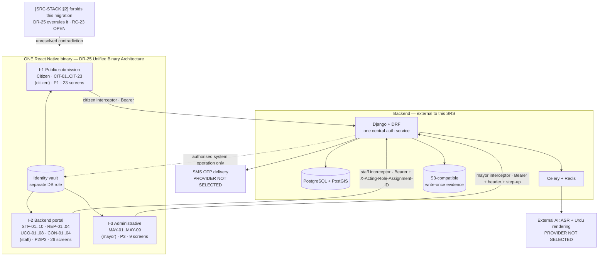

# Software Requirements Specification
## Parakh Mobile Application — React Native (Android and iOS)

---

# Document Control

| Field | Value |
|---|---|
| **Document title** | Software Requirements Specification — Parakh Mobile Application |
| **Document identifier** | `PARAKH-SRS-MOBILE` |
| **Version** | **2.8.0** |
| **Date issued** | 13 Sep 2026 *(v1.0.0)* · 13 Sep 2026 *(v1.1.0)* · 14 Sep 2026 *(v2.0.0)* · 14 Sep 2026 *(v2.1.0)* · 4 Oct 2026 *(v2.2.0)* · 6 Oct 2026 *(v2.3.0)* · 7 Oct 2026 *(v2.4.0)* · 7 Oct 2026 *(v2.5.0)* · 11 Oct 2026 *(v2.6.0)* · 11 Oct 2026 *(v2.7.0)* · **11 October 2026 *(v2.8.0)*** |
| **Author** | **Hassan Jalal** — Founder and Project Lead, Parakh |
| **Document status** | **Draft — awaiting mentor review and approval.** **v2.8.0 records the Project Lead's decisions on the `DG-73` follow-ups, 11 October 2026** — without coordinates the citizen may describe the location **by voice**, kept as evidence and never interpreted by AI, with a written description as an alternative, so `NFR-28` (voice and camera alone) holds (`DG-77`; `TBD-M19` resolved); authorized staff will see the device-measured and the citizen's final position as two distinct values, with the device-reported accuracy (`DG-78`); and the `CIT-10` settings: 5 m per button press, a 20-second wait for a fix, the best practical accuracy, the accuracy shown as the device reports it. Whether contractors are among those staff is not decided (`TBD-M20`). **v2.7.0 recorded the Project Lead's further decisions of 11 October 2026** — the location comes from the phone's current GPS position, else its last known position, else the citizen's written description, with what the phone measured kept beside any adjustment and no map or address lookup; a recording is AAC in MPEG-4, mono, 64 kbit/s, at most 3 minutes, and the server accepts MPEG-4 audio only; accepted typed text is kept exactly as written (repository decision IDs `DG-73`–`DG-76`; `TBD-M18` resolved). The written-description fallback conflicts with `NFR-28` (voice and camera alone) when no coordinates exist; `NFR-28` is not amended and the conflict is opened as `TBD-M19`. **v2.6.0 recorded the Project Lead's decisions of 11 October 2026** — the first version's location uses the phone's GPS, shows its accuracy and is adjusted with directional buttons, with no external map or address-lookup provider; a video must include sound, so it needs the microphone; and the capture settings are approved (repository decision IDs `DG-30`, `DG-71`, `DG-72`). Where `DG-30` conflicts with `FR-PUB.24` and `CIT-10` as written, the requirement text is unchanged pending the Project Lead's confirmation (`TBD-M18`). **v2.5.0 recorded the Project Lead's governance decision of 7 October 2026 on `DR-26` and `SC-10`** — `DR-26` remains in force; the amendment of `SC-10` on 6 October is an explicit owner-approved amendment, limited to citizen-side drafts and pending submissions, not a descoping; encryption and storage at rest of future staff and administrative data on the device stay a separate open decision (repository decision IDs `DG-66`, `DG-68`; `TBD-M16` resolved, `TBD-M17` opened). **v2.4.0 recorded the Project Lead's decisions of 7 October 2026** — a pending submission is shown apart from saved drafts as not yet confirmed, and is deleted from the phone 48 hours after the citizen first pressed Submit if the server has not confirmed it; abandoned temporary data on the server is cleaned up after 72 hours without activity; Parakh's local data is kept out of device and cloud backups (repository decision IDs `DG-57`, `DG-59`, `DG-67`). **v2.3.0 recorded the Project Lead's decisions of 6 October 2026** — report text spoken or typed, in Urdu and English and confirmed by the reporter; no application encryption for local drafts and their media; a 2-day lifetime for unsubmitted drafts; submission only on an explicit Submit, with status checks (repository decision IDs `DG-61`–`DG-65`). **v2.2.0 recorded the Project Lead's decisions of 4 October 2026** — the photo-count rule, the optional video, temporary processing data and cancellation, the submission retry window, typed renderings and the verification sequence (repository decision IDs `DG-09`, `DG-14`, `DG-47`, `DG-53`–`DG-56`). **v2.1.0 formally overrides `[SRC-STACK §2]` under `DR-26` and closes `RC-23`**, with twelve named unified-bundle security controls at §7.4.2. **The override is a recorded decision, not an amendment: `TECHNICAL_STACK` still says the opposite until it is re-issued — `TBD-M13`** |
| **Implementation status** | **Partly implemented in a development build; not deployed.** *(v2.6.0)* **Tested on one physical Android phone** (Samsung SM-A546E, Android 16, 9–10 Oct 2026): sign-in, session restore and sign-out, the local draft store and its 48-hour rules, backups, permissions and `CIT-08` live capture. **No iOS device.** *(v2.5.0: "not tested on any physical device".)* At v2.4.0 the citizen sign-in screens, session handling, the backend report pipeline, the local draft store of the 6 October decisions and the submission queue exist as development code with **SIMULATED** SMS and AI adapters, and the development build has run on an Android **emulator**. ~~**No reporting screen exists yet.**~~ *(v2.6.0)* **`CIT-08` live capture is the first reporting screen built**; the others are not. *(v2.7.0)* **`CIT-09` speak or type is built too**; `CIT-10` onwards are not. The repository's `docs/project/CURRENT_STATE.md` is the record of what exists |
| **Standards basis** | IEEE Std 830-1998 · ISO/IEC/IEEE 29148:2018 |
| **Target SRS completion** | **3 October 2026** |
| **Target application submission** | **1 November 2026** |
| **Classification** | Internal project document |

> **This SRS is a derived document.** It does not originate requirements. It **extracts, restates and traces** the requirements already recorded across the Parakh document set, expresses them in testable `The system shall…` form for a React Native client, and marks every place where those sources disagree or fall silent. **Every requirement in §5, §6 and §7 carries a citation to the source it came from.** A requirement with no citation would be an invention, and none appears.

## Change history

| Version | Date | Author | Sections | Description | Approved by |
|---|---|---|---|---|---|
| 1.0.0 | 13 Sep 2026 | Hassan Jalal | All | Initial baseline. Consolidates `CR-61 rev 1.3`, RBAC v1.3, Data Model v1.3, Screen Inventory v1.3, API Contract v3.0, Technical Stack v1.3, Test Catalogue v1.0, the 12-file use-case pack v1.0, and the surviving non-superseded requirements of `Parakh_Prototype_SRS_v1.4.2` into a mobile requirements baseline. **22 source conflicts recorded as `[NEEDS RECONCILIATION]`; 31 open items recorded as `[TBD]`; no conflict silently resolved** | *Pending* |
| **2.3.0** | **6 Oct 2026** | **Hassan Jalal** | Document Control · §2.3.3 · §2.7 · §3.2 · §3.2.1 · §3.3 · §3.4.3.2 · §3.4.3.3 · §3.6.1 · §3.6.3 · §3.6.3.1 · §3.6.4 · §4.1.2 · §5.2.3 · §5.2.4 · §5.2.6 · §5.2.7 · §5.5 · §6.3 · §6.4.1 · §7.1 · §7.4 · §7.4.2.2 · §11.2 · §11.3 · §11.4.2 · §12 | **MINOR — the Project Lead's decisions of 6 October 2026. Requirement identifiers and counts unchanged; superseded text is marked, not deleted.** **Report text is spoken or typed** — two equal ways (`FR-PUB.9`, `FR-PUB.12`). **Every report carries its text in Urdu and English**; the reporter reviews and confirms the transcription and every translation before submission, and **AI never changes confirmed text, approves a report or replaces verification** (`FR-PUB.13`, `.16`, `.19`, `.21`, `.26`, `.27`). **`DR-23` superseded for local drafts and their media** — no application-managed key, no draft-unlock key and no lost-key reset; the captured file is used directly (§3.6.3, `NFR-48`, `SC-10` amended, `DEP-08`, `R-19`). **Unsubmitted drafts are deleted 2 days after creation** (§3.6.4, `FR-COMMON.12`, §6.4.1). **Submission only on an explicit Submit**; 48-hour retries from the first attempt; a status check before a retry or a deletion (`FR-PUB.28`). `NFR-8` amended: photos are sized at capture, with no second copy. **Two `[TBD]` items opened** — `TBD-M15`, `TBD-M16`. Repository decision IDs `DG-61`–`DG-67`. Change record: `Parakh_Mobile_SRS_v2.3.0_Change_Record.md` | **Hassan Jalal** (decisions, 6 Oct 2026) |
| **2.4.0** | **7 Oct 2026** | **Hassan Jalal** | Document Control · §3.6.3 · §3.6.4 · §5.2.6 · §5.5 · §6.4.1 · §11.1 · §11.4 · Appendices A, D, E, F | **MINOR — the Project Lead's decisions of 7 October 2026. Requirement identifiers and counts unchanged; superseded text is marked, not deleted.** **A pending submission** — Submit pressed, receipt not yet confirmed — **is shown apart from saved drafts as not yet confirmed, retried for 48 hours from the first press of Submit, and then deleted from the phone** (`FR-PUB.28`, `FR-COMMON.12`, `FR-COMMON.13`, §3.6.4, §6.4.1). This supersedes v2.2.0's *keep the local draft* and resolves **`TBD-M15`**. **Server clean-up of abandoned temporary data: 72 hours without activity, approved** (§3.6.4, §6.4.1). **Local Parakh data kept out of device and cloud backups** where the platform allows it (§3.6.3). **`DR-26` and `TBD-M16` are unchanged and under review.** Repository decision IDs `DG-57`, `DG-59`, `DG-67`. Change record: `Parakh_Mobile_SRS_v2.4.0_Change_Record.md` | **Hassan Jalal** (decisions, 7 Oct 2026) |
| **2.5.0** | **7 Oct 2026** | **Hassan Jalal** | Document Control · §1.4.3.2 · §3.6.3 · §7.4 `NFR-48` · §7.4.2.2 `SC-10` · §11.1 · §11.3 `RC-23` · §11.4 · Appendices A, D, E, F | **MINOR — the Project Lead's governance decision of 7 October 2026. Requirement identifiers and counts unchanged; superseded text is marked, not deleted.** **`DR-26` remains in force.** The amendment of **`SC-10`** made on 6 Oct 2026 (`DG-63`) is recorded as an **explicit owner-approved amendment** of the controls associated with `DR-26` — **not a descoping and not a failure of its condition** — so the override does not lapse and `RC-23` stays resolved; **`TBD-M16` resolved**. The amendment covers **citizen-side drafts and pending submissions only**, and weakens no other control. **Encryption and storage at rest of future staff, Union Council, contractor, Mayor & Operations and administrative data on the device are not decided — `TBD-M17` opened**. Repository decision IDs `DG-66`, `DG-68`. Change record: `Parakh_Mobile_SRS_v2.5.0_Change_Record.md` | **Hassan Jalal** (decision, 7 Oct 2026) |
| **2.6.0** | **11 Oct 2026** | **Hassan Jalal** | Document Control · §4.2 · §5.2.2 `FR-PUB.4` · §5.2.5 `FR-PUB.24` (note only) · §7 `NFR-8` · §11.1 · §11.4 · Appendices D, E, F | **MINOR — the Project Lead's decisions of 11 October 2026 (`DG-30`, `DG-71`, `DG-72`). Requirement identifiers and counts are unchanged, and no requirement statement is altered.** A video includes sound and needs the microphone; the capture settings are approved; the simple location approach is recorded, and its conflicts with `FR-PUB.24` and `CIT-10` as written are opened as `TBD-M18` rather than resolved. Honest status updated for the physical-phone tests | Hassan Jalal |
| **2.7.0** | **11 Oct 2026** | **Hassan Jalal** | Document Control · §2.7 `DEP-04` · §3.2.1 · §3.3 · §3.6 · §4.1.2 `CIT-10` · §4.2 · §5.2.3 `FR-PUB.10`, `FR-PUB.12` · §5.2.5 `FR-PUB.24` · §6.2.7 · §9.1 · §11.1 · §11.4 · Appendices D, E, F | **MINOR — the Project Lead's further decisions of 11 October 2026 (`DG-73`–`DG-76`). Requirement identifiers and counts are unchanged.** `FR-PUB.24` is restated for the approved location design (the v2.6.0 statement and criteria are kept, quoted, in a dated note); the map, dragging and `GET /geo/reverse` are removed from `CIT-10`, `DEP-04` and the module list, struck through rather than deleted. Recording settings and the 3-minute limit, MPEG-4 audio only, and verbatim typed text recorded as dated notes. **`TBD-M18` resolved; `TBD-M19` opened** for the conflict with `NFR-28`, which is not amended | Hassan Jalal |
| **2.8.0** | **11 Oct 2026** | **Hassan Jalal** | Document Control · §3.6 · §4.1.2 `CIT-10` · §4.2 · §4.3.5 · §5.2.5 `FR-PUB.24` · §6.2.7 · §6.2.9 · §9.1 · §11.1 · §11.4 · Appendices D, E, F | **MINOR — the Project Lead's decisions of 11 October 2026 on `DG-77`, `DG-78` and the `CIT-10` settings. Requirement identifiers and counts are unchanged.** `FR-PUB.24` is restated so the location may be described by voice (the v2.7.0 statement and criteria are quoted in a dated note); the `location_voice` evidence kind is added; staff visibility of the two positions is recorded in §4.3.5 as a dated note. **`TBD-M19` resolved; `TBD-M20` opened** for the contractor question | Hassan Jalal |
| **2.2.0** | **4 Oct 2026** | **Hassan Jalal** | Document Control · §3.6.4 · §4.1.2 · §4.3.4 · §5.2.2 · §5.2.3 · §5.2.6 · §5.6 · §6.2.4 · §6.2.5 · §6.2.8 · §6.2.9 · §6.4.1 · §8.1 · §9.1 · §10.3 · §11.1 · §11.2 · §11.3 · §11.4 · §12 | **MINOR — the Project Lead's decisions of 4 October 2026; no approved requirement removed or reversed.** **`D-14` decided:** every report needs **1–3 live photos** (`FR-PUB.8` Branch A, minimum one); **`TBD-M9` closed**. **One optional live video of up to 60 s** (`FR-PUB.4`, `FR-PUB.6`). **Typed descriptions are rendered and confirmed like voice** (`FR-PUB.12`). **Server uploads before final submission are temporary processing data; cancellation removes them; evidence is sealed at final submission** (`FR-PUB.29`, §6.4.1). **Automatic submission retry for 48 hours** from the first final-submission attempt (`FR-PUB.28`, `FR-COMMON.12`). **The verification sequence is confirmed** (§6.2.8). Repository decision IDs `DG-09`, `DG-14`, `DG-47`, `DG-53`–`DG-56`. Change record: `Parakh_Mobile_SRS_v2.2.0_Change_Record.md` | **Hassan Jalal** (decisions, 4 Oct 2026) |
| **2.1.0** | **14 Sep 2026** | **Hassan Jalal** | Document Control · §1.4.3.3 · §7.4.2 · §7.8 · §9.1 · §10.3 · §11.2 · §11.3 · §11.4 · §12 | **MINOR — `RC-23` closed by formal override; no requirement removed or reversed.** **`DR-26` formally overrides `[SRC-STACK §2]`** and approves **`DR-25`** as the binding client architecture. §7.4.2 adds **twelve unified-bundle security controls `SC-01`–`SC-12`** mitigating the risk of packaging public (`CIT`) and privileged (`MAY`, `STF`) routes in one compiled React Native bundle, and **three new requirements `NFR-94`–`NFR-96`** covering task-switcher masking, tamper posture and the treat-the-bundle-as-published rule. **`RC-23` moves OPEN → RESOLVED BY OVERRIDE; 23 conflicts recorded, 6 closed, 17 open.** **`TBD-M13` remains open** — the override does not amend `TECHNICAL_STACK`, and a change request is still required. **Counts: 83 → 86 NFRs; 22 → 23 risks; 35 `[TBD]` items unchanged** | *Pending* |
| **2.0.0** | **14 Sep 2026** | **Hassan Jalal** | Document Control · §1.4.3 · §1.4.5 · §3.2 · §3.3 · §3.4 · §4.1.1 · §5.3 · §5.5 · §7.4 · §8 · §11.2 · §11.3 · §11.4 · §12 | **MAJOR — `DR-21` is reversed in full and superseded by `DR-25`, the Unified Binary Architecture.** **All 58 approved screens now ship in one React Native binary**: Citizen (`CIT-01`…`CIT-23`), shared staff (`STF-01`…`STF-10`), Street Representative (`REP-01`…`REP-04`), UC Officer (`UCO-01`…`UCO-08`), Contractor (`CON-01`…`CON-04`) and **Mayor & Operations (`MAY-01`…`MAY-09`)**. §3.2 expands the Presentation layer and adds **role-specific transport interceptors** while **retaining `X-Acting-Role-Assignment-ID`**. §3.3 restructures the route tree behind a **secure authentication gateway** into four isolated groups — **`app/(auth)`**, **`app/(citizen)`**, **`app/(staff)`**, **`app/(mayor)`**. §3.4 mandates **strict Zustand state isolation and a cache-wiping protocol on every role and subject transition**, with four new requirements `FR-COMMON.23`–`.26` and three new `NFR-91`–`NFR-93`. **`RC-04` is re-answered; `RC-10` is favourably resolved; a new conflict `RC-23` is opened, because `[SRC-STACK §2]` still forbids exactly what this revision requires.** **Counts: 120 → 124 functional requirements; 80 → 83 NFRs; 22 → 23 conflicts; 33 → 35 `[TBD]` items; 20 → 22 risks** | *Pending* |
| **1.1.0** | **13 Sep 2026** | **Hassan Jalal** | Document Control · §1.4.3 · §2.4.1 · §2.7 · §3.2.1 · §3.3 · §3.6.3 · §4.3.1 · §4.3.2 · §5.1.3 · §6.3 · §7.4 · §7.6 · §8 · §11.3 · §11.4 · §12 | **MINOR — five architectural conflicts resolved; no requirement removed or reversed.** **`RC-05` resolved** — decision **`D-04` formally approved**; a sixth transport class **`Staff-pre-role`** is added at §4.3.1, breaking the `API-120` circular dependency. **`RC-16` resolved** — decision **`D-10` closed**; `LDS-2` and `LDS-3` are encrypted with **`expo-sqlite` compiled against SQLCipher**, keyed from **`expo-secure-store`**. **`RC-02` resolved** — the minimum iOS deployment target is formally established as **iOS 16.4**, closing **`TBD-M6`**. **`RC-01` and `RC-04` resolved together** — **no `STF-*` screen is implemented in React Native in any phase**; interface **I-2** is delivered by the existing **Django Templates + HTMX + Alpine.js** portals. Four new decision records **`DR-21`**–**`DR-24`** are created. An **Executive Sign-Off Matrix** centralises **`TBD-M1`**–**`TBD-M7`**. **Counts after this revision: 22 conflicts — 5 resolved, 17 open; 31 `[TBD]` items — 3 resolved, 28 open** | *Pending* |

> **Version numbering.** Semantic. **MAJOR** on removal or reversal of an approved requirement; **MINOR** on addition; **PATCH** on editorial correction that changes no requirement. Every re-issue adds a row above.

> **Why this is 2.0.0 and not 1.2.0.** **`DR-21` — approved at v1.1.0 — is reversed in full.** The rule above makes reversal a **MAJOR** increment, and applying it to this document is not optional. **v1.1.0 is retained unmodified** as the superseded baseline, exactly as `Parakh_Prototype_SRS_v1.4.2.md` is retained: *"Do not silently rewrite a historical baseline."*

## Approval

| Role | Name | Responsibility | Approval record | Date |
|---|---|---|---|---|
| Author / Project Lead | **Hassan Jalal** | Content accuracy, scope, requirement correctness | — | — |
| **Academic / technical mentor** | **`[TBD-M1: mentor name required]`** | **Approves this SRS before React Native scaffolding begins.** Per `SRC-MEET`, the mentor scaffolds the base React Native application and walks through the generated code **after** this document is approved | **`[TBD-M2: approval to be recorded here]`** | **`[TBD-M3]`** |
| Reviewer *(optional)* | `[TBD-M4: second reviewer, if the programme requires one]` | Independent requirements review | — | — |

> **Approval is a hard gate.** §8.1 states that **no Phase 1 implementation begins until the mentor approval row is completed.**

## Executive Sign-Off Matrix

**Introduced at v1.1.0.** Every decision reserved to the Project Lead that gates a date, a build or an approval is centralised here, so no reader has to assemble them from §11.4. **Each row is one signature.** The `[TBD-M*]` identifiers are **preserved verbatim** and remain the authoritative cross-reference; this matrix does not replace §11.4, it hoists the Project Lead's own items out of it.

| # | Item | What must be decided | Decision authority | Gates | Status | Signed | Date |
|---|---|---|---|---|---|---|---|
| 1 | **`TBD-M1`** | **Mentor name** — the individual who reviews and approves this SRS and scaffolds the base React Native application | **Hassan Jalal** | **`G0`**, **`G1`** | **OPEN** | ☐ | — |
| 2 | **`TBD-M2`** | **Mentor approval record** — the written approval itself, recorded in the Approval table above | **Mentor** *(nominated under `TBD-M1`)* | **`G0`** | **OPEN** | ☐ | — |
| 3 | **`TBD-M3`** | **Mentor approval date** — must fall on or before **3 October 2026** | **Mentor** | **`G0`** · §8.5 schedule | **OPEN** | ☐ | — |
| 4 | **`TBD-M4`** | **Second reviewer** — whether the programme requires an independent requirements review, and by whom | **Hassan Jalal** / programme | **`G0`** | **OPEN** | ☐ | — |
| 5 | **`TBD-M5`** | **Distribution channel** — public store listing · closed testing track · TestFlight · direct install. **Changes the review lead time and therefore the latest safe build date** | **Hassan Jalal** | **`G3`** · §8.5 · **1 November 2026 submission** | **OPEN** | ☐ | — |
| 6 | **`TBD-M6`** | **Minimum iOS deployment target** | **Hassan Jalal** | `NFR-74`, `RC-02` | **✅ RESOLVED at v1.1.0 — iOS 16.4.** See §2.4.1 and **`DR-24`** | ☑ | **13 Sep 2026** |
| 7 | **`TBD-M7`** | **End-user manual / training material** — whether the programme requires one for submission | **Hassan Jalal** / programme | §2.6 · **`G3`** | **OPEN** | ☐ | — |

**Sign-off arithmetic:** `7 rows · 1 resolved · 6 open`.

> **Two of the six open rows are not Hassan's to sign** — `TBD-M2` and `TBD-M3` belong to the mentor and cannot be closed until `TBD-M1` names them. **`TBD-M1` is therefore the single highest-leverage signature in this matrix: four other rows and both of the first two gates depend on it.**

> **This matrix covers only Project-Lead sign-offs.** It does **not** cover the **28 remaining `[TBD]` items** at §11.4 — which include **four `TBD — legal or institutional review required`** items that **Hassan Jalal cannot sign alone** — nor the **17 open `[NEEDS RECONCILIATION]` conflicts** at §11.3.

---

## Source inventory — every Parakh document consulted

**All 217 Markdown files in the repository were enumerated. The table below records which were used, which were deliberately not used, and why.** Version tags, change-request numbers and portal names appear **exactly as they appear in the sources** and are never normalised, renumbered or tidied.

### A. Authoritative — requirements extracted from these

| ID | File | Version | Role in this SRS |
|---|---|---|---|
| `SRC-CR61` | `docs/change-records/CR_MOBILE_OTP_AND_FIVE_PORTAL_IDENTITY_MODEL.md` | **CR-61 rev 1.3** | **Binding architecture source** for identity, authentication, actors, reporting, language, state machine. Its own §2 states: *"this change record is the binding architecture source"* until SRS v2.0.0 exists |
| `SRC-RBAC` | `docs/security/RBAC_AND_SCOPE_MATRIX.md` | **1.3** | Capabilities, 34-row permission matrix, authentication matrix, step-up, scope model, conflict rules, 12-state machine with transitions `T1`–`T12`, privacy filtering by role |
| `SRC-DATA` | `docs/architecture/DATA_MODEL_AND_IDENTITY_SCHEMA.md` | **1.3** | **31 active entities**, field lists, enums, uniqueness, indexes, retention, identity-vault separation |
| `SRC-SCREEN` | `docs/design/SCREEN_INVENTORY_AND_NAVIGATION.md` | **1.3** | **58 screens** — `CIT-01`…`CIT-23`, `STF-01`…`STF-10`, `REP-01`…`REP-04`, `UCO-01`…`UCO-08`, `CON-01`…`CON-04`, `MAY-01`…`MAY-09`; status labels; offline rule table |
| `SRC-API` | `docs/api/API_CONTRACT.md` | **3.0** | Five transport classes, 46 endpoints, idempotency, 9 error codes, privacy-filtered response shapes |
| `SRC-STACK` | `docs/architecture/TECHNICAL_STACK.md` | **1.3** | Pinned versions, module selection, on-device storage boundary, voice-pipeline client consequences |
| `SRC-TEST` | `docs/testing/TEST_CATALOGUE_IDENTITY_FOUNDATION.md` | **1.0** | Identity-foundation test assertions |
| `SRC-UC00`…`SRC-UC11` | `docs/use-cases/00`–`11` | **1.0** | **163 use cases** (`CIT 58 + REP 24 + UCO 29 + CON 24 + MAY 28`), 90 golden-journey steps, 23 workflows `WF-01`…`WF-23`, decisions `D-01`…`D-15`, acceptance tests |
| `SRC-CR60` | `docs/change-records/CR-60_REACT_NATIVE_MIGRATION.md` | — | **`DR-19`** React Native decision. **Retained and reaffirmed by `SRC-CR61`** |
| `SRC-CR59` | `docs/change-records/CR-59_ANONYMOUS_CITIZEN_REPORTING.md` | — | **Superseded in full by `SRC-CR61`.** Consulted only for the CR-numbering conflict (`RC-11`) and the retention correction (§9) |
| `SRC-STACKCFG` | `mobile/README.md` + 8 `mobile/*` config files | — | The eight configuration files that physically exist. **Written for the superseded anonymous model** — see `RC-12` |
| `SRC-BRIEF` | Project brief, 13 Sep 2026 | — | **Authoritative for mobile scope, platform targets, phasing and delivery dates only** |
| `SRC-MEET` | Mentor meeting record, 13 Sep 2026 | — | Technology-selection rationale, two-interface framing, mentor scaffolding commitment, 3 Oct / 1 Nov dates |

### B. Partially used — surviving requirements extracted, superseded parts excluded

| ID | File | Version | What was taken · what was excluded |
|---|---|---|---|
| `SRC-SRS142` | `Parakh_Prototype_SRS_v1.4.2.md` | **1.4.2 — superseded baseline, preserved byte-identical** | **Taken:** the **84 NFR identifiers** (`NFR-SEC-001`…`024`, `NFR-USA-001`…`018`, `NFR-PERF-001`…`007`, `NFR-REL-001`…`006`, `NFR-OPS-001`…`017`, `NFR-MNT-001`…`004`, `NFR-COMP-001`…`003`, `NFR-DR-001`…`005`), the **42 business rules `BR-001`…`BR-041`**, the **11 constraints `C-1`…`C-10`**, the **decision records `DR-1`…`DR-20`**, the **147 detailed `FR-` block titles**, and the **58 `TBD-001`…`TBD-058`** identifiers. **Excluded:** everything `SRC-CR61` §19 supersedes — the `FR-ANON-*` family, `FR-AUTH-004a`, `C-6a`, `BR-007a`, `BR-039`, `BR-040`, `DR-20`, `INV-ANON-01/02`, the `Moderator`/`Administrator` actor model, TOTP, and the anonymous screens `CZ-17`…`CZ-21` |
| `SRC-BUILD131` | `Parakh_Release_0_Build_Specification_v1.3.1.md` | 1.3.1 | **Not used as a requirement source.** It is an extraction of `SRC-SRS142`, so anything in it that survives is already captured above |

### C. Named, not used — and the reason recorded

| File | Version / state | Why not used |
|---|---|---|
| `DATABASE_ARCHITECTURE.md` | **2.7 — stale** | Still describes `AnonymousAccessGrant` and `SubmissionRecovery`, both **removed** by `SRC-DATA` §6. Superseded by `SRC-DATA` v1.3. **Not silently patched** — see `RC-13` |
| `docs/security/AUTHENTICATION_ROLE_ASSIGNMENT_AND_ANONYMOUS_REPORTING.md` | **1.2 — stale** | Its §9 four-actor matrix is explicitly superseded by `SRC-RBAC` v1.3 |
| `docs/use-cases/AUTHENTICATION_AND_INCIDENT_REPORTING_USE_CASES.md` | superseded | The anonymous-model use-case set. Preserved byte-identical; superseded by `SRC-UC00`–`SRC-UC11` |
| `Parakh_Master_Document*.md` (v1.0–v1.2.1) | superseded | Predecessors of `SRC-SRS142` |
| `Parakh_Prototype_SRS_v1.0` … `v1.4.1` (13 files) | superseded | Superseded by v1.4.2, itself superseded on identity |
| `Parakh_Release_0_Build_Specification_v1.0` … `v1.3.0` (12 files) | superseded | Superseded by v1.3.1 |
| `v11/`, `v12/`, `v13/`, `v131/`, `v132/`, `v133/`, `srs/`, `roadmap/`, `usecase/`, `manual/`, `s134.md`, `s135.md`, `w126.md`, `w127.md`, `w136.md`, `w137.md`, `r123.md`–`r125.md`, `.bak_dup.md` | working chunks and backups | Intermediate authoring fragments of the files above. **Contain no requirement not present in a released version** |
| `PARAKH_RESEARCH_PROPOSAL.md`, `Parakh_Roadmap_*`, `Parakh_Developer_Handoff.md`, `README.md`, `docs/DEVELOPMENT_JOURNAL.md` | contextual | Non-normative. Consulted for context; **no requirement drawn from them** |
| `node_modules/**` | third-party | Not project documents |

### D. Precedence rule

Where two sources conflict, precedence is:

| Rank | Source | Scope of precedence |
|---|---|---|
| 1 | **`SRC-BRIEF` · `SRC-MEET`** | Mobile scope, platform targets, phasing, delivery dates **only** |
| 2 | **`SRC-CR61` rev 1.3** | Identity, authentication, actors, reporting, language, state machine |
| 3 | **`SRC-RBAC` · `SRC-DATA` · `SRC-API` · `SRC-SCREEN`** (all 1.3 / 3.0) | Permissions, entities, endpoints, screens |
| 4 | **`SRC-STACK` 1.3** | Technology and module selection |
| 5 | **`SRC-UC*` 1.0** | Actor-level behaviour and the `D-01`…`D-15` register |
| 6 | **`SRC-SRS142`** | **Only** for `NFR-*`, `BR-*`, `C-*`, `DR-*`, `TBD-*` identifiers not superseded at rank 2 |

**A conflict this rule does not settle is recorded as `[NEEDS RECONCILIATION]` in §11.3 and is not resolved in this document.**

---

# 1. Introduction

## 1.1 Purpose

This Software Requirements Specification defines the complete, verifiable requirements for the **Parakh Mobile Application** — a cross-platform mobile client written in **React Native with strict TypeScript**, built from a **single shared codebase** targeting **Android and iOS** `[SRC-BRIEF]`, implementing decision **`DR-19`** `[SRC-CR60 §2; SRC-CR61 §19 "Retained"]`.

Parakh is an existing project with an extensive prior specification set targeting web delivery. **This document specifies the mobile realisation of that project and nothing else.** It has four purposes:

| # | Purpose | Audience |
|---|---|---|
| 1 | **To be built against.** Every functional requirement is atomic, uniquely identified, cited to its source, and paired with Given/When/Then acceptance criteria | Implementer (Hassan Jalal) |
| 2 | **To be reviewed and approved.** It is the artefact the mentor reviews before scaffolding the base React Native application `[SRC-MEET]` | Mentor |
| 3 | **To be tested against.** §10 defines what "done" means per phase; §9 traces every requirement to a test identifier | Implementer and reviewer |
| 4 | **To record what is not decided and what disagrees.** §11.3 lists **23 source conflicts** — **6 closed, 17 open**; §11.4 lists **35 items** — **3 resolved, 32 open** | All |

**This document specifies behaviour. It does not report behaviour.** Every source consulted carries the same status line — *"Specified; not implemented; not tested"* — and this document inherits it. No performance, accuracy, deliverability or adoption figure anywhere in this document is a measurement; each is a **target to be met** or an explicit `[TBD]`.

### 1.1.1 What this document does not do

- **It does not resolve `D-01`…`D-15`** from `[SRC-UC09]`. Five of those are **Blockers**. They are restated in §11.3 with both branches written, exactly as the register does.
- **It does not design screens.** It states what each screen must allow and prevent, citing `[SRC-SCREEN]`.
- **It does not specify the backend.** Django · DRF · PostgreSQL/PostGIS · Celery/Redis · S3-compatible write-once storage `[SRC-STACK §2, DR-6]` are an **external system** from this client's point of view (§4.3).
- **It does not migrate the four staff web portals to React Native.** `[SRC-STACK §2]` states plainly: *"The four staff portals are not migrated to React Native."* See `RC-04`.
- **It does not name an AI provider, SMS provider, hosting location or legal approval.** None has been selected `[SRC-CR61 §18; SRC-STACK §3.1; SRC-API §12]`.

## 1.2 Document conventions

### 1.2.1 Requirement language

| Term | Meaning |
|---|---|
| **shall** | Absolute requirement. Non-compliance is a defect |
| **shall not** | Absolute prohibition. Occurrence is a defect |
| **should** | Recommendation. A deviation requires a written justification recorded against the requirement ID |
| **may** | Genuinely optional. Neither presence nor absence is a defect |

Every functional requirement is written **"The system shall …"**. A statement that cannot take that form is not a requirement and does not appear in §5.

### 1.2.2 Prohibited language

These words **shall not** appear in a requirement statement unless immediately followed by a measurable definition: *fast, slow, quick, user-friendly, intuitive, seamless, robust, efficient, scalable, modern, simple, easy, secure* (unqualified), *optimised, reasonable, appropriate, as needed, etc., and so on, where possible, if necessary.*

This rule is inherited, not invented: `[SRC-SCREEN §1]` already requires *"no blank spinner without naming what is happening"* and `[SRC-SRS142 NFR-USA-017]` already requires *"a progress indicator with a text description, not a bare spinner."*

### 1.2.3 Identifier scheme — and the rule on legacy identifiers

> **Existing identifiers are preserved exactly.** Change-request numbers (`CR-59`, `CR-60`, **`CR-61`**), version tags (**rev 1.3**, **v3.0**, **v1.4.2**), portal names (**Citizen**, **Street Representative**, **UC Officer**, **Contractor**, **Mayor & Operations**), screen IDs (`CIT-11`, **`STF-10`**, `UCO-06`), capability names (**`CAP_RENDERING_CONFIRM_OWN`**), state names (`PENDING_CITIZEN_CONFIRMATION`), API IDs (`API-135`), entity names (`RenderingConfirmation`), and legacy requirement IDs (`FR-VOI-002`, `BR-041`, `NFR-SEC-007`, `DR-19`, `C-6`, `TBD-005`) appear **verbatim**. **Nothing is renumbered, normalised, corrected for style, or silently replaced.**

| Kind | Format | Example | Origin |
|---|---|---|---|
| Functional requirement *(this document)* | `FR-<MODULE>.<n>` | `FR-AUTH.7` | New, per `[SRC-BRIEF]` writing rules. **Every one cites its legacy source ID** |
| Non-functional requirement *(this document)* | `NFR-<n>` | `NFR-12` | New, per `[SRC-BRIEF]`. **Every one cites its legacy `NFR-*` ID where one exists** |
| Legacy functional requirement | `FR-<FAMILY>-<nnn>` | `FR-VOI-002`, `FR-OFF-006` | `[SRC-SRS142]` — **preserved, never renumbered** |
| Legacy non-functional requirement | `NFR-<FAMILY>-<nnn>` | `NFR-SEC-007` | `[SRC-SRS142]` — preserved |
| Business rule | `BR-<nnn>` | `BR-002`, `BR-041` | `[SRC-SRS142 §8]` — preserved |
| Constraint | `C-<n>` | `C-5`, `C-6` | `[SRC-SRS142]` — preserved |
| Design decision | `DR-<n>` | `DR-6`, `DR-19` | `[SRC-SRS142]` — preserved |
| Screen | `<PORTAL>-<nn>` | `CIT-09`, `STF-10` | `[SRC-SCREEN v1.3]` — preserved |
| API | `API-<nnn>` | `API-135` | `[SRC-API v3.0]` — preserved |
| Capability | `CAP_<NAME>` | `CAP_CASE_CLOSE` | `[SRC-RBAC v1.3 §2]` — preserved |
| Entity | `<EntityName>` | `ClientSubmission` | `[SRC-DATA v1.3]` — preserved |
| Use case | `UC-<PORTAL>-<nnn>` | `UC-CIT-031` | `[SRC-UC*]` — preserved |
| Workflow | `WF-<nn>` | `WF-21` | `[SRC-UC06]` — preserved |
| Open decision | `D-<nn>` | `D-04` | `[SRC-UC09]` — preserved |
| Legacy open item | `TBD-<nnn>` | `TBD-005` | `[SRC-SRS142]` — preserved |
| **Reconciliation item** *(new)* | `RC-<nn>` | `RC-04` | **New in this document.** Each records one source-vs-source conflict |
| Acceptance test *(this document)* | `AT-<MODULE>-<nnn>` | `AT-AUTH-014` | New; traced to legacy `TEST-*` IDs where they exist |
| Risk | `R-<nn>` | `R-07` | New |
| Assumption | `ASM-<nn>` | `ASM-05` | New |
| Local data store | `LDS-<n>` | `LDS-3` | New |

**Identifier stability.** An identifier here is permanent. A withdrawn requirement keeps its row with status `WITHDRAWN` and a pointer to its replacement — the pattern `[SRC-CR61 §19]` already uses for `CAP_VOICE_CONFIRM` → `CAP_RENDERING_CONFIRM_OWN` and `REP-05` → `STF-10`. **Identifiers are never reused.**

### 1.2.4 Priority (MoSCoW)

| Tag | Meaning | Consequence if absent |
|---|---|---|
| **[MUST]** | The phase is not delivered without it | Phase fails acceptance |
| **[SHOULD]** | Important; the phase remains usable without it | Delivered with a recorded gap |
| **[COULD]** | Delivered only if capacity remains after every MUST and SHOULD | None |
| **[WON'T-P1]** | Explicitly out of Phase 1; scheduled later | **Must not be built in Phase 1** |

### 1.2.5 Phase tags

| Tag | Meaning | Window |
|---|---|---|
| **P1** | **Authentication and the public submission interface** `[SRC-BRIEF]` | After 3 Oct 2026; delivered by **1 Nov 2026** |
| **P2** | **Backend portal — view and process submissions** `[SRC-BRIEF]` | After 1 Nov 2026 |
| **P3** | Remaining portal workflows, analytics, hardening | After P2 |
| **P?** | Not assignable until an `[TBD]` or `RC-` item closes | — |

A requirement carries **exactly one** priority tag and **exactly one** phase tag.

### 1.2.6 The `[TBD]` convention

`[TBD-<id>: <what is needed>]` marks a genuine unknown and always states **what would close it** and **who must decide**. Two decider categories are inherited verbatim from the sources:

- **`TBD — Hassan decision required`** — a product decision only the owner can make `[SRC-UC09]`.
- **`TBD — legal or institutional review required`** — requires external review `[SRC-UC09]`.

**Legacy `TBD-nnn` identifiers from `[SRC-SRS142]` are reused unchanged where the same question is still open.** New questions raised by the mobile scope take `TBD-M<n>`.

> **A `[TBD]` shall not be closed by an implementer choosing a value.** It closes by a recorded decision, producing a new MINOR version of this document.

### 1.2.7 The `[NEEDS RECONCILIATION]` convention — new in this document

`[NEEDS RECONCILIATION: RC-<nn>]` marks a place where **two authoritative sources say different things about the same subject**. It is not an unknown; it is a **contradiction**.

| Rule | Detail |
|---|---|
| **Both positions are stated** | Each `RC-` entry in §11.3 names both sources, quotes both, and explains the consequence |
| **Neither is silently adopted** | Where this document must proceed, it states which position it follows **and why**, and the conflict stays open |
| **It is never downgraded to a `[TBD]`** | A `[TBD]` means nobody has decided. An `RC-` means **two documents already decided differently** |
| **It is never repaired by editing a source** | No source document was modified while writing this SRS |

### 1.2.8 Citation format

Every requirement carries a **Source** cell in the form `[SRC-XXX §n]`, naming the document and the section the requirement was extracted from. A requirement derived from more than one source lists all of them. **A requirement with no citation would be an invention; there are none.**

### 1.2.9 Acceptance criteria form

```
Given   <a precondition that can be set up>
When    <a single observable action or event>
Then    <a single observable, checkable outcome>
And     <further checkable outcomes, if any>
```

A criterion that cannot be set up, triggered and observed is not an acceptance criterion. Timing criteria use explicit numbers or `[TBD]`.

### 1.2.10 Typography

`Monospace` = identifier, field, state, endpoint, path, error code or literal. **Bold** = defined term on first use, tag, or an emphasis not to be skimmed. *Italic* = document title or quoted phrase.

## 1.3 Intended audience and reading suggestions

| Reader | Purpose | Reading order |
|---|---|---|
| **Mentor / reviewer** | Approve the SRS; know what will be scaffolded | §1 → §2 → §3 → §8 → §11 → §5 selectively |
| **Implementer (P1)** | Build authentication and the public submission interface | §3 → §4 → §5.1 `FR-AUTH` → §5.2 `FR-PUB` → §6 → §7 → §10 |
| **Reviewer of one behaviour** | Check a single rule | §9 → the `FR-` → its criteria → its `AT-` in §10 |
| **Backend implementer** | Know what the client expects | §4.3 → §6 → §5 → §7.4 |
| **Tester** | Verify a phase | §10 → §9 → §7 |
| **Anyone assessing project risk** | Find what is unsettled | **§11.3 (23 conflicts, 17 open) → §11.4 (35 items, 32 open) → §11.2 (risks)** |

**Recommended first read for everyone:** §1.2 and §11.3. The second tells you, in one place, everywhere the project's own documents disagree with each other.

## 1.4 Product scope

### 1.4.1 Identity

| Attribute | Value | Source |
|---|---|---|
| Project | **Parakh** | `[SRC-CR61]` |
| This deliverable | **Parakh Mobile Application** | `[SRC-BRIEF]` |
| Client platform | **React Native + strict TypeScript**, single shared codebase | `DR-19` `[SRC-CR60 §2]` |
| Target platforms | **Android 7+ and iOS 16.4+** | `[SRC-BRIEF]` · **`RC-02` RESOLVED at v1.1.0 by `DR-24`** — `[SRC-STACK §1, §3]` remains Android-first in wording, and the iOS floor is inherited from the pinned Expo SDK 57 |
| Development environment | macOS (MacBook) | `[SRC-BRIEF; SRC-MEET]` |
| Version control | **GitHub** | `[SRC-BRIEF; SRC-MEET]` |
| Development support | The mentor scaffolding the base app | `[SRC-BRIEF; SRC-MEET]` |
| Distribution channel | **`[TBD-M5: public store listing, closed testing track, TestFlight, or direct install — decision required from Hassan Jalal; it changes the review lead time in §8.5]`** | — |

### 1.4.2 What the product is

> Most civic platforms digitise the complaint. **Parakh is designed to digitise the proof.**

Its operating sequence is **evidence first → AI assisted → human reviewed**. A report is anchored to captured evidence — location, live-captured photograph, and a **voice description** — rather than to typed prose. Machine processing assists with transcription and Urdu-script rendering. **A human being makes every civic decision** `[SRC-CR61 §7]`.

### 1.4.3 The interfaces

`[SRC-BRIEF]` defines the mobile product as **two distinct interfaces within one application**:

| # | Interface | Users | Function | Phase |
|---|---|---|---|---|
| **I-1** | **Public submission interface** | Members of the public — the **Citizen** portal, `CIT` | Submit an incident report with evidence; track it; confirm or dispute its resolution | **P1** |
| **I-2** | **Backend portal** | Registered, **invited** staff users — `REP`, `UCO`, `CON` | Sign in, view submitted reports, process them through the civic workflow | **P2 / P3 — React Native, in the same binary. See `DR-25`** |
| **I-3** | **Administrative portal** | **Mayor & Operations** (`MAY`) users | Account administration, role and scope, contractor organisations, audit review, exceptional intervention, protected contact, appeals | **P3 — React Native, in the same binary, behind its own isolated route group. See `DR-25`** |

### 1.4.3.1 `DR-25` — the Unified Binary Architecture *(supersedes `DR-21` in full)*

| Field | Value |
|---|---|
| **Decision record** | **`DR-25`** *(next available after `DR-24`)* |
| **Decided** | **14 September 2026**, at SRS **v2.0.0** |
| **Approved by** | **Hassan Jalal — Founder & Project Lead** |
| **Supersedes** | **`DR-21` in full.** `DR-21` is **retained below as a superseded record** and is **not deleted** — §1.2.3 |
| **Re-answers** | **`RC-04`** — with the opposite answer to v1.1.0 |
| **Opens** | **`RC-23`** — a **new** conflict with `[SRC-STACK §2]` |

> **Decision, stated explicitly.** **Parakh ships as a single React Native binary containing all 58 approved screens.** The binary carries the **Citizen** portal (`CIT-01`…`CIT-23`), the **shared staff** screens (`STF-01`…`STF-10`), **Street Representative** (`REP-01`…`REP-04`), **UC Officer** (`UCO-01`…`UCO-08`), **Contractor** (`CON-01`…`CON-04`) and **Mayor & Operations** (`MAY-01`…`MAY-09`). **No portal is delivered as a mobile web view.**

**Screen count in the binary — recomputed, not inherited:**

| Group | Screen IDs | Count | In the binary at v1.1.0 | **In the binary at v2.0.0** |
|---|---|--:|:--:|:--:|
| Citizen | `CIT-01` … `CIT-23` | 23 | ✅ | ✅ |
| Shared staff | `STF-01` … `STF-10` | 10 | ✗ *(web)* | **✅** |
| Street Representative | `REP-01` … `REP-04` | 4 | ✗ *(web)* | **✅** |
| UC Officer | `UCO-01` … `UCO-08` | 8 | ✗ *(web)* | **✅** |
| Contractor | `CON-01` … `CON-04` | 4 | ✗ *(web)* | **✅** |
| **Mayor & Operations** | `MAY-01` … `MAY-09` | **9** | ✗ *(web)* | **✅** |
| **Total in the React Native binary** | | **58** | **23** | **58** |

**Arithmetic shown:** `23 + 10 + 4 + 8 + 4 + 9 = 58`. **The approved inventory total is unchanged at 58** `[SRC-SCREEN §6]` — **no screen is created by this decision.** What changes is **which client renders them**, and the binary's share moves **23 → 58**.

> **On "newly added Mayor portals".** **`MAY-01` … `MAY-09` are not new.** They have existed in the approved inventory since Screen Inventory v1.0 `[SRC-SCREEN §5.5]`. **`DR-25` adds them to the React Native binary; it does not add them to Parakh.** No `MAY-*` identifier is created, renumbered or reused.

**What this buys, and what it costs:**

| Consideration | Finding |
|---|---|
| **`RC-10` is favourably resolved** | The `STF-10` offline-recording claim was contradictory *only* because the staff portals were Django/HTMX with **no offline queue, no local database and no background sync**. **On React Native the claim becomes technically satisfiable** — the citizen client already implements exactly that machinery. **`D-11`'s online-only recommendation is no longer required** |
| **One evidence pipeline, not two** | `STF-10` official reporting reuses `expo-camera`, `expo-audio`, `expo-crypto` hashing, the `ClientSubmission` pipeline, the `RenderingConfirmation` flow and the offline queue **already specified for the citizen path** — rather than a second, web-based implementation of the same eight-field confirmation contract |
| **Native capability for staff** | Push notification to a staff queue, native camera for field and completion verification, and offline drafting in the field — **none of which a server-rendered HTMX page can provide** |
| **Cost — schedule** | **35 screens return to scope.** `DR-21` deleted them at v1.1.0 and called that *"the single largest risk reduction available"*. **Reversing it restores that risk in full**, against one developer with **no React Native experience recorded** (`ASM-08`) |
| **Cost — an approved source is contradicted** | **`[SRC-STACK §2]` still says the four staff portals are *not* migrated to React Native.** `DR-25` does not have the authority to amend that document. **`RC-23` records the contradiction; it is not resolved here** |
| **Cost — blast radius** | A single binary now holds **citizen data and administrative authority**. That is the direct reason §3.4.3 mandates **strict state isolation and cache wiping**; the risk did not exist when the binary held one portal |

**Consequences applied throughout this revision:** `FR-PORTAL.1` … `FR-PORTAL.30` become **React Native implementation requirements** as well as backend requirements. §3.2, §3.3 and §3.4 are rewritten. §8.3 and §8.4 restore the screen scope. **`FR-COMMON.23`–`.26` and `NFR-91`–`NFR-93` are added** to contain the isolation risk this decision creates.

> **`DR-25` does not resolve `RC-18`.** A staff official reporter **still has no screen showing them their own report** — `STF-11` remains **PROPOSED and not approved**, and the inventory total stays **58**. **That Blocker is untouched by client technology and survives this revision**, exactly as it survived `DR-21`.

#### 1.4.3.2 `DR-26` — formal override of `[SRC-STACK §2]` *(closes `RC-23`)*

| Field | Value |
|---|---|
| **Decision record** | **`DR-26`** *(next available after `DR-25`)* |
| **Decided** | **14 September 2026**, at SRS **v2.1.0** |
| **Approved by** | **Hassan Jalal — Founder & Project Lead** |
| **Closes** | **`RC-23`** — status **RESOLVED BY OVERRIDE** |
| **Does not close** | **`TBD-M13`** — the documentation-sync obligation survives this decision |
| **Status** *(v2.5.0)* | **In force.** Confirmed by the Project Lead on 7 Oct 2026, after the amendment of `SC-10` (`DG-66`) |

> **Decision, stated explicitly.** **`[SRC-STACK §2]` is formally overridden on the single point of client platform for the staff portals.** The sentence *"The four staff portals are not migrated to React Native… React Native Web does not replace the staff portals"* **no longer governs.** **`DR-25` — the Unified Binary Architecture — is the binding client-architecture decision for Parakh Mobile.**

**What the override covers, and what it deliberately does not:**

| Overridden | **Not** overridden |
|---|---|
| The **client platform** of the four staff portals — `REP`, `UCO`, `CON`, `MAY` — which is now **React Native**, in the same binary | **`DR-6`** — the backend remains Python · Django · DRF · PostgreSQL/PostGIS · Celery/Redis · S3-compatible write-once evidence |
| The corresponding statement in `[SRC-SCREEN §5]` | **The 58-screen approved inventory** `[SRC-SCREEN §6]`. **No screen is created, retired or renumbered** |
| The staff-portal scope exclusion in `[SRC-CR60 §4]` | **`DR-19`** — React Native, strict TypeScript, Expo SDK 57, and the rule that the RN version follows the SDK |
| — | **Any permission, capability, scope rule, state transition or privacy rule.** `[SRC-RBAC]` and `[SRC-DATA]` are untouched |

> **An override is not an amendment, and this document does not pretend otherwise.** **`TECHNICAL_STACK v1.3` still contains the overridden sentence.** Until it is re-issued at **v1.4** under a change request, **two approved documents state opposite things about client platform, and a reader consulting only `TECHNICAL_STACK` will be misled.** **`TBD-M13` tracks that obligation and remains open.** **No source file is modified by this SRS.**

**Why the override was granted rather than `DR-25` being withdrawn:**

| Consideration | Finding |
|---|---|
| **`RC-10` closes without cost** | The `STF-10` offline-recording claim in `[SRC-SCREEN §5.1]` becomes **true** on React Native instead of contradictory. `D-11`'s online-only workaround is no longer needed |
| **One evidence pipeline** | `STF-10` official reporting reuses the citizen client's camera, audio, hashing, `ClientSubmission` pipeline, `RenderingConfirmation` contract and offline queue — rather than a second web implementation of the same eight-field confirmation |
| **Native staff capability** | Push to staff queues, native camera for field and completion verification, offline drafting in the field — none available on a server-rendered HTMX page |
| **What it costs** | **35 screens of scope return** (`R-21`), **citizen data becomes co-resident with administrative authority in one process** (`R-22`), and **the compiled bundle now maps the privileged API surface** (`R-23`). **§7.4.2 exists solely to contain the second and third** |

**Condition attached to the override.** **`DR-26` is granted conditional on §7.4.2.** The twelve controls `SC-01`–`SC-12` and the requirements `FR-COMMON.23`–`.26` and `NFR-91`–`NFR-96` are **`[MUST]`**, and **Phase 2 does not exit without exit criteria 17–24**. **If those controls are descoped, the override lapses and `RC-23` re-opens.**

> ***(v2.5.0)* — Project Lead's decision of 7 Oct 2026 (`DG-66`, resolving `TBD-M16`).** **`DR-26` remains in force.** It is an architectural and operational decision — the citizen, staff, Union Council, contractor and Mayor & Operations portals stay within the approved React Native application — and **not fundamentally a draft-encryption decision**. **The amendment of `SC-10` made on 6 Oct 2026 (`DG-63`) is an explicit owner-approved amendment of the controls associated with `DR-26`, not a descoping and not a failure of this condition**, so the override does not lapse and `RC-23` stays resolved. The amendment covers citizen-side drafts and pending submissions only (§7.4.2.2 `SC-10`).

#### 1.4.3.3 `DR-21` — superseded, retained

| Field | Value |
|---|---|
| **Decision record** | **`DR-21`** |
| **Decided** | 13 September 2026, at SRS v1.1.0 |
| **Status** | **SUPERSEDED IN FULL by `DR-25` on 14 September 2026.** **Retained, not deleted** — §1.2.3 identifier stability |
| **What it said** | *"No `STF-*` screen — `STF-01` through `STF-10` — is implemented in React Native, in Phase 2 or in any later phase. Interface `I-2` is delivered by the existing Django Templates + HTMX + Alpine.js staff portals… The React Native binary contains the Citizen portal and nothing else."* |
| **Why it was reversed** | Recorded by the Project Lead on 14 September 2026. `DR-21`'s strongest argument was schedule — deleting 40 screens of speculative scope. **`DR-25` accepts that cost back** in exchange for one evidence pipeline, native staff capability, and the favourable resolution of `RC-10` |
| **What it got right, and still holds** | **`[SRC-STACK §2]` does say what `DR-21` said it says.** `DR-21` was not wrong about the source; **`DR-25` overrules the source rather than reinterpreting it**, which is why `RC-23` exists |

### 1.4.4 In scope

- The React Native client: screens, navigation, local storage, offline behaviour, and use of camera, microphone, location, secure storage and biometrics.
- The **client side** of authentication, drafting, evidence capture, voice recording, rendering review and confirmation, submission, tracking, notification, and — from P2 — portal processing.
- The client's expectations of the backend API, stated as an interface requirement (§4.3).
- Non-functional targets the **client** is responsible for meeting.

### 1.4.5 Out of scope

| Item | Reason | Source |
|---|---|---|
| Backend service implementation, DDL, migrations | External system to this client | `[SRC-STACK §2]` |
| The four Django/HTMX staff **web** portals | *"The four staff portals are not migrated to React Native"* | `[SRC-STACK §2; SRC-SCREEN §5]` |
| **Every `STF-*`, `REP-*`, `UCO-*`, `CON-*` and `MAY-*` screen as a React Native implementation** | **`DR-21`, v1.1.0** — I-2 is delivered as web. **40 screens of Phase 2/3 React Native scope are deleted** | §1.4.3.1 |
| AI/ML model selection, hosting, accuracy | **None selected.** No accuracy figure exists or is assumed | `[SRC-CR61 §18, §20]` |
| SMS delivery infrastructure | **No provider integration exists or is claimed** | `[SRC-STACK §6; SRC-API §12]` |
| Hosting, deployment topology, infrastructure authentication | **Out-of-band, controlled by the deployment environment** | `[SRC-CR61 §3.4]` |
| Visual design system, brand assets | A design activity | — |
| Legal review, data-protection registration, adoption | **Not obtained. Not assumed** | `[SRC-CR61 §23]` |
| Web front end of the existing project | Unchanged by this document | — |

### 1.4.6 Objectives and how each is measured

| Objective | Mechanism in this SRS | Measured by |
|---|---|---|
| A report carries verifiable evidence, not assertion | `BR-001` · live-capture `BR-002` · hash at capture `FR-EVD-003` | `AT-PUB-*`, `TEST-EVD-001` |
| A person with low literacy can report | Voice-first path `FR-VOI-001`; Urdu rendering; no typing required | `AT-PUB-*`, `NFR-25`–`NFR-31` |
| Every civic decision is human | **No requirement in §5 permits an automated accept, reject, verify, assign, resolve, dispute, appeal or close** | Review of §5.3 against `BR-004`, `[SRC-CR61 §7]` |
| The reporter approves the exact text submitted | `CAP_RENDERING_CONFIRM_OWN` + version + content hash | `AT-PUB-*`, `TEST-API-011/012` |
| A submitter can see what happened | `CIT-14`, `CIT-15`, sanitised timeline | `AT-PUB-*` |
| Deliverable by 1 November 2026 | Phase 1 bounded to authentication + public submission | §8.4 phase-exit criteria |

## 1.5 References

### 1.5.1 External

| Ref | Title | Use |
|---|---|---|
| `REF-1` | IEEE Std 830-1998 | Document structure |
| `REF-2` | ISO/IEC/IEEE 29148:2018 | Requirement quality criteria |
| `REF-3` | W3C WCAG 2.1 / 2.2 | Accessibility targets §7.3. **`[SRC-SCREEN §9]` and `[SRC-UC00 §8]` both specify WCAG 2.1 AA; §7.3 preserves that level** |
| `REF-4` | OWASP MASVS · OWASP Mobile Top 10 · OWASP API Top 10 | Security framing §7.4, per `NFR-SEC-024` |
| `REF-5` | IETF RFC 3339 | Wire timestamp format |
| `REF-6` | ITU-T E.164 | Mobile-number normalisation, per `CitizenPhoneCredential` |
| `REF-7` | Expo SDK reference — SDK ↔ React Native compatibility table | Version pinning, **verified 20 Aug 2026** `[SRC-STACK §1]` |
| `REF-8` | React Native documentation | Platform capability checks |
| `REF-9` | Android and Apple platform permission documentation | Runtime permissions §4.2 |

### 1.5.2 Internal

All internal references appear in the **Source inventory** above and are cited in-line by `SRC-` identifier.

### 1.5.3 Status of §1

**Nothing in §1 is a requirement.** §1 governs interpretation; §5–§7 govern behaviour.

---

# 2. Overall Description

## 2.1 Product perspective

Parakh Mobile is **one component of a larger system that already has an approved architecture**. It is not a standalone product and it does not define the system it joins.

```
┌──────────────────────────────────────────────────────────────────────────┐
│                          PARAKH SYSTEM (approved)                         │
│                                                                           │
│  ┌──────────────────────────────────────────────────────────────────┐   │
│  │   ONE REACT NATIVE BINARY — UNIFIED BINARY ARCHITECTURE   DR-25   │   │
│  │   58 of 58 approved screens ship here. No portal is a web view.   │   │
│  │  ┌────────────┐ ┌──────────────────────────┐ ┌────────────────┐   │   │
│  │  │ I-1 PUBLIC │ │ I-2 BACKEND PORTAL       │ │ I-3 ADMIN      │   │   │
│  │  │ CIT-01..23 │ │ STF-01..10 · REP-01..04  │ │ MAY-01..09     │   │   │
│  │  │ (citizen)  │ │ UCO-01..08 · CON-01..04  │ │ (mayor)        │   │   │
│  │  │   P1  23   │ │ (staff)      P2/P3   26  │ │  P3         9  │   │   │
│  │  └────────────┘ └──────────────────────────┘ └────────────────┘   │   │
│  │   STRICT STATE ISOLATION + CACHE WIPE BETWEEN ROLES  §3.4.3       │   │
│  └─────────────┬──────────────────────────────┬─────────────────────┘   │
│                │                                      │                   │
│                │  HTTPS / TLS 1.2+ · Bearer · role-specific interceptors  │
│                │  X-Acting-Role-Assignment-ID RETAINED on staff routes    │
│                ▼                                      ▼                   │
│  ┌──────────────────────────────────────────────────────────────────────┐│
│  │  ONE BACKEND · ONE CENTRAL AUTHENTICATION SERVICE     [SRC-STACK §2] ││
│  │  Python · Django · Django REST Framework                       DR-6  ││
│  │  Authorisation is evaluated AFTER authentication                     ││
│  └───────┬──────────────┬──────────────┬───────────────┬───────────────┘│
│          │              │              │               │                 │
│  ┌───────▼──────┐ ┌─────▼──────┐ ┌─────▼───────┐ ┌────▼───────────────┐│
│  │ PostgreSQL   │ │ Celery +   │ │ S3-compat.  │ │ IDENTITY VAULT     ││
│  │ + PostGIS    │ │ Redis      │ │ WRITE-ONCE  │ │ separate schema,   ││
│  │              │ │ (AI jobs)  │ │ evidence    │ │ separate DB role   ││
│  │  INT-004     │ │  INT-005   │ │  INT-003    │ │ NO app SELECT      ││
│  └──────────────┘ └─────┬──────┘ └─────────────┘ └────────────────────┘│
│                          │                                              │
│                          ▼                                              │
│              ┌────────────────────────────┐                             │
│              │  EXTERNAL AI (ASR + Urdu   │  PROVIDER NOT SELECTED      │
│              │  rendering) — SERVER-SIDE  │  [TBD — Hassan decision]    │
│              │  NO ON-DEVICE MODEL EXISTS │                             │
│              └────────────────────────────┘                             │
│                                                                          │
│  ┌────────────────────────────────────────────────────────────────────┐ │
│  │  [SRC-STACK §2] STILL SAYS: "The four staff portals are not        │ │
│  │  migrated to React Native."  DR-25 OVERRULES THIS SOURCE.          │ │
│  │  The contradiction is RECORDED AT RC-23, NOT RESOLVED.             │ │
│  │  TECHNICAL_STACK must move to v1.4 and a change request is         │ │
│  │  required — TBD-M13.  No source file is edited by this SRS.        │ │
│  └────────────────────────────────────────────────────────────────────┘ │
│                                                                          │
│  Technical System Administrator — OUT-OF-BAND infrastructure auth.       │
│  NOT a sixth portal · NO civic RoleAssignment · appears in no use case.  │
│                                                [SRC-CR61 §3.4; RBAC §1.1]│
└──────────────────────────────────────────────────────────────────────────┘
```



### 2.1.1 What already exists, and what does not

| Item | State | Source |
|---|---|---|
| Architecture, RBAC, data model, screens, API contract | **Specified** | `[SRC-CR61 … SRC-API]` |
| 163 use cases, 23 workflows, acceptance tests | **Specified** | `[SRC-UC*]` |
| `mobile/` — **8 configuration files** (`package.json`, `tsconfig.json`, `app.config.ts`, `.env.example`, `eslint.config.js`, `.prettierrc.json`, `jest.config.js`, `README.md`) | **Present — not installed, not resolved** | `[SRC-STACK §7]` |
| Application source, `node_modules`, `android/`, `ios/`, APK, IPA, device run | **None** | `[SRC-STACK §6]` |
| Any executed test | **None** | `[SRC-STACK §6]` |
| SMS provider · AI provider integration | **None exists or is claimed** | `[SRC-STACK §6]` |

> The eight configuration files *"were written for the v1.4.2 anonymous model and have not been revised for CR-61"* `[SRC-STACK §7]`. **`[NEEDS RECONCILIATION: RC-12]`.**

## 2.2 Product functions

Grouped as the `[SRC-BRIEF]` requires, each traced to its Parakh origin.

| Group | Functions | Phase | Origin |
|---|---|---|---|
| **FR-AUTH** | Language choice before anything else · privacy and voice-processing disclosure · separate required/optional consent held on-device pre-auth · mobile-number entry · SMS OTP request/verify · account creation on first verify · returning-user login · session and refresh-token handling · logout · logout-all-devices · masked own number · number change by two OTPs · account deactivation · **staff**: invitation activation, own-password creation, password + OTP login, acting-role selection, step-up, password reset, session management | P1 (citizen) · P2 (staff) | `[SRC-CR61 §3; SRC-RBAC §4–§5; SRC-API §3; SRC-SCREEN §2.1, §5.1]` |
| **FR-PUB** | Start a report · choose category by icon · **live** evidence capture · **record the issue by voice** · offline draft queue · resumable upload · server-side AI transcription and **Urdu-script civic rendering** · named processing states · low-confidence field questions · correction producing a new version · **confirm the exact active rendering version** · location capture and manual pin · review and submit · "Waiting to send" · receive the official reference · My Reports · report detail with sanitised timeline · answer a clarification · review completion evidence · confirm resolution · dispute | **P1** | `[SRC-CR61 §5–§11; SRC-SCREEN §2, §3; SRC-API §5–§8.1; SRC-UC01]` |
| **FR-PORTAL** | Staff queues · field verification · accept · reject with coded reason · request clarification · assign an eligible contractor · accept/decline work · progress update · completion evidence · completion verification · ordinary closure · reopen · dispute handling · formal appeal decision · protected contact · account and role administration · contractor-organisation approval · civic audit read · export · **`STF-10` official reporting shared by all four staff roles** | **P2 / P3** | `[SRC-RBAC §3, §9; SRC-API §8.2; SRC-SCREEN §5; SRC-UC02–05]` |
| **FR-NOTIF** | In-app notification list · read state · SMS **only with consent** · notification body carries no phone number and no report content · protected contact delivered in-app when SMS consent is absent | P1 (in-app) · P2 (SMS) | `[SRC-DATA §5.8 Notification, §5.9; SRC-SCREEN CIT-20]` |
| **FR-COMMON** | Urdu/English interface with RTL · spoken input in Urdu, Punjabi, English and code-switched speech · accessibility · offline detection and plain-language messaging · error handling with named states · runtime permissions · secure local storage · logging prohibitions · app configuration · help | **P1** | `[SRC-SCREEN §8, §9; SRC-STACK §4, §5; SRC-SRS142 NFR-USA-*]` |

## 2.3 User classes and characteristics

### 2.3.1 The five civic portals — names preserved exactly

| # | Portal | Code | Client | Signup | Provisioned by | Identifier | **Factors** |
|---|---|---|---|---|---|---|---|
| 1 | **Citizen** | `CIT` | **React Native** | **Self-service** | Self, on first OTP verification | Mobile number | **One — SMS OTP (possession)** |
| 2 | **Street Representative** | `REP` | Django/HTMX/Alpine | **Never public** | **UC Officer**, within own scope | Official mobile number | **Two — password (knowledge) + SMS OTP (possession)** |
| 3 | **UC Officer** | `UCO` | Django/HTMX/Alpine | **Never public** | **Mayor & Ops** with `CAP_ACCOUNT_ADMIN` | Official mobile number | **Two** |
| 4 | **Contractor** | `CON` | Django/HTMX/Alpine | **Never public** | **Mayor & Ops** with `CAP_ACCOUNT_ADMIN`, after organisation approval | Official mobile number | **Two** |
| 5 | **Mayor & Operations** | `MAY` | Django/HTMX/Alpine | **Never public** | Bootstrapped once, then invited by a Mayor/Ops Account Administrator | Official mobile number | **Two** |

*Source: `[SRC-RBAC §1; SRC-UC00 §6]`.*

> **The mobile number is an account identifier, not an authentication factor** `[SRC-CR61 §3.1]`. **Staff login is two-factor — password and SMS OTP. It is never three-factor.** **Citizen login is single-factor using a possession factor; it is never two-factor.** No requirement, response, error string or screen label in this document describes them otherwise.

> **Public staff signup is impossible for every staff role** `[SRC-CR61 §16]`. **No public staff-signup route exists** `[SRC-API TEST-API-004]`.

### 2.3.2 Technical System Administrator — deliberately not a user class here

> *"Out-of-band infrastructure authentication controlled by the deployment environment — not specified as part of the civic application login."* `[SRC-CR61 §3.4]`

`SYSADMIN` **is not a sixth portal**, holds **no civic `RoleAssignment`**, has **no row in the authentication matrix and no column in the permission matrix** `[SRC-RBAC §1.1, §3]`, has **no screen** `[SRC-SCREEN §5.1]`, is authenticated by **no route** `[SRC-API §3.4]`, and **appears in no use case** `[SRC-UC00 §6]`. It may perform deployment, backup, configuration and `CAP_AUDIT_INTEGRITY_VERIFY` **only** — hash-chain results with **no report content, no citizen identity, no rendering text, no staff notes, no audit narrative** `[SRC-DATA §1.1]`.

**This mobile client contains no Technical System Administrator function of any kind.**

### 2.3.3 Characteristics that shape the requirements

| Characteristic | Consequence | Source |
|---|---|---|
| Limited technical literacy | *"One decision per screen"* · *"Icons before words"* · *"No jargon"* — never "RBAC", "role assignment", "scope", "token", "session" in citizen UI | `[SRC-SCREEN §1]` |
| Limited reading literacy | **"Speak, do not type."** *"The reporter must never be required to type a complete complaint."* Typing is a fallback, not the path | `[SRC-SCREEN §1; SRC-CR61 §5]` |
| Low-end Android devices | Android **7+**; skeletons over spinners; **images sized at capture by the camera settings, with no second copy** *(v2.3.0)*; `≤ 2 GB RAM` per `NFR-COMP-003` | `[SRC-SCREEN §9; SRC-STACK §1]` · `DG-63` |
| Weak, intermittent networks | Drafts queue silently; **OTP and AI never work offline and the app says so plainly** | `[SRC-SCREEN §1, §8]` |
| Speaks Urdu, Punjabi, English or a mix | **Written interface: Urdu and English only.** **Spoken input: Urdu, Punjabi, English and natural code-switched speech.** The civic rendering is **always Urdu script** | `[SRC-CR61 §4]` |
| Shared handsets are common | Logout-all-devices; no sensitive data on the home screen; *"the application must warn that privacy cannot be guaranteed on a shared or compromised device"* | `[SRC-CR61 §20; SRC-STACK §5]` |
| Reporters fear the authority they report | Access restriction, not anonymity. **Citizens must never be described as anonymous, untraceable or identity-free** | `[SRC-CR61 §18]` |

## 2.4 Operating environment

### 2.4.1 Client runtime — versions verified, not assumed

**Verified 20 August 2026 against the Expo SDK reference** `[SRC-STACK §1; SRC-CR60 §2]`. **No version below has been installed or resolved in this repository.**

| Component | Pinned value | Note |
|---|---|---|
| **Expo SDK** | **57.0.0** | Current stable line |
| **React Native** | **0.86** | **Determined by the SDK — not chosen independently.** *"Do not force a React Native version against SDK 57"* |
| **React** | **19.2.3** | Per the same table |
| **Node.js** | **≥ 22.13.x** | Minimum for SDK 57 |
| **TypeScript** | `strict: true`, plus `noUncheckedIndexedAccess`, `exactOptionalPropertyTypes` | `DR-19`; `mobile/tsconfig.json` |
| **Android** | **7+**, `compileSdkVersion` **36**, `targetSdkVersion` **36** | Expo Android support table |
| **iOS** | **16.4** — minimum deployment target | **Established at v1.1.0 — `DR-24`. `[RESOLVED — RC-02]`, closing `TBD-M6`** |
| **New Architecture** | Default in this RN line; enabled unless a required module proves incompatible — **verify per module** | `[SRC-STACK §1]` |
| **Reference runtime** | **Expo development build** (`expo-dev-client`) | Not Expo Go |

#### 2.4.1.1 `DR-24` — minimum iOS deployment target *(resolves `RC-02`, closes `TBD-M6`)*

| Field | Value |
|---|---|
| **Decision record** | **`DR-24`** |
| **Decided** | **13 September 2026**, at SRS **v1.1.0** |
| **Approved by** | **Hassan Jalal — Founder & Project Lead** |
| **Value** | **iOS 16.4** |
| **Basis** | **Verified 13 September 2026** against the Expo changelog: **Expo SDK 56 raised the iOS deployment target to 16.4** *(from 15.1 in SDK 55)*, and **SDK 57 is a React-Native-only bump that inherits it** — the SDK 57 changelog records the RN 0.85 → 0.86 upgrade and lists no platform-requirement change |

> **The value is not chosen — it is inherited.** Exactly as *"React Native's version is not chosen independently"* `[SRC-CR60 §2]`, **the iOS floor is set by the pinned Expo SDK.** Parakh does not select iOS 16.4; **Parakh selects Expo SDK 57, and 16.4 follows.** Lowering it would require moving to an older SDK, which `DR-19` forbids.

**Parity with Android 7+, stated honestly:**

| Platform | Floor | Oldest supported hardware | Released |
|---|---|---|---|
| **Android** | **7.0 (API 24)**, compile/target SDK **36** | Very wide — API 24 devices remain common in Pakistan | **2016** |
| **iOS** | **16.4** | **iPhone 8 / iPhone X and later** | **2017** |

> **This is near-parity in device age, not in device reach.** The two floors are one year apart by release date, **but the populations behind them are not comparable**: the Android floor was chosen `[SRC-SCREEN §9]` precisely because Parakh's users are on *"low-end Android phones"*, and `NFR-75` requires the app to run on **≤ 2 GB RAM**. **The iOS floor is a consequence of the toolchain, not a statement about Parakh's users.** **No claim is made that the iOS and Android user populations are equivalent, and none should be.**

> **Verification obligation.** The value **shall be re-confirmed** by running `npx expo install --fix` and reading the generated Podfile **before the first iOS build**. `[SRC-STACK §1]` records that **no version in this project has been installed or resolved**, and **`DR-24` does not change that**. A mismatch between this document and the resolved Podfile is a defect **in this document** and requires a PATCH revision.

**Requirement updated:** `NFR-74` moves from **`[TBD-M6]` · P?** to **iOS 16.4 · [MUST] · P1**.

> **Why a development build — stated accurately** `[SRC-STACK §1; SRC-CR60 §2]`. **Expo Go *does* include Expo Camera and SecureStore**, so it is wrong to claim basic capture and secure storage are unavailable there. The real reasons are narrower: **`TaskManager` and background execution are limited or unavailable in Expo Go**, and Parakh's offline draft queue depends on reliable background behaviour; **some camera, audio and biometric configuration requires a custom build**; and **production-equivalent behaviour** is needed to test the offline queue, resumable upload and native permissions honestly. **Expo Go remains acceptable for throwaway UI experiments only.**

### 2.4.2 Development environment

macOS (MacBook) `[SRC-BRIEF; SRC-MEET]` · Node ≥ 22.13.x · npm or pnpm · Android Studio with SDK 36 · JDK per the Expo Android guide · a physical Android device or emulator on Android 7+ `[SRC-CR60 §9]` · **Xcode and an iOS simulator or device**, targeting **iOS 16.4** per **`DR-24`** — required by the `[SRC-BRIEF]` iOS target and **established at v1.1.0** · **GitHub** for version control `[SRC-BRIEF]`.

### 2.4.3 Server environment — external to this SRS

Python · Django · **Django REST Framework** · **PostgreSQL + PostGIS** (`INT-004`) · **Celery + Redis** (`INT-005`) · **S3-compatible write-once evidence storage** (`INT-003`) · `pgvector` **P2, not installed at P0** · Docker · GitHub Actions — all `DR-6`, unchanged `[SRC-STACK §2]`.

**Four environments exist and there is no production environment**, because the prototype is not deployed to the public: **local development · automated test (CI) · field-test · demonstration** `[SRC-SRS142 NFR-OPS-006]`. Local development and CI use **synthetic data only** (`C-7`, `NFR-OPS-008`).

## 2.5 Design and implementation constraints

### 2.5.1 Constraints inherited verbatim — `C-1` … `C-10`

| ID | Constraint | Status |
|---|---|---|
| `C-5` | **No money field, balance, wallet, payment, escrow, disbursement or transfer capability shall exist anywhere in the system** (`BR-019`) | **Binding** |
| `C-6` | *"No anonymous reporting; verified identity for every reporter"* | **SUPERSEDED** by `C-6a` at v1.4.0 (`CR-59`), then **reinstated in amended form as `C-6b`** by `[SRC-CR61 §19]`, requiring a **verified account**, not an attested institutional identity |
| `C-7` | Local development and CI use synthetic data only | **Binding** (`NFR-OPS-008`) |
| `C-8` | **No participant under 18 is enrolled in the prototype** (`BR-008`, `FR-SAF-005`) | **Binding** |
| `C-1`, `C-2`, `C-3`, `C-4`, `C-9`, `C-10` | Recorded in `[SRC-SRS142]` and preserved by identifier | **Carried forward; `C-4` language scope is affected by `RC-09`** |

### 2.5.2 Business rules binding the mobile client — `BR-` identifiers preserved

| ID | Rule | Client consequence |
|---|---|---|
| **`BR-001`** | Parakh stores **evidence records, never free-standing assertions without evidence** | The reporting path always captures evidence |
| **`BR-002`** | **Live-capture rule.** All report media on the citizen reporting path **shall be captured by the in-app camera**. **No gallery, file-picker, share-intent or import path shall exist on that path** | `mobile/app.config.ts` **blocks gallery permissions** `[SRC-STACK §7]` |
| **`BR-003`** | **Original-evidence immutability.** Once sealed, bytes and capture metadata **shall never be modified, replaced or deleted by any actor or process** | *"The client never re-encodes, trims or replaces a recording after capture"* `[SRC-STACK §3.1]` |
| **`BR-004`** | **AI-authority boundary.** No AI output shall change a case state, accept or reject a report, restrict a user, close a case, judge truthfulness, or label a person | §5.2, §5.3 contain no automated decision |
| **`BR-005`** | **Human-review requirement.** Every consequential decision is attributable to a **named authenticated human**, with timestamp and recorded reason | — |
| **`BR-009`** | **Data-minimisation.** Device fingerprints, contact lists, advertising IDs, background location and cross-app identifiers are **prohibited** | `NFR-40` |
| **`BR-019`** | No-money boundary | No payment code, ever |
| **`BR-020`** | **The system shall not select, rank, score or recommend a contractor** | Portal shows eligibility, never a ranking |
| **`BR-021`** | **No public map, public case list or public dashboard shall exist in the prototype** | No unauthenticated content surface |
| **`BR-022`** | **No-deletion rule.** No actor, including the Administrator, may hard-delete a report, case, evidence item or audit row. Corrections append | Client offers no delete-report control |
| **`BR-026`** | **Capture-time authority.** The capture timestamp is operative; server-received time is stored separately and **never overwrites it** | Client sends capture time |
| **`BR-027`** | **Degraded-AI rule.** AI failure or unavailability **shall never block capture or submission** | **See `RC-14`** — under `[SRC-CR61 §8.1]` AI failure **does** block *creation of a `CivicReport`*, though never capture |
| **`BR-028`** | Every machine annotation carries `model_id`, `model_version`, `provider`; a null is invalid | `VoiceTranscriptionArtifact.model_name`, `.model_version` |
| **`BR-029`** | **Self-approval prohibition.** The actor who submitted an evidence item shall never verify or confirm it | `ConflictExclusion` |
| **`BR-032`** | **Honest-status rule.** No UI string, export, screen or generated document shall assert Punjab Government branding, adoption, endorsement, partnership or demonstrated impact | `NFR-47` |
| **`BR-034`** | Any integrity claim must state that hashing **detects change to a stored record and does not prove a photograph or statement was truthful** | Help text |
| **`BR-036`** | **Active-role rule.** Every privileged request resolves to **exactly one** `acting_role_assignment_id`. **Permissions are never unioned** | `X-Acting-Role-Assignment-ID` |
| **`BR-041`** | **Account-level conflict.** Conflict exclusion is enforced at the **staff-account** level, not the role-assignment level | `ConflictExclusion.excluded_staff_account_id` |
| **`BR-007a`, `BR-039`, `BR-040`** | Anonymous attribution, lost-response recovery secret, upload-capability transport | **SUPERSEDED in full** by `[SRC-CR61 §19]` |

### 2.5.3 Technology constraints

| Constraint | Detail | Source |
|---|---|---|
| **React Native is mandated** | `DR-19`. *"React Native's version is not chosen independently"* — each Expo SDK targets exactly one RN version | `[SRC-CR60 §2]` |
| **No Flutter exists or ever existed** | *"No `pubspec.yaml`, no `.dart` file, no `android/` embedding."* **No code was ported, because none existed** | `[SRC-CR60 §1; SRC-STACK §4]` |
| **`expo-background-fetch` is Deprecated** | Use **`expo-background-task` + `expo-task-manager`** | `[SRC-STACK §4; SRC-CR60 §6]` |
| **`expo-av` no longer appears in the SDK index** | Audio is **`expo-audio`** | `[SRC-STACK §4]` |
| **No blessed resumable-upload module** | Implement custom chunking over `expo-file-system` + `fetch`, against `API-131`/`API-132` | `[SRC-STACK §4]` |
| **`expo-secure-store` holds small secrets and keys only — never media** | Media goes to app-private `expo-file-system` | `[SRC-STACK §4, §5]` |
| **No secret is bundled into the client** | `.env.example` contains placeholders only | `[SRC-STACK §7]` |
| **`console.log` is an ESLint error** | Tokens, numbers and renderings must never reach a log sink | `mobile/eslint.config.js` `[SRC-STACK §7; SRC-STACKCFG]` |
| **No on-device AI model** | *"No on-device ASR model is bundled, and none has been implemented or tested"* | `[SRC-STACK §3.1]` |
| **Staff portals stay Django/HTMX/Alpine** | *"React Native Web does not replace the staff portals"* | `[SRC-STACK §2; SRC-CR60 §4]` |

### 2.5.4 Regulatory and organisational constraints

| Constraint | Status |
|---|---|
| Raw-audio retention duration | **`TBD — legal or institutional review required`.** *"No duration is stated, implied or assumed anywhere in this documentation set"* `[SRC-CR61 §14]` |
| External AI provider and processing location | **`TBD — Hassan decision required`.** *"No provider, no hosting location and no legal approval is named or assumed"* `[SRC-CR61 §18]` |
| SMS provider, cost and delivery policy | **`TBD — Hassan decision required`.** *"No provider integration exists or is claimed"* `[SRC-API §12]` |
| Emergency or legally required messaging without consent | **`TBD — legal or institutional review required`** `[SRC-DATA §5.9]` |
| Breach-response procedure | **Not yet written** → `TBD-036` (`NFR-SEC-020`) |
| Independent security or privacy review | **Not performed** `[SRC-CR59 §15]` |

## 2.6 User documentation

| Artefact | Status | Source |
|---|---|---|
| In-app **Help** — FAQ, what each status means, **who can see my number**, **what happens to my voice recording**, contact. **Fully offline.** Plain language, no jargon, fully translated | **Specified** as screen `CIT-23` | `[SRC-SCREEN §2.1]` |
| **Privacy, phone and voice explanation** shown **before** collection — screen `CIT-02`. **Human-translated, not machine-translated** | **Specified** | `[SRC-SCREEN §2.1]` |
| Plain-language status labels, Urdu and English, for every pipeline and civic state | **Specified** — `[SRC-SCREEN §7]` supplies the full table, reproduced at §4.1.4 | `[SRC-SCREEN §7]` |
| **Audio playback** for consent, every status label, every citizen-path error and every step instruction | **Specified** as `FR-LOC-002` **(P1)** | `[SRC-SRS142 NFR-USA-008]` |
| Developer README, setup steps, honest status | **Present** — `mobile/README.md`, but **written for the superseded anonymous model** | **`RC-12`** |
| End-user manual, training material, operator handbook | **`[TBD-M7: not required for the 1 November 2026 submission unless the programme demands it — confirmation required from Hassan Jalal]`** | — |

## 2.7 Assumptions and dependencies

| ID | Assumption | If it proves false |
|---|---|---|
| `ASM-01` | **The mentor scaffolds the base React Native application after this SRS is approved**, and explains the generated code `[SRC-MEET]` | Phase 1 start slips; §8.5 schedule is invalidated |
| `ASM-02` | A backend implementing `[SRC-API v3.0]` exists before Phase 1 integration testing | P1 is limited to UI with stubs; no end-to-end acceptance test can pass |
| `ASM-03` | An SMS provider capable of delivering a six-digit OTP is available | **Authentication cannot work at all.** `[SRC-API §12]` confirms no provider is selected — this is a **live Phase-1 dependency**, not a background risk |
| `ASM-04` | An AI service performing ASR and Urdu-script rendering is available server-side | **The voice-first path cannot complete.** No provider selected `[SRC-CR61 §18]` |
| `ASM-05` | Expo SDK 57 supports every module in `[SRC-STACK §4]` under the New Architecture | *"verify per module"* — a failing module forces a substitution and a documentation change |
| `ASM-06` | Hassan Jalal works independently on implementation `[SRC-MEET]` | Scope must shrink; §8 phase contents are the lever |
| `ASM-07` | Field-test participants are **18 or over** (`C-8`, `BR-008`) | `FR-SAF-005` excludes minors; enrolment must stop |
| `ASM-08` | The developer has **no prior React Native experience** — recorded as **`TBD — Hassan decision required`** in `[SRC-CR60 §11]` | Learning time must be added to §8.5 |
| `ASM-09` | The 58-screen inventory `[SRC-SCREEN §6]` is the approved surface, and `STF-11` is **not** approved | If `D-03` is approved the total becomes **59** and §4.1 changes |

| ID | External dependency | Status |
|---|---|---|
| `DEP-01` | Expo SDK 57 / RN 0.86 / React 19.2.3 toolchain | Pinned, **not installed** |
| `DEP-02` | SMS OTP delivery service | **Not selected** — `[TBD — Hassan decision required]` |
| `DEP-03` | ASR + Urdu-rendering AI service | **Not selected** — `[TBD — Hassan decision required]` |
| `DEP-04` | ~~Map tiles for `CIT-10` — `react-native-maps` is **P1**, not R0~~ *(v2.7.0)* **None for `CIT-10` in the first version: no map, no map provider and no address lookup** (`DG-30`, `DG-73`). A map is a later decision | `[SRC-STACK §4]` · `DG-73` |
| `DEP-05` | Push notification transport — `expo-notifications`, **local first; push is P1** | `[SRC-STACK §4]` |
| `DEP-06` | Crash reporting — Sentry React Native, **P1**, **must scrub tokens, phone numbers, renderings and evidence paths** | `[SRC-STACK §4]` |
| `DEP-07` | Build and signing — **EAS Build** or local `expo prebuild` + Gradle. **Credential custody is `TBD — Hassan decision required`** | `[SRC-STACK §4; SRC-CR60 §8]` |
| `DEP-08` | ~~**SQLCipher support in `expo-sqlite` under Expo SDK 57**, on Android 7+ and iOS 16.4~~ | **Superseded at v2.3.0 for local drafts and their media** — `DR-23` no longer applies to them (Project Lead's decision of 6 Oct 2026, `DG-63`), so `DEP-08` no longer gates `G3` for them. It would apply again only if `LDS-3` were ever persisted on the device (it is not). *(Mechanism specified at v1.1.0 — `DR-23`; an emulator run on 5 Oct 2026 showed SQLCipher linking; no device run was made.)* |

---

# 3. System Architecture Overview

## 3.1 Architectural style and principles

| Principle | Statement | Source |
|---|---|---|
| **Thin, untrusted client** | The client renders, captures and queues. **It decides nothing.** *"Every use case names the server check"*; *"Hiding a button is never sufficient"* | `[SRC-UC00 §7]` |
| **Deny by default** | An absent capability is a denial, not a default-allow | `[SRC-UC00 §7; SRC-RBAC §2]` |
| **Server-side authorisation only** | *"No client-side-only authorization."* The six acting-role checks run on the server | `[SRC-API §4]` |
| **Offline-first for drafts, online-only for identity and AI** | Drafts queue silently. **OTP and AI processing always need a connection, and the app says so plainly** | `[SRC-SCREEN §1, §8]` |
| **Queued ≠ received** | A queued draft shows **no reference** and **has no `CivicReport`** | `[SRC-SCREEN §1]` |
| **Evidence is immutable from capture** | Hash at capture; write-once storage; never re-encoded | `BR-003`, `FR-EVD-003` |
| **AI output is a draft, not a fact** | Every AI-produced text is labelled **AI-generated until the reporter confirms it** | `[SRC-SCREEN §1]` |
| **Nobody confirms for anybody else** | `CAP_RENDERING_CONFIRM_OWN` is subject-type aware and **never delegable** | `[SRC-RBAC §2.1]` |
| **Idempotent by construction** | `client_submission_id` + idempotency key; a replay **can never create a second `CivicReport`** | `[SRC-API §10]` |
| **No secret in the bundle** | Session obtained at runtime by OTP; staff credentials never reach the mobile client | `[SRC-STACK §7]` |

## 3.2 High-level client architecture

```
┌───────────────────────────────────────────────────────────────────────────┐
│                    PARAKH MOBILE — React Native 0.86 / Expo SDK 57         │
│                                                                            │
│  ┌──────────────────────────────────────────────────────────────────────┐ │
│  │ PRESENTATION — UNIFIED, 58 of 58 screens            DR-25             │ │
│  │   expo-router (file-based) · i18next · I18nManager RTL · a11y labels  │ │
│  │                                                                       │ │
│  │   (auth)     SECURE AUTHENTICATION GATEWAY — §3.3                     │ │
│  │              resolves subject_type + acting role BEFORE any group     │ │
│  │              renders.  No group is reachable without passing it.      │ │
│  │        │                                                              │ │
│  │        ├── (citizen)  CIT-01..CIT-23                 P1     23        │ │
│  │        │              subject_type = citizen · NO acting-role header  │ │
│  │        │                                                              │ │
│  │        ├── (staff)    STF-01..STF-10  shared         P2     10        │ │
│  │        │              REP-01..REP-04  Street Rep     P3      4        │ │
│  │        │              UCO-01..UCO-08  UC Officer     P3      8        │ │
│  │        │              CON-01..CON-04  Contractor     P3      4        │ │
│  │        │              subject_type = staff · exactly ONE acting role  │ │
│  │        │                                                              │ │
│  │        └── (mayor)    MAY-01..MAY-09  Mayor & Ops    P3      9        │ │
│  │                       subject_type = staff · MAY assignment only ·    │ │
│  │                       step-up enforced on 8 of 9 screens              │ │
│  │                                                                       │ │
│  │   23 + 10 + 4 + 8 + 4 + 9 = 58                                        │ │
│  └───────────────────────────────┬──────────────────────────────────────┘ │
│                                  │                                         │
│  ┌───────────────────────────────▼──────────────────────────────────────┐ │
│  │ STATE — STRICTLY ISOLATED PER SUBJECT AND PER ACTING ROLE   §3.4.3    │ │
│  │  Zustand  ── one namespaced slice tree per active principal.          │ │
│  │              NO slice is shared between (citizen), (staff), (mayor).  │ │
│  │  TanStack Query ── one QueryClient per principal.  Cache is DESTROYED │ │
│  │              on logout, on role switch and on subject change —        │ │
│  │              never merely invalidated.        FR-COMMON.23..26        │ │
│  └───────────────────────────────┬──────────────────────────────────────┘ │
│                                  │                                         │
│  ┌───────────────────────────────▼──────────────────────────────────────┐ │
│  │ DOMAIN SERVICES                                                       │ │
│  │  auth      OTP request/verify · token refresh · logout · sessions     │ │
│  │  draft     ClientSubmission pipeline state machine (7 states)         │ │
│  │  evidence  capture → SHA-256 (expo-crypto) → manifest → chunk upload  │ │
│  │  voice     record (expo-audio) · playback · never re-encode           │ │
│  │  rendering fetch active version · hold version + content hash         │ │
│  │  sync      offline queue · backoff · idempotency · conflict (409)     │ │
│  │  i18n      ur/en · RTL · digits stay LTR                              │ │
│  └───────────────────────────────┬──────────────────────────────────────┘ │
│                                  │                                         │
│  ┌──────────────┬────────────────┴──────────┬────────────────────────────┐ │
│  │ SECURE STORE │ LOCAL DATABASE            │ APP-PRIVATE FILES          │ │
│  │ expo-secure- │ expo-sqlite  + SQLCipher  │ expo-file-system           │ │
│  │ store        │ LDS-2 draft metadata      │ LDS-4 media + voice_original│ │
│  │ LDS-1 tokens │ LDS-3 pending_consent     │ NEVER shared storage        │ │
│  │ + DB key     │ rendering_version + hash  │ Too large for SecureStore   │ │
│  │ NEVER media  │ useSQLCipher: true        │ ENCRYPTED BEFORE WRITE      │ │
│  │ NEVER an OTP │ key from SecureStore      │ DR-23  (v1.1.0)             │ │
│  └──────────────┴───────────────────────────┴────────────────────────────┘ │
│                                  │                                         │
│  ┌───────────────────────────────▼──────────────────────────────────────┐ │
│  │ TRANSPORT — ONE CLIENT, ROLE-SPECIFIC INTERCEPTORS        DR-25       │ │
│  │   TLS 1.2+ only · Bearer access token · no-store honoured             │ │
│  │                                                                       │ │
│  │   citizen interceptor   attaches Bearer.                              │ │
│  │                         REFUSES to attach an acting-role header.      │ │
│  │   staff-pre-role int.   attaches Bearer, NO header.                   │ │
│  │                         Permits only API-125 / API-120 / API-004.     │ │
│  │   staff interceptor     attaches Bearer +                             │ │
│  │                         X-Acting-Role-Assignment-ID  (RETAINED)       │ │
│  │   mayor interceptor     as staff, plus step-up pre-flight on the      │ │
│  │                         step-up-required routes.                      │ │
│  │                                                                       │ │
│  │   An interceptor is HYGIENE, NOT AUTHORIZATION.  The server re-checks │ │
│  │   all six acting-role conditions on every request.       §4.3         │ │
│  │                                                                       │ │
│  │   X-Idempotency-Key · netinfo · expo-background-task deferred sync    │ │
│  └───────────────────────────────┬──────────────────────────────────────┘ │
└──────────────────────────────────┼────────────────────────────────────────┘
                                   ▼
                      Django + DRF backend  (external)
```

> ***(v2.3.0)* The local database and the app-private files in this diagram are no longer encrypted by the application, and no database key is held.** `DR-23` is superseded for drafts and their media (§3.6.3.1). Tokens stay in `expo-secure-store`; the app sandbox and the device's own protections guard the rest.

### 3.2.1 Module selection — verified, with Release 0 status

**Every module checked against the Expo SDK reference index on 20 August 2026** `[SRC-STACK §4]`. **R0** = required in Release 0 · **P1** = later · **—** = not required.

| Capability | Module | R0 status | Native config |
|---|---|---|:--:|
| Navigation | **`expo-router`** | **R0** | Dev build |
| Client state | **Zustand** | **R0** | — |
| Server state | **TanStack Query** | **R0** | — |
| Camera | **`expo-camera`** — **live capture only, no gallery path** (`BR-002`) | **R0** | Dev build |
| **Audio record + playback** | **`expo-audio`** — *"`expo-av` no longer appears in the current SDK index"* | **R0** | Dev build |
| Location | **`expo-location`** — GPS + accuracy for `location_unverified` | **R0** | Dev build |
| Maps | ~~**`react-native-maps`**~~ *(v2.7.0)* **not used: `CIT-10` has no map** (`DG-30`, `DG-73`) | ~~**P1**~~ | — |
| Secure storage | **`expo-secure-store`** — Android Keystore-backed. **Small secrets and keys only — never media** | **R0** | Dev build |
| Local database | **`expo-sqlite`** | **R0** | Dev build |
| ~~**Local encryption at rest**~~ | ~~**`expo-sqlite` with `useSQLCipher: true`** + **`expo-crypto`** *(key generation)* + **`expo-secure-store`** *(key custody)* — **`DR-23`, new at v1.1.0**~~ — **superseded for drafts and their media at v2.3.0 (`DG-63`)**. SQLCipher stays in the build only so drafts written by the 5 October development build can be read once and moved | **R0** | **Dev build — SQLCipher is not supported in Expo Go** |
| File storage | **`expo-file-system`** — **app-private only; never shared storage** | **R0** | Dev build |
| Offline queue | **`expo-sqlite` + custom sync service** — idempotency key bound to payload hash | **R0** | — |
| Background sync | **`expo-background-task` + `expo-task-manager`** — **`expo-background-fetch` is Deprecated** | **P1** | Dev build |
| Network state | **`@react-native-community/netinfo`** | **R0** | Dev build |
| Hashing | **`expo-crypto`** — SHA-256 for evidence integrity **and rendering content hashes** | **R0** | Dev build |
| Resumable upload | **Custom chunking over `expo-file-system` + `fetch`** — **no single blessed Expo module** | **R0** | — |
| Image redaction | **`expo-image-manipulator`** — produces a **derived** item; original retained | **P1** | Dev build |
| Notifications | **`expo-notifications`** — **local first; push is P1** | **P1** | Dev build |
| Localization | **`expo-localization` + `i18next`** — **Urdu and English written interface** | **R0** | — |
| RTL | **`I18nManager`** + logical style props — Urdu RTL; **digits stay LTR** | **R0** | — |
| Permissions | Per-module Expo permission hooks | **R0** | Dev build |
| Crash reporting | **Sentry React Native** — **must scrub tokens, phone numbers, renderings and evidence paths** | **P1** | Dev build |
| Unit test | **Jest** (`jest-expo` preset) | **R0** | — |
| Component test | **React Native Testing Library** | **R0** | — |
| E2E test | **Maestro** *(preferred)* or Detox | **P1** | — |
| Lint · Format · Types | **ESLint** · **Prettier** · **`tsc --noEmit`** | **R0** | — |
| Build / signing | **EAS Build** or local `expo prebuild` + Gradle — **credential custody `TBD`** | **R0** | — |
| Env config | **`app.config.ts`** + typed env module — **no secret bundled** | **R0** | — |

### 3.2.2 Transport layer — role-specific interceptors

**One API client. Four interceptor profiles. The acting-role header is retained unchanged.**

| Profile | Selected when | Attaches | Refuses to attach | Permitted routes |
|---|---|---|---|---|
| **`citizen`** | `AuthSession.subject_type = citizen` | `Authorization: Bearer <token>` · `X-Idempotency-Key` where the operation requires one | **`X-Acting-Role-Assignment-ID`** — a citizen session has no acting role and must never send one | The `Citizen-authenticated` class |
| **`staff-pre-role`** | `subject_type = staff` **and** `acting_role_assignment_id IS NULL` | `Authorization: Bearer <token>` only | **`X-Acting-Role-Assignment-ID`** — the header does not yet exist | **Exactly three:** `API-125`, `API-120`, `API-004` — `DR-22` |
| **`staff`** | `subject_type = staff` **and** an acting assignment whose role ∈ { `REP`, `UCO`, `CON` } | `Authorization: Bearer <token>` **+ `X-Acting-Role-Assignment-ID: <uuid>`** | Any second acting-role value | The `Staff-authenticated` class |
| **`mayor`** | `subject_type = staff` **and** an acting assignment whose role = `MAY` | As `staff`, **plus a step-up pre-flight** on every route `[SRC-RBAC §5]` marks step-up-required | Any second acting-role value | The `Staff-authenticated` class |

**Rules governing every profile:**

| # | Rule |
|---|---|
| 1 | **`X-Acting-Role-Assignment-ID` is retained exactly as specified** `[SRC-API §4]`. **The header is a claim, never a grant.** Interceptors change **which** profile sends it, never **what it means** |
| 2 | **Exactly one interceptor profile is active at a time**, selected from the resolved principal. **Profiles are never composed, chained or unioned** — the client-side mirror of `BR-036` |
| 3 | **An interceptor is hygiene, not authorization.** The server performs **all six** acting-role checks on every request `[SRC-API §4]`. *"Server still enforces authorization even if a button is hidden"* `[SRC-UC00 §7]` |
| 4 | **A request that cannot be matched to exactly one profile is not sent.** The client fails closed and surfaces a plain-language error; **it does not fall back to a less specific profile** |
| 5 | **Profile switching is destructive.** On any change of `subject_type` or acting assignment, the outgoing profile's in-flight requests are **cancelled**, and §3.4.3's wipe protocol runs **before** the incoming profile issues its first request |
| 6 | **No interceptor caches a credential.** Tokens are read from `expo-secure-store` (`LDS-1`) at request time |
| 7 | The **`mayor`** step-up pre-flight is a **latency optimisation only**. A `401 E_STEP_UP_REQUIRED` from the server is still handled; **the client never assumes step-up is satisfied because it pre-flighted** |

> **Why `mayor` is a separate profile and not a `staff` variant.** `MAY` is the only role holding `CAP_ACCOUNT_ADMIN`, `CAP_ROLE_ASSIGN`, `CAP_EXPORT`, `CAP_PROTECTED_CONTACT`, `CAP_EXCEPTIONAL_INTERVENTION` and `CAP_APPEAL_DECIDE` `[SRC-RBAC §2]`, and **8 of its 9 screens require step-up** `[SRC-SCREEN §5.5]`. **Separating it in transport is what makes the "zero data leakage between standard and administrative accounts" requirement testable** rather than aspirational — see `FR-COMMON.26`.

## 3.3 Recommended React Native folder structure

Expo Router is **file-based**, so the route tree *is* the folder tree. Grouping folders `(…)` do not appear in URLs. **`DR-25` restructures the tree into a secure authentication gateway and four isolated route groups.**

```text
mobile/
├── app.config.ts                  # Expo config: SDK 57, dev-client, gallery blocked (BR-002)
│                                  # useSQLCipher (DR-23, superseded for drafts at v2.3.0) · iOS 16.4 target (DR-24)
├── package.json  tsconfig.json    # strict:true, noUncheckedIndexedAccess
├── eslint.config.js               # console.log = error
├── .prettierrc.json  jest.config.js  .env.example
│
├── app/                           # ROUTE TREE — expo-router · DR-25
│   ├── _layout.tsx                # root: providers, i18n, RTL bootstrap
│   │                              # MOUNTS THE GATEWAY. Mounts NOTHING else.
│   │
│   ├── (auth)/                    # ═══ SECURE AUTHENTICATION GATEWAY ═══════════
│   │   │                          # The ONLY unauthenticated group. Every other
│   │   │                          # group is unreachable until this one resolves
│   │   │                          # a principal: {subject_type, acting assignment}.
│   │   ├── _layout.tsx            # gateway: resolves principal, selects the
│   │   │                          # transport profile (§3.2.2), then redirects.
│   │   │                          # NO child group renders before it resolves.
│   │   ├── index.tsx              # CIT-01  splash + language (اردو / English)
│   │   ├── privacy.tsx            # CIT-02  why we need your number AND your voice
│   │   ├── consent.tsx            # CIT-03  3 separate choices, held on device
│   │   ├── phone.tsx              # CIT-04  mobile number        → API-121
│   │   ├── otp.tsx                # CIT-05  six digits           → API-122
│   │   ├── staff-activate.tsx     # STF-01  consume invitation   → API-123
│   │   ├── staff-activate-otp.tsx # STF-02  bound to intended phone → API-124
│   │   ├── staff-set-password.tsx # STF-03  THE USER SETS THEIR OWN → API-105
│   │   ├── staff-login.tsx        # STF-04  factor 1 — password  → API-005
│   │   ├── staff-login-otp.tsx    # STF-05  factor 2 — SMS OTP   → API-125
│   │   ├── staff-select-role.tsx  # STF-06  exactly ONE acting assignment
│   │   │                          #         Staff-pre-role profile ONLY (DR-22)
│   │   └── staff-reset.tsx        # STF-07  revokes all sessions → API-127
│   │
│   ├── (citizen)/                 # ═══ I-1 · subject_type = citizen · P1 · 18 ═══
│   │   ├── _layout.tsx            # guard: citizen principal ONLY.
│   │   │                          # REFUSES to attach an acting-role header.
│   │   ├── home.tsx               # CIT-06  five tiles
│   │   ├── report/
│   │   │   ├── category.tsx       # CIT-07  icon grid
│   │   │   ├── evidence.tsx       # CIT-08  live camera only (BR-002)
│   │   │   ├── voice.tsx          # CIT-09  record · 12 named states (§3.6.2)
│   │   │   ├── location.tsx       # CIT-10  GPS · accuracy · directional buttons · written description (v2.7.0; was: map · manual pin · unverified flag)
│   │   │   ├── review.tsx         # CIT-11  confirm the EXACT active version
│   │   │   ├── queued.tsx         # CIT-12  "Waiting to send" — no reference
│   │   │   └── received.tsx       # CIT-13  official report_reference
│   │   ├── reports/
│   │   │   ├── index.tsx          # CIT-14  My Reports (+ queued drafts, marked)
│   │   │   └── [id]/
│   │   │       ├── index.tsx      # CIT-15  detail + sanitised timeline
│   │   │       ├── clarify.tsx    # CIT-16  reply by voice
│   │   │       ├── completion.tsx # CIT-17  before / after
│   │   │       ├── confirm.tsx    # CIT-18  Yes fixed / Not fixed
│   │   │       └── dispute.tsx    # CIT-19  reason + voice or text
│   │   ├── notifications.tsx      # CIT-20
│   │   ├── profile.tsx            # CIT-21  masked number · language · SMS consent
│   │   ├── phone-change.tsx       # CIT-22  OTP to OLD then NEW number
│   │   └── help.tsx               # CIT-23  fully offline
│   │
│   ├── (staff)/                   # ═══ I-2 · staff, role ∈ {REP,UCO,CON} · 26 ═══
│   │   ├── _layout.tsx            # guard: staff principal AND an acting assignment.
│   │   │                          # A NULL acting role redirects to (auth).
│   │   │                          # A MAY assignment is REFUSED here — see (mayor).
│   │   ├── step-up.tsx            # STF-08  only when recent_auth_at > 10 min
│   │   ├── sessions.tsx           # STF-09  device list · sign out all
│   │   ├── report-official.tsx    # STF-10  shared by all four staff roles
│   │   │                          #         CAP_REPORT_OFFICIAL · now OFFLINE-CAPABLE
│   │   ├── rep/
│   │   │   ├── verifications.tsx  # REP-01  own reports never appear here
│   │   │   ├── verify.tsx         # REP-02  field verification + evidence
│   │   │   ├── verify-completion.tsx # REP-03  not the completer, not the reporter
│   │   │   └── recuse.tsx         # REP-04  declare conflict
│   │   ├── uco/
│   │   │   ├── dashboard.tsx      # UCO-01
│   │   │   ├── review.tsx         # UCO-02  Accept → ACCEPTED · Reject (step-up)
│   │   │   ├── assign.tsx         # UCO-03  eligible contractors only (step-up)
│   │   │   ├── reassign.tsx       # UCO-04
│   │   │   ├── dispute.tsx        # UCO-05
│   │   │   ├── close.tsx          # UCO-06  THE ONLY ordinary closure screen
│   │   │   ├── invite-rep.tsx     # UCO-07  own scope only (step-up)
│   │   │   └── history.tsx        # UCO-08
│   │   └── con/
│   │       ├── assigned.tsx       # CON-01
│   │       ├── job.tsx            # CON-02  NO citizen audio · NO ASR · NO identity
│   │       ├── progress.tsx       # CON-03
│   │       └── completion.tsx     # CON-04
│   │
│   ├── (mayor)/                   # ═══ I-3 · staff, role = MAY · P3 · 9 ═════════
│   │   ├── _layout.tsx            # guard: staff principal AND acting role = MAY.
│   │   │                          # SEPARATE Zustand tree + SEPARATE QueryClient.
│   │   │                          # Entering wipes (citizen)/(staff) state first.
│   │   ├── dashboard.tsx          # MAY-01  city-wide health
│   │   ├── escalations.tsx        # MAY-02
│   │   ├── accounts.tsx           # MAY-03  provision · suspend · revoke (step-up)
│   │   ├── roles.tsx              # MAY-04  mandatory expiry (step-up)
│   │   ├── organisations.tsx      # MAY-05  approve · suspend (step-up)
│   │   ├── audit.tsx              # MAY-06  civic narrative, read-only
│   │   ├── intervention.tsx       # MAY-07  NOT a closure screen (step-up)
│   │   ├── protected-contact.tsx  # MAY-08  NO phone number rendered, ever
│   │   └── appeal.tsx             # MAY-09  decider ≠ prior actor on the case
│   │
│   └── (common)/
│       ├── offline.tsx  error.tsx  settings.tsx
│
├── src/
│   ├── api/                       # NO fetch call outside this directory
│   │   ├── client.ts              # one client; profile chosen by principal
│   │   ├── interceptors/          # §3.2.2 — exactly one active at a time
│   │   │   ├── citizen.ts         # Bearer. REFUSES the acting-role header.
│   │   │   ├── staffPreRole.ts    # Bearer, no header. API-125/120/004 only.
│   │   │   ├── staff.ts           # Bearer + X-Acting-Role-Assignment-ID
│   │   │   └── mayor.ts           # as staff + step-up pre-flight
│   │   ├── auth.ts                # API-003 004 005 105 120..128
│   │   ├── drafts.ts              # API-130..136
│   │   ├── reports.ts             # API-140 141 150..156
│   │   ├── staff.ts               # API-080 098 160..173
│   │   └── errors.ts              # the nine E_* codes — §4.3.4
│   ├── auth/
│   │   ├── gateway.ts             # resolves the principal; the ONLY writer of it
│   │   ├── principal.ts           # {subject_type, acting_role_assignment_id, role}
│   │   └── transition.ts          # runs the §3.4.3 wipe protocol. Fails closed.
│   ├── domain/
│   │   ├── pipeline.ts            # the 7 ClientSubmission states — NOT civic states
│   │   ├── civicStates.ts         # the 15 CivicReport enum values — no DRAFT
│   │   ├── capabilities.ts        # CAP_* names, DISPLAY GATING ONLY
│   │   └── statusLabels.ts        # internal state → citizen label  [SRC-SCREEN §7]
│   ├── services/
│   │   ├── evidenceCapture.ts     # live camera only; SHA-256 at capture
│   │   ├── voiceRecorder.ts       # expo-audio; NEVER re-encode or trim
│   │   ├── renderingConfirm.ts    # holds rendering_version + content hash
│   │   ├── syncQueue.ts           # backoff, idempotency, 409 → re-fetch API-134
│   │   └── secureStorage.ts       # SecureStore keys ONLY; never media, never an OTP
│   ├── store/                     # Zustand — namespaced per principal (§3.4.3)
│   │   ├── citizen/  staff/  mayor/
│   │   └── registry.ts            # enumerates every slice so the wipe is total
│   ├── db/                        # expo-sqlite (LDS-2), app-private — DR-23 superseded at v2.3.0
│   ├── i18n/                      # ur.json en.json — build FAILS on a missing key
│   ├── a11y/                      # ≥48dp targets, labels, announcements
│   └── config/                    # typed env; NO secret
│
├── assets/                        # bundled Urdu font (NFR-USA-004) · category icons
└── __tests__/                     # Jest + React Native Testing Library
```

**Screens in the tree, counted:** `(auth)` **12** *(`CIT-01`…`CIT-05` + `STF-01`…`STF-07`)* · `(citizen)` **18** *(`CIT-06`…`CIT-23`)* · `(staff)` **19** *(`STF-08`, `STF-09`, `STF-10` + `REP` 4 + `UCO` 8 + `CON` 4)* · `(mayor)` **9**.
**Arithmetic shown:** `12 + 18 + 19 + 9 = 58`. **The total matches the approved inventory** `[SRC-SCREEN §6]`, and **no screen is counted twice**: authentication screens live in `(auth)` and are reached from no other group.

### 3.3.1 The `(auth)` gateway — what makes it a gateway and not a folder

| # | Rule |
|---|---|
| 1 | **`app/_layout.tsx` mounts `(auth)` and nothing else.** `(citizen)`, `(staff)` and `(mayor)` are **not mounted** until the gateway resolves a principal |
| 2 | The principal is **`{subject_type, acting_role_assignment_id, role}`**, derived from `AuthSession` `[SRC-DATA §4.3]`. **`src/auth/gateway.ts` is the only writer of it** |
| 3 | **A `citizen` principal can reach `(citizen)` only.** A `staff` principal with a null acting assignment can reach **`(auth)` only** — `Staff-pre-role`, `DR-22` |
| 4 | **A `staff` principal whose acting role is `REP`, `UCO` or `CON` reaches `(staff)` only. A `staff` principal whose acting role is `MAY` reaches `(mayor)` only.** **Neither can reach the other** |
| 5 | **Route guards are navigation hygiene, not authorization.** *"Server still enforces authorization even if a button is hidden"* `[SRC-UC00 §7]`. Every guard has a server-side counterpart in the six checks of §4.3 |
| 6 | **The gateway fails closed.** An unresolvable or ambiguous principal renders **no** group and returns the user to sign-in with a plain-language message |
| 7 | **Every transition through the gateway runs the §3.4.3 wipe protocol before the destination group mounts** |

> **Structural rules.** **No component calls `fetch` directly** — every network call goes through `src/api/`. **No screen writes to storage directly** — every write goes through `src/services/secureStorage.ts` or `src/db/`. **`src/domain/pipeline.ts` and `src/domain/civicStates.ts` are separate files on purpose**, because `[SRC-CR61 §8]` requires that draft-pipeline states and civic case states are never conflated.

## 3.4 State management and data flow

### 3.4.1 Three kinds of state, three mechanisms

| Kind | Mechanism | Examples | Persisted? |
|---|---|---|---|
| **Ephemeral UI** | React local state | Field focus, expanded rows | No |
| **Client/session** | **Zustand**, **namespaced per principal** | Selected interface language, connectivity, active draft ID, acting role *(staff)* | Language: yes *(principal-independent)*. **Every other slice: no.** Session tokens in SecureStore only |
| **Server** | **TanStack Query**, **one `QueryClient` per principal** | Report list, report detail, draft pipeline state, active rendering, notifications, staff queues, audit pages | Cache only; **`Cache-Control: no-store` responses are not persisted to disk** |

> **Only one slice survives a principal change: the interface language.** It is a device preference, carries no civic data, and is read before any principal exists at `CIT-01`. **Everything else is destroyed — see §3.4.3.**

### 3.4.2 The submission data flow, end to end

```mermaid
sequenceDiagram
    participant U as Reporter
    participant C as RN client
    participant L as Local (SQLite + FS)
    participant S as Backend
    participant AI as AI service

    U->>C: CIT-07 category
    U->>C: CIT-08 live capture (BR-002)
    C->>C: SHA-256 at capture (FR-EVD-003)
    C->>L: store media app-private (LDS-4)
    U->>C: CIT-09 record voice
    C->>L: store voice_original — NEVER re-encoded (BR-003)
    C->>L: ClientSubmission = LOCAL_DRAFT

    alt offline
        C->>L: WAITING_FOR_CONNECTION
        C-->>U: "Waiting to send" — NO reference, NO CivicReport
    end

    C->>S: API-130 open draft (client_submission_id)
    C->>S: API-131 evidence chunks (server RECOMPUTES each hash)
    C->>S: API-132 complete manifest (server recomputes whole manifest)
    Note over C,S: UPLOADING
    S->>AI: ASR + Urdu-script civic rendering (SERVER-SIDE ONLY)
    Note over C,S: TRANSCRIPTION_PROCESSING
    AI-->>S: source_asr_text + urdu_civic_rendering + per-field confidence
    S->>S: VoiceTranscriptionArtifact v1, is_active_version = true
    C->>S: API-134 GET active rendering
    S-->>C: artifact_id, rendering_version, rendering_content_hash, ai_generated:true
    Note over C,S: AWAITING_REPORTER_REVIEW

    U->>C: CIT-11 reads the Urdu rendering, replays the original
    alt correction
        C->>S: correction → NEW rendering_version (previous retained)
        S-->>C: v2 active; v1 superseded
    end

    U->>C: Confirm THIS exact version
    C->>S: API-135 confirm {artifact_id, version, content_hash} + idempotency key
    S->>S: SIX checks (ownership · active · hash · not superseded · not already used · idempotent)
    alt stale
        S-->>C: 409 E_RENDERING_SUPERSEDED / E_RENDERING_HASH_MISMATCH
        C->>S: API-134 re-fetch — client NEVER retries blindly
    end
    S-->>C: RenderingConfirmation recorded
    Note over C,S: READY_TO_SUBMIT

    C->>S: API-140 POST /citizen/reports (client_submission_id + idempotency key)
    S->>S: ONE TRANSACTION: verify confirmation · verify evidence ·<br/>create CivicReport(state=SUBMITTED) · issue report_reference ·<br/>bind rendering · record ReportOwnership · append AuditEvent
    S-->>C: {report_reference, state:"SUBMITTED", created_at}
    C-->>U: CIT-13 Received — the FIRST moment a reference exists
```

### 3.4.3 The rule the whole flow exists to protect

> **A `CivicReport` is created only after all four preconditions hold** `[SRC-CR61 §10.1; SRC-API §7.1]`: the Urdu rendering exists · **the reporter has confirmed the current active rendering version** · required evidence validation has passed · the backend accepts the submission. **The report reference is issued in the same transaction that creates the row. No reference exists before that transaction commits. A queued draft has no `CivicReport` and no official reference.**

### 3.4.3 State isolation and the cache-wiping protocol — `DR-25`

> **The risk this exists to contain.** Before `DR-25` the binary held **one portal**. It now holds **citizen data and administrative authority in the same process**. A residual cache entry that survives a logout is no longer a stale list — it is **a citizen's report visible to an administrator who never had scope for it, or an administrator's audit page visible to a citizen**. **This section is the direct cost of the Unified Binary Architecture, and it is a requirement, not a recommendation.**

#### 3.4.3.1 Isolation

| # | Rule |
|---|---|
| 1 | **Every Zustand slice is namespaced by principal** — `citizen` · `staff` · `mayor`. **`src/store/registry.ts` enumerates every slice**, so a wipe is total by construction rather than by the developer remembering |
| 2 | **No slice is shared across namespaces.** A slice needed by two namespaces is **duplicated, not shared**. `src/store/registry.ts` fails the build on a slice registered in more than one namespace |
| 3 | **One `QueryClient` per principal.** Switching principal **constructs a new client**; it does not reconfigure the existing one |
| 4 | **The only principal-independent state is the interface language** (`ur` / `en`), plus device connectivity |
| 5 | **`(mayor)` gets its own namespace, separate from `(staff)`**, even though both are `subject_type = staff`. **`MAY` is the only role holding `CAP_ACCOUNT_ADMIN`, `CAP_ROLE_ASSIGN`, `CAP_EXPORT`, `CAP_PROTECTED_CONTACT`, `CAP_EXCEPTIONAL_INTERVENTION` and `CAP_APPEAL_DECIDE`** `[SRC-RBAC §2]`. **Administrative state is never co-resident with operational state** |
| 6 | **Isolation is a client-side containment control, not an authorization control.** It does not replace, weaken or substitute for the six server-side checks at §4.3. **A leak prevented here would still have been denied by the server; this prevents it being *rendered*** |

#### 3.4.3.2 The wipe protocol

**Triggered on every one of these, without exception:** logout · session expiry · token-family revocation · **acting-role switch** · subject change · `403 E_ROLE_ASSIGNMENT_INVALID` · `403 E_CONFLICT_EXCLUDED` · account suspension or revocation detected mid-session · **app backgrounded past the configured threshold** *(`[TBD-M14]`)*.

**Order is mandatory. Each step completes before the next begins.**

| Step | Action |
|---|---|
| **1** | **Cancel every in-flight request** on the outgoing profile. No response from the outgoing principal is ever applied to the incoming one |
| **2** | **Destroy the outgoing `QueryClient`** — `clear()` **and** discard the instance. **Invalidation is not sufficient**: an invalidated entry is still readable until it refetches |
| **3** | **Reset every registered Zustand slice** in the outgoing namespace to its initial value, **iterating `src/store/registry.ts`** rather than a hand-written list |
| **4** | **Purge in-memory buffers** — renderings, `source_asr_text` if ever held, evidence thumbnails, draft bodies |
| **5** | **Release the local draft database connection.** *(v2.3.0)* No application key exists for drafts — `DR-23` superseded for them (`DG-63`). *(v2.2.0 text: release the SQLCipher connection and drop the in-memory database key)* |
| **6** | **Clear the navigation history stack** so no back-navigation re-renders an outgoing screen |
| **7** | **Revoke server-side** via `API-004` where the trigger is a logout. *"Client discard is not a logout"* `[SRC-API §3.2]` |
| **8** | **Only then** may the gateway mount the incoming group |

#### 3.4.3.3 What is deliberately **not** wiped

| Retained | Why |
|---|---|
| **Queued citizen drafts in `LDS-2` / `LDS-4`** | **`NFR-9` — no captured evidence shall be lost as a result of any error path.** Drafts are **bound to a `reporter_account_id`**; the app never lists, opens, resumes or submits them for the next principal (`FR-COMMON.25`) *(v2.3.0)*. They are kept **only within their lifetime** (§3.6.4). **Wiping them would destroy a citizen's unsent report to solve a rendering problem** *(v2.2.0 text also said they were encrypted at rest under `DR-23`, superseded for drafts at v2.3.0)* |
| **Interface language** | Device preference; no civic content |
| **`AuditEvent` records** | Server-side, append-only, never client state |

> **A queued draft is protected by encryption and ownership, not by deletion.** `FR-COMMON.24` requires the client to prove this: after a wipe, the incoming principal must be unable to read, list or resume the outgoing principal's drafts.

## 3.5 Navigation architecture

| Layer | Rule |
|---|---|
| **Router** | `expo-router`, file-based, deep-link ready `[SRC-STACK §4]` |
| **Three route groups** | `(onboarding)` — no session · `(citizen)` — citizen session, **no acting-role header** · `(staff)` — staff session **and** an acting role |
| **Session gate** | `app/_layout.tsx` resolves the session before rendering any group. A citizen token **never** unlocks `(staff)`; a staff token **never** unlocks `(citizen)` — `AuthSession.subject_type` decides `[SRC-DATA §4.3]` |
| **Onboarding order is fixed** | `CIT-01` language → `CIT-02` privacy → `CIT-03` consent → `CIT-04` number → `CIT-05` OTP → `CIT-06` home. **Consent precedes number entry** `[SRC-SCREEN §2.1; TEST-SCR-003]` |
| **Reporting order is fixed** | `CIT-07` → `CIT-08` → `CIT-09` → `CIT-10` → `CIT-11` → (`CIT-12` queued \| `CIT-13` received) |
| **Back-navigation** | Leaving the reporting flow **preserves the draft**; it never discards a recording `[SRC-SCREEN §8]` |
| **Deep links** | A notification opens the related report. **A deep link never bypasses the session gate or ownership** — a report belonging to another account returns the same `404` as one that does not exist `[SRC-API §8.1]` |
| **Staff role switching** | **Explicit.** Switching **upward** requires a fresh OTP `[SRC-SCREEN §5.1]`. **`RC-05` RESOLVED at v1.1.0 by `DR-22`** — the first `API-120` call is made on a **`Staff-pre-role`** session that carries no acting-role header and no capability. **Under `DR-21` this is a web screen (`STF-06`), not a React Native route** |
| **`REP-05`** | **Retired, not reassigned.** It **must not exist in the navigation graph** `[SRC-SCREEN §5.2; TEST-SCR-025]` |

## 3.6 Offline behaviour, local persistence and synchronisation

### 3.6.1 The authoritative offline rule table

Reproduced from `[SRC-SCREEN §8]` **without alteration**:

| Operation | Offline? |
|---|:--:|
| Choose language, read privacy notice, read Help | **✓ Works** |
| Make consent choices before signing in | **✓ Works — held on the device, sent with the OTP request** |
| Prepare a draft **while already authenticated** | **✓ Works** |
| Capture evidence, **record voice**, ~~place a pin~~ *(v2.7.0)* set the location — the GPS position, the last known position or a written description *(v2.8.0: or a spoken one, `DG-77`)* | **✓ Works** |
| Play back your own recording | **✓ Works** |
| Queue a draft for later sending | **✓ Works — shows "Waiting to send", no reference, no `CivicReport`** |
| Answer a clarification, confirm resolution, dispute | **✓ Queues — report content, not authentication** |
| **AI transcription, Urdu and English text** *(v2.3.0)* | **✗ Impossible — server-side only. No on-device model has been implemented or tested** |
| **Creating a `CivicReport`** | **✗ Impossible — it is a server transaction** |
| **Request an OTP · Verify an OTP** | **✗ Impossible** |
| **Staff activation · staff login · password reset · phone change · step-up** | **✗ Impossible** |

> **In every impossible case the app shows a plain-language connection message and preserves non-sensitive input where safe.** **An OTP is never stored on the device for later verification.** **A recording waiting for processing is never discarded.**

### 3.6.2 The draft pipeline — seven states, none of them civic

```text
LOCAL_DRAFT ──▶ WAITING_FOR_CONNECTION ──▶ UPLOADING ──▶ TRANSCRIPTION_PROCESSING
                                                                    │
                                                                    ▼
     READY_TO_SUBMIT ◀────────────────────────── AWAITING_REPORTER_REVIEW
             │                                            ▲
             │                                            │ correction → new version
             ▼                                            │
   (server transaction) ──▶ CivicReport.SUBMITTED    SUBMISSION_FAILED
```

`ClientSubmission.pipeline_state ∈ { LOCAL_DRAFT · WAITING_FOR_CONNECTION · UPLOADING · TRANSCRIPTION_PROCESSING · AWAITING_REPORTER_REVIEW · READY_TO_SUBMIT · SUBMISSION_FAILED }` `[SRC-DATA §5.1]`.

> **Renamed at rev 1.3:** `AWAITING_CITIZEN_REVIEW` → **`AWAITING_REPORTER_REVIEW`**, because the same pipeline serves citizen reporters **and** authorised staff official reporters. `ClientSubmission` carries **`reporter_subject_type`** so the pipeline is never ambiguous about who must confirm `[SRC-DATA §5.1]`.

**The twelve named states the reporter actually sees inside `CIT-09` / `CIT-11`** `[SRC-SCREEN §3]` — *these are states, not screens*: Ready to record · Recording · Recorded — review your recording · Waiting for connection · Uploading · **Processing your recording** · **Check the text — AI-generated** · A question about one detail · Corrected — please check again · Ready to send · **This text is out of date** · Something went wrong.

**Five states the interface must never conflate** `[SRC-CR61 §8]`: *queued locally · uploaded for processing · awaiting reporter review · officially submitted · received by Parakh.*

### 3.6.3 On-device storage boundary

Reproduced from `[SRC-STACK §5]` **without alteration**, with the local-store IDs added:

| ID | Data | Location | Rule |
|---|---|---|---|
| `LDS-1` | Access and refresh tokens | **`expo-secure-store`** | Small secrets. Keystore-backed |
| ~~`LDS-1`~~ | ~~Local DB encryption key~~ | — | **None exists for drafts at v2.3.0** (`DG-63`). The key of the 5 October development build is deleted once its drafts are moved |
| `LDS-3` | **Pre-authentication consent payload** | **`expo-sqlite` + SQLCipher**, key from `expo-secure-store` — **`DR-23`** *(still governs `LDS-3` if it is ever persisted; at v2.3.0 it is held in memory only and sent with the OTP request)* | Held only until the account exists, then discarded |
| `LDS-2` | Draft metadata, pipeline state, `rendering_version`, `rendering_content_hash` | **`expo-sqlite`, app-private, with no application encryption** *(v2.3.0)* — `DR-23` superseded (`DG-63`) | App-private. **Bound to the reporter's account; deleted when its lifetime ends** (§3.6.4) |
| `LDS-4` | **Captured media awaiting upload, including `voice_original`** | **`expo-file-system`, app-private: the capture module's own file**, never copied, re-encoded or encrypted by the application *(v2.3.0)* — `DR-23` superseded (`DG-63`) | **Never shared storage.** Too large for SecureStore. **App-private storage is an access control, not encryption** — the device's own encryption is the only encryption at rest for drafts |
| — | **OTP codes** | **Nowhere** | **An OTP is never stored on the device for later verification** |
| — | Citizen mobile number | **Not persisted beyond the active session context** | The server holds the only authoritative record, encrypted |
| — | Anything else | — | Not persisted |

> **`[RESOLVED at v1.1.0 — RC-16]`** — the mechanism is now specified. **`LDS-2` and `LDS-3` use `expo-sqlite` compiled against SQLCipher; `LDS-4` media is encrypted before it is written; the key is generated by `expo-crypto` and held only in `expo-secure-store`.** Full decision at **§3.6.3.1 `DR-23`**.

> ***(v2.3.0)* — Project Lead's decision of 6 Oct 2026 (`DG-63`).** **Application-managed encryption of `LDS-2` and `LDS-4` is superseded.** There is **no draft-unlock key and no lost-key reset**. **Unchanged:** tokens only in `expo-secure-store` (`LDS-1`), HTTPS, account isolation, server authorization and the operating system's protections. *(v2.5.0)* **Scope: citizen-side drafts and pending submissions** (`DG-66`). **It does not extend to staff, Union Council, contractor, Mayor & Operations or administrative data on the device**, whose encryption and storage at rest are undecided — **`TBD-M17`** (`DG-68`).

> **Why a file exists at all — the smallest necessary exception.** The camera writes each photo to a file (`takePictureAsync`); a video is recorded only to a file (`recordAsync`); the recorder writes the voice recording to a file. Holding a photo in memory instead (a picture reference) cannot survive an app restart, and a draft must survive restarts for up to 2 days (`FR-COMMON.13`). **So each captured item is exactly one file — the capture module's own output.** The voice recording is written straight into app-private storage. A photo or video that the camera wrote to the cache is **moved** (renamed) into app-private storage so the operating system does not clear it. **Nothing is copied, re-encoded or encrypted by the application, and no file-free implementation is claimed.**

> **Transition.** Drafts written by the 5 October 2026 development build under `DR-23` are **moved once** into the unencrypted store: rows keep their original `created_at`, so the 2-day lifetime still counts from it; the old database, media and key are removed only after the copy is verified. **An encrypted store whose key cannot be read is left untouched — never wiped and never reset.**

> ***(v2.4.0)* Backups — Project Lead's decision of 7 Oct 2026 (`DG-59`).** Drafts, pending submissions, temporary report data, photographs, videos, recordings and the session tokens are **kept out of device and cloud backups wherever the platform allows it**. **Android:** `android:allowBackup="false"`, and data-extraction rules that exclude every storage domain from cloud backup and from device-to-device transfer (Android 12 and higher), with matching full-backup rules for Android 11 and lower. **iOS:** the session tokens are stored for this device only; the drafts database and media folders are marked excluded from backup (`NSURLIsExcludedFromBackupKey`) **with the iOS build**, which needs Xcode.

#### 3.6.3.1 `DR-23` — local encryption at rest *(resolves `RC-16`, closes `D-10`)* — **superseded for drafts and their media at v2.3.0**

> **Superseded at v2.3.0 for `LDS-2` and `LDS-4` by the Project Lead's decision of 6 Oct 2026 (`DG-63`).** The record below is kept unchanged as history. It still governs `LDS-3` should that payload ever be persisted on the device; at v2.3.0 it is not.

| Field | Value |
|---|---|
| **Decision record** | **`DR-23`** |
| **Decided** | **13 September 2026**, at SRS **v1.1.0** |
| **Approved by** | **Hassan Jalal — Founder & Project Lead** |
| **Closes** | **`RC-16`** · `[SRC-UC09 D-10]` · satisfies `NFR-48` / `NFR-SEC-007` |

**The gap this closes.** `[SRC-STACK §5]` called `LDS-2` and `LDS-3` *"encrypted"* and `NFR-SEC-007` **required** keystore-backed queue encryption, but `[SRC-UC09 D-10]` recorded that **no library, cipher or key-derivation approach was ever named**, and that **`expo-file-system` app-private storage is an OS access control, not encryption at rest.** A requirement asserted a protection whose mechanism did not exist.

**The mechanism, specified.**

| # | Rule |
|---|---|
| 1 | **`LDS-2` and `LDS-3` shall be stored in a single `expo-sqlite` database compiled against SQLCipher**, enabling **transparent 256-bit AES encryption of the database file** |
| 2 | SQLCipher shall be enabled by setting **`useSQLCipher: true`** on the **`expo-sqlite` config plugin** in `app.config.ts`, followed by **`npx expo prebuild`** |
| 3 | The database key shall be a **256-bit value generated by `expo-crypto` on first launch**, never derived from a user secret, a device identifier or any guessable value |
| 4 | The key shall be **written to `expo-secure-store` and held nowhere else** — **Android Keystore-backed on Android, Keychain-backed on iOS**. **It shall never be written to `expo-sqlite`, to `expo-file-system`, to a log, to a crash report or to a backup** |
| 5 | The key shall be applied with **`PRAGMA key`** as the **first statement executed after the database is opened**, before any read or write |
| 6 | **`LDS-4` — captured media, including `voice_original` — shall be encrypted at rest with the same key or a key derived from it, before the bytes are written to `expo-file-system`.** App-private storage **alone does not satisfy `NFR-48`** |
| 7 | Encryption shall be applied **before** the original recording is written, and the ciphertext **shall not be re-encoded, trimmed or replaced thereafter** — `BR-003` and `FR-PUB.10` are unaffected by encryption |
| 8 | If the key is absent or unreadable at launch, the client shall **fail closed**: it shall not silently create a new key, shall not open the database unencrypted, and shall tell the user plainly that local drafts cannot be opened on this device |

> **Correction to the proposed mechanism, recorded rather than silently applied.** **`expo-sqlite/kv-store` is an AsyncStorage-compatible key–value API built on SQLite. It is not an encryption provider and does not encrypt anything.** Specifying it as the encryption mechanism would have written a requirement that cannot be implemented — the exact failure `D-10` was raised to prevent. **`DR-23` therefore specifies SQLCipher on the already-selected `expo-sqlite` module**, which adds **no new dependency**, rather than a third-party SQLite replacement.

**Why this fits the stack already approved:**

| Constraint already in force | How `DR-23` satisfies it |
|---|---|
| *"`expo-secure-store` holds small secrets and keys only — never media"* `[SRC-STACK §4]` | SecureStore holds **the key only**. The media stays in `expo-file-system`, encrypted |
| **A development build is the reference runtime** `[SRC-STACK §1]` | **SQLCipher is not supported in Expo Go** and requires a prebuild. Parakh already mandates a development build, so this adds **no new constraint** |
| *"No secret is bundled into the client"* `[SRC-STACK §7]` | The key is **generated on the device at first launch**, never shipped |
| `FR-COMMON.17` — secrets never reach a log sink | The key is never logged; `console.log` is already an ESLint error |

> **Two verification obligations, not yet discharged.** **(a)** `[SRC-UC09 D-10]` states that whether the mechanism *"is available and acceptable is an engineering verification task, not a documentation decision."* **`DR-23` records the decision; it does not record a successful build.** **(b)** A **known Android issue** affects `useSQLCipher` under **16 KB memory page sizes** *(`expo/expo#39792`)*. **Both shall be confirmed on a real Android 7+ device and a real iOS 16.4 device before Phase 1 exit (`G3`).** **`DEP-08` remains open until they are.**


> **A draft is bound to an authenticated account on a specific installation.** The application **must warn that privacy cannot be guaranteed on a shared or compromised device**, and must support signing out from all devices `[SRC-STACK §5]`.

### 3.6.4 Synchronisation rules

| Rule | Detail | Source |
|---|---|---|
| **Idempotency on draft creation** | Keyed on `client_submission_id`; a repeat returns the existing draft | `[SRC-API §10]` |
| **Idempotency on evidence** | Chunk *n* is idempotent; **the server recomputes the hash** and rejects on mismatch. **A client-declared hash is never trusted as proof** | `[SRC-API §5]` |
| **Idempotency on report creation** | Keyed on `client_submission_id` **and** an idempotency key. **A replay can never create a second `CivicReport`** | `[SRC-API §10]` |
| **Concurrency** | Concurrent retries are serialised on `client_submission_id`; **exactly one `CivicReport` results** | `[SRC-API §10]` |
| **Lost response** | The client retries with the **same** `client_submission_id` and idempotency key and receives the original `report_reference`. **The account is the recovery mechanism** — no recovery secret, no anonymous grant | `[SRC-API §10]` |
| **Explicit submission** *(v2.3.0)* | **A draft is never submitted automatically.** Submission starts only when the reporter presses **Submit** after reviewing the report. Uploads that prepare the text for confirmation are temporary processing, not submission | Project Lead's decision of 6 Oct 2026 (`DG-65`) |
| **Retry window** *(v2.2.0; v2.3.0; v2.4.0)* | **48 hours from the citizen's first final-submission attempt — the first press of Submit**, with the same identifier and idempotency key. ~~Then automatic retries stop, the draft is kept, the citizen is told plainly that submission was not confirmed, and the server is checked for an existing report before another attempt is offered.~~ *(v2.4.0)* **While the 48 hours last, the item is shown as a pending submission, not yet confirmed — never as a saved draft. When they end without confirmation, automatic retries stop and the local pending submission and its media are deleted**, after a last status check where the server can be reached, so that a report which did arrive is shown; the server is asked to drop its temporary copy and keeps any report that exists. **Retries stop on confirmed success or cancellation** | Project Lead's decisions, 4 Oct 2026 (`DG-14`), 6 Oct 2026 (`DG-65`) and 7 Oct 2026 (`DG-67`) |
| **Status check** *(v2.3.0)* | A submission whose response was lost is told apart from a draft that was never submitted. **Before a retry after an attempt with an unknown outcome, and before deleting the local copy of a draft whose submission was requested, the client asks the server for the submission's status.** A report found there is shown, never created again. *(v2.4.0)* **At the end of the 48 hours the local copy is deleted even when the server cannot be reached**; the server keeps any report that exists | Project Lead's decisions of 6 Oct 2026 (`DG-65`) and 7 Oct 2026 (`DG-67`) |
| **Draft lifetime** *(v2.3.0)* | **An unsubmitted draft and its local media are deleted 2 days after the draft was created**: `expires_at = created_at + 48 hours` (172,800 s), set when the draft is created, from the device clock in UTC, and **never changed by editing or reopening**. A draft whose Submit was pressed is not subject to this lifetime; it follows the retry window. A device clock changed by the user can move the deletion earlier or later | Project Lead's decision of 6 Oct 2026 (`DG-64`) |
| **Server clean-up** *(v2.3.0; v2.4.0)* | Temporary processing data on the server has **its own clean-up period, separate from the retry window and from the device's draft lifetime**. ~~The period is not approved (`DG-57`)~~ *(v2.4.0)* **72 hours without activity, approved.** Activity is an upload chunk, an edit, a manifest update, a correction, a confirmation, or the start or end of a processing job, so data still arriving or being processed is not purged because of its age. A submitted report and its sealed evidence are never purged | Project Lead's decisions of 6 Oct 2026 and 7 Oct 2026 (`DG-57`) |
| **`409` handling** | *"The client must handle `409` by re-fetching the active rendering, not by retrying blindly"* | `[SRC-STACK §3.1]` |
| **Stale state** | Workflow transitions guarded by `state_version`; a stale version returns `409 E_STALE_STATE` | `[SRC-API §10]` |
| **Background sync** | `expo-background-task` + `expo-task-manager`, **P1**. **Background sync on low-end Android is OEM-restricted — design foreground-first and treat background as best-effort** | `[SRC-STACK §4; SRC-CR60 §11]` |
| **`[NEEDS RECONCILIATION: RC-06]`** | `[SRC-API §6.1]` and `§7.2` both name `X-Idempotency-Key`, while `[SRC-DATA §5.3]` makes `RenderingConfirmation.idempotency_key` **UNIQUE**. Reusing one value across both calls collides. `D-12` proposes two distinct headers; **no source approves it** | `[SRC-UC09 D-12]` |

---

# 4. External Interface Requirements

## 4.1 User interfaces

### 4.1.1 The approved screen inventory — 58 screens, counted not inherited

| Portal | Screen IDs | Count | Client | Phase in this SRS |
|---|---|--:|---|---|
| **Citizen** | `CIT-01` … `CIT-23` | **23** | **React Native** | **P1** |
| **Shared staff** | `STF-01` … `STF-10` | **10** | **React Native — `DR-25`** | **P2** — `(auth)` ×7, `(staff)` ×3 |
| **Street Representative** | `REP-01` … `REP-04` | **4** | **React Native — `DR-25`** | **P3** — `(staff)` |
| **UC Officer** | `UCO-01` … `UCO-08` | **8** | **React Native — `DR-25`** | **P3** — `(staff)` |
| **Contractor** | `CON-01` … `CON-04` | **4** | **React Native — `DR-25`** | **P3** — `(staff)` |
| **Mayor & Operations** | `MAY-01` … `MAY-09` | **9** | **React Native — `DR-25`** | **P3** — **`(mayor)`, isolated** |
| **Total** | | **58** | | |

**Arithmetic shown:** `23 + 10 + 4 + 8 + 4 + 9 = 58` `[SRC-SCREEN §6]`.

> **`REP-05` is retired at rev 1.3 and replaced by shared `STF-10 — Report an Issue Officially`.** `REP` moved 5 → 4, `STF` 9 → 10, **total unchanged at 58**. *"The identifier is not reassigned."* The rejected alternative — four duplicate reporting screens, one per staff role — would have produced **61** screens for one function `[SRC-SCREEN §5.2, §6]`.

> **`STF-11 — My Official Reports` is PROPOSED and not approved.** Approving it would make the total **59** `[SRC-UC09 D-03]`. **This SRS holds the total at 58** and references `STF-11` only inside a labelled branch.

### 4.1.2 Citizen screens — the Phase 1 surface

| ID | Screen | Purpose | Offline | APIs |
|---|---|---|---|---|
| `CIT-01` | **Splash & language** | Choose the interface language before anything else — **اردو / English** | **Works fully offline** | — |
| `CIT-02` | **Why we need your number and your voice** | Explain **before** collecting either | **Cached text, readable offline** | — |
| `CIT-03` | **Consent** | **Three separate decisions, never one checkbox** | **Choices held on the device. Nothing is sent yet** | **None — no authenticated call is possible here** |
| `CIT-04` | Mobile number | Collect the only identifier Parakh asks for | **"You need an internet connection to sign in." No queueing** | `API-121` *(carries `pending_consent_ref`)* |
| `CIT-05` | OTP verification | Verify ownership of the number | **"You need an internet connection to verify this code."** | `API-122` |
| `CIT-06` | **Home** | **Five choices, nothing else** | Shows cached counts | `GET /citizen/reports/summary` |
| `CIT-07` | Issue category | Pick what is wrong, **by picture** | **Fully offline** | `GET /categories` |
| `CIT-08` | Evidence capture | **Capture proof live** — **1–3 photos**, and **one optional video of up to 60 s** *(v2.2.0)* | App-private storage, queued — the captured file itself *(v2.3.0)* | `API-131` |
| `CIT-09` | **Speak the issue** | **Speak or type the report text — two equal ways** *(v2.3.0)*. Both are turned into Urdu and English text on the server and confirmed | **Recording works offline. Upload and AI do not — the screen says so plainly** | `API-131` · `API-134` |
| `CIT-10` | Confirm location | Place the issue accurately | ~~Last known position + manual pin~~ *(v2.7.0)* The GPS position with its accuracy, adjusted with directional buttons; else the last known position; else a written description (`DG-73`) *(v2.8.0: or a spoken one, kept as evidence, `DG-77`)* | ~~`GET /geo/reverse`~~ — *(v2.7.0: no address lookup, `DG-30`)* |
| `CIT-11` | **Review & submit** | **Confirm the exact active rendering version** — the transcription, the Urdu text and the English text *(v2.3.0)* — then **Submit** | Confirmation may be prepared offline; **the report is created only on the server** | `API-135` → `API-140` |
| `CIT-12` | **Waiting to send** | **A queued draft — no `CivicReport` exists.** *No report reference. No claim the authority has received it.* Automatic retry for 48 h after the first final-submission attempt; **Cancel deletes the temporary server uploads** *(v2.2.0)* | **This is the offline state** | `API-140` · `DELETE /citizen/drafts/{id}` |
| `CIT-13` | **Received** | **The backend created the `CivicReport`** — official reference shown | **Only reachable after a successful server response** | response of `API-140` |
| `CIT-14` | My Reports | Everything this account submitted | Cached list **plus queued drafts, clearly marked** | `API-150` |
| `CIT-15` | Report detail | Progress in plain language, **sanitised timeline** | Cached detail | `API-151` |
| `CIT-16` | Clarification | Answer a question from staff — **reply by voice** | **Queues** — report content, not authentication | `API-152` |
| `CIT-17` | Completion review | **Before / after** evidence | Cached | `API-151` |
| `CIT-18` | Confirm resolution | **Yes — fixed** / **Not fixed** | Queues | `API-153` |
| `CIT-19` | Dispute | Say why it is not fixed | Queues | `API-154` |
| `CIT-20` | Notifications | What changed | Cached | `GET /citizen/notifications` |
| `CIT-21` | Profile & settings | **Masked** number · language · **SMS consent toggle** · logout · logout all · deactivate | Read-only offline | `API-155` |
| `CIT-22` | Change mobile number | **OTP to the old number, then OTP to the new** | **Neither OTP can be queued** | `API-156` |
| `CIT-23` | Help | FAQ · what each status means · **who can see my number** · **what happens to my voice recording** | **Fully offline** | — |

*Source: `[SRC-SCREEN §2.1]`.*

### 4.1.3 User-interface rules binding every screen

| Rule | Requirement | Source |
|---|---|---|
| One decision per screen | No screen asks two unrelated questions | `[SRC-SCREEN §1]` |
| Consent before collection | The citizen learns what the number **and the voice recording** are for **before** giving either | `[SRC-SCREEN §1]` |
| Icons before words | Categories are pictures with short labels, not a dropdown. **Every icon carries a text label** | `[SRC-SCREEN §1; NFR-USA-007]` |
| No jargon | **Never** "RBAC", "role assignment", "scope", "token", "session" in citizen UI | `[SRC-SCREEN §1]` |
| No password for citizens | One number, one code. Nothing to remember or lose | `[SRC-SCREEN §1]` |
| **Speak, do not type** | **The reporter must never be required to type a complete complaint** | `[SRC-SCREEN §1]` |
| AI output is a draft | Every AI-produced text is **labelled AI-generated until the reporter confirms it** | `[SRC-SCREEN §1]` |
| Nobody confirms for anybody else | A reporter confirms **their own** rendering | `[SRC-SCREEN §1]` |
| Plain status language | **Internal state codes are never shown** | `[SRC-SCREEN §1, §7]` |
| Touch targets | **≥ 48 dp**; capture and record controls **≥ 64 dp** | `[SRC-SCREEN §9; NFR-USA-009]` |
| Contrast | **WCAG 2.1 AA**; text contrast at least **4.5:1** | `[SRC-SCREEN §9; NFR-USA-013]` |
| Colour | **Never the sole carrier of meaning** — every status has text **and** an icon | `[SRC-SCREEN §9; NFR-USA-013]` |
| Text scaling | Usable at **200%** without loss of function; body text **≥ 16 sp** | `[SRC-SCREEN §9; NFR-USA-010]` |
| RTL | Full mirroring for Urdu; **digits, phone numbers, OTPs and report references stay LTR** | `[SRC-SCREEN §9; SRC-UC00 §8]` |
| Progress | **Every operation longer than one second shows a progress indicator with a text description, not a bare spinner** | `[NFR-USA-017]` |
| Errors | Error messages state **what happened, whether anything was lost, and what to do next — in that order** | `[NFR-USA-011]` |
| Destructive actions | Require a second confirmation with a plain-language description of the consequence | `[NFR-USA-012]` |
| Translation | **Human-reviewed. Machine translation is not acceptable for consent, privacy or status text** | `[SRC-SCREEN §9]` |
| Font | **A font supporting the full Urdu character set is bundled**; the system does not depend on a device font | `[NFR-USA-004]` |

### 4.1.4 Internal state → citizen-facing label

**Citizens never see internal state codes** `[SRC-SCREEN §7]`. Reproduced without alteration.

**Device-pipeline states — `ClientSubmission`, not `CivicReport`:**

| Pipeline state | English label | Urdu | Meaning shown |
|---|---|---|---|
| `LOCAL_DRAFT` | **Not finished** | مکمل نہیں | "Finish and send when ready" |
| `WAITING_FOR_CONNECTION` | **Waiting to send** | بھیجنے کا انتظار | **"Not sent yet. No reference until it reaches us"** |
| `UPLOADING` · `TRANSCRIPTION_PROCESSING` | **Checking your recording** | آپ کی ریکارڈنگ دیکھی جا رہی ہے | "We are turning your recording into text for you to check" |
| **`AWAITING_REPORTER_REVIEW`** | **Please check the text** | براہِ کرم متن دیکھیں | "Read it and tell us if it is right" |
| `READY_TO_SUBMIT` | **Ready to send** | بھیجنے کے لیے تیار | "Press send when you are ready" |
| `SUBMISSION_FAILED` | **Not sent — try again** | نہیں بھیجی گئی — دوبارہ کوشش کریں | "Something went wrong. Your recording is safe" |

**Civic `CivicReport` states — `DRAFT` is not one of them:**

| Internal state | English label | Urdu |
|---|---|---|
| `SUBMITTED` | Received | موصول ہو گئی |
| `UNDER_VERIFICATION` | Being checked | جانچ کی جا رہی ہے |
| `VERIFIED` | Being checked *(same label — the distinction is internal)* | جانچ کی جا رہی ہے |
| `UC_REVIEW` | Being checked *(same label)* | جانچ کی جا رہی ہے |
| **`ACCEPTED`** | **Accepted for action** | کارروائی کے لیے منظور |
| `CONTRACTOR_ASSIGNED` | Work arranged | کام سونپ دیا گیا |
| `IN_PROGRESS` | Work started | کام جاری ہے |
| `COMPLETION_SUBMITTED` | Work reported done | کام مکمل بتایا گیا |
| `COMPLETION_VERIFICATION` | Being confirmed | تصدیق ہو رہی ہے |
| **`PENDING_CITIZEN_CONFIRMATION`** | **Your answer needed** | آپ کا جواب درکار ہے |
| `RESOLVED_CONFIRMED` | Fixed | ٹھیک ہو گیا |
| `CLOSED` | Closed | بند کر دیا گیا |
| `REOPENED` | Being looked at again | دوبارہ دیکھا جا رہا ہے |
| `REJECTED` | Not taken forward *(shown **with the reason**)* | آگے نہیں بڑھایا گیا |
| `CANCELLED` | Cancelled *(shown **with the reason**)* | منسوخ |

> **`RESOLVED_CONFIRMED` and `CLOSED` may share the citizen-facing label "Fixed", but the internal states remain distinct** `[SRC-CR61 §10.2]`.

**Never shown to citizens:** internal staff notes · staff personal contact details · which named officer acted · **the intermediate source-language ASR output** · confidential investigation detail · security or audit internals `[SRC-SCREEN §7]`.

## 4.2 Hardware interfaces

| Device capability | Module | Permission | Denied-permission behaviour | Source |
|---|---|---|---|---|
| **Camera** | `expo-camera` | Camera | **Explain, offer manual path.** **No gallery fallback** — `BR-002` forbids it | `[SRC-SCREEN CIT-08]` |
| **Microphone** | `expo-audio` · `expo-camera` *(video)* | Microphone | **Text fallback offered, not forced** (`FR-VOI-005`) · *(v2.6.0)* **Video on `CIT-08`: a video includes sound, so it needs the microphone. Refused or unavailable, video recording stays unavailable, with a plain explanation and a way to grant it — never a silent video; photo capture is unaffected** (`DG-71`) · *(v2.7.0)* **Recordings on `CIT-09`: AAC in MPEG-4, mono, 64 kbit/s, at most 3 minutes; the server accepts MPEG-4 audio only** (`DG-74`, `DG-75`) · *(v2.8.0)* **On `CIT-10`, a spoken location description when there are no coordinates** (`location_voice`, `DG-77`); refused, the written description stays available | `[SRC-SCREEN CIT-09]` · `DG-71` |
| **GPS / location** | `expo-location` | Fine location *(foreground only)* | ~~**Manual pin, marked `location_unverified`** (`FR-EVD-102`)~~ *(v2.7.0)* **The last known position, else a written description; both marked `location_unverified`** (`DG-73`) · *(v2.8.0)* **or a spoken description — typing is never required** (`DG-77`) | `[SRC-SCREEN CIT-10]` · `DG-73` |
| **Secure keystore** | `expo-secure-store` | — | Android Keystore-backed. **Small secrets and keys only** | `[SRC-STACK §5]` |
| **Local storage** | `expo-sqlite`, `expo-file-system` | — | **App-private only. Never shared storage** | `[SRC-STACK §5]` |
| **Network radio** | `@react-native-community/netinfo` | — | Drives the offline state machine | `[SRC-STACK §4]` |
| **Device biometrics** | — | — | **Not implemented.** *"Device biometric unlock may later be offered as an optional local convenience for unlocking the app; it never replaces server authentication and is not implemented"* | `[SRC-CR61 §3.3]` |
| **Background execution** | `expo-background-task` + `expo-task-manager` | — | **P1.** Best-effort; **OEM-restricted on low-end Android** | `[SRC-STACK §4; SRC-CR60 §11]` |

**Prohibited device data — `BR-009`:** device fingerprints · contact lists · advertising IDs · **background location** · cross-app identifiers. **`app.config.ts` blocks gallery permissions** `[SRC-STACK §7]`.

## 4.3 Software interfaces — the backend API

### 4.3.1 Transport classes — six, exactly one per endpoint

> **"Every endpoint belongs to exactly one class. A route with no declared class fails the build."** `[SRC-API §2]`

| # | Class | Credential | Carried in | Note |
|---|---|---|---|---|
| 1 | **Public-auth** | **None** — authentication entry points only | — | **No privilege is ever returned to an unauthenticated caller other than a session** |
| 2 | **Citizen-authenticated** | Access token | `Authorization: Bearer <token>` | `subject_type = citizen`. **No acting-role header** |
| 3 | **Staff-authenticated** | Access token **+ `X-Acting-Role-Assignment-ID`** | Headers | `subject_type = staff`. **Exactly one acting assignment** |
| 4 | **Ticket-bound** | Single-use ticket, **no privilege** | Request body | Between the two staff login factors, and during activation |
| 5 | **Refresh-only** | Refresh token | `Authorization: Bearer <refresh>` | Rotation only |
| **6** | **`Staff-pre-role`** | Access token with `subject_type = staff` and **no acting-role header** | `Authorization: Bearer <token>` | **New at v1.1.0 — `DR-22`.** **Carries zero capability.** Reaches exactly three routes |

> **The `Public-anonymous` and `Report-grant-bound` classes of API v2.0 no longer exist** `[SRC-API §2]`.

#### 4.3.1.1 `DR-22` — the `Staff-pre-role` transport class *(resolves `RC-05`; formally approves `D-04` and `D-05`)*

| Field | Value |
|---|---|
| **Decision record** | **`DR-22`** |
| **Decided** | **13 September 2026**, at SRS **v1.1.0** |
| **Approved by** | **Hassan Jalal — Founder & Project Lead** |
| **Closes** | **`RC-05`** · formally approves `[SRC-UC09 D-04]` and `[SRC-UC09 D-05]`, which were **PROPOSED and not approved** at v1.0.0 |

**The defect this closes, restated.** `[SRC-API §2]` defines **Staff-authenticated** as *access token **+ `X-Acting-Role-Assignment-ID`***, and `[SRC-API §3.2]` classes **`API-120 POST /auth/role/select`** as **Staff-authenticated**. *"To select an acting role you must already have selected an acting role. The first call after login can never succeed"* `[SRC-UC09 D-04]`. **Every staff golden journey passes through step 10, so the defect blocked all four staff portals, not one route.**

**The resolution.**

| # | Rule |
|---|---|
| 1 | A sixth transport class **`Staff-pre-role`** is added. It is a **valid access token** with `subject_type = staff` and **no `X-Acting-Role-Assignment-ID` header** |
| 2 | A `Staff-pre-role` token **carries no capability whatsoever.** It is not a reduced-privilege session; it is a **zero-privilege** one |
| 3 | It reaches **exactly three routes** — **`API-125`** *(staff login OTP, which issues it)*, **`API-120`** *(role select)*, **`API-004`** *(logout)*. **Every other staff route returns the standard authorisation failure** |
| 4 | **`API-120` is reclassified from `Staff-authenticated` to `Staff-pre-role`.** **This is the only endpoint reclassification in this revision** |
| 5 | **Every other staff route remains `Staff-authenticated` and continues to require the header.** No route becomes more permissive |
| 6 | **`AuthSession.acting_role_assignment_id` is nullable** — closing `[SRC-UC09 D-05]`, which recorded its nullability as undefined |
| 7 | A session with a null `acting_role_assignment_id` is **audited on creation as `staff_session_pre_role`** |
| 8 | It **expires on a short timer independent of the full session** if no role is selected. **Timer length: `[TBD-M11: pre-role session timeout — decision required from Hassan Jalal. `[SRC-UC09 D-05]` proposes "a short timer" without a value, and no source states one]`** |
| 9 | On successful `API-120`, the session is **upgraded in place** to `Staff-authenticated` with exactly one acting assignment. **The six acting-role checks of §4.3 then apply unchanged from that point forward** |

> **What this decision does not do.** It does **not** widen any capability, does **not** create a new screen, and does **not** alter the rule that **permissions are never unioned across assignments** (`BR-036`). **`STF-06` remains the only role-selection screen**, and under **`DR-21`** it is a **web** screen.

> **Upstream consequence to be recorded.** `[SRC-API v3.0 §2]` still says *"Transport classes — five"*. **`API_CONTRACT` must move to v3.1 to carry `DR-22`.** That document is **not modified by this SRS** — the change is recorded here and listed in §11.4 as an outstanding upstream edit.

### 4.3.2 Endpoints the mobile client calls

| Group | IDs | Phase |
|---|---|---|
| **Citizen auth** | `API-121` request OTP · `API-122` verify OTP | **P1** |
| **Session** | `API-003` refresh *(replay of a consumed token revokes the family)* · `API-004` logout *(**client discard is not a logout**)* · `API-128` `GET`/`DELETE /auth/sessions` | **P1** |
| **Drafts** | `API-130` open · `API-131` evidence chunk · `API-132` complete manifest · `API-133` poll · `API-134` fetch **active** rendering | **P1** |
| **Confirmation** | **`API-135`** confirm one exact rendering version | **P1** |
| **Report creation** | **`API-140`** `POST /citizen/reports` | **P1** |
| **Citizen reports** | `API-150` list · `API-151` detail · `API-152` clarify · `API-153` confirm · `API-154` dispute · `API-155` profile · `API-156` phone change | **P1** |
| **Staff auth** | `API-005` password *(factor 1)* · `API-125` login OTP *(factor 2)* · `API-123` invitation accept · `API-124` staff OTP verify · `API-105` set own password · **`API-120` role select — reclassified `Staff-pre-role` at v1.1.0 (`DR-22`)** · `API-126` step-up · `API-127` password reset | **P2** |
| **Staff reporting** | `API-141` `POST /staff/reports/official` — requires **`CAP_REPORT_OFFICIAL`** · `API-136` transcript review | **P2** |
| **Staff workflow** | `API-160` field verification · `API-161` accept · `API-162` reject · `API-163` assign · `API-164` accept/decline work · `API-165` progress · `API-166` completion · `API-167` completion verification · `API-168` close *(**`UCO` only**)* · `API-169` reopen · `API-170` appeal decide · `API-171` protected contact · `API-172` suspend/revoke · `API-173` role assignment · `API-098` invite · `API-080` history | **P3** |

*Source: `[SRC-API §3, §5–§8]`.*

### 4.3.3 Secret-handling rules — apply to every route

| Rule | Requirement |
|---|---|
| **Never in URLs** | **No secret, OTP, token or phone number in a path segment, query parameter or fragment** |
| **Header redaction** | Gateway, reverse proxy, application logger, APM and crash reporter redact the **entire** value of `Authorization` and the idempotency header |
| **Body logging** | **Disabled** on every route carrying an OTP, a password, a phone number or a rendering |
| **Caching** | `Cache-Control: no-store` on every token-issuing response and on every response containing a rendering or an evidence URL |
| **Errors** | **No secret, and no hash of a secret, in any error object** |
| **Phone numbers** | **Never returned to any operational role, in any form.** A citizen may receive only their own masked number |

*Source: `[SRC-API §2.1]`.*

### 4.3.4 Error catalogue — client handling

| Code | HTTP | Cause | Reporter-facing text | **Client action** |
|---|---|---|---|---|
| **`E_RENDERING_SUPERSEDED`** | 409 | The confirmed version is no longer active | *"This text has been updated. Please read the new version."* | **Re-fetch `API-134`; never retry blindly** |
| **`E_RENDERING_HASH_MISMATCH`** | 409 | Content hash does not match the stored rendering | *"This text has changed. Please read it again."* | Re-fetch `API-134` |
| **`E_RENDERING_NOT_CONFIRMED`** | 422 | Report creation attempted without a valid confirmation | *"Please check and confirm the text before sending."* | Return to `CIT-11` |
| **`E_EVIDENCE_REQUIRED`** | 422 | Required evidence missing | *"Please add a photo before sending."* | Return to `CIT-08`. **Applies: `D-14` decided at v2.2.0 — 1–3 live photos per report** |
| **`E_STALE_STATE`** | 409 | `state_version` mismatch | *"This has changed since you last looked. Refreshing."* | Refresh and re-ask |
| **`E_CAPTURE_INTEGRITY`** | 422 | Server-recomputed manifest hash mismatch | *"Some of your evidence did not arrive correctly."* | Re-upload the affected item |
| **`E_ROLE_ASSIGNMENT_INVALID`** | 403 | Acting assignment absent, expired, revoked or not owned | *"Your role has changed. Please sign in again."* | Staff only — return to `STF-06` |
| **`E_CONFLICT_EXCLUDED`** | 403 | The **account** is excluded from acting on this record | *"You reported this issue, so you cannot act on it."* | Staff only — hide the action |
| **`E_STEP_UP_REQUIRED`** | 401 | `recent_auth_at` older than 10 minutes | *"Please confirm the code we just sent you."* | Staff only — open `STF-08` |

**Uniform-response rules** `[SRC-API §11]`: not-found, not-owned and no-permission-to-read all return **the same `404`** with the same body and timing class, so no route becomes an enumeration oracle. **OTP request and verify responses are uniform whether or not the number is registered.** **Wrong-identifier and wrong-password outcomes are operationally indistinguishable.**

### 4.3.5 Privacy-filtered response shapes the client must expect

**Filtering is server-side. Template omission is not filtering** `[SRC-API §9]`.

| Consumer | Receives | **Never receives** |
|---|---|---|
| **Citizen** | Own report only · own recording · confirmed rendering · **sanitised timeline** · **own masked number only** | `source_asr_text` · internal staff notes · staff personal contact details · which named officer acted · **the staff identity of an official reporter** · security or audit internals |
| **Contractor** (`CON-02` packet, P3) | `report_reference` · `category` · `location` *(required precision only)* · **confirmed `urdu_civic_rendering`** · **redacted** photo/video · work instructions · safe access information · progress and completion requirements | **`voice_original` reference or URL** · **`source_asr_text`** · `citizen_account_id` · citizen mobile number, masked or otherwise · citizen name · internal staff notes · unrestricted audit narrative · official reporter's staff identity |
| **`REP` / `UCO`** | Scope-limited report content · **original recording, scope-limited, for verification** · `source_asr_text` where required · internal staff notes | **Citizen mobile number in any form** · citizen name · `citizen_account_id` |
| **`MAY`** | As above plus `citizen_account_id`, staff identity, civic audit narrative. **Original-recording access is authorised, scope-limited and audited** | **Still no citizen phone number** |

> *(v2.8.0)* **Location for staff — the Project Lead's decision of 11 Oct 2026 (`DG-78`)**: authorized staff see **both** the original device-measured position and the citizen's final reported position, as **two clearly distinct values** so the adjusted position is never taken for the phone's measurement, with the device-reported accuracy where available. The measured position is never overwritten or discarded. **The contractor row above is not amended**: whether contractors are among those staff, and whether the spoken location recording is withheld from them like `voice_original`, is not decided (`TBD-M20`).

> **The universal rule.** *"No operational role receives a citizen phone number in any response, masked or otherwise. The authentication and notification services access the encrypted number only to perform an authorised system operation and never render it to a person."* `[SRC-API §9.5]`

> **`[NEEDS RECONCILIATION: RC-07]`** — `[SRC-RBAC §11]` lists a **`Citizen name`** row granting `✓` to Mayor & Operations, but **no name field exists anywhere in the 31-entity model** `[SRC-DATA §2.1]`. `D-13` proposes deleting the row. **This SRS follows the data model — no citizen name exists and none is displayed to anyone** — and leaves the conflict open.

## 4.4 Communications interfaces

| Aspect | Requirement | Source |
|---|---|---|
| **Protocol** | HTTPS. **TLS 1.2 or higher; plaintext HTTP is rejected** | `NFR-SEC-005` |
| **Authentication transport** | `Authorization: Bearer <access token>`; refresh on the refresh-only class | `[SRC-API §2]` |
| **Acting role** | `X-Acting-Role-Assignment-ID: <uuid>` on **staff routes only**. **The header is a claim, never a grant** | `[SRC-API §4]` |
| **Idempotency** | Client-generated key per operation. **`[NEEDS RECONCILIATION: RC-06]`** on whether confirmation and creation share one header | `[SRC-API §6.1, §7.2, §10]` |
| **Upload** | **Chunked and resumable**, per-chunk SHA-256; **the server recomputes and rejects on mismatch** | `[SRC-API §5]` |
| **Timestamps** | RFC 3339 on the wire. **Capture time is operative; server-received time is stored separately and never overwrites it** (`BR-026`) | `[SRC-SRS142]` |
| **Phone-number format** | E.164 normalised. **The client never persists it beyond the active session context** | `[SRC-DATA §2.2; SRC-STACK §5]` |
| **SMS** | Outbound only, backend-originated. **Only with consent.** **The body never contains the phone number or report content** | `[SRC-DATA §5.8]` |
| **Push notifications** | `expo-notifications`; **local first, push is P1** | `[SRC-STACK §4]` |
| **Rate limiting** | Per number, per device and per IP on OTP routes. **Numeric thresholds are `TBD — Hassan decision required` — field evidence needed** | `[SRC-DATA §4.2; SRC-API §12]` |
| **Certificate pinning** | **`[TBD-M8: not specified in any Parakh source. Decision required — pinning complicates certificate rotation and is not mentioned in `NFR-SEC-005`]`** | — |

---

# 5. Functional Requirements

## 5.0 How to read this section

Each requirement carries: the **statement** in `The system shall …` form · a **priority** tag · a **phase** tag · the **source** it was extracted from · the **legacy identifier** it corresponds to, where one exists · its **screen / API / entity / capability** traces · and **Given/When/Then acceptance criteria**.

| Module | Range | Count | Phase |
|---|---|--:|---|
| `FR-AUTH` | `FR-AUTH.1` … `FR-AUTH.26` | 26 | P1 (citizen) · P2 (staff) |
| `FR-PUB` | `FR-PUB.1` … `FR-PUB.34` | 34 | **P1** |
| `FR-PORTAL` | `FR-PORTAL.1` … `FR-PORTAL.30` | 30 | P2 / P3 |
| `FR-NOTIF` | `FR-NOTIF.1` … `FR-NOTIF.8` | 8 | P1 / P2 |
| `FR-COMMON` | `FR-COMMON.1` … `FR-COMMON.26` | **26** | **P1** · `.23`–`.26` **P2** |
| **Total** | | **124** | |

**Arithmetic shown:** `26 + 34 + 30 + 8 + 26 = 124`.

> **Every one of the 124 requirements cites a source.** A requirement with no citation would be an invention. **There are none.**

---

## 5.1 FR-AUTH — Authentication, accounts and sessions

### 5.1.1 The terminology this module is built on

| Element | What it is | What it is **not** |
|---|---|---|
| **Mobile number** | **Account identifier.** It names the account | **Not an authentication factor.** It is not secret and is often known to others |
| **Password** | **Knowledge factor** | — |
| **SMS OTP** | **Possession factor** — proof of control of the registered handset | — |

> **Citizen authentication is single-factor, possession-based.** *"It is not two-factor merely because the citizen types a number and then a code. No document may describe citizen login as two-factor."* `[SRC-CR61 §3.2]`
>
> **Staff authentication is two-factor** — password and SMS OTP. *"The mobile number is not a third factor, and no document may call this three-factor authentication."* `[SRC-CR61 §3.3]`

**Excluded from Release 0 and absent from every requirement below** `[SRC-CR61 §3.3; SRC-API §3.2]`: TOTP authenticator applications · passkeys · WebAuthn · hardware security keys · different login technologies per staff role · server-side biometric authentication · administrator-created passwords · passwords sent by SMS, email, WhatsApp or paper.

### 5.1.2 Citizen authentication — Phase 1

#### `FR-AUTH.1` — Interface language selected before anything else
| | |
|---|---|
| **Statement** | The system shall present a language choice of **Urdu or English** as the first interactive screen, before any data-collection screen, and shall apply the choice to every subsequent screen. |
| **Priority · Phase** | **[MUST]** · **P1** |
| **Source** | `[SRC-SCREEN CIT-01; SRC-CR61 §4]` · Legacy: **`FR-CIT-001`** |
| **Traces** | Screen `CIT-01` · Entity `CitizenAccount.preferred_language` · `NFR-25`, `NFR-27` |
```
Given  a first application launch with no stored language preference
When   the application starts
Then   CIT-01 is displayed with exactly two language buttons, "اردو" and "English"
And    no data-collection field is reachable before a language is chosen
And    the screen functions with no network connection
And    Punjabi is NOT offered as a written interface language
```

#### `FR-AUTH.2` — Pre-collection disclosure of number and voice use
| | |
|---|---|
| **Statement** | The system shall display, before collecting a mobile number or recording any audio, a disclosure stating: why the number is required · **that reporting is not anonymous** · that the number is used for authentication · **that operational users never receive the number** · **that the voice recording is stored** · **that AI processes the recording and its output may contain errors** · **that the citizen reviews the Urdu text before sending** · that SMS alerts are optional and separately consented · that optional consent may be withdrawn without losing the account. |
| **Priority · Phase** | **[MUST]** · **P1** |
| **Source** | `[SRC-SCREEN CIT-02; SRC-DATA §4.7]` · Legacy: **`FR-CIT-003`**, **`FR-CIT-004`** |
| **Traces** | Screen `CIT-02` · `NFR-38` |
```
Given  a citizen who has chosen a language and has no account
When   CIT-02 is displayed
Then   all nine disclosure points above are present in the chosen language
And    the text is human-translated, not machine-translated
And    the text is readable with no network connection
And    the text is readable at 200% text scale without loss of function
And    the application does not state or imply that the citizen is anonymous, untraceable or identity-free
```

#### `FR-AUTH.3` — Three separate consent decisions, never one checkbox
| | |
|---|---|
| **Statement** | The system shall capture **three separate consent decisions** — *(a)* account creation and processing **(required)**, *(b)* voice recording, storage and AI processing **(required)**, *(c)* SMS notifications **(optional and withdrawable)** — as **individually labelled and individually announced controls**, and shall not combine them into a single control. |
| **Priority · Phase** | **[MUST]** · **P1** |
| **Source** | `[SRC-SCREEN CIT-03; SRC-DATA §4.6]` · Legacy: **`FR-CIT-003`** |
| **Traces** | Screen `CIT-03` · Entity `ConsentRecord.consent_type` · Test `TEST-SCR-004`, `TEST-DATA-017` |
```
Given  CIT-03 is displayed
When   the citizen inspects the consent controls
Then   exactly three separate controls are present with distinct labels
And    each control is separately announced by the screen reader
And    leaving either required control unchecked prevents continuing, with a plain explanation
And    the optional SMS control may be left unchecked and continuing is still permitted
```

#### `FR-AUTH.4` — Pre-authentication consent held on the device
| | |
|---|---|
| **Statement** | The system shall hold the consent selections on the device as a `pending_consent` payload carrying the `consent_version`, the selected options and a client-generated `pending_consent_ref`, shall transmit nothing at the moment of selection, and shall send `pending_consent_ref` with the OTP request so the backend can bind the recorded consent to the account after verification. |
| **Priority · Phase** | **[MUST]** · **P1** |
| **Source** | `[SRC-DATA §4.7; SRC-SCREEN §2.1; SRC-STACK §5]` |
| **Traces** | `LDS-3` · Entity `OTPChallenge.pending_consent_ref` · `API-121` · `D-08` |
```
Given  the citizen has made consent selections at CIT-03
When   the selections are saved
Then   no network request is made
And    the payload is written to the encrypted local database (LDS-3)
And    the payload carries consent_version, the selections and a pending_consent_ref
When   the citizen later requests an OTP
Then   pending_consent_ref accompanies the request
When   the citizen abandons the flow and the OTP is never verified
Then   the challenge expires, NO CitizenAccount is created, NO ConsentRecord is created
And    the device payload is discarded
```
> **`[NEEDS RECONCILIATION: RC-15]`** — persistence and binding are **LOCKED**, but *"whether the payload is tamper-evident"* is **not specified**. `D-08` proposes the server store `consent_version` and the selected options **against the `OTPChallenge` at request time**. **Not approved.**

#### `FR-AUTH.5` — Mobile-number entry and validation
| | |
|---|---|
| **Statement** | The system shall collect exactly one mobile number, with the country prefix `+92` presented, shall validate its format inline before submission, and shall normalise it to E.164 before transmission. |
| **Priority · Phase** | **[MUST]** · **P1** |
| **Source** | `[SRC-SCREEN CIT-04; SRC-DATA §2.2]` · `REF-6` |
| **Traces** | Screen `CIT-04` · `API-121` |
```
Given  CIT-04 is displayed
When   the citizen enters a malformed number
Then   an inline format error is shown and "Send code" remains disabled
When   the citizen enters a valid number
Then   the number is normalised to E.164 before transmission
And    a numeric keypad with large digits is presented
And    the digits render left-to-right even when the interface is Urdu right-to-left
```

#### `FR-AUTH.6` — OTP request
| | |
|---|---|
| **Statement** | The system shall request a **six-digit SMS OTP** via `API-121`, shall require a network connection, and shall not queue the request for later delivery. |
| **Priority · Phase** | **[MUST]** · **P1** |
| **Source** | `[SRC-API §3.1; SRC-SCREEN §8; SRC-DATA §4.2]` · Legacy: **`FR-AUTH-001`** |
| **Traces** | `API-121` · Entity `OTPChallenge` · Test `TEST-SCR-001` |
```
Given  the device has no network connection
When   the citizen presses "Send code"
Then   the message "You need an internet connection to sign in." is shown
And    NO request is queued for later sending
Given  the device has a connection
When   the citizen presses "Send code"
Then   API-121 is called with the number and pending_consent_ref
And    the response is identical whether or not the number is already registered
```

#### `FR-AUTH.7` — OTP verification, account creation and sign-in
| | |
|---|---|
| **Statement** | The system shall verify a six-digit OTP via `API-122`; on **first** successful verification the backend **creates** the `CitizenAccount` and binds the recorded consent in the same transaction; on **later** successful verification it **signs in** to the existing account. |
| **Priority · Phase** | **[MUST]** · **P1** |
| **Source** | `[SRC-CR61 §3.2; SRC-API §3.1; SRC-DATA §4.7]` · Legacy: **`FR-AUTH-002`** |
| **Traces** | Screen `CIT-05` · `API-122` · Entities `CitizenAccount`, `ConsentRecord`, `AuthSession` · Test `TEST-DATA-001`, `TEST-DATA-016` |
```
Given  a number with no existing CitizenAccount and a verified OTP
When   API-122 succeeds
Then   exactly one CitizenAccount is created
And    required and optional consents are stored as SEPARATE ConsentRecord rows
And    access and refresh tokens are returned
Given  a number with an existing CitizenAccount and a verified OTP
When   API-122 succeeds
Then   NO second CitizenAccount is created
And    the citizen is signed in to the existing account
```

#### `FR-AUTH.8` — OTP controls, uniform failure and lockout
| | |
|---|---|
| **Statement** | The system shall enforce: **six numeric digits · five-minute expiry · single use · maximum five attempts · resend cooldown · hourly and daily caps · per-number, per-device and per-IP rate limits**; shall display a **uniform** message for a wrong or expired code; shall display the number of attempts remaining; and shall **never store an OTP on the device**. |
| **Priority · Phase** | **[MUST]** · **P1** |
| **Source** | `[SRC-DATA §4.2; SRC-SCREEN CIT-05; SRC-STACK §5]` · Legacy: **`NFR-SEC-011`** |
| **Traces** | Entity `OTPChallenge` · `NFR-35` |
```
Given  an OTP challenge exists
When   the citizen submits a wrong code and then an expired code
Then   the two messages are identical in wording and in response timing
And    the remaining-attempt count is displayed and announced
When   five failed attempts have occurred
Then   the challenge is locked and a further attempt is refused
When   a resend is requested
Then   the previous challenge is superseded and invalidated immediately
And    at no point is any OTP value written to device storage
```
> **Numeric rate-limit thresholds are `TBD — Hassan decision required` — field evidence needed** `[SRC-API §12]`.

#### `FR-AUTH.9` — No citizen password exists
| | |
|---|---|
| **Statement** | The system shall provide **no citizen password**, no citizen password field, no citizen password-reset path and no citizen password storage in Release 0. |
| **Priority · Phase** | **[MUST]** · **P1** |
| **Source** | `[SRC-CR61 §3.2; SRC-RBAC §4]` |
| **Traces** | Test `TEST-API-001` |
```
Given  the complete citizen authentication flow
When   every citizen screen and every citizen route is inspected
Then   no password field, password-reset link or password storage exists
And    API-122 rejects any attempt to authenticate a citizen with a password
```

#### `FR-AUTH.10` — Session, token storage and rotation
| | |
|---|---|
| **Statement** | The system shall store access and refresh tokens **only in `expo-secure-store`**, shall rotate the refresh token via `API-003`, and shall treat replay of a consumed refresh token as revocation of the whole token family. |
| **Priority · Phase** | **[MUST]** · **P1** |
| **Source** | `[SRC-STACK §5; SRC-API §3.2; SRC-DATA §4.4]` · Legacy: **`NFR-SEC-009`**, **`FR-AUTH-003`** |
| **Traces** | `LDS-1` · Entities `AuthSession`, `RefreshTokenFamily` |
```
Given  a signed-in citizen
When   tokens are persisted
Then   they are written to expo-secure-store and to no other location
And    no token appears in the SQLite database, the file system or any log
When   a consumed refresh token is replayed
Then   the entire RefreshTokenFamily is revoked and the session ends
```

#### `FR-AUTH.11` — Logout is server-side
| | |
|---|---|
| **Statement** | The system shall perform logout by calling `API-004` to revoke the session server-side and shall then clear all local credentials. **Discarding the token on the client alone shall not be treated as a logout.** |
| **Priority · Phase** | **[MUST]** · **P1** |
| **Source** | `[SRC-API §3.2]` |
| **Traces** | Screen `CIT-21` · `API-004` |
```
Given  a signed-in citizen
When   "Log out" is pressed
Then   API-004 is called before local credentials are cleared
And    if the call fails, the user is told the session may still be active on the server
```

#### `FR-AUTH.12` — Log out from all devices
| | |
|---|---|
| **Statement** | The system shall list the account's active device sessions and shall allow the citizen to end all of them, via `API-128`. |
| **Priority · Phase** | **[MUST]** · **P1** |
| **Source** | `[SRC-DATA §4.5; SRC-API §3.2; SRC-CR61 §20]` |
| **Traces** | Screen `CIT-21` · `API-128` · Entity `DeviceSession` |
```
Given  a citizen signed in on two devices
When   "Log out from all devices" is used on one
Then   API-128 DELETE is called
And    the other device is signed out on its next request
```

#### `FR-AUTH.13` — Session expiry returns to sign-in without data loss
| | |
|---|---|
| **Statement** | On session expiry the system shall return the user to the sign-in flow, shall preserve any local draft and its recording, and shall not discard captured evidence. |
| **Priority · Phase** | **[MUST]** · **P1** |
| **Source** | `[SRC-UC01 UC-CIT-056]` · Legacy: **`FR-OFF-009`**, **`NFR-REL-001`** |
| **Traces** | `LDS-2`, `LDS-4` |
```
Given  a queued draft and an expired session
When   the client attempts to sync
Then   the user is returned to sign-in with a plain-language explanation
And    the draft, its recording and its evidence remain intact on the device
And    after re-authentication the same draft resumes under the SAME client_submission_id
```

#### `FR-AUTH.14` — Masked own number
| | |
|---|---|
| **Statement** | The system shall display the citizen's own mobile number **only in masked form**, and shall never display it in full anywhere in the application. |
| **Priority · Phase** | **[MUST]** · **P1** |
| **Source** | `[SRC-RBAC §3 row 4, §11; SRC-SCREEN CIT-21]` |
| **Traces** | Screen `CIT-21` · `API-155` · Test `TEST-SCR-006`, `TEST-RBAC-016` |
```
Given  a signed-in citizen on CIT-21
When   the profile is displayed
Then   the number appears masked
And    no screen, tooltip, long-press, share sheet or error message reveals it in full
```

#### `FR-AUTH.15` — Change of mobile number requires two OTPs
| | |
|---|---|
| **Statement** | The system shall change a citizen's mobile number only after **two** successful OTP verifications — first to the **old** number, then to the **new** — via `API-156`, and shall permit neither to be queued offline. |
| **Priority · Phase** | **[SHOULD]** · **P1** |
| **Source** | `[SRC-SCREEN CIT-22; SRC-API §8.1; SRC-DATA §4.2]` |
| **Traces** | Screen `CIT-22` · `API-156` · `OTPChallenge.purpose ∈ {citizen_phone_change_old, citizen_phone_change_new}` |
```
Given  a signed-in citizen on CIT-22
When   the change is started offline
Then   "You need an internet connection." is shown and neither OTP is queued
Given  a connection is available
When   the old-number OTP is verified and then the new-number OTP is verified
Then   the number is changed and the previous phone_lookup_hmac is retained per the data model
And    a failure at either step produces a uniform failure message
```

#### `FR-AUTH.16` — Account deactivation
| | |
|---|---|
| **Statement** | The system shall allow a citizen to deactivate their own account; on deactivation the `CitizenAccount` row is retained and the credential destroyed. **The system shall provide no hard-delete of a report, case, evidence item or audit row.** |
| **Priority · Phase** | **[SHOULD]** · **P1** |
| **Source** | `[SRC-DATA §2.1, §2.2]` · Legacy: **`BR-022`**, **`NFR-SEC-022`** |
| **Traces** | Screen `CIT-21` · `CitizenAccount.status = DEACTIVATED` |
```
Given  a signed-in citizen
When   deactivation is confirmed with a second confirmation naming the consequence
Then   CitizenAccount.status becomes DEACTIVATED and the credential is destroyed
And    no control anywhere offers hard deletion of a report, evidence item or audit row
```

#### `FR-AUTH.17` — Withdrawing SMS consent does not deactivate the account
| | |
|---|---|
| **Statement** | The system shall allow the optional `sms_notification` consent to be withdrawn at any time **without losing the account**, and shall continue to deliver in-app notifications. |
| **Priority · Phase** | **[MUST]** · **P1** |
| **Source** | `[SRC-DATA §4.6, §4.7]` |
| **Traces** | Screen `CIT-21` · Test `TEST-SCR-005`, `TEST-DATA-018` |
```
Given  a citizen with sms_notification consent granted
When   the toggle is switched off
Then   the ConsentRecord records withdrawn_at
And    the account remains ACTIVE
And    in-app notifications continue to be delivered
```

#### `FR-AUTH.18` — Uniform enumeration resistance
| | |
|---|---|
| **Statement** | The system shall present identical wording, identical response shape and an indistinguishable response time for: a number that is registered versus one that is not; a report that does not exist versus one owned by another account. |
| **Priority · Phase** | **[MUST]** · **P1** |
| **Source** | `[SRC-API §11; SRC-DATA §4.2]` |
| **Traces** | Test `TEST-API-019` |
```
Given  an unregistered number and a registered number
When   an OTP is requested for each
Then   both responses are identical in body and timing class
Given  a report ID that does not exist and one owned by another citizen
When   API-151 is called for each
Then   both return the same 404 with the same body
```

### 5.1.3 Staff authentication — Phase 2

#### `FR-AUTH.19` — Invitation-only staff activation
| | |
|---|---|
| **Statement** | The system shall activate a staff account only by consuming a **single-use, short-lived invitation bound to an intended phone number**, and shall refuse activation with a different number. **The system shall expose no public staff-signup path.** |
| **Priority · Phase** | **[MUST]** · **P2** |
| **Source** | `[SRC-CR61 §16; SRC-DATA §4.1; SRC-API §3.2]` |
| **Traces** | Screens `STF-01`, `STF-02` · `API-123`, `API-124` · Entity `AccountInvitation` · Test `TEST-API-004`, `TEST-RBAC-028` |
```
Given  a valid single-use invitation bound to number A
When   activation is attempted with number B
Then   activation is refused
When   the same invitation is presented twice
Then   the second attempt is refused
And    no screen or route anywhere allows a member of the public to create a staff account
```

#### `FR-AUTH.20` — The staff user sets their own password
| | |
|---|---|
| **Statement** | The system shall require the invited user to set their own password via `API-105`. **No administrator may choose, view, transmit or store another user's password, and no password is ever sent by SMS, email, WhatsApp, spreadsheet or printed document.** |
| **Priority · Phase** | **[MUST]** · **P2** |
| **Source** | `[SRC-CR61 §3.3, §16; SRC-DATA §2.4; SRC-API §3.2]` |
| **Traces** | Screen `STF-03` · `API-105` · Entity `StaffCredential` · Test `TEST-API-003` |
```
Given  an activated invitation
When   the password is set
Then   it is set by the account owner only
And    it is stored as an Argon2id hash with documented parameters
And    no administrative screen or route can read, set or transmit it
```

#### `FR-AUTH.21` — Two-factor staff login
| | |
|---|---|
| **Statement** | The system shall authenticate staff with **exactly two factors** — a user-created password (`API-005`, factor 1) followed by a six-digit SMS OTP (`API-125`, factor 2) — identically for **Street Representative, UC Officer, Contractor and Mayor & Operations**. The first factor shall return a `login_ticket` carrying **no privilege**. |
| **Priority · Phase** | **[MUST]** · **P2** |
| **Source** | `[SRC-CR61 §3.3; SRC-RBAC §4; SRC-API §3.2]` · Legacy: **`FR-AUTH-006`** *(MFA obligation; **TOTP form withdrawn**)* |
| **Traces** | Screens `STF-04`, `STF-05` · `API-005`, `API-125` · Test `TEST-API-002`, `TEST-SCR-020` |
```
Given  a staff account
When   the password is submitted
Then   a login_ticket with no privilege is returned
And    a wrong identifier and a wrong password produce operationally indistinguishable outcomes
When   the SMS OTP is verified
Then   tokens AND the role-assignment list are returned
And    no screen, label, error string or document describes this as three-factor authentication
And    no TOTP, passkey, WebAuthn or hardware-key path exists
```

#### `FR-AUTH.22` — Exactly one acting role per session
| | |
|---|---|
| **Statement** | The system shall require a staff user to select **exactly one** `RoleAssignment` as the acting role, shall carry its ID on every privileged request as `X-Acting-Role-Assignment-ID`, and **shall never combine capabilities from more than one assignment**. |
| **Priority · Phase** | **[MUST]** · **P2** |
| **Source** | `[SRC-CR61 §17; SRC-RBAC §7; SRC-API §4]` · Legacy: **`BR-036`**, **`FR-ROLE-001`**, **`FR-ROLE-002`** |
| **Traces** | Screen `STF-06` · `API-120` · Entity `AuthSession.acting_role_assignment_id` · Test `TEST-API-006`, `TEST-RBAC-027` |
```
Given  a staff account holding three role assignments
When   the user selects one
Then   only that assignment's capabilities apply
And    an action permitted only by a different assignment is denied
When   the user switches role
Then   the switch is explicit, is audited, and switching upward requires a fresh OTP
```
**Additional acceptance criteria — `Staff-pre-role`, added at v1.1.0 (`DR-22`)**
```
Given  a staff user who has just verified the login OTP at API-125 and selected no role
When   the issued token is inspected
Then   subject_type is staff and acting_role_assignment_id is NULL
And    the session is audited as staff_session_pre_role
When   that token is presented to API-120 with no acting-role header
Then   the call SUCCEEDS
When   that same token is presented to any staff route other than API-125, API-120 or API-004
Then   the standard authorisation failure is returned and NO capability is granted
When   API-120 succeeds
Then   the session is upgraded in place and every subsequent request carries X-Acting-Role-Assignment-ID
When   no role is selected before the pre-role timer expires
Then   the session ends and the user must authenticate again
```
> **`[RESOLVED at v1.1.0 — RC-05]`** — `API-120` is reclassified to the new **`Staff-pre-role`** transport class (**`DR-22`**, §4.3.1.1), and **`AuthSession.acting_role_assignment_id` is nullable**. The first call after login now succeeds against a zero-capability session. **This requirement is implementable as written.** The remaining open item is the pre-role session timeout, **`[TBD-M11]`**.

#### `FR-AUTH.23` — Step-up authentication, timed from the later of two timestamps
| | |
|---|---|
| **Statement** | The system shall require a **fresh six-digit SMS OTP** before a sensitive staff action when `recent_auth_at = max(mfa_satisfied_at, step_up_satisfied_at)` is **older than 10 minutes**, and **shall not ask again inside that window**. |
| **Priority · Phase** | **[MUST]** · **P2** |
| **Source** | `[SRC-CR61 §3.6; SRC-RBAC §5; SRC-API §3.2]` |
| **Traces** | Screen `STF-08` · `API-126` · Test `TEST-RBAC-011`, `TEST-RBAC-012`, `TEST-API-022` |
```
Given  a staff user who verified the login OTP 2 minutes ago
When   a step-up-requiring action is attempted
Then   NO further OTP is demanded — the login OTP already satisfies the window
Given  the most recent successful OTP was 11 minutes ago
When   the same action is attempted
Then   E_STEP_UP_REQUIRED is returned and STF-08 is shown with the reason for the prompt
And    on success step_up_satisfied_at is updated
And    the audit entry contains neither the OTP nor the phone number
And    step-up is impossible offline
```
**Applies to** `[SRC-CR61 §3.6]`: rejecting a report · assigning or reassigning a contractor · closing a case · creating, suspending or revoking an account · changing a role or scope · approving or suspending a contractor organisation · generating an export · exceptional intervention · initiating protected citizen contact.
**Does not apply to:** routine queue viewing, ordinary progress viewing, non-sensitive navigation, **and rendering confirmation of one's own draft** `[SRC-RBAC §5]`.

#### `FR-AUTH.24` — Staff password reset revokes every session
| | |
|---|---|
| **Statement** | The system shall allow a staff password reset by OTP via `API-127`, shall **revoke all existing sessions** on success, and **shall not reactivate a suspended, revoked or expired account**. |
| **Priority · Phase** | **[MUST]** · **P2** |
| **Source** | `[SRC-API §3.2; SRC-SCREEN §5.1]` |
| **Traces** | Screen `STF-07` · `API-127` |
```
Given  an ACTIVE staff account with two live sessions
When   a password reset completes
Then   both sessions are revoked and the staff member and the appropriate administrator are notified
Given  a SUSPENDED, REVOKED or EXPIRED staff account
When   a password reset is attempted
Then   the account is NOT reactivated
```

#### `FR-AUTH.25` — Privileges require an active account **and** an active role assignment
| | |
|---|---|
| **Statement** | The system shall grant no staff-portal privilege unless the `StaffAccount` is `ACTIVE` **and** at least one `RoleAssignment` is `ACTIVE` and unexpired, evaluated **at the point of action**. |
| **Priority · Phase** | **[MUST]** · **P2** |
| **Source** | `[SRC-CR61 §16; SRC-RBAC §4; SRC-DATA §3.2; SRC-API §3.3]` |
| **Traces** | Test `TEST-API-005`, `TEST-RBAC-009`, `TEST-RBAC-026` |
```
Given  an ACTIVE StaffAccount with no ACTIVE RoleAssignment
When   any staff route is called
Then   the standard authorisation failure is returned on every route
Given  a role assignment that expires mid-session
When   the next action is attempted
Then   the session is downgraded at that action, not at the next login
```

#### `FR-AUTH.26` — Suspension or revocation invalidates live sessions
| | |
|---|---|
| **Statement** | The system shall prevent a suspended, revoked or expired account from authenticating, and shall invalidate its active sessions. |
| **Priority · Phase** | **[MUST]** · **P2** |
| **Source** | `[SRC-CR61 §3.3; SRC-DATA §2.3]` |
| **Traces** | Test `TEST-RBAC-010` |
```
Given  a staff account with a live session
When   the account is suspended or revoked
Then   the next request from that session is refused
And    a fresh login attempt is refused
```

---

## 5.2 FR-PUB — Public submission interface (I-1, Citizen portal)

> **Scope note.** `[SRC-BRIEF]` describes the public interface as one *"where end users submit information/requests"*, adding *"no account required unless specified; mark as TBD if unclear"*. **It is specified.** `[SRC-CR61 §3.2]` requires a **verified mobile-number account** and states that **anonymous citizen reporting, anonymous tracking tokens, submission recovery codes, identity-free access and password-based citizen login are withdrawn and not to be restored.** This SRS therefore requires an account. The divergence is recorded as **`RC-03`**, closed in favour of `SRC-CR61`.

### 5.2.1 Starting a report

#### `FR-PUB.1` — Start a report from the home screen
| | |
|---|---|
| **Statement** | The system shall present an authenticated citizen home screen offering exactly five choices — **Report an Issue · My Reports · Notifications · Help · Profile & Settings** — with **Report an Issue** as the primary action, each choice carrying both an icon and a text label. |
| **Priority · Phase** | **[MUST]** · **P1** |
| **Source** | `[SRC-SCREEN CIT-06]` |
| **Traces** | Screen `CIT-06` · `GET /citizen/reports/summary` · `NFR-26` |
```
Given  an authenticated citizen
When   CIT-06 is displayed
Then   exactly five tiles are shown
And    each tile has an icon AND a text label
And    with no connection, cached counts are shown rather than an error
And    no report content is shown on the home screen (shared-handset rule)
```

#### `FR-PUB.2` — Category selection by picture
| | |
|---|---|
| **Statement** | The system shall present the issue categories as an icon grid — **water, road, drainage, streetlight, waste, other** — with each icon carrying a text label, and shall not present them as a dropdown list. |
| **Priority · Phase** | **[MUST]** · **P1** |
| **Source** | `[SRC-SCREEN CIT-07; §1]` |
| **Traces** | Screen `CIT-07` · `GET /categories` |
```
Given  a citizen starting a report
When   CIT-07 is displayed
Then   categories appear as an icon grid with text labels
And    the screen functions fully with no connection
And    meaning is never carried by colour alone
```

#### `FR-PUB.3` — Open a draft with a client-generated identifier
| | |
|---|---|
| **Statement** | The system shall create a `ClientSubmission` with a **client-generated `client_submission_id`** at the start of a report, shall set `pipeline_state = LOCAL_DRAFT`, and shall use that identifier for every subsequent operation on the draft. |
| **Priority · Phase** | **[MUST]** · **P1** |
| **Source** | `[SRC-DATA §5.1; SRC-API §5]` · Legacy: **`FR-OFF-006`** |
| **Traces** | `API-130` · `LDS-2` · Entity `ClientSubmission` |
```
Given  a citizen starts a report
When   the draft is created
Then   a client_submission_id is generated on the device
And    pipeline_state is LOCAL_DRAFT
And    calling API-130 twice with the same id returns the existing draft, never a second one
```

### 5.2.2 Evidence capture

#### `FR-PUB.4` — Live capture only
| | |
|---|---|
| **Statement** | The system shall capture all report media through the **in-app camera** — live photos and, optionally, **one live video of up to 60 seconds** *(v2.2.0, Project Lead's decision of 4 Oct 2026, `DG-54`)*. **The system shall provide no gallery, file-picker, share-intent or import path on the reporting path.** |
| **Priority · Phase** | **[MUST]** · **P1** |
| **Source** | `[SRC-STACK §4; SRC-SCREEN CIT-08]` · Legacy: **`BR-002`**, **`FR-EVD-001`** |
| **Traces** | Screen `CIT-08` · `mobile/app.config.ts` blocks gallery permissions |
```
Given  the reporting path
When   every evidence-capture control is inspected
Then   only the in-app camera is offered
And    no gallery picker, file picker or share-intent handler is present
And    the application does not request gallery permission
When   a video is recorded
Then   recording stops at 60 seconds
And    a video longer than 60 seconds is refused on the device and on the server
```

> *(v2.6.0)* **A video includes sound** — the Project Lead's decision of 11 Oct 2026 (`DG-71`). The microphone is required for video; if it is refused or unavailable, video recording stays unavailable with a plain explanation and a way to grant it, and a video is **never** recorded without sound. Photo capture stays available where its own permission is granted. **Recording settings approved** (`DG-72`): about 4.5 Mbit/s, so 60 seconds at 720p fit the 40 MiB limit. The 60-second, one-video and 1–3-photo bounds are unchanged.

#### `FR-PUB.5` — Content hash computed at capture
| | |
|---|---|
| **Statement** | The system shall compute a SHA-256 content hash of each evidence item **at the moment of capture**, using `expo-crypto`, and shall attach it to the item before any upload. |
| **Priority · Phase** | **[MUST]** · **P1** |
| **Source** | `[SRC-STACK §4]` · Legacy: **`FR-EVD-003`**, **`FR-EVD-004`** |
| **Traces** | Entity `EvidenceObject.sha256` · `API-131` |
```
Given  a photograph or a video is captured
When   capture completes
Then   a SHA-256 hash is computed on the device and stored with the item
And    the hash is sent with the corresponding upload chunk
And    the server RECOMPUTES the hash and rejects on mismatch with E_CAPTURE_INTEGRITY
And    a client-declared hash is never accepted as proof
```

#### `FR-PUB.6` — Evidence review, retake and count bounds
| | |
|---|---|
| **Statement** | The system shall allow the citizen to review, retake and delete a **not-yet-submitted** evidence item, and shall enforce the approved bounds: **at least one and at most three live photos per report**, and **at most one live video of up to 60 seconds**, which never counts as or replaces a photo *(v2.2.0 — `DG-47`, `DG-54`)*. The bounds are enforced in the interface **and** on the server. |
| **Priority · Phase** | **[MUST]** · **P1** |
| **Source** | `[SRC-SCREEN CIT-08; SRC-UC01 UC-CIT-016]` · Legacy: **`FR-EVD-002`** |
| **Traces** | Screen `CIT-08` |
```
Given  captured evidence not yet submitted
When   the citizen retakes or deletes an item
Then   the change is applied to the local draft only
And    once an item is part of a submitted report it can never be modified or deleted (BR-003, BR-022)
When   the citizen tries to add a fourth photo or a second video
Then   the capture is refused with a plain explanation
```
> **`[RESOLVED at v2.2.0 — TBD-M9]`** — Hassan Jalal decided on 4 October 2026: **1–3 photos per report** (`DG-47`). The bounds are configuration, not code.

#### `FR-PUB.7` — Denied camera permission
| | |
|---|---|
| **Statement** | On denial of camera permission the system shall explain the consequence in plain language and offer the manual path, and **shall not fall back to a gallery**. *(v2.2.0: because every report needs at least one live photo — `FR-PUB.8` — the manual path keeps the draft on the device and guides the citizen to grant camera permission; no report can be submitted without a photo.)* |
| **Priority · Phase** | **[MUST]** · **P1** |
| **Source** | `[SRC-SCREEN CIT-08; SRC-UC01 UC-CIT-017]` |
| **Traces** | Screen `CIT-08` |
```
Given  camera permission is denied
When   CIT-08 is opened
Then   a plain-language explanation is shown
And    a manual path is offered
And    no gallery import is offered under any circumstance
```

#### `FR-PUB.8` — Mandatory-photo rule — **decided at v2.2.0: Branch A, with bounds**
| | |
|---|---|
| **Statement** | **Every citizen report shall carry at least one and at most three live photos** captured through the in-app camera. The submit control shall stay disabled until at least one photo exists, and report creation without one shall be refused with `422 E_EVIDENCE_REQUIRED`. An optional video (`FR-PUB.4`) never counts as or replaces a photo. |
| **Priority · Phase** | **[MUST]** · **P1** |
| **Decision** | **`D-14` decided by Hassan Jalal on 4 October 2026** — repository `DG-47`, which supersedes the 3 October decision `DG-09` that had made the photo optional |
| **Source** | `[SRC-CR61 §14; SRC-SCREEN §4; SRC-DATA §5.7; SRC-API §7.4; SRC-UC09 D-14]` |
| **Traces** | Screens `CIT-08`, `CIT-11`, `STF-10` · `API-140` |

| Branch | `CIT-08` behaviour | API validation | Test | Status |
|---|---|---|---|---|
| **A — photo mandatory for all** | **No skip control.** Submit disabled until ≥ 1 photo | Creation rejects with `422 E_EVIDENCE_REQUIRED` | `TEST-EVID-001` | **Chosen at v2.2.0**, with at most three photos |
| **B — optional for named categories** | Skip control shown **only** for categories on the approved list | Validation is **category-conditional** | `TEST-EVID-002`, `TEST-EVID-003` | Not chosen |

**Acceptance criteria — Branch A, as decided**
```
Given  a draft with zero photographs
When   the citizen reaches CIT-11
Then   the submit control is disabled and the reason is stated in plain language
And    CIT-08 presents NO skip control
When   report creation is attempted by any means
Then   422 E_EVIDENCE_REQUIRED is returned and no CivicReport exists
Given  a draft with three photographs
When   the citizen tries to add a fourth
Then   the capture is refused, and the server refuses a manifest with more than three photos
```

> **A voice recording is not a substitute for every form of visual evidence** `[SRC-CR61 §14]`. *The Branch B criteria and the "until decided" criterion of v2.1.0 are retired; v2.1.0 keeps them.*

### 5.2.3 Spoken or typed reporting — two equal ways to enter the report text *(v2.3.0; v2.2.0 title: "Voice-first reporting — the primary description path")*

#### `FR-PUB.9` — Speaking and typing are both offered *(v2.3.0; v2.2.0 title: "Voice recording is the primary description path")*
| | |
|---|---|
| **Statement** | The system shall offer two equal ways to enter the report text — **speaking** (the recording is turned into text on the server) and **typing** — and **shall require neither**: a reporter can complete a report by voice and camera alone, or by typing *(v2.3.0 — Project Lead's decision of 6 Oct 2026, `DG-61`)*. |
| **Priority · Phase** | **[MUST]** · **P1** |
| **Source** | `[SRC-CR61 §5; SRC-SCREEN §1, CIT-09]` · **`DG-61`** · Legacy: **`FR-VOI-001`**, **`FR-CIT-101`**, **`NFR-USA-006`** |
| **Traces** | Screen `CIT-09` · `expo-audio` · `NFR-28` |
```
Given  a citizen describing an issue
When   CIT-09 is displayed
Then   a "Speak" control and a "Type" control are both offered
And    neither is presented as a fallback for the other
And    the complete report flow is achievable by voice and camera alone
```
> *v2.2.0 required "type instead" to be presented as a fallback, not as the primary path. That rule is superseded.*

#### `FR-PUB.10` — The original recording is never altered
| | |
|---|---|
| **Statement** | The system shall store the original recording unchanged and **shall never re-encode, trim, replace or overwrite it after capture**, including when AI output is produced. |
| **Priority · Phase** | **[MUST]** · **P1** |
| **Source** | `[SRC-CR61 §6; SRC-STACK §3.1; SRC-DATA §5.2 rule 1]` · Legacy: **`FR-VOI-002`**, **`BR-003`** |
| **Traces** | `LDS-4` · `EvidenceObject.kind = voice_original` · Test `TEST-DATA-011` |
```
Given  a recording has been captured
When   AI output is later produced for it
Then   the original audio bytes are byte-identical to the captured bytes
And    the client performs no re-encode, trim or normalisation at any point
And    the original remains playable by its owner
```

> *(v2.7.0)* **Recording settings — the Project Lead's decision of 11 Oct 2026 (`DG-74`)**: AAC in an MPEG-4 file, mono, a 64 kbit/s target bitrate, and a **hard maximum of 3 minutes** for a citizen's spoken description — the product limit, not the length the server's 20 MiB item limit would allow. The recorder stops itself at 3 minutes and keeps what was recorded; a longer recording is refused on the device and by the server. **The server accepts MPEG-4 audio only (`DG-75`)**, the format whose duration it can verify; other formats need a separate reviewed change. Stopping at the limit is not trimming: the file is never altered after capture.

#### `FR-PUB.11` — Playback and re-record before submission
| | |
|---|---|
| **Statement** | The system shall allow the reporter to play, pause, delete and re-record their own recording before submission. |
| **Priority · Phase** | **[MUST]** · **P1** |
| **Source** | `[SRC-SCREEN CIT-09; SRC-CR61 §5]` · Legacy: **`FR-VOI-004`** |
| **Traces** | Screen `CIT-09` · `expo-audio` |
```
Given  a recording exists on a draft
When   playback is requested
Then   the ORIGINAL recording plays, offline included
And    re-recording replaces the draft recording only before submission
```

#### `FR-PUB.12` — Typed report text *(v2.3.0; v2.2.0 title: "Typed fallback when the microphone is unavailable")*
| | |
|---|---|
| **Statement** | The system shall let the reporter **type** the report text instead of speaking, at any time, and shall keep typing available, with a plain explanation, when the microphone is denied or unavailable; **it shall never force typing**. **The typed text is the reporter's own words and is never altered by AI.** The server produces the report's **Urdu and English text** from it — a version in another language than the one typed is a **translation labelled AI-generated** — and the reporter confirms the exact version of every text before any report exists *(v2.3.0 — Project Lead's decision of 6 Oct 2026, `DG-61`, `DG-62`; refines `DG-53`)*. |
| **Priority · Phase** | **[MUST]** · **P1** |
| **Source** | `[SRC-SCREEN CIT-09; SRC-CR61 §5]` · **`DG-61`**, **`DG-62`** · Legacy: **`FR-VOI-005`**, **`FR-VOI-003`** |
| **Traces** | Screen `CIT-09` |
```
Given  CIT-09
When   the reporter chooses Type
Then   a text field is offered whether or not the microphone works
Given  microphone permission is denied
When   CIT-09 is opened
Then   typing remains available with a plain explanation
And    the option to grant permission and record is kept
Given  a typed text
When   it is sent for processing
Then   the typed text is kept exactly as written
And    its Urdu and English versions are produced on the server, labelled AI-generated where AI produced them
And    no CivicReport exists until the reporter confirms the current version of every text
```

> *(v2.7.0)* **The Project Lead's decision of 11 Oct 2026 (`DG-76`)**: accepted typed text is stored exactly as written — **no automatic trimming of leading or trailing spaces and no normalisation** — on the device and the server, including the reporter's corrections. Text that is only whitespace may be refused. A content hash is computed over a canonical form of the text; that form is never what is stored.

#### `FR-PUB.13` — Spoken language is never pre-selected
| | |
|---|---|
| **Statement** | The system shall accept **Urdu, Punjabi, English and natural code-switched speech** without asking the reporter to select a spoken language, and **shall not present "Roman Urdu" as a spoken-language option anywhere**. |
| **Priority · Phase** | **[MUST]** · **P1** |
| **Source** | `[SRC-CR61 §4, §6; SRC-SCREEN §3, §9; SRC-UC00 §8]` |
| **Traces** | Screen `CIT-09` · Test `TEST-SCR-014`, `TEST-SCR-027` |
```
Given  CIT-09 is displayed
When   the reporter begins recording
Then   no spoken-language selector is presented
And    no screen lists "Roman Urdu" as a spoken language
And    the report text is produced in both Urdu (Urdu script) and English, whatever was spoken  (v2.3.0)
```
> **Roman Urdu is a written representation of Urdu in Latin script, not a spoken language** `[SRC-CR61 §4]`. **`[NEEDS RECONCILIATION: RC-09]`** — `[SRC-SRS142 BR-033]` states *"No UI or output shall claim Punjabi support"* and `NFR-USA-003` marks Punjabi **Future**, while `[SRC-CR61 §4]` states *"Punjabi speech input is retained and strengthened."*

#### `FR-PUB.14` — AI processing is server-side only and never claimed offline
| | |
|---|---|
| **Statement** | The system shall perform no transcription, translation, rendering or automated validation on the device, shall bundle no on-device ASR model, and **shall never present transcription, Urdu text or English text as available offline**. **Server processing that prepares the text for the reporter's confirmation is temporary processing, not a submission** *(v2.3.0 — `DG-62`, `DG-55`)*. |
| **Priority · Phase** | **[MUST]** · **P1** |
| **Source** | `[SRC-CR61 §8; SRC-STACK §3.1; SRC-SCREEN §8]` |
| **Traces** | Test `TEST-SCR-018` |
```
Given  the device has no connection
When   a recording is captured
Then   the draft shows "Waiting for connection" and the recording is held safely
And    NO transcript is fabricated locally
And    NO screen states or implies that AI processing is happening
And    no on-device model is present in the bundle
```

#### `FR-PUB.15` — Named processing states, never a bare spinner
| | |
|---|---|
| **Statement** | The system shall display a **named** processing state for every stage of the voice pipeline, and shall never display an unlabelled spinner for an operation longer than one second. |
| **Priority · Phase** | **[MUST]** · **P1** |
| **Source** | `[SRC-SCREEN §3, CIT-09]` · Legacy: **`NFR-USA-017`** |
| **Traces** | Screen `CIT-09` · the **twelve named states** of §3.6.2 |
```
Given  a recording is uploading and then processing
When   each stage is entered
Then   the screen names the stage in plain language in the chosen interface language
And    the state change is announced to the screen reader
And    at no point is a bare spinner shown without a text description
```

#### `FR-PUB.16` — The speech and text artefacts are never conflated *(v2.3.0; v2.2.0 title: "The three speech artefacts are never conflated")*
| | |
|---|---|
| **Statement** | The system shall distinguish and never conflate the **original voice recording**, the **intermediate raw ASR output**, the **transcription** (the reporter's own words as text, in the language used), the **Urdu text** and the **English text**. It shall show the reporter the transcription, the Urdu text and the English text for review and confirmation, and **shall not display the intermediate raw ASR output to a citizen** *(v2.3.0 — Project Lead's decision of 6 Oct 2026, `DG-62`)*. |
| **Priority · Phase** | **[MUST]** · **P1** |
| **Source** | `[SRC-CR61 §6; SRC-DATA §5.2; SRC-RBAC §11; SRC-SCREEN §3]` · **`DG-62`** |
| **Traces** | `VoiceTranscriptionArtifact.source_asr_text`, `.transcription`, `.urdu_civic_rendering`, `.english_rendering` · `API-134` |

| Artefact | Shown to the citizen? | Rule |
|---|---|---|
| **Original voice recording** | **Yes** — playable at `CIT-09`, `CIT-11`, `CIT-15` | **Immutable while retained. The authoritative source** |
| **Intermediate raw ASR output** | **No** | *"The text may use Urdu script, Latin/English script, Romanized Urdu or mixed scripts depending on model output."* Kept internal |
| **Transcription** *(v2.3.0)* | **Yes** — at `CIT-11`, confirmed | The reporter's words as text, in the language used. **For a typed report it is the typed text, unaltered** |
| **Urdu text** (`urdu_civic_rendering`) | **Yes** — at `CIT-11`, confirmed | *"May involve transcription, transliteration, normalisation or translation."* **An English→Urdu transformation is translation, not word-for-word transcription** |
| **English text** (`english_rendering`) *(v2.3.0)* | **Yes** — at `CIT-11`, confirmed | A translation, unless English was used |

> ***(v2.3.0)* Report text in two languages.** Every report carries its text in **Urdu and English**. **One confirmation covers the transcription and both language versions**: `rendering_content_hash` is computed over all three (`FR-PUB.21`). Where two of them are identical — the reporter wrote in Urdu, say — the screen may show that text once; the confirmation still covers all three. **From v2.3.0, "the rendering" or "the Urdu civic rendering" elsewhere in this document means this confirmed set of texts.**

> *v2.2.0 withheld every speech-recognition output from the citizen. v2.3.0 shows the transcription, because the reporter must confirm it (`DG-62`); the raw intermediate output stays internal. This reading of the decision is recorded in the change record.*

```
Given  a completed AI processing run
When   the citizen views CIT-11
Then   the transcription, the Urdu text and the English text are displayed, each labelled AI-generated where AI produced it
And    the original recording is playable beside them
And    source_asr_text is NOT present in any citizen response or screen
```

#### `FR-PUB.17` — Every AI output is labelled AI-generated until confirmed
| | |
|---|---|
| **Statement** | The system shall render every AI-produced text with an explicit **AI-generated** marker, visually and to the screen reader, until the reporter has confirmed it. |
| **Priority · Phase** | **[MUST]** · **P1** |
| **Source** | `[SRC-SCREEN §1, §3, §9; SRC-STACK §3.1; SRC-API §5]` |
| **Traces** | `API-134` returns `ai_generated: true` · Test `TEST-SCR-016` |
```
Given  a rendering has been produced and not yet confirmed
When   it is displayed on any screen
Then   an AI-generated marker is visible
And    the screen reader announces the text as AI-generated
And    no screen describes the rendering as the reporter's exact words
```

#### `FR-PUB.18` — Low-confidence critical fields produce a targeted question, never a guess
| | |
|---|---|
| **Statement** | On low confidence in a **critical field** the system shall preserve the original recording, **visibly mark the uncertain field**, ask a **short targeted confirmation question**, allow replay or re-recording, and **shall not guess**. |
| **Priority · Phase** | **[MUST]** · **P1** |
| **Source** | `[SRC-CR61 §7; SRC-DATA §5.2; SRC-SCREEN §3 state 8]` · Legacy: **`FR-VOI-103`** |
| **Traces** | `VoiceTranscriptionArtifact.field_confidence_json` |

**Critical fields** `[SRC-CR61 §7]`: location · street, ward, village or UC · issue category · severity · time · dates · quantities · **negation** · affected infrastructure · safety risk · affected people · evidence references.
```
Given  a rendering with a low-confidence critical field
When   CIT-09 / CIT-11 is displayed
Then   the uncertain field is visibly marked and individually identifiable
And    a short, specific confirmation question about that field is asked
And    the relevant audio is replayable at that point
And    no value is auto-filled by the model for that field
And    if still unresolved, human_review_status is set to PENDING
```

#### `FR-PUB.19` — A correction creates a new version; nothing is overwritten
| | |
|---|---|
| **Statement** | The system shall treat any correction of a rendering as producing a **new `rendering_version`**, linked by `supersedes_artifact_id`, with **exactly one** version per draft carrying `is_active_version = true`, and shall retain every prior version traceably. ***(v2.3.0)* AI never overwrites a text the reporter wrote or corrected. When the reporter corrects one text, the server may re-derive the other AI-produced texts from it; that derivation is a new version, labelled AI-generated, which the reporter must confirm. No automated process changes a confirmed text, approves a report, or takes the place of Street Representative or UC Officer verification** (`DG-62`, `DG-56`). |
| **Priority · Phase** | **[MUST]** · **P1** |
| **Source** | `[SRC-DATA §5.2 rules 2–3]` |
| **Traces** | `API-134` · Test `TEST-DATA-012` |
```
Given  an active rendering version v1
When   the reporter corrects a field
Then   a new version v2 is created and becomes the active version
And    v1 is retained and remains traceable via supersedes_artifact_id
And    nothing is deleted or silently replaced
```

#### `FR-PUB.20` — AI failure preserves everything and creates nothing
| | |
|---|---|
| **Statement** | On AI-processing failure the system shall preserve the draft and the original recording *(or, for a typed description, the typed text)*, shall keep the item as a `ClientSubmission` with **no `CivicReport` created**, shall offer retry or re-record, and **shall never generate plausible replacement text**. |
| **Priority · Phase** | **[MUST]** · **P1** |
| **Source** | `[SRC-CR61 §8.1; SRC-DATA §5.4; SRC-API §7.5]` |
| **Traces** | `processing_status = FAILED` / `REVIEW_REQUIRED` · Test `TEST-DATA-015`, `TEST-SCR-017` |
```
Given  AI processing fails
When   the failure is surfaced
Then   a plain failure message is shown with retry, re-record, or send-for-review
And    the draft and the original recording are intact
And    NO CivicReport exists
And    no replacement or approximated text is generated
And    audio-only official submission is not offered — it is not part of Release 0
```
> **The contradiction this closes.** Revision 1.2 said both *"no official submission without reporter confirmation"* and *"where approved, allow submission flagged `TRANSCRIPTION_REVIEW_REQUIRED`"*. **The second is withdrawn.** **`REVIEW_REQUIRED` never bypasses reporter confirmation and never becomes a `CivicReport` lifecycle state** `[SRC-CR61 §8.1]`.

> **`[NEEDS RECONCILIATION: RC-14]`** — `[SRC-SRS142 BR-027]` states *"Failure or unavailability of any AI service shall never block capture, submission, moderation, verification or closure"*, while `[SRC-CR61 §8.1]` states that AI failure **does** prevent creation of a `CivicReport` because confirmation cannot occur. **Capture is never blocked under either source; creation is blocked under `SRC-CR61`.**

### 5.2.4 Rendering confirmation — the integrity core

#### `FR-PUB.21` — The reporter confirms one exact rendering version
| | |
|---|---|
| **Statement** | The system shall submit, with every confirmation, **all nine** of: `voice_transcription_artifact_id` · `client_submission_id` · `rendering_version` · **`rendering_content_hash`** · `reporter_subject_type` · `reporter_account_id` · `confirmed_at` · an **idempotency key** · **`reviewed_texts`** — the transcription, the Urdu text and the English text *(v2.3.0)*; and shall hold `rendering_version` and `rendering_content_hash` with the local draft for that purpose. **`rendering_content_hash` covers all three texts** (`DG-62`). |
| **Priority · Phase** | **[MUST]** · **P1** |
| **Source** | `[SRC-CR61 §11.1; SRC-API §6.1; SRC-DATA §5.3; SRC-STACK §3.1]` |
| **Traces** | Screen `CIT-11` · `API-135` · Entity `RenderingConfirmation` · Capability **`CAP_RENDERING_CONFIRM_OWN`** |
```
Given  a rendering displayed at CIT-11
When   the citizen presses "Confirm and submit"
Then   API-135 carries all nine fields, and reviewed_texts names all three texts
And    reporter_subject_type and reporter_account_id are taken from the session
And    a body value disagreeing with the session is rejected
And    the local draft holds the rendering_version and rendering_content_hash it displayed
```

#### `FR-PUB.22` — A stale or superseded confirmation is rejected and re-fetched
| | |
|---|---|
| **Statement** | On `409 E_RENDERING_SUPERSEDED` or `409 E_RENDERING_HASH_MISMATCH` the system shall **re-fetch the active rendering via `API-134`**, present the newest version to the reporter, and **shall not retry the confirmation blindly**. |
| **Priority · Phase** | **[MUST]** · **P1** |
| **Source** | `[SRC-CR61 §11.2; SRC-API §6.2; SRC-STACK §3.1; SRC-SCREEN §3 state 11]` |
| **Traces** | Test `TEST-SCR-026`, `TEST-API-011`, `TEST-API-012`, `TEST-DATA-023`, `TEST-DATA-024` |
```
Given  a client holding rendering v1 while the server's active version is v2
When   the client confirms v1
Then   the server returns 409 E_RENDERING_SUPERSEDED
And    the client calls API-134 and displays v2 with "This text is out of date"
And    the client does NOT retry the v1 confirmation
And    the server never silently accepts the older version
And    the server never silently upgrades the confirmation to the newer one
```
> **`DEFERRED — define during the portal use-case phase`: the exact screen interaction when a stale confirmation is rejected** `[SRC-CR61 §11.2]`.

#### `FR-PUB.23` — Nobody confirms on another person's behalf
| | |
|---|---|
| **Statement** | The system shall permit confirmation of a rendering **only by the reporter who owns that draft** — a citizen confirms their own citizen draft, an authorised staff reporter confirms their own official draft — and **shall provide no path by which any moderator, reviewer, administrator, Mayor & Operations user or Technical System Administrator confirms for another person**. |
| **Priority · Phase** | **[MUST]** · **P1** |
| **Source** | `[SRC-CR61 §12.3; SRC-RBAC §2.1; SRC-API §6.2]` |
| **Traces** | Capability **`CAP_RENDERING_CONFIRM_OWN`** *(replaces the withdrawn `CAP_VOICE_CONFIRM`)* · Test `TEST-RBAC-023`, `-024`, `-025`, `TEST-API-008`, `-009`, `-010` |
```
Given  a citizen draft and a staff user holding CAP_TRANSCRIPT_REVIEW
When   the staff user attempts to confirm that rendering
Then   the attempt is denied
And    the reviewer may produce a NEW version but may never confirm it
And    the corrected version returns to the ORIGINAL reporter for confirmation
Given  staff user A's official draft
When   staff user B attempts to confirm it
Then   the attempt is denied
```

### 5.2.5 Location

#### `FR-PUB.24` — Location: the GPS position with its accuracy, the last known position, or a spoken or written description *(v2.8.0; v2.7.0 title: "Location: the GPS position with its accuracy, the last known position, or a written description")*
| | |
|---|---|
| **Statement** | The system shall obtain the device's **current GPS position**, requesting the **best practical accuracy** the device offers, with its reported accuracy; if no current position can be obtained, it shall use the device's **last known position**, if one exists. It shall show the latitude, the longitude and, where available, **the accuracy as the device reports it, never a greater precision**, and shall let the reporter **adjust the position with directional buttons**. If neither a current nor a last known position is available — including when location permission is refused — **the reporter shall describe the location by voice or in writing; typing shall never be required**. A spoken description is a recording kept as report evidence, and **no AI interpretation or automatic location inference is made from it**. The report shall state plainly that precise GPS coordinates were not available. **What the device measured — the position, its accuracy, whether it was a current or last known reading, and when it was measured — is kept unchanged beside the position the reporter confirms**; an adjusted position is never presented as the device's measurement. Every location other than an unadjusted current GPS position is marked **`location_unverified`**. The first version uses **no map, no map provider and no address lookup** *(v2.8.0 — the Project Lead's decisions of 11 Oct 2026, `DG-30`, `DG-73`, `DG-77`)*. |
| **Priority · Phase** | **[MUST]** · **P1** |
| **Source** | `[SRC-SCREEN CIT-10; SRC-STACK §4]` · **`DG-30`**, **`DG-73`**, **`DG-77`** · Legacy: **`FR-EVD-101`**, **`FR-EVD-102`** |
| **Traces** | Screen `CIT-10` · `expo-location` · `measured_*`, `reported_*`, `location_description`, `location_source`, `location_unverified`, `EvidenceObject.kind = location_voice` *(v2.8.0)* *(v2.7.0; the `GET /geo/reverse` trace removed, `DG-30`)* |
```
Given  location permission is granted and a current GPS position is obtained
When   CIT-10 is opened
Then   the latitude, the longitude and the accuracy the device reports are shown, never a greater precision
And    the position can be adjusted with directional buttons
Given  no current position can be obtained
Then   the device's last known position is used, if one exists, and marked location_unverified
Given  location permission is refused, or neither a current nor a last known position is available
Then   the reporter may describe the location by voice, or in writing as an alternative
And    typing is never required
And    a spoken description is kept as report evidence, with no AI interpretation or location inference
And    the report states that precise GPS coordinates were not available
And    the report can still be submitted
Given  the reporter adjusts a measured position
Then   the measured position, its accuracy, its kind and its time are kept unchanged
And    the adjusted position is stored separately and marked location_unverified
And    no map, map tiles or address lookup is used
```

> *(v2.6.0)* **The Project Lead's decision of 11 Oct 2026 (`DG-30`)**: the first version obtains the position from the phone's GPS, shows the latitude, the longitude and the reported accuracy, lets the citizen adjust the position with directional buttons, and uses **no external map or address-lookup provider**. **Two parts of the text above conflict with it and are left unchanged pending the Project Lead's confirmation (`TBD-M18`):** the criterion that the pin can also be moved *"by dragging"*, and the trace to `GET /geo/reverse` (also in the `CIT-10` row of §4.1). `DG-30` does not set where a manual position starts when location is refused or unavailable.

> *(v2.7.0)* **`TBD-M18` resolved by the Project Lead's decision of 11 Oct 2026 (`DG-73`)**: the current GPS position, else the last known position, else a written description — **no predetermined starting coordinate**; both the measured and the adjusted position kept. The statement and criteria above replace the v2.6.0 text, which read: *"The system shall capture device location with its accuracy value; on denial or unavailability it shall allow a manual pin and shall mark the location `location_unverified`. Pin placement shall be operable by buttons, not only by drag."* — with the criteria *"Given location permission is granted / When CIT-10 is opened / Then the position and its accuracy are captured / Given location permission is denied / Then a manual pin is offered and the result is marked location_unverified / And with no connection, the last known position plus manual pin is offered / And the pin can be moved using buttons as well as by dragging"*. **The written-description fallback conflicts with `NFR-28`** (the complete flow by voice and camera alone) when no coordinates exist: `NFR-28` is not amended, and the conflict is opened as **`TBD-M19`**.

> *(v2.8.0)* **`TBD-M19` resolved by the Project Lead's decision of 11 Oct 2026 (`DG-77`)**: without coordinates the reporter may describe the location **by voice** — a `location_voice` recording, kept as evidence, never transcribed or used to infer a location — with a written description as an alternative; **`NFR-28` is preserved**. **`CIT-10` settings approved the same day**: **5 m per button press**, a **20-second** wait for a current fix, a **500-character** written description, the best practical accuracy requested, and the accuracy shown as the device reports it. The length of a spoken location description is not set: the recording limit of `FR-PUB.10` (3 minutes, `DG-74`) is applied and proposed for confirmation (repository `DG-79`). The v2.7.0 statement read: *"The system shall obtain the device's current GPS position with its reported accuracy; if no current position can be obtained, it shall use the device's last known position, if one exists. It shall show the latitude, the longitude and, where available, the accuracy, and shall let the reporter adjust the position with directional buttons. If neither a current nor a last known position is available — including when location permission is refused — the reporter shall describe the location in words, and the report shall state plainly that precise GPS coordinates were not available. What the device measured — the position, its accuracy, whether it was a current or last known reading, and when it was measured — is kept unchanged beside the position the reporter confirms; an adjusted position is never presented as the device's measurement. Every location other than an unadjusted current GPS position is marked `location_unverified`. The first version uses no map, no map provider and no address lookup *(v2.7.0 — the Project Lead's decisions of 11 Oct 2026, `DG-30`, `DG-73`)*."*, with the criteria *"Given location permission is refused, or neither a current nor a last known position is available / Then the reporter describes the location in words / And the report states that precise GPS coordinates were not available / And the report can still be submitted"* and *"Then the latitude, the longitude and the reported accuracy are shown"*.

#### `FR-PUB.25` — Capture time is operative
| | |
|---|---|
| **Statement** | The system shall record the **capture timestamp** as the operative time of a report and shall transmit it; the server-received timestamp is stored separately and **shall never overwrite it**. |
| **Priority · Phase** | **[MUST]** · **P1** |
| **Source** | Legacy: **`BR-026`**, **`FR-EVD-103`**, **`FR-EVD-104`** `[SRC-SRS142]` |
| **Traces** | `EvidenceObject.captured_at`, `.capture_confidence` |
```
Given  a report captured offline and uploaded three hours later
When   the report is created
Then   the capture time is the operative time
And    the received time is stored separately
And    the received time does not replace or alter the capture time
```

### 5.2.6 Review, submission and the reference

#### `FR-PUB.26` — Pre-submission review
| | |
|---|---|
| **Statement** | The system shall present, before submission, the category, the **playable original recording**, the **transcription, the Urdu text and the English text, each labelled AI-generated where AI produced it** *(v2.3.0)*, a **rendering-version indicator**, any marked low-confidence fields, evidence thumbnails and the location; and shall read the whole summary back, including the rendering. |
| **Priority · Phase** | **[MUST]** · **P1** |
| **Source** | `[SRC-SCREEN CIT-11]` · Legacy: **`FR-CIT-104`** |
| **Traces** | Screen `CIT-11` · `NFR-30` |
```
Given  a draft ready for review
When   CIT-11 is displayed
Then   all seven elements above are present
And    the summary including the rendering can be read aloud
And    "Play original", "Re-record", "Correct a marked field" and "Edit any part" are available
```

#### `FR-PUB.27` — A `CivicReport` is created only when four preconditions hold
| | |
|---|---|
| **Statement** | The system shall submit a report only when: the transcription, the Urdu text and the English text exist *(v2.3.0)* · **the reporter has confirmed the current active rendering version, covering all three** · required evidence validation has passed *(1–3 live photos and at most one video of up to 60 seconds — `FR-PUB.6`, `FR-PUB.8`; v2.2.0)* · the backend accepts the submission. **The system shall not display an official reference before the backend has created the `CivicReport`.** |
| **Priority · Phase** | **[MUST]** · **P1** |
| **Source** | `[SRC-CR61 §10.1; SRC-RBAC §9.1; SRC-API §7.1, §7.3]` |
| **Traces** | `API-140` · Test `TEST-API-014`, `-015`, `-016`, `TEST-DATA-021`, `-022` |
```
Given  a draft whose rendering has not been confirmed
When   report creation is attempted
Then   422 E_RENDERING_NOT_CONFIRMED is returned and no report exists
Given  a confirmed draft with no photo
When   report creation is attempted
Then   422 E_EVIDENCE_REQUIRED is returned and no report exists
Given  all four preconditions hold
When   API-140 succeeds
Then   a CivicReport is created in state SUBMITTED and in no other state
And    the report_reference is issued in the SAME transaction
And    the client displays the reference only after that response is received
```

#### `FR-PUB.28` — Idempotent submission; a replay never creates a second report
| | |
|---|---|
| **Statement** | **A draft is never submitted automatically: submission starts only when the reporter presses Submit after reviewing the report** *(v2.3.0)*. The system shall submit with the same `client_submission_id` and idempotency key on every retry, and shall treat a repeated success response as the original result. **Before a retry after an attempt whose outcome is unknown, and before deleting the local copy of a draft whose submission was requested, it shall ask the server for the submission's status** *(v2.3.0)* — **where the server can be reached; at the end of the 48 hours the copy is deleted regardless** *(v2.4.0)*. **Retries stop on confirmed success or cancellation** (`DG-65`). **After the citizen's first final-submission attempt, the system shall retry automatically for up to 48 hours** *(v2.2.0 — `DG-14`)*~~; it shall then stop automatic retries, keep the local draft, tell the citizen plainly that submission was not confirmed, and check the server for an existing report before offering another attempt~~ *(superseded at v2.4.0)*. **While those 48 hours last, the system shall show the item as a pending submission whose submission is not yet confirmed, distinct from a saved draft. When they end without confirmation, it shall stop retrying and delete the local pending submission and its media, after asking the server for the submission's status where the server can be reached and showing any report found** *(v2.4.0 — `DG-67`)*. |
| **Priority · Phase** | **[MUST]** · **P1** |
| **Source** | `[SRC-API §10; SRC-DATA §5.1]` · Legacy: **`FR-OFF-006`**, **`NFR-REL-004`** |
| **Traces** | Test `TEST-DATA-002`, `TEST-API-013` |
```
Given  a submission whose response was lost
When   the client retries with the same client_submission_id and idempotency key
Then   the original report_reference is returned
And    exactly one CivicReport exists
And    duplicate cases created by retry number zero
# Superseded at v2.4.0 (DG-67), kept as history:
# Given  a submission still unconfirmed 48 hours after the first final-submission attempt
# Then   automatic retries stop and the local draft is kept
# And    the citizen is told plainly that submission was not confirmed
# And    before another attempt the server is asked whether a report already exists
Given  a pending submission whose Submit was first pressed at time S  (v2.4.0)
Then   until S + 48 hours it is shown as a pending submission, not yet confirmed, never as a saved draft
When   S + 48 hours passes without confirmation
Then   automatic retries stop, and the pending submission and its local media are deleted
And    where the server can be reached, its status is asked first and a report found there is shown
And    the server is asked to drop its temporary copy, and a report that exists there is kept
Given  a confirmed draft whose reporter has not pressed Submit  (v2.3.0)
Then   no submission is sent, by any retry or background task
Given  a submission attempt whose response was lost
When   the next attempt is due
Then   the client first asks the server for the submission's status
And    a report found there is shown, not created again
```

#### `FR-PUB.29` — "Waiting to send" shows no reference and claims no receipt
| | |
|---|---|
| **Statement** | The system shall display a queued draft as **"Waiting to send"**, shall show **no report reference**, and **shall make no claim that the authority has received it**; it shall offer retry, edit and cancel. **Cancel, before final submission, stops server processing and deletes the temporary draft content, the uploaded media and all derived content; if a report was already created, the citizen is shown its reference instead of a cancellation** *(v2.2.0 — `DG-55`)*. |
| **Priority · Phase** | **[MUST]** · **P1** |
| **Source** | `[SRC-SCREEN CIT-12, §1; SRC-DATA §5.1]` |
| **Traces** | Screen `CIT-12` · Test `TEST-SCR-002`, `TEST-DATA-003`, `TEST-API-016` |
```
Given  a draft queued offline
When   CIT-12 is displayed
Then   the label reads "Waiting to send" / "بھیجنے کا انتظار"
And    NO report reference appears anywhere on the screen
And    the status is announced as "waiting to send, not yet sent"
And    no CivicReport exists for this draft
When   the citizen cancels before final submission
Then   server processing stops and the temporary uploads and derived content are deleted
And    if a report already exists, its reference is shown instead of a cancellation
```

#### `FR-PUB.30` — The official reference, once it exists
| | |
|---|---|
| **Statement** | The system shall display the **human-readable, non-sequential `report_reference`** returned by the backend, large, selectable and announced, together with what happens next and the expected timeframe. |
| **Priority · Phase** | **[MUST]** · **P1** |
| **Source** | `[SRC-SCREEN CIT-13; SRC-DATA §5.5]` · Legacy: **`FR-CIT-105`** |
| **Traces** | Screen `CIT-13` |
```
Given  a successful API-140 response
When   CIT-13 is displayed
Then   the reference is shown large, is selectable and is announced
And    the reference renders left-to-right inside a right-to-left layout
And    CIT-13 is unreachable without a successful server response
```

### 5.2.7 Tracking and follow-up

#### `FR-PUB.31` — My Reports lists submitted reports and queued drafts distinctly
| | |
|---|---|
| **Statement** | The system shall list every report submitted by the authenticated account together with queued drafts, **clearly distinguishing the two**, showing reference *(or "waiting to send")*, category, **plain-language status** and date; status shall be conveyed by **text and icon, never by colour alone**. |
| **Priority · Phase** | **[MUST]** · **P1** |
| **Source** | `[SRC-SCREEN CIT-14; SRC-API §8.1]` |
| **Traces** | Screen `CIT-14` · `API-150` |
```
Given  an account with two submitted reports and one queued draft
When   CIT-14 is displayed
Then   all three appear, with the queued draft clearly marked and carrying no reference
And    status is shown as text AND icon
And    with no connection the cached list plus queued drafts is shown
```

#### `FR-PUB.32` — Report detail with a sanitised timeline
| | |
|---|---|
| **Statement** | The system shall show, for an owned report, the reference, summary, a **sanitised timeline**, the citizen's own evidence, their own original recording and approved updates — and **shall not show internal staff notes, staff personal contact details, which named officer acted, the intermediate ASR output, confidential investigation detail or security or audit internals**. |
| **Priority · Phase** | **[MUST]** · **P1** |
| **Source** | `[SRC-SCREEN CIT-15, §7; SRC-API §9.2; SRC-RBAC §11]` · Legacy: **`FR-CASE-101`**, **`FR-PRV-006`** |
| **Traces** | Screen `CIT-15` · `API-151` |
```
Given  an owned report
When   CIT-15 is displayed
Then   the timeline is a list, not a graphic, and is sanitised
And    none of the six withheld categories appears
And    the citizen's own original recording is playable
Given  a report owned by another account
When   its ID is supplied
Then   the SAME 404 is returned as for a non-existent report
```

#### `FR-PUB.33` — Answer a clarification by voice
| | |
|---|---|
| **Statement** | The system shall present a staff clarification question **as text and as spoken playback**, shall allow a **voice** reply with typing as a fallback, shall allow a photo to be added, and shall **queue the reply offline** because it is report content, not authentication. |
| **Priority · Phase** | **[MUST]** · **P1** |
| **Source** | `[SRC-SCREEN CIT-16, §8; SRC-API §8.1]` |
| **Traces** | Screen `CIT-16` · `API-152` |
```
Given  an open clarification request on an owned report
When   CIT-16 is displayed
Then   the question is shown as text, is translated, and can be played aloud
And    "Reply by voice" is the primary action, with "Type instead" and "Not sure" secondary
And    with no connection the reply queues rather than failing
```

#### `FR-PUB.34` — Confirm or dispute the resolution
| | |
|---|---|
| **Statement** | The system shall present the completion evidence as a **before/after** comparison and shall allow the reporter — **and only the reporter** — to confirm the resolution *(`RESOLVED_CONFIRMED`)* or dispute it *(`REOPENED`)*, a dispute requiring a **reason** and permitting voice or text plus added evidence. |
| **Priority · Phase** | **[MUST]** · **P1** |
| **Source** | `[SRC-SCREEN CIT-17, CIT-18, CIT-19; SRC-RBAC §3 rows 19–20, §9.2 T11; SRC-API §8.1]` · Legacy: **`FR-FIX-101`**–**`FR-FIX-103`**, **`BR-016`** |
| **Traces** | Screens `CIT-17`–`CIT-19` · `API-153`, `API-154` · Entities `CitizenConfirmation`, `Dispute` |
```
Given  a report in PENDING_CITIZEN_CONFIRMATION owned by this citizen
When   "Yes — fixed" is chosen
Then   API-153 is called and the state becomes RESOLVED_CONFIRMED
When   "Not fixed" is chosen
Then   CIT-19 requires a reason before submission
And    API-154 is called and the state becomes REOPENED
Given  the state has already changed
Then   409 E_STALE_STATE is returned, the view refreshes and the question is re-asked
And    a non-owner can never reach either control
```
> **`[NEEDS RECONCILIATION: RC-17]` — a staff-official report cannot complete this step.** `PENDING_CITIZEN_CONFIRMATION` requires a citizen; `CitizenConfirmation` requires a `citizen_account_id`; **when a staff user reports officially, no citizen exists to confirm, and the case stalls permanently** `[SRC-UC09 D-01]`. All three of `[SRC-RBAC §9.2 T11]`, `[SRC-CR61 §12.3]` and `[SRC-SCREEN §5.1.1]` carry the **identical `DEFERRED` marker**. **Blocker.**

#### `FR-COMMON.23` — State is isolated per principal
| | |
|---|---|
| **Statement** | The system shall namespace all client state by principal — **`citizen`, `staff`, `mayor`** — shall construct a **separate `QueryClient` per principal**, and **shall share no state slice between namespaces** other than the interface language and device connectivity. |
| **Priority · Phase** | **[MUST]** · **P2** |
| **Source** | **`DR-25`** §3.4.3.1 · `[SRC-RBAC §2, §7]` · `BR-036` |
| **Traces** | `src/store/registry.ts` · §3.2 State layer · `NFR-91` |
```
Given  a slice registered in more than one principal namespace
When   the build runs
Then   the build FAILS
Given  a signed-in citizen and a signed-in staff principal on the same device over time
When   the store is inspected under each
Then   no Zustand slice instance is shared between them
And    each principal holds its own QueryClient instance
And    only the interface language and connectivity survive the change of principal
```

#### `FR-COMMON.24` — The cache-wiping protocol runs on every principal transition
| | |
|---|---|
| **Statement** | The system shall execute the eight-step wipe protocol of §3.4.3.2 — **in order, each step completing before the next** — on logout, session expiry, token-family revocation, **acting-role switch**, subject change, `403 E_ROLE_ASSIGNMENT_INVALID`, `403 E_CONFLICT_EXCLUDED`, detected suspension or revocation, and backgrounding past the configured threshold; and **shall not mount the incoming route group until the protocol has completed**. |
| **Priority · Phase** | **[MUST]** · **P2** |
| **Source** | **`DR-25`** §3.4.3.2 · `[SRC-API §3.2]` · `[SRC-CR61 §3.3]` |
| **Traces** | `src/auth/transition.ts` · `API-004` · `LDS-1`–`LDS-4` · `NFR-92` |
```
Given  a staff principal viewing a scoped report queue
When   the user switches acting role
Then   every in-flight request on the outgoing profile is cancelled
And    the outgoing QueryClient is destroyed, not merely invalidated
And    every registered slice in the outgoing namespace is reset from the registry
And    in-memory renderings, ASR text, thumbnails and draft bodies are purged
And    the SQLCipher connection is released and the in-memory key dropped
And    the navigation history stack is cleared
And    the incoming group mounts only after all of the above complete
Given  a logout
Then   API-004 is called — client discard alone is NOT a logout
Given  the wipe protocol fails at any step
Then   the client fails CLOSED and returns the user to sign-in
```

#### `FR-COMMON.25` — Queued citizen drafts survive a wipe, and stay closed to another principal *(v2.3.0; v2.2.0 title ended "and stay unreadable")*
| | |
|---|---|
| **Statement** | The system shall **preserve queued drafts, their recordings and their evidence across a principal transition**, and shall ensure the incoming principal **cannot read, list, resume or submit** a draft belonging to the outgoing principal. |
| **Priority · Phase** | **[MUST]** · **P2** |
| **Source** | **`DR-25`** §3.4.3.3 · `NFR-9` · `[SRC-DATA §5.1]` · ~~`DR-23`~~ *(superseded for drafts at v2.3.0)* · `DG-63`, `DG-64` |
| **Traces** | `LDS-2`, `LDS-4` · `ClientSubmission.reporter_account_id` |
```
Given  a citizen with a queued draft, who logs out
When   a different principal signs in on the same installation
Then   the draft still exists on the device and is NOT deleted
And    it does not appear in any list shown to the incoming principal
And    an attempt to open it by identifier fails
Given  the original citizen signs back in
Then   the draft resumes under the SAME client_submission_id
And    no captured evidence has been lost
```
> *(v2.3.0)* **The separation is enforced by the application binding every draft to its account, not by encryption**; the operating system's app sandbox keeps the files from other apps. A draft is kept only within its lifetime (§3.6.4), so "survives a wipe" never means "kept indefinitely".

#### `FR-COMMON.26` — Zero rendered leakage between standard and administrative accounts
| | |
|---|---|
| **Statement** | The system shall ensure that **no data fetched, cached or rendered under a `MAY` acting role is readable or renderable under any `CIT`, `REP`, `UCO` or `CON` principal, and the converse**; and shall treat any such occurrence as a **defect of the highest severity**. |
| **Priority · Phase** | **[MUST]** · **P2** |
| **Source** | **`DR-25`** §3.4.3.1 rule 5 · `[SRC-RBAC §2, §11]` · `[SRC-API §9]` |
| **Traces** | `(mayor)` route group · `mayor` interceptor · `NFR-93` |
```
Given  a MAY principal who has viewed MAY-03 account administration and MAY-06 audit
When   that user switches to a REP assignment, or a citizen signs in on the device
Then   no account-administration record, audit narrative, export or protected-contact
       record is present in any cache, store or rendered view
And    no back-navigation re-renders a MAY screen
Given  a citizen who has viewed their own report and recording
When   a MAY principal signs in on the same installation
Then   no citizen report content, recording reference or rendering is readable
And    the citizen's phone number is absent, as it is in every response  [SRC-API §9.5]
```

---

## 5.3 FR-PORTAL — Backend portal (I-2, staff-facing)

> **Scope, re-answered at v2.0.0.** **`DR-25` (§1.4.3.1) supersedes `DR-21` and places every staff screen in the React Native binary.** `STF-01`…`STF-10` live in `(auth)` and `(staff)`; `REP-*`, `UCO-*`, `CON-*` live in `(staff)`; `MAY-*` lives in `(mayor)`. **Every `FR-PORTAL` requirement below is now a React Native implementation obligation as well as a backend one.**
>
> **`[NEEDS RECONCILIATION: RC-23]` — `[SRC-STACK §2]` still forbids this.** *"The four staff portals are not migrated to React Native… React Native Web does not replace the staff portals."* **`DR-25` overrules that source; this SRS does not have the authority to amend it.** `TECHNICAL_STACK` must move to **v1.4** under a change request — **`[TBD-M13]`**.

> **The prohibitions that bound this whole module** `[SRC-UC00 §7; SRC-RBAC §3]`:
> - **Server still enforces authorization even if a button is hidden.** No client-side-only authorization.
> - **A Representative may not invite another Representative** — `CAP_REP_INVITE` is **`UCO` only, own scope**.
> - **A UC Officer must not assign a contractor before the report reaches `ACCEPTED`.**
> - **A Contractor must never verify their own work, close a case, or decide the reporter's dispute.**
> - **Mayor & Operations is not an unrestricted superuser** — it has **no ordinary closure** and **no routine Representative invitation**.
> - **AI never decides.** Verification, acceptance, rejection, assignment, completion, dispute, appeal and closure are human.

#### `FR-PORTAL.1` — Six server-side checks on every privileged request
| | |
|---|---|
| **Statement** | The system shall evaluate, server-side and in order, denying on the first failure: **(1)** the acting assignment belongs to the authenticated account · **(2)** it is active and unexpired **at the point of action** · **(3)** the role is authorised for this endpoint · **(4)** its scope covers the target record · **(5)** the **account** is not in `ConflictExclusion` for this record · **(6)** OTP assurance and any step-up requirement are satisfied. |
| **Priority · Phase** | **[MUST]** · **P2** |
| **Source** | `[SRC-RBAC §7; SRC-API §4, §3.3]` |
```
Given  a client sending an X-Acting-Role-Assignment-ID belonging to another account
When   any staff route is called
Then   the request is denied at check 1
And    the attempt is audited as unauthorised_access_attempt
And    the header is treated as a CLAIM, never as a grant
```

#### `FR-PORTAL.2` — Scope evaluated across six dimensions
| | |
|---|---|
| **Statement** | The system shall evaluate **role · geographic scope · organisational scope · ownership · workflow state · conflict**, and shall deny on any single failure. The hierarchy is `city ⊃ district ⊃ tehsil ⊃ union_council ⊃ ward`. **No actor may grant a scope broader than its own, or a role more privileged than its own.** |
| **Priority · Phase** | **[MUST]** · **P2** |
| **Source** | `[SRC-RBAC §6]` |
```
Given  a UC Officer scoped to Union Council 12
When   a report in Union Council 13 is requested
Then   access is denied on the geographic dimension
And    an attempt to invite a Representative outside UC 12 is refused (TEST-RBAC-004)
```

#### `FR-PORTAL.3` — Account-level conflict exclusion survives role switching
| | |
|---|---|
| **Statement** | The system shall exclude a staff **account** that submitted an official report from **verifying, accepting, assigning, approving evidence, approving completion, resolving, closing, or deciding a dispute or appeal** on that record, **under every role assignment it holds, present or future**. |
| **Priority · Phase** | **[MUST]** · **P2** |
| **Source** | `[SRC-RBAC §8; SRC-CR61 §12.2; SRC-DATA §5.10]` · Legacy: **`BR-041`**, **`FR-CONF-001`** |
| **Traces** | `ConflictExclusion.excluded_staff_account_id` · `E_CONFLICT_EXCLUDED` · Test `TEST-RBAC-008` |
```
Given  a UC Officer who submitted an official report and later switches to a Street Representative assignment
When   that account attempts to verify, accept, assign, approve, close or decide a dispute on that report
Then   403 E_CONFLICT_EXCLUDED is returned under EVERY assignment
And    the exclusion is retained permanently; a later role grant does not clear it
And    when no eligible actor remains, the case escalates one level, then is FLAGGED UNRESOLVABLE AND HELD —
       never auto-approved, never routed back to the conflicted account
```
> **`[NEEDS RECONCILIATION: RC-08]` — organisation-level self-dealing is not prevented.** A contractor employee's **account** is excluded; **their organisation is not**, so a UC Officer may assign the repair to the organisation whose own employee requested it `[SRC-UC09 D-06]`. **Blocker.**

#### `FR-PORTAL.4` — Shared official reporting via `STF-10`
| | |
|---|---|
| **Statement** | The system shall provide **one shared screen, `STF-10 — Report an Issue Officially`**, reachable by **all four authenticated human staff roles holding `CAP_REPORT_OFFICIAL`**, shall record the authenticated staff account and **exactly one acting `RoleAssignment`** on the report, shall state plainly **before submission** that the reporter will be excluded from acting on it, and shall create an **account-level `ConflictExclusion`** on submission. |
| **Priority · Phase** | **[MUST]** · **P2** |
| **Source** | `[SRC-CR61 §12.2; SRC-SCREEN §5.1.1; SRC-RBAC §3 row 1]` |
| **Traces** | Screen `STF-10` *(replaces retired `REP-05`)* · `API-141` · Test `TEST-SCR-021`, `-022`, `TEST-API-007` |
```
Given  a staff user holding CAP_REPORT_OFFICIAL in any of the four roles
When   STF-10 is opened
Then   the screen is reachable and shows the acting role in plain language
And    an exclusion warning is displayed BEFORE submission
Given  a staff user without CAP_REPORT_OFFICIAL
Then   STF-10 is not reachable and the server refuses API-141
And    REP-05 does not exist in the navigation graph
And    service accounts and automated integrations are excluded from API-141
```
> **`[NEEDS RECONCILIATION: RC-10]`** — `[SRC-SCREEN §5.1]` says `STF-10` recording *"works offline"*, but the staff portals are **Django Templates + HTMX + Alpine.js** with **no offline draft queue, no local database and no background sync** `[SRC-UC09 D-11]`. The claim was copied from the React Native citizen client, where it is true. `D-11` proposes **online-only in every respect**. **Not approved.**

> **`[NEEDS RECONCILIATION: RC-11]` — no staff voice-processing notice exists.** Citizens receive a versioned disclosure at `CIT-02`/`CIT-03`; **`STF-10` has no equivalent**, and `ConsentRecord` is keyed on `citizen_account_id` so it **cannot hold a staff consent** `[SRC-UC09 D-09]`. A staff user records their voice, it is stored, AI-processed and retained — **and they are never told.**

#### `FR-PORTAL.5` — Street Representative field verification
| | |
|---|---|
| **Statement** | The system shall allow a Street Representative holding `CAP_FIELD_VERIFY`, **who is not the reporter account**, to record a field-verification outcome on a report in `UNDER_VERIFICATION`, with a **mandatory note** and field evidence, producing `VERIFIED` or routing to `UC_REVIEW`. |
| **Priority · Phase** | **[MUST]** · **P3** |
| **Source** | `[SRC-RBAC §3 row 10, §9.2 T3, §9.3; SRC-SCREEN REP-02]` · Legacy: **`FR-REP-101`**, **`BR-012`** |
| **Traces** | `API-160` · Entity `Verification` · Audit `field_verified` |
```
Given  a report in UNDER_VERIFICATION within the Representative's assigned UC
When   an outcome is submitted without a note
Then   the submission is refused
When   an outcome is submitted with a note
Then   the state becomes VERIFIED, or routes to UC_REVIEW for: verification unsuccessful,
       location inaccessible, or duplicate suspected — each with a MANDATORY reason
And    a duplicate is FLAGGED, never silently deleted
And    the Representative's own reports never appear in this queue
```

#### `FR-PORTAL.6` — Verification queue excludes the actor's own reports
| | |
|---|---|
| **Statement** | The system shall exclude from a Street Representative's verification queue every report where that account is the reporter. |
| **Priority · Phase** | **[MUST]** · **P3** |
| **Source** | `[SRC-SCREEN REP-01]` |
```
Given  a Representative who submitted an official report in their own ward
When   REP-01 is displayed
Then   that report does not appear in the queue
```

#### `FR-PORTAL.7` — Voluntary recusal
| | |
|---|---|
| **Statement** | The system shall allow a Street Representative to recuse themselves with a reason, creating a `ConflictExclusion` and rerouting the item. |
| **Priority · Phase** | **[SHOULD]** · **P3** |
| **Source** | `[SRC-SCREEN REP-04]` · Legacy: **`FR-REP-104`** |
```
Given  an assigned verification
When   the Representative recuses with a reason
Then   a ConflictExclusion is created and the item reroutes to another eligible actor
```

#### `FR-PORTAL.8` — UC Officer triage and acceptance
| | |
|---|---|
| **Statement** | The system shall allow a UC Officer holding `CAP_CASE_ACCEPT`, **not the reporter account**, to accept a report in `UC_REVIEW`, producing **`ACCEPTED`**. |
| **Priority · Phase** | **[MUST]** · **P3** |
| **Source** | `[SRC-RBAC §3 row 11, §9.2 T5; SRC-SCREEN UCO-02]` · Legacy: **`FR-MOD-003`** *(responsibility moved from Moderator)* |
| **Traces** | `API-161` · Audit `case_accepted` · Test `TEST-RBAC-014` |
```
Given  a report in UC_REVIEW in the officer's scope
When   the officer accepts it
Then   the state becomes ACCEPTED and the citizen is notified
And    an officer who is the reporter account is refused
```

#### `FR-PORTAL.9` — Rejection with a mandatory coded reason and step-up
| | |
|---|---|
| **Statement** | The system shall allow a UC Officer holding `CAP_CASE_REJECT` to reject a report in `UC_REVIEW` with a **mandatory coded reason**, requiring **step-up**. **Mayor & Operations shall not hold this action.** |
| **Priority · Phase** | **[MUST]** · **P3** |
| **Source** | `[SRC-RBAC §3 row 12, §9.3; SRC-SCREEN UCO-02]` · Legacy: **`FR-MOD-006`** |
| **Traces** | `API-162` · Audit `case_rejected` |
```
Given  a report in UC_REVIEW
When   rejection is attempted without a coded reason
Then   it is refused
When   rejection is attempted with recent_auth_at older than 10 minutes
Then   E_STEP_UP_REQUIRED is returned
When   a Mayor & Ops user attempts rejection
Then   it is denied
And    the rejected state is shown to the citizen WITH the reason
```

#### `FR-PORTAL.10` — Request clarification
| | |
|---|---|
| **Statement** | The system shall allow a UC Officer or Street Representative holding `CAP_CASE_CLARIFY` to request clarification on a pre-close report with a **mandatory reason**. **Contractors shall not hold this action.** |
| **Priority · Phase** | **[MUST]** · **P3** |
| **Source** | `[SRC-RBAC §3 row 13, §9.3]` · Legacy: **`FR-MOD-004`** |
```
Given  a pre-close report in scope
When   clarification is requested with a reason
Then   the citizen receives the question and may reply by voice at CIT-16
And    a Contractor attempting the same action is denied
```

#### `FR-PORTAL.11` — Contractor assignment only from `ACCEPTED`, only to an eligible contractor
| | |
|---|---|
| **Statement** | The system shall allow a UC Officer holding `CAP_CASE_ASSIGN`, with **step-up**, to assign a report **only in state `ACCEPTED`**, and **only** to a contractor satisfying **all** of: account `ACTIVE` · organisation `APPROVED` and active · current date within `valid_from … valid_until` · report category in the approved categories · report location inside the approved service areas. **Ineligible contractors shall not be rendered, and the server shall re-check on submit regardless.** |
| **Priority · Phase** | **[MUST]** · **P3** |
| **Source** | `[SRC-RBAC §3 row 14, §10, §9.2 T6; SRC-SCREEN UCO-03; SRC-API §8.2]` |
| **Traces** | `API-163` · Entity `CaseAssignment` · Test `TEST-RBAC-005`, `TEST-SCR-008` |
```
Given  a report in UC_REVIEW (not yet ACCEPTED)
When   assignment is attempted
Then   it is refused — acceptance cannot be skipped
Given  a report in ACCEPTED
When   the contractor picker is rendered
Then   only contractors passing all five eligibility checks appear
When   an ineligible contractor id is submitted directly
Then   the server re-checks and refuses
And    the system does not select, rank, score or recommend a contractor (BR-020)
```

#### `FR-PORTAL.12` — Contractor accepts or declines assigned work
| | |
|---|---|
| **Statement** | The system shall allow a Contractor holding `CAP_WORK_ACCEPT` to accept work in `CONTRACTOR_ASSIGNED` — producing `IN_PROGRESS` — or to decline **with an allowed reason**, returning the report to `ACCEPTED`; and shall return it to `ACCEPTED` automatically when the contractor fails to respond within the window. **Eligibility is checked at the point of action.** |
| **Priority · Phase** | **[MUST]** · **P3** |
| **Source** | `[SRC-RBAC §3 row 15, §9.2 T7, §9.3, §10; SRC-SCREEN CON-02]` |
| **Traces** | `API-164` · Audit `work_accepted` / `work_declined` / `assignment_lapsed` |
```
Given  an assigned report and a contractor whose organisation was suspended after assignment
When   acceptance is attempted
Then   it is refused despite a still-valid session
Given  no response within the response_deadline
Then   the state returns to ACCEPTED and assignment_lapsed is audited
```

#### `FR-PORTAL.13` — Contractor progress updates
| | |
|---|---|
| **Statement** | The system shall allow a Contractor holding `CAP_WORK_PROGRESS` to post append-only progress updates on a report in `IN_PROGRESS`. |
| **Priority · Phase** | **[MUST]** · **P3** |
| **Source** | `[SRC-RBAC §3 row 16; SRC-SCREEN CON-03]` |
| **Traces** | `API-165` · Entity `ContractorProgress` |
```
Given  a report in IN_PROGRESS assigned to this organisation
When   a progress update is posted
Then   it is appended and never overwrites a previous update
```

#### `FR-PORTAL.14` — Completion evidence, live-captured
| | |
|---|---|
| **Statement** | The system shall require completion evidence to be **live-captured through the same pipeline as citizen evidence**, shall require a **mandatory completion note**, and shall move the report to `COMPLETION_SUBMITTED`. |
| **Priority · Phase** | **[MUST]** · **P3** |
| **Source** | `[SRC-RBAC §3 row 17, §9.2 T8; SRC-SCREEN CON-04]` · Legacy: **`BR-014`**, **`FR-FIX-002`**, **`FR-FIX-004`**, **`FR-FIX-005`** |
| **Traces** | `API-166` · Entity `CompletionEvidence` |
```
Given  a report in IN_PROGRESS
When   completion is submitted without a note or without evidence
Then   it is refused
When   completion is submitted with both
Then   the state becomes COMPLETION_SUBMITTED and the UC Officer is notified
```

#### `FR-PORTAL.15` — The completer never verifies their own completion
| | |
|---|---|
| **Statement** | The system shall route completion verification to a **conflict-free Street Representative** who is **neither the completer nor the reporter**, and shall produce `PENDING_CITIZEN_CONFIRMATION` on success or return the report to `IN_PROGRESS` on failure, with a **mandatory reason** either way. |
| **Priority · Phase** | **[MUST]** · **P3** |
| **Source** | `[SRC-RBAC §3 row 18, §9.2 T9–T10, §9.3; SRC-SCREEN REP-03]` · Legacy: **`BR-029`**, **`FR-FIX-006`**, **`FR-FIX-007`** |
| **Traces** | `API-167` · Audit `completion_verified` / `completion_rejected` |
```
Given  a report in COMPLETION_VERIFICATION
When   the completing contractor attempts verification
Then   it is denied
When   the reporting account attempts verification
Then   it is denied
When   a conflict-free Representative verifies with a reason and evidence
Then   the state becomes PENDING_CITIZEN_CONFIRMATION and the citizen is notified
```

#### `FR-PORTAL.16` — Ordinary closure is UC Officer only
| | |
|---|---|
| **Statement** | The system shall permit **ordinary closure only** by a UC Officer holding `CAP_CASE_CLOSE`, **not the reporter account**, with **step-up** and a **mandatory closure reason or checklist**, producing `CLOSED`. **`REP`, `CON`, `CIT` and `MAY` shall not perform ordinary closure.** |
| **Priority · Phase** | **[MUST]** · **P3** |
| **Source** | `[SRC-RBAC §3 row 21, §2.2 C1, §9.2 T12; SRC-SCREEN UCO-06; SRC-API §8.2]` · Legacy: **`FR-REP-101`** *(responsibility moved from Moderator)* |
| **Traces** | `API-168` · Test `TEST-RBAC-001`, `TEST-RBAC-015`, `TEST-SCR-009` |
```
Given  a report in RESOLVED_CONFIRMED
When   a Mayor & Ops user attempts closure
Then   it is denied — MAY has no close route
When   a UC Officer closes without a reason
Then   it is refused
When   a UC Officer closes with a reason and satisfied step-up
Then   the state becomes CLOSED and the citizen is notified
And    UCO-06 is the ONLY ordinary closure screen in the system
```

#### `FR-PORTAL.17` — Reopen
| | |
|---|---|
| **Statement** | The system shall allow a UC Officer or a Mayor & Operations user holding `CAP_CASE_REOPEN`, with step-up and a **mandatory reason**, to reopen a closed or disputed case, producing `REOPENED`. |
| **Priority · Phase** | **[SHOULD]** · **P3** |
| **Source** | `[SRC-RBAC §3 row 22, §9.3]` · Legacy: **`BR-017`**, **`FR-CASE-104`** |
| **Traces** | `API-169` |
```
Given  a CLOSED report
When   reopening is performed with a reason and step-up
Then   the state becomes REOPENED and prior submissions are retained
```
> **`[TBD — Hassan decision required]`: repeated reopening — is there a cap, and what happens at it?** `[SRC-RBAC §9.4]`

#### `FR-PORTAL.18` — Dispute handling
| | |
|---|---|
| **Statement** | The system shall allow a UC Officer, **not the reporter account**, with step-up, to handle a citizen dispute on a report in `REOPENED` by rework or reassignment, **as a separate, separately audited decision** with a mandatory reason. |
| **Priority · Phase** | **[MUST]** · **P3** |
| **Source** | `[SRC-RBAC §3 row 24, §9.3; SRC-SCREEN UCO-05]` |
| **Traces** | Entity `Dispute` · Audit `dispute_handled` |
```
Given  a report in REOPENED with a dispute raised
When   the officer selects rework or reassign
Then   a mandatory reason is required and the decision is separately audited
```

#### `FR-PORTAL.19` — Formal appeal decided by an independent Mayor & Ops actor
| | |
|---|---|
| **Statement** | The system shall track a formal appeal on the **dispute record** as `appeal_status ∈ { NOT_FILED · FILED · UNDER_REVIEW · DECIDED }`, shall keep the **case itself in `REOPENED`**, shall require the decider to be a Mayor & Operations actor **who was not a prior actor on that case**, and shall record the resulting case-state transition **explicitly**. |
| **Priority · Phase** | **[SHOULD]** · **P3** |
| **Source** | `[SRC-CR61 §10.3; SRC-RBAC §9.4, §3 row 25; SRC-SCREEN MAY-09]` · Legacy: **`BR-030`**, **`FR-ADM-102`**, **`FR-ADM-103`** |
| **Traces** | `API-170` · Test `TEST-RBAC-013` |
```
Given  a dispute with appeal_status FILED
When   a prior actor on that case attempts to decide it
Then   it is denied
When   an independent Mayor & Ops actor decides it
Then   the outcome is recorded and the resulting case transition is EXPLICIT
And    no pseudo-state such as "REOPENED → (appeal)" exists anywhere
And    a UC Officer cannot decide a formal appeal
```

#### `FR-PORTAL.20` — Protected contact without revealing a number
| | |
|---|---|
| **Statement** | The system shall allow a Mayor & Operations user holding `CAP_PROTECTED_CONTACT`, with **step-up**, to send a system-mediated message to a citizen **without rendering the citizen's phone number in any form — not masked, not partial, not on hover**; delivery is **by SMS only if the citizen consented, otherwise in-app only**. |
| **Priority · Phase** | **[MUST]** · **P3** |
| **Source** | `[SRC-RBAC §3 rows 4–5, §2.2 C4; SRC-DATA §5.9; SRC-SCREEN MAY-08]` |
| **Traces** | `API-171` · Entity `ProtectedContactRequest` · Test `TEST-RBAC-007`, `TEST-SCR-010`, `TEST-DATA-007` |
```
Given  MAY-08 is open for a report
When   the screen renders
Then   NO citizen phone number appears in any form
When   the message is sent and the citizen consented to SMS
Then   it may be delivered by SMS
When   the citizen did not consent
Then   it is delivered in-app only
And    the audit event protected_contact_sent contains no phone number
```

#### `FR-PORTAL.21` — Exceptional intervention is never recorded as an ordinary closure
| | |
|---|---|
| **Statement** | The system shall provide `CAP_EXCEPTIONAL_INTERVENTION` to Mayor & Operations only, with step-up, a mandatory reason, and **separate audit**, and **shall never record it as an ordinary closure**. The acting user **shall not be a prior actor on the case**. |
| **Priority · Phase** | **[SHOULD]** · **P3** |
| **Source** | `[SRC-RBAC §3 row 23; SRC-SCREEN MAY-07]` |
```
Given  MAY-07
When   an intervention is performed
Then   a reason is mandatory and the event is separately audited as exceptional_intervention
And    MAY-07 offers no closure control
```

#### `FR-PORTAL.22` — Street Representative invitation, UC Officer only, own scope
| | |
|---|---|
| **Statement** | The system shall permit `CAP_REP_INVITE` **only** to a UC Officer, **only within that officer's own scope**, with step-up. **A Representative shall not invite another Representative.** Mayor & Operations shall not invite routinely. |
| **Priority · Phase** | **[MUST]** · **P3** |
| **Source** | `[SRC-RBAC §3 row 27, §2.2 C2; SRC-SCREEN UCO-07]` |
| **Traces** | `API-098` · Test `TEST-RBAC-002`, `TEST-RBAC-004` |
```
Given  a UC Officer scoped to UC 12
When   an invitation is issued for a ward inside UC 12
Then   it succeeds with step-up
When   an invitation is issued for UC 13
Then   it is refused — an invitation can never exceed the inviter's own scope
When   a Representative attempts to invite a Representative
Then   it is denied
```

#### `FR-PORTAL.23` — Account administration is separate from case authority
| | |
|---|---|
| **Statement** | The system shall grant `CAP_ACCOUNT_ADMIN` **explicitly and never automatically**, and shall not permit ordinary case-management authority to imply account-administration authority. **Provisioning a UC Officer or a Contractor requires `CAP_ACCOUNT_ADMIN`; a UC Officer shall not provision either.** |
| **Priority · Phase** | **[MUST]** · **P3** |
| **Source** | `[SRC-CR61 §9.2; SRC-RBAC §2, §3 rows 28–29; SRC-SCREEN MAY-03]` |
```
Given  a UC Officer holding CAP_CASE_TRIAGE but not CAP_ACCOUNT_ADMIN
When   provisioning another UC Officer is attempted
Then   it is denied
```

#### `FR-PORTAL.24` — Role and scope assignment is downward-only with mandatory expiry
| | |
|---|---|
| **Statement** | The system shall require `valid_until` on every `RoleAssignment`, shall never permit an assigner to grant a scope broader or a role more privileged than its own, shall never hard-delete an assignment, and shall require step-up. |
| **Priority · Phase** | **[MUST]** · **P3** |
| **Source** | `[SRC-RBAC §3 row 31, §6; SRC-DATA §3.2; SRC-SCREEN MAY-04]` · Legacy: **`FR-ADM-002`** |
| **Traces** | `API-173` |
```
Given  a Mayor & Ops user scoped to a district
When   a city-wide assignment is attempted
Then   it is refused
When   an assignment is created without valid_until
Then   it is refused
When   an assignment is revoked
Then   it is marked revoked and never hard-deleted
```

#### `FR-PORTAL.25` — Suspend or revoke an account
| | |
|---|---|
| **Statement** | The system shall allow suspension or revocation with step-up, shall invalidate active sessions, and **shall not permit revoking the last account administrator**. |
| **Priority · Phase** | **[MUST]** · **P3** |
| **Source** | `[SRC-RBAC §3 row 32; SRC-API §8.2]` |
| **Traces** | `API-172` |
```
Given  one remaining account administrator
When   revocation of that account is attempted
Then   it is refused
```

#### `FR-PORTAL.26` — Contractor organisation approval
| | |
|---|---|
| **Statement** | The system shall allow only a Mayor & Operations user holding `CAP_ACCOUNT_ADMIN` to approve or suspend a contractor organisation, with step-up. **A UC Officer can never create one.** **Suspending the organisation shall cascade to its accounts immediately.** |
| **Priority · Phase** | **[MUST]** · **P3** |
| **Source** | `[SRC-RBAC §3 row 30; SRC-DATA §3.4; SRC-SCREEN MAY-05]` |
```
Given  an APPROVED contractor organisation with three active accounts
When   the organisation is suspended
Then   all three accounts lose the ability to accept work or submit completion immediately
```

#### `FR-PORTAL.27` — Civic audit narrative is read-only and role-limited
| | |
|---|---|
| **Statement** | The system shall grant `CAP_AUDIT_READ` to Mayor & Operations and to a **scope-limited** UC Officer, **read-only**, and shall deny it to `REP`, `CON`, `CIT` and **`SYSADMIN`**. **No actor, service or role may edit or delete an existing `AuditEvent`, including the audit service itself.** |
| **Priority · Phase** | **[MUST]** · **P3** |
| **Source** | `[SRC-RBAC §3 row 33; SRC-DATA §1.1, §5.11]` · Legacy: **`FR-AUD-001`**–**`FR-AUD-004`**, **`NFR-SEC-015`** |
| **Traces** | `API-080` · Test `TEST-RBAC-003`, `TEST-DATA-009` |
```
Given  any actor at all
When   an update or delete of an AuditEvent is attempted
Then   it is refused at the storage layer
Given  a SYSADMIN integrity check
Then   it returns hash-chain results only — no report content, no citizen identity,
       no rendering text, no staff notes, no audit narrative
```

#### `FR-PORTAL.28` — Export with a de-identification checklist
| | |
|---|---|
| **Statement** | The system shall grant `CAP_EXPORT` to Mayor & Operations only, with step-up and a de-identification checklist, and shall exclude withdrawn participants from every export. |
| **Priority · Phase** | **[COULD]** · **P3** |
| **Source** | `[SRC-RBAC §3 row 34]` · Legacy: **`FR-OBS-005`**–**`FR-OBS-007`** |
```
Given  an export request
When   step-up and the checklist are satisfied
Then   the export is generated and audited as export_generated
And    withdrawn participants are excluded
```

#### `FR-PORTAL.29` — Transcript review produces a version, never a confirmation
| | |
|---|---|
| **Statement** | The system shall allow a holder of `CAP_TRANSCRIPT_REVIEW` (`UCO`, `MAY`) to produce or correct an Urdu-rendering version for a flagged artefact, and **shall never allow that reviewer to confirm it**. The new version **returns to the original reporter** for confirmation. |
| **Priority · Phase** | **[SHOULD]** · **P3** |
| **Source** | `[SRC-RBAC §2, §3 row 9; SRC-API §8.2; SRC-CR61 §8.1 rules 4–6]` |
| **Traces** | `API-136` · Test `TEST-API-010`, `TEST-RBAC-025` |
```
Given  a flagged rendering
When   a reviewer corrects it
Then   a new rendering_version is created
And    the reviewer cannot confirm it
And    the original reporter must confirm the corrected version before any report is created
```
> **`DEFERRED — define during the portal use-case phase`: the human-transcript-review workflow, its queue, its notifications and its screen behaviour** `[SRC-CR61 §8.1]`.

#### `FR-PORTAL.30` — Staff reporter visibility of their own report
| | |
|---|---|
| **Statement** | **`[TBD — Hassan decision required]`** The system shall provide a means by which a staff official reporter can view the progress of, and respond to clarifications on, the report they submitted. |
| **Priority · Phase** | **[MUST]** · **P?** |
| **Source** | `[SRC-UC09 D-02, D-03]` |
```
Given  a UC Officer who submitted an official report
When   they look for it
Then   ...  NO SOURCE SPECIFIES THIS BEHAVIOUR
```
> **`[NEEDS RECONCILIATION: RC-18]` — Blocker.** `[SRC-SCREEN §5.1]` lists `STF-01`…`STF-10`; **no staff screen shows a staff user their own reports**. `[SRC-RBAC §3 row 3]` gives staff **scope-based** read, not **ownership-based** read, and `ConflictExclusion` bars the reporting account from *acting*. *"A UC Officer who reports a pothole cannot see what happened to it, cannot answer a clarification request on it, and cannot confirm or dispute the resolution"* `[SRC-UC09 D-02]`. `D-03` proposes **`STF-11 — My Official Reports`**, read-only, filtered to `official_reporter_account_id = self` — **moving the screen total from 58 to 59. Not approved.**

---

## 5.4 FR-NOTIF — Notifications

#### `FR-NOTIF.1` — In-app notification list
| | |
|---|---|
| **Statement** | The system shall present an in-app list of notifications with message, date and read state, shall allow opening the related report and marking all as read, and shall mark unread state **by text, not by colour alone**. |
| **Priority · Phase** | **[MUST]** · **P1** |
| **Source** | `[SRC-SCREEN CIT-20; SRC-DATA §5.8]` · Legacy: **`FR-CASE-201`** |
| **Traces** | Screen `CIT-20` · `GET /citizen/notifications` · Entity `Notification` |
```
Given  notifications exist for the account
When   CIT-20 is displayed
Then   each entry shows message, date and read state
And    unread entries are marked by text, not only by colour
And    with no connection the cached list is shown
And    with none at all, "Nothing new" is shown
```

#### `FR-NOTIF.2` — Channel is `in_app` or `sms`, and SMS requires consent
| | |
|---|---|
| **Statement** | The system shall deliver notifications on channel `in_app` or `sms`, and shall use `sms` **only where the citizen has granted `sms_notification` consent**. |
| **Priority · Phase** | **[MUST]** · **P2** |
| **Source** | `[SRC-DATA §5.8, §4.6]` |
```
Given  a citizen without SMS consent
When   a notification is generated
Then   it is delivered in-app only
Given  a citizen with SMS consent
Then   SMS delivery is permitted in addition
```

#### `FR-NOTIF.3` — Notification bodies carry no number and no report content
| | |
|---|---|
| **Statement** | The system shall ensure a notification body **never contains the phone number or report content**. |
| **Priority · Phase** | **[MUST]** · **P1** |
| **Source** | `[SRC-DATA §5.8]` |
```
Given  any generated notification of any template_key
When   its body is inspected
Then   it contains no phone number and no report content
```

#### `FR-NOTIF.4` — Notifications on every state transition that concerns the citizen
| | |
|---|---|
| **Statement** | The system shall notify the citizen on: report submitted · case accepted · contractor assigned · work accepted · completion verified *(**their answer is needed**)* · case closed · case rejected · case cancelled. |
| **Priority · Phase** | **[MUST]** · **P2** |
| **Source** | `[SRC-RBAC §9.2 transitions T1, T5, T6, T7, T10, T12; §9.3]` |
```
Given  a report owned by the citizen
When   it enters PENDING_CITIZEN_CONFIRMATION
Then   the citizen is notified with the plain label "Your answer needed"
```

#### `FR-NOTIF.5` — Queue notifications to the correct staff role
| | |
|---|---|
| **Statement** | The system shall route work notifications to the Representative queue on `SUBMITTED → UNDER_VERIFICATION`, to the officer queue on `VERIFIED → UC_REVIEW`, to the contractor on assignment, and to the Representative queue on completion routing. |
| **Priority · Phase** | **[MUST]** · **P3** |
| **Source** | `[SRC-RBAC §9.2 T2, T4, T6, T9]` |
```
Given  a report entering UNDER_VERIFICATION
Then   it appears in the scoped Representative queue
And    it does NOT appear in the queue of the account that reported it
```

#### `FR-NOTIF.6` — Local notifications first; push is a later phase
| | |
|---|---|
| **Statement** | The system shall implement notifications using **local notifications first**; **push delivery is P1** in the module plan and shall not be assumed present in Release 0. |
| **Priority · Phase** | **[SHOULD]** · **P2** |
| **Source** | `[SRC-STACK §4]` |
```
Given  the Release 0 build
When   notification behaviour is inspected
Then   in-app and local notifications function
And    no requirement depends on push delivery being available
```

#### `FR-NOTIF.7` — No notification reveals staff identity to a citizen
| | |
|---|---|
| **Statement** | The system shall not reveal in any citizen-facing notification which named officer acted, any staff personal contact detail, or the staff identity of an official reporter. |
| **Priority · Phase** | **[MUST]** · **P1** |
| **Source** | `[SRC-RBAC §11; SRC-API §9.2; SRC-SCREEN §7]` · Legacy: **`FR-PRV-006`** |
```
Given  any citizen-facing notification
When   its content is inspected
Then   no staff name, contact detail or official-reporter identity appears
```

#### `FR-NOTIF.8` — Notification opens the report without bypassing ownership
| | |
|---|---|
| **Statement** | The system shall allow a notification to open its related report, and **shall apply the ownership check unchanged** — a report not owned by the authenticated account returns the same `404` as one that does not exist. |
| **Priority · Phase** | **[MUST]** · **P1** |
| **Source** | `[SRC-API §8.1; SRC-DATA §5.6]` |
```
Given  a notification deep link
When   it is opened by an account that does not own the report
Then   the same 404 is returned as for a non-existent report
And    a client-supplied report ID never authorises access
```

---

## 5.5 FR-COMMON — Cross-cutting client behaviour

#### `FR-COMMON.1` — Two written interface languages, and only two
| | |
|---|---|
| **Statement** | The system shall offer exactly **Urdu and English** as written interface languages, switchable at `CIT-01` and `CIT-21`, and **shall not offer Punjabi as a written interface language**. |
| **Priority · Phase** | **[MUST]** · **P1** |
| **Source** | `[SRC-CR61 §4; SRC-SCREEN §9; SRC-DATA §2.1]` · Legacy: **`FR-LOC-001`** |
| **Traces** | `CitizenAccount.preferred_language ∈ {ur, en}` · Test `TEST-SCR-013`, `TEST-DATA-019` |
```
Given  the language switcher on CIT-01 or CIT-21
When   the options are inspected
Then   exactly two options are offered: اردو and English
And    preferred_language accepts only "ur" and "en"
And    the Shahmukhi-versus-Gurmukhi question does not appear — it is WITHDRAWN
```

#### `FR-COMMON.2` — Interface language and rendering language are separate
| | |
|---|---|
| **Statement** | The system shall display the **civic report rendering in Urdu script at all times**, including when the interface language is English. **Switching the interface to English shall not turn the rendering into English.** |
| **Priority · Phase** | **[MUST]** · **P1** |
| **Source** | `[SRC-CR61 §4; SRC-DATA §2.1]` |
```
Given  a citizen whose interface language is English
When   a rendering is displayed at CIT-11 or CIT-15
Then   the rendering text is Urdu script
And    buttons, instructions, privacy notices, consent text, statuses and help remain English
```

#### `FR-COMMON.3` — Complete bilingual coverage enforced at build time
| | |
|---|---|
| **Statement** | The system shall provide every citizen-facing string in both Urdu and English, and **the build shall fail on a missing key**. |
| **Priority · Phase** | **[MUST]** · **P1** |
| **Source** | Legacy: **`FR-LOC-001`**, **`NFR-USA-001`** `[SRC-SRS142]` |
| **Traces** | `src/i18n/ur.json`, `src/i18n/en.json` |
```
Given  a string key present in en.json but absent from ur.json
When   the build runs
Then   the build FAILS
```

#### `FR-COMMON.4` — RTL with LTR digits
| | |
|---|---|
| **Statement** | The system shall mirror the layout fully for Urdu, and shall render **digits, phone numbers, OTP codes and report references left-to-right inside right-to-left text**. |
| **Priority · Phase** | **[MUST]** · **P1** |
| **Source** | `[SRC-SCREEN §9; SRC-UC00 §8; SRC-STACK §4]` · Legacy: **`NFR-USA-002`** |
| **Traces** | `I18nManager` + logical style props · Test `TEST-SCR-012` |
```
Given  the interface language is Urdu
When   any screen containing digits is displayed
Then   the layout is mirrored
And    digits, phone numbers, OTP codes and report references render left-to-right
And    mixed Urdu–English lines, numerals and dates render correctly
```

#### `FR-COMMON.5` — Bundled Urdu font
| | |
|---|---|
| **Statement** | The system shall bundle a font supporting the full Urdu character set and **shall not depend on a device font being present**. |
| **Priority · Phase** | **[MUST]** · **P1** |
| **Source** | Legacy: **`NFR-USA-004`** `[SRC-SRS142]` |
```
Given  a device with no Urdu font installed
When   Urdu text is displayed
Then   it renders correctly from the bundled font
```

#### `FR-COMMON.6` — Human-reviewed translation for consequential text
| | |
|---|---|
| **Statement** | The system shall use **human-reviewed translation** for consent, privacy and status text. **Machine translation shall not be used for those categories.** |
| **Priority · Phase** | **[MUST]** · **P1** |
| **Source** | `[SRC-SCREEN §9, CIT-02]` |
```
Given  the consent, privacy and status strings
When   their provenance is reviewed
Then   each is recorded as human-reviewed
```

#### `FR-COMMON.7` — Audio read-back for consequential instructions
| | |
|---|---|
| **Statement** | The system shall provide audio playback for consent text, every status label, every citizen-path error and every step instruction; where an Urdu text-to-speech read-back of a rendering is offered it shall be **clearly marked as generated playback**. |
| **Priority · Phase** | **[SHOULD]** · **P1** |
| **Source** | `[SRC-CR61 §5]` · Legacy: **`FR-LOC-002`**, **`NFR-USA-008`** |
```
Given  any consent text, status label, citizen-path error or step instruction
When   the audio control is used
Then   the text is read aloud in the chosen interface language
And    a generated read-back of a rendering is labelled as generated playback
```

#### `FR-COMMON.8` — Screen-reader operability
| | |
|---|---|
| **Statement** | The system shall label every interactive element for the platform screen reader, shall announce **attempts remaining** on OTP entry, shall announce a queued draft as **"not yet sent"**, and shall announce **AI-generated text as AI-generated**. |
| **Priority · Phase** | **[MUST]** · **P1** |
| **Source** | `[SRC-SCREEN §9]` · Legacy: **`NFR-USA-014`** |
```
Given  the platform screen reader is active
When   each screen is traversed
Then   every interactive element has a content description
And    the three specific announcements above are made
```

#### `FR-COMMON.9` — Touch targets and text scaling
| | |
|---|---|
| **Statement** | The system shall use touch targets of **≥ 48 dp**, capture and record controls of **≥ 64 dp**, body text of **≥ 16 sp**, and shall remain fully functional at **200%** text scale. |
| **Priority · Phase** | **[MUST]** · **P1** |
| **Source** | `[SRC-SCREEN §9]` · Legacy: **`NFR-USA-009`**, **`NFR-USA-010`** |
```
Given  any screen at 200% device font scale
When   it is rendered
Then   no control is clipped, hidden or made unreachable
And    every primary touch target measures at least 48 dp
And    the capture and record controls measure at least 64 dp
```

#### `FR-COMMON.10` — Colour is never the sole carrier of meaning
| | |
|---|---|
| **Statement** | The system shall convey every status by **text and icon**, shall maintain text contrast of at least **4.5:1**, and **shall not use colour alone to carry meaning**. |
| **Priority · Phase** | **[MUST]** · **P1** |
| **Source** | `[SRC-SCREEN §9]` · Legacy: **`NFR-USA-013`** |
```
Given  the application rendered in greyscale
When   any status is displayed
Then   its meaning remains fully determinable from text and icon
```

#### `FR-COMMON.11` — Offline detection and honest messaging
| | |
|---|---|
| **Statement** | The system shall detect connectivity, shall indicate offline mode, and for every operation that **cannot** work offline shall show a **plain-language connection message** and preserve non-sensitive input where safe. |
| **Priority · Phase** | **[MUST]** · **P1** |
| **Source** | `[SRC-SCREEN §8]` · Legacy: **`FR-OFF-001`**, **`NFR-USA-015`** |
| **Traces** | `@react-native-community/netinfo` · Test `TEST-SCR-018` |
```
Given  the device is offline
When   an OTP request, OTP verification or AI-dependent step is attempted
Then   a plain-language connection message is shown
And    no such operation is silently queued
And    non-sensitive input already entered is preserved
```

#### `FR-COMMON.12` — Queue lifecycle, retry and backoff
| | |
|---|---|
| **Statement** | The system shall maintain an offline queue with named lifecycle states, automatic retry with backoff, and a **manual retry** control; and **shall delete the local copy of a submitted item only after confirmed server receipt** — *(v2.4.0)* **or, unconfirmed, 48 hours after the first press of Submit** (`DG-67`). For an explicitly submitted report, automatic retry runs for **48 hours from the citizen's first final-submission attempt** (`FR-PUB.28`) *(v2.2.0 — `DG-14`, `DG-55`)*. **A pending submission not confirmed within those 48 hours is deleted from the device with its media** *(v2.4.0 — `DG-67`)*. **An unsubmitted draft and its local media are deleted when the draft's 2-day lifetime ends — `expires_at = created_at + 48 hours`, never extended by editing — and a draft is never queued for submission unless the reporter pressed Submit** *(v2.3.0 — `DG-64`, `DG-65`)*. |
| **Priority · Phase** | **[MUST]** · **P1** |
| **Source** | `[SRC-SCREEN CIT-12; SRC-STACK §4]` · Legacy: **`FR-OFF-003`**–**`FR-OFF-005`**, **`FR-OFF-008`** |
```
Given  a queued item and no connection
When   connectivity returns
Then   automatic retry begins with backoff
And    a manual "Retry now" control is always available
And    the local copy is deleted only after the server confirms receipt, or 48 hours after Submit  (v2.4.0)
And    automatic retry of a submitted report stops 48 hours after the first final-submission attempt
Given  an unsubmitted draft created at time T  (v2.3.0)
When   T + 48 hours passes
Then   the draft and its local media are deleted
And    editing or reopening the draft before then did not change T + 48 hours
Given  a pending submission whose Submit was first pressed at time S  (v2.4.0)
When   S + 48 hours passes without confirmed receipt
Then   the pending submission and its local media are deleted
And    a later press of Submit before then did not change S + 48 hours
```

#### `FR-COMMON.13` — A queued item survives termination, restart and OS update
| | |
|---|---|
| **Statement** | The system shall preserve a queued report, its recording and its evidence across application termination, device restart and an operating-system update, **for as long as it is kept** — an unsubmitted draft for its 2-day lifetime, a submitted one until the server confirms receipt or the reporter cancels *(v2.3.0 — `DG-64`, `DG-65`)*, **and at most 48 hours from the first press of Submit** *(v2.4.0 — `DG-67`)*. |
| **Priority · Phase** | **[MUST]** · **P1** |
| **Source** | Legacy: **`NFR-REL-003`**, **`NFR-REL-001`** `[SRC-SRS142]` |
```
Given  a queued draft with a recording and two photographs
When   the application is force-stopped and the device restarted
Then   the draft, the recording and both photographs are intact
And    no captured evidence is lost on any error path
```

#### `FR-COMMON.14` — Corrupted queue item and storage exhaustion
| | |
|---|---|
| **Statement** | The system shall detect a corrupted queue item and a storage-exhaustion condition, shall report each in plain language, and **shall not discard a recording silently**. |
| **Priority · Phase** | **[SHOULD]** · **P1** |
| **Source** | Legacy: **`FR-OFF-010`**, **`FR-OFF-011`** `[SRC-SRS142]` |
```
Given  device storage is exhausted during capture
When   the condition is detected
Then   the user is told what happened, whether anything was lost, and what to do next
And    no existing recording is discarded to make room without explicit consent
```

#### `FR-COMMON.15` — Two devices, one account
| | |
|---|---|
| **Statement** | The system shall handle the same account being signed in on two devices without producing duplicate reports, relying on `client_submission_id` and idempotency. |
| **Priority · Phase** | **[SHOULD]** · **P1** |
| **Source** | Legacy: **`FR-OFF-012`** `[SRC-SRS142]` · `[SRC-API §10]` |
```
Given  one account signed in on two devices
When   each device syncs its own drafts
Then   each draft produces exactly one CivicReport
And    no draft from one device appears as a draft on the other
```

#### `FR-COMMON.16` — Runtime permissions are requested in context
| | |
|---|---|
| **Statement** | The system shall request camera, microphone and location permission **at the point of use**, shall explain why before requesting, and shall degrade to the defined fallback on denial. **The system shall not request gallery permission.** |
| **Priority · Phase** | **[MUST]** · **P1** |
| **Source** | `[SRC-STACK §4, §7; SRC-SCREEN CIT-08, CIT-09, CIT-10]` |
```
Given  a first use of the camera, microphone or location
When   the permission is needed
Then   an explanation precedes the system prompt
And    denial leads to the defined fallback, never to a dead end
And    gallery permission is never requested
```

#### `FR-COMMON.17` — Secrets never reach a log sink
| | |
|---|---|
| **Statement** | The system shall exclude from every log, analytics event, crash report, error message, evidence filename, rendering text and audit entry: **OTP codes · passwords · tokens · phone numbers · rendering content · evidence bytes · precise coordinates**. |
| **Priority · Phase** | **[MUST]** · **P1** |
| **Source** | `[SRC-DATA §2.2, §5.11; SRC-API §2.1; SRC-STACK §4, §7]` · Legacy: **`NFR-SEC-017`** |
| **Traces** | `console.log` is an **ESLint error**; Sentry **must scrub** tokens, phone numbers, renderings and evidence paths · Test `TEST-DATA-006`, `TEST-DATA-008` |
```
Given  a full end-to-end session including OTP, upload and confirmation
When   every log, crash report and analytics payload is inspected
Then   none of the seven categories above appears
And    a storage_key contains no phone number, account ID or name
```

#### `FR-COMMON.18` — Error messages in the required order
| | |
|---|---|
| **Statement** | The system shall state, in every error message and **in this order**: **what happened · whether anything was lost · what to do next.** |
| **Priority · Phase** | **[MUST]** · **P1** |
| **Source** | Legacy: **`NFR-USA-011`** `[SRC-SRS142]` |
```
Given  any error surfaced to a citizen
When   the message is read
Then   the three elements appear in the required order
And    where a recording exists, the message says explicitly that it is safe
```

#### `FR-COMMON.19` — Destructive actions require a second confirmation
| | |
|---|---|
| **Statement** | The system shall require a second confirmation, carrying a plain-language description of the consequence, before any destructive or irreversible action. |
| **Priority · Phase** | **[MUST]** · **P1** |
| **Source** | Legacy: **`NFR-USA-012`** `[SRC-SRS142]` |
```
Given  a control that discards a draft or deactivates an account
When   it is activated
Then   a second confirmation describing the consequence is required
```

#### `FR-COMMON.20` — Shared-device warning and sign-out everywhere
| | |
|---|---|
| **Statement** | The system shall warn that **privacy cannot be guaranteed on a shared or compromised device**, and shall support signing out from all devices. |
| **Priority · Phase** | **[MUST]** · **P1** |
| **Source** | `[SRC-STACK §5; SRC-CR61 §20]` |
```
Given  a citizen reading Help or Profile
When   the shared-device topic is reached
Then   the warning is present in plain language
And    a "sign out from all devices" control is reachable
```

#### `FR-COMMON.21` — Configuration is externalised and carries no secret
| | |
|---|---|
| **Statement** | The system shall externalise all tunable behaviour into configuration, **shall hard-code no timing value**, and **shall bundle no secret into the client**. |
| **Priority · Phase** | **[MUST]** · **P1** |
| **Source** | `[SRC-STACK §4, §7]` · Legacy: **`FR-ADM-005`**, **`NFR-OPS-012`**, **`NFR-MNT-002`**, **`NFR-SEC-008`** |
```
Given  the built application bundle
When   it is inspected
Then   no API secret, signing key or provider credential is present
And    no timeout, retry interval or window length is hard-coded in source
```

#### `FR-COMMON.22` — Honest status in every user-visible string
| | |
|---|---|
| **Statement** | The system shall assert **no** Punjab Government branding, adoption, endorsement, partnership or demonstrated impact in any UI string, export, screen or generated document; **shall not describe SMS OTP as highly secure**; and **shall not describe a hash or tombstone as recoverable audio**. |
| **Priority · Phase** | **[MUST]** · **P1** |
| **Source** | `[SRC-SCREEN §5.1; SRC-CR61 §14]` · Legacy: **`BR-032`**, **`BR-034`** |
| **Traces** | Test `TEST-LOC-006` |
```
Given  every user-visible string in the application
When   they are reviewed
Then   none asserts government branding, adoption, endorsement, partnership or impact
And    no screen describes SMS OTP as highly secure
And    no text describes a hash or deletion tombstone as recoverable audio
And    no citizen is described as anonymous, untraceable or identity-free
```

---

# 6. Data Requirements

> **This section restates `[SRC-DATA v1.3]`. It adds no entity and renames no field.** Where the mobile client holds a local copy, that is stated explicitly and marked `LDS-n`. **No SQL, no ORM code, no migration** — the field lists are logical, as the source states.

## 6.1 Logical data model — 31 active entities

| Group | Entities | Count |
|---|---|--:|
| **Identity and account** | `CitizenAccount` · `CitizenPhoneCredential` · `StaffAccount` · `StaffCredential` · `Organization` · `ContractorOrganization` | **6** |
| **Authorisation** | `Role` · `RoleAssignment` · `GeographicScope` | **3** |
| **Authentication** | `AccountInvitation` · `OTPChallenge` · `AuthSession` · `RefreshTokenFamily` · `DeviceSession` · `ConsentRecord` | **6** |
| **Draft, reporting and workflow** | `ClientSubmission` · `VoiceTranscriptionArtifact` · **`RenderingConfirmation`** · `CivicReport` · `ReportOwnership` · `EvidenceObject` · `CaseAssignment` · `Verification` · `ContractorProgress` · `CompletionEvidence` · `CitizenConfirmation` · `Dispute` · `Notification` · `ProtectedContactRequest` · `ConflictExclusion` | **15** |
| **Audit** | `AuditEvent` | **1** |
| **Total active** | | **31** |

**Arithmetic shown:** `6 + 3 + 6 + 15 + 1 = 31` `[SRC-DATA §7]`. **Change from rev 1.2: 30 → 31** — only `RenderingConfirmation` was added.

### 6.1.1 Identity separation — the central decision

| Store | Holds | Readable by the application role? |
|---|---|---|
| **Operational** | Reports, evidence, renderings, assignments, workflow | **Yes** |
| **Identity vault** | `CitizenPhoneCredential`, `StaffCredential` | **No** — separate database role, separate schema |
| **Audit** | Append-only event chain | **Append-only via the audit service** |

> **The application role has no `SELECT` on the identity vault. A compromised application role does not yield the phone-number table** `[SRC-DATA §1]`. Legacy: `FR-PRV-001`, `FR-PRV-002`, `NFR-SEC-004`.

### 6.1.2 Entities removed from active design — named, not silently dropped

| Entity | Disposition |
|---|---|
| `AnonymousAccessGrant` · `SubmissionRecovery` | **Removed.** Retained in Database Architecture v2.7 as superseded records |
| `UploadSession` *(anonymous form)* | **Replaced** by an upload session bound to the authenticated session |
| `MfaEnrolment` · `MfaRecoveryCode` | **Removed.** SMS OTP stores no per-user secret |
| `Participant` · `IdentityVaultRecord` · `AttestationRecord` | **Replaced** by the account + credential pairs |
| `CivicCase` | **Never created.** `CivicReport` holds the whole lifecycle |

**No claim is made that data exists in any of these** `[SRC-DATA §6]`.

## 6.2 Data dictionary — the entities the mobile client touches

### 6.2.1 `CitizenAccount`

| Field | Type / values | Client relevance |
|---|---|---|
| `id` | identifier | Held in session only |
| `status` | `ACTIVE` · `TEMPORARILY_LOCKED` · `DEACTIVATED` | Drives sign-in outcome |
| **`preferred_language`** | **`ur` or `en` only** | `CIT-01`, `CIT-21`. **Interface language only — no effect on the language spoken, and no effect on the rendering script, which is always Urdu** |
| `created_at` · `last_seen_at` · `deactivated_at` · `deactivation_reason` | timestamps / text | — |

**Uniqueness:** `id`. **The phone number is not stored here.** **Retention:** retained while active; on deactivation the row is retained and the credential destroyed.

### 6.2.2 `CitizenPhoneCredential` — the protected identity record

| Field | Note |
|---|---|
| `id` · `citizen_account_id` | — |
| `phone_e164_encrypted` | Authenticated encryption, key in a **KMS, not in the application database** |
| **`phone_lookup_hmac`** | **`HMAC(server_key, normalised_e164)`. UNIQUE** |
| `phone_masked_display` | **The only form any human ever sees, and only the owner** |
| `verified_at` · `previous_phone_lookup_hmac` · `changed_at` | — |

> **Why HMAC, not a plain hash** `[SRC-DATA §2.2]`: *"The E.164 space for one country is small enough to enumerate exhaustively. A plain SHA-256 of a phone number is reversible by brute force in minutes. A keyed HMAC is not, unless the key also leaks."*

**Sensitive: the entire record.** **Never in logs, analytics, exports, evidence filenames, rendering text, audit text, contractor packets or error messages.** **Indexes:** `phone_lookup_hmac` only — **no index on the ciphertext.** **Access:** authentication and notification services only, for an authorised system operation. **No human-facing endpoint returns it to any operational role.**

### 6.2.3 `StaffAccount` — and the identifier ambiguity that rev 1.3 resolved

| Field | Values | Note |
|---|---|---|
| `id` | identifier | **The unit of identity and of conflict exclusion** |
| **`staff_reference`** | *(optional, nullable)* | **Renamed from `official_identifier` at rev 1.3.** An **administrative or employee reference** — a payroll ID, department code or equivalent. **Unique when present; null values do not collide** |
| `display_name` · `organization_id` *(nullable)* · `invited_by` · `invited_at` · `activated_at` · `suspended_at` · `revoked_at` · `expires_at` · `reason` | — | — |
| `status` | `INVITED` · `PENDING_ACTIVATION` · `ACTIVE` · `SUSPENDED` · `REVOKED` · `EXPIRED` | — |

> **Revision 1.2 carried `StaffAccount.official_identifier` *and* a protected mobile number in `StaffCredential`. Two ambiguous login identifiers is a defect, and it is corrected here** `[SRC-DATA §2.3.1]`.

| Question | Answer |
|---|---|
| What is the **login identifier**? | **The official mobile number**, held only in `StaffCredential` |
| Is **`staff_reference`** used for login? | **No. Never. No authentication path reads it** |
| Is it required? | **Optional.** An account is fully functional without one |
| Is it returned by default? | **No.** Returned only where a caller demonstrably needs it, and **never to a citizen or contractor** |
| Why keep it at all? | *"Institutions that later adopt Parakh may need to reconcile a Parakh account against their own personnel register. Keeping it optional and non-authenticating costs nothing; **making it a second login identifier would be a security defect**"* |

**Critical rules** `[SRC-DATA §2.3]`: **an `ACTIVE` account with no active `RoleAssignment` receives no staff-portal privileges** · **suspended, revoked or expired accounts cannot authenticate**, and suspension or revocation **invalidates active sessions** · **public staff signup is impossible** · every state change is audited. **Test:** `TEST-DATA-026` — *`staff_reference` is never accepted as a login identifier*.

### 6.2.3a `StaffCredential`, `RoleAssignment` and `Role`

| Entity | Key fields | Critical rule |
|---|---|---|
| `StaffCredential` | `id` · `staff_account_id` · `password_hash` · `password_algo` · `password_set_at` · `phone_e164_encrypted` · `phone_lookup_hmac` · `phone_verified_at` · `must_reset` | **Argon2id** with documented parameters. **Created only by the account owner.** **No administrator chooses, views, transmits or stores it.** **Never sent by SMS, WhatsApp, email, spreadsheet or printed document.** A password reset **revokes all existing sessions**. `phone_lookup_hmac` **UNIQUE across staff** |
| `RoleAssignment` | `id` · `staff_account_id` · `role` · `scope_type` · `scope_id` · `organization_id` · `status` · `valid_from` · **`valid_until`** · `assigned_by` · `assigned_at` · `revoked_by` · `revoked_at` · `reason` | States `PENDING · ACTIVE · SUSPENDED · EXPIRED · REVOKED`. **`valid_until` is mandatory.** Validity is evaluated **at the point of action**. **Never hard-deleted.** **Exactly one assignment acts per session; capabilities are never unioned** |
| `Role` | `id` · `code` (`CIT` / `REP` / `UCO` / `CON` / `MAY`) · `display_name` · `capabilities[]` | Reference data. **`SYSADMIN` is not a civic role and has no row** |
| `GeographicScope` | `id` · `type` (`city`/`district`/`tehsil`/`union_council`/`ward`) · `parent_id` · `name` · `boundary` (PostGIS) | Hierarchical containment |
| `AccountInvitation` | `id` · `staff_account_id` · `token_hash` · **`intended_phone_lookup_hmac`** · `role` · `scope_id` · `issued_by` · `issued_at` · `expires_at` · `consumed_at` · `status` | **Single-use, short-lived, hashed at rest. Bound to the intended phone — activating with a different number is refused. Activation cannot occur offline** |
| `Organization` / `ContractorOrganization` | `id` · `legal_name` · `approval_reference` · `approved_by` · `approved_at` · `status` · `valid_from` · `valid_until` · `approved_categories[]` · `service_areas[]` | States `PENDING_APPROVAL · APPROVED · SUSPENDED · EXPIRED · REVOKED`. **A UC Officer can never create one. Suspending the organisation cascades to its accounts immediately.** A contractor employee hierarchy is **explicitly future scope** |

> **No TOTP secret, passkey credential or WebAuthn public key exists in this model.** The approved second factor is **SMS OTP, which stores no per-user secret.** **The Technical System Administrator has no row in either credential table** `[SRC-DATA §2.4]`.

### 6.2.4 `ClientSubmission` — the draft pipeline

| Field | Values |
|---|---|
| `client_submission_id` | **Client-generated UUID. UNIQUE** |
| **`reporter_subject_type`** | `citizen` · `staff` |
| `reporter_account_id` · `acting_role_assignment_id` *(staff only)* | — |
| `payload_hash` · `first_seen_at` · `resulting_report_id` *(nullable)* | — |
| **`pipeline_state`** | `LOCAL_DRAFT` · `WAITING_FOR_CONNECTION` · `UPLOADING` · `TRANSCRIPTION_PROCESSING` · **`AWAITING_REPORTER_REVIEW`** · `READY_TO_SUBMIT` · `SUBMISSION_FAILED` |

> **These are draft/pipeline states, not civic case states.** A retry with the same id and identical payload returns the original result and **creates no second report**. **No official report reference exists until the backend creates the `CivicReport`.** **Retention *(v2.2.0)*:** before final submission the server's copy is **temporary processing data** — deleted on cancellation, or when an abandoned draft expires (`DG-55`; the expiry period is `DG-57`, proposed). A submitted draft row is kept with its report as the idempotency anchor. The client retries a submitted report automatically for **48 hours** from the first final-submission attempt (`DG-14`).

### 6.2.5 `VoiceTranscriptionArtifact`

`id` · `client_submission_id` · **`source_audio_evidence_id`** · `detected_languages[]` · **`source_asr_text`** · **`urdu_civic_rendering`** · **`rendering_content_hash`** · `critical_fields_json` · `field_confidence_json` · `overall_confidence` · `model_name` · `model_version` · `processing_started_at` · `processing_completed_at` · `processing_status` · `failure_code` · **`rendering_version`** · **`is_active_version`** · `human_review_status` · `human_reviewed_by_account_id` · **`supersedes_artifact_id`** · `created_at`.

| Enum | Values |
|---|---|
| `processing_status` | `QUEUED` · `PROCESSING` · `COMPLETED` · `FAILED` · **`REVIEW_REQUIRED`** |
| `human_review_status` | `NOT_REQUIRED` · `PENDING` · `IN_REVIEW` · `COMPLETED` |

**Uniqueness:** exactly one artefact per `client_submission_id` has `is_active_version = true`. **Eleven rules apply** `[SRC-DATA §5.2]`, including: the original recording is never overwritten · AI outputs are versioned · previous versions remain traceable · `rendering_content_hash` is computed over the canonicalised `urdu_civic_rendering` · `model_name` and `model_version` are recorded on **every** artefact · low-confidence fields remain individually identifiable · **no AI output is ever labelled as the original speech** · **`REVIEW_REQUIRED` never permits a `CivicReport` to be created** · **the intermediate ASR output is not returned to citizens or contractors**.

**v2.2.0 (`DG-53`):** the same artefact carries the rendering of a **typed** description. Its source is the reporter's typed text, `source_audio_evidence_id` is null, and no ASR output exists.

### 6.2.6 `RenderingConfirmation` — the integrity binding

`id` · **`voice_transcription_artifact_id`** · **`client_submission_id`** · **`rendering_version`** · **`rendering_content_hash`** · **`reporter_subject_type`** · **`reporter_account_id`** · `acting_role_assignment_id` *(staff only)* · **`confirmed_at`** · **`idempotency_key`** · `resulting_report_id` *(nullable)* · `client_app_version`.

**Uniqueness:** **`idempotency_key` UNIQUE**; **at most one confirmation per `client_submission_id` may hold a non-null `resulting_report_id`.**

**The six server-side checks** `[SRC-DATA §5.3]`: ownership · active version · content-hash match · not superseded · has not already produced another report · the idempotency key cannot create a duplicate.

> **`[NEEDS RECONCILIATION: RC-06]`** — the `idempotency_key` UNIQUE constraint here collides with report-creation replay handling if one header value serves both operations `[SRC-UC09 D-12]`.

### 6.2.7 `CivicReport` — the single lifecycle record

> *(v2.7.0)* **`location` is held as separate fields (`DG-73`)**: what the device measured (`measured_latitude`, `measured_longitude`, `measured_accuracy_m`, `measured_fix` — current or last known — and `measured_at`), the position the reporter confirmed (`reported_latitude`, `reported_longitude`), the `location_description` when there are no coordinates, and the derived `location_source` and `location_unverified`. A report always has reported coordinates or a written description. *(v2.8.0, `DG-77`)* **Or a spoken description**: `location_source = spoken_description`, with its `location_voice` recording sealed among the report's evidence.

`id` · `report_reference` *(human-readable, **non-sequential**, **issued in the same transaction that creates this row**)* · `client_submission_id` · `reporter_kind` (`citizen` / `staff_official`) · `citizen_account_id` *(nullable)* · `official_reporter_account_id` *(nullable)* · `official_reporter_role_assignment_id` *(nullable)* · `category` · **`confirmed_rendering_artifact_id`** · **`confirmed_rendering_version`** · **`rendering_confirmation_id`** · `location` · `uc_scope_id` · **`state`** · `state_version` · `created_at`.

**`state` enum — 15 values, `DRAFT` removed:**

`SUBMITTED` · `UNDER_VERIFICATION` · `VERIFIED` · `UC_REVIEW` · `ACCEPTED` · `CONTRACTOR_ASSIGNED` · `IN_PROGRESS` · `COMPLETION_SUBMITTED` · `COMPLETION_VERIFICATION` · `PENDING_CITIZEN_CONFIRMATION` · `RESOLVED_CONFIRMED` · `CLOSED` · `REOPENED` · `REJECTED` · `CANCELLED`.

**Twelve are the canonical lifecycle; `REOPENED`, `REJECTED` and `CANCELLED` are exception states.**

> **Exactly one attribution shape is valid**, enforced by CHECK: `citizen` ⇒ `citizen_account_id` NOT NULL and both official fields NULL; `staff_official` ⇒ both official fields NOT NULL and `citizen_account_id` NULL. **No placeholder or shared account may be created to satisfy a foreign key** `[SRC-DATA §5.5]`.

**Indexes:** `report_reference` UNIQUE · `client_submission_id` UNIQUE · (`citizen_account_id`, `created_at`) · (`uc_scope_id`, `state`).
**Critical rule:** **`citizen_account_id` is never returned to `REP`, `CON` or `UCO`.**

### 6.2.8 The canonical state machine

```text
              ┌──────────── T1: reporter confirms rendering → creation is ATOMIC
              ▼
        [SUBMITTED] ──T2 system──▶ [UNDER_VERIFICATION] ──T3 REP──▶ [VERIFIED]
                                            │                          │
                     verification failed /  │                          │ T4 system
                     inaccessible /         │                          ▼
                     duplicate suspected ───┴──────────────▶   [UC_REVIEW]
                                                                  │   │
                                                    T5 UCO accept │   │ reject (coded reason, step-up)
                                                                  ▼   ▼
                                                          [ACCEPTED] [REJECTED]
                                                              │
                                              T6 UCO assign (step-up, eligibility)
                                                              ▼
                                                 [CONTRACTOR_ASSIGNED]
                                                    │            │ decline / lapse
                                         T7 CON accept           └──▶ back to [ACCEPTED]
                                                    ▼
                                             [IN_PROGRESS] ◀── completion rejected
                                                    │ T8 CON completion evidence
                                                    ▼
                                        [COMPLETION_SUBMITTED]
                                                    │ T9 system → conflict-free REP
                                                    ▼
                                     [COMPLETION_VERIFICATION]
                                                    │ T10 REP verify
                                                    ▼
                                 [PENDING_CITIZEN_CONFIRMATION]
                                          │                  │ dispute
                            T11 citizen   │                  ▼
                            confirms      │             [REOPENED] ──▶ rework / reassign
                                          ▼                              (UCO, separately audited)
                               [RESOLVED_CONFIRMED]
                                          │ T12 UCO ONLY, step-up, mandatory reason
                                          ▼
                                      [CLOSED] ──▶ (reopen: UCO or MAY, step-up)

Exception:  [UC_REVIEW | ACCEPTED | REOPENED] ──▶ [CANCELLED]  (UCO, defined conditions only)
Held:       no eligible REP or CON ──▶ escalate ──▶ if still none: FLAG UNRESOLVABLE AND HOLD
```

**Prohibited transitions** `[SRC-RBAC §9.3]`: creating a `CivicReport` in any state other than `SUBMITTED` · `SUBMITTED → CONTRACTOR_ASSIGNED` · `UC_REVIEW → CONTRACTOR_ASSIGNED` *(acceptance cannot be skipped)* · `IN_PROGRESS → RESOLVED_CONFIRMED` · `RESOLVED_CONFIRMED → CLOSED` by anyone other than a UC Officer · **creation without reporter confirmation of the active rendering version** · **creation on a `REVIEW_REQUIRED` artefact the reporter has not confirmed** · any transition by an account in `ConflictExclusion` · any transition by an expired or revoked role assignment.

**All transitions are guarded by `state_version` and are idempotent under retry.**

> **Project Lead's decision, 4 October 2026 (`DG-56`).** The Street Representative verifies a submitted report first (`T2`–`T3`). The UC Officer then reviews and accepts it (`T4`–`T5`) before contractor assignment (`T6`) or any later stage. **No verification stage may be skipped.** This decision concerns report verification only; it does not appoint a reviewer for the Urdu interface, consent or privacy text (`FR-COMMON.6`).

### 6.2.9 Other entities the client interacts with

| Entity | Key fields | Client-relevant rule |
|---|---|---|
| `EvidenceObject` | `id` · `report_id`/`client_submission_id` · `kind` (`photo`/`video`/**`voice_original`**; *(v2.8.0)* **`location_voice`** — the spoken location description, `DG-77`, never processed by AI) · `storage_key` · `sha256` · `mime_type` · `bytes` · `captured_at` · `capture_confidence` · `derived_from_id` · `uploaded_by_kind` · `deleted_at` · `deletion_tombstone_id` | Write-once storage **from final submission** — before it, uploaded media is temporary processing data that cancellation deletes *(v2.2.0, `DG-55`)*; access via **short-lived, single-use, session-bound URLs**. **No public bucket URL, ever.** `storage_key` is **opaque and never contains a phone number, account ID or name** |
| `ReportOwnership` | `report_id` · `subject_type` · `subject_id` · `established_at` | **Ownership is a first-class check, not an inference. A client-supplied report ID never authorises access** |
| `ConsentRecord` | `id` · `citizen_account_id` · `consent_type` · `consent_version` · `granted_at` · `withdrawn_at` · `locale` | `consent_type ∈ { account_creation_and_processing (required) · voice_processing (required) · sms_notification (optional, withdrawable) }`. **These must never be combined into one checkbox** |
| `OTPChallenge` | `id` · **`purpose`** · `phone_lookup_hmac` · `code_hash` · `created_at` · `expires_at` · `attempts` · `max_attempts` · `consumed_at` · `superseded_by` · `request_ip_hmac` · `device_hint` · **`pending_consent_ref`** | **`code_hash` only** — never plaintext, never logged. **8 purposes:** `citizen_signup_login` · `staff_activation` · `staff_login` · `password_reset` · `citizen_phone_change_old` · `citizen_phone_change_new` · `staff_phone_change_new` · `step_up`. **`[NEEDS RECONCILIATION: RC-19]`** — `D-07`: the purposes exist on the entity but **ticket purpose-binding is not specified**, so an activation OTP could in principle be replayed as a step-up OTP |
| `AuthSession` | `id` · `subject_type` · `subject_id` · `acting_role_assignment_id` · `issued_at` · `expires_at` · `revoked_at` · `revocation_reason` · **`mfa_satisfied_at`** · **`step_up_satisfied_at`** · **`authentication_method`** (`citizen_otp` / `staff_password_otp`) · `device_session_id` · `refresh_token_family_id` | `recent_auth_at = max(mfa_satisfied_at, step_up_satisfied_at)` — **derived, not stored**. **`RC-05` RESOLVED at v1.1.0 by `DR-22`** — **`acting_role_assignment_id` is nullable**; a null value denotes a zero-capability **`Staff-pre-role`** session, audited on creation as `staff_session_pre_role` |
| `ConflictExclusion` | `id` · `report_id` · **`excluded_staff_account_id`** · `reason` · `created_at` | **Keyed on the account, never the role assignment. Retained permanently — a later role grant does not clear it.** Created automatically when `reporter_kind = staff_official` |
| `AuditEvent` | `id` · `sequence` · `chain_segment` · `prev_hash` · `hash` · `actor_kind` · `actor_account_id` · `acting_role_assignment_id` · `action` · `report_id` · `client_submission_id` · `reason` · `prev_state` · `new_state` · `correlation_id` · `created_at` | **Append-only.** **No actor, service or role may edit or delete an existing event.** **No audit text may contain a phone number, OTP, password, token or unrestricted rendering content** |
| `Dispute` | … **`appeal_status ∈ { NOT_FILED · FILED · UNDER_REVIEW · DECIDED }`** … | **No pseudo-state such as `REOPENED → (appeal)` exists** |
| `Notification` | `id` · `recipient_kind` · `recipient_id` · `channel` (`in_app`/`sms`) · `template_key` · `sent_at` · `read_at` | **SMS only with consent. Body never contains the phone number or report content** |

## 6.3 Local (on-device) data

| ID | Store | Contents | Mechanism | Rule |
|---|---|---|---|---|
| **`LDS-1`** | **`expo-secure-store`** | Access token · refresh token *(v2.2.0 also listed the local DB encryption key; none exists for drafts at v2.3.0)* | Android Keystore-backed | **Small secrets and keys only. Never media. Never an OTP** |
| **`LDS-2`** | **`expo-sqlite`** *(v2.3.0)* | Draft metadata · `pipeline_state` · **`rendering_version`** · **`rendering_content_hash`** · queue lifecycle · **`expires_at`** | **App-private, with no application encryption** — `DR-23` superseded (`DG-63`) | App-private. **Bound to the reporter's account; an unsubmitted draft is deleted at `expires_at`** |
| **`LDS-3`** | **`expo-sqlite` + SQLCipher** | **Pre-authentication consent payload** — `consent_version`, selections, `pending_consent_ref` | Same database, same key — **`DR-23`** | **Held only until the account exists, then discarded** |
| **`LDS-4`** | **`expo-file-system`**, app-private *(v2.3.0)* | Captured media awaiting upload, **including `voice_original`** | **The capture module's own file, kept app-private — never copied, re-encoded or encrypted by the application** (`DG-63`) | **Never shared storage.** Too large for SecureStore. **App-private storage is an access control, not encryption at rest** |
| — | **Nowhere** | **OTP codes** | — | **An OTP is never stored on the device for later verification** |
| — | Session context only | Citizen mobile number | — | **Not persisted beyond the active session context.** The server holds the only authoritative record, encrypted |
| — | — | Anything else | — | **Not persisted** |

> **`[RESOLVED at v1.1.0 — RC-16]`** — the mechanism is specified at **§3.6.3.1 `DR-23`**: `expo-sqlite` compiled against SQLCipher, `useSQLCipher: true`, a 256-bit `expo-crypto` key held only in `expo-secure-store`, applied via `PRAGMA key` as the first statement after open, with `LDS-4` media encrypted before write. **`DEP-08` remains open until the engineering verification in `DR-23` is discharged — a decision is not a successful build.**

## 6.4 Data retention, privacy and deletion

### 6.4.1 Retention table

| Data | Retention | Basis |
|---|---|---|
| `AuditEvent` | **Never deleted** | Accountability |
| Evidence provenance — hash, manifest, tombstone | **Retained after raw-media disposal. Never described as recoverable audio** | Integrity |
| **Original voice audio** | **Immutable while retained.** Deleted according to the approved retention policy | **`TBD — legal or institutional review required`** |
| `VoiceTranscriptionArtifact` versions | Retained with the report; superseded versions traceable | **`TBD — legal or institutional review required`** |
| **`RenderingConfirmation`** | **Retained with the report — it is the evidence that the reporter approved this exact text** | Accountability |
| Raw photo/video evidence | Deleted per the approved policy, with a tombstone | **`TBD — legal or institutional review required`** |
| `CitizenPhoneCredential` | Destroyed on account deletion | **`TBD — legal or institutional review required`** |
| `OTPChallenge` | Deleted shortly after consumption or expiry | Minimisation |
| `ClientSubmission` before final submission — **temporary processing data** *(v2.2.0)* | **Deleted on cancellation**, with any uploaded media and derived content; or when an abandoned draft expires — **after 72 hours without activity** *(v2.4.0)*. A content-free tombstone and an audit event remain | Project Lead's decisions `DG-55` (4 Oct 2026) and `DG-57` (7 Oct 2026: 72 hours, approved; ~~proposed~~) |
| `ClientSubmission` of a submitted report *(v2.2.0)* | Retained with the report — it is the idempotency anchor for replays | `FR-PUB.28` |
| **Unsubmitted local draft and its local media, on the device** *(v2.3.0)* | **Deleted 48 hours after the draft was created** (`expires_at = created_at + 48 h`, fixed at creation; editing or reopening never extends it) | Project Lead's decision of 6 Oct 2026 `DG-64` |
| **Local copy of a draft whose Submit was pressed, on the device** *(v2.3.0)* | **Deleted once the server confirms the report exists**, or when the reporter cancels. ~~Still unconfirmed when the 48-hour retry window ends: kept, labelled not confirmed, until a server check settles it — upper bound `TBD-M15`~~ *(v2.4.0)* **Still unconfirmed 48 hours after the first press of Submit: deleted, with its media** — `submission_expires_at = submission_requested_at + 48 hours`, fixed at the first press | Project Lead's decisions of 6 Oct 2026 `DG-65` and 7 Oct 2026 `DG-67`; `TBD-M15` resolved |
| IP / abuse identifiers | Short bounded window, **keyed HMAC only** | Minimisation |

### 6.4.2 Retention wording — exact, and not to be paraphrased

- **Original audio is immutable while retained.**
- **Original audio and the confirmed rendering remain traceably linked throughout the approved retention period.**
- **Raw audio is deleted according to the approved retention policy.**
- **A permitted non-reversible hash, deletion tombstone and audit event may remain after deletion.**
- **A hash or tombstone must never be described as recoverable audio.**

> **Revision 1.2 implied that raw citizen voice recordings are permanently retained while the legally approved retention period remains undecided. That claim is withdrawn** `[SRC-CR61 §14]`.

### 6.4.3 The privacy effect, stated honestly

| | v1.4.2 *(superseded)* | **v2.0.0 model** |
|---|---|---|
| Citizen identifier collected? | **No** | **Yes — mobile number** |
| Voice recording stored? | Yes | **Yes, and now bound to an identified account** |
| Can Parakh link a citizen's reports? | Weakly, by content | **Yes, by account** |
| Can a reporter be compelled to be identified? | No identifier existed | **Yes** |
| Who can see the number? | n/a | **No operational user, in any form.** Contact is system-mediated |
| Who can hear the original audio? | Broad | **Citizen (own) · `REP` and `UCO` scope-limited for verification · `MAY` authorised and audited. Never the contractor** |

> **This is a real reduction in reporter protection and is not presented as neutral.** *"Someone reporting a civic failure is often least protected from the authority concerned. v2.0.0 accepts that cost for account-based tracking, notification, dispute handling and abuse control. **The mitigation is access restriction, not anonymity.** Citizens must never be described as anonymous, untraceable or identity-free."* `[SRC-CR61 §18]`

> **Voice adds a second sensitivity.** The original audio is **biometric-adjacent**. It is stored, processed by AI, and retained under the approved retention policy. **This must be disclosed before the first recording**, and it is, at `CIT-02`.

### 6.4.4 Prohibited data collection

**`BR-009` / `FR-PRV-003`:** device fingerprints · contact lists · advertising IDs · **background location** · cross-app identifiers. **The system shall collect only data required by an approved requirement** (`NFR-SEC-019`).

**No citizen name field exists anywhere in the 31-entity model** `[SRC-DATA §2.1]`. **`[NEEDS RECONCILIATION: RC-07]`** — the privacy matrix nonetheless grants Mayor & Operations a `Citizen name` row.

### 6.4.5 Account realms — unresolved

> **`TBD — Hassan decision required`: may an official staff user use the same mobile number for a separate citizen account?** `[SRC-DATA §8]`

| Option | For | Against |
|---|---|---|
| **Allow in both realms** | Staff are also residents and should be able to report personal civic issues | Complicates conflict detection; a shared family phone can create false identity assumptions |
| **Automatically link the accounts** | Makes conflict detection trivial | **Reduces privacy** — personal reports become linkable to the official identity |
| **Forbid in both realms** | Clean separation | Forces a second SIM, which many will not obtain; **they simply will not report** |

**Until decided:** uniqueness is **scoped per realm** — unique among citizens, unique among staff. **Cross-realm uniqueness is neither enforced nor prohibited.**

---

# 7. Non-Functional Requirements

> **Every `NFR-n` below maps to a legacy `NFR-<FAMILY>-<nnn>` identifier from `[SRC-SRS142]` where one exists.** Legacy identifiers are **preserved, never renumbered**. Where a legacy NFR is superseded by `[SRC-CR61]`, that is stated in the row rather than the NFR being silently rewritten.

## 7.1 Performance

> **Every performance target in `[SRC-SRS142]` is an open `TBD`, not a measured figure.** No figure is invented here.

| ID | Requirement | Target | Priority · Phase | Legacy ID |
|---|---|---|---|---|
| **`NFR-1`** | The system shall make the camera preview ready within a target measured on the reference low-cost device | **`TBD-040`** — median and 90th percentile over 30 cold starts on the reference device | **[SHOULD]** · P1 | `NFR-PERF-001` |
| **`NFR-2`** | The system shall complete capture-to-sealed — hash computed, metadata attached — within a target | **`TBD-041`** — instrumented timing, 50 captures | **[SHOULD]** · P1 | `NFR-PERF-002` |
| **`NFR-3`** | The system shall keep a report payload within a size target | **`8 MB` is recorded as a benchmark, not an approved limit** | **[SHOULD]** · P1 | `NFR-PERF-003` |
| **`NFR-4`** | The system shall render a review packet within a target on a typical console connection | **`TBD-042`** | **[COULD]** · P3 | `NFR-PERF-004` |
| **`NFR-5`** | The system shall meet a transcription end-to-end latency target | **`≤ 5 minutes` is recorded as a pilot benchmark**, *"reported, not enforced"* | **[SHOULD]** · P1 | `NFR-PERF-005` |
| **`NFR-6`** | The system shall support the field-test volume — participants, reports and concurrent operators | **`TBD-045`** — *"expected order is tens of participants and low hundreds of reports; the figure must be set from the field-test plan"* | **[COULD]** · P3 | `NFR-PERF-006` |
| **`NFR-7`** | The architecture shall permit later extraction of the worker tier without redesign | Structural, per `DR-5` | **[SHOULD]** · P3 | `NFR-PERF-007` |
| **`NFR-8`** | The system shall **keep images small at capture — through the camera's quality and picture-size settings — rather than making a downscaled copy before upload** *(v2.3.0)*, and shall use skeleton placeholders in preference to spinners on low-end devices | Absolute | **[MUST]** · P1 | `[SRC-SCREEN §9]` · **amended at v2.3.0 by `DG-63`: the captured photo itself is uploaded** · *(v2.6.0)* **values approved by `DG-72`: the largest picture size at or below about 3 megapixels, at JPEG quality 0.7** |

```
Given  a requirement above whose target is marked TBD
When   an implementer needs a number
Then   the number is NOT invented — the TBD is escalated to Hassan Jalal
And    §11.4 lists the measurement method and the deadline for each
```

## 7.2 Reliability

| ID | Requirement | Target | Priority · Phase | Legacy ID |
|---|---|---|---|---|
| **`NFR-9`** | **No captured evidence shall be lost as a result of any error path** | **Absolute — no target needed.** Verified by injecting every error path and confirming the evidence is still present | **[MUST]** · P1 | `NFR-REL-001` |
| **`NFR-10`** | The system shall meet an offline-sync success-rate target once connectivity is available for a sustained period | **`TBD-043`** — measured across ≥ 50 field syncs | **[SHOULD]** · P1 | `NFR-REL-002` |
| **`NFR-11`** | **A queued report shall survive app termination, device restart and an operating-system update** | Absolute | **[MUST]** · P1 | `NFR-REL-003` |
| **`NFR-12`** | **Duplicate cases created by retry shall be zero** | Absolute | **[MUST]** · P1 | `NFR-REL-004` |
| **`NFR-13`** | **AI unavailability shall not block any workflow** | Absolute — *kill-switch test* | **[MUST]** · P1 | `NFR-REL-005`. **`[NEEDS RECONCILIATION: RC-14]`** — `[SRC-CR61 §8.1]` blocks *creation*, though never capture |
| **`NFR-14`** | The system shall meet an availability target for the prototype backend | **`TBD-044`** — *"a single small VPS has no meaningful availability guarantee"* | **[COULD]** · P3 | `NFR-REL-006` |

## 7.3 Usability, accessibility and localisation

| ID | Requirement | Priority · Phase | Legacy ID |
|---|---|---|---|
| **`NFR-25`** | Every citizen-facing string shall exist in **Urdu and English**; **the build shall fail on a missing key** | **[MUST]** · P1 | `NFR-USA-001` |
| **`NFR-26`** | Urdu shall render right-to-left correctly, including mixed Urdu–English lines, numerals, dates and form layout | **[MUST]** · P1 | `NFR-USA-002` |
| **`NFR-27`** | **Urdu–English code-switching shall be supported** in speech and typed input | **[SHOULD]** · P1 | `NFR-USA-003`. **`[NEEDS RECONCILIATION: RC-09]`** — the legacy text adds *"Punjabi is Future and shall not be claimed anywhere"*, which `[SRC-CR61 §4]` contradicts for **speech** |
| **`NFR-28`** | **The complete report flow shall be achievable by voice and camera alone** | **[MUST]** · P1 | `NFR-USA-006`, `FR-CIT-101` |
| **`NFR-29`** | **Every icon shall carry a text label; no action shall be conveyed by icon alone** | **[SHOULD]** · P1 | `NFR-USA-007` |
| **`NFR-30`** | Audio playback shall exist for consent, every status label, every citizen-path error and every step instruction | **[SHOULD]** · P1 | `NFR-USA-008`, `FR-LOC-002` |
| **`NFR-31`** | Content shall use plain language: short sentences, common vocabulary, **no bureaucratic or technical register in citizen-facing text** | **[SHOULD]** · P1 | `NFR-USA-005` |
| **`NFR-32`** | Primary touch targets shall be **≥ 48 dp**; capture and record controls **≥ 64 dp** | **[MUST]** · P1 | `NFR-USA-009` |
| **`NFR-33`** | Body text shall be **≥ 16 sp** and shall respect the device font-scale setting up to **200%** without loss of function | **[SHOULD]** · P1 | `NFR-USA-010` |
| **`NFR-34`** | Error messages shall state **what happened, whether anything was lost, and what to do next — in that order** | **[MUST]** · P1 | `NFR-USA-011` |
| **`NFR-35`** | Destructive or irreversible actions shall require a second confirmation with a plain-language description of the consequence | **[SHOULD]** · P1 | `NFR-USA-012` |
| **`NFR-36`** | Text contrast shall be at least **4.5:1**; **no status shall be conveyed by colour alone** | **[SHOULD]** · P1 | `NFR-USA-013`, `[SRC-SCREEN §9]` WCAG 2.1 AA |
| **`NFR-37`** | Screens shall be navigable with the platform screen reader; **every interactive element shall have a content description** | **[SHOULD]** · P1 | `NFR-USA-014` |
| **`NFR-38`** | The application shall function on intermittent connectivity, **with every network-dependent action showing progress and a manual retry** | **[MUST]** · P1 | `NFR-USA-015` |
| **`NFR-39`** | **Every operation longer than one second shall show a progress indicator with a text description, not a bare spinner** | **[MUST]** · P1 | `NFR-USA-017` |
| **`NFR-40`** | The application shall run on low-cost Android devices | **[SHOULD]** · P1 | `NFR-USA-016`, `NFR-COMP-003`. Minimum version **`TBD-005`** — **`[NEEDS RECONCILIATION: RC-20]`**, because `[SRC-STACK §1]` pins **Android 7+** while `TBD-005` remains open |
| **`NFR-41`** | Usability testing shall be conducted with at least **20 real target users across two rounds with different participants**, recording unassisted task completion, drop-off point and every failure | **[COULD]** · P3 | `NFR-USA-018`. **Not performed** |

## 7.4 Security

| ID | Requirement | Priority · Phase | Legacy ID |
|---|---|---|---|
| **`NFR-42`** | The system shall require authentication on every endpoint except the declared **Public-auth** entry points, and shall return an authorisation failure **without disclosing whether a resource exists** | **[MUST]** · P1 | `NFR-SEC-001` *(endpoint list updated by `[SRC-API §2]`)* |
| **`NFR-43`** | The system shall enforce the full check set — **authenticated · capability · scope · object · action · conflict** — **server-side on every endpoint**, and **shall not rely on any client-side check** | **[MUST]** · P1 | `NFR-SEC-002` |
| **`NFR-44`** | The system shall grant each role the **minimum capabilities required**, and **shall present no interface control for an action the role cannot perform** | **[MUST]** · P2 | `NFR-SEC-003` |
| **`NFR-45`** | The system shall hold identity data in a **separate schema with separate database credentials and separate encryption keys**, and **no reporting query shall join it** | **[MUST]** · P1 | `NFR-SEC-004`, `FR-PRV-001` |
| **`NFR-46`** | The system shall use **TLS 1.2 or higher** for all transport and **shall reject plaintext HTTP** | **[MUST]** · P1 | `NFR-SEC-005` |
| **`NFR-47`** | The system shall encrypt identity-vault fields, evidence-storage credentials and export salts at rest **beyond the database default** | **[SHOULD]** · P2 | `NFR-SEC-006` |
| **`NFR-48`** | **The mobile client shall store tokens only in the platform keystore, and shall keep the offline queue (drafts and their media) in app-private storage, bound to the reporter's account and deleted when its lifetime ends** *(v2.3.0)*. *(v2.5.0: this covers citizen-side drafts and pending submissions; staff and administrative data at rest are `TBD-M17`.)* *(v2.2.0 required the queue to be encrypted with a key held in the platform keystore — `expo-sqlite` compiled against SQLCipher for `LDS-2`/`LDS-3` and encryption-before-write for `LDS-4`; superseded for drafts and media by `DG-63`.)* | **[MUST]** · P1 | `NFR-SEC-007` *(its queue-encryption clause superseded for drafts and media at v2.3.0)*. `RC-16` resolved at v1.1.0 by `DR-23`; **`DR-23` superseded for drafts at v2.3.0** |
| **`NFR-49`** | The system shall hold **no secret in source control**; all secrets shall be supplied by environment configuration | **[MUST]** · P1 | `NFR-SEC-008` |
| **`NFR-50`** | The system shall expire access tokens, rotate refresh tokens, and **invalidate a token family on reuse detection** | **[MUST]** · P1 | `NFR-SEC-009` |
| **`NFR-51`** | The system shall require **two-factor authentication (password + SMS OTP) for every staff session** across all four civic staff portals | **[MUST]** · P2 | `NFR-SEC-010` — **the legacy text names "Representative, Moderator and Administrator" and mandates MFA in its TOTP form. `[NEEDS RECONCILIATION: RC-21]`**: Moderator and Administrator **no longer exist**, and TOTP is **excluded from Release 0** `[SRC-CR61 §3.3, §19]` |
| **`NFR-52`** | The system shall lock an authentication challenge after **five** failed attempts and shall rate-limit **per number, per device and per IP** | **[MUST]** · P1 | `NFR-SEC-011`. **Numeric thresholds `TBD — Hassan decision required`** |
| **`NFR-53`** | The system shall validate and bound **every** input: string lengths, numeric ranges, enumerations and payload size | **[MUST]** · P1 | `NFR-SEC-012` |
| **`NFR-54`** | The system shall validate uploaded media by **declared type, magic-byte inspection and size bound**, and shall reject anything not matching the declared type | **[MUST]** · P1 | `NFR-SEC-013` |
| **`NFR-55`** | The system shall **never execute, render inline as HTML, or serve with an executable content type** any uploaded file. **Malware scanning is not implemented in the prototype; this is a stated residual risk** | **[SHOULD]** · P2 | `NFR-SEC-014`, `TBD-035` |
| **`NFR-56`** | The application database role shall have **`INSERT` and `SELECT` only** on the audit table, and **no `DELETE` on evidence or audit tables for any application role** | **[MUST]** · P1 | `NFR-SEC-015` |
| **`NFR-57`** | Backups shall be encrypted, stored off-host in a separate failure domain, with restricted credentials, and **restore verified before field testing** | **[SHOULD]** · P3 | `NFR-SEC-016`, `NFR-DR-001`, `NFR-DR-004` |
| **`NFR-58`** | The system shall exclude from all logs: **passcodes, tokens, identity values, transcript text, evidence bytes and precise coordinates** | **[MUST]** · P1 | `NFR-SEC-017` |
| **`NFR-59`** | The system shall collect **only data required by an approved requirement**, and none of the identifiers prohibited by `DR-16` / `BR-009` | **[MUST]** · P1 | `NFR-SEC-019`, `FR-PRV-003` |
| **`NFR-60`** | The project shall maintain a documented **breach-response procedure** naming who is informed, within what period, and what is recorded | **[SHOULD]** · P3 | `NFR-SEC-020` — **not yet written → `TBD-036`** |
| **`NFR-61`** | The project shall run **dependency vulnerability scanning in CI** and triage findings before each field-test release | **[SHOULD]** · P2 | `NFR-SEC-021` |
| **`NFR-62`** | The system shall support account deactivation and data flagging; **it shall not support hard deletion** | **[MUST]** · P1 | `NFR-SEC-022`, `BR-022` |
| **`NFR-63`** | Retention periods and the lawful-request procedure are **unresolved**; until approved, the system records retention fields, **performs no automatic deletion**, and escalates any legal request to the appropriate authority, logged without disclosure | **[MUST]** · P1 | `NFR-SEC-023`, `TBD-006`, `TBD-007` |
| **`NFR-64`** | The system shall address, and be tested against, the **OWASP Mobile Top 10** categories of improper credential usage, insecure data storage, insufficient cryptography, insecure authentication and authorisation, and insufficient input validation; and the **OWASP API Top 10** categories of broken object-level authorisation, broken authentication, broken object-property-level authorisation, unrestricted resource consumption, and broken function-level authorisation | **[SHOULD]** · P2 | `NFR-SEC-024`, `REF-4` |
| **`NFR-65`** | Staff passwords shall be hashed with **Argon2id** with documented parameters, **never reversible, never logged, never displayed**, and **never created, chosen, viewed, transmitted or stored by an administrator** | **[MUST]** · P2 | `[SRC-DATA §2.4]` |
| **`NFR-66`** | The system shall not describe SMS OTP as a strong or highly secure factor. It is **vulnerable to SIM swap, SS7 interception, malicious SIM-port requests, social engineering and a shared handset** | **[MUST]** · P1 | `[SRC-CR61 §3.5; SRC-SCREEN §5.1]` |

### 7.4.1 State isolation — new at v2.0.0

| ID | Requirement | Priority · Phase | Legacy ID |
|---|---|---|---|
| **`NFR-91`** | **No client state slice shall be shared between the `citizen`, `staff` and `mayor` principal namespaces**, other than the interface language and device connectivity. **The build shall fail on a slice registered in more than one namespace** | **[MUST]** · P2 | **No legacy ID — `DR-25`.** Client-side counterpart of `BR-036` and `NFR-SEC-003` |
| **`NFR-92`** | **The cache-wiping protocol of §3.4.3.2 shall complete before any incoming route group mounts**, and **shall fail closed** — a failure at any step returns the user to sign-in rather than proceeding | **[MUST]** · P2 | **No legacy ID — `DR-25`.** Extends `NFR-SEC-002` to client-side containment |
| **`NFR-93`** | **Zero data fetched, cached or rendered under a `MAY` acting role shall be readable or renderable under any `CIT`, `REP`, `UCO` or `CON` principal, or the converse.** Any occurrence is a **defect of the highest severity**, handled under the incident procedure of `NFR-90` | **[MUST]** · P2 | **No legacy ID — `DR-25`.** Client-side counterpart of the `[SRC-RBAC §11]` privacy matrix |

> **These three are containment, not authorization.** They do not replace the six server-side checks at §4.3. **A leak they prevent would still have been denied by the server — they prevent it being *rendered*, which is the risk a single binary creates and a two-client architecture did not.**

### 7.4.2 Unified-bundle security controls — `SC-01` … `SC-12`

> **The threat model this addresses.** Before `DR-25` the compiled artefact contained **one portal**. It now contains **every route in the system** — public citizen screens and the administrative screens that provision accounts, assign roles, read the civic audit narrative, generate exports and contact citizens. **The compiled bundle is distributed to the public.** Anyone who installs the app holds the code that describes the administrative surface. **§7.4.2 is the condition on which `DR-26` was granted.**

#### 7.4.2.1 The honest baseline

| Statement | Consequence |
|---|---|
| **The JavaScript bundle is readable by anyone who installs the app.** Extracting an APK or IPA and reading the bundle requires no privileged access | **Every string in the bundle is published.** Route paths, screen names, API paths, capability names and error codes must be treated as public |
| **Client-side guards cannot survive a rooted or jailbroken device.** A runtime instrumentation framework can bypass a route guard, a namespace check or an interceptor selection | **No control in this section is an authorization control.** Authorization is the **six server-side checks** at §4.3, and **only** those |
| **`[SRC-STACK §7]` already holds: no secret is bundled into the client** | The bundle's readability leaks **structure**, not credentials. **That is the risk being managed, and it is not reduced to zero** |

> **What `DR-25` actually changed about risk.** It did **not** create a path for a citizen to perform an administrative action — the server refused that before and refuses it now. **It created two new things: a published map of the administrative surface, and citizen data co-resident in one process with administrative data.** `SC-01`–`SC-12` address those two, and claim nothing more.

#### 7.4.2.2 The controls

| ID | Control | Mitigates | Enforced by |
|---|---|---|---|
| **`SC-01`** | **Server-side authorization is the only authorization.** Every privileged request passes the six acting-role checks regardless of which route issued it. **A forged deep link into `(mayor)` fails at the server, not at the guard** | Route forcing · bundle inspection · tampering | `[SRC-API §4]` · `NFR-43` |
| **`SC-02`** | **The `(auth)` gateway fails closed.** An unresolvable or ambiguous principal renders **no** group | Route forcing · principal confusion | §3.3.1 rule 6 |
| **`SC-03`** | **Exactly one interceptor profile is active**, selected from the resolved principal; **profiles are never composed, chained or unioned**, and a request matching no profile **is not sent** | Privilege confusion in transport | §3.2.2 rules 2, 4 · `BR-036` |
| **`SC-04`** | **The `citizen` interceptor refuses to attach `X-Acting-Role-Assignment-ID`**, and the `staff-pre-role` profile reaches **exactly three routes** | Header injection from a citizen session | §3.2.2 · `DR-22` |
| **`SC-05`** | **Strict per-principal state isolation** — namespaced Zustand, one `QueryClient` per principal, **`(mayor)` separate from `(staff)`** | Cross-role rendering of cached data | `FR-COMMON.23` · `NFR-91` |
| **`SC-06`** | **The eight-step ordered fail-closed wipe protocol** runs on every principal transition, **destroying** the `QueryClient` rather than invalidating it, and completes **before** the incoming group mounts | Residual state after logout or role switch | `FR-COMMON.24` · `NFR-92` |
| **`SC-07`** | **Zero rendered leakage between `MAY` and any of `CIT`, `REP`, `UCO`, `CON`**, in either direction. Any occurrence is a **highest-severity defect** under `NFR-90` | Administrative data reaching a standard account | `FR-COMMON.26` · `NFR-93` |
| **`SC-08`** | **Privileged screens are masked in the task switcher and on backgrounding**, and **`(mayor)` screens disable screenshot capture where the platform permits it** | Shoulder-surfing · task-switcher capture · shared handsets | **`NFR-94`** |
| **`SC-09`** | **Crash reporting and analytics scrub tokens, phone numbers, renderings, evidence paths and — added here — account-administration payloads, audit narrative and export content.** `console.log` remains an **ESLint error** | Privileged content escaping to a third-party sink | `FR-COMMON.17` · `NFR-58` · `[SRC-STACK §4]` |
| **`SC-10`** | **Local data at rest is protected** *(v2.3.0)* — **tokens only in `expo-secure-store`**; drafts and their media **app-private, bound to the reporter's account, kept out of device backups and deleted when their lifetime ends**; the local database connection **released on every wipe**. **No application encryption of drafts and media** — the device's own encryption is the only encryption at rest for them. *(v2.2.0: `LDS-2`/`LDS-3` under SQLCipher, `LDS-4` encrypted before write, key in `expo-secure-store`.)* ~~Whether this amendment affects the condition on `DR-26` is `TBD-M16`~~ *(v2.5.0)* **This is the Project Lead's explicit, approved amendment of `SC-10` — not a descoping and not a failure of `DR-26`'s condition; `DR-26` remains in force** (`DG-66`, 7 Oct 2026). **Scope: citizen-side drafts and pending submissions**, which need no Parakh-specific encryption key, draft lock or application-encrypted draft store beyond the operating system's protections, the app sandbox and the approved backup exclusion (`DG-59`). **No other control is weakened. Staff, Union Council, contractor, Mayor & Operations and administrative data on the device are not covered: their encryption and storage at rest remain undecided and return to the Project Lead when those features are built — `TBD-M17`** | Device seizure · offline extraction | ~~`DR-23`~~ · `DG-59`, `DG-63`, `DG-64`, `DG-66` · `NFR-48` · §3.4.3.2 step 5 |
| **`SC-11`** | **Root, jailbreak and debugger presence is detected and recorded, and the posture is stated honestly**: detection is a **signal, not a defence**, and **no claim is made that client isolation survives a compromised device** | Runtime instrumentation | **`NFR-95`** |
| **`SC-12`** | **The bundle is treated as published.** No secret, no endpoint the server does not already defend, and **no authorization decision** is placed in it. Capability names in `src/domain/capabilities.ts` are **display gating only** | Bundle inspection | **`NFR-96`** · `[SRC-STACK §7]` |

#### 7.4.2.3 New requirements introduced by these controls

| ID | Requirement | Priority · Phase | Legacy ID |
|---|---|---|---|
| **`NFR-94`** | The system shall **mask privileged screen content in the task switcher and on backgrounding**, and shall **disable screenshot capture on `(mayor)` screens where the platform permits it** | **[MUST]** · P2 | **No legacy ID — `DR-26` / `SC-08`** |
| **`NFR-95`** | The system shall **detect and record root, jailbreak and attached-debugger conditions**, and **shall not claim that client-side isolation is effective on a compromised device**. **Detection shall not be used as an authorization control** | **[SHOULD]** · P3 | **No legacy ID — `DR-26` / `SC-11`** |
| **`NFR-96`** | The system shall place **no secret, no authorization decision and no undefended endpoint** in the compiled bundle, and **shall treat every string in it as published** | **[MUST]** · P2 | **No legacy ID — `DR-26` / `SC-12`**; extends `NFR-49`, `NFR-SEC-008` |

> **What §7.4.2 does not claim.** It does not claim the bundle is obfuscated, that reverse engineering is prevented, that a rooted device is contained, or that any control here replaces server-side authorization. **It claims that the two new risks `DR-25` created are named, assigned an owner and made testable at exit criteria 21–24.**

## 7.5 Maintainability

| ID | Requirement | Priority · Phase | Legacy ID |
|---|---|---|---|
| **`NFR-67`** | **Every requirement in this SRS shall be traceable to at least one test** (§9) | **[MUST]** · P1 | `NFR-MNT-001` |
| **`NFR-68`** | **Configuration shall be externalised; no timing value shall be hard-coded** | **[MUST]** · P1 | `NFR-MNT-002`, `NFR-OPS-012` |
| **`NFR-69`** | **Feature flags shall gate every Should and Could requirement so that Musts are never delayed** | **[SHOULD]** · P1 | `NFR-MNT-003`, `NFR-OPS-013`, `DR-3` |
| **`NFR-70`** | Code shall be version-controlled in **GitHub** with meaningful commit messages, and **contribution attribution shall be preserved so that founder and developer work can be distinguished** | **[MUST]** · P1 | `NFR-MNT-004`, `[SRC-BRIEF]` |
| **`NFR-71`** | TypeScript shall run in **strict mode** (`strict: true`, `noUncheckedIndexedAccess`, `exactOptionalPropertyTypes`) and `tsc --noEmit` shall pass with zero errors before any merge | **[MUST]** · P1 | `DR-19`, `mobile/tsconfig.json` |
| **`NFR-72`** | **ESLint shall treat `console.log` as an error** | **[MUST]** · P1 | `mobile/eslint.config.js` `[SRC-STACK §7]` |

## 7.6 Portability and compatibility

| ID | Requirement | Priority · Phase | Legacy ID |
|---|---|---|---|
| **`NFR-73`** | The Android minimum supported version shall be **Android 7+**, with `compileSdkVersion` and `targetSdkVersion` **36** | **[MUST]** · P1 | `NFR-COMP-001`, `TBD-005` — **`RC-20`** |
| **`NFR-74`** | The **iOS** minimum deployment target shall be **iOS 16.4**, inherited from the pinned Expo SDK 57 and re-confirmed against the generated Podfile before the first iOS build | **[MUST]** · **P1** | **No legacy ID — `[SRC-STACK]` specifies Android only. `RC-02` RESOLVED at v1.1.0 by `DR-24`** |
| **`NFR-75`** | The application shall function on devices with **≤ 2 GB RAM** | **[SHOULD]** · P1 | `NFR-COMP-003` |
| **`NFR-76`** | The application shall be built from **a single shared React Native codebase** for both platforms | **[MUST]** · P1 | `[SRC-BRIEF]`, `DR-19` |
| **`NFR-77`** | The React Native version shall be **whatever the pinned Expo SDK targets**, and **shall not be forced independently** | **[MUST]** · P1 | `[SRC-CR60 §2; SRC-STACK §1]` |

## 7.7 Operations, environments and disaster recovery

| ID | Requirement | Priority · Phase | Legacy ID |
|---|---|---|---|
| **`NFR-78`** | Four environments shall exist — **local development · automated test (CI) · field-test · demonstration**. **There is no production environment, because the prototype is not deployed to the public** | **[MUST]** · P2 | `NFR-OPS-006` |
| **`NFR-79`** | Environments shall be fully separated: separate databases, object-storage buckets, credentials and signing keys. **No credential shall be shared between environments** | **[MUST]** · P2 | `NFR-OPS-001`, `NFR-OPS-007` |
| **`NFR-80`** | Local development and CI shall use **synthetic data only**. **No real participant data shall exist outside the field-test environment** | **[MUST]** · P1 | `NFR-OPS-008`, `C-7` |
| **`NFR-81`** | The demonstration environment shall contain a **seeded synthetic case set** and shall be **visually labelled as demonstration data** | **[MUST]** · P3 | `NFR-OPS-010` |
| **`NFR-82`** | Releases shall use **semantic versioning with a build number**, shall be tagged, and **every field-test build shall be reproducible from a tag** | **[MUST]** · P2 | `NFR-OPS-002`, `NFR-OPS-014` |
| **`NFR-83`** | **A rollback path shall exist for every deployment** — the previous image plus a reversible migration | **[MUST]** · P2 | `NFR-OPS-003`, `NFR-OPS-015` |
| **`NFR-84`** | Database schema changes shall be applied by **versioned, reversible migrations, tested against a restored backup** before the field-test environment | **[MUST]** · P2 | `NFR-OPS-011` |
| **`NFR-85`** | Data portability: **the research export and a full database dump shall be producible on demand** | **[SHOULD]** · P3 | `NFR-OPS-004` |
| **`NFR-86`** | **Every consequential action shall be reconstructable from the audit log alone** | **[MUST]** · P2 | `NFR-OPS-005` |
| **`NFR-87`** | Recovery point and recovery time objectives shall be set | **[COULD]** · P3 | `NFR-DR-003`, **`TBD-048`** — *"recorded as proposed pilot benchmarks, not approved values"* |
| **`NFR-88`** | A restore of the **protected field-test environment** from an encrypted off-host backup shall be **rehearsed and integrity-verified before any real participant data is collected** | **[SHOULD]** · P3 | `NFR-DR-002` |
| **`NFR-89`** | A restore of the **synthetic demonstration backup** shall be rehearsed and integrity-verified — **record counts and evidence hashes** — before any external demonstration | **[MUST]** · P3 | `NFR-DR-005` — *"a `demo`-environment obligation; it does not cover real participant data"* |
| **`NFR-90`** | An **incident procedure** shall exist naming severity levels, who is informed, and what is recorded. **A `chain_verification_failed` event is automatically the highest severity** | **[SHOULD]** · P3 | `NFR-OPS-017` — **procedure not yet written → `TBD-036`** |

## 7.8 Summary of NFR coverage

| Group | `NFR-n` range | Count | Legacy family |
|---|---|--:|---|
| Performance | `NFR-1`…`NFR-8` | 8 | `NFR-PERF-001`…`007` |
| Reliability | `NFR-9`…`NFR-14` | 6 | `NFR-REL-001`…`006` |
| *(reserved)* | `NFR-15`…`NFR-24` | 10 | **Reserved for future use — deliberately unallocated so later additions need not renumber** |
| Usability / accessibility / localisation | `NFR-25`…`NFR-41` | 17 | `NFR-USA-001`…`018` |
| Security | `NFR-42`…`NFR-66` | 25 | `NFR-SEC-001`…`024` |
| Maintainability | `NFR-67`…`NFR-72` | 6 | `NFR-MNT-001`…`004` |
| Portability / compatibility | `NFR-73`…`NFR-77` | 5 | `NFR-COMP-001`…`003` |
| Operations / DR | `NFR-78`…`NFR-90` | 13 | `NFR-OPS-001`…`017`, `NFR-DR-001`…`005` |
| **State isolation** | **`NFR-91`…`NFR-93`** | **3** | **No legacy IDs — new at v2.0.0, `DR-25`** |
| **Unified-bundle security** | **`NFR-94`…`NFR-96`** | **3** | **No legacy IDs — new at v2.1.0, `DR-26`** |
| **Total allocated** | | **86** | **84 legacy identifiers preserved** |

**Arithmetic shown:** `8 + 6 + 17 + 25 + 6 + 5 + 13 + 3 + 3 = 86` allocated, with `NFR-15`…`NFR-24` reserved.

> **Four legacy NFRs have no `NFR-n` in this document** because they are **backend- or process-only and outside the mobile client's responsibility**: `NFR-SEC-018` *(break-glass identity access)* · `NFR-OPS-009` *(field-test environment data handling)* · `NFR-OPS-016` *(deployment ownership)* · `NFR-PERF-004` is allocated as `NFR-4`. **They remain binding on the project and are named here so they are not lost.**

---

# 8. Phased Delivery Plan

## 8.1 The gates

| Gate | Condition | Consequence if unmet |
|---|---|---|
| **G0 — SRS approved** | The mentor approval row in **Document Control** is completed | **No Phase 1 implementation begins** |
| **G1 — Scaffold delivered** | The mentor has scaffolded the base React Native application and walked through the generated code `[SRC-MEET]` | Phase 1 cannot start; `ASM-01` has failed |
| **G2 — Blockers triaged** | Each of the **four remaining Blocker items** in §11.3 is either resolved or **confirmed out of Phase 1 scope in writing.** *(Six were recorded at v1.0.0; `RC-05` was cleared at v1.1.0 by `DR-22`; `D-14` was decided at v2.2.0.)* | Phase 1 proceeds with a documented hole |
| **G3 — P1 exit** | Every `[MUST] · P1` requirement passes its acceptance test (§10) | The 1 November 2026 submission is incomplete and must say so |

> **Three downstream baselines named by `[SRC-CR61 §21]` do not exist and are not produced by this document:** **SRS v2.0.0** *(the full civic baseline — this mobile SRS is not it)*, **Build Specification v2.0.0** *(an extraction of the SRS P0 set; `[SRC-BUILD131]` v1.3.1 is an extraction of the superseded v1.4.2 and cannot stand in for it)*, and **Database Architecture v3.0** *(`RC-13`)*. **Their absence is recorded, not worked around.**

## 8.2 Phase 1 — Authentication and the public submission interface

**Scope statement, taken verbatim from `[SRC-BRIEF]`:** *"PHASE 1 = authentication + the public submission interface."*

> **Interpretation recorded as `RC-22`.** "Authentication" in Phase 1 means **citizen authentication** — the only authentication the public submission interface requires. **Staff authentication moves with the backend portal into Phase 2**, because `[SRC-BRIEF]` places *"full backend portal processing workflows"* in later phases and staff authentication without a portal has no user-visible function. **This is a stated interpretation, not a source statement.**

| In Phase 1 | Out of Phase 1 |
|---|---|
| `CIT-01` … `CIT-23` — all 23 citizen screens | Every `STF-`, `REP-`, `UCO-`, `CON-`, `MAY-` screen |
| `FR-AUTH.1` … `FR-AUTH.18` *(citizen)* | `FR-AUTH.19` … `FR-AUTH.26` *(staff)* |
| `FR-PUB.1` … `FR-PUB.34` | `FR-PORTAL.1` … `FR-PORTAL.30` |
| `FR-NOTIF.1`, `.3`, `.4` *(in-app)*, `.7`, `.8` | `FR-NOTIF.2`, `.5`, `.6` *(SMS, queues, push)* |
| `FR-COMMON.1` … `FR-COMMON.22` | — |
| `API-121`, `-122`, `-003`, `-004`, `-128`, `-130` … `-136`, `-140`, `-150` … `-156` | Every staff route |
| **R0 modules only** — `expo-router`, Zustand, TanStack Query, `expo-camera`, `expo-audio`, `expo-location`, `expo-secure-store`, `expo-sqlite`, `expo-file-system`, `netinfo`, `expo-crypto`, `expo-localization` + `i18next`, `I18nManager`, Jest, RNTL, ESLint, Prettier, `tsc` | **P1 modules** — `react-native-maps`, `expo-background-task`, `expo-image-manipulator`, `expo-notifications` push, Sentry, Maestro |

**Phase 1 requirement count:** `FR-AUTH` 18 + `FR-PUB` 34 + `FR-NOTIF` 5 + `FR-COMMON` 22 = **79 functional requirements**.

## 8.3 Phase 2 — Backend portal: authentication and read

| Contents |
|---|
| `FR-AUTH.19` … `FR-AUTH.26` — invitation activation, own-password creation, two-factor login, acting-role selection, step-up, password reset, session management |
| `FR-PORTAL.1` … `FR-PORTAL.4` — the six server-side checks, six-dimension scope, account-level conflict exclusion, shared `STF-10` official reporting |
| `FR-NOTIF.2`, `.6` — SMS with consent; local-first notifications |
| Screens `STF-01` … `STF-10` — **as React Native screens, per `DR-25`**: `STF-01`…`STF-07` in **`app/(auth)`**, `STF-08`…`STF-10` in **`app/(staff)`** |
| **`FR-COMMON.23`–`.26` and `NFR-91`–`NFR-93` — state isolation and the cache-wiping protocol.** These are **P2 `[MUST]`** and gate the phase: **the moment the binary holds two principals, the containment must exist** |
| **`RC-04` is re-answered at v2.0.0 by `DR-25`**, and **`RC-23` is opened** because `[SRC-STACK §2]` still forbids it. Phase 2 **adds 10 screens to the React Native binary** |

## 8.4 Phase 3 — Portal processing workflows

| Contents |
|---|
| `FR-PORTAL.5` … `FR-PORTAL.30` — verification, triage, acceptance, rejection, assignment, work acceptance, progress, completion, completion verification, closure, reopen, dispute, appeal, protected contact, exceptional intervention, invitation, account administration, role and scope, organisation approval, audit read, export, transcript review |
| `FR-NOTIF.5` — staff queue routing |
| Screens `REP-01` … `REP-04`, `UCO-01` … `UCO-08`, `CON-01` … `CON-04` in **`app/(staff)`**, and `MAY-01` … `MAY-09` in **`app/(mayor)`** — **all React Native, per `DR-25`.** **25 further screens enter the binary**, taking it from 33 to **58** |
| `NFR-81`, `NFR-85`, `NFR-87` … `NFR-90` — demonstration environment, portability, DR rehearsal, incident procedure |
| Usability testing `NFR-41` |

## 8.5 Schedule — and what it depends on

| Date | Milestone | Depends on |
|---|---|---|
| **13 September 2026** | This SRS drafted | — |
| **→ 3 October 2026** | **SRS reviewed and approved** *(gate G0)* | Mentor review; **six Blockers triaged (G2)** |
| **Immediately after 3 October** | **Mentor scaffolds the base React Native application** *(gate G1)* | `ASM-01` |
| **October 2026** | **Phase 1 implementation** — 79 functional requirements | G0, G1, `ASM-02` (a backend), `ASM-03` (an SMS provider), `ASM-04` (an AI service) |
| **→ 1 November 2026** | **Application submission** *(gate G3)* | Every `[MUST] · P1` acceptance test passing |
| After 1 November 2026 | Phase 2 | `RC-01`, `RC-04` resolved |
| After Phase 2 | Phase 3 | Phase 2 delivered |

> **The schedule's three hardest dependencies are not software.** `ASM-03` **no SMS provider is selected** — without one, **no citizen can authenticate and Phase 1 cannot be demonstrated end to end**. `ASM-04` **no AI provider is selected** — without one, **the voice-first path cannot produce a rendering and therefore cannot produce a `CivicReport`**. `ASM-02` **no backend exists** — without one, Phase 1 is UI against stubs. **None of these is a risk to be monitored; each is a live blocking dependency with under seven weeks of runway.**

## 8.6 What Phase 1 will and will not be able to demonstrate

| Demonstrable on 1 November 2026 | Not demonstrable without `ASM-02`/`-03`/`-04` |
|---|---|
| Language selection, disclosure, consent capture, RTL, accessibility | Real SMS OTP delivery |
| Live camera capture, hashing at capture, local encrypted draft | Real AI transcription and Urdu rendering |
| Voice recording, playback, offline queue, "Waiting to send" | An actual `CivicReport` and an official reference |
| Every named pipeline state and every plain-language label | End-to-end submission |
| Every client-side privacy prohibition — no number in logs, no ASR text shown, no anonymity claim | Server-side authorisation enforcement |

**This distinction must appear in any demonstration.** Showing the flow with stubs is legitimate; **describing it as a working system would not be.**

---

# 9. Requirements Traceability Matrix

## 9.1 Functional requirements → screen · API · entity · legacy ID · test

| FR | Screen(s) | API | Entity / capability | Legacy ID | Test | Phase |
|---|---|---|---|---|---|---|
| `FR-AUTH.1` | `CIT-01` | — | `preferred_language` | `FR-CIT-001` | `AT-AUTH-001` | P1 |
| `FR-AUTH.2` | `CIT-02` | — | — | `FR-CIT-003`, `FR-CIT-004` | `AT-AUTH-002` | P1 |
| `FR-AUTH.3` | `CIT-03` | — | `ConsentRecord` | `FR-CIT-003` | `AT-AUTH-003` · `TEST-SCR-004` | P1 |
| `FR-AUTH.4` | `CIT-03`, `CIT-04` | `API-121` | `OTPChallenge.pending_consent_ref`, `LDS-3` | — | `AT-AUTH-004` · `TEST-DATA-016` | P1 |
| `FR-AUTH.5` | `CIT-04` | `API-121` | — | — | `AT-AUTH-005` | P1 |
| `FR-AUTH.6` | `CIT-04` | `API-121` | `OTPChallenge` | `FR-AUTH-001` | `AT-AUTH-006` · `TEST-SCR-001` | P1 |
| `FR-AUTH.7` | `CIT-05` | `API-122` | `CitizenAccount`, `ConsentRecord`, `AuthSession` | `FR-AUTH-002` | `AT-AUTH-007` · `TEST-DATA-001` | P1 |
| `FR-AUTH.8` | `CIT-05` | `API-121`, `API-122` | `OTPChallenge` | `NFR-SEC-011` | `AT-AUTH-008` | P1 |
| `FR-AUTH.9` | all citizen | `API-122` | — | — | `AT-AUTH-009` · `TEST-API-001` | P1 |
| `FR-AUTH.10` | — | `API-003` | `AuthSession`, `RefreshTokenFamily`, `LDS-1` | `NFR-SEC-009`, `FR-AUTH-003` | `AT-AUTH-010` | P1 |
| `FR-AUTH.11` | `CIT-21` | `API-004` | `AuthSession` | — | `AT-AUTH-011` | P1 |
| `FR-AUTH.12` | `CIT-21` | `API-128` | `DeviceSession` | — | `AT-AUTH-012` | P1 |
| `FR-AUTH.13` | all citizen | — | `LDS-2`, `LDS-4` | `FR-OFF-009`, `NFR-REL-001` | `AT-AUTH-013` | P1 |
| `FR-AUTH.14` | `CIT-21` | `API-155` | `phone_masked_display` | — | `AT-AUTH-014` · `TEST-SCR-006` | P1 |
| `FR-AUTH.15` | `CIT-22` | `API-156` | `OTPChallenge.purpose` | — | `AT-AUTH-015` | P1 |
| `FR-AUTH.16` | `CIT-21` | `API-155` | `CitizenAccount.status` | `BR-022`, `NFR-SEC-022` | `AT-AUTH-016` | P1 |
| `FR-AUTH.17` | `CIT-21` | `API-155` | `ConsentRecord` | — | `AT-AUTH-017` · `TEST-SCR-005` | P1 |
| `FR-AUTH.18` | `CIT-05`, `CIT-15` | `API-121`, `API-151` | — | — | `AT-AUTH-018` · `TEST-API-019` | P1 |
| `FR-AUTH.19` | `STF-01`, `STF-02` | `API-123`, `API-124` | `AccountInvitation` | — | `AT-AUTH-019` · `TEST-API-004` | P2 |
| `FR-AUTH.20` | `STF-03` | `API-105` | `StaffCredential` | — | `AT-AUTH-020` · `TEST-API-003` | P2 |
| `FR-AUTH.21` | `STF-04`, `STF-05` | `API-005`, `API-125` | `AuthSession` | `FR-AUTH-006` | `AT-AUTH-021` · `TEST-API-002` | P2 |
| `FR-AUTH.22` | `STF-06` | `API-120` | `acting_role_assignment_id` | `BR-036`, `FR-ROLE-001/002` | `AT-AUTH-022` · `TEST-API-006` | P2 |
| `FR-AUTH.23` | `STF-08` | `API-126` | `recent_auth_at` | — | `AT-AUTH-023` · `TEST-RBAC-011/012` | P2 |
| `FR-AUTH.24` | `STF-07` | `API-127` | `StaffCredential.must_reset` | — | `AT-AUTH-024` | P2 |
| `FR-AUTH.25` | all staff | all staff | `RoleAssignment` | — | `AT-AUTH-025` · `TEST-API-005` | P2 |
| `FR-AUTH.26` | all staff | all staff | `StaffAccount.status` | — | `AT-AUTH-026` · `TEST-RBAC-010` | P2 |
| `FR-PUB.1` | `CIT-06` | reports summary | — | — | `AT-PUB-001` | P1 |
| `FR-PUB.2` | `CIT-07` | categories | — | — | `AT-PUB-002` | P1 |
| `FR-PUB.3` | `CIT-07` | `API-130` | `ClientSubmission` | `FR-OFF-006` | `AT-PUB-003` | P1 |
| `FR-PUB.4` | `CIT-08` | `API-131` | `EvidenceObject` | **`BR-002`**, `FR-EVD-001` | `AT-PUB-004` | P1 |
| `FR-PUB.5` | `CIT-08` | `API-131`, `API-132` | `EvidenceObject.sha256` | `FR-EVD-003/004` | `AT-PUB-005` | P1 |
| `FR-PUB.6` | `CIT-08` | `API-131` | `EvidenceObject` | `FR-EVD-002` | `AT-PUB-006` | P1 |
| `FR-PUB.7` | `CIT-08` | — | — | — | `AT-PUB-007` | P1 |
| `FR-PUB.8` | `CIT-08`, `CIT-11`, `STF-10` | `API-140` | — | **`D-14`** | `TEST-EVID-001` | **P1** |
| `FR-PUB.9` | `CIT-09` | — | — | `FR-VOI-001`, `FR-CIT-101`, `NFR-USA-006` | `AT-PUB-009` | P1 |
| `FR-PUB.10` | `CIT-09` | `API-131` | `voice_original` | `FR-VOI-002`, **`BR-003`** | `AT-PUB-010` · `TEST-DATA-011` | P1 |
| `FR-PUB.11` | `CIT-09` | — | — | `FR-VOI-004` | `AT-PUB-011` | P1 |
| `FR-PUB.12` | `CIT-09` | — | — | `FR-VOI-005`, `FR-VOI-003` | `AT-PUB-012` | P1 |
| `FR-PUB.13` | `CIT-09` | — | `detected_languages[]` | — | `AT-PUB-013` · `TEST-SCR-027` | P1 |
| `FR-PUB.14` | `CIT-09` | — | — | — | `AT-PUB-014` · `TEST-SCR-018` | P1 |
| `FR-PUB.15` | `CIT-09` | `API-133` | `pipeline_state` | `NFR-USA-017` | `AT-PUB-015` | P1 |
| `FR-PUB.16` | `CIT-09`, `CIT-11` | `API-134` | `VoiceTranscriptionArtifact` | — | `AT-PUB-016` · `TEST-DATA-028` | P1 |
| `FR-PUB.17` | `CIT-09`, `CIT-11`, `CIT-15` | `API-134` | `ai_generated` | — | `AT-PUB-017` · `TEST-SCR-016` | P1 |
| `FR-PUB.18` | `CIT-09`, `CIT-11` | `API-134` | `field_confidence_json` | `FR-VOI-103` | `AT-PUB-018` · `TEST-DATA-014` | P1 |
| `FR-PUB.19` | `CIT-09` | `API-134` | `rendering_version`, `supersedes_artifact_id` | — | `AT-PUB-019` · `TEST-DATA-012` | P1 |
| `FR-PUB.20` | `CIT-09` | `API-133` | `processing_status` | **`BR-027`** *(see `RC-14`)* | `AT-PUB-020` · `TEST-DATA-015` | P1 |
| `FR-PUB.21` | `CIT-11` | **`API-135`** | `RenderingConfirmation`, **`CAP_RENDERING_CONFIRM_OWN`** | — | `AT-PUB-021` | P1 |
| `FR-PUB.22` | `CIT-11` | `API-134`, `API-135` | `is_active_version` | — | `AT-PUB-022` · `TEST-API-011/012` | P1 |
| `FR-PUB.23` | `CIT-11`, `STF-10` | `API-135` | **`CAP_RENDERING_CONFIRM_OWN`** | *(replaces `CAP_VOICE_CONFIRM`)* | `AT-PUB-023` · `TEST-RBAC-023/024/025` | P1 |
| `FR-PUB.24` | `CIT-10` | ~~geo reverse~~ — | `measured_*`, `reported_*`, `location_description`, `location_source`, `location_unverified` *(v2.7.0)*, `location_voice` *(v2.8.0)* | `FR-EVD-101/102` | `AT-PUB-024` | P1 |
| `FR-PUB.25` | `CIT-08`, `CIT-09` | `API-131` | `captured_at` | **`BR-026`**, `FR-EVD-103/104` | `AT-PUB-025` | P1 |
| `FR-PUB.26` | `CIT-11` | `API-134` | — | `FR-CIT-104` | `AT-PUB-026` | P1 |
| `FR-PUB.27` | `CIT-11`, `CIT-13` | **`API-140`** | `CivicReport.state = SUBMITTED` | — | `AT-PUB-027` · `TEST-API-014/015` | P1 |
| `FR-PUB.28` | `CIT-12`, `CIT-13` | `API-140` | `client_submission_id` | `FR-OFF-006`, `NFR-REL-004` | `AT-PUB-028` · `TEST-DATA-002` | P1 |
| `FR-PUB.29` | `CIT-12` | — | `WAITING_FOR_CONNECTION` | — | `AT-PUB-029` · `TEST-SCR-002` | P1 |
| `FR-PUB.30` | `CIT-13` | `API-140` | `report_reference` | `FR-CIT-105` | `AT-PUB-030` | P1 |
| `FR-PUB.31` | `CIT-14` | `API-150` | `ReportOwnership` | — | `AT-PUB-031` | P1 |
| `FR-PUB.32` | `CIT-15` | `API-151` | sanitised timeline | `FR-CASE-101`, `FR-PRV-006` | `AT-PUB-032` · `TEST-API-019` | P1 |
| `FR-PUB.33` | `CIT-16` | `API-152` | — | — | `AT-PUB-033` | P1 |
| `FR-PUB.34` | `CIT-17`–`CIT-19` | `API-153`, `API-154` | `CitizenConfirmation`, `Dispute` | `FR-FIX-101/102/103`, **`BR-016`** | `AT-PUB-034` | P1 |
| `FR-PORTAL.1` | all staff | all staff | six checks | — | `AT-PORT-001` | P2 |
| `FR-PORTAL.2` | all staff | all staff | `GeographicScope` | — | `AT-PORT-002` · `TEST-RBAC-004` | P2 |
| `FR-PORTAL.3` | all staff | all staff | `ConflictExclusion` | **`BR-041`**, `FR-CONF-001` | `AT-PORT-003` · `TEST-RBAC-008` | P2 |
| `FR-PORTAL.4` | **`STF-10`** | `API-141` | `CAP_REPORT_OFFICIAL` | *(replaces `REP-05`)* | `AT-PORT-004` · `TEST-SCR-021/022` | P2 |
| `FR-PORTAL.5` | `REP-02` | `API-160` | `Verification` | `FR-REP-101`, `BR-012` | `AT-PORT-005` | P3 |
| `FR-PORTAL.6` | `REP-01` | — | — | — | `AT-PORT-006` | P3 |
| `FR-PORTAL.7` | `REP-04` | — | `ConflictExclusion` | `FR-REP-104` | `AT-PORT-007` | P3 |
| `FR-PORTAL.8` | `UCO-02` | `API-161` | `ACCEPTED` | `FR-MOD-003` | `AT-PORT-008` · `TEST-RBAC-014` | P3 |
| `FR-PORTAL.9` | `UCO-02` | `API-162` | `REJECTED` | `FR-MOD-006` | `AT-PORT-009` | P3 |
| `FR-PORTAL.10` | `UCO-02`, `REP-02` | — | `CAP_CASE_CLARIFY` | `FR-MOD-004` | `AT-PORT-010` | P3 |
| `FR-PORTAL.11` | `UCO-03` | `API-163` | `CaseAssignment` | **`BR-020`** | `AT-PORT-011` · `TEST-RBAC-005` | P3 |
| `FR-PORTAL.12` | `CON-02` | `API-164` | `IN_PROGRESS` | — | `AT-PORT-012` | P3 |
| `FR-PORTAL.13` | `CON-03` | `API-165` | `ContractorProgress` | — | `AT-PORT-013` | P3 |
| `FR-PORTAL.14` | `CON-04` | `API-166` | `CompletionEvidence` | **`BR-014`**, `FR-FIX-002/004/005` | `AT-PORT-014` | P3 |
| `FR-PORTAL.15` | `REP-03` | `API-167` | `Verification` | **`BR-029`**, `FR-FIX-006/007` | `AT-PORT-015` | P3 |
| `FR-PORTAL.16` | `UCO-06` | `API-168` | `CLOSED` | `FR-REP-101` | `AT-PORT-016` · `TEST-RBAC-001/015` | P3 |
| `FR-PORTAL.17` | `UCO-04` | `API-169` | `REOPENED` | **`BR-017`**, `FR-CASE-104` | `AT-PORT-017` | P3 |
| `FR-PORTAL.18` | `UCO-05` | — | `Dispute` | — | `AT-PORT-018` | P3 |
| `FR-PORTAL.19` | `MAY-09` | `API-170` | `appeal_status` | **`BR-030`**, `FR-ADM-102/103` | `AT-PORT-019` · `TEST-RBAC-013` | P3 |
| `FR-PORTAL.20` | `MAY-08` | `API-171` | `ProtectedContactRequest` | — | `AT-PORT-020` · `TEST-RBAC-007` | P3 |
| `FR-PORTAL.21` | `MAY-07` | — | `CAP_EXCEPTIONAL_INTERVENTION` | — | `AT-PORT-021` | P3 |
| `FR-PORTAL.22` | `UCO-07` | `API-098` | `CAP_REP_INVITE` | — | `AT-PORT-022` · `TEST-RBAC-002/004` | P3 |
| `FR-PORTAL.23` | `MAY-03` | `API-098` | `CAP_ACCOUNT_ADMIN` | `FR-ADM-003` | `AT-PORT-023` | P3 |
| `FR-PORTAL.24` | `MAY-04` | `API-173` | `RoleAssignment.valid_until` | `FR-ADM-002` | `AT-PORT-024` | P3 |
| `FR-PORTAL.25` | `MAY-03` | `API-172` | `StaffAccount.status` | `FR-ADM-004` | `AT-PORT-025` | P3 |
| `FR-PORTAL.26` | `MAY-05` | — | `ContractorOrganization` | — | `AT-PORT-026` | P3 |
| `FR-PORTAL.27` | `MAY-06`, `UCO-08` | `API-080` | `AuditEvent` | `FR-AUD-001`–`004`, `NFR-SEC-015` | `AT-PORT-027` · `TEST-RBAC-003` | P3 |
| `FR-PORTAL.28` | `MAY-06` | — | `CAP_EXPORT` | `FR-OBS-005`–`007` | `AT-PORT-028` | P3 |
| `FR-PORTAL.29` | `UCO-02` | `API-136` | `CAP_TRANSCRIPT_REVIEW` | — | `AT-PORT-029` · `TEST-API-010` | P3 |
| `FR-PORTAL.30` | **`STF-11` PROPOSED** | — | — | **`D-02`, `D-03`** | — | **P?** |
| `FR-NOTIF.1` | `CIT-20` | notifications | `Notification` | `FR-CASE-201` | `AT-NOTIF-001` | P1 |
| `FR-NOTIF.2` | — | — | `Notification.channel` | — | `AT-NOTIF-002` · `TEST-DATA-007` | P2 |
| `FR-NOTIF.3` | `CIT-20` | — | `Notification` | — | `AT-NOTIF-003` | P1 |
| `FR-NOTIF.4` | `CIT-20` | — | state transitions | — | `AT-NOTIF-004` | P2 |
| `FR-NOTIF.5` | `REP-01`, `UCO-01`, `CON-01` | — | queues | — | `AT-NOTIF-005` | P3 |
| `FR-NOTIF.6` | `CIT-20` | — | — | — | `AT-NOTIF-006` | P2 |
| `FR-NOTIF.7` | `CIT-20` | — | privacy filter | `FR-PRV-006` | `AT-NOTIF-007` | P1 |
| `FR-NOTIF.8` | `CIT-20`, `CIT-15` | `API-151` | `ReportOwnership` | — | `AT-NOTIF-008` · `TEST-API-019` | P1 |
| `FR-COMMON.1` | `CIT-01`, `CIT-21` | — | `preferred_language` | `FR-LOC-001` | `AT-COM-001` · `TEST-SCR-013` | P1 |
| `FR-COMMON.2` | `CIT-11`, `CIT-15` | — | `urdu_civic_rendering` | — | `AT-COM-002` | P1 |
| `FR-COMMON.3` | build | — | — | `FR-LOC-001`, `NFR-USA-001` | `AT-COM-003` | P1 |
| `FR-COMMON.4` | all | — | — | `NFR-USA-002` | `AT-COM-004` · `TEST-SCR-012` | P1 |
| `FR-COMMON.5` | all | — | — | `NFR-USA-004` | `AT-COM-005` | P1 |
| `FR-COMMON.6` | `CIT-02`, `CIT-03` | — | — | — | `AT-COM-006` | P1 |
| `FR-COMMON.7` | all | — | — | `FR-LOC-002`, `NFR-USA-008` | `AT-COM-007` | P1 |
| `FR-COMMON.8` | all | — | — | `NFR-USA-014` | `AT-COM-008` | P1 |
| `FR-COMMON.9` | all | — | — | `NFR-USA-009/010` | `AT-COM-009` | P1 |
| `FR-COMMON.10` | all | — | — | `NFR-USA-013` | `AT-COM-010` | P1 |
| `FR-COMMON.11` | all | — | — | `FR-OFF-001`, `NFR-USA-015` | `AT-COM-011` · `TEST-SCR-018` | P1 |
| `FR-COMMON.12` | `CIT-12` | `API-140` | queue states | `FR-OFF-003`–`005`, `008` | `AT-COM-012` | P1 |
| `FR-COMMON.13` | `CIT-12` | — | `LDS-2`, `LDS-4` | `NFR-REL-001/003` | `AT-COM-013` | P1 |
| `FR-COMMON.14` | `CIT-08`, `CIT-09` | — | — | `FR-OFF-010/011` | `AT-COM-014` | P1 |
| `FR-COMMON.15` | — | `API-140` | `client_submission_id` | `FR-OFF-012` | `AT-COM-015` | P1 |
| `FR-COMMON.16` | `CIT-08`–`CIT-10` | — | — | — | `AT-COM-016` | P1 |
| `FR-COMMON.17` | all | all | — | `NFR-SEC-017` | `AT-COM-017` · `TEST-DATA-006` | P1 |
| `FR-COMMON.18` | all | — | — | `NFR-USA-011` | `AT-COM-018` | P1 |
| `FR-COMMON.19` | all | — | — | `NFR-USA-012` | `AT-COM-019` | P1 |
| `FR-COMMON.20` | `CIT-21`, `CIT-23` | `API-128` | `DeviceSession` | — | `AT-COM-020` | P1 |
| `FR-COMMON.21` | build | — | — | `FR-ADM-005`, `NFR-OPS-012` | `AT-COM-021` | P1 |
| `FR-COMMON.22` | all | — | — | **`BR-032`**, **`BR-034`** | `AT-COM-022` · `TEST-LOC-006` | P1 |
| `FR-COMMON.23` | all groups | all | `src/store/registry.ts` | **`DR-25`**, `BR-036` | `AT-COM-023` | P2 |
| `FR-COMMON.24` | `(auth)` gateway | `API-004` | `LDS-1`–`LDS-4` | **`DR-25`** | `AT-COM-024` | P2 |
| `FR-COMMON.25` | `CIT-12`, `CIT-14` | `API-140` | `ClientSubmission.reporter_account_id` | **`DR-25`**, `NFR-9`, `DR-23` | `AT-COM-025` | P2 |
| `FR-COMMON.26` | `(mayor)` vs `(staff)`/`(citizen)` | all | privacy matrix | **`DR-25`**, `[SRC-RBAC §11]` | `AT-COM-026` | P2 |

## 9.2 Reverse coverage — every citizen screen has at least one requirement

| Screen | Requirements |
|---|---|
| `CIT-01` | `FR-AUTH.1`, `FR-COMMON.1` |
| `CIT-02` | `FR-AUTH.2`, `FR-COMMON.6`, `FR-COMMON.7` |
| `CIT-03` | `FR-AUTH.3`, `FR-AUTH.4` |
| `CIT-04` | `FR-AUTH.4`, `FR-AUTH.5`, `FR-AUTH.6` |
| `CIT-05` | `FR-AUTH.7`, `FR-AUTH.8`, `FR-AUTH.18` |
| `CIT-06` | `FR-PUB.1` |
| `CIT-07` | `FR-PUB.2`, `FR-PUB.3` |
| `CIT-08` | `FR-PUB.4`–`FR-PUB.8`, `FR-PUB.25`, `FR-COMMON.16` |
| `CIT-09` | `FR-PUB.9`–`FR-PUB.20`, `FR-COMMON.16` |
| `CIT-10` | `FR-PUB.24`, `FR-COMMON.16` |
| `CIT-11` | `FR-PUB.21`–`FR-PUB.23`, `FR-PUB.26`, `FR-PUB.27`, `FR-COMMON.2` |
| `CIT-12` | `FR-PUB.29`, `FR-COMMON.12`, `FR-COMMON.13` |
| `CIT-13` | `FR-PUB.30` |
| `CIT-14` | `FR-PUB.31` |
| `CIT-15` | `FR-PUB.32`, `FR-NOTIF.8` |
| `CIT-16` | `FR-PUB.33` |
| `CIT-17`–`CIT-19` | `FR-PUB.34` |
| `CIT-20` | `FR-NOTIF.1`, `.3`, `.4`, `.7`, `.8` |
| `CIT-21` | `FR-AUTH.11`, `.12`, `.14`, `.16`, `.17`, `FR-COMMON.1`, `FR-COMMON.20` |
| `CIT-22` | `FR-AUTH.15` |
| `CIT-23` | `FR-COMMON.20` |

**23 of 23 citizen screens are covered. Zero orphans.**

## 9.3 Reverse coverage — capabilities

| Capability | Requirement |
|---|---|
| `CAP_REPORT_SUBMIT` | `FR-PUB.27` |
| `CAP_REPORT_OWN_VIEW` | `FR-PUB.31`, `FR-PUB.32` |
| **`CAP_RENDERING_CONFIRM_OWN`** | `FR-PUB.21`, `FR-PUB.23` |
| `CAP_REPORT_OFFICIAL` | `FR-PORTAL.4` |
| `CAP_FIELD_VERIFY` | `FR-PORTAL.5` |
| `CAP_COMPLETION_VERIFY` | `FR-PORTAL.15` |
| `CAP_CASE_TRIAGE` · `CAP_CASE_ACCEPT` | `FR-PORTAL.8` |
| `CAP_CASE_REJECT` | `FR-PORTAL.9` |
| `CAP_CASE_CLARIFY` | `FR-PORTAL.10` |
| `CAP_CASE_ASSIGN` | `FR-PORTAL.11` |
| `CAP_CASE_CLOSE` | `FR-PORTAL.16` |
| `CAP_CASE_REOPEN` | `FR-PORTAL.17` |
| `CAP_WORK_ACCEPT` · `CAP_WORK_PROGRESS` · `CAP_WORK_COMPLETE` | `FR-PORTAL.12`, `.13`, `.14` |
| `CAP_REP_INVITE` | `FR-PORTAL.22` |
| `CAP_ACCOUNT_ADMIN` | `FR-PORTAL.23`, `.25`, `.26` |
| `CAP_ROLE_ASSIGN` | `FR-PORTAL.24` |
| `CAP_AUDIT_READ` | `FR-PORTAL.27` |
| `CAP_APPEAL_DECIDE` | `FR-PORTAL.19` |
| `CAP_EXCEPTIONAL_INTERVENTION` | `FR-PORTAL.21` |
| `CAP_PROTECTED_CONTACT` | `FR-PORTAL.20` |
| `CAP_TRANSCRIPT_REVIEW` | `FR-PORTAL.29` |
| `CAP_EXPORT` | `FR-PORTAL.28` |
| `CAP_ESCALATION` | `FR-PORTAL.17` *(escalation path)* |
| `CAP_SAFEGUARDING` | **Not covered — `[TBD-M10]`.** `[SRC-RBAC §2]` assigns it to `MAY`; **no screen and no requirement in this SRS implements it.** Legacy `FR-SAF-001`–`006` exist in `[SRC-SRS142]` and are **not restated here** because no rev-1.3 source specifies the mobile behaviour |
| `CAP_AUDIT_INTEGRITY_VERIFY` | **Deliberately not covered** — `SYSADMIN` only, outside the civic application |

**25 of 28 capabilities are covered by a requirement. The three exceptions are named above rather than left as silent gaps.**

---

# 10. Acceptance and Testing Criteria

## 10.1 Status of every test named in this document

> **No test in this document, or in any source it draws on, has been written as code or executed.** `[SRC-RBAC §13; SRC-DATA §10; SRC-SCREEN §10; SRC-API §13]` each close with the identical line: ***"Every test above: Specified; not implemented; not executed."*** This SRS inherits that status unchanged.

## 10.2 Test levels and tooling

| Level | Tool | Scope | Phase |
|---|---|---|---|
| **Static** | `tsc --noEmit` (strict) · ESLint · Prettier | Types, lint, format. **Zero errors before any merge** | **P1** |
| **Unit** | **Jest** (`jest-expo` preset) | Domain services: pipeline state machine, idempotency, hashing, i18n key coverage, status-label mapping | **P1** |
| **Component** | **React Native Testing Library** | Screen behaviour, accessibility labels, announcement text, RTL rendering | **P1** |
| **Integration** | Jest + mocked API client | API error-code handling, `409` re-fetch behaviour, offline queue, retry/backoff | **P1** |
| **End-to-end** | **Maestro** *(preferred)* or Detox | Golden journeys on a device | **P1 module status** — later phase |
| **Manual accessibility** | Platform screen reader, 200% font scale, greyscale | `NFR-32`, `NFR-33`, `NFR-36`, `NFR-37`, `NFR-39` | **P1** |
| **Usability** | `NFR-41` — ≥ 20 real users, two rounds, different participants | Unassisted completion, drop-off, every failure | **P3 — not performed** |

## 10.3 Phase 1 exit criteria — gate `G3`

Phase 1 is **delivered** only when **all** of the following hold. Anything less is reported as a gap, not rounded up.

| # | Criterion | Evidence |
|---|---|---|
| 1 | Every `[MUST] · P1` functional requirement has a passing acceptance test | Test report, one row per `FR-` |
| 2 | `tsc --noEmit` passes with **zero** errors under `strict: true` | CI log |
| 3 | ESLint passes with **zero** errors, including `console.log` | CI log |
| 4 | The i18n build check passes — **no missing Urdu or English key** | Build log (`FR-COMMON.3`) |
| 5 | **No token, phone number, OTP, rendering or evidence path appears in any log, crash report or analytics payload** | Manual inspection of a full session (`FR-COMMON.17`) |
| 6 | Every screen is usable at **200%** text scale and in greyscale | Manual checklist (`NFR-33`, `NFR-36`) |
| 7 | The screen reader announces the three mandated states — attempts remaining, "not yet sent", "AI-generated" | Manual checklist (`FR-COMMON.8`) |
| 8 | A queued draft survives force-stop, restart and reinstall-preserving-data | Device test (`NFR-11`) |
| 9 | A retried submission produces **exactly one** `CivicReport` | Integration test (`NFR-12`) |
| 10 | A stale rendering confirmation produces a `409` and triggers an `API-134` re-fetch, **never a blind retry** | Integration test (`FR-PUB.22`) |
| 11 | **No screen presents AI processing as available offline** | Manual checklist (`TEST-SCR-018`) |
| 12 | **No screen shows a report reference for a queued draft** | Manual checklist (`TEST-SCR-002`) |
| 13 | **No screen lists Roman Urdu as a spoken language** | Manual checklist (`TEST-SCR-027`) |
| 14 | **No string asserts government branding, adoption, endorsement, partnership or impact** | String review (`BR-032`) |
| 15 | The **four remaining Blockers** in §11.3 are resolved **or** confirmed out of Phase 1 scope in writing *(five at v2.1.0; `D-14` decided at v2.2.0)* | Decision record |
| 16 | **`DEP-08` is discharged** — SQLCipher confirmed working on a real Android 7+ device **and** a real iOS 16.4 device, including the 16 KB memory-page-size case | Device test record (`DR-23`) |

**Additional Phase 2 exit criteria, introduced at v2.0.0 (`DR-25`):**

| # | Criterion | Evidence |
|---|---|---|
| 17 | **No Zustand slice is registered in more than one principal namespace** — the build fails if one is | Build log (`FR-COMMON.23`, `NFR-91`) |
| 18 | **After every trigger in §3.4.3.2, the incoming principal can read nothing belonging to the outgoing one** — store, query cache, rendered view and back-navigation all checked | Instrumented test per trigger (`FR-COMMON.24`, `NFR-92`) |
| 19 | **A queued citizen draft survives a principal change, is invisible to the incoming principal, and resumes intact for its owner** | Device test (`FR-COMMON.25`) |
| 20 | **Nothing rendered under a `MAY` role is reachable under `CIT`, `REP`, `UCO` or `CON`, and the converse** | Paired-principal test (`FR-COMMON.26`, `NFR-93`) |
| 21 | **A forged deep link into `(mayor)` or `(staff)` from a citizen session is refused by the server**, not merely by the route guard | Instrumented request test (`SC-01`, `SC-02`) |
| 22 | **Privileged screens are masked in the task switcher**, and `(mayor)` screenshot capture is disabled where the platform permits | Device test (`SC-08`, `NFR-94`) |
| 23 | **A full session's crash reports and analytics payloads contain no token, phone number, rendering, evidence path, account-administration payload, audit narrative or export content** | Sink inspection (`SC-09`, `NFR-58`) |
| 24 | **The extracted release bundle contains no secret, no authorization decision and no endpoint the server does not defend** | Bundle inspection (`SC-12`, `NFR-96`) |

> **Exit criteria 21–24 are the condition attached to `DR-26`.** **If they are descoped, the override lapses and `RC-23` re-opens** — §1.4.3.2.

## 10.4 Acceptance-test identifiers

| Group | Range | Count | Covers |
|---|---|--:|---|
| `AT-AUTH-001` … `AT-AUTH-026` | 26 | 26 | `FR-AUTH.1`–`.26` |
| `AT-PUB-001` … `AT-PUB-034` | 34 | 34 | `FR-PUB.1`–`.34` |
| `AT-PORT-001` … `AT-PORT-029` | 29 | 29 | `FR-PORTAL.1`–`.29` *(`.30` has no test — it has no specified behaviour)* |
| `AT-NOTIF-001` … `AT-NOTIF-008` | 8 | 8 | `FR-NOTIF.1`–`.8` |
| `AT-COM-001` … `AT-COM-026` | 26 | 26 | `FR-COMMON.1`–`.26` |
| **Total** | | **123** | **123 of 124 requirements** |

**Arithmetic shown:** `26 + 34 + 29 + 8 + 26 = 123`. **`FR-PORTAL.30` has no acceptance test because no source specifies the behaviour to test** — see `RC-18`.

**The Given/When/Then body of each `AT-` is the acceptance-criteria block printed under its requirement in §5.** They are not duplicated here.

## 10.5 Legacy test identifiers preserved

The sources define **117 test identifiers** across five families. **They are preserved by identifier and referenced in §9.1; they are not renumbered.**

| Family | Range | Count | Source |
|---|---|--:|---|
| `TEST-RBAC-001` … `TEST-RBAC-028` | 28 | 28 | `[SRC-RBAC §13]` |
| `TEST-DATA-001` … `TEST-DATA-028` | 28 | 28 | `[SRC-DATA §10]` |
| `TEST-SCR-001` … `TEST-SCR-028` | 28 | 28 | `[SRC-SCREEN §10]` |
| `TEST-API-001` … `TEST-API-022` | 22 | 22 | `[SRC-API §13]` |
| `TEST-EVID-001` … `TEST-EVID-003` | 3 | 3 | `[SRC-SCREEN §4]` — **branch-dependent on `D-14`** |
| Identity-foundation assertions | — | **111** | `[SRC-TEST v1.0]` — the identity-foundation test catalogue. **Counted from the file, not inherited.** Every one: *Specified; not implemented; not executed* |
| Legacy families in `[SRC-SRS142]` — `TEST-AUTH-*`, `TEST-SEC-*`, `TEST-PRV-*`, `TEST-EVD-*`, `TEST-OFF-*`, `TEST-CASE-*`, `TEST-FIX-*`, `TEST-MOD-*`, `TEST-REP-*`, `TEST-AUD-*`, `TEST-AI-*`, `TEST-LOC-*`, `TEST-SAF-*`, `TEST-DR-*`, `TEST-ROLE-*`, `TEST-ANON-*` | — | — | **`TEST-ANON-*` is superseded in full** with the anonymous model `[SRC-CR61 §19]` |

**Arithmetic shown:** `28 + 28 + 28 + 22 + 3 = 109` rev-1.3 test identifiers, plus the legacy families.

## 10.6 The tests that matter most, and why

| Test | Why it is the one to run first |
|---|---|
| `TEST-DATA-021` — **`CivicReport.state` has no `DRAFT` value** | If `DRAFT` survives in an enum, a report can be created before confirmation, and the whole integrity chain collapses |
| `TEST-API-015` — **no route can create a `CivicReport` in a state other than `SUBMITTED`** | Same reason, at the API boundary |
| `TEST-API-011` / `-012` — **a superseded version or mismatched hash returns `409`** | This is the only thing standing between a cached client and a report the reporter never actually read |
| `TEST-DATA-025` — **a replayed idempotency key returns the original report, never a second one** | Weak networks make retries the normal case, not the exception |
| `TEST-RBAC-019` / `-020` — **a contractor cannot access the original recording or the ASR output** | The voice is biometric-adjacent and the contractor is an external commercial party |
| `TEST-RBAC-016` / `TEST-API-018` — **no operational role receives a citizen number in any response** | The single largest privacy commitment in the system |
| `TEST-RBAC-008` — **a staff reporter cannot act on their own report under another role** | Account-level conflict is the whole point; role-level checking would silently permit it |
| `TEST-SCR-002` — **a queued draft shows no reference** | Showing one would tell a citizen their report was received when it was not |

## 10.7 What cannot be tested at Phase 1, and must be said

| Untestable in Phase 1 | Reason |
|---|---|
| Real SMS OTP delivery and its failure modes | **No SMS provider selected** (`ASM-03`) |
| ASR accuracy on Punjabi and code-switched speech | **No AI provider selected** (`ASM-04`). *"Real and unmeasured — no accuracy figure is claimed"* `[SRC-CR61 §20]` |
| Server-side authorisation, scope and conflict enforcement | **No backend exists** (`ASM-02`) |
| Whether a reporter can actually read the Urdu rendering | *"Requires usability testing — not performed"* `[SRC-CR61 §20]` |
| Local database encryption | **Mechanism not named** (`D-10`, `RC-16`) |
| Background sync reliability on OEM-restricted Android | `expo-background-task` is a **P1 module**, not R0 |

---

# 11. Risks, Constraints and Open Questions

## 11.1 How this section is organised

| Sub-section | Contents | Count |
|---|---|--:|
| §11.2 | **Risk register** — things that may go wrong | 23 *(2 at v1.1.0 · 2 at v2.0.0 · 1 at v2.1.0)* |
| §11.3 | **`[NEEDS RECONCILIATION]` register** — places where two sources already disagree | **23** *(6 closed · **17 open**)* |
| §11.4 | **Consolidated `[TBD]` register** — places where no source has decided | **41** *(3 resolved at v1.1.0 · 2 opened at v2.0.0 · 3 resolved at v2.2.0 · 2 opened at v2.3.0 · 1 resolved at v2.4.0 · 1 resolved and 1 opened at v2.5.0 · 1 opened at v2.6.0 · 1 resolved and 1 opened at v2.7.0 · 1 resolved and 1 opened at v2.8.0 · **31 open**)* |
| §11.5 | What this section deliberately does not do | — |

## 11.2 Risk register

| ID | Risk | Severity | Mitigation | Residual |
|---|---|---|---|---|
| `R-01` | **No SMS provider is selected with under seven weeks to submission** | **High** | Select and integrate, or demonstrate with an explicitly labelled stub | **Live blocking dependency, not a background risk** |
| `R-02` | **No AI provider is selected**, so no rendering can be produced and no `CivicReport` can be created | **High** | Same | **Live blocking dependency** |
| `R-03` | **No backend exists**, so Phase 1 is UI against stubs | **High** | Build to the `[SRC-API v3.0]` contract; label stubs in every demonstration | **Real** |
| `R-04` | **Four Blocker decisions remain open** (§11.3) — six were recorded; `RC-05` cleared at v1.1.0 and `D-14` decided at v2.2.0 | **High** | Triage at gate `G2`; each has both branches written | **Real until decided** |
| `R-05` | **Reporter deterrence once identified** | **High** | Access restriction; explanation before consent | **Real. Accepted by decision** `[SRC-CR61 §20]` |
| `R-06` | **SIM swap / OTP interception** | **High** | Rate limits, revocation on recovery, step-up | **Not eliminable with SMS OTP** |
| `R-07` | **ASR accuracy on Punjabi and code-switched speech** | **High** | Confidence marking, targeted clarification, human review, immutable original audio | **Real and unmeasured — no accuracy figure is claimed** |
| `R-08` | **AI silently altering a critical fact** | **High** | Per-field confidence; reporter confirmation required before creation | Mitigated by design, **not by measurement** |
| `R-09` | **Reporter cannot read the Urdu rendering** | **High** | Audio read-back, original-recording replay, icon-led controls | **Requires usability testing — not performed** |
| `R-10` | **Stale rendering confirmed from a cached client** | **Medium-High** | Version, content hash, supersession and idempotency checks | Mitigated by design, **not by testing** |
| `R-11` | **Shared phones** | **Medium-High** | Logout-all; no sensitive data on the home screen; explicit warning | Partially mitigated |
| `R-12` | **Phone-number recycling** | **Medium** | Re-verification after dormancy | **`TBD — Hassan decision required`** |
| `R-13` | **SMS cost and deliverability** | **Medium** | Rate caps; in-app primary, SMS optional | **No provider integration exists or is claimed** |
| `R-14` | **Nothing exists in either stack** — the migration decision does not create a working app | **High** | Stated plainly; the scaffold is configuration only | **Real** `[SRC-CR60 §11]` |
| `R-15` | **Expo SDK cadence (~3 releases/year) forces periodic upgrades** | Medium | Pin SDK 57; schedule upgrades deliberately | Manageable |
| `R-16` | **Background sync on low-end Android is OEM-restricted** | **High** | **Design for foreground-first sync; treat background as best-effort** | Real |
| `R-17` | **Resumable upload has no single blessed Expo module** | Medium | Implement chunking over the documented file and network modules | Real |
| `R-19` | ~~**SQLCipher may not build cleanly under Expo SDK 57** on Android 7+ or iOS 16.4 — a **known 16 KB memory-page-size issue** exists (`expo/expo#39792`), and **`DR-23` records a decision, not a successful build**~~ | Low *(v2.3.0)* | **Superseded for drafts and their media at v2.3.0 (`DG-63`).** SQLCipher stays in the build only to move the 5 October drafts once | **Largely retired** — it returns only if `LDS-3` is ever persisted |
| `R-21` | **`DR-25` restores 35 screens of scope that `DR-21` deleted**, against one developer with **no React Native experience recorded** (`ASM-08`). `DR-21` called deleting them *"the single largest risk reduction available"* | **High** | P1 scope is unchanged — the restored screens are P2/P3, after the 1 November submission. §8.5 is unaffected for P1 | **Real, and accepted by decision.** The schedule risk lands after submission, not before it |
| `R-23` | **The compiled bundle publishes a map of the administrative surface.** Every route, screen name, API path and capability name for `MAY` and `STF` is readable by anyone who installs the app and extracts the bundle | **Medium** | `SC-12` / `NFR-96` — **treat the bundle as published**; no secret, no authorization decision and no undefended endpoint in it. **`SC-01` — the server refuses regardless of what an attacker learns** | **Real and not eliminable.** Reconnaissance value is reduced to what the server already defends against. **No obfuscation claim is made** |
| `R-22` | **A single binary now holds citizen data and administrative authority.** A residual cache entry surviving a logout is a rendered privacy breach, not a stale list | **High** | §3.4.3 isolation and wipe protocol; `FR-COMMON.23`–`.26`; `NFR-91`–`NFR-93`; separate `(mayor)` namespace and interceptor | **Mitigated by design, not by testing.** Exit criteria 17–20 exist precisely because this cannot be assumed |
| `R-20` | **iOS 16.4 excludes a meaningfully different device population than Android 7+** — the two floors are one year apart by release date but are **not equivalent in reach** | Medium | Stated plainly at §2.4.1.1; **no claim of population parity is made** | **Accepted by decision (`DR-24`)** |
| `R-18` | **The developer has no React Native experience** | **Unknown** | **`TBD — Hassan decision required`** `[SRC-CR60 §11]` | **Unquantified, and the schedule assumes it away** |

## 11.3 `[NEEDS RECONCILIATION]` register — 23 source-vs-source conflicts

> **Each entry names both sources and quotes both.** **At v1.1.0, five were resolved by decision of the Project Lead — `RC-01`, `RC-02`, `RC-04`, `RC-05` and `RC-16`.** **Seventeen remain open, and none of those is resolved by this document.** **Rows are never deleted** — a resolved conflict keeps its identifier and records how it was closed, per the identifier-stability rule at §1.2.3.

**Status arithmetic:** `23 recorded · 6 closed · 17 open`. **Closed: `RC-01`, `RC-02`, `RC-05`, `RC-16` *(v1.1.0)*, `RC-10` *(v2.0.0)* and `RC-23` *(v2.1.0, by override)*.** **`RC-04` is re-answered but counted OPEN** — its contradiction was **transferred to `RC-23`**, not eliminated. **Blockers: 6 recorded · 2 closed (`RC-05`; `D-14` at v2.2.0) · 4 open.**

| ID | Conflict | Source A | Source B | Severity | Status |
|---|---|---|---|---|---|
| **`RC-01`** | **Two interfaces or five portals?** | `[SRC-BRIEF]`: *"TWO distinct interfaces"* | `[SRC-SCREEN §1–§5; SRC-RBAC §1; SRC-UC00 §6]`: **five civic portals**, only Citizen in React Native | High | **✅ RESOLVED — re-answered at v2.0.0 by `DR-25`.** The five-portal model is still unchanged; **all five now ship in one binary**, surfaced as **three route groups** — `(citizen)` = I-1, `(staff)` = I-2, `(mayor)` = I-3. *(At v1.1.0 `DR-21` answered this with a web I-2; that answer is superseded.)* |
| **`RC-02`** | **Android and iOS, or Android-first only?** | `[SRC-BRIEF]`: *"BOTH Android and iOS"* | `[SRC-STACK §1, §3]`: *"Android-first Expo application"*, **Android 7+**, `app.config.ts` Android-first. **No iOS target anywhere** | High | **✅ RESOLVED at v1.1.0 — `DR-24` (§2.4.1.1).** **iOS 16.4**, inherited from the pinned Expo SDK 57 and **verified 13 Sep 2026** against the Expo changelog. `NFR-74` moves to `[MUST] · P1`; **`TBD-M6` is closed**. **`app.config.ts` must add the iOS target — an outstanding upstream edit** |
| **`RC-03`** | **Account required for the public interface?** | `[SRC-BRIEF]`: *"no account required unless specified"* | `[SRC-CR61 §3.2]`: mobile-number account **required**; anonymous reporting **withdrawn and not to be restored** | Medium | **Closed in favour of `SRC-CR61`** — the brief's own hedge, *"unless specified"*, is satisfied |
| **`RC-04`** | **Is the backend portal React Native?** | `[SRC-BRIEF]`: backend portal inside this application | `[SRC-STACK §2; SRC-SCREEN §5]`: *"The four staff portals are not migrated to React Native… React Native Web does not replace the staff portals"* | High | **⚠️ RE-ANSWERED at v2.0.0 — `DR-25`. YES.** All 58 screens ship in the React Native binary. **This answer agrees with `[SRC-BRIEF]` and contradicts `[SRC-STACK §2]`**, so the conflict is **not closed** — it is **transferred to `RC-23`**, which records the contradiction against the source that still forbids it. *(At v1.1.0 `DR-21` answered "No"; that answer is superseded.)* |
| **`RC-05`** | **`API-120` requires the header it exists to obtain** | `[SRC-API §2]`: **Staff-authenticated** = token **+ `X-Acting-Role-Assignment-ID`** | `[SRC-API §3.2]`: `API-120 POST /auth/role/select` is classed **Staff-authenticated** | **BLOCKER — CLEARED** | **✅ RESOLVED at v1.1.0 — `DR-22` (§4.3.1.1).** `D-04` and `D-05` **formally approved**. A sixth class **`Staff-pre-role`** carries zero capability, reaches exactly `API-125`, `API-120`, `API-004`; `API-120` is reclassified; **`acting_role_assignment_id` is nullable**. **`API_CONTRACT` must move to v3.1 — an outstanding upstream edit.** Residual: **`[TBD-M11]`** pre-role timeout |
| **`RC-06`** | **One idempotency header or two?** | `[SRC-API §6.1, §7.2, §10]`: both operations name `X-Idempotency-Key` | `[SRC-DATA §5.3]`: `RenderingConfirmation.idempotency_key` is **UNIQUE** | High | **Open.** `D-12` proposes `X-Confirmation-Idempotency-Key` and `X-Submission-Idempotency-Key` — **not approved** |
| **`RC-07`** | **Does a citizen name exist?** | `[SRC-RBAC §11]`: a **`Citizen name`** row with `✓` for Mayor & Operations | `[SRC-DATA §2.1]`: **no name field exists anywhere in the 31-entity model** | **BLOCKER** | **Open.** *"Read literally, it invites an implementer to add a name field to satisfy the matrix — introducing personal-data collection through a documentation artefact rather than a decision"* `[SRC-UC09 D-13]`. **This SRS follows the data model** |
| **`RC-08`** | **Contractor organisation-level self-dealing** | `[SRC-DATA §5.10]`: exclusion keyed on **`excluded_staff_account_id`** | `[SRC-RBAC §10]`: contractor eligibility checks approval, category and area — **but not conflict** | **BLOCKER** | **Open.** *"A UC Officer may then assign the repair to that same organisation, which bills for work its own employee requested"* `[SRC-UC09 D-06]` |
| **`RC-09`** | **Punjabi — claimed or not?** | `[SRC-SRS142 BR-033]`: *"No UI or output shall claim Punjabi support"*; `NFR-USA-003`: *"Punjabi is Future and shall not be claimed anywhere"* | `[SRC-CR61 §4]`: *"Punjabi speech input is retained and strengthened"*; only the **written** interface is removed | Medium | **Open.** The distinction — **written interface removed, speech retained** — is coherent, but the two texts read as contradictory and `BR-033` has not been amended |
| **`RC-10`** | **`STF-10` offline recording on a Django/HTMX portal** | `[SRC-SCREEN §5.1]`: *"Online only for AI processing and submission; **recording works offline**"* | `[SRC-SCREEN §5; SRC-STACK §2]`: staff portals are **Django Templates + HTMX + Alpine.js**, with **no offline queue, no local database, no background sync** | Low | **✅ RESOLVED FAVOURABLY at v2.0.0 — `DR-25`.** `STF-10` is now a **React Native** screen in `app/(staff)`, on the client that **already implements** the offline queue, encrypted local storage and background sync. **The `[SRC-SCREEN §5.1]` sentence becomes true rather than contradictory, and `D-11`'s online-only workaround is no longer required.** The one conflict this revision closes without cost |
| **`RC-11`** | **No staff voice-processing notice exists** | `[SRC-SCREEN CIT-02/CIT-03]`: citizens get a versioned disclosure before any recording | `[SRC-SCREEN §5.1]`: `STF-10` has **no equivalent**; `[SRC-DATA §4.6]`: `ConsentRecord` is keyed on `citizen_account_id` and **cannot hold a staff consent** | High | **Open.** *"They are never told, and no record of their being told exists"* `[SRC-UC09 D-09]` |
| **`RC-12`** | **`mobile/` config files describe the withdrawn anonymous model** | `mobile/README.md`: *"tracking token, upload-session token, submission-recovery secret (`FR-ANON-002`, `BR-040`)"*, *"no participant exists"* | `[SRC-CR61 §19]`: the whole `FR-ANON-*` family, `BR-040` and the anonymous path are **superseded in full** | Medium | **Open, and acknowledged in the source:** *"These eight files were written for the v1.4.2 anonymous model and have not been revised for CR-61"* `[SRC-STACK §7]` |
| **`RC-13`** | **`DATABASE_ARCHITECTURE.md` v2.7 is stale** | `DATABASE_ARCHITECTURE.md` v2.7: still describes `AnonymousAccessGrant`, `SubmissionRecovery` | `[SRC-DATA §6]`: both **removed**; **31 entities** | Medium | **Open.** `[SRC-CR61 §21]` records Database **v3.0 as NOT WRITTEN** |
| **`RC-14`** | **Does AI failure block submission?** | `[SRC-SRS142 BR-027]`: *"Failure or unavailability of any AI service shall never block capture, **submission**, moderation, verification or closure"* | `[SRC-CR61 §8.1]`: AI failure leaves the item a `ClientSubmission`; **no `CivicReport` is created** | Medium | **Open.** Capture is never blocked under either reading; **creation is blocked under `SRC-CR61`** |
| **`RC-15`** | **Is the pre-auth consent payload tamper-evident?** | `[SRC-DATA §4.7]`: persistence and binding **fully specified — LOCKED** | `[SRC-UC09 D-08]`: *"a device-held record of what the user agreed to, with a client-generated reference, is not by itself evidence"* | Medium | **Open on integrity, locked on persistence.** `D-08` proposes storing `consent_version` + selections on the `OTPChallenge` — **not approved** |
| **`RC-16`** | **Local encryption asserted without a mechanism** | `[SRC-STACK §5]`: SQLite *"encrypted"*; `[SRC-SRS142 NFR-SEC-007]` **requires** keystore-backed queue encryption | `[SRC-UC09 D-10]`: *"no encryption library, cipher, key-derivation approach"* named; **`expo-file-system` app-private storage is an access control, not encryption at rest** | High | **✅ RESOLVED at v1.1.0 — `DR-23` (§3.6.3.1).** `D-10` **closed**: `expo-sqlite` + SQLCipher (`useSQLCipher: true`), 256-bit `expo-crypto` key held only in `expo-secure-store`, `PRAGMA key` first, **`LDS-4` encrypted before write**. **`DEP-08` stays open — a decision is not a successful build** · ***(v2.3.0)* `DR-23` superseded for `LDS-2` and `LDS-4` by the Project Lead's decision of 6 Oct 2026 (`DG-63`); `NFR-SEC-007`'s queue-encryption clause no longer applies to drafts and media** |
| **`RC-17`** | **A staff-official report cannot complete the confirmation step** | `[SRC-RBAC §9.2 T11]`: `PENDING_CITIZEN_CONFIRMATION` → `RESOLVED_CONFIRMED` by **Citizen** | `[SRC-DATA §5.5]`: `reporter_kind` may be **`staff_official`**, in which case **no citizen exists** | **BLOCKER** | **Open.** *"A staff-official report reaching `COMPLETION_VERIFICATION` would enter `PENDING_CITIZEN_CONFIRMATION` and **stall permanently**"* `[SRC-UC09 D-01]`. All three sources carry the **identical `DEFERRED` marker** |
| **`RC-18`** | **A staff reporter cannot see their own report** | `[SRC-SCREEN §5.1]`: `STF-01`…`STF-10` — **no screen shows a staff user their own reports** | `[SRC-RBAC §3 row 3]`: staff read is **scope-based**, not ownership-based | **BLOCKER** | **Open.** `D-03` proposes **`STF-11 — My Official Reports`**, moving the screen total **58 → 59** — **not approved** |
| **`RC-19`** | **OTP tickets are not purpose-bound** | `[SRC-DATA §4.2]`: **eight** `OTPChallenge.purpose` values | `[SRC-API §3.2]`: no separate request endpoint per purpose and **no statement that a ticket is rejected for a different purpose** | High | **Open.** *"An activation OTP that could be replayed as a step-up OTP would defeat step-up entirely"* `[SRC-UC09 D-07]` |
| **`RC-20`** | **Android minimum — pinned or open?** | `[SRC-STACK §1]`: **Android 7+**, compile/target SDK **36** | `[SRC-SRS142 NFR-COMP-001, NFR-USA-016]`: minimum version is **`TBD-005`**, *"to be set from the devices actually used in field testing"* | Low | **Open.** A pinned value and an open TBD coexist |
| **`RC-21`** | **`NFR-SEC-010` names roles that no longer exist and a factor that is excluded** | `[SRC-SRS142 NFR-SEC-010]`: *"MFA for every **Representative, Moderator and Administrator** session"* | `[SRC-CR61 §9, §19]`: **Moderator and Administrator are removed**; **TOTP is excluded from Release 0** | Medium | **Open.** `NFR-51` restates the surviving intent — two-factor for all four staff portals — **without renumbering the legacy ID** |
| **`RC-22`** | **Does "authentication" in Phase 1 include staff authentication?** | `[SRC-BRIEF]`: *"PHASE 1 = authentication + the public submission interface"* | `[SRC-BRIEF]`: *"later phases = full backend portal processing workflows"* | Low | **Interpretation recorded in §8.2** — citizen authentication in P1, staff authentication with the portal in P2. **A stated interpretation, not a source statement** |
| **`RC-23`** | **`DR-25` requires exactly what `[SRC-STACK §2]` forbids** | **This SRS, `DR-25` (v2.0.0)**: all 58 screens ship in one React Native binary; `STF-*`, `REP-*`, `UCO-*`, `CON-*`, `MAY-*` are React Native routes | **`[SRC-STACK §2]` v1.3**, and `[SRC-SCREEN §5]`: *"The four staff portals are **not** migrated to React Native… **React Native Web does not replace the staff portals**"* — and `[SRC-CR60 §4]` lists the staff portals as **explicitly out of scope** for the React Native migration | **High** | **✅ RESOLVED BY OVERRIDE at v2.1.0 — `DR-26` (§1.4.3.2).** The Project Lead **formally overrides `[SRC-STACK §2]` on the single point of client platform**, granting `DR-25` binding force. **Conditional on §7.4.2** — if `SC-01`–`SC-12` are descoped, **the override lapses and this row re-opens.** **`TBD-M13` stays open: an override is not an amendment, and `TECHNICAL_STACK v1.3` still contains the overridden sentence** · *(v2.5.0)* **The amendment of `SC-10` on 6 Oct 2026 is an owner-approved amendment, not a descoping: the override stands and this row stays resolved** (`DG-66`) |

### 11.3.1 The six Blockers, restated plainly

**Six were recorded at v1.0.0. `RC-05` was resolved at v1.1.0 by `DR-22`, and `D-14` was decided at v2.2.0. Four remain.**

**The four that remain are conflicts between two sources and carry a `BLOCKER` severity cell in the table above — `RC-07`, `RC-08`, `RC-17`, `RC-18`. The fifth at v2.1.0 was an undecided rule — `D-14`, the mandatory-photo question — decided on 4 October 2026 (1–3 live photos). `4 + 0 = 4`.**

| # | An implementer cannot proceed because… | Register ID |
|---|---|---|
| 1 | **A staff-official report stalls forever at `PENDING_CITIZEN_CONFIRMATION`** — no actor can move it | `RC-17` / `D-01` |
| 2 | **A staff reporter has no way to see, or respond about, the report they filed** | `RC-18` / `D-02`, `D-03` |
| ~~3~~ | ~~**The first `POST /auth/role/select` after login can never succeed**~~ — **✅ CLEARED at v1.1.0 by `DR-22`** | `RC-05` / `D-04`, `D-05` |
| 4 | **A contractor organisation may be assigned work its own employee requested** | `RC-08` / `D-06` |
| 5 | **The privacy matrix grants access to a citizen name the data model does not have** | `RC-07` / `D-13` |
| ~~6~~ | ~~**The mandatory-photo rule is undecided**~~ — **✅ DECIDED at v2.2.0: every report needs 1–3 live photos (Branch A)** | `[TBD]` / `D-14` |

## 11.4 Consolidated `[TBD]` register — 35 open items

> **Every `[TBD]` in this document appears below.** A `[TBD]` in the body that is absent here is an error in this document.

**Arithmetic shown:** `24 inherited + 11 raised by the mobile scope = 35`; **`TBD-M15` and `TBD-M16` opened at v2.3.0 make `37`, with 31 open; `TBD-M15` resolved at v2.4.0 leaves 30 open; at v2.5.0 `TBD-M16` was resolved and `TBD-M17` opened, making `38` with 30 open; `TBD-M18` opened at v2.6.0 makes `39` with 31 open; at v2.7.0 `TBD-M18` was resolved and `TBD-M19` opened, making `40` with 31 open; at v2.8.0 `TBD-M19` was resolved and `TBD-M20` opened, making `41` with 31 open.** **Counted from the register rows below, not asserted.** **Three were resolved at v1.1.0 — `D-10`, `TBD-M6` and the `DR-21` portal question — leaving 30 open.** **Three more were resolved at v2.2.0 — `D-14`, `TBD-M9` and the `ClientSubmission` retry window — leaving 29 open on the §11.1 count** *(the sentence before this one was written at v1.1.0, before the two items opened at v2.0.0)*. **Resolved rows keep their identifiers and are marked, never deleted.**

### 11.4.1 Inherited from the Parakh sources — identifiers preserved

| ID | Question | Decider | Blocks | Source |
|---|---|---|---|---|
| **`D-14`** | ~~Is at least one live photo required for every Release 0 report, or may named categories be submitted without one?~~ | **Hassan Jalal** | `FR-PUB.8`, `CIT-08`, `CIT-11`, `STF-10`, `API-140`, `TEST-EVID-001/002/003` | **✅ RESOLVED at v2.2.0 — yes: 1–3 live photos per report, Branch A (4 Oct 2026)** · `[SRC-CR61 §14; SRC-SCREEN §4; SRC-DATA §5.7; SRC-API §7.4]` |
| **`D-01`** | **Which confirmation state applies to a staff-official report?** | **Hassan Jalal** | `FR-PUB.34`, `FR-PORTAL.15`, `WF-10`, `WF-11` | `[SRC-UC09 D-01]` — **Blocker** |
| **`D-02`** | **How does a staff reporter track and respond to their own official report?** | **Hassan Jalal** | `FR-PORTAL.30` | `[SRC-UC09 D-02]` — **Blocker** |
| **`D-06`** | **May a contractor organisation be assigned work its own employee requested?** | **Hassan Jalal** | `FR-PORTAL.11`, `FR-PORTAL.12` | `[SRC-UC09 D-06]` — **Blocker** |
| **`D-10`** | ~~What library, cipher and key-derivation approach encrypt the local database and media at rest?~~ | **Hassan Jalal** | `LDS-2`, `LDS-3`, `NFR-48`, `DEP-08` | **✅ RESOLVED at v1.1.0 — `DR-23`.** `expo-sqlite` + SQLCipher, `expo-crypto` key, `expo-secure-store` custody. **`DEP-08` engineering verification remains outstanding** |
| — | **Raw-audio retention duration** | **Legal or institutional review** | §6.4, `NFR-63` | `[SRC-CR61 §14; SRC-DATA §9]` |
| — | **`VoiceTranscriptionArtifact` version retention** | **Legal or institutional review** | §6.4 | `[SRC-DATA §9]` |
| — | **Raw photo/video retention** | **Legal or institutional review** | §6.4 | `[SRC-DATA §9]` |
| — | **`CitizenPhoneCredential` retention after deletion** | **Legal or institutional review** | §6.4 | `[SRC-DATA §2.2, §9]` |
| — | ~~`ClientSubmission` retry-window duration~~ | **Hassan Jalal** | `FR-PUB.28`, `FR-COMMON.12` | **✅ RESOLVED at v2.2.0 — 48 hours from the first final-submission attempt (4 Oct 2026)** · `[SRC-DATA §5.1; SRC-API §12]` |
| — | **External AI provider and processing location** | **Hassan Jalal** | `ASM-04`, `R-02`, `CIT-02` disclosure | `[SRC-CR61 §18; SRC-STACK §3.1]` |
| — | **SMS / OTP provider, cost and delivery policy** | **Hassan Jalal** | `ASM-03`, `R-01`, all of `FR-AUTH` | `[SRC-API §12; SRC-STACK §6]` |
| — | **Numeric rate-limit thresholds** — *"field evidence needed"* | **Hassan Jalal** | `FR-AUTH.8`, `NFR-52` | `[SRC-API §12]` |
| — | **May a staff user hold a separate citizen account on the same number?** | **Hassan Jalal** | §6.4.5 | `[SRC-DATA §8]` |
| — | **No-citizen-response closure** — what happens if the citizen never confirms or disputes? | **Hassan Jalal** | `FR-PUB.34` | `[SRC-RBAC §9.4]` |
| — | **Repeated reopening** — is there a cap, and what happens at it? | **Hassan Jalal** | `FR-PORTAL.17` | `[SRC-RBAC §9.4]` |
| — | **Emergency or legally required messaging without consent** | **Legal or institutional review** | `FR-PORTAL.20` | `[SRC-DATA §5.9]` |
| — | **Phone-number recycling / re-verification after dormancy** | **Hassan Jalal** | `R-12` | `[SRC-CR61 §20]` |
| **`TBD-005`** | **Android minimum supported version** | **Hassan Jalal** — from the devices actually used in field testing | `NFR-40`, `NFR-73`, `RC-20` | `[SRC-SRS142 NFR-COMP-001]` |
| **`TBD-035`** | **Malware scanning of uploads** — *not implemented; a stated residual risk* | **Hassan Jalal** | `NFR-55` | `[SRC-SRS142 NFR-SEC-014]` |
| **`TBD-036`** | **Breach-response and incident procedure** — **not yet written** | **Hassan Jalal** | `NFR-60`, `NFR-90` | `[SRC-SRS142 NFR-SEC-020, NFR-OPS-017]` |
| **`TBD-040`**–**`TBD-048`** | **Every numeric performance, reliability and DR target** | **Hassan Jalal** — measurement methods and deadlines are recorded in `[SRC-SRS142]` | `NFR-1`–`NFR-6`, `NFR-10`, `NFR-14`, `NFR-87` | `[SRC-SRS142]` |
| — | **Build and signing credential custody** — EAS-managed or locally held | **Hassan Jalal** | `DEP-07` | `[SRC-STACK §4; SRC-CR60 §8]` |
| — | **CR numbering conflict** — accept `CR-59`/`CR-60` and mark 56–58 permanently unused, **or** renumber to `CR-56`/`CR-57` and re-point every citation | **Hassan Jalal** | Every citation of `CR-59`, `CR-60`, `CR-61` | `[SRC-CR59]`, `[SRC-CR60]` |

### 11.4.2 Raised by the mobile scope — new in this document

| ID | Question | Decider | Blocks |
|---|---|---|---|
| **`TBD-M1`**–**`TBD-M4`** | Mentor name, approval record, approval date, optional second reviewer | Hassan Jalal / programme | Gate `G0` |
| **`TBD-M5`** | **Distribution channel** for the 1 November 2026 submission — public store listing, closed testing track, TestFlight, or direct install | Hassan Jalal | §8.5 review lead time |
| **`TBD-M6`** | ~~Minimum iOS deployment target for Expo SDK 57~~ — **✅ RESOLVED at v1.1.0 — `DR-24`. iOS 16.4**, verified 13 Sep 2026 | Hassan Jalal | `NFR-74`, `RC-02` |
| **`TBD-M7`** | Whether an end-user manual or training material is required for submission | Hassan Jalal / programme | §2.6 |
| **`TBD-M8`** | **Certificate pinning** — not specified in any Parakh source | Hassan Jalal | §4.4 |
| **`TBD-M9`** | ~~Numeric photo-count bounds of `FR-EVD-002`~~ — **✅ RESOLVED at v2.2.0: 1–3 photos per report (4 Oct 2026)** | Hassan Jalal | `FR-PUB.6` |
| **`TBD-M10`** | **`CAP_SAFEGUARDING` mobile behaviour** — the capability exists in `[SRC-RBAC §2]` but **no rev-1.3 source specifies any screen or client behaviour**; legacy `FR-SAF-001`–`006` are not restated | Hassan Jalal | §9.3 |
| **`TBD-M11`** | **Pre-role session timeout** — `DR-22` requires a `Staff-pre-role` session to expire on *"a short timer independent of the full session"*. **`[SRC-UC09 D-05]` proposes the behaviour without a value, and no source states one** | Hassan Jalal | `FR-AUTH.22`, `DR-22` |
| **`TBD-M13`** | **`TECHNICAL_STACK` v1.4 and a new change request for `DR-25` / `DR-26`.** **`RC-23` is closed by override at v2.1.0, but the override does not amend the source.** `[SRC-STACK §2]` v1.3 still contains the overridden sentence, and a reader consulting only that document will be misled. `[SRC-STACK §2]` forbids the migration this SRS now requires, and `[SRC-CR60 §4]` places the staff portals out of scope. **A `CR-62` — or whatever the register shows as next available, given the unresolved `CR-56`–`CR-58` gap — is required to move `DR-6`'s client-platform scope.** **No source file is edited by this SRS** | **Hassan Jalal** | **`RC-23`**, `DR-25` |
| **`TBD-M14`** | **Backgrounding threshold that triggers the wipe protocol.** §3.4.3.2 lists *"app backgrounded past the configured threshold"* as a trigger; **no source states a value, and one is not invented here** | **Hassan Jalal** | `FR-COMMON.24`, `NFR-92` |
| **`TBD-M12`** | **Upstream document edits created by v1.1.0** — **`API_CONTRACT` must move to v3.1** to carry the `Staff-pre-role` class and the `API-120` reclassification; **`TECHNICAL_STACK` must record `DR-23` and `DR-24`**; **`app.config.ts` must add the iOS 16.4 target and the `useSQLCipher` flag**. **None of those files is modified by this SRS** | Hassan Jalal | `DR-22`, `DR-23`, `DR-24` |
| **`TBD-M15`** *(v2.3.0)* | **✅ RESOLVED at v2.4.0** by the Project Lead's decision of 7 Oct 2026: a pending submission still unconfirmed when its 48 hours end is deleted from the phone (repository `DG-67`). *(v2.3.0 text:)* **A submission still unconfirmed when its 48-hour retry window ends.** `DG-14` keeps it, labelled not confirmed, and checks the server before another attempt; `DG-64` forbids keeping drafts indefinitely but covers only drafts whose Submit was never pressed. **No upper bound is stated, and one is not invented here** | **Hassan Jalal** | `FR-PUB.28`, §6.4.1 — repository `DG-67` |
| **`TBD-M16`** *(v2.3.0)* | **✅ RESOLVED at v2.5.0** by the Project Lead's decision of 7 Oct 2026: the amendment is an explicit owner-approved amendment of `SC-10`, and `DR-26` remains in force (repository `DG-66`). *(v2.3.0 text:)* **Does amending `SC-10` lapse the `DR-26` override?** `DR-26` is conditional on `SC-01`–`SC-12`; `DG-63` changes `SC-10`'s mechanism for drafts and media. **Whether that is an amendment by the same authority or a descoping is reserved to the Project Lead** | **Hassan Jalal** | §1.4.3.2, §7.4.2 — repository `DG-66` |
| **`TBD-M17`** *(v2.5.0)* | **Encryption and storage at rest of staff, Union Council, contractor, Mayor & Operations and administrative data on the device.** The citizen-side amendment of `SC-10` (`DG-63`, `DG-66`) does not extend to it. **Not decided; brought back to the Project Lead before any such data is stored on a device** (for example `STF-10` offline official reporting, `T-090`) | **Hassan Jalal** | §7.4.2.2 `SC-10`, §3.6.3 — repository `DG-68` |
| **`TBD-M18`** *(v2.6.0)* | **✅ RESOLVED at v2.7.0** by the Project Lead's decision of 11 Oct 2026: dragging and `GET /geo/reverse` removed; the current GPS position, else the last known position, else a written description, with no predetermined starting coordinate; the measured and the adjusted position both kept (repository `DG-73`). *(v2.6.0 text:)* **`CIT-10` under `DG-30` (11 Oct 2026: GPS, accuracy, directional buttons, no external map or address lookup).** (1) `FR-PUB.24` still requires the pin to be movable *"by dragging"* as well as by buttons; (2) `FR-PUB.24` and the `CIT-10` row trace to `GET /geo/reverse`, an address lookup; (3) where a manual position starts when location is refused or unavailable. **Not changed here; for the Project Lead to confirm before `CIT-10` is built** | **Hassan Jalal** | §5.2.5 `FR-PUB.24`, §4.1 `CIT-10` — repository `DG-73` |
| **`TBD-M19`** *(v2.7.0)* | **✅ RESOLVED at v2.8.0** by the Project Lead's decision of 11 Oct 2026: the location may be described by voice, kept as evidence and never interpreted by AI; typing is never required; `NFR-28` preserved (repository `DG-77`). *(v2.7.0 text:)* **`NFR-28` and the written location description.** `NFR-28` requires the complete report flow by voice and camera alone; under `DG-73`, when there is neither a current nor a last known position (or location is refused), the only way to give a location is a **written** description. **Not changed here; for the Project Lead to decide** — for example, whether the description may also be spoken | **Hassan Jalal** | §6 `NFR-28`, §5.2.5 `FR-PUB.24` — repository `DG-77` |
| **`TBD-M20`** *(v2.8.0)* | **Contractors and the two positions.** `DG-78` gives authorized staff both the device-measured and the final position; §4.3.5 gives a contractor `location` *(required precision only)* and never the `voice_original`. **Whether contractors are among the authorized staff for the measured position, and whether the spoken location recording is withheld from them like `voice_original`, is not decided.** §4.3.5 is not changed | **Hassan Jalal** | §4.3.5 — repository `DG-80` |

## 11.5 What this section deliberately does not do

Taken verbatim from the register this document inherits `[SRC-UC09]`:

> **"It does not resolve any `TBD`. It does not approve any `PROPOSED` item. It does not treat the absence of a rule as permission to invent one. Where a source is silent, this register says so and stops."**

---

# 12. Appendices

## Appendix A — Glossary

**Every term below is used consistently throughout this document.** Where a term was renamed by `[SRC-CR61 rev 1.3]`, both the old and the new name appear so the change is traceable.

| Term | Definition | Source |
|---|---|---|
| **Account identifier** | The mobile number. **It names the account. It is not an authentication factor** | `[SRC-CR61 §3.1]` |
| **Acting role** | The single `RoleAssignment` a staff session is operating under. **Exactly one. Never a union** | `[SRC-CR61 §17]` |
| **`AWAITING_REPORTER_REVIEW`** | The pipeline state in which the reporter must read and confirm the rendering. **Renamed from `AWAITING_CITIZEN_REVIEW` at rev 1.3** | `[SRC-DATA §5.1]` |
| **`CAP_RENDERING_CONFIRM_OWN`** | The capability to confirm **one's own** rendering. **Replaces the withdrawn `CAP_VOICE_CONFIRM`**, and is **subject-type aware** | `[SRC-RBAC §2.1]` |
| **`CivicReport`** | **The principal record throughout the entire lifecycle.** After acceptance it may be *described* to users as an accepted case. **There is no separate `CivicCase` entity** | `[SRC-CR61 §15]` |
| **`ClientSubmission`** | The **pre-submission draft**. **A queued draft is not a report** | `[SRC-DATA §5.1]` |
| **Confirmation** | The reporter's agreement that a rendering represents **what they meant**. **Not a claim that the AI output is objectively perfect, and no screen may describe it that way** | `[SRC-SCREEN §3]` |
| **Conflict exclusion** | Exclusion of a staff **account** from acting on a record it reported. **Account-level, permanent, survives role switching** | `[SRC-RBAC §8]` |
| **Critical field** | Location · street/ward/village/UC · issue category · severity · time · dates · quantities · **negation** · affected infrastructure · safety risk · affected people · evidence references | `[SRC-CR61 §7]` |
| **`DR-21`** | **The staff-portal client decision, v1.1.0. SUPERSEDED IN FULL by `DR-25`.** Said no `STF-*` screen would be React Native and I-2 would be web. **Retained, not deleted** | §1.4.3.3 |
| **`DR-25`** | **The Unified Binary Architecture, v2.0.0.** **All 58 approved screens ship in one React Native binary** across four route groups behind a secure `(auth)` gateway. Supersedes `DR-21`; re-answers `RC-04`; resolves `RC-10` favourably; opened `RC-23` | §1.4.3.1 |
| **`DR-26`** | **The formal override of `[SRC-STACK §2]`, v2.1.0.** Grants `DR-25` binding force on client platform. **Conditional on §7.4.2 — if `SC-01`–`SC-12` are descoped, the override lapses and `RC-23` re-opens.** **An override is not an amendment.** *(v2.5.0)* **In force; the amendment of `SC-10` on 6 Oct 2026 is an owner-approved amendment, not a descoping** (`DG-66`) | §1.4.3.2 |
| **Override** | A recorded decision that a named statement in an approved source **no longer governs**. **It does not edit the source.** Until the source is re-issued, **two approved documents state opposite things** | §1.4.3.2 · `TBD-M13` |
| **Principal** | **`{subject_type, acting_role_assignment_id, role}`** — resolved by the `(auth)` gateway and the **only** thing selecting a route group, a Zustand namespace, a `QueryClient` and an interceptor | §3.3.1 |
| **`SC-01` … `SC-12`** | **Unified-bundle security controls, v2.1.0.** The twelve controls containing the two risks `DR-25` created | §7.4.2.2 |
| **Unified Binary Architecture** | One binary, four isolated route groups, one interceptor profile active at a time, strict state isolation with a mandatory wipe on every principal transition | §1.4.3.1 · §3.2–§3.4 |
| **Wipe protocol** | The **eight-step, ordered, fail-closed** sequence of §3.4.3.2. **Destroys the `QueryClient`; invalidation is not sufficient** | §3.4.3.2 |
| **`DR-22`** | **The `Staff-pre-role` transport class, v1.1.0.** Formally approves `D-04` and `D-05`; breaks the `API-120` circular dependency. Resolves `RC-05` | §4.3.1.1 |
| **`DR-23`** | **Local encryption at rest, v1.1.0.** `expo-sqlite` + SQLCipher for `LDS-2`/`LDS-3`, encryption-before-write for `LDS-4`, key from `expo-secure-store`. Resolves `RC-16`, closes `D-10` | §3.6.3.1 |
| **`DR-24`** | **Minimum iOS deployment target, v1.1.0 — iOS 16.4**, inherited from the pinned Expo SDK 57. Resolves `RC-02`, closes `TBD-M6` | §2.4.1.1 |
| **`DRAFT`** | **Removed from `CivicReport.state` at rev 1.3.** A draft is a device-pipeline state, not a civic state | `[SRC-CR61 §10]` |
| **Evidence-first** | Parakh stores **evidence records, never free-standing assertions without evidence** | `BR-001` |
| **Identity vault** | The separate schema and database role holding `CitizenPhoneCredential` and `StaffCredential`. **The application role has no `SELECT` on it** | `[SRC-DATA §1]` |
| **Intermediate source-language ASR output** | `source_asr_text`. AI speech-to-text. **The text may use Urdu script, Latin/English script, Romanized Urdu or mixed scripts depending on model output.** **Not shown to citizens or contractors** | `[SRC-CR61 §6]` |
| **Knowledge factor** | The user-created password. **Staff only** | `[SRC-CR61 §3.1]` |
| **Original voice recording** | What the reporter actually said. **Immutable while retained. The authoritative source** | `[SRC-CR61 §6]` |
| **Possession factor** | The six-digit SMS OTP — proof of control of the registered handset | `[SRC-CR61 §3.1]` |
| **Protected contact** | System-mediated messaging to a citizen **without any phone number being rendered to a person** | `[SRC-RBAC §2.2 C4]` |
| **`REP-05`** | **Retired at rev 1.3, not reassigned.** Replaced by shared **`STF-10`** | `[SRC-SCREEN §5.2]` |
| **`report_reference`** | Human-readable, **non-sequential**, **issued in the same transaction that creates the `CivicReport`**. **No reference exists before that transaction commits** | `[SRC-CR61 §10.1]` |
| **Roman Urdu** | **A written representation of Urdu in Latin script. Not a spoken language** | `[SRC-CR61 §4]` |
| **`STF-10`** | **`Report an Issue Officially`** — one shared screen for **all four** staff roles holding `CAP_REPORT_OFFICIAL` | `[SRC-SCREEN §5.1.1]` |
| **`STF-11`** | **`My Official Reports` — PROPOSED, not approved.** Would move the screen total 58 → 59 | `[SRC-UC09 D-03]` |
| **SQLCipher** | The SQLite fork providing **transparent 256-bit AES encryption of the database file**. Enabled on `expo-sqlite` with **`useSQLCipher: true`** and a prebuild; **not supported in Expo Go**. The mechanism named by **`DR-23`** | §3.6.3.1 |
| **`Staff-pre-role`** | **The sixth transport class, added at v1.1.0 by `DR-22`.** A staff access token with **no acting-role header** and **zero capability**, reaching exactly `API-125`, `API-120` and `API-004` | §4.3.1.1 |
| **Step-up** | A fresh SMS OTP required when `recent_auth_at` is older than **10 minutes** | `[SRC-CR61 §3.6]` |
| **Technical System Administrator** (`SYSADMIN`) | **Out-of-band infrastructure authentication controlled by the deployment environment — not specified as part of the civic application login.** Not a sixth portal | `[SRC-CR61 §3.4]` |
| **Transcription vs translation** | **An English-to-Urdu transformation is translation and normalisation, not word-for-word transcription** | `[SRC-CR61 §6]` |
| **Urdu-script civic rendering** | `urdu_civic_rendering`. The standardised Urdu-script representation shown to reporter and authorised staff. **Labelled AI-generated until the reporter confirms it** *(v2.3.0)* — **with the English text and the transcription, part of one confirmed set** (`FR-PUB.16`) | `[SRC-CR61 §6]` · `DG-62` |
| **Transcription** *(v2.3.0)* | `transcription`. The reporter's own words as text, in the language used; for a typed report, the typed text unaltered. **Shown to the reporter and confirmed** | `DG-62` |
| **English text** *(v2.3.0)* | `english_rendering`. The report text in English; a translation unless English was used. **Labelled AI-generated where AI produced it; confirmed by the reporter** | `DG-62` |
| **Draft lifetime** *(v2.3.0)* | **2 days.** An unsubmitted local draft and its media are deleted at `expires_at = created_at + 48 hours`, fixed at creation | `DG-64` |
| **Pending submission** *(v2.4.0)* | A draft whose Submit was pressed and whose receipt the server has not yet confirmed. **Shown apart from saved drafts as not yet confirmed**; retried for 48 hours from the first press of Submit, then deleted from the phone at `submission_expires_at = submission_requested_at + 48 hours` | `DG-65`, `DG-67` |
| **Server clean-up period** *(v2.4.0)* | **72 hours without activity** for abandoned temporary data on the server; separate from the device's 48-hour rules and never derived from them | `DG-57` |
| **Temporary processing data** *(v2.2.0)* | Media, text and AI output a draft uploads **before** final submission. **Not a report and not sealed evidence**; cancellation deletes it | `DG-55` |
| **Sealing** *(v2.2.0)* | Writing a report's evidence once to the write-once store, in the transaction that creates the report. **Write-once protection starts here** | `DG-55` |

### A.1 Terms that must not be used

| Prohibited | Why | Source |
|---|---|---|
| *"anonymous"*, *"untraceable"*, *"identity-free"* of a citizen | **Withdrawn in full.** Citizens hold accounts | `[SRC-CR61 §18; SRC-API §1]` |
| *"three-factor authentication"* for staff | **The mobile number is not a factor.** It is two-factor | `[SRC-CR61 §3.3]` |
| *"two-factor"* for citizen login | **It is single-factor, possession-based** | `[SRC-CR61 §3.2]` |
| *"Roman Urdu"* as a spoken language | It is a **written representation** | `[SRC-CR61 §4]` |
| *"permanently retained"* of raw audio | **Withdrawn.** The correct phrase is **"immutable while retained"** | `[SRC-CR61 §14]` |
| *"recoverable audio"* of a hash or tombstone | **A hash or tombstone must never be described as recoverable audio** | `[SRC-CR61 §14]` |
| *"highly secure"* of SMS OTP | **It is vulnerable to SIM swap, SS7 interception and social engineering** | `[SRC-SCREEN §5.1]` |
| `Moderator`, `Administrator` as actors | **Removed as standalone portals.** Responsibilities mapped in `[SRC-CR61 §9]` | `[SRC-CR61 §1]` |
| `CivicCase` | **Never created** | `[SRC-CR61 §15]` |
| `CAP_VOICE_CONFIRM`, `CAP_IDENTITY_VIEW_MASKED` | **Withdrawn capabilities** | `[SRC-RBAC §2]` |
| Flutter, Dart, `pubspec.yaml` as active technology | **No Flutter implementation exists and there never was one** | `[SRC-CR60 §1]` |
| `expo-av`, `expo-background-fetch` | **`expo-av` no longer appears in the SDK index; `expo-background-fetch` is Deprecated** | `[SRC-STACK §4]` |

## Appendix B — Screen inventory, complete

| ID | Screen | Portal | Phase |
|---|---|---|---|
| `CIT-01`…`CIT-23` | Splash & language · Why we need your number and your voice · Consent · Mobile number · OTP verification · Home · Issue category · Evidence capture · **Speak the issue** · Confirm location · **Review & submit** · **Waiting to send** · **Received** · My Reports · Report detail · Clarification · Completion review · Confirm resolution · Dispute · Notifications · Profile & settings · Change mobile number · Help | Citizen | **P1** |
| `STF-01`…`STF-10` | Activate invitation · Activation OTP · Create password · **Login — password** · **Login — SMS OTP** · Select acting role · Password reset · Step-up verification · Session management · **Report an Issue Officially** | Shared staff | **P2** |
| `REP-01`…`REP-04` | My verifications · Verify issue · Verify completion · Declare conflict / recuse | Street Representative | **P3** |
| `UCO-01`…`UCO-08` | UC dashboard · Review verified report · Assign contractor · Reassign or escalate · Handle citizen dispute · **Close case** · Invite Street Representative · Case history | UC Officer | **P3** |
| `CON-01`…`CON-04` | Assigned work · Job detail · Update progress · Submit completion | Contractor | **P3** |
| `MAY-01`…`MAY-09` | Operations dashboard · Escalations · Account administration · Role and scope · Contractor organisations · Audit review · **Exceptional intervention** · **Send protected message** · Formal appeal decision | Mayor & Operations | **P3** |

**Total 58.** `REP-05` retired. `STF-11` **PROPOSED, not counted.**

## Appendix C — Identifier crosswalk

| This SRS | Maps to | Count |
|---|---|--:|
| `FR-AUTH.1`–`.26` | `FR-CIT-001/003/004`, `FR-AUTH-001/002/003/006`, `FR-OFF-009`, `FR-ROLE-001/002`, `BR-036`, `NFR-SEC-009/011/022` | 26 |
| `FR-PUB.1`–`.34` | `FR-CIT-101/104/105`, `FR-VOI-001`–`005`, `FR-VOI-103`, `FR-EVD-001`–`004`, `FR-EVD-101`–`104`, `FR-OFF-006`, `FR-CASE-101`, `FR-FIX-101`–`103`, `FR-PRV-006`, `BR-002`, `BR-003`, `BR-016`, `BR-026`, `BR-027` | 34 |
| `FR-PORTAL.1`–`.30` | `FR-REP-101/104`, `FR-MOD-003/004/006`, `FR-FIX-002`/`004`–`007`, `FR-ADM-002`–`004`, `FR-ADM-102/103`, `FR-AUD-001`–`004`, `FR-OBS-005`–`007`, `FR-CASE-104`, `FR-CONF-001`, `BR-012`, `BR-014`, `BR-017`, `BR-020`, `BR-029`, `BR-030`, `BR-041` | 30 |
| `FR-NOTIF.1`–`.8` | `FR-CASE-201`, `FR-PRV-006` | 8 |
| `FR-COMMON.1`–`.22` | `FR-LOC-001/002`, `FR-OFF-001`, `FR-OFF-003`–`005`, `FR-OFF-008`, `FR-OFF-010`–`012`, `FR-ADM-005`, `BR-032`, `BR-034`, `NFR-USA-*`, `NFR-SEC-008/017`, `NFR-OPS-012`, `NFR-MNT-002` | 22 |
| `NFR-1`–`NFR-90` *(80 allocated)* | **All 84 legacy `NFR-*` identifiers**, four of which are backend- or process-only and named in §7.8 | 80 |
| `RC-01`–`RC-22` | `D-01`–`D-15` where applicable; **11 are new findings not in `[SRC-UC09]`** | 22 |
| `AT-*` | `TEST-RBAC-*`, `TEST-DATA-*`, `TEST-SCR-*`, `TEST-API-*`, `TEST-EVID-*` | 119 |

## Appendix D — Conformance to the required document structure

The brief's 13-item structure numbers *"Introduction"* as item 2 with subsections `1.1`–`1.5`, and *"Overall Description"* as item 3 with subsections `2.1`–`2.7`. **The subsection numbers are IEEE-830 standard and were followed.** Every required item is present:

| # in the brief | Required item | Where it is |
|--:|---|---|
| 1 | Document Control — version, author Hassan Jalal, change history, mentor approval row | **Document Control** *(front matter)* — **now at v1.1.0, with an added Executive Sign-Off Matrix centralising `TBD-M1`–`TBD-M7`** |
| 2 | Introduction — purpose, conventions, audience, scope, references | **§1** (1.1–1.5) |
| 3 | Overall Description — perspective, functions, user classes, environment, constraints, documentation, assumptions | **§2** (2.1–2.7) |
| 4 | System Architecture Overview — with RN folder structure and a diagram | **§3** (3.1–3.6) — ASCII **and** Mermaid, plus the full folder tree at §3.3 |
| 5 | External Interface Requirements — user, hardware, software, communications | **§4** (4.1–4.4) — **six transport classes at §4.3.1 after `DR-22`** |
| 6 | Functional Requirements — `FR-AUTH` / `FR-PUB` / `FR-PORTAL` / `FR-NOTIF` / `FR-COMMON` | **§5** — **124 requirements** |
| 7 | Data Requirements | **§6** (6.1–6.4) |
| 8 | Non-Functional Requirements | **§7** — **86 allocated, 84 legacy preserved**. **§7.4.2 adds `SC-01`–`SC-12`** |
| 9 | Phased Delivery Plan | **§8** |
| 10 | Requirements Traceability Matrix | **§9** |
| 11 | Acceptance and Testing Criteria | **§10** |
| 12 | Risks, Constraints and Open Questions — risk register + consolidated `[TBD]` list | **§11** — **23 risks · 23 `[NEEDS RECONCILIATION]` (17 open) · 41 `[TBD]` (31 open after v2.8.0)** |
| 13 | Appendices | **§12** |

## Appendix E — Counting rules used in this document

**Every count in this document was computed, not inherited.** The arithmetic is shown at the point of use:

| Count | Arithmetic | Where |
|---|---|---|
| 31 entities | `6 + 3 + 6 + 15 + 1 = 31` | §6.1 |
| 58 screens | `23 + 10 + 4 + 8 + 4 + 9 = 58` | §4.1.1 |
| 124 functional requirements | `26 + 34 + 30 + 8 + 26 = 124` | §5.0 |
| 86 allocated NFRs | `8 + 6 + 17 + 25 + 6 + 5 + 13 + 3 + 3 = 86` | §7.8 |
| 12 security controls | `SC-01` … `SC-12`, counted as table rows | §7.4.2.2 |
| 123 acceptance tests | `26 + 34 + 29 + 8 + 26 = 123` | §10.4 |
| 109 rev-1.3 legacy tests | `28 + 28 + 28 + 22 + 3 = 109` | §10.5 |
| 79 Phase 1 requirements | `18 + 34 + 5 + 22 = 79` | §8.2 |
| 15 `CivicReport` states | 12 canonical + `REOPENED` + `REJECTED` + `CANCELLED` | §6.2.7 |
| **6 transport classes** | 5 at v1.0.0 **+ 1** (`Staff-pre-role`, `DR-22`) **= 6** | §4.3.1 |
| **4 new decision records** | `DR-21` · `DR-22` · `DR-23` · `DR-24` — next available after `DR-20` | §1.4.3.1, §4.3.1.1, §3.6.3.1, §2.4.1.1 |
| **7 sign-off rows** | `TBD-M1` … `TBD-M7` · **1 resolved · 6 open** | Executive Sign-Off Matrix |
| 7 pipeline states | `LOCAL_DRAFT` … `SUBMISSION_FAILED` | §3.6.2 |
| 84 legacy NFR identifiers | `NFR-SEC` 24 + `NFR-USA` 18 + `NFR-OPS` 17 + `NFR-PERF` 7 + `NFR-REL` 6 + `NFR-DR` 5 + `NFR-MNT` 4 + `NFR-COMP` 3 = 84 | §7.8 |
| 23 risks | `R-01` … `R-23`, counted as register rows · **`R-19`/`R-20` at v1.1.0 · `R-21`/`R-22` at v2.0.0 · `R-23` at v2.1.0** | §11.2 |
| 23 reconciliations | `RC-01` … `RC-23`, counted as register rows · **6 closed, 17 open** | §11.3 |
| 41 `[TBD]` items | `24 + 11 = 35`, counted as register rows, `+ 2` opened at v2.3.0 `+ 1` opened at v2.5.0 `+ 1` opened at v2.6.0 `+ 1` opened at v2.7.0 `+ 1` opened at v2.8.0 `= 41` · **32 open after v2.0.0 · 29 open after v2.2.0 · 31 open after v2.3.0 · 30 open after v2.4.0 · 30 open after v2.5.0 · 31 open after v2.6.0 · 31 open after v2.7.0 · 31 open after v2.8.0** | §11.4 |
| 4 Blockers remaining | `4` `BLOCKER` cells in §11.3; the undecided rule `D-14` was decided at v2.2.0; `RC-05` cleared at v1.1.0 | §11.3.1 |

## Appendix F — Honest status

**At v2.3.0, part of Phase 1 exists as development code (see Document Control), and the development build has run on an Android emulator. Nothing has been deployed, piloted, adopted, certified or independently reviewed, and nothing had been tested on a physical device.** *(v2.6.0)* **Since 9 October 2026 the development build has been tested on one physical Android phone; no iOS device.**

| Claim | Truth |
|---|---|
| Application source code | **A development build** *(v2.2.0)*: citizen sign-in, session handling and the backend report pipeline, with **SIMULATED** SMS and AI adapters. `docs/project/CURRENT_STATE.md` records what exists |
| APK, IPA, device run | **A debug APK has run on an Android emulator** *(v2.3.0)*. ~~**No physical device run**~~ *(v2.6.0)* **It has also run on one physical Android phone** (Samsung SM-A546E, Android 16, 9–10 Oct 2026). **No IPA** |
| Executed tests | **Automated tests and one Android emulator run** *(v2.3.0)* — backend, mobile unit and component tests, tracker checks. ~~**No device test**~~ *(v2.6.0)* **Manual tests on that phone**: sign-in, session restore and sign-out, the draft store and its 48-hour rules, backups, permissions and `CIT-08` live capture |
| SMS provider integration | **None exists or is claimed** |
| AI provider integration | **None exists or is claimed.** **No accuracy figure appears anywhere** |
| Hosting location, legal approval, data-retention approval | **None obtained** |
| Independent security or privacy review | **Not performed** |
| Usability testing | **Not performed.** No user has seen any of this |
| Government branding, adoption, endorsement, partnership, impact | **None. Asserting any of these is prohibited by `BR-032`** |
| Screen design | **No screen has been designed, prototyped or usability-tested.** *(v2.6.0)* Development screens are built for sign-in and home (`CIT-01`–`CIT-06`) and live capture (`CIT-08`); v2.5.0 also said none was built. *(v2.7.0)* **`CIT-09` speak or type is built too** |

> **No citizen has spoken into this system. No officer has closed a case in it.**

### F.0 What v2.8.0 changed, and what it did not

| Changed | Did not change |
|---|---|
| **The location may be described by voice** without coordinates — a `location_voice` recording kept as evidence, never interpreted by AI; typing never required (`DG-77`) | **`NFR-28`** — preserved; `TBD-M19` resolved |
| **Staff see both positions**, distinct, with the device-reported accuracy (`DG-78`) | **§4.3.5's contractor row** — whether contractors see the measured position is **`TBD-M20`** |
| **`CIT-10` settings**: 5 m per press, 20 s for a fix, 500 characters, the best practical accuracy, the accuracy as the device reports it | **The other evidence bounds** |

### F.0.1 What v2.7.0 changed, and what it did not

| Changed | Did not change |
|---|---|
| **`FR-PUB.24` restated** for the approved location design: GPS with accuracy and directional buttons, else the last known position, else a written description; the measured and the adjusted position both kept (`DG-73`) | **No requirement removed or renumbered.** The v2.6.0 statement and criteria are quoted in a dated note |
| **No map, map provider or address lookup**: `DEP-04`, the Maps module, the `CIT-10` row and the `GET /geo/reverse` traces struck through | **`NFR-28` is not amended**: its conflict with the written fallback is opened as **`TBD-M19`** |
| **Recordings**: AAC in MPEG-4, mono, 64 kbit/s, at most 3 minutes; the server accepts MPEG-4 audio only (`DG-74`, `DG-75`) | **The other evidence bounds**: 1–3 photos, one video of up to 60 seconds |
| **Typed text kept exactly as written**, never trimmed or normalised (`DG-76`) | **The content hash's canonical form**, used only for hashing |

### F.0.2 What v2.6.0 changed, and what it did not

| Changed | Did not change |
|---|---|
| **A video includes sound** and needs the microphone; refused or unavailable, video stays unavailable, never silent (`DG-71`) | **No requirement removed, renumbered or reworded.** The decisions are recorded as dated notes |
| **Capture settings approved**: about 3 megapixels at quality 0.7 for photos, about 4.5 Mbit/s for video (`DG-72`) | **The bounds are unchanged**: 1–3 photos, one video of up to 60 seconds, 40 MiB |
| **The first version's location**: GPS, latitude, longitude and accuracy, directional buttons, no external map or address lookup (`DG-30`) | **`FR-PUB.24` and the `CIT-10` row are not amended**: their conflicts with `DG-30` are opened as **`TBD-M18`** for the Project Lead |
| **Honest status**: tested on one physical Android phone | **No iOS device; nothing deployed** |

### F.0.3 What v2.5.0 changed, and what it did not

| Changed | Did not change |
|---|---|
| **`DR-26` confirmed in force**: the `SC-10` amendment of 6 Oct 2026 is an owner-approved amendment, not a descoping; **`TBD-M16` resolved** | **No requirement removed or renumbered.** Superseded text is marked, not deleted |
| **`SC-10` and `NFR-48` scoped to citizen-side drafts and pending submissions** | **No other control is weakened**; `SC-01`–`SC-09`, `SC-11` and `SC-12` are unchanged |
| **`TBD-M17` opened**: staff and administrative data at rest on the device | **No implementation changes** — the code never treated `DR-26` as lapsing |

### F.0.4 What v2.4.0 changed, and what it did not

| Changed | Did not change |
|---|---|
| **A pending submission is shown apart from saved drafts as not yet confirmed, and deleted from the phone 48 hours after the first press of Submit** if the server has not confirmed it; **`TBD-M15` resolved** | **No requirement removed or renumbered.** Superseded text is marked, not deleted |
| **Server clean-up of abandoned temporary data: 72 hours without activity, approved** (`DG-57`) | **The 2-day lifetime of an unsubmitted draft is unchanged** (`DG-64`) |
| **Local Parakh data kept out of device and cloud backups** where the platform allows it (`DG-59`) | **`DR-26`, `SC-10` and `TBD-M16` are unchanged** — the Project Lead is reviewing `DR-26` |
| `FR-PUB.28`, `FR-COMMON.12`, `FR-COMMON.13`, §3.6.3, §3.6.4, §6.4.1 amended | **The verification sequence is unchanged** — Street Representative, then UC Officer; **four Blockers remain** |

### F.0.5 What v2.3.0 changed, and what it did not

| Changed | Did not change |
|---|---|
| **Report text spoken or typed** — two equal ways; **Urdu and English text** with the transcription, all confirmed by the reporter | **No requirement removed or renumbered.** Superseded text is marked, not deleted |
| **`DR-23` superseded for drafts and their media** — no application key, no unlock key, no lost-key reset; the captured file used directly | **Tokens stay in `expo-secure-store`; HTTPS, account isolation and server authorization unchanged** |
| **A 2-day lifetime for unsubmitted drafts**; **submission only on an explicit Submit**, with a status check before a retry or a deletion | **The verification sequence is unchanged** — Street Representative, then UC Officer (§6.2.8) |
| **`NFR-8`, `NFR-48`, `SC-10` amended**; `DEP-08` and `R-19` superseded for drafts | **Server clean-up timing stays separate and unapproved** (`DG-57`) |
| **`TBD-M15`, `TBD-M16` opened** | **Four Blockers remain** — `RC-07`, `RC-08`, `RC-17`, `RC-18`; **`DG-41` stays open** |

### F.0.6 What v2.2.0 changed, and what it did not

| Changed | Did not change |
|---|---|
| **`D-14` decided** — 1–3 live photos per report (Branch A); **`TBD-M9`** and the retry-window TBD closed | **No requirement removed.** Requirement identifiers and counts unchanged |
| **One optional live video of up to 60 s**; **typed descriptions rendered and confirmed like voice** | **No authorization rule changed** |
| **Temporary processing data and cancellation**; evidence **sealed at final submission**; **48-hour** automatic submission retry | **Four Blockers remain** — `RC-07`, `RC-08`, `RC-17`, `RC-18` |
| **The verification sequence confirmed** (§6.2.8) | **`DG-41` stays open** — no Urdu reviewer is named |

### F.1 What v2.1.0 changed, and what it did not

| Changed | Did not change |
|---|---|
| **`RC-23` closed by formal override** — `DR-26` grants `DR-25` binding force on client platform | **`TECHNICAL_STACK v1.3` still contains the overridden sentence.** **An override is not an amendment**; `TBD-M13` stays open |
| **Twelve controls `SC-01`–`SC-12`**, three requirements `NFR-94`–`NFR-96` | **No authorization model changed.** **The server's six checks remain the only authorization** |
| **Four exit criteria 21–24**, and the override is **conditional on them** | **No claim of obfuscation, reverse-engineering resistance or rooted-device containment** |
| **`R-23` opened** — the bundle publishes a map of the administrative surface | **Five Blockers remain**, untouched |

### F.2 What v2.0.0 changed, and what it did not

| Changed | Did not change |
|---|---|
| **`DR-21` reversed by `DR-25`**; **35 screens return to the binary** (23 → 58) | **No requirement removed.** `DR-21` **retained as a superseded record** |
| **`RC-10` resolved favourably** — `STF-10` offline recording becomes satisfiable | **Five Blockers remain**, untouched by client technology |
| **`FR-COMMON.23`–`.26`, `NFR-91`–`NFR-93`** for state isolation | **Phase 1 untouched.** Restored scope is P2/P3, after submission |

### F.3 What v1.1.0 changed, and what it did not

| Changed | Did not change |
|---|---|
| **Five conflicts resolved by decision** — `RC-01`, `RC-02`, `RC-04`, `RC-05`, `RC-16` | **No requirement was removed or reversed.** This is a MINOR revision |
| **Four decision records created** — `DR-21`–`DR-24` | **No source document was modified.** `API_CONTRACT`, `TECHNICAL_STACK` and `app.config.ts` all now lag this SRS — recorded as **`TBD-M12`** |
| **One Blocker cleared** — `RC-05`, by `DR-22` | **Five Blockers remain**, and none of them is affected by client technology |
| **40 screens of Phase 2/3 React Native scope deleted** by `DR-21` | **`FR-PORTAL.1`–`.30` remain binding** on the backend and the web portals |
| **`TBD-M6` closed** with a verified value | **Two new `[TBD]` items opened** — `TBD-M11`, `TBD-M12` — because closing a question honestly usually opens a smaller one |
| **A mechanism named for local encryption** | **`DEP-08` is still open.** `DR-23` records a decision; **no build has been attempted, and the Android 16 KB page-size issue is unverified** |

> **Nothing in v1.1.0 moved the project closer to running code.** It removed four reasons an implementer would have had to stop, and it named one mechanism that must now be proved on a device.

---

*Specified; partly implemented in a development build; not tested on a device.*

**Parakh Mobile Application — Software Requirements Specification v2.3.0 — 6 October 2026 — Hassan Jalal**
