# Parakh — Prototype Software Requirements Specification

**Version 1.3.7 · 9 August 2026 · Master Prototype Build Specification**

*Companion: `Parakh_Release_0_Build_Specification_v1.2.7.md` — the developer-facing extraction of the P0 scope defined in §3.7.*

> **Status statement (mandatory, do not remove).** Parakh is a **prototype-stage civic-technology project**. The complete application has **not been fully built or deployed**. Parakh is **not** an official Punjab Government application. **No government or NGO partnership is formally signed.** **No social impact has been demonstrated.** This document specifies what is to be **built for the prototype**; it is not a claim that the envisioned institutional capabilities exist. Founder and Project Lead: **Hassan Jalal**, who owns the product concept, requirements, workflows, research direction, prioritisation and product decisions. Developers will implement much of the mobile application, backend and database.

---

## Table of Contents

- [0. Document Control](#0-document-control)
- [1. Executive Summary](#1-executive-summary)
- [2. Product Context](#2-product-context)
- [3. Scope](#3-scope)
  - [3.7 Release Model — P0, P1, P2](#37-release-model--p0-p1-p2)
- [4. Definitions and Glossary](#4-definitions-and-glossary)
- [5. Actors, Roles and Permissions](#5-actors-roles-and-permissions)
- [6. System Context and Architecture](#6-system-context-and-architecture)
- [7. User Journeys, Navigation and Screen Inventory](#7-user-journeys-navigation-and-screen-inventory)
- [8. Business Rules](#8-business-rules)
- [9. Functional Requirements](#9-functional-requirements)
  - [9.1 Authentication and Identity (FR-AUTH)](#91-authentication-and-identity-fr-auth)
  - [9.2 Citizen Onboarding and Consent (FR-CIT-0xx)](#92-citizen-onboarding-and-consent-fr-cit-0xx)
  - [9.3 Report Creation (FR-CIT-1xx)](#93-report-creation-fr-cit-1xx)
  - [9.4 Live Evidence Capture (FR-EVD)](#94-live-evidence-capture-fr-evd)
  - [9.5 Location and Time (FR-EVD-1xx)](#95-location-and-time-fr-evd-1xx)
  - [9.6 Voice Recording (FR-VOI-0xx)](#96-voice-recording-fr-voi-0xx)
  - [9.7 Transcription and AI Assistance (FR-VOI-1xx, FR-AI)](#97-transcription-and-ai-assistance-fr-voi-1xx-fr-ai)
  - [9.8 Offline Queue and Synchronisation (FR-OFF)](#98-offline-queue-and-synchronisation-fr-off)
  - [9.9 Submission and Evidence Sealing (FR-EVD-2xx)](#99-submission-and-evidence-sealing-fr-evd-2xx)
  - [9.10 Human Moderation (FR-MOD)](#910-human-moderation-fr-mod)
  - [9.11 Representative Assignment (FR-REP-0xx)](#911-representative-assignment-fr-rep-0xx)
  - [9.12 Field Verification (FR-REP-1xx)](#912-field-verification-fr-rep-1xx)
  - [9.13 Completion / Fix Evidence (FR-FIX-0xx)](#913-completion--fix-evidence-fr-fix-0xx)
  - [9.14 Citizen Confirmation and Dispute (FR-FIX-1xx)](#914-citizen-confirmation-and-dispute-fr-fix-1xx)
  - [9.15 Closure, Reopening and Recurrence (FR-CASE-0xx)](#915-closure-reopening-and-recurrence-fr-case-0xx)
  - [9.16 Case History (FR-CASE-1xx)](#916-case-history-fr-case-1xx)
  - [9.17 Prototype Administration (FR-ADM)](#917-prototype-administration-fr-adm)
  - [9.18 Notifications and Communications (FR-CASE-2xx)](#918-notifications-and-communications-fr-case-2xx)
  - [9.19 Audit and Integrity (FR-AUD)](#919-audit-and-integrity-fr-aud)
  - [9.20 Data Export and Evaluation (FR-OBS)](#920-data-export-and-evaluation-fr-obs)
  - [9.21 Restrictions, Suspension and Appeals (FR-ADM-1xx)](#921-restrictions-suspension-and-appeals-fr-adm-1xx)
  - [9.22 Emergency, Unsafe and Exceptional Content (FR-SAF)](#922-emergency-unsafe-and-exceptional-content-fr-saf)
  - [9.23 Localisation and Accessibility (FR-LOC)](#923-localisation-and-accessibility-fr-loc)
  - [9.24 Privacy Controls (FR-PRV)](#924-privacy-controls-fr-prv)
- [10. Case State Machine](#10-case-state-machine)
- [11. Evidence Specification](#11-evidence-specification)
- [12. Offline and Synchronisation Specification](#12-offline-and-synchronisation-specification)
- [13. AI and Speech-to-Text Specification](#13-ai-and-speech-to-text-specification)
- [14. Data Model and Data Dictionary](#14-data-model-and-data-dictionary)
- [15. API Specification](#15-api-specification)
- [16. Security and Privacy Requirements](#16-security-and-privacy-requirements)
- [17. Safety, Ethics and Safeguarding](#17-safety-ethics-and-safeguarding)
- [18. Localisation, Accessibility and Usability](#18-localisation-accessibility-and-usability)
- [19. Non-Functional Requirements](#19-non-functional-requirements)
- [20. Error Catalogue](#20-error-catalogue)
- [21. Audit and Observability](#21-audit-and-observability)
- [22. Research and Evaluation Instrumentation](#22-research-and-evaluation-instrumentation)
- [23. Integrations and External Dependencies](#23-integrations-and-external-dependencies)
- [24. Environments, Configuration and Deployment](#24-environments-configuration-and-deployment)
- [25. Testing Strategy](#25-testing-strategy)
- [26. Critical End-to-End Acceptance Scenario](#26-critical-end-to-end-acceptance-scenario)
- [27. Edge-Case Matrix](#27-edge-case-matrix)
- [28. Open Questions and Decision Register](#28-open-questions-and-decision-register)
- [29. Requirements Traceability Matrix](#29-requirements-traceability-matrix)
- [30. Implementation Sequence](#30-implementation-sequence)
- [31. Definition of Ready](#31-definition-of-ready)
- [32. Definition of Done](#32-definition-of-done)
- [33. Developer Handoff Checklist](#33-developer-handoff-checklist)
- [34. Completeness Audit](#34-completeness-audit)
- [35. Field-Test Readiness Gate](#35-field-test-readiness-gate)
- [36. Change Report — v1.0 → v1.1](#36-change-report--v10--v11)
- [37. Validation Report](#37-validation-report)

---

# 0. Document Control

| Field | Value |
|---|---|
| **Title** | Parakh — Prototype Software Requirements Specification |
| **File** | `Parakh_Prototype_SRS_v1.3.7.md` |
| **Version** | **1.3.7** *(supersedes v1.3.6; all earlier versions retained unchanged)* |
| **Date** | 9 August 2026 |
| **Owner** | Hassan Jalal — Founder & Project Lead |
| **Document status** | **DRAFT FOR DEVELOPER HANDOFF** — not yet signed off by any reviewer |
| **Approval status** | Unapproved. Sign-off table in §0.4 is empty pending review |
| **Intended audience** | Mobile developer · backend developer · database owner · QA tester · security/privacy reviewer · field-testing owner · product owner · external technical reviewer |
| **Classification** | Internal project document. Contains no personal data |

## 0.1 Revision history

| Version | Date | Author | Change |
|---|---|---|---|
| 1.0 | 9 Aug 2026 | Hassan Jalal | Initial SRS derived from Master Document v1.2.1, Use Case Document v1.0, User Training & Operations Manual v1.0, Execution Roadmap v1.0, and in-chat owner corrections of 7–9 Aug 2026 |
| **1.1** | **9 Aug 2026** | Hassan Jalal | **Controlled correction pass.** 20 undefined requirements defined and 2 stale references corrected; 9 undefined error codes defined and the catalogue recounted; 4 undefined screens added; 12 APIs added and one destructive endpoint replaced; a P0/P1/P2 release model introduced across every requirement, NFR, API and screen; AI terminology corrected so that no artefact implies the AI recommends a civic outcome; the implementation sequence reordered so identity precedes capture; the offline consent-withdrawal defect repaired; human closure separated from administrative expiry with binding reporting rules; the appeal/state-machine inconsistency corrected and referred to owner decision; MFA made implementable; the refresh-token flow corrected; grouped TBDs split; TBD-008 and TBD-009 closed; six new TBDs raised; all totals recomputed programmatically. **Full changelog at §36; validation results at §37.** v1.0 is retained unchanged |
| **1.2** | 9 Aug 2026 | Hassan Jalal | Consistency pass. §34 replaced with a current audit; canonical 167-test registry built; §29 rebuilt to one row per active requirement; explicit release on all 145 requirement blocks with 18 conflicts resolved; **MFA restored to P0 per binding DR-9**; twelve undefined entities defined and the P0 entity count corrected 19 → 34; capability `P1` renamed `CAP_PROXY_COMPLETION`; "captured, not uploaded" replaced; API-005 reconciled with the MFA protocol; **`REOPENED` no longer skipped — FR-CASE-104 and API-078 added**; direct-database identity access removed as a product permission; Release 0 totals corrected and a logical-to-physical screen mapping added; Release 0 hypothesis rewritten as a technical demonstration; tamper demonstration secured; three arithmetic errors corrected. **Changelog §36.3; validation §37.** v1.0 and v1.1 retained unchanged |
| **1.3** | **9 Aug 2026** | Hassan Jalal | **Implementation-readiness pass.** Every surviving v1.0/v1.1/v1.2 statement audited and corrected, not only the changelog. §3.7.4 and §3.7.5 regenerated from the authoritative catalogues — v1.2's §3.7.5 listed **eleven P0 capabilities as excluded from P0**. **Three requirements that combined P0 and P1 behaviour were split** (`FR-MOD-003`, `FR-REP-101`, `FR-REP-105`), and `FR-SAF-001` narrowed to an implementable P0 safeguarding boundary; **`FR-REP-108`, `FR-REP-109` and `FR-SAF-006` created (P1)**. Accepted-path-only Release 0 enforced at requirement, enum and control level (new §3.7.7). **All 84 NFRs explicitly phased** — v1.2 phased 24. Transition table given a Release column. `CZ-16`, `MO-13`, `API-077` corrected to **P1 conditional on TBD-056**. Three console MFA screens added (`MO-14`, `RP-09`, `AD-12`) because FR-AUTH-007/008 are P0 and had no screen. **RTM rebuilt semantically** — copied entity and transition blocks removed, truncated sources repaired. **Test registry rebuilt** — 21 identifiers cited outside it given rows, six mixed-release tests split, `TEST-PRV-001` repaired, every P0 row made executable, every P1/P2 row labelled a deferred specification. Entity totals stated once. §28, §34, §34.2 and §37 rewritten. **Wave 0A/0B implementation sequence added (§30.5–§30.6).** All totals recomputed from the final text. **Changelog §36.5; validation §37; audit `Parakh_v1.3_Consistency_Audit.md`.** v1.0, v1.1 and v1.2 retained unchanged |
| **1.3.1** | **9 Aug 2026** | Hassan Jalal | **Targeted correction pass. No architecture change and no new capability.** Document Control corrected to name this file and version 1.3.1. **`FR-VOI-004` and `FR-VOI-005` moved from §8 into §9.6**, so §8 holds business rules only and §9 holds all 133 detailed blocks. **Every P0 screen Requirements cell reduced to P0 identifiers**, with later capabilities moved into a separated *Future exclusions* note; `CZ-14` offline numbering corrected; `AD-02` unowned controls removed. **`FR-SAF-003` narrowed to the reporting-flow emergency warning**; the consent-statement warning moved into `FR-CIT-003` (P1). API corrections: `API-055` purpose, `API-062` schema, `API-070`/`API-071` capability name, `API-090` explicit activate/deactivate/reactivate paths, `API-056`/`API-057` requirement mapping, and an explicit statement of how the P1 extensions of `API-052`/`API-055`/`API-062` will arrive. **RTM rebuilt semantically a second time** — 20 truncated source quotations removed, business-rule mappings corrected or replaced with *No direct business-rule mapping*, states removed from entity cells. **All 122 P0 tests rewritten individually**; the generic step phrase, the ellipses and the audit-policy contradiction are gone, and citizen tests no longer demand privileged MFA. **Wave 0A Core reduced to a genuine first vertical slice.** `R-6` and `R-7` remain **awaiting approval** and the five permission levels are now stated separately. **Audit `Parakh_v1.3.1_Consistency_Audit.md`.** v1.0–v1.3 retained unchanged |
| **1.3.2** | **9 Aug 2026** | Hassan Jalal | **Evidence-based implementability pass.** **The privileged-account bootstrap was unreachable and is repaired**: `API-104` added to consume the enrolment token, set the first-factor credential and issue an `mfa_enrolment` ticket; `API-099` now ticket-bound rather than demanding a bearer that nothing issued; `API-102` feeds the same path; **new `FR-AUTH-009`**; new **§15.3** states the complete protocol, the five endpoint authentication classes and the token-consumer table; three credential entities added (`OperatorCredential`, `EnrolmentToken`, `AuthTicket`). **`FR-AUTH-006` corrected** — the first factor alone returns a ticket and is not an error. **P0/P1 leakage removed**: mandatory audio prompts stripped from seven P0 blocks; typed note and microphone typed-fallback removed from P0; storage exhaustion split into P0 no-data-loss error handling and P1 proactive monitoring; **`FR-SAF-003` made text-only on `CZ-05`** with no `FR-CIT-003` dependency. **`AD-08` P2→P1**; **`FR-ADM-001` narrowed to synthetic provisioning** with real attestation left to `FR-CIT-002`; **`NFR-DR-002`/`NFR-DR-005` differentiated**; four environments stated consistently. **Totals recomputed from the saved files, not carried forward.** Audit `Parakh_v1.3.2_Consistency_Audit.md`. v1.0–v1.3.1 retained unchanged |
| **1.3.3** | **9 Aug 2026** | Hassan Jalal | **Authentication repair.** Operator **username** lifecycle added to `API-098`, `OperatorCredential.username_normalised` (NFKC+casefold+trim, unique) and `AD-11`, with `E_USERNAME_UNAVAILABLE` **returned only to an authenticated Administrator so no route enumerates accounts**. **The single-use-ticket contradiction is resolved**: new P0 entity **`AuthFlowSession`** carries the second step of both two-step operations — `API-099` enrol consumes the ticket and returns `enrolment_session_id` **with no recovery codes**, confirm consumes the session and returns them; `API-100` challenge consumes the login ticket and returns `challenge_id`, verify consumes the challenge and returns tokens. Expiry, replay rejection, five-attempt lock and audit events defined. **Recovery made reachable** — `API-101` issues fully privileged tokens that **never** return `E_MFA_REQUIRED`, sets `reenrolment_required`, and blocks only the *next* `API-100` sign-in with `E_MFA_REENROLMENT_REQUIRED`; the claim that `API-100` is the sole token issuer is corrected. **Five overlapping authentication classes replaced by four mutually exclusive transport classes**, with MFA assurance restated as a separate authorisation predicate. Console screens made mode-specific and no longer imply that setup issues a session. Four P0 tests added and `TEST-AUTH-010`, `TEST-SEC-001`, `TEST-SEC-005`, `TEST-ADM-008` rewritten. All earlier versions retained unchanged |
| **1.3.4** | **9 Aug 2026** | Hassan Jalal | **Authentication repair completed and audited.** **`AuthFlowSession` added to the §14.2.2 dictionary** with internal id / opaque client-token-hash separation, type, operator binding, `source_ticket_id` under a **`UNIQUE` constraint that structurally guarantees one flow session per ticket**, expiry, attempt count, status, `consumed_at`, and the full index and replay-protection set. **`MfaEnrolment.status ∈ {enrolled,recovery}` replaced by `Session.mfa_assurance = none mfa recovery`** — `API-100` verify issues `mfa`, `API-101` issues `recovery`, both satisfy the privileged predicate, and a recovery session carries `assurance_expires_at` at 24 h that `API-003` cannot extend, so re-enrolment cannot be postponed indefinitely. **The recovery dead end is removed**: `AuthTicket.kind` gains **`mfa_reenrolment`**, `API-005` returns it with `next_action:"mfa_reenrol"`, only `API-099` accepts it, and `API-099` admits it at any enrolment status. `TEST-AUTH-006/007/008/011/013/015`, `TEST-SEC-005` and `TEST-SEC-021` repaired; 0A/0B recomputed to **47 + 37 = 84, disjoint**. Live totals corrected to 149 requirements, 61 API contract IDs, 51 screens, 38/49 entities, 203 tests, 49 error codes. Audit `Parakh_v1.3.4_Consistency_Audit.md` |
| **1.3.5** | **9 Aug 2026** | Hassan Jalal | **Surgical documentation cleanup.** Master §30.6 rewritten as the **single authoritative Wave 0B list of 37 P0 functional requirements across ten slices**, with the duplicate list removed and cross-cutting non-functional work separated out. Release §10.1 sole-issuer wording corrected to **`API-100` and `API-101` are the only two issuers of privileged tokens**; the malformed §10.2 `API-100` table row repaired to a structurally valid two-cell row; the §9.1 `AuthTicket` row extended to list all three P0 kinds `mfa_enrolment`, `login` and `mfa_reenrolment`. §3.7.2 heading corrected to 84 requirements; §33 and §34 totals refreshed; `CR-51` restored to its historical figures and explicitly labelled historical. Audit: `Parakh_v1.3.5_Consistency_Audit.md` |
| **1.3.6** | **9 Aug 2026** | Hassan Jalal | **Documentation-consistency cleanup only — no architecture, authentication, privacy, evidence, API, role, entity, screen, workflow or scope change.** The duplicate Wave 0B specification removed from §30.5, leaving **§30.6 as the single authoritative source**; the P1 `NFR-PERF-001…005` row moved out of the P0 §30.6.1 list into a labelled **§30.6.2 P1** subsection **without changing their classification**; error-catalogue total corrected **46 → 49**; **§34 fully rewritten against current verified totals** and no longer exempts itself from verification; §37 `V-15` and `V-27` corrected to **149 of 149** with the acceptance split stated as **134 Given/When/Then + 15 external-verification records**; document-control, headings, footers and companion references refreshed to **v1.3.6 / v1.2.6**. All v1.2.5 Release authentication corrections preserved unchanged |
| **1.3.7** | **9 Aug 2026** | Hassan Jalal | **Documentation-integrity repair only — no architecture, authentication, privacy, evidence, API, role, permission, entity, screen, workflow, priority, test or scope change.** Release §26 replaced: it had carried fifteen slices, 45 of 83 P0 requirements, `0B-1 … 0B-6`, 38 remaining requirements and an `R-6` figure of 83, and now carries the verified **47 of 84 across `0A-1 … 0A-8`**, **37 across `0B-1 … 0B-10`**, **18 slices**, `R-6` at **84**, and no P1 performance work presented as mandatory Wave 0B work. This revision-history table repaired — the v1.3.4 change cell restored from source, v1.3.5 added, and the orphan v1.3.6 row moved in from after the footer. `SRC-6` added to §0.2 as a derived document that never overrides the Master, and §0.6 corrected to **v1.2.7**. `TBD-009` clarified as settling only the four-actor demonstration boundary, **not** `R-6` or `R-7`. Audit: `Parakh_v1.3.7_Consistency_Audit.md` |

## 0.2 Related documents

| ID | Document | Version | Date | Role |
|---|---|---|---|---|
| **SRC-1** | Parakh Master Document | v1.2.1 | 3 Aug 2026 | **Authoritative** for product, policy, privacy, safety and AI decisions. Contains Decision Register DR-1…DR-18 and Constraints Register C-1…C-8 |
| **SRC-2** | Parakh Execution Roadmap | v1.0 | 9 Aug 2026 | **Authoritative** for prototype scope and implementation priority |
| **SRC-3** | Parakh Use Case Document | v1.0 | 7 Aug 2026 | **Authoritative** for actor-to-actor behaviour and use-case flows |
| **SRC-4** | Parakh User Training & Operations Manual | v1.0 | 7 Aug 2026 | **Authoritative** for operational procedure where it applies to prototype scope |
| **SRC-5** | Owner corrections issued in project conversation, 7–9 Aug 2026 | — | 7–9 Aug 2026 | **Supersedes** older draft provisions on the points it addresses (see §0.5) |
| **SRC-6** | Parakh Release 0 Build Specification | v1.2.7 | 9 Aug 2026 | **Derived from this document and never overriding it.** A developer-facing extraction of the P0 scope defined in §3.7. Where the two differ, **this document governs and SRC-6 is regenerated**. It carries verified summary totals and points to §30.6 for Wave membership; **it holds no independent requirement-membership list** |

## 0.3 Source-authority hierarchy

Applied in this order. A lower-numbered source wins on the matters it governs.

1. **SRC-5** — explicit later owner decisions and corrections, on the specific points they address.
2. **SRC-1 §0.4 Decision Register and §0.5 Constraints Register** — product, policy, privacy, safety, AI authority.
3. **SRC-2** — prototype scope, feature classification, implementation priority.
4. **SRC-3** — detailed user behaviour and use-case flows.
5. **SRC-4** — operational procedure within prototype scope.
6. Remaining sections of **SRC-1**.

Where a requirement below cannot be traced to a source section, it is marked **`Source: Derived requirement`** with an explicit rationale. No requirement is left unexplained.

## 0.4 Reviewers and sign-off

| Role | Name | Reviewed | Date | Signature / record |
|---|---|---|---|---|
| Product owner | Hassan Jalal | ☐ | | |
| Mobile developer | *TBD-001* | ☐ | | |
| Backend developer | *TBD-001* | ☐ | | |
| Database owner | *TBD-001* | ☐ | | |
| Security / privacy reviewer | *TBD-002* | ☐ | | |
| QA tester | *TBD-001* | ☐ | | |
| Field-testing owner | Hassan Jalal | ☐ | | |
| External technical reviewer | *TBD-003* | ☐ | | |

## 0.5 Source Conflict Register

Conflicts detected during cross-reference of SRC-1 … SRC-5. **None has been silently resolved.**

| ID | Conflicting provisions | Exact wording in conflict | Resolution applied | Owner | Required by |
|---|---|---|---|---|---|
| **SC-01** | **Launch language scope.** SRC-1 §0.7 origin narrative describes farmers "expressed naturally in Punjabi"; SRC-1 C-4 and §7.3 state Punjabi is **Won't (MVP)**; SRC-5 (7 Aug 2026) directs that Punjabi be described as a future extension everywhere | C-4: *"Urdu + English (incl. code-switching) at launch; multilingual-extensible core"* vs. §7.3 row *"Punjabi/Sindhi/Pashto/Balochi/Saraiki — Won't (MVP)"* | **Resolved.** SRC-5 + C-4 govern: **Urdu and English including Urdu–English code-switching only.** Punjabi is Future and shall not appear as a prototype capability. Origin narrative is historical context, not a requirement | Hassan Jalal | Closed |
| **SC-02** | **Timing benchmarks.** SRC-1 §6.1.2 lists 48 h / 72 h / 7 d / 14 d values; SRC-1 §6 "Benchmark ruling" marks every one **[proposed]**; SRC-4 §4.3 (as corrected 7 Aug) labels them proposed pilot benchmarks | §6.1.2 tabulates values as if operative; the benchmark ruling states they are *"pilot evaluation benchmark, not a guaranteed service level"* | **Resolved.** All durations in this SRS are **configurable parameters with proposed defaults**, never hard-coded, never enforced as SLAs. See `DAT-CONF-*` and TBD-010 | Hassan Jalal | Before field test |
| **SC-03** | **Action owner in Phase 1.** SRC-1 §6.1.2 T7/T8 name an "action owner"; SRC-1 FR-309 permits Moderator/Admin to record those states **by proxy**; SRC-2 §5.2 classes the UC Officer and Contractor portals as Future/Do-Not-Build | T7 *"Action owner (Phase 1: pilot-site authority; later: UC officer)"* vs. SRC-2 *"UC Officer portal — FUTURE — no officer exists to use it"* | **Resolved.** Prototype implements a **Completion-Evidence Submitter** capability exercised **only** by an authorised Moderator or Administrator acting by proxy under audit (FR-309). No Contractor or UC Officer portal is built. See §5.1.5 | Hassan Jalal | Closed |
| **SC-04** | **Duplicate detection scope.** SRC-1 FR-601–FR-604 and DR-14 specify duplicate detection as **Must**; SRC-2 §5.2 classifies duplicate detection as **BUILD AFTER VALIDATION** ("meaningless below ~200 reports") | FR-601 priority *M* vs. SRC-2 *"Duplicate detection — BUILD AFTER VALIDATION"* | **Resolved by scope hierarchy.** SRC-2 governs prototype scope: duplicate detection is **Pilot-stage, not prototype**. The data model shall retain the fields so it can be added without migration (DAT-ISSUE-*). Merge/unmerge is **not** built | Hassan Jalal | Closed |
| **SC-05** | **AI category and severity suggestion.** SRC-1 FR-502/FR-503 are Must; SRC-2 §5.2 classifies both as **BUILD AFTER VALIDATION** | FR-502 *M* vs. SRC-2 *"AI category + severity suggestion — BUILD AFTER VALIDATION"* | **Resolved by scope hierarchy.** Only **transcription** AI is in prototype scope. Category and severity are captured as **human-entered** values in the prototype. Annotation schema still supports machine-origin rows for later use | Hassan Jalal | Closed |
| **SC-06** | **Hash-chained audit with off-host signed checkpoints.** SRC-1 DR-8 requires the full chain in Phase 1; SRC-2 §5.2 marks the signed-checkpoint layer **DO NOT BUILD YET**, requiring only append-only with row hashes | DR-8 *"plus B implemented in Phase 1: hash-chained audit with … off-host signed checkpoints"* vs. SRC-2 *"A plain append-only log with row hashes demonstrates the property. The full chain is Week 20+"* | **Partially resolved.** Prototype implements **append-only log + per-row payload hash + previous-row hash chaining + a verification tool** (FR-AUD-001…005). **Off-host signed checkpoints and key custody are deferred** to pilot — recorded as **TBD-004** so the deferral is explicit and not silent | Hassan Jalal | Before pilot |
| **SC-07** | **Nearby verified issues / support count.** SRC-1 FR-308 and FR-604 are Must; SRC-2 does not list them among prototype must-builds and classifies community-facing surfaces as pilot-stage | FR-308 *M* vs. SRC-2 feature classification omitting it from MUST BUILD NOW | **Resolved by scope hierarchy.** `GET /issues/nearby` and support counts are **Pilot-stage**. Not built in the prototype. The single-workflow hypothesis (SRC-2 §5.1) does not require them | Hassan Jalal | Closed |
| **SC-08** | **Appeals.** SRC-1 §6.1.3 and FR-307/FR-804 specify a full appeal mechanism as Must; SRC-2 §5.2 lists "Appeals workflow" as **PILOT FEATURE** | FR-307 *M* vs. SRC-2 *"Appeals workflow — PILOT FEATURE — needed the moment real rejections happen to real people"* | **Partially resolved.** Because the prototype **will** produce real rejections during field testing with real participants, a **minimum appeal path** is required: the citizen can file one appeal, and it is routed to a moderator who did not decide the original (FR-ADM-101…103). Full appeals administration remains out of scope | Hassan Jalal | Before field test |
| **SC-09** | **Minimum Android version.** SRC-1 FR-101 states *"min 8.0 [benchmark]"*; SRC-2 requires testing on low-cost devices without naming a version | FR-101 *"Android app (min 8.0 [benchmark])"* — explicitly a benchmark, not an approved value | **Unresolved → TBD-005.** Default assumption Android 8.0 recorded; the real floor must be set from the actual devices used in Ladheywala Virkan field testing | Hassan Jalal | Before Week 4 of SRC-2 sprint |
| **SC-10** | **Retention periods and lawful-request procedure.** SRC-1 §12.3 defines retention *classes*; SRC-4 §18.1 lists retention periods and the lawful-request procedure as **open items blocking pilot launch** | Retention tags exist (`retention_class`, `retention_until`) but no periods are approved | **Unresolved → TBD-006, TBD-007.** Prototype shall implement the retention **fields and mechanism** but shall not enforce any deletion schedule until values are approved | Hassan Jalal + legal review | Before pilot |

## 0.6 Source Availability Register

| Source | Availability | Notes |
|---|---|---|
| SRC-1 Master Document v1.2.1 | **Fully available and read** | Full text inspected, including Decision Register, Constraints Register, §6 workflows, §7 feature requirements, Part III system design, Part IV AI design, Appendices A–G |
| SRC-2 Execution Roadmap v1.0 | **Fully available and read** | Full text inspected; Part 5 feature classification is the governing prototype scope |
| SRC-3 Use Case Document v1.0 | **Fully available and read** | Full text inspected |
| SRC-4 Operations Manual v1.0 | **Fully available and read** | Full text inspected, including the 7 Aug 2026 corrections |
| SRC-5 Owner corrections in conversation | **Available** | Language-scope correction, benchmark-status correction, DLP qualification, restriction/suspension authority split, accessibility export |
| **SRC-6** Parakh Release 0 Build Specification | **Exists — v1.2.7, 9 Aug 2026** | The developer-facing extraction of the P0 scope defined in §3.7. It is derived from this document and **this document governs** where they differ. The two questions that produced TBD-008 and TBD-009 are both **closed**: the client platform is settled by approved DR-6, and the **four-actor demonstration boundary** is settled by SRC-6, while the 84-requirement scope and 18-route count remain unapproved under `R-6` and `R-7` |

## 0.7 Change-control process

1. Any change to an approved requirement is proposed as a numbered change request referencing the requirement ID.
2. The change request states: reason, affected requirements, affected tests, affected screens, affected data entities, and whether any source document must also change.
3. **Hassan Jalal approves or rejects.** No developer may change a requirement's behaviour unilaterally; a developer may raise an implementation blocker.
4. Approved changes increment the SRS minor version and append a revision-history row.
5. A change that contradicts an approved DR or constraint in SRC-1 **requires a new Decision Record in SRC-1 first**. The SRS may not silently override the Master Document.
6. Requirement IDs are never reused, never renumbered and never deleted; a withdrawn requirement is marked `WITHDRAWN` with the reason and date.

---

# 1. Executive Summary

## 1.1 What is being built

A **single-workflow vertical prototype** of Parakh consisting of:

- an **Android citizen application** supporting live evidence capture, voice description, offline queueing and case tracking;
- a **web console** supporting human moderation, representative field verification, completion-evidence submission by proxy, and prototype administration;
- a **backend** providing authentication, evidence sealing, an append-only audit log, transcription orchestration and a case state machine.

## 1.2 Who it serves

| Served party | In the prototype |
|---|---|
| **Citizens** in a rural Punjab community, including people with low literacy | Report a civic problem using camera and voice only, and confirm or dispute whether it was actually fixed |
| **Street / Community Representatives** — consented adults | Independently verify that a reported problem is real, without seeing who reported it |
| **Moderators** | Decide, with a written reason, whether a report enters the workflow, and close verification states |
| **Hassan Jalal, as researcher** | Collect the field data that tests the central hypothesis |

## 1.3 Why this prototype exists

SRC-2 Part 1 records the current state: documentation is strong, executed product is absent — prototype 2/10, user validation 0/10, measurable outcomes 0/10. The prototype exists to move Parakh from a design into something that **real people in Ladheywala Virkan can use, break, and be measured on**. Its purpose is evidence, not demonstration polish.

## 1.4 Central hypothesis

> **H1.** A person with low literacy, using a low-cost Android phone with poor or intermittent connectivity, can produce an evidence-based civic report that another independent person can verify, and the complete verification and resolution lifecycle can be traced without records being quietly altered.
>
> *Source: SRC-2 §5.1.*

## 1.5 The one workflow that must work

```
Citizen observation
  → live evidence capture (camera only, no gallery route)
  → voice description (Urdu / English / code-switched)
  → offline encrypted queue if needed
  → secure synchronisation preserving capture time
  → AI transcription assistance (advisory annotation only)
  → human moderation with a mandatory written reason
  → independent Street Representative verification (reporter identity absent)
  → VERIFIED case
  → completion / fix evidence submitted by an authorised proxy
  → before-and-after comparison
  → citizen confirmation or dispute
  → closure or reopening
  → complete traceable case history, with alteration detectable
```

## 1.6 Prototype boundary

**In:** one vertical workflow, four operating actors plus a proxy capability, Urdu/English, Android, offline-first, transcription only.
**Out:** UC Officer portal, Contractor portal, Mayor & Operations Command, payments, procurement, contractor selection, public heatmap, duplicate detection, AI category/severity, prioritisation, fraud scoring, iOS, additional languages, province-wide deployment.

## 1.7 Definition of prototype success

The prototype succeeds when **all** of the following are objectively true:

| # | Success condition | Verified by |
|---|---|---|
| S-1 | The six-minute end-to-end scenario in §26 passes **on a low-cost Android device**, in the field, starting in airplane mode | TEST-E2E-001 |
| S-2 | ≥ 20 unassisted usability sessions have been run with real target users and every failure is logged with a session ID | §22, TEST-FIELD-001 |
| S-3 | Reporter identity **never** appears in any Representative-facing response payload, screen or log, proven by an automated test | TEST-PRV-001 |
| S-4 | No AI output changes any case state; every consequential state change carries a named human actor, a timestamp and a reason | TEST-AI-001, TEST-AUD-002 |
| S-5 | `FIX_CLAIMED` (state `PENDING_CONFIRMATION`) never becomes a resolved state without a human action or an explicit, logged window-lapse event | TEST-CASE-004 |
| S-6 | A deliberate alteration of a stored evidence row or audit row is **detected** by the verification tool | TEST-AUD-003 |
| S-7 | A report captured fully offline syncs later with the **capture timestamp preserved** and no duplicate case created | TEST-OFF-001, TEST-OFF-006 |
| S-8 | Research export produces an anonymised dataset from which no reporter can be identified | TEST-OBS-002 |

**Success is not** a polished demo, a screen count, or the number of reports submitted.

---

# 2. Product Context

## 2.1 Problem statement

Existing civic complaint systems record **assertions**. A complaint is filed, routed and marked resolved, frequently with no independent confirmation that the problem existed or that it was fixed. When the same problem recurs, the trail is cold. *Source: SRC-3 §2; SRC-1 §1.*

## 2.2 Geographic context

**Punjab is the starting context**, chosen because it is the context the founder understands from within — its languages, agricultural realities, communities and infrastructure. **Possible future expansion elsewhere in Pakistan** would follow only after learning from this initial context. No expansion is planned, scheduled or claimed. *Source: SRC-1 §0.7.*

## 2.3 Product thesis

> Most civic platforms digitise the **complaint**. Parakh is designed to digitise the **proof**. Parakh is therefore **evidence-first rather than complaint-only**: a record enters the system only when it carries evidence another person can later check.
> *Source: SRC-3 §2.*

A complaint is an assertion. Evidence is something another person can later check. The prototype's job is to prove that this distinction can be operationalised on a cheap phone in a village.

## 2.4 Existing-system context

<span id="ctx-note"></span>**Punjab already operates province-wide citizen complaint infrastructure.** SRC-2 §10.1 records, from primary sources, that the Punjab Information Technology Board runs citizen feedback and contact-centre systems and provides the backend for provincial grievance portals. **Parakh is therefore positioned as a verification layer over existing intake, not as another intake channel.** This positioning is a product constraint on wording in every user-facing string and every external document. *Source: SRC-2 §10.1.*

## 2.5 Product principles (binding on implementation)

| # | Principle | Source |
|---|---|---|
| P-1 | Evidence is **captured live in the application and cannot be imported from pre-existing device media** | SRC-1 C-6, FR-401; SRC-3 §2.1 |
| P-2 | Evidence is **sealed at capture** — hash, location, time attached on-device | SRC-1 FR-405, §10.2 |
| P-3 | **Interpretation is stored separately from evidence.** AI output is an annotation with model and version, never a modification of the original | SRC-1 DR-12, DR-13, §11.2.1 |
| P-4 | **A named human decides.** AI assists and never decides | SRC-1 DR-1 principle 4, FR-504, DR-16 |
| P-5 | **Reporter identity is absent from the verification workflow**, enforced in the query, not the interface | SRC-1 DR-18, FR-702 |
| P-6 | **A claimed fix is not a resolved fix.** Only human action closes a case | SRC-1 T8/T9; SRC-3 §4 Stage 11 |
| P-7 | **Nothing is deleted.** The record is append-only; corrections append | SRC-1 DR-8; SRC-4 §15.3 |
| P-8 | **Degraded AI never blocks the workflow** | SRC-1 DR-5, FR-505 |
| P-9 | **Parakh holds no money and selects no contractor** | SRC-1 C-5, DR-2 |
| P-10 | **Honest status.** No claim of government adoption, partnership or impact | SRC-1 §0.7; SRC-4 cover |

## 2.6 Stakeholders

| Stakeholder | Interest in the prototype | Involvement |
|---|---|---|
| Citizen participants (adults) | Report a real problem; be told what happened | Field testing participants |
| Street Representatives (consented adults) | Verify honestly without social exposure | Field testing participants |
| Moderator (Hassan + one other) | Operate the review layer | Operators |
| Prototype Administrator | Grants, configuration, exports, break-glass | Hassan Jalal |
| Development team | Build, test, hand over | Implementers |
| External technical reviewer | Critique architecture, privacy, AI boundary | SRC-2 §4.2 Week 9 |
| Community liaison | Access and trust in the village | Field enabler |
| **Minors** | **Excluded from prototype field research** (§17.6) | **None** |

## 2.7 Assumptions

| ID | Assumption | If false |
|---|---|---|
| ASM-01 | Participants own or can borrow an Android device running the minimum supported version | Device provision cost rises; see TBD-005 |
| ASM-02 | Intermittent 2G/3G connectivity is available at least intermittently in the test area | Sync cannot be tested; offline-only mode still testable |
| ASM-03 | A managed speech-to-text service supporting Urdu is reachable and affordable at prototype volume | Transcription becomes manual; FR-VOI-103 fallback applies |
| ASM-04 | At least two people can act as Moderators so that appeal independence (SC-08) is satisfiable | Appeal independence cannot be met; TBD-011 |
| ASM-05 | At least three consented adults will act as Street Representatives | Verification volume constrained; the hypothesis is still testable at lower n |
| ASM-06 | Developers implement the mobile client and backend; Hassan implements the evaluation harness and the integrity verifier | Ownership statement in §30.4 must be revised |
| ASM-07 | No real government or NGO partner is involved during prototype field testing | If one appears, §17 safeguarding and data-sharing terms must be renegotiated **before** any data is shared |

## 2.8 Dependencies

External dependencies are enumerated with failure behaviour in §23. Internal dependency: the prototype depends on the approved decisions in SRC-1; a change to any DR requires the change-control process in §0.7.

## 2.9 Constraints (inherited, binding)

| ID | Constraint | Effect on this SRS |
|---|---|---|
| C-1 | Concept/prototype stage; no formal implementation partner | No production claims; no institutional integration built |
| C-2 | Small team, undecided budget | Cost efficiency, open source, minimal infrastructure |
| C-4 | **Urdu + English including code-switching at launch**; multilingual-extensible core | Punjabi is Future (SC-01) |
| C-5 | Parakh is a civic evidence platform; **no money movement** | Payments prohibited (§3.6) |
| C-6 | **No anonymous reporting**; verified identity for every reporter | FR-AUTH-004, FR-CIT-002 |
| C-7 | Synthetic/demo data first, then pilot data under consent | §22, §24.4 |
| C-8 | Minors: school-approved identity, no CNIC, separated storage, safeguarding | **Prototype excludes minors entirely** (§17.6); the data model retains the student track for pilot |

> **C-3 note.** SRC-1 C-3 states a timeline of "functional MVP, initial pilot, early impact evidence … before mid-October 2026". SRC-2 (9 Aug 2026) supersedes this as unachievable and re-plans to a 12-week prototype sprint with the pilot in Dec 2026 – Feb 2027. **SRC-2 governs.** Recorded here so the discrepancy is visible rather than silently dropped.

---

# 3. Scope

## 3.1 In scope — current prototype

| ID | Item | Source |
|---|---|---|
| SC-IN-01 | Android citizen application (single build, side-loadable APK) | SRC-1 FR-101; SRC-2 §5.2 |
| SC-IN-02 | Web console for Moderator, Representative and Administrator | SRC-1 Appendix E; SRC-2 §5.2 |
| SC-IN-03 | Authentication and session management for all four actors | SRC-1 DR-9, §13.6 |
| SC-IN-04 | Role assignment and role-based access control with scope checks | SRC-1 DR-1, Appendix A |
| SC-IN-05 | Citizen onboarding with verified identity and recorded consent | SRC-1 C-6, C-8, FR-201, FR-203 |
| SC-IN-06 | Live in-app camera capture; **no gallery route on the reporting path** | SRC-1 C-6, FR-401 |
| SC-IN-07 | GPS capture with accuracy recording and assisted pin-drop fallback | SRC-1 DR-17, FR-302 |
| SC-IN-08 | Capture timestamp and server-received timestamp stored separately | SRC-1 §10.2.2; SRC-3 §4 Stage 2 |
| SC-IN-09 | Voice recording, Urdu / English / code-switched, original preserved | SRC-1 FR-403, C-4 |
| SC-IN-10 | Speech-to-text transcription as a machine annotation with provenance | SRC-1 DR-11, FR-501 |
| SC-IN-11 | Offline capture, encrypted local queue, retry sync, idempotency | SRC-1 FR-103, §6.8; DR-7 decision 6 |
| SC-IN-12 | Content hashing at capture, evidence manifest, ingest re-verification | SRC-1 FR-405, §10.2.1 |
| SC-IN-13 | Append-only audit log with row-level and chained hashes, plus a verification tool | SRC-1 DR-8 (partial — see SC-06) |
| SC-IN-14 | Human moderation queue with accept / reject / needs-info, mandatory reasons | SRC-1 FR-801, FR-803 |
| SC-IN-15 | Representative assignment with conflict exclusion at assignment time | SRC-1 FR-701 |
| SC-IN-16 | Identity-stripped validation packet | SRC-1 DR-18, FR-702 |
| SC-IN-17 | Field verification with mandatory note and optional live supplementary photos | SRC-1 FR-703 |
| SC-IN-18 | Recusal and reassignment | SRC-1 §6.3; SRC-3 §6 |
| SC-IN-19 | Case state machine implementing the approved report and issue machines | SRC-1 §6.1, FR-901 |
| SC-IN-20 | Completion / fix evidence submitted by an authorised proxy | SRC-1 FR-309 (see SC-03) |
| SC-IN-21 | Before-and-after side-by-side comparison view | SRC-2 §5.2; SRC-3 §4 Stage 10 |
| SC-IN-22 | Citizen confirm / dispute with evidence required on dispute | SRC-1 FR-306 |
| SC-IN-23 | Reopen and rework path | SRC-1 T11 |
| SC-IN-24 | Closure and complete case history timeline | SRC-1 FR-305 |
| SC-IN-25 | Prototype administration: grants, configuration, restriction, break-glass, export | SRC-1 FR-205, FR-1004 |
| SC-IN-26 | In-app notification / status surface (push and SMS deferred — see §3.2) | SRC-1 FR-902; SRC-2 §5.2 |
| SC-IN-27 | Urdu and English UI with correct RTL rendering | SRC-1 FR-102 |
| SC-IN-28 | Low-literacy accessibility: voice-first path, icon+label, audio prompts | SRC-1 NFR-A1, NFR-A4 |
| SC-IN-29 | Research instrumentation and anonymised export | SRC-1 FR-1001, FR-1004; SRC-2 §22 |
| SC-IN-30 | Minimum appeal path (one appeal, independent decider) | SC-08 |
| SC-IN-31 | Safeguarding routing for welfare-concern content | SRC-1 FR-808 |
| SC-IN-32 | Temporary restriction (Moderator) and permanent suspension (Administrator only) | SRC-1 FR-805, A4; SRC-5 |

## 3.2 Limited or simulated in the prototype

Each item below **is visible in the demonstration but is explicitly not the production behaviour**, and must be labelled as such in the UI and in any demonstration.

| ID | Item | How it is limited | Labelling requirement |
|---|---|---|---|
| SC-LIM-01 | **Action owner / completion evidence** | No Contractor or UC Officer portal. An authorised Moderator or Administrator records acknowledgement, work-started and fix-claimed **by proxy**, and submits completion evidence through the same live-capture pipeline | Every proxy action displays *"recorded by proxy — prototype"* and stores `on_behalf_of` |
| SC-LIM-02 | **Notifications** | In-app status surface only. Push and SMS are **not** implemented in the prototype | Console shows *"notification simulated — in-app only"* |
| SC-LIM-03 | **Identity verification** | Institutional attestation is performed **manually by the Administrator** and recorded; no automated attestation integration | Admin screen states *"manual attestation — prototype"* |
| SC-LIM-04 | **Off-host signed checkpoints** | Chain is computed and verifiable but checkpoints are stored on-host and unsigned | Verification tool output states *"unsigned, on-host — prototype limitation"* — see TBD-004 |
| SC-LIM-05 | **Category and severity** | Human-entered by moderator; no AI suggestion | Field label shows *"entered by reviewer"* |
| SC-LIM-06 | **Before/after angle similarity** | Visual side-by-side only; **no automated similarity computation** | Comparison screen states *"human comparison — no automated check"* |

## 3.3 Pilot-stage — designed, not built in the prototype

| ID | Item | Source of deferral |
|---|---|---|
| SC-PIL-01 | Duplicate detection, candidate ranking, merge / unmerge | SC-04 |
| SC-PIL-02 | AI category and severity suggestion | SC-05 |
| SC-PIL-03 | Nearby verified issues browser and support counts | SC-07 |
| SC-PIL-04 | Full appeals administration and calibration double-review | SC-08; SRC-1 FR-806 |
| SC-PIL-05 | Push and SMS notification channels | SRC-2 §5.2 |
| SC-PIL-06 | Private operational heatmap | SRC-1 DR-4; SRC-2 §5.2 |
| SC-PIL-07 | Multi-representative consensus | SRC-2 §5.2 |
| SC-PIL-08 | Student / minor participation track | §17.6; C-8 |
| SC-PIL-09 | Off-host signed audit checkpoints and key custody | SC-06, TBD-004 |
| SC-PIL-10 | Automated before/after viewpoint similarity | SRC-2 §6.1 |

## 3.4 Future — institutional model, not built

| ID | Item |
|---|---|
| SC-FUT-01 | Union Council Officer / UC Operations portal |
| SC-FUT-02 | Contractor / Thekedar portal |
| SC-FUT-03 | Mayor & Operations Command portal |
| SC-FUT-04 | Commit–Verify–Release model |
| SC-FUT-05 | Inspector / Field Verifier role |
| SC-FUT-06 | Prioritisation scoring engine |
| SC-FUT-07 | Recurrence detection across closed cases |
| SC-FUT-08 | Defect liability tracking (default 12 months, pending legal review and confirmation in the applicable work order or contract) |
| SC-FUT-09 | Punjabi and other regional languages |
| SC-FUT-10 | Anomaly detection over cost and work orders |

## 3.5 Explicitly out of scope for the prototype

| ID | Item | Reason |
|---|---|---|
| SC-OUT-01 | Full UC Officer portal | SRC-2 §5.2; no officer exists to use it |
| SC-OUT-02 | Full Contractor portal | SRC-2 §5.2; no contractor exists to use it |
| SC-OUT-03 | Full Mayor & Operations Command portal | SRC-2 §5.2 |
| SC-OUT-04 | Government payments of any kind | C-5, DR-2 |
| SC-OUT-05 | Contractor selection | DR-2; SRC-3 §4 Stage 8 |
| SC-OUT-06 | Procurement decisions | C-5 |
| SC-OUT-07 | Public live heatmap | DR-4 |
| SC-OUT-08 | Blockchain or distributed ledger | DR-8 *"not marketed as blockchain"*; SRC-2 §20 |
| SC-OUT-09 | AI fraud scoring or trust scoring | DR-16 |
| SC-OUT-10 | AI final decisions of any kind | DR-1 principle 4, FR-504 |
| SC-OUT-11 | Model fine-tuning | DR-11; SRC-2 §6.1 |
| SC-OUT-12 | iOS application | SRC-2 §5.2 |
| SC-OUT-13 | Languages other than Urdu and English | C-4, SC-01 |
| SC-OUT-14 | Gallery evidence upload on the reporting path | C-6, FR-401 |
| SC-OUT-15 | Province-wide deployment | C-1 |

## 3.6 Prohibited capabilities — shall not exist in the codebase

These are stronger than "out of scope". **No code path may exist that could perform them**, and their absence is a testable requirement.

| ID | Prohibited capability | Test |
|---|---|---|
| PRH-01 | Any route that imports media from the device gallery into a report | TEST-EVD-002 |
| PRH-02 | Any hard delete of an evidence row, report, case or audit row | TEST-AUD-004 |
| PRH-03 | Any code path where an AI output changes a case state, rejects a report, restricts a user, or closes a case | TEST-AI-001 |
| PRH-04 | Any AI-generated label asserting that a person is fraudulent, dishonest or malicious | TEST-AI-002 |
| PRH-05 | Any query, serializer, view or log line that exposes reporter identity to a Representative | TEST-PRV-001, TEST-PRV-002 |
| PRH-06 | Any money field, wallet, balance, payment, escrow or transfer capability | TEST-SEC-010 |
| PRH-07 | Any automatic transition from `PENDING_CONFIRMATION` to a resolved state without either a human action or an explicit logged window-lapse job | TEST-CASE-004 |
| PRH-08 | Any device fingerprint, contact-list read, advertising ID, background location, or cross-app identifier | DR-16; TEST-PRV-005 |
| PRH-09 | Any UI string, asset or document asserting Punjab Government branding, adoption, endorsement or partnership | TEST-LOC-006 |
| PRH-10 | Any self-approval path where the actor who submitted evidence verifies or confirms it | TEST-REP-004 |

---


## 3.7 Release Model — P0, P1, P2

**Introduced in v1.1 (CR-06).** v1.0 specified one undifferentiated "prototype" of 121 functional requirements, 84 non-functional requirements, 43 APIs and 37 screens. That is not a first buildable release. v1.1 keeps the whole specification but classifies every item.

| Release | Name | Definition | Data | Field readiness |
|---|---|---|---|---|
| **P0** | **Release 0 — Prototype** | The smallest **complete** evidence → human-reviewed-outcome workflow that can be demonstrated end to end | **Synthetic or controlled test data only** | **None claimed.** Not for real participants |
| **P1** | **Controlled field test / pilot** | Everything additionally required before a real person's evidence may be collected: consent lifecycle, safeguarding escalation, restriction and appeal, accessibility completeness, configuration, privacy break-glass, metrics. **Multi-factor authentication is not in this list — DR-9 is binding and MFA is P0** | Real participant data, under the §35 gate | Only after the §35 Field-Test Readiness Gate is signed |
| **P2** | **Government production scale** | Cross-department operation, research export, broad analytics, mature appeals and safeguarding administration, large-scale grant administration, institutional integrations, production governance | Institutional data under a signed agreement | Requires a partnership that does not exist |

### 3.7.1 Release 0 shape — recomputed in v1.3

**Every figure in this table was recomputed from the final saved bytes of this document after all v1.3.7 edits, then re-derived independently from the Release 0 specification's own tables. Neither document copies a number from the other.**

| Dimension | Release 0 (P0) | P1 | P2 | Master total |
|---|---|---|---|---|
| Functional requirements | **84** | 46 | 19 | **149** |
| Non-functional requirements | **45** | 37 | 2 | **84** |
| Screens *(logical IDs)* | **34** | 16 | 1 | **51** |
| Screens *(physical Release 0 routes)* | **18** | — | — | — |
| API contracts | **41** | 19 | 1 | **61** |
| Data entities | **38 P0 entities** | — | — | **49 defined**, of which **11 are P1/P2-only** |
| Error codes | **37** | — | — | **46** |
| State transitions | **10 of 18** | 8 | — | **18** |
| Canonical tests | see §25.2 | see §25.2 | see §25.2 | see §25.2 |
| Actors | 4 + `CAP_PROXY_COMPLETION` | same | same | same |

**Requirement counts changed in v1.3** because three requirements that combined P0 and P1 behaviour in one block were split — see §3.7.6. **Screen counts changed** because FR-AUTH-007 and FR-AUTH-008 are P0 and had no screen; MO-14, RP-09 and AD-12 were added. All three are implemented by the one `/mfa` physical route, so the physical route count is unchanged at 18.

### 3.7.2 Why Release 0 carries 84 requirements rather than 30–45

The suggested range is 30–45. Release 0 carries **84**. Three forces drive the overage, and each is a binding constraint rather than a preference.

| Driver | Items | Why it cannot be deferred |
|---|---|---|
| **DR-9 mandates MFA for privileged roles** | FR-AUTH-006, 007, 008, FR-ADM-003 | v1.1 deferred MFA to P1. **That was wrong.** DR-9 is an approved binding decision and the correction brief prohibits weakening MFA to simplify the prototype. Every privileged Release 0 session is MFA-protected, which requires enrolment, challenge, verification, recovery and account creation |
| **Screen-to-requirement alignment** | FR-VOI-004, FR-OFF-005, FR-FIX-004, FR-EVD-102, FR-EVD-105, FR-ADM-004, FR-CASE-102, FR-AUD-003 | v1.1 had P0 screens that depended on P1 requirements — a map and pin, playback before submit, manual retry, a completion note, grant revocation, case history. Either the behaviour leaves P0 or the requirement enters it. Each of these behaviours is used by the demonstration, so the requirement enters |
| **Auditability of the dispute path** | FR-CASE-104 *(new)*, FR-FIX-103, FR-REP-004 | v1.1's API returned `IN_PROGRESS` directly from a dispute, silently skipping the auditable `REOPENED` state. Making the two events separately attributable requires an explicit rework transition |
| **The thesis itself** | Evidence sealing, offline integrity, identity separation, audit chain, human-only decisions | Removing any of these would make the demonstration dishonest rather than merely smaller — unchanged from v1.1 §3.7.2 |

**Recommendation requiring Hassan's approval (R-6):** accept **84** P0 requirements. The alternative is to drop MFA, which contradicts DR-9, or to remove demonstration behaviours the six-minute script depends on.

### 3.7.3 Complete phase register — every active requirement

**149 active requirements.** Every requirement block in §9 carries the same value as the row below. The three requirements introduced in v1.3 are `FR-REP-108`, `FR-REP-109` and `FR-SAF-006`. The fifteen `FR-OBS-1xx` rows are metric definitions whose authoritative text is the §22 instrumentation table rather than a §9 block; they are marked as such in §29 and are all **P2**.

| Requirement | Rel | Requirement | Rel | Requirement | Rel | Requirement | Rel |
|---|:--:|---|:--:|---|:--:|---|:--:|
| `FR-ADM-001` | **P0** | `FR-ADM-002` | **P0** | `FR-ADM-003` | **P0** | `FR-ADM-004` | **P0** |
| `FR-ADM-005` | **P1** | `FR-ADM-101` | **P1** | `FR-ADM-102` | **P1** | `FR-ADM-103` | **P2** |
| `FR-ADM-104` | **P1** | `FR-ADM-105` | **P1** | `FR-AI-001` | **P0** | `FR-AI-002` | **P0** |
| `FR-AI-003` | **P0** | `FR-AUD-001` | **P0** | `FR-AUD-002` | **P0** | `FR-AUD-003` | **P0** |
| `FR-AUD-004` | **P0** | `FR-AUD-005` | **P0** | `FR-AUTH-001` | **P0** | `FR-AUTH-002` | **P0** |
| `FR-AUTH-003` | **P0** | `FR-AUTH-004` | **P0** | `FR-AUTH-005` | **P1** | `FR-AUTH-006` | **P0** |
| `FR-AUTH-007` | **P0** | `FR-AUTH-008` | **P0** | `FR-AUTH-009` | **P0** | `FR-CASE-001` | **P0** |
| `FR-CASE-002` | **P1** |  |  |  |  |  |  |
| `FR-CASE-003` | **P1** | `FR-CASE-004` | **P0** | `FR-CASE-005` | **P1** | `FR-CASE-101` | **P0** |
| `FR-CASE-102` | **P0** | `FR-CASE-103` | **P0** | `FR-CASE-104` | **P0** | `FR-CASE-201` | **P1** |
| `FR-CIT-001` | **P0** | `FR-CIT-002` | **P1** | `FR-CIT-003` | **P1** | `FR-CIT-004` | **P1** |
| `FR-CIT-005` | **P1** | `FR-CIT-006` | **P1** | `FR-CIT-101` | **P0** | `FR-CIT-102` | **P0** |
| `FR-CIT-103` | **P0** | `FR-CIT-104` | **P0** | `FR-CIT-105` | **P0** | `FR-EVD-001` | **P0** |
| `FR-EVD-002` | **P0** | `FR-EVD-003` | **P0** | `FR-EVD-004` | **P0** | `FR-EVD-005` | **P0** |
| `FR-EVD-006` | **P1** | `FR-EVD-101` | **P0** | `FR-EVD-102` | **P0** | `FR-EVD-103` | **P0** |
| `FR-EVD-104` | **P0** | `FR-EVD-105` | **P0** | `FR-EVD-201` | **P0** | `FR-EVD-202` | **P0** |
| `FR-FIX-001` | **P0** | `FR-FIX-002` | **P0** | `FR-FIX-003` | **P0** | `FR-FIX-004` | **P0** |
| `FR-FIX-005` | **P1** | `FR-FIX-006` | **P0** | `FR-FIX-007` | **P1** | `FR-FIX-101` | **P0** |
| `FR-FIX-102` | **P0** | `FR-FIX-103` | **P0** | `FR-FIX-104` | **P1** | `FR-LOC-001` | **P0** |
| `FR-LOC-002` | **P1** | `FR-LOC-003` | **P1** | `FR-MOD-001` | **P0** | `FR-MOD-002` | **P0** |
| `FR-MOD-003` | **P0** | `FR-MOD-004` | **P1** | `FR-MOD-005` | **P0** | `FR-MOD-006` | **P1** |
| `FR-OBS-001` | **P1** | `FR-OBS-002` | **P1** | `FR-OBS-003` | **P1** | `FR-OBS-004` | **P1** |
| `FR-OBS-005` | **P2** | `FR-OBS-006` | **P2** | `FR-OBS-007` | **P2** | `FR-OBS-101` | **P2** |
| `FR-OBS-102` | **P2** | `FR-OBS-103` | **P2** | `FR-OBS-104` | **P2** | `FR-OBS-105` | **P2** |
| `FR-OBS-106` | **P2** | `FR-OBS-107` | **P2** | `FR-OBS-108` | **P2** | `FR-OBS-109` | **P2** |
| `FR-OBS-110` | **P2** | `FR-OBS-111` | **P2** | `FR-OBS-112` | **P2** | `FR-OBS-113` | **P2** |
| `FR-OBS-114` | **P2** | `FR-OBS-115` | **P2** | `FR-OFF-001` | **P0** | `FR-OFF-002` | **P0** |
| `FR-OFF-003` | **P0** | `FR-OFF-004` | **P0** | `FR-OFF-005` | **P0** | `FR-OFF-006` | **P0** |
| `FR-OFF-007` | **P0** | `FR-OFF-008` | **P0** | `FR-OFF-009` | **P1** | `FR-OFF-010` | **P1** |
| `FR-OFF-011` | **P1** | `FR-OFF-012` | **P1** | `FR-PRV-001` | **P0** | `FR-PRV-002` | **P0** |
| `FR-PRV-003` | **P0** | `FR-PRV-004` | **P0** | `FR-PRV-005` | **P1** | `FR-PRV-006` | **P1** |
| `FR-REP-001` | **P0** | `FR-REP-002` | **P0** | `FR-REP-003` | **P1** | `FR-REP-004` | **P0** |
| `FR-REP-005` | **P0** | `FR-REP-006` | **P0** | `FR-REP-101` | **P0** | `FR-REP-102` | **P1** |
| `FR-REP-103` | **P1** | `FR-REP-104` | **P1** | `FR-REP-105` | **P0** | `FR-REP-107` | **P1** |
| `FR-REP-108` | **P1** | `FR-REP-109` | **P1** | `FR-SAF-001` | **P0** | `FR-SAF-002` | **P1** |
| `FR-SAF-003` | **P0** | `FR-SAF-004` | **P1** | `FR-SAF-005` | **P0** | `FR-SAF-006` | **P1** |
| `FR-VOI-001` | **P0** | `FR-VOI-002` | **P0** | `FR-VOI-003` | **P1** | `FR-VOI-004` | **P0** |
| `FR-VOI-005` | **P1** | `FR-VOI-101` | **P0** | `FR-VOI-102` | **P0** | `FR-VOI-103` | **P1** |

**Totals: P0 84 · P1 46 · P2 19 = 149.** Verified mechanically in §37.

### 3.7.4 Non-functional, API and screen phasing — regenerated in v1.3

**Generated from the authoritative catalogues, not maintained by hand.** The sources are the §19 and §18 and §24 non-functional tables (every row now carries a `Rel` column), the §16 security table, the §15.2 endpoint catalogue and the §7.8 screen inventory. **Where this table and a catalogue ever disagree, the catalogue governs and this table is regenerated.**

#### Non-functional requirements — 84 total, every one explicitly phased

| Family | P0 | P1 | P2 |
|---|---|---|---|
| **NFR-COMP** (3) | 001, 002 | 003 | — |
| **NFR-DR** (5) | 004, 005 | 001, 002, 003 | — |
| **NFR-MNT** (4) | 001, 002, 004 | 003 | — |
| **NFR-OPS** (17) | 001, 002, 003, 006, 007, 008, 010, 011, 012, 014, 015, 016 | 004, 005, 009, 013, 017 | — |
| **NFR-PERF** (7) | — | 001, 002, 003, 004, 005 | 006, 007 |
| **NFR-REL** (6) | 001, 003, 004, 005 | 002, 006 | — |
| **NFR-SEC** (24) | 001, 002, 003, 004, 005, 007, 008, 009, 010, 011, 012, 013, 015, 017, 019 | 006, 014, 016, 018, 020, 021, 022, 023, 024 | — |
| **NFR-USA** (18) | 001, 002, 006, 009, 011, 015, 017 | 003, 004, 005, 007, 008, 010, 012, 013, 014, 016, 018 | — |

**Totals: P0 45 · P1 37 · P2 2 = 84.**

> A `P0` classification means the requirement is **in force for Release 0**. It does **not** mean a numeric target has been approved. Fourteen non-functional requirements carry a `TBD` value with a proposed test method and a named approver; none may be reported as a pass/fail result. **Every `NFR-PERF` requirement is P1 or P2** — Release 0 measures performance and reports the figures, and gates on none of them.

#### API contracts — 61 total

| Family | P0 | P1 | P2 |
|---|---|---|---|
| **API** (61) | API-001, API-002, API-003, API-004, API-005, API-020, API-021, API-022, API-030, API-031, API-032, API-040, API-041, API-050, API-051, API-052, API-053, API-054, API-055, API-060, API-061, API-062, API-070, API-071, API-072, API-074, API-078, API-080, API-090a, API-090b, API-090c, API-090d, API-091, API-091b, API-097, API-098, API-099, API-100, API-101, API-102, API-104 | API-010, API-011, API-033, API-034, API-056, API-057, API-058, API-059, API-063, API-064, API-073, API-075, API-076, API-077, API-092, API-093, API-095, API-096, API-103 | API-094 |

**Totals: P0 41 · P1 19 · P2 1 = 61.** `API-077` moved from P2 to **P1, conditional on TBD-056** in v1.3. **The `API-090` family became four explicit paths — `API-090a` create, `API-090b` activate, `API-090c` deactivate, `API-090d` reactivate — in v1.3.1**, because `AD-03` offers all four actions and a screen control must map to a real method and path. No capability was added.

#### Screens — 51 total

| Family | P0 | P1 | P2 |
|---|---|---|---|
| **AD** (12) | AD-01, AD-02, AD-03, AD-04, AD-09, AD-11, AD-12 | AD-05, AD-06, AD-08, AD-10 | AD-07 |
| **CZ** (16) | CZ-01, CZ-03, CZ-04, CZ-05, CZ-06, CZ-07, CZ-08, CZ-09, CZ-10, CZ-11, CZ-12, CZ-14 | CZ-02, CZ-13, CZ-15, CZ-16 | — |
| **MO** (14) | MO-01, MO-02, MO-03, MO-04, MO-06, MO-07, MO-08, MO-09, MO-11, MO-14 | MO-05, MO-10, MO-12, MO-13 | — |
| **RP** (9) | RP-01, RP-02, RP-03, RP-04, RP-09 | RP-05, RP-06, RP-07, RP-08 | — |

**Totals: P0 34 · P1 16 · P2 1 = 51.** `CZ-16` and `MO-13` are **P1, conditional on TBD-056**. `MO-14`, `RP-09` and `AD-12` were added in v1.3 because `FR-AUTH-007` and `FR-AUTH-008` are P0 and had no screen.


### 3.7.5 Excluded-from-P0 handoff table — regenerated in v1.3

**Generated from the phase register, not maintained by hand.** Every requirement below is `P1` or `P2` in §3.7.3. **No requirement classified `P0` appears in this table**, and every `P1` and `P2` requirement appears in it exactly once — both facts are checked mechanically in §37.

The v1.2 version of this table was wrong in eleven places: it listed multi-factor authentication, assisted pin-drop, playback before submit, manual retry, the mandatory completion note, safeguarding routing, minors exclusion, the emergency warning, the prohibited-data rule and the no-public-surface rule as excluded from P0 **while §3.7.3 classified all of them P0**. Nothing is discarded here; everything is scheduled.

| Capability | Excluded from P0 because | Lands in |
|---|---|---|
| Consent capture, disclosure, withdrawal and offline withdrawal *(`FR-CIT-002`, `FR-CIT-003`, `FR-CIT-004`, `FR-CIT-005`, `FR-CIT-006`)* | Release 0 uses synthetic participants; there is no real consent to take or withdraw | **P1 — blocking for field test** |
| Typed description fallback and low-confidence transcript marking *(`FR-VOI-003`, `FR-VOI-005`, `FR-VOI-103`)* | The voice-first path is complete in P0; these are accessibility and quality refinements for real users | **P1** |
| Integrity-flag surfacing to moderators *(`FR-EVD-006`)* | P0 records integrity flags; presenting them to a reviewer is a P1 interface | **P1** |
| Offline edge cases — corruption quarantine, storage exhaustion, expired-auth sync, multi-device *(`FR-OFF-009`, `FR-OFF-010`, `FR-OFF-011`, `FR-OFF-012`)* | Real-device edge cases that a controlled demonstration does not exercise | **P1** |
| Needs-information cycle and report rejection *(`FR-MOD-004`, `FR-MOD-006`)* | A real rejection of a real person needs the appeal route, which is also P1. Release 0 therefore implements the accepted path only — see §3.7.7 | **P1** |
| Negative verification outcome and its closure *(`FR-REP-108`, `FR-REP-109`)* | Split out of FR-REP-101 and FR-REP-105 in v1.3 so that no P0 interface can reach `NOT_VALIDATED` | **P1** |
| Assignment expiry, supplementary evidence, `unsafe_to_verify`, recusal, Representative history *(`FR-REP-003`, `FR-REP-102`, `FR-REP-103`, `FR-REP-104`, `FR-REP-107`)* | Real social-pressure and time-window cases arise only with real Representatives | **P1** |
| Multiple completion items, completion rejection and rework request *(`FR-FIX-005`, `FR-FIX-007`)* | Single-item completion with a mandatory note suffices for the demonstration | **P1** |
| Confirmation-window expiry job *(`FR-FIX-104`)* | A scheduled lapse is not demonstrable in six minutes, and its reporting rules RS-1…RS-5 bind only once it runs | **P1** |
| Dispute window, archival, recurrence fields, notifications *(`FR-CASE-002`, `FR-CASE-003`, `FR-CASE-005`, `FR-CASE-201`)* | Time-window behaviour and outbound messaging are not part of the demonstration | **P1** |
| Restriction, suspension, appeal filing and appeal decision *(`FR-ADM-101`, `FR-ADM-102`, `FR-ADM-104`, `FR-ADM-105`)* | No real participant can be restricted in P0 | **P1** |
| Session expiry warning and re-authentication prompt *(`FR-AUTH-005`)* | A courtesy prompt for long console sessions; P0 refuses expired tokens correctly without it | **P1** |
| Configuration user interface *(`FR-ADM-005`)* | P0 externalises configuration but edits it by deployment, not by screen | **P1** |
| Reviewer-raised safeguarding concerns, escalation handling and the runbook *(`FR-SAF-002`, `FR-SAF-004`, `FR-SAF-006`)* | **Split out of FR-SAF-001 in v1.3.** P0 demonstrates queue ordering, restricted visibility and external-transcription suppression from a seeded flag; it never claims a real escalation occurred | **P1 — blocking for field test, TBD-030** |
| Audio prompts and the full low-literacy interaction rules *(`FR-LOC-002`, `FR-LOC-003`)* | Required before any real low-literacy user, not required to prove the technical workflow | **P1 — blocking for field test** |
| Break-glass identity access and the reviewer-anonymity assertion *(`FR-PRV-005`, `FR-PRV-006`)* | No real identity exists in P0 | **P1** |
| Metrics computation, honest-labelling metrics view, telemetry buffering *(`FR-OBS-001`, `FR-OBS-002`, `FR-OBS-003`, `FR-OBS-004`)* | Nothing meaningful to measure on synthetic data | **P1** |
| De-identified research export, withdrawal exclusion, export access control *(`FR-OBS-005`, `FR-OBS-006`, `FR-OBS-007`)* | Research instrumentation is P2 and requires separate approval | **P2** |
| Research metric definitions *(`FR-OBS-101`, `FR-OBS-102`, `FR-OBS-103`, `FR-OBS-104`, `FR-OBS-105`, `FR-OBS-106`, `FR-OBS-107`, `FR-OBS-108`, `FR-OBS-109`, `FR-OBS-110`, `FR-OBS-111`, `FR-OBS-112`, `FR-OBS-113`, `FR-OBS-114`, `FR-OBS-115`)* | Authoritative text is the §22 instrumentation table; all fifteen are P2 | **P2** |
| Appeal decision recording *(`FR-ADM-103`)* | Follows the P1 appeal filing path and is scheduled after it | **P2** |
| Duplicate detection, AI categorisation, severity, prioritisation, fraud scoring, public heatmap, officer and contractor portals, payments and procurement | Already outside prototype scope under §3.3–§3.6. **The AI items additionally require separate approval, bias evaluation, safety review and documented human oversight before any work begins** | **P2 / Future / Prohibited** |

**Coverage: 65 of 65 non-P0 requirements are itemised above; the remainder is 0.**


### 3.7.6 Requirements split in v1.3 so that one requirement carries one release

Three v1.2 requirements described **P0 behaviour and P1 behaviour in a single block**. A requirement that does this cannot be classified honestly: whichever release it is given, either a P1 path is exposed through a P0 interface or a P0 path is deferred. Each was split, and every dependent table, transition, API, screen, test, traceability row and total was recomputed.

| v1.2 requirement | What it combined | v1.3 result |
|---|---|---|
| `FR-MOD-003` | The `ACCEPT`, `NEEDS_INFO` and `REJECT` decisions in one requirement classified **P0**, while `FR-MOD-004` (needs-info) and `FR-MOD-006` (reject) already existed as **P1** | `FR-MOD-003` narrowed to the **P0 `ACCEPT` decision** with its mandatory reason, category and severity. The needs-information and rejection paths stay with `FR-MOD-004` and `FR-MOD-006`. `API-052` accepts only `action="accept"` |
| `FR-REP-101` | The `VALIDATED` and `NOT_VALIDATED` outcomes in one **P0** requirement | `FR-REP-101` narrowed to the **P0 `VALIDATED`** outcome. **`FR-REP-108` (P1)** created for the negative outcome. `API-062` accepts only `outcome="validated"` |
| `FR-REP-105` | Closure by **T5** and by **T6** in one **P0** requirement | `FR-REP-105` narrowed to the **P0 T5 closure into `VERIFIED`**. **`FR-REP-109` (P1)** created for the T6 closure into `NOT_VALIDATED`. `API-055` accepts only `outcome="validated"` |
| `FR-SAF-001` | Reviewer flag creation, escalation recording and contact notification, all classified **P0**, with no P0 screen, no P0 endpoint and no `EscalationRecord` in the P0 data model | `FR-SAF-001` narrowed to the **P0 boundary**: a seeded flag produces queue ordering, restricted visibility and suppression of external transcription. **`FR-SAF-006` (P1)** created for reviewer flag creation, escalation recording and contact notification, blocked on **TBD-030** |

### 3.7.7 Release 0 implements the accepted path only — binding

This subsection is binding on the requirement text, the state machine, the API contracts, the screen inventory and the Release 0 specification alike. **Where any of them appears to allow otherwise, this subsection governs.**

| Rule | Consequence |
|---|---|
| P0 moderation offers **`ACCEPT` only** | The Needs-info and Reject controls are **absent from MO-04**, not hidden and not disabled. `API-052` rejects any other `action` with `E_VALIDATION_FAILED` |
| P0 Representative verification offers **`VALIDATED` only** | The `NOT_VALIDATED` control and the `unsafe_to_verify` field are **absent from RP-04 and from the P0 request schema**. `API-062` rejects any other `outcome` |
| P0 closure applies **T5 only** | The `NOT_VALIDATED` control is **absent from MO-07**. `API-055` rejects any other `outcome` |
| `REJECTED`, `NEEDS_INFO`, `EXPIRED`, `NOT_VALIDATED`, `REJECTED_FINAL`, `REJECTED_FINAL_CASE`, `RESOLVED_UNCONFIRMED` and `ARCHIVED` are **not reachable through any P0 interface or endpoint** | The database enum carries every state from the outset so that no migration is needed later, but **no P0 code path writes any of them** |
| Transitions **T3b, T3c, T6, T10, T11b/c, T12a, T12b/c and T13 are P1** | They remain fully specified in §10.4, which now carries a `Rel` column, and are marked there. **Ten of the eighteen transitions are P0** |
| The full future state machine **stays in this document** | Removing it would lose design work. Marking it and refusing to expose it is the correct treatment |

**Why.** Release 0 runs on synthetic data with controlled operators. No real person can be rejected, so no real person needs an appeal — and the appeal route is itself P1. Shipping a rejection button with no route behind it would be worse than shipping no rejection button.


---

# 4. Definitions and Glossary

| Term | Definition in this SRS |
|---|---|
| **Observation** | A citizen's real-world perception of a civic problem. Not yet a system record |
| **Report** | One citizen submission: an evidence bundle of media, voice, optional text, location and metadata. Has its own state machine (§10.2). *SRC-1 §6.1.1* |
| **Issue (Case)** | The canonical record of one real-world problem. In the prototype an issue is created from exactly one accepted report (merging is Pilot-stage, SC-04). Has its own state machine (§10.3). Used interchangeably with **Case** in user-facing text |
| **Evidence** | Media and metadata captured in-app and sealed at capture |
| **Original evidence** | The exact captured bytes plus capture metadata, immutable, never modified by any process including AI |
| **Machine annotation** | Any AI-produced artefact — transcript, confidence, structured observation — stored in a separate table, always carrying `model_id`, `model_version`, `provider` |
| **Sealed evidence** | Evidence whose content hash, capture time, location and manifest entry have been computed **on-device at capture** and written write-once on the server |
| **Verification** | Independent human confirmation by a Street Representative that the reported condition is real and observable |
| **Validation** | Synonym of verification as used in SRC-1 §6.3; this SRS uses **verification** in prose and `VALIDATED` / `NOT_VALIDATED` as the stored outcome enum, matching SRC-1 |
| **Moderation** | Human review of a submitted report deciding whether it enters the workflow |
| **Fix claimed** | State `PENDING_CONFIRMATION`. Someone asserts the work is done. **Not a resolution** |
| **Resolved** | Either `RESOLVED_CONFIRMED` or `RESOLVED_UNCONFIRMED`. Only reachable through §10.3 transitions |
| **Confirmed resolved** | `RESOLVED_CONFIRMED` — the affected citizen affirmatively confirmed |
| **Disputed** | The citizen rejected the claimed fix with a reason and fresh live evidence |
| **Reopened** | State `REOPENED` — a resolved or pending case returned for rework |
| **Recurrence** | The same problem reappearing at the same location after closure. **Future** (SC-FUT-07); the data model records the fields |
| **Reporter** | The verified citizen who submitted the report |
| **Representative** | Street / Community Representative — a consented adult holding a scoped, time-bounded grant of `F1 verify-on-site` and `F3 represent-community` |
| **Action owner** | The party responsible for acting on a verified issue. In the prototype this is a **proxy capability** exercised by an authorised Moderator or Administrator (SC-03) |
| **Audit event** | An append-only record of a consequential action: actor, action, object, previous state, new state, reason, timestamp, correlation ID, payload hash, previous hash |
| **Identity vault** | The logically and cryptographically separated store of verified identity, never joined in reporting queries |
| **Evidence manifest** | The canonical, versioned list of evidence items in a report with their hashes, produced on-device and re-verified at ingest |
| **Hash** | A content digest computed with a recorded algorithm and version. **Detects change to a stored record. Does not prove that a photograph or statement was truthful** |
| **Offline queue** | The encrypted on-device store of captured-but-unsent reports |
| **Sync** | Transfer of a queued report to the server with idempotency and hash re-verification |
| **Code-switching** | Alternation between Urdu and English within a single utterance. Supported at launch. Punjabi is Future |
| **AI assistance** | Advisory machine output that a human may accept, correct or ignore |
| **Human decision** | A consequential action taken by a named authenticated person, with a recorded reason |
| **Prototype** | The build specified by this document. Not deployed to the public |
| **Pilot** | A later supervised field deployment with a baseline and measured outcomes. Out of scope here |
| **Output** | Activity produced — reports submitted, sessions run. **Never impact** |
| **Outcome** | Measured change in the system — verification rate, time to verification, confirmation rate |
| **Impact** | Durable attributable change for people. **Cannot be claimed from the prototype** |

---
# 5. Actors, Roles and Permissions

## 5.1 Actor definitions

### 5.1.1 Citizen `CZ`

| Aspect | Specification |
|---|---|
| **Definition** | A verified adult resident who submits reports and confirms or disputes outcomes |
| **Eligibility** | Adult (18+). **Minors are excluded from the prototype** (§17.6). Resident of, or present in, the field-test area |
| **Onboarding** | Administrator records an institutional/community attestation of identity (SC-LIM-03), the participant records consent, the account is activated with a pseudonymous `Participant.id` |
| **Authentication** | Phone OTP as **authentication only** — never as identity proof, never as a permanent person identifier (DR-9) |
| **Capabilities** | `{}` — base rights only (SRC-1 Appendix A) |
| **Data visibility** | Own reports and cases in full; own evidence; own case history; own transcript; the status of a case they reported |
| **Identity visibility** | Sees no other participant's identity, anywhere |
| **Prohibited** | Anonymous reporting · gallery import on the reporting path · viewing others' cases · verifying any report · seeing reviewer identity · deleting anything |
| **Revocation** | Administrator deactivates; consent withdrawal deactivates within the withdrawal window and flags data (FR-CIT-005) |

### 5.1.2 Street / Community Representative `REP`

| Aspect | Specification |
|---|---|
| **Definition** | A consented adult who independently verifies whether a reported condition is real |
| **Eligibility** | Adult, verified, endorsed by the community liaison or pilot partner, has signed a conflict-of-interest declaration. **Students are never Representatives** (SRC-3 §6) |
| **Onboarding** | Administrator issues a **scoped, time-bounded capability grant** `{F1, F3}` with a mandatory expiry (SRC-1 Appendix A) |
| **Authentication** | Console login; **MFA required** for this privileged role (DR-9) |
| **Data visibility** | The validation packet for assigned cases within their scope: original media, transcript annotation with confidence and provenance, location, human-entered category/severity, case history **excluding reporter identity** |
| **Identity visibility** | **None. Ever.** Enforced at query construction, not by UI hiding (FR-PRV-002) |
| **Prohibited** | Seeing reporter identity · verifying a case they reported or are named in · verifying outside scope · deleting or hiding anything · overruling a Moderator · labelling a citizen fraudulent · changing a case state directly (they record an outcome; a Moderator closes the state) |
| **Revocation** | Grant expiry, or Administrator revocation; effective on the next action (FR-ADM-004) |

### 5.1.3 Human Moderator `MOD`

| Aspect | Specification |
|---|---|
| **Definition** | The human control layer: triage, state closure, safeguarding routing, restriction, proxy recording |
| **Eligibility** | Trained adult operator designated by the Administrator |
| **Onboarding** | Administrator grants `{F2}` |
| **Authentication** | Console login with **MFA** (DR-9) |
| **Data visibility** | All operational case data; evidence; annotations; validation outcomes; audit history. **Not the identity vault** except through break-glass, which is Administrator-only |
| **Identity visibility** | **No reporter identity in normal moderation.** Vault access is Administrator-only, justified, dual-logged (SRC-1 Appendix A break-glass) |
| **Prohibited** | Deleting any record · permanently suspending an account (**Administrator only** — SRC-1 A4, FR-805, SRC-5) · deciding an appeal on a report they previously decided · verifying a case in place of a Representative · accessing the identity vault directly |
| **Revocation** | Administrator revocation, effective next action |

### 5.1.4 Prototype Administrator `ADM`

| Aspect | Specification |
|---|---|
| **Definition** | Operational owner of the prototype instance |
| **Eligibility** | Hassan Jalal in the prototype |
| **Authentication** | Console login with **MFA** |
| **Capabilities** | `{admin}` — grant management, configuration, exports, break-glass, permanent suspension |
| **Data visibility** | All operational data; identity vault **only via break-glass** with a mandatory justification string, dual-logged |
| **Prohibited** | **Deleting any record** (PRH-02) · altering an audit row · altering original evidence · verifying their own report · silently accessing the vault |
| **Revocation** | Not applicable in the prototype; there is exactly one Administrator |

### 5.1.5 Completion-Evidence Submitter — a proxy capability, not a portal

| Aspect | Specification |
|---|---|
| **Definition** | The capability to record acknowledgement, work-started and fix-claimed states, and to submit completion evidence, **on behalf of the pilot-site authority** |
| **Who holds it** | **Only** an authenticated Moderator or Administrator, with the additional capability flag `CAP_PROXY_COMPLETION` (source alias: `P1 act-as-action-owner-proxy`) |
| **Why it exists** | SRC-1 FR-309 explicitly permits Moderators/Admins to record these states by proxy without creating a new role, preserving DR-1. SRC-2 forbids building a Contractor portal. This is the resolution recorded at SC-03 |
| **Mandatory recording** | Every proxy action stores `on_behalf_of` (free text naming the real-world party), `proxy_reason`, actor identity and timestamp |
| **UI requirement** | The console screen and the citizen-facing timeline both display *"recorded by proxy — prototype"*. **The prototype must never present this as a Contractor portal** |
| **Prohibited** | Self-confirmation of the fix they submitted (PRH-10) · use by any Citizen or Representative |

## 5.2 Conflict of interest and recusal

Implemented as server-side checks at **assignment time** and re-checked at **action time** (SRC-1 Appendix A):

```
deny if actor == report.author
deny if actor in case.related_parties
deny if actor.declared_conflicts ∩ case.parties ≠ ∅
deny if action == "decide_appeal" and actor in case.prior_decision_actors
deny if capability_grant.scope ∌ case.scope
deny if capability_grant.expired or capability_grant.revoked
deny if action in {verify, confirm_fix} and actor == evidence.submitted_by   # PRH-10
```

A Representative may additionally **self-recuse** at any time (FR-REP-104). Recusal returns the case to the assignment pool, is logged, and is never treated as a performance failure.

## 5.3 Restriction and suspension authority

| Action | Who may perform | Reason required | Appealable | Source |
|---|---|---|---|---|
| **Temporary account restriction** | Moderator or Administrator | **Yes, coded + free text** | Yes | SRC-1 FR-805 |
| **Permanent account suspension** | **Administrator only** | **Yes** | Yes | SRC-1 A4, FR-805; SRC-5 |
| Grant revocation | Administrator only | Yes | No (operational) | SRC-1 FR-205 |
| Consent withdrawal deactivation | System, on citizen request | N/A | N/A | SRC-1 FR-203 |

## 5.4 Role–Permission Matrix

Legend: **✓** permitted · **✗** prohibited · **⚑** permitted with an additional check named in the note · **—** not applicable.

| # | Resource · Action | CZ | REP | MOD | ADM | Note |
|---|---|:--:|:--:|:--:|:--:|---|
| 1 | Account · register | ✓ | ✗ | ✗ | ✓ | ADM creates REP/MOD accounts |
| 2 | Account · authenticate | ✓ | ✓ | ✓ | ✓ | REP/MOD/ADM require MFA |
| 3 | Account · view own profile | ✓ | ✓ | ✓ | ✓ | |
| 4 | Account · withdraw consent | ✓ | ✓ | — | — | Deactivates account |
| 5 | Account · temporary restriction | ✗ | ✗ | ⚑ | ✓ | ⚑ reason mandatory |
| 6 | Account · permanent suspension | ✗ | ✗ | **✗** | ✓ | **ADM only** |
| 7 | Report · create | ✓ | ✗ | ✗ | ✗ | REP/MOD/ADM may not report in the prototype |
| 8 | Report · capture live media | ✓ | ⚑ | ⚑ | ⚑ | ⚑ REP for supplementary verification photos; MOD/ADM for proxy completion evidence |
| 9 | Report · import from gallery | **✗** | **✗** | **✗** | **✗** | PRH-01 — no path exists |
| 10 | Report · view own | ✓ | — | — | — | |
| 11 | Report · view any | ✗ | ⚑ | ✓ | ✓ | ⚑ REP only assigned + in scope + identity-stripped |
| 12 | Report · edit after submission | ✗ | ✗ | ✗ | ✗ | Immutable; corrections append |
| 13 | Report · delete | **✗** | **✗** | **✗** | **✗** | PRH-02 |
| 14 | Report · moderate (accept/reject/needs-info) | ✗ | ✗ | ⚑ | ⚑ | ⚑ conflict checks + mandatory reason |
| 15 | Report · appeal a rejection | ✓ | ✗ | ✗ | ✗ | Own report only |
| 16 | Report · decide an appeal | ✗ | ✗ | ⚑ | ⚑ | ⚑ must not be a prior decision actor |
| 17 | Evidence · view original media | ⚑ | ⚑ | ✓ | ✓ | ⚑ CZ own only; REP assigned only |
| 18 | Evidence · download original | ✗ | ✗ | ⚑ | ✓ | ⚑ logged |
| 19 | Evidence · modify | **✗** | **✗** | **✗** | **✗** | Write-once |
| 20 | Evidence · verify integrity | ✗ | ✗ | ✓ | ✓ | Runs the verification tool |
| 21 | Transcript · view | ⚑ | ⚑ | ✓ | ✓ | ⚑ own / assigned |
| 22 | Transcript · correct | ⚑ | ✗ | ✓ | ✓ | ⚑ CZ pre-submission only; correction appends |
| 23 | Case · view timeline | ⚑ | ⚑ | ✓ | ✓ | ⚑ own / assigned |
| 24 | Case · assign to representative | ✗ | ✗ | ✓ | ✓ | Conflict checks enforced |
| 25 | Case · record verification outcome | ✗ | ⚑ | ✗ | ✗ | ⚑ assigned + in scope + note mandatory |
| 26 | Case · recuse from assignment | ✗ | ✓ | — | — | Logged |
| 27 | Case · close verification state | ✗ | **✗** | ✓ | ✓ | Representative recommends; Moderator closes (T5/T6) |
| 28 | Case · record acknowledgement / work started | ✗ | ✗ | ⚑ | ⚑ | ⚑ proxy capability `CAP_PROXY_COMPLETION`; `on_behalf_of` required |
| 29 | Case · submit completion evidence | ✗ | ✗ | ⚑ | ⚑ | ⚑ proxy capability `CAP_PROXY_COMPLETION`; live capture only |
| 30 | Case · confirm resolution | ⚑ | ✗ | ✗ | ✗ | ⚑ reporter only |
| 31 | Case · dispute resolution | ⚑ | ✗ | ✗ | ✗ | ⚑ reporter only; evidence mandatory |
| 32 | Case · reopen | ✗ | ✗ | ⚑ | ⚑ | ⚑ reason mandatory; also reachable by citizen dispute |
| 33 | Case · archive | ✗ | ✗ | ✓ | ✓ | Terminal |
| 34 | Case · change state directly (bypass machine) | ✗ | ✗ | ✗ | **✗** | No such capability exists |
| 35 | Reporter identity · view | ✗ | **✗** | **✗** | ⚑ | ⚑ **Break-glass only** (FR-PRV-005), with justification and dual logging. **Direct database access is a maintenance activity, not a product permission, and shall never be used as an identity-viewing workflow** |
| 36 | Identity vault · query | ✗ | ✗ | ✗ | ⚑ | ⚑ break-glass |
| 37 | Audit log · view | ✗ | ✗ | ✓ | ✓ | Read-only for all |
| 38 | Audit log · modify or delete | **✗** | **✗** | **✗** | **✗** | Append-only |
| 39 | Grant · create / revoke | ✗ | ✗ | ✗ | ✓ | |
| 40 | Configuration · view | ✗ | ✗ | ✓ | ✓ | |
| 41 | Configuration · change | ✗ | ✗ | ✗ | ✓ | Every change audited |
| 42 | Research export · generate | ✗ | ✗ | ✗ | ✓ | De-identification checklist enforced |
| 43 | Metrics · view | ✗ | ✗ | ✓ | ✓ | |
| 44 | Safeguarding queue · view | ✗ | ✗ | ✓ | ✓ | Restricted visibility |
| 45 | Safeguarding · escalate | ✗ | ✓ | ✓ | ✓ | REP may raise, not resolve |
| 46 | Money / payment of any kind | **✗** | **✗** | **✗** | **✗** | PRH-06 — no such capability exists |
| 47 | Contractor selection | **✗** | **✗** | **✗** | **✗** | Not in the system |
| 48 | Heatmap · view | ✗ | ✗ | ✗ | ✗ | Not built (SC-PIL-06) |

---

# 6. System Context and Architecture

> **Technology stack.** The stack below is **extracted from SRC-1 DR-6 (APPROVED)**, not invented. DR-6 approves: Flutter client · Django + DRF · PostgreSQL with PostGIS and pgvector · Celery + Redis · HTMX console · S3-compatible object storage · Docker on a small VPS · GitHub Actions. Flutter and HTMX are **defaults, replaceable only after a documented blocking spike**. **TBD-008 is closed.** SRC-2 asked whether the prototype should instead be browser-only; that was a proposal to depart from an approved decision, and an unanswered proposal does not reopen DR-6. **The client platform is therefore settled: a Flutter Android citizen client and a Django + HTMX web console**, replaceable only after a documented blocking spike and a new Decision Record in SRC-1. No section of this document treats the platform as unresolved.

## 6.1 System context

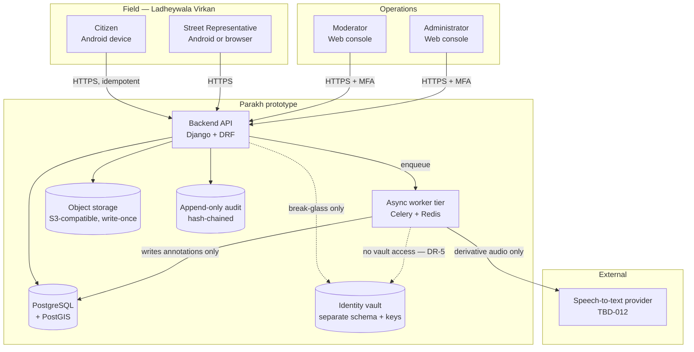

## 6.2 Logical component architecture

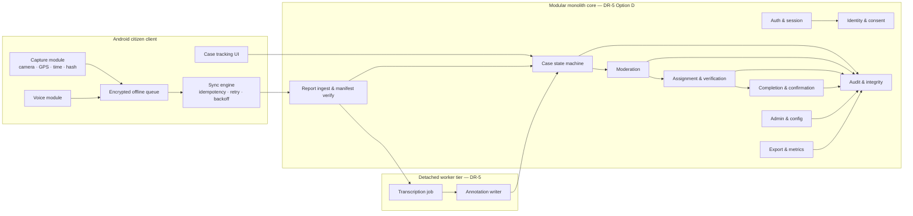

**Binding architecture rules from DR-5 (nine binding decisions):** one modular core deployable; the worker tier is asynchronous on a queue; **AI is read-only on evidence, write-only to annotations, and has no vault access**; **AI failure never blocks a workflow**; no service mesh; no distributed transactions in the MVP.

## 6.3 Trust boundaries

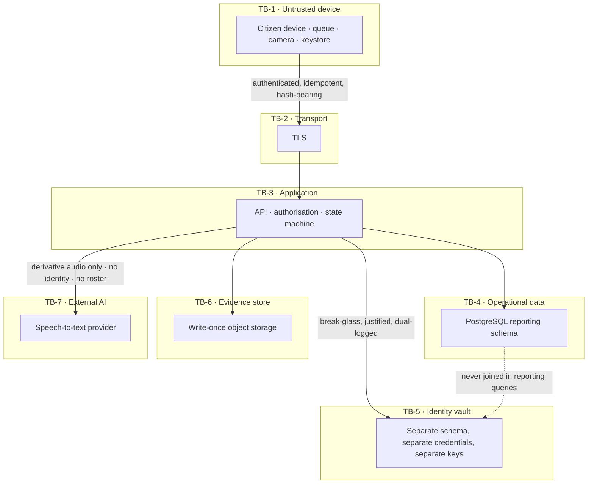

**Boundary rules.** TB-1 is untrusted: the server re-verifies every hash and never trusts client-supplied state. TB-5 is never joined to TB-4 in any reporting query. TB-7 receives **derivative audio only**, never identity, credentials or roster data (DR-10). Safeguarding-flagged content is **never** sent across TB-7 (DR-10).

## 6.4 Data flow — online submission

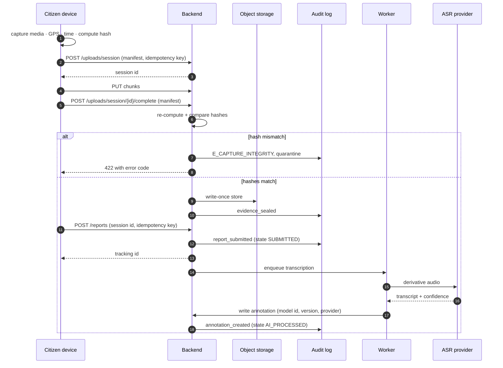

## 6.5 Data flow — offline capture and reconnect

```mermaid
sequenceDiagram
    autonumber
    participant CZ as Citizen device
    participant Q as Encrypted queue
    participant API as Backend

    CZ->>CZ: detect no connectivity
    CZ->>CZ: capture media · GPS · captured_at · hash
    CZ->>Q: store encrypted bundle + idempotency key
    Note over Q: state QUEUED
    CZ->>CZ: connectivity restored
    loop retry with exponential backoff + jitter
        Q->>API: upload session (same idempotency key)
        alt success
            API-->>Q: 201 or 200 (already processed)
            Q->>Q: mark SYNCED, delete local media only after server ack
        else transient failure
            API-->>Q: 5xx / timeout
            Q->>Q: increment attempt, backoff
        else permanent failure
            API-->>Q: 4xx
            Q->>Q: mark FAILED, surface to user with retry
        end
    end
    Note over API: captured_at preserved; received_at set by server
```

## 6.6 Evidence lifecycle

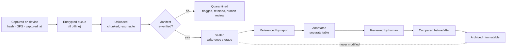

## 6.7 Identity separation

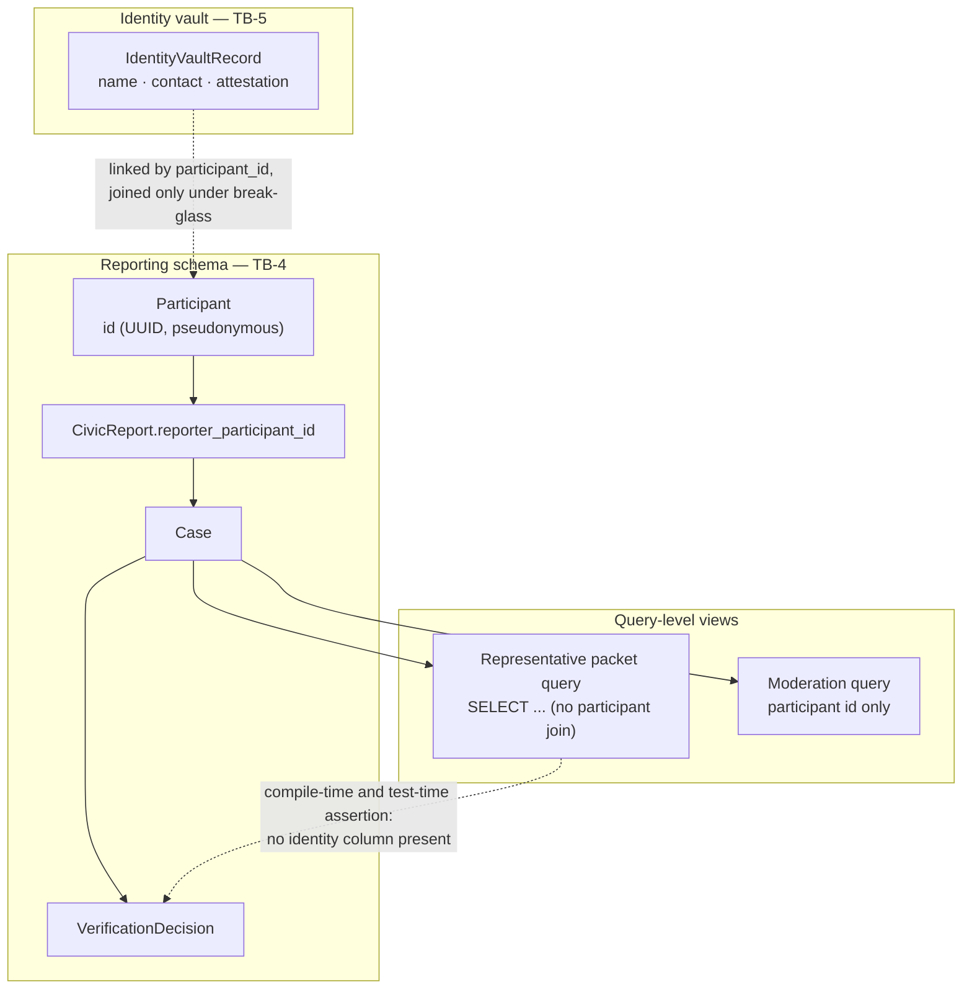

---

# 7. User Journeys, Navigation and Screen Inventory

## 7.1 Citizen navigation

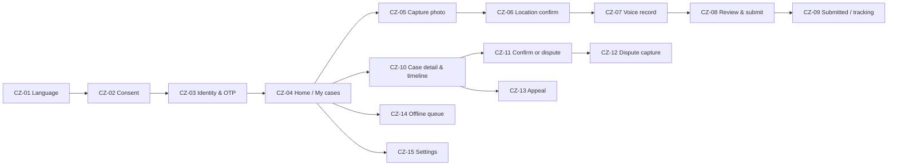

## 7.2 Moderator navigation

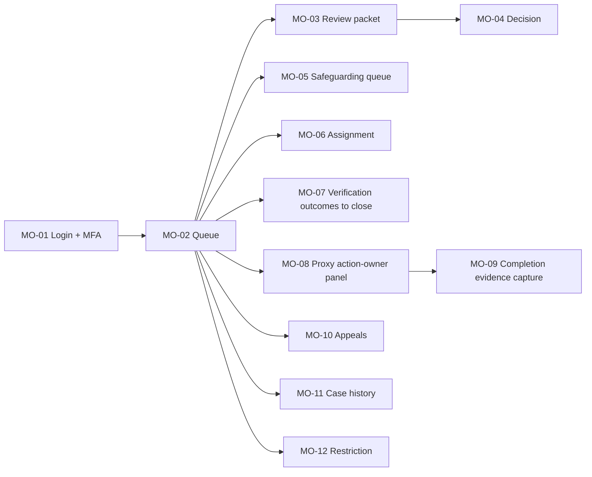

## 7.3 Representative navigation

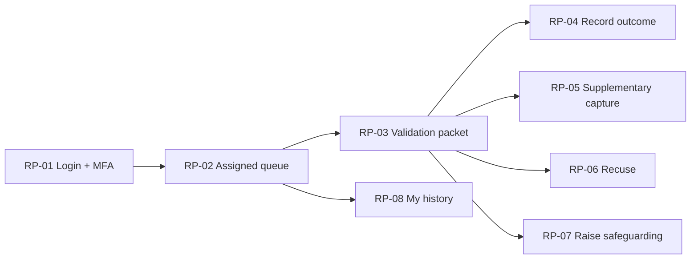

## 7.4 Administrator navigation

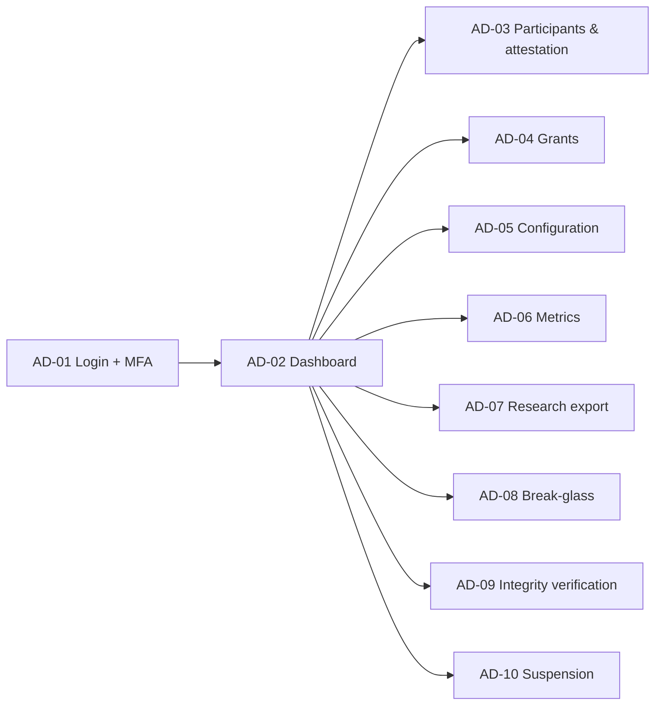

## 7.5 Completion-evidence path (proxy)

`MO-02 → MO-08 (select verified case) → record acknowledgement → record work started → MO-09 capture completion evidence live → system sets PENDING_CONFIRMATION → citizen notified in-app`. Every step writes `on_behalf_of` and `proxy_reason`.

## 7.6 Logout and session-expiry paths

| Situation | Behaviour |
|---|---|
| Explicit logout on the Android client | Session tokens revoked. **The encrypted offline queue is retained** (SRC-1 §10.5). On next login by the same participant the queue resumes. If a different participant logs in, the queue remains sealed and inaccessible |
| Session expiry mid-capture | Capture completes and the bundle enters the queue. On sync the client re-authenticates; the user is prompted once. `captured_at` is unchanged |
| Session expiry in the console | Redirect to login preserving the target URL. **No in-progress decision is auto-submitted** |
| Grant revoked while a Representative is viewing a packet | Next action returns `E_PERMISSION_DENIED`. The packet becomes read-only and then closes |

## 7.7 Error and recovery paths

Every screen implements the states defined in §7.8: empty, loading, success, and each listed error. Global rules: (a) no error dead-ends — every error screen offers a next action; (b) no captured evidence is ever lost as a consequence of an error (§12.14); (c) error text appears in the user's selected language and is never a raw code alone.

## 7.8 Screen inventory

> Notation — **Ctl** = controls; **Val** = validation; **A** = analytics events. All screens exist in Urdu and English.

### 7.8.1 Citizen application

| ID | **Rel** | Name | Actor | Purpose | Entry condition | Controls / fields | Validation | Empty | Loading | Success | Error states | Permissions | Analytics | Requirements |
|---|:--:|---|---|---|---|---|---|---|---|---|---|---|---|---|
| **CZ-01** | **P0** | Language selection | CZ | Choose Urdu or English | First launch, or Settings | Two large buttons with native-script labels | One must be chosen | — | — | Proceeds to CZ-02 | — | Public | `lang_selected` | FR-LOC-001. **Future exclusions (not built in P0):** the spoken language prompt is `FR-LOC-002` (P1) |
| **CZ-02** | **P1** | Consent | CZ | Record informed consent | After CZ-01 | Plain-language text, **audio playback of the full text**, Accept / Decline | Accept required to proceed | — | — | Consent artefact stored | `E_CONSENT_REQUIRED` | Public | `consent_shown`, `consent_granted` | FR-CIT-003 |
| **CZ-03** | **P0** | Identity & authentication | CZ | Authenticate | App opened and a language chosen. **Not gated on consent — consent is P1 (FR-CIT-003…006)** | Phone number, OTP entry, resend | Phone format; OTP 6 digits; ≤ 5 attempts | — | Spinner + text | Session established | `E_AUTH_REQUIRED`, `E_RATE_LIMITED`, `E_ACCOUNT_RESTRICTED` | Public | `auth_started`, `auth_succeeded`, `auth_failed` | FR-AUTH-001, FR-AUTH-002, FR-AUTH-003, FR-AUTH-004. **Future exclusions (not built in P0):** session-expiry warning `FR-AUTH-005` (P1); restriction and suspension messaging `FR-ADM-101`, `FR-ADM-102` (P1) |
| **CZ-04** | **P0** | Home / My cases | CZ | See own cases and start a report | Authenticated | **Large primary "Report a problem" button with icon and text label**, case list, offline badge. *(The spoken prompt on this button is **FR-LOC-002, P1** and is not present in P0)* | — | "You have no cases yet" + how to start | Skeleton list | List rendered | `E_SERVER_UNAVAILABLE` (shows cached) | CZ | `home_viewed` | FR-CIT-101, FR-CASE-101 |
| **CZ-05** | **P0** | Capture photo | CZ | Capture live evidence | Report started | **Not-an-emergency-service statement rendered as text at the top of the screen, before any capture control is reachable** (`FR-SAF-003`); **camera preview opens directly**; shutter; retake; counter 1–5; next | ≥ 1 photo; ≤ 5; live capture only | — | Camera init | Photo sealed locally | `E_CAMERA_UNAVAILABLE`, `E_PERMISSION_CAMERA`, `E_STORAGE_FULL` | CZ | `capture_started`, `photo_captured`, `capture_abandoned` | FR-EVD-001, FR-EVD-002, FR-EVD-003, FR-EVD-004, FR-EVD-005, **FR-SAF-003**. **Future exclusions (not built in P0):** integrity-flag surfacing `FR-EVD-006` (P1); spoken emergency guidance `FR-LOC-002` (P1) |
| **CZ-06** | **P0** | Location confirm | CZ | Confirm or place location | After ≥ 1 photo | Map, current pin, drag-to-adjust, accuracy readout, "GPS unavailable → place manually" | Location present, verified or flagged | — | GPS acquiring with a visible timer | Location stored with confidence | `E_LOCATION_DENIED`, `E_LOCATION_TIMEOUT`, `E_LOCATION_INACCURATE` | CZ | `location_captured`, `location_manual` | FR-EVD-101…105 |
| **CZ-07** | **P0** | Voice record | CZ | Describe the problem aloud | After location | **Large record button**, timer, **playback**, re-record. **Voice is mandatory — no typed field exists on this screen** | ≥ 3 s; ≤ 90 s | — | — | Audio sealed locally | `E_MIC_UNAVAILABLE`, `E_PERMISSION_MIC` | CZ | `voice_started`, `voice_recorded`, `voice_rerecorded` | FR-VOI-001, FR-VOI-002, FR-VOI-004. **Future exclusions (not built in P0):** optional typed note `FR-VOI-003`, typed fallback `FR-VOI-005`, low-confidence marking `FR-VOI-103` (all P1) |
| **CZ-08** | **P0** | Review & submit | CZ | Final check | After voice | Thumbnails, map, audio playback, **Submit** | All mandatory items present | — | — | Report queued or submitted | `E_VALIDATION_FAILED` | CZ | `review_viewed`, `submit_pressed` | FR-CIT-103, FR-CIT-104, FR-EVD-202. **Future exclusions (not built in P0):** the optional typed note is `FR-VOI-003` and the typed microphone fallback is `FR-VOI-005` (both P1) |
| **CZ-09** | **P0** | Submitted / tracking | CZ | Confirm receipt | After submit | Tracking reference, submitted status, plain-text next-step summary | — | — | — | Tracking ID shown | — | CZ | `report_submitted` | FR-CIT-105. **Future exclusions (not built in P0):** the spoken next-step prompt is `FR-LOC-002` (P1) |
| **CZ-10** | **P0** | Case detail & timeline | CZ | Follow the case | From CZ-04 | Status chip, **plain-language text explanation**, full event timeline, own evidence, transcript | — | — | Skeleton | Timeline rendered | `E_SERVER_UNAVAILABLE` | CZ (own) | `case_viewed` | FR-CASE-101, FR-CASE-102, FR-CASE-103. **Future exclusions (not built in P0):** the spoken explanation is `FR-LOC-002` (P1) |
| **CZ-11** | **P0** | Confirm or dispute | CZ | Close the loop | Case in `PENDING_CONFIRMATION` | Before/after images side by side, **Confirm** / **Dispute**. **No countdown, deadline or expiry warning is shown — the confirmation-window job is FR-FIX-104, P1, and does not run in P0** | Dispute requires reason + evidence | — | — | State transition | `E_INVALID_TRANSITION`, `E_EVIDENCE_REQUIRED` | CZ (reporter) | `confirm_shown`, `confirmed`, `disputed` | FR-FIX-101, FR-FIX-102, FR-FIX-103. **Future exclusions (not built in P0):** the confirmation-window expiry job and any countdown or deadline are `FR-FIX-104` (P1) and no expiry surface exists in P0 |
| **CZ-12** | **P0** | Dispute capture | CZ | Provide fresh evidence | From CZ-11 dispute | Live camera, reason text or voice | ≥ 1 live photo | — | — | Dispute recorded | as CZ-05 | CZ (reporter) | `dispute_evidence_captured` | FR-FIX-103 |
| **CZ-13** | **P1** | Appeal | CZ | Appeal a rejection | Report `REJECTED`, within window | Reason (voice or text), optional evidence | Reason required | — | — | Appeal filed | `E_APPEAL_WINDOW_CLOSED` | CZ (author) | `appeal_filed` | FR-ADM-101 |
| **CZ-14** | **P0** | Offline queue | CZ | See pending items | Always reachable | Queued items, per-item state, **Retry now**. **No storage indicator and no threshold warning — proactive storage monitoring is `FR-OFF-011` (P1)** | — | "Nothing waiting to send" | — | Items sync | `E_SYNC_FAILED`, `E_STORAGE_FULL` | CZ | `queue_viewed`, `manual_retry` | FR-OFF-001, FR-OFF-002, FR-OFF-003, FR-OFF-004, FR-OFF-005, FR-OFF-006, FR-OFF-007, FR-OFF-008, FR-CIT-102. **Future exclusions (not built in P0):** expired-authentication sync `FR-OFF-009`; corrupted queue item `FR-OFF-010`; **proactive storage monitoring, thresholds, indicator and advance warning `FR-OFF-011`**; multi-device behaviour `FR-OFF-012`. All four are P1. **`E_STORAGE_FULL` remains reachable in P0 as no-data-loss error handling under `FR-EVD-001` and `FR-OFF-002`** |
| **CZ-15** | **P1** | Settings | CZ | Language, withdraw consent, logout | Authenticated | Language toggle, withdraw consent, logout | Withdrawal double-confirmed | — | — | Applied | — | CZ | `settings_changed`, `consent_withdrawn` | FR-CIT-005, FR-LOC-001 |

### 7.8.2 Console — Moderator, Representative, Administrator

| ID | **Rel** | Name | Actor | Purpose | Entry | Controls / fields | Validation | Empty | Loading | Success | Error states | Permissions | Analytics | Requirements |
|---|:--:|---|---|---|---|---|---|---|---|---|---|---|---|---|
| **MO-01** | **P0** | Login + MFA | MOD/ADM/REP | **First factor only.** Username and credential; on success the client holds a `login_ticket` and **no session yet** | Public | Username, credential, submit. **No second-factor field on this surface** — the client is redirected to the MFA route carrying the `login_ticket` | MFA mandatory | — | Spinner | Session | **`E_AUTH_FAILED`** (wrong credential) · **`E_RATE_LIMITED`**. **`API-005` is public: a correct first factor returns `200` with a ticket, so `E_AUTH_REQUIRED` and `E_MFA_REQUIRED` are never returned from this screen** | Public | `console_login` | FR-AUTH-006 |
| **RP-01** | **P0** | Representative sign-in | REP | **First factor only.** Username and credential; on success the client holds a `login_ticket` and **no session yet** | Public | Username, credential, submit. **No second-factor field on this surface** — the client is redirected to the MFA route carrying the `login_ticket` | MFA mandatory | — | Spinner | Session with scope and grant expiry shown | **`E_AUTH_FAILED`** (wrong credential) · **`E_RATE_LIMITED`**. **`API-005` is public: a correct first factor returns `200` with a ticket, so `E_AUTH_REQUIRED` and `E_MFA_REQUIRED` are never returned from this screen** | Public | `console_login` | FR-AUTH-006 |
| **AD-01** | **P0** | Administrator sign-in | ADM | **First factor only.** Username and credential; on success the client holds a `login_ticket` and **no session yet** | Public | Username, credential, submit. **No second-factor field on this surface** — the client is redirected to the MFA route carrying the `login_ticket` | MFA mandatory | — | Spinner | Admin session | **`E_AUTH_FAILED`** (wrong credential) · **`E_RATE_LIMITED`**. **`API-005` is public: a correct first factor returns `200` with a ticket, so `E_AUTH_REQUIRED` and `E_MFA_REQUIRED` are never returned from this screen** | Public | `console_login` | FR-AUTH-006 |
| **AD-02** | **P0** | Administrator dashboard | ADM | Operational overview and navigation | Authenticated | **Integrity-check status** and a link to run the verifier; links to the P0 administration screens AD-03, AD-04, AD-09 and AD-11 | Read-only | "No activity yet" | Skeleton | Rendered | `E_SERVER_UNAVAILABLE` | admin | `admin_dashboard_viewed` | FR-AUD-005. **Future exclusions (not built in P0):** counts-by-state and queue-depth metrics are `FR-OBS-002` and `FR-OBS-003` (P1) and **are removed from P0 rather than left as unowned controls**; the break-glass access register is `FR-PRV-005` (P1); the export register is `FR-OBS-007` (P2) |
| **AD-11** | **P0** | Operator accounts | ADM | Create, enrol and deactivate console accounts | Authenticated | Account list with **username** and **enrolment status** (`awaiting_credential` · `credentialled` · `enrolled` · `locked` · `deactivated`); create account with a **username** (`API-098`, returns the enrolment link once); reissue a reset token (`API-102`); deactivate (`API-098`) | Role required; MFA before privileged action | "No operators" | — | Created / deactivated | `E_PERMISSION_DENIED`, `E_MFA_REQUIRED` | admin | `operator_account_created` | FR-ADM-003, FR-AUTH-008, **FR-AUTH-009** |
| **MO-14** | **P0** | Console credential setup and multi-factor authentication | MOD | Enrol, challenge, verify and recover the second factor | **Three mutually exclusive entry modes.** *(a)* **Credential setup** — entered only with an `enrolment_token`; *(b)* **MFA enrolment or re-enrolment** — entered with an `mfa_enrolment` ticket from `API-104`, a `login` ticket where `OperatorCredential.status = credentialled`, **or an `mfa_reenrolment` ticket from `API-005` after a recovery sign-in**; *(c)* **Login verification** — entered only with a `login` ticket | *(a)* username shown read-only, credential + confirm, submit (`API-104`). *(b)* TOTP QR and secret, confirm code (`API-099` enrol then confirm); **recovery codes are shown once, only after confirm succeeds**. *(c)* 6-digit code, or a recovery code (`API-100` challenge then verify, or `API-101`). **Neither (a) nor (b) issues a privileged session — only (c) does** | 6 digits; ≤ 5 attempts then lockout | — | *(a)* credential set, ticket returned — **no session**. *(b)* enrolment confirmed, recovery codes shown — **no session**. *(c)* privileged session issued | Privileged session issued | `E_ENROLMENT_TOKEN_INVALID`, `E_AUTH_FAILED`, `E_RATE_LIMITED`, `E_VALIDATION_FAILED`, `E_MFA_REENROLMENT_REQUIRED` | Ticket holder only | `mfa_enrolled`, `mfa_challenge`, `mfa_failed`, `mfa_lockout`, `privileged_login` | FR-AUTH-006, FR-AUTH-007, FR-AUTH-008, **FR-AUTH-009** |
| **RP-09** | **P0** | Console credential setup and multi-factor authentication | REP | As MO-14, for the Representative console | **Three mutually exclusive entry modes.** *(a)* **Credential setup** — entered only with an `enrolment_token`; *(b)* **MFA enrolment or re-enrolment** — entered with an `mfa_enrolment` ticket from `API-104`, a `login` ticket where `OperatorCredential.status = credentialled`, **or an `mfa_reenrolment` ticket from `API-005` after a recovery sign-in**; *(c)* **Login verification** — entered only with a `login` ticket | *(a)* username shown read-only, credential + confirm, submit (`API-104`). *(b)* TOTP QR and secret, confirm code (`API-099` enrol then confirm); **recovery codes are shown once, only after confirm succeeds**. *(c)* 6-digit code, or a recovery code (`API-100` challenge then verify, or `API-101`). **Neither (a) nor (b) issues a privileged session — only (c) does** | As MO-14 | — | *(a)* credential set, ticket returned — **no session**. *(b)* enrolment confirmed, recovery codes shown — **no session**. *(c)* privileged session issued | Privileged session issued | `E_ENROLMENT_TOKEN_INVALID`, `E_AUTH_FAILED`, `E_RATE_LIMITED`, `E_VALIDATION_FAILED`, `E_MFA_REENROLMENT_REQUIRED` | Ticket holder only | As MO-14 | FR-AUTH-006, FR-AUTH-007, FR-AUTH-008, **FR-AUTH-009** |
| **AD-12** | **P0** | Console credential setup and multi-factor authentication | ADM | As MO-14, for the Administrator console | **Three mutually exclusive entry modes.** *(a)* **Credential setup** — entered only with an `enrolment_token`; *(b)* **MFA enrolment or re-enrolment** — entered with an `mfa_enrolment` ticket from `API-104`, a `login` ticket where `OperatorCredential.status = credentialled`, **or an `mfa_reenrolment` ticket from `API-005` after a recovery sign-in**; *(c)* **Login verification** — entered only with a `login` ticket | *(a)* username shown read-only, credential + confirm, submit (`API-104`). *(b)* TOTP QR and secret, confirm code (`API-099` enrol then confirm); **recovery codes are shown once, only after confirm succeeds**. *(c)* 6-digit code, or a recovery code (`API-100` challenge then verify, or `API-101`). **Neither (a) nor (b) issues a privileged session — only (c) does** | As MO-14; reset requires a written reason | — | *(a)* credential set, ticket returned — **no session**. *(b)* enrolment confirmed, recovery codes shown — **no session**. *(c)* privileged session issued | Privileged session issued | `E_ENROLMENT_TOKEN_INVALID`, `E_AUTH_FAILED`, `E_RATE_LIMITED`, `E_VALIDATION_FAILED`, `E_MFA_REENROLMENT_REQUIRED` | Ticket holder only; reset is admin-only | As MO-14, plus `mfa_recovery_used`, `mfa_reset_by_admin` | FR-AUTH-006, FR-AUTH-007, FR-AUTH-008, **FR-AUTH-009** |
| **MO-02** | **P0** | Moderation queue | MOD | Triage | Authenticated | List ordered **safeguarding first, then age**; filters; age-vs-benchmark indicator | — | "Queue empty" | Skeleton | List | `E_SERVER_UNAVAILABLE` | `F2` | `queue_viewed` | FR-MOD-001 |
| **MO-03** | **P0** | Review packet | MOD | Examine a report | From MO-02 | Media viewer, **audio player**, transcript panel **visually separated and labelled machine-generated with model, version, confidence**, map, human category/severity fields, history | — | — | Skeleton | Rendered | `E_SERVER_UNAVAILABLE` | `F2` + object | `packet_viewed`, `audio_played` | FR-MOD-002, FR-VOI-102 |
| **MO-04** | **P0** | Moderation decision | MOD | Decide | From MO-03 | **Accept** — the only decision available in P0; **coded reason (required)**; **category (required)**; **severity (required)**; optional free-text note | **Reason mandatory**; conflict re-checked server-side | — | — | State transition + audit | `E_PERMISSION_DENIED`, `E_CONFLICT_OF_INTEREST`, `E_REASON_REQUIRED`, `E_INVALID_TRANSITION` | `F2` | `moderation_decided` | FR-MOD-003, FR-MOD-005. **Future exclusions (not built in P0):** the needs-information cycle is `FR-MOD-004` and report rejection is `FR-MOD-006`, both P1. **Neither control exists in the P0 build — absent, not hidden and not disabled** |
| **MO-05** | **P1** | Safeguarding queue | MOD | Handle welfare concerns | Authenticated | Restricted list, escalate, record action | Escalation reason required | "None" | — | Escalated | `E_PERMISSION_DENIED` | `F2` | `safeguarding_viewed`, `safeguarding_escalated` | FR-SAF-001…004 |
| **MO-06** | **P0** | Assignment | MOD | Assign to a representative | Case `OPEN_UNVALIDATED` | Eligible-representative list **(ineligible ones are absent, with the count of exclusions shown)**, assign. **No expiry countdown, reassign-on-expiry or expiry-override control — the assignment-expiry job is FR-REP-003, P1** | Conflict + scope + grant validity | "No eligible representative" + escalate | — | Assigned | `E_NO_ELIGIBLE_ASSIGNEE`, `E_CONFLICT_OF_INTEREST` | `F2` | `assignment_made` | FR-REP-001, FR-REP-002, FR-REP-004. **Future exclusions (not built in P0):** the assignment-expiry job and any expiry countdown, reassignment or override are `FR-REP-003` (P1) |
| **MO-07** | **P0** | Close verification | MOD | Apply **T5 only** | Outcome recorded by REP | Representative outcome and note; **Confirm-close to `VERIFIED`** — the only closure available in P0 | Reason required to depart from the recommendation | — | — | `VERIFIED` | `E_INVALID_TRANSITION`, `E_REASON_REQUIRED`, `E_VALIDATION_FAILED` | `F2` | `verification_closed` | FR-REP-105. **Future exclusions (not built in P0):** closure into `NOT_VALIDATED` by transition T6 is `FR-REP-109` (P1); return-to-pool is P1 |
| **MO-08** | **P0** | Proxy action-owner panel | MOD/ADM | Record acknowledgement / work started | Case `VERIFIED` | `on_behalf_of` (required), `proxy_reason` (required), Acknowledge, Work started | Both fields required | — | — | `IN_PROGRESS` | `E_PERMISSION_DENIED`, `E_PROXY_FIELDS_REQUIRED` | `F2` + `CAP_PROXY_COMPLETION` | `proxy_ack`, `proxy_work_started` | FR-FIX-001…003 |
| **MO-09** | **P0** | Completion evidence capture | MOD/ADM | Submit fix evidence by proxy | Case `IN_PROGRESS` **or `REOPENED` after a rework decision** | **Live capture only** — no gallery, no file picker; before-photo reference shown; **note required (≥ 20 characters)**; `on_behalf_of` and `proxy_reason` required. **No multiple-item manager (FR-FIX-005, P1) and no reject-completion or rework-request control (FR-FIX-007, P1)** | ≥ 1 live photo; note ≥ 20 characters; both proxy fields present | — | — | `PENDING_CONFIRMATION` | `E_LIVE_CAPTURE_REQUIRED`, `E_CAPTURE_INTEGRITY` | `F2` + `CAP_PROXY_COMPLETION` | `completion_submitted` | FR-FIX-002, FR-FIX-004. **Future exclusions (not built in P0):** multiple completion items are `FR-FIX-005` and completion rejection or rework request is `FR-FIX-007` (both P1) |
| **MO-10** | **P1** | Appeals | MOD | Decide an appeal | Appeal filed | Original decision, appeal statement, Reinstate / Uphold, reason | **Decider must not be a prior decision actor** | "None" | — | Outcome | `E_CONFLICT_OF_INTEREST` | `F2` | `appeal_decided` | FR-ADM-102…103 |
| **MO-11** | **P0** | Case history | MOD/ADM | Full audit trail | Any case | Chronological events: actor, action, reason, previous → new state, hash | Read-only | — | Skeleton | Rendered | — | `F2` / admin | `history_viewed` | FR-CASE-102 |
| **MO-12** | **P1** | Restriction | MOD/ADM | Temporarily restrict | Participant record | Restrict (temporary), reason, duration | Reason required | — | — | Applied + audit | `E_PERMISSION_DENIED` | `F2` (temp) | `restriction_applied` | FR-ADM-104 |
| **RP-02** | **P0** | Assigned queue | REP | See assigned cases | Authenticated + grant | List within scope, age indicator | — | "Nothing assigned" | Skeleton | List | `E_PERMISSION_DENIED` | `F1`+`F3` scoped | `rep_queue_viewed` | FR-REP-005 |
| **RP-03** | **P0** | Validation packet | REP | Examine the case | From RP-02 | Media, audio, transcript with provenance, map, history — **no identity field exists in the response** | — | — | Skeleton | Rendered | `E_PERMISSION_DENIED` | `F1` + object + scope | `rep_packet_viewed` | FR-REP-006, FR-PRV-002 |
| **RP-04** | **P0** | Record outcome | REP | Verify | From RP-03 | **`VALIDATED`** — the only outcome available in P0; **note (required, ≥ 20 characters)** | **Note mandatory**; save blocked without it; outcome validated against a one-value enum | — | — | Outcome stored, routed to MO-07. **The case state does not change** | `E_NOTE_REQUIRED`, `E_CONFLICT_OF_INTEREST`, `E_VALIDATION_FAILED` | `F1` | `verification_recorded` | FR-REP-101. **Future exclusions (not built in P0):** the negative outcome is `FR-REP-108`, the `unsafe_to_verify` flag is `FR-REP-103`, and supplementary capture is `FR-REP-102`, all P1. **None of the three controls exists in the P0 build — absent, not hidden and not disabled** |
| **RP-05** | **P1** | Supplementary capture | REP | Add live photos | From RP-03 | Live camera only | Live capture only | — | — | Attached | as CZ-05 | `F1` | `rep_photo_captured` | FR-REP-102 |
| **RP-06** | **P1** | Recuse | REP | Withdraw from a case | From RP-03 | Reason (required) | Reason required | — | — | Returned to pool, logged | — | `F1` | `recusal_recorded` | FR-REP-104 |
| **RP-07** | **P1** | Raise safeguarding | REP | Escalate a welfare concern | From RP-03 | Concern description | Description required | — | — | Routed to restricted queue | — | `F1` | `safeguarding_raised` | FR-SAF-002 |
| **RP-08** | **P1** | My history | REP | Own past outcomes | Authenticated | Own outcomes and notes | Read-only | "None yet" | — | Rendered | — | `F1` | `rep_history_viewed` | FR-REP-107 |
| **AD-03** | **P0** | Participants & attestation | ADM | Record attestation, activate, deactivate | Authenticated **admin session with MFA satisfied** | Participant list; **Create participant** (`API-090a`); **Record attestation and activate** (`API-090b`); **Deactivate** (`API-090c`); **Reactivate** (`API-090d`). `track` is fixed to `adult` and the student option is absent | Attestation party, method and notes all required; `track` must be `adult` | "No participants yet" | Skeleton | Activated | `E_VALIDATION_FAILED`, `E_PERMISSION_DENIED`, `E_MFA_REQUIRED` | admin only | `participant_attested`, `participant_activated`, `participant_deactivated` | FR-ADM-001, FR-AUTH-004, FR-SAF-005 |
| **AD-04** | **P0** | Grants | ADM | Grant / revoke capabilities | Authenticated | Capability, scope, **expiry (mandatory)**, revoke | Expiry required | "No grants" | — | Applied + audit | `E_VALIDATION_FAILED` | admin | `grant_created`, `grant_revoked` | FR-ADM-002…004 |
| **AD-05** | **P1** | Configuration | ADM | Adjust prototype parameters | Authenticated | Window durations, max photos, audio length, queue limits | Numeric bounds | — | — | Saved + audit | — | admin | `config_changed` | FR-ADM-005 |
| **AD-06** | **P1** | Metrics | ADM/MOD | Prototype metrics | Authenticated | §22 metric set, computed from event logs | Read-only | "No data yet" | Skeleton | Rendered | — | `F2`/admin | `metrics_viewed` | FR-OBS-001…004 |
| **AD-07** | **P2** | Research export | ADM | Anonymised export | Authenticated | Date range, **de-identification checklist (all items must be ticked)**, generate | Checklist mandatory | — | Progress | File produced + audit | `E_EXPORT_BLOCKED` | admin | `export_generated` | FR-OBS-005…007 |
| **AD-08** | **P1** | Break-glass | ADM | Access identity under justification | Authenticated | Participant, **justification (required, min length enforced)**, confirm | Justification required | — | — | Identity shown, dual-logged | `E_JUSTIFICATION_REQUIRED` | admin | `vault_access` | FR-PRV-005 |
| **AD-09** | **P0** | Integrity verification | ADM/MOD | Run the verifier | Authenticated | Run, scope selector, results | — | — | Progress | Pass / fail report | `E_CHAIN_VERIFICATION_FAILED` | `F2`/admin | `integrity_check_run` | FR-AUD-005 |
| **AD-10** | **P1** | Suspension | ADM | Permanent suspension | Participant record | Suspend permanently, reason | **Reason required; ADM only** | — | — | Applied + audit | `E_PERMISSION_DENIED` | admin | `suspension_applied` | FR-ADM-105 |

| **CZ-16** | **P1** | Case reconsideration | CZ | **Conditional on TBD-056 — specified, not built.** Request reconsideration of a final case rejection | Case `REJECTED_FINAL_CASE`, within window | Reason (voice or text), live capture | Reason + ≥ 1 live photo | — | — | Reconsideration filed | `E_INVALID_TRANSITION`, `E_EVIDENCE_REQUIRED` | CZ (reporter) | `reconsideration_filed` | §10.9.2, blocked on TBD-056 |
| **MO-13** | **P1** | Reconsideration review | MOD | **Conditional on TBD-056 — specified, not built.** Decide a case reconsideration | Reconsideration filed | Original closure, new evidence, Re-verify / Uphold, reason | Reason required; decider not the original closer | "None" | — | Outcome | `E_CONFLICT_OF_INTEREST` | `F2` | `reconsideration_decided` | §10.9.2, blocked on TBD-056 |

**Screen count:** 16 citizen, 35 console = **51 screens**, of which **34 are P0**, 15 are P1 and 2 are P2. Two of the P1 screens — CZ-16 and MO-13 — are **specified, not built**, and are conditional on TBD-056. The three console multi-factor screens MO-14, RP-09 and AD-12 were added in v1.3 because FR-AUTH-007 and FR-AUTH-008 are P0 and had no screen. All are prototype-scope; none is a future portal.

---
# 8. Business Rules
> **Scope of this section.** §8 contains **business rules only**. Every detailed functional-requirement block lives in §9. `FR-VOI-004` and `FR-VOI-005` were misplaced here in v1.2 and v1.3 and were moved to **§9.6** in v1.3.1.


Every rule is binding on implementation and independently testable.

| ID | Rule | Source | Test |
|---|---|---|---|
| **BR-001** | A **complaint** is an assertion; **evidence** is a record another person can later check. Parakh shall store and process evidence records, never free-standing assertions without evidence | SRC-3 §2 | TEST-EVD-001 |
| **BR-002** | **Live-capture rule.** All report media on the citizen reporting path shall be captured by the in-app camera. **No gallery, file-picker, share-intent or import path shall exist** on that path | SRC-1 C-6, FR-401 | TEST-EVD-002 |
| **BR-003** | **Original-evidence immutability.** Once sealed, the bytes and capture metadata of an evidence item shall never be modified, replaced or deleted by any actor or process | SRC-1 §12.2, DR-8 | TEST-AUD-004 |
| **BR-004** | **AI-authority boundary.** No AI output shall change a case state, accept or reject a report, restrict a user, close a case, judge truthfulness, or label a person | SRC-1 DR-1 p.4, FR-504, DR-16 | TEST-AI-001, TEST-AI-002 |
| **BR-005** | **Human-review requirement.** Every consequential decision shall be attributable to a named authenticated human, with a timestamp and a recorded reason | SRC-1 §13.4; SRC-3 §10 | TEST-AUD-002 |
| **BR-006** | **Identity-separation rule.** Reporter identity shall be excluded from Representative-facing queries at the query-construction layer, not hidden in the interface | SRC-1 DR-18, FR-702 | TEST-PRV-001 |
| **BR-007** | **No anonymous reporting.** Every report shall be linked to a verified participant | SRC-1 C-6 | TEST-AUTH-004 |
| **BR-008** | **Minors rule.** No participant under 18 shall be enrolled in the prototype. The student track exists in the data model but is disabled by configuration | SRC-1 C-8; §17.6 | TEST-SAF-005 |
| **BR-009** | **Data-minimisation rule.** The system shall collect only data required by an approved requirement. Device fingerprints, contact lists, advertising IDs, background location and cross-app identifiers are prohibited | SRC-1 DR-16 | TEST-PRV-005 |
| **BR-010** | **Moderation rule.** A report shall enter the workflow only by an explicit human moderation decision carrying a coded reason | SRC-1 FR-803, T3 | TEST-MOD-002 |
| **BR-011** | **Assignment rule.** A verification assignment shall be created only for a Representative who holds a valid, unexpired, in-scope grant and passes all conflict checks **at assignment time** | SRC-1 FR-701 | TEST-REP-001 |
| **BR-012** | **Verification rule.** A verification outcome shall not be saved without a written note | SRC-1 FR-703 | TEST-REP-005 |
| **BR-013** | **Recommend-then-close rule.** A Representative records an outcome; a **Moderator** closes the corresponding case state (T5 / T6) | SRC-1 §6.1.2; SRC-3 §6 | TEST-CASE-002 |
| **BR-014** | **Completion rule.** Completion evidence shall be live-captured through the same pipeline as citizen evidence, and shall reference the case's original evidence | SRC-1 FR-309; SRC-3 §4 Stage 10 | TEST-FIX-002 |
| **BR-015** | **`FIX_CLAIMED` ≠ `RESOLVED`.** The state `PENDING_CONFIRMATION` shall never be treated, displayed, exported or aggregated as a resolved state | SRC-1 T8/T9; SRC-3 §4 Stage 11 | TEST-CASE-004 |
| **BR-016** | **Citizen confirmation.** Only the reporter may confirm or dispute a claimed fix. A dispute requires a reason **and** fresh live evidence | SRC-1 FR-306 | TEST-FIX-004 |
| **BR-017** | **Reopening.** A dispute, or a Moderator action with a reason, shall return the case to `IN_PROGRESS` via `REOPENED`. Prior submissions are retained | SRC-1 T11 | TEST-CASE-005 |
| **BR-018** | **Recurrence.** Recurrence linkage is **Future**. The prototype shall record location and closure data sufficient to support it later, and shall make no recurrence claim | SC-FUT-07 | TEST-DAT-003 |
| **BR-019** | **No-money boundary.** No money field, balance, wallet, payment, escrow, disbursement or transfer capability shall exist anywhere in the system | SRC-1 C-5, DR-2 | TEST-SEC-010 |
| **BR-020** | **Contractor-selection boundary.** The system shall not select, rank, score or recommend a contractor. Contractor selection belongs to the appropriate government or procurement authority | SRC-1 DR-2 | TEST-SEC-011 |
| **BR-021** | **Publication restriction.** No public map, public case list or public dashboard shall exist in the prototype. Any internal aggregate view shall be role-restricted | SRC-1 DR-4 | TEST-PRV-006 |
| **BR-022** | **No-deletion rule.** No actor, including the Administrator, shall have a capability to hard-delete a report, case, evidence item or audit row. Corrections append | SRC-1 DR-8; SRC-4 §15.3 | TEST-AUD-004 |
| **BR-023** | **Retention boundary.** Retention fields shall be recorded on every personal-data record. **No automatic deletion shall run** until retention periods are approved | SRC-1 §12.3; TBD-006 | TEST-DAT-004 |
| **BR-024** | **Status-change authority.** A case state shall change only through a transition defined in §10 and only by an actor permitted for that transition. No direct state write shall be exposed | SRC-1 FR-901 | TEST-CASE-006 |
| **BR-025** | **Reason-required decisions.** Moderation decisions, verification outcomes, recusals, restrictions, suspensions, reopenings, proxy actions, break-glass access and configuration changes all require a recorded reason | SRC-1 §13.4, Appendix A | TEST-AUD-002 |
| **BR-026** | **Capture-time authority.** The capture timestamp shall be the operative time for a report. The server-received timestamp shall be stored separately and shall never overwrite it | SRC-1 §10.2.2; SRC-3 §4 Stage 2 | TEST-OFF-006 |
| **BR-027** | **Degraded-AI rule.** Failure or unavailability of any AI service shall never block capture, submission, moderation, verification or closure | SRC-1 DR-5, FR-505 | TEST-AI-005 |
| **BR-028** | **Annotation-provenance rule.** Every machine annotation shall carry `model_id`, `model_version` and `provider`. A null in any of these is invalid and shall be rejected at write time | SRC-1 §11.2.1, Appendix C | TEST-AI-003 |
| **BR-029** | **Self-approval prohibition.** The actor who submitted an evidence item shall never be permitted to verify or confirm it | SRC-4 §10.4; §5.2 | TEST-REP-004 |
| **BR-030** | **Appeal independence.** An appeal shall be decided by a moderator who was not a prior decision actor on that report | SRC-1 §6.1.3 | TEST-ADM-003 |
| **BR-031** | **Safeguarding precedence.** Content indicating a welfare concern shall be routed to a restricted queue and escalated immediately, overriding normal workflow order | SRC-1 FR-808 | TEST-SAF-001 |
| **BR-032** | **Honest-status rule.** No UI string, export, screen or generated document shall assert Punjab Government branding, adoption, endorsement, partnership or demonstrated impact | SRC-1 §0.7; SRC-4 cover | TEST-LOC-006 |
| **BR-033** | **Language-scope rule.** The prototype shall support **Urdu and English including Urdu–English code-switching only**. No UI or output shall claim Punjabi support | SRC-1 C-4; SC-01 | TEST-LOC-005 |
| **BR-034** | **Hash-limitation rule.** Any UI or document referring to integrity shall state that hashing detects change to a stored record and **does not prove that a photograph or statement was truthful** | SRC-1 DR-8 | TEST-AUD-006 |
| **BR-035** | **Proxy-transparency rule.** Every action recorded on behalf of a pilot-site authority shall store `on_behalf_of` and `proxy_reason` and shall be labelled as a proxy action in every view where it appears | SC-03; SRC-1 FR-309 | TEST-FIX-001 |

# 9. Functional Requirements

> **Reading the requirement blocks.** Every block below carries all fields mandated by the SRS brief. `C/R/U` denotes create, read, update on the named entity. "Offline" describes device-side behaviour when connectivity is absent.
>
> **Acceptance format.** The **134 detailed blocks in this section** state acceptance criteria in **Given/When/Then** form and map to the test IDs listed. The **15 `FR-OBS-1xx` metric requirements are defined authoritatively in §22** and state acceptance in **metric/formula form** — a named event source, a computation and a reporting rule — because a metric definition has no interactive flow to express as Given/When/Then. **149 active requirements = 134 detailed blocks here + 15 metric definitions in §22.**

---

## 9.1 Authentication and Identity (FR-AUTH)

### FR-AUTH-001 — Phone-based authentication challenge

| Field | Value |
|---|---|
| **Requirement** | The system shall allow a Citizen to begin authentication by submitting a phone number, and shall issue a single-use one-time passcode valid for a configurable period (default 300 seconds) |
| **Purpose** | Authenticate a returning participant without treating the phone number as identity proof |
| **Source** | SRC-1 DR-9 (*"OTP is authentication only, never sufficient identity"*), Appendix B `POST /auth/challenge` |
| **Release / Priority** | **P0** · Must for that release |
| **Actors** | Primary: Citizen · Secondary: System |
| **Trigger** | Citizen submits a phone number on CZ-03 |
| **Preconditions** | The phone number is associated with an activated participant |
| **Main flow** | 1. Client posts the phone number. 2. Server resolves it to a participant. 3. Server generates a single-use passcode, stores its hash and expiry. 4. Server dispatches the passcode. 5. Server returns a challenge identifier |
| **Alternate flows** | Phone not recognised → the system returns the **same** generic response and does **not** reveal whether the number exists |
| **Exception flows** | Rate limit exceeded → `E_RATE_LIMITED` with retry metadata. Dispatch failure → `E_SERVER_UNAVAILABLE`, retryable |
| **Inputs** | `phone` (E.164), `idempotency_key` |
| **Validation** | Phone matches E.164; ≤ 5 challenges per number per hour and ≤ 20 per IP per hour (configurable) |
| **Processing rules** | Passcode stored only as a salted hash. Prior unused passcodes for the same participant are invalidated |
| **Outputs** | `challenge_id`, `expires_at` |
| **Data** | C `AuthChallenge`; R `Participant` |
| **Permissions** | Public endpoint |
| **Audit event** | `auth_challenge_issued` — participant reference, time, correlation ID. **The passcode is never logged** |
| **Privacy** | The phone number is vault data; the operational log stores only the participant reference |
| **Security** | Rate limiting; no user enumeration; passcode hashed at rest |
| **AI involvement** | None |
| **Offline** | Not available offline. The client shows `E_NO_CONNECTIVITY` and preserves any queued work |
| **Localisation / accessibility** | Error and instruction text in the selected language; numeric keypad. *(Spoken prompts and status audio are `FR-LOC-002`, **P1**, and are not required by this P0 requirement.)* |
| **Dependencies** | SMS or equivalent dispatch — TBD-013 |
| **Telemetry** | `auth_started` |
| **Acceptance** | **Given** an activated participant, **when** a valid phone number is submitted, **then** a challenge is created, a single-use passcode is dispatched, and no response field distinguishes a known from an unknown number. **Given** six challenges within one hour for one number, **when** a seventh is submitted, **then** `E_RATE_LIMITED` is returned with retry metadata |
| **Tests** | TEST-AUTH-001, TEST-SEC-002 |
| **Open questions** | TBD-013 (dispatch channel) |

### FR-AUTH-002 — Passcode verification and session issue

| Field | Value |
|---|---|
| **Requirement** | The system shall verify a submitted passcode against the stored hash and, on success, issue a short-lived access token and a rotating refresh token |
| **Purpose** | Establish an authenticated session with rotation-based theft detection |
| **Source** | SRC-1 Appendix B `POST /auth/verify`, §13.6 |
| **Release / Priority** | **P0** · Must for that release |
| **Actors** | Primary: Citizen · Secondary: System |
| **Trigger** | Citizen submits a passcode |
| **Preconditions** | An unexpired challenge exists |
| **Main flow** | 1. Compare hashes in constant time. 2. Invalidate the passcode. 3. Create a session. 4. Return access + refresh tokens |
| **Alternate flows** | Participant restricted → session issued with restricted scope and a clear explanation (FR-ADM-104). Participant suspended → `E_ACCOUNT_SUSPENDED`, no session |
| **Exception flows** | Wrong passcode → `E_AUTH_FAILED`, attempt counter incremented; after 5 failures the challenge is invalidated. Expired → `E_AUTH_EXPIRED` |
| **Inputs** | `challenge_id`, `passcode` |
| **Validation** | Challenge unexpired; attempts < 5 |
| **Processing rules** | Constant-time comparison. Single use enforced |
| **Outputs** | `access_token`, `refresh_token`, `participant_id`, `roles`, `language` |
| **Data** | C `Session`; U `AuthChallenge`; R `Participant`, `RoleAssignment` |
| **Permissions** | Public |
| **Audit event** | `auth_succeeded` or `auth_failed` — never with the passcode |
| **Privacy** | Only pseudonymous `participant_id` is returned |
| **Security** | Refresh rotation; reuse of a rotated refresh token invalidates the whole token family (SRC-1 §13.6) |
| **AI involvement** | None |
| **Offline** | Unavailable; queued work preserved |
| **Localisation / accessibility** | Localised messages; large numeric entry |
| **Dependencies** | FR-AUTH-001 |
| **Telemetry** | `auth_succeeded`, `auth_failed` |
| **Acceptance** | **Given** a valid unexpired passcode, **when** submitted, **then** tokens are issued and the passcode cannot be reused. **Given** a rotated refresh token, **when** the old token is presented, **then** the entire family is invalidated and `E_AUTH_REUSE_DETECTED` is returned |
| **Tests** | TEST-AUTH-002, TEST-SEC-003 |
| **Open questions** | None |

### FR-AUTH-003 — Session lifetime, refresh and revocation

| Field | Value |
|---|---|
| **Requirement** | The system shall expire access tokens after a configurable period, allow refresh with rotation, and revoke all sessions for a participant on logout, restriction, suspension or consent withdrawal |
| **Purpose** | Bound the window of a compromised token; make revocation immediate |
| **Source** | SRC-1 §13.6; Appendix B `/auth/refresh`, `/auth/logout` |
| **Release / Priority** | **P0** · Must for that release |
| **Actors** | Primary: all authenticated actors |
| **Trigger** | Token expiry, explicit logout, or an administrative action |
| **Preconditions** | An active session |
| **Main flow** | 1. Client refreshes before expiry. 2. Server rotates and returns a new pair. 3. Old refresh token is marked consumed |
| **Alternate flows** | Logout → all tokens for that session revoked; **the encrypted offline queue is retained** (§7.6) |
| **Exception flows** | Revoked session used → `E_AUTH_REQUIRED`. Grant revoked mid-session → next authorised action returns `E_PERMISSION_DENIED` |
| **Inputs** | `refresh_token` |
| **Validation** | Token unconsumed, unexpired, family not invalidated |
| **Processing rules** | Access-token lifetime default 30 min; refresh default 14 days — both configurable, values not approved → TBD-014 |
| **Outputs** | New token pair, or an error |
| **Data** | U `Session` |
| **Permissions** | Authenticated |
| **Audit event** | `session_refreshed`, `session_revoked` |
| **Privacy** | No personal data in tokens beyond the pseudonymous participant ID |
| **Security** | Tokens stored in the platform keystore, never in plain preferences or logs |
| **AI involvement** | None |
| **Offline** | Capture continues while a session is expired; sync re-authenticates and prompts once |
| **Localisation / accessibility** | Re-authentication prompt localised and explains that nothing captured has been lost |
| **Dependencies** | FR-AUTH-002, FR-OFF-009 |
| **Telemetry** | `session_expired`, `session_refreshed` |
| **Acceptance** | **Given** an expired access token, **when** the client refreshes with a valid refresh token, **then** a new pair is issued and the old refresh token is consumed. **Given** a participant is suspended, **when** any existing session makes a request, **then** it is rejected within one request cycle |
| **Tests** | TEST-AUTH-003, TEST-SEC-004 |
| **Open questions** | TBD-014 (token lifetimes) |

### FR-AUTH-004 — Verified identity precondition for reporting

| Field | Value |
|---|---|
| **Requirement** | The system shall reject any report submission from a participant whose identity has not been attested and activated, and shall provide no anonymous reporting path |
| **Purpose** | Enforce C-6 |
| **Source** | SRC-1 C-6, FR-201, DR-9 |
| **Release / Priority** | **P0** · Must for that release |
| **Actors** | Primary: Citizen · Secondary: Administrator |
| **Trigger** | Report submission |
| **Preconditions** | — |
| **Main flow** | 1. Server checks `Participant.status == active` and an attestation record exists. 2. If satisfied, submission proceeds |
| **Alternate flows** | Status `pending` → the client permits capture and queueing but blocks submission with a clear explanation (SRC-4 §9 STEP 002 failure path) |
| **Exception flows** | Status `withdrawn` or `suspended` → `E_ACCOUNT_SUSPENDED`; queued items remain encrypted and are not uploaded |
| **Inputs** | Session context |
| **Validation** | Active status; attestation present |
| **Processing rules** | Attestation is recorded manually by the Administrator in the prototype (SC-LIM-03) |
| **Outputs** | Permit or `E_IDENTITY_REQUIRED` |
| **Data** | R `Participant`, `AttestationRecord` |
| **Permissions** | Citizen |
| **Audit event** | `submission_blocked_identity` when blocked |
| **Privacy** | Attestation details live in the vault; the check returns only a boolean |
| **Security** | Server-side only; never trusted from the client |
| **AI involvement** | None |
| **Offline** | Capture and queueing are allowed; upload is blocked with the reason shown in the queue screen |
| **Localisation / accessibility** | Blocking message explains what to do next *(Spoken prompts and status audio are `FR-LOC-002`, **P1**, and are not required by this P0 requirement.)* |
| **Dependencies** | FR-ADM-001 |
| **Telemetry** | `identity_block` |
| **Acceptance** | **Given** a participant with status `pending`, **when** a queued report attempts to sync, **then** upload is refused with `E_IDENTITY_REQUIRED`, the item stays in the queue, and no data is lost. **Given** any request, **when** the codebase is searched, **then** no endpoint accepts a report without an authenticated participant |
| **Tests** | TEST-AUTH-004, TEST-PRV-004 |
| **Open questions** | None |

### FR-AUTH-005 — Restricted-account behaviour

| Field | Value |
|---|---|
| **Requirement** | The system shall allow a temporarily restricted participant to authenticate and view their existing cases, but shall refuse new report submissions, and shall display the restriction reason and the appeal route |
| **Purpose** | Restriction is a bounded, explained, appealable action — not silent exclusion |
| **Source** | SRC-1 FR-805; SRC-4 §5.17 |
| **Release / Priority** | **P1** · Must for that release |
| **Actors** | Primary: Citizen · Secondary: Moderator |
| **Trigger** | Authentication or submission by a restricted participant |
| **Preconditions** | An active restriction exists |
| **Main flow** | 1. Session issued with restricted scope. 2. Read paths permitted. 3. Submission blocked with the reason and appeal route |
| **Alternate flows** | Restriction expires → full scope restored on the next session refresh |
| **Exception flows** | Permanent suspension → no session at all |
| **Inputs** | Session context |
| **Validation** | Restriction active and unexpired |
| **Processing rules** | Restriction never deletes existing cases or evidence |
| **Outputs** | Restricted session; explanatory message |
| **Data** | R `Restriction` |
| **Permissions** | Citizen |
| **Audit event** | `restricted_access_attempt` |
| **Privacy** | The reason shown to the participant is the recorded coded reason, without any reviewer identity |
| **Security** | Enforced server-side on every mutating endpoint |
| **AI involvement** | None. **No AI output may cause a restriction** (BR-004) |
| **Offline** | Queued items remain; upload refused with the explanation |
| **Localisation / accessibility** | Reason and appeal route localised, with audio |
| **Dependencies** | FR-ADM-104 |
| **Telemetry** | `restriction_encountered` |
| **Acceptance** | **Given** a restricted participant, **when** they authenticate, **then** they can read their cases and see the reason and appeal route, **and** any submission attempt returns `E_ACCOUNT_RESTRICTED` |
| **Tests** | TEST-AUTH-005 |
| **Open questions** | None |

### FR-AUTH-006 — Multi-factor authentication for privileged roles

| Field | Value |
|---|---|
| **Requirement** | The system shall require two factors before issuing any privileged access token. **The first factor alone shall return a short-lived `login_ticket` carrying no privileged scope and shall not be an error**; the second factor, presented with that ticket, is the only path to a privileged access and refresh token pair |
| **Purpose** | DR-9 mandates MFA for privileged roles |
| **Source** | SRC-1 DR-9 (*"Privileged roles require MFA, TOTP/passkey preferred over SMS"*) |
| **Release / Priority** | **P0** · Must for that release |
| **Actors** | Primary: REP, MOD, ADM |
| **Trigger** | Console login |
| **Preconditions** | Account has an enrolled second factor |
| **Main flow** | 1. `API-005` verifies the first-factor credential and returns a `login_ticket` (kind `login`, 240 s, single-use, no privileged scope). 2. `API-100` issues and verifies the second factor **against that ticket**. 3. Access and refresh tokens are issued **only** by `API-100` or `API-101` |
| **Alternate flows** | Second factor not yet enrolled → forced enrolment before any privileged action |
| **Exception flows** | **Error semantics, stated exactly.** Wrong first-factor credential at `API-005` → `401 E_AUTH_FAILED`. Wrong or absent second-factor code at `API-100` → `401 E_AUTH_FAILED` with `attempts_left`. **A `login` or `mfa_enrolment` ticket presented as a bearer to any business endpoint → `401 E_AUTH_REQUIRED`** — a ticket is not a bearer credential. **A valid access token whose account has incomplete enrolment → `403 E_MFA_REQUIRED`.** Missing or malformed `Authorization` header on a bearer-protected route → `401 E_AUTH_REQUIRED`. Five failures in the window → `429 E_RATE_LIMITED` and a lockout recorded on `OperatorCredential` A sign-in attempted while `MfaEnrolment.reenrolment_required` is set → **`403 E_MFA_REENROLMENT_REQUIRED`** from `API-100`; `API-099` re-enrolment clears it. Five wrong codes against one `AuthFlowSession` → the session is `locked`, `OperatorCredential.locked_until` is set and `429 E_RATE_LIMITED` is returned. **A replayed ticket or a replayed flow session returns `401 E_AUTH_FAILED` and opens nothing.** |
| **Inputs** | Credentials; TOTP code or passkey assertion |
| **Validation** | Both factors valid |
| **Processing rules** | TOTP or passkey preferred over SMS (DR-9) |
| **Outputs** | Privileged session |
| **Data** | C `Session`; R `MfaEnrolment` |
| **Permissions** | Public endpoint, privileged outcome |
| **Audit event** | `privileged_login`, `mfa_failed` |
| **Privacy** | No personal data in the MFA record beyond the enrolment secret, which is encrypted |
| **Security** | Lockout after repeated failure; secrets encrypted at rest |
| **AI involvement** | None |
| **Offline** | Console is online-only |
| **Localisation / accessibility** | Localised; large entry field |
| **Dependencies** | FR-ADM-002 |
| **Telemetry** | `console_login`, `mfa_challenge` |
| **Acceptance** | **Given** a Moderator account, **when** the first factor alone is presented to `API-005`, **then** the response is `200` with a `login_ticket` and **no access token, no refresh token and no session cookie**; it is **not** an error. **Given** the codebase, **when** privileged routes are enumerated, **then** every one asserts an MFA-satisfied session |
| **Tests** | TEST-AUTH-006, TEST-SEC-005 |
| **Open questions** | TBD-015 (second-factor mechanism) |

### FR-AUTH-007 — MFA enrolment, challenge and verification

| Field | Value |
|---|---|
| **Requirement** | The system shall require every Representative, Moderator and Administrator to enrol a TOTP or passkey second factor before performing any privileged action, shall challenge the second factor at every console sign-in, shall issue single-use recovery codes at enrolment, and shall lock the account for a configurable period after five consecutive failures. **Enrolment is performed against an `mfa_enrolment` ticket from `API-104` or a `login` ticket from `API-005` where the account is credentialled but not yet enrolled — never against a bearer token, because no bearer exists before enrolment completes.** The shared secret is encrypted at rest and every recovery code is stored only as a hash |
| **Release / Priority** | **P0** · Must for that release |
| **Purpose / rationale** | DR-9 mandates MFA for privileged roles. v1.0 asserted the requirement but specified no enrolment, challenge, verification or recovery flow, so it was not implementable |
| **Source** | SRC-1 DR-9 (*"MFA for privileged roles, TOTP/passkey preferred over SMS"*); **enrolment and recovery flows are `Source: Derived requirement`** because DR-9 states the obligation without the mechanism |
| **Actors** | Primary: Representative, Moderator, Administrator · Secondary: Administrator (reset) |
| **Preconditions** | A console account exists (FR-ADM-003) |
| **Trigger** | First sign-in, or any subsequent console sign-in |
| **Main flow** | 1. First factor presented; a short-lived login ticket is issued with **no privileged scope**. 2. If unenrolled, enrolment is forced: provisioning material is issued and confirmed with a live code. 3. Ten single-use recovery codes are shown **once** and stored only as hashes. 4. On subsequent sign-ins the second factor is challenged and verified before any privileged token is issued |
| **Alternative flows** | Passkey instead of TOTP where the platform supports it |
| **Error conditions** | `E_MFA_REQUIRED` for any privileged call on an unenrolled or unchallenged session · `E_AUTH_FAILED` on a wrong code · `E_RATE_LIMITED` after 5 failures, with lockout |
| **Privacy implications** | The enrolment secret is not personal data but is encrypted at rest; recovery codes are never logged, never emailed in plaintext, and never displayed twice |
| **Security implications** | The login ticket carries no privileged scope, so a stolen first factor alone grants nothing. **SMS is not used as a second factor** |
| **Offline behaviour** | Console is online-only; not applicable |
| **Outputs / postconditions** | A privileged session exists only where both factors were satisfied in the same authentication event |
| **Acceptance (Given/When/Then)** | **Given** a Moderator account with no enrolled factor, **when** any privileged endpoint is called, **then** `E_MFA_REQUIRED` is returned and no privileged action occurs. **Given** an enrolled account, **when** the password alone is presented, **then** no privileged token is issued. **Given** five consecutive wrong codes, **then** the account is locked for the configured period and the lockout is audited |
| **Linked tests** | TEST-AUTH-006, TEST-AUTH-007, TEST-SEC-005 |
| **Linked screens** | MO-01, RP-01, AD-01, AD-11 |
| **Linked APIs** | API-099, API-100 |
| **Dependencies** | FR-ADM-003 |
| **Audit events** | `mfa_enrolled`, `mfa_challenge`, `mfa_failed`, `mfa_lockout` |
| **Open decisions** | TBD-015 (TOTP versus passkey) · TBD-052 (lockout duration) |

### FR-AUTH-008 — MFA recovery and administrator reset

| Field | Value |
|---|---|
| **Requirement** | The system shall allow a privileged user who has lost their second-factor device to authenticate with a single-use recovery code, shall consume that code, shall notify the account of its use, and shall additionally permit an Administrator to reset a second factor with a mandatory written reason recorded in both the audit log and a security register. **The Administrator reset issues a new single-use enrolment token that is consumed by `API-104`**, so the reset re-enters the documented enrolment path rather than producing an output nothing accepts |
| **Release / Priority** | **P0** · Must for that release |
| **Purpose / rationale** | Mandatory MFA without a recovery path locks the team out of its own prototype. Recovery is also the most commonly abused path, so it is bounded and visible rather than convenient |
| **Source** | **Source: Derived requirement** — required by DR-9's MFA obligation; no source document specifies recovery |
| **Actors** | Primary: privileged user · Secondary: Administrator |
| **Preconditions** | Enrolled account with unused recovery codes, or a verified Administrator |
| **Trigger** | Device loss |
| **Main flow** | 1. First factor presented. 2. Recovery code submitted. 3. Code consumed. 4. Session issued. 5. Account notified. 6. User is required to re-enrol a factor before the next sign-in |
| **Alternative flows** | No codes remain → Administrator reset via API-102, which requires a written reason and is dual-recorded |
| **Error conditions** | `E_AUTH_FAILED` on a wrong or used code · `E_RATE_LIMITED` after 3 attempts per hour · `E_REASON_REQUIRED` on an Administrator reset without a reason |
| **Privacy implications** | Notification of recovery use contains no code and no location |
| **Security implications** | **The Administrator can reset a factor but cannot read one.** An Administrator resetting their own factor is the single-point-of-failure case recorded at TBD-053 |
| **Offline behaviour** | Not applicable |
| **Outputs / postconditions** | A recovered session and a forced re-enrolment |
| **Acceptance (Given/When/Then)** | **Given** a valid unused recovery code, **when** it is submitted with the first factor, **then** a session is issued, the code cannot be reused, and the account is notified. **Given** an Administrator reset without a reason, **then** it is refused |
| **Linked tests** | TEST-AUTH-008, TEST-SEC-021 |
| **Linked screens** | MO-01, RP-01, AD-01, AD-11 |
| **Linked APIs** | API-101, API-102 |
| **Dependencies** | FR-AUTH-007 |
| **Audit events** | `mfa_recovery_used`, `mfa_reset_by_admin` |
| **Open decisions** | TBD-053 (sole-Administrator lockout contingency) |

### FR-AUTH-009 — Operator credential establishment

| Field | Value |
|---|---|
| **Requirement** | The system shall allow an operator holding a valid, unconsumed, unexpired enrolment token to establish a first-factor credential for their own account and shall, on success, consume the token and issue a short-lived **MFA-enrolment ticket carrying no privileged scope**. The system shall never issue a privileged access token on this path |
| **Purpose / rationale** | ***Historical provenance — introduced in v1.3.2.*** v1.3.1 had an unreachable bootstrap: `API-098` and `API-102` returned an `enrolment_token` that **no endpoint consumed**, `API-099` demanded a bearer from an *"unenrolled privileged session"* that **no endpoint issued**, and `API-005` demanded a password that **no endpoint ever set**. A new operator could not reach a working account by any documented path |
| **Source** | Derived requirement — DR-9 requires MFA for privileged roles and therefore requires a specified way to reach an enrolled account |
| **Release / Priority** | **P0** · Must for that release |
| **Actors** | Primary: Representative, Moderator, Administrator · Secondary: Administrator, who issues the token by `API-098` or `API-102` |
| **Preconditions** | An `EnrolmentToken` row exists for the caller's account with `consumed_at` null and `expires_at` in the future |
| **Trigger** | The operator opens the enrolment link |
| **Main flow** | 1. The token is presented and looked up **by hash**. 2. Expiry, single-use and account binding are checked. 3. The first-factor credential is validated against the credential policy and stored **as a hash only**. 4. The token is marked consumed with a timestamp. 5. An `AuthTicket` of kind `mfa_enrolment` is issued with a 600 s lifetime and no privileged scope |
| **Alternative flows** | A reset token issued by `API-102` follows the identical path and replaces the existing credential |
| **Error conditions** | Unknown, expired, already-consumed or wrong-account token → **`400 E_ENROLMENT_TOKEN_INVALID`**, with no distinction between the four cases in the response. Credential failing policy → `400 E_VALIDATION_FAILED` naming the rule. More than five attempts per token per hour → `429 E_RATE_LIMITED` |
| **Processing rules** | **The plaintext token is never stored, logged or returned again.** The credential is stored only as a hash with its algorithm and parameters. **This endpoint issues no access token and no refresh token** |
| **Privacy implications** | The operator's contact details stay in the vault schema |
| **Security implications** | Single-use, short-lived, hash-stored, account-bound, rate-limited. An unconsumed token expires by itself |
| **Offline behaviour** | Not applicable — the console is online-only |
| **Outputs / postconditions** | `OperatorCredential` written; `EnrolmentToken.consumed_at` set; an `mfa_enrolment` ticket returned |
| **Acceptance (Given/When/Then)** | **Given** a valid unconsumed token, **when** a credential is submitted, **then** it is stored as a hash, the token is consumed, and an `mfa_enrolment` ticket with no privileged scope is returned. **Given** the same token again, **then** `400 E_ENROLMENT_TOKEN_INVALID`. **Given** a token issued for another account, **then** the same error and the same response shape. **Given** the returned ticket presented as a bearer to any business endpoint, **then** `401 E_AUTH_REQUIRED`. **Given** the same ticket presented twice to `API-099`, **then** the second call returns `401 E_AUTH_FAILED` and no session is opened |
| **Linked tests** | TEST-AUTH-010, TEST-AUTH-011, TEST-SEC-022 |
| **Linked screens** | MO-14, RP-09, AD-12 |
| **Linked APIs** | API-104 |
| **Dependencies** | FR-ADM-003 |
| **Audit events** | `operator_credential_established`, `enrolment_token_consumed`, `enrolment_token_rejected` |
| **Open decisions** | Credential policy strength — **TBD-058**, owner Hassan Jalal, due before the first operator account is created outside `local`. Consequence if unresolved: the demo build uses a documented minimum and **no field-test account may be created** |

---
## 9.2 Citizen Onboarding and Consent (FR-CIT-0xx)

### FR-CIT-001 — Language selection before anything else

| Field | Value |
|---|---|
| **Requirement** | The system shall present a language choice of **Urdu** or **English** as the first interaction, shall render each option **in its own native script as a text label**, and shall **persist the choice on the device**. **Server-side persistence of the preference is the P1 `API-076` extension and is not required here** |
| **Purpose** | A person who cannot read the interface language cannot consent to anything that follows |
| **Source** | SRC-1 FR-102, C-4; SRC-4 §5.2 |
| **Release / Priority** | **P0** · Must for that release |
| **Actors** | Primary: Citizen |
| **Trigger** | First launch |
| **Preconditions** | None |
| **Main flow** | 1. Show two options with native-script text labels. 2. Store the choice locally in `DevicePreference` |
| **Alternate flows** | Changed later in CZ-15 without reinstalling |
| **Exception flows** | A stored preference that cannot be read falls back to the language chooser; no report data is affected |
| **Inputs** | Language selection |
| **Validation** | Exactly one of `ur`, `en` |
| **Processing rules** | **No third language option shall be offered** (BR-033) |
| **Outputs** | Persisted preference |
| **Data** | C/U `DevicePreference`; U `Participant.language` |
| **Permissions** | Public |
| **Audit event** | None pre-authentication; `language_changed` afterwards |
| **Privacy** | Preference is not personal data |
| **Security** | None |
| **AI involvement** | None |
| **Offline** | Fully offline |
| **Localisation / accessibility** | Urdu renders right-to-left correctly throughout, including numerals, mixed-direction strings and form layout |
| **Dependencies** | None |
| **Telemetry** | `lang_selected` |
| **Acceptance** | **Given** a first launch, **when** the app opens, **then** exactly two language options are shown, each as a text label in its own script, **and** no other language is offered. **Given** a chosen language, **when** the app is relaunched, **then** the choice persists **from device storage, with no server call** |
| **Tests** | TEST-LOC-001, TEST-LOC-005 |
| **Open questions** | None |

### FR-CIT-002 — Identity attestation record

| Field | Value |
|---|---|
| **Requirement** | The system shall require an Administrator-recorded attestation before a participant becomes active, storing the attesting party, method, date and the recording Administrator, in the identity vault |
| **Purpose** | DR-9 makes institutional attestation the adult verification basis; OTP is not identity |
| **Source** | SRC-1 DR-9, FR-201 |
| **Release / Priority** | **P1** · Must for that release |
| **Actors** | Primary: Administrator · Secondary: Citizen |
| **Trigger** | Enrolment of a field-test participant |
| **Preconditions** | The person has agreed to take part |
| **Main flow** | 1. Administrator records attestation on AD-03. 2. Participant status becomes `active`. 3. Only the pseudonymous ID is written to the reporting schema |
| **Alternate flows** | Attestation later withdrawn → status `withdrawn`; existing records retained and flagged |
| **Exception flows** | Incomplete attestation → participant remains `pending` |
| **Inputs** | Attesting party, method, date, notes |
| **Validation** | All fields present; Administrator authenticated |
| **Processing rules** | **No CNIC is required or stored in the prototype** (C-8 principle applied conservatively to all participants) |
| **Outputs** | Active participant with a pseudonymous ID |
| **Data** | C `IdentityVaultRecord`, `AttestationRecord`; C `Participant` |
| **Permissions** | Administrator only |
| **Audit event** | `participant_attested`, `participant_activated` |
| **Privacy** | Identity fields exist **only** in the vault; the reporting schema stores the UUID |
| **Security** | Vault has separate credentials and keys (SRC-1 §9.2) |
| **AI involvement** | None |
| **Offline** | Console only; not applicable |
| **Localisation / accessibility** | Console is English; the participant-facing consent script is bilingual |
| **Dependencies** | FR-ADM-001 |
| **Telemetry** | `participant_activated` |
| **Acceptance** | **Given** a participant with no attestation, **when** activation is attempted, **then** it is refused. **Given** an activated participant, **when** the reporting schema is queried by any means, **then** no name, phone number or attestation detail is present |
| **Tests** | TEST-AUTH-004, TEST-PRV-003 |
| **Open questions** | None |

### FR-CIT-003 — Informed consent with audio

| Field | Value |
|---|---|
| **Requirement** | The system shall present a plain-language consent statement in the selected language, with **audio playback of the complete text**, shall require an explicit affirmative action, shall store a versioned consent artefact recording the granting party, version, timestamp and language, and **shall include within that statement the declaration that Parakh is not an emergency service** *(moved here from `FR-SAF-003` in v1.3.1, so that no P0 requirement depends on a P1 consent screen)* |
| **Purpose** | Consent that a low-literacy participant cannot read is not consent |
| **Source** | SRC-1 FR-203, C-8; SRC-2 §7.4 |
| **Release / Priority** | **P1** · Must for that release |
| **Actors** | Primary: Citizen |
| **Trigger** | After language selection, before authentication |
| **Preconditions** | Language chosen |
| **Main flow** | 1. Display text with an audio play control. 2. Citizen accepts. 3. Consent artefact stored on first sync |
| **Alternate flows** | Decline → onboarding stops; no data is retained beyond the declined-consent event |
| **Exception flows** | Audio playback fails → consent may still proceed via text; the failure is logged |
| **Inputs** | Accept or decline |
| **Validation** | Explicit accept required; **no pre-ticked control** |
| **Processing rules** | The consent statement must state that this is a student research prototype, **not** a government service, and that no fix is promised |
| **Outputs** | `ConsentRecord` |
| **Data** | C `ConsentRecord` |
| **Permissions** | Public |
| **Audit event** | `consent_granted`, `consent_declined` |
| **Privacy** | Consent artefact references the participant ID only |
| **Security** | Immutable once written; withdrawal appends |
| **AI involvement** | None |
| **Offline** | Consent is captured offline and queued with the first sync |
| **Localisation / accessibility** | Full audio in both languages; ≥ 16 sp text; no scroll-trap |
| **Dependencies** | FR-CIT-001 |
| **Telemetry** | `consent_shown`, `consent_granted`, `consent_audio_played` |
| **Acceptance** | **Given** the consent screen, **when** it is displayed, **then** the full text is playable as audio in the selected language and no control is pre-ticked. **Given** consent is granted, **when** the artefact is inspected, **then** it records version, timestamp, language and granting party |
| **Tests** | TEST-CIT-001, TEST-USA-002 |
| **Open questions** | TBD-016 (final consent wording, requires review before field testing) |

### FR-CIT-004 — Prototype status disclosure

| Field | Value |
|---|---|
| **Requirement** | The system shall display, within the consent flow and in Settings, a statement that Parakh is a prototype student project, is not a government service, has no signed partnership, and does not guarantee that any reported problem will be fixed |
| **Purpose** | Prevents the expectation gap identified as risk R-15 |
| **Source** | SRC-2 §14 R-15; SRC-1 §0.7 |
| **Release / Priority** | **P1** · Must for that release |
| **Actors** | Primary: Citizen |
| **Trigger** | Consent flow; Settings |
| **Preconditions** | None |
| **Main flow** | Statement shown with audio |
| **Alternate flows** | None |
| **Exception flows** | None |
| **Inputs** | None |
| **Validation** | Statement present in both languages |
| **Processing rules** | Text is a build-time constant covered by a test |
| **Outputs** | Displayed text |
| **Data** | None |
| **Permissions** | Public |
| **Audit event** | None |
| **Privacy** | None |
| **Security** | None |
| **AI involvement** | None |
| **Offline** | Fully offline |
| **Localisation / accessibility** | Both languages, with audio |
| **Dependencies** | FR-CIT-003 |
| **Telemetry** | `status_disclosure_shown` |
| **Acceptance** | **Given** the consent flow, **when** it is displayed, **then** the four status statements appear in the selected language. **Given** the string catalogue, **when** it is scanned, **then** no string asserts government adoption, partnership or impact |
| **Tests** | TEST-LOC-006 |
| **Open questions** | None |

### FR-CIT-005 — Consent withdrawal

| Field | Value |
|---|---|
| **Requirement** | The system shall allow a participant to withdraw consent from Settings; on withdrawal it shall deactivate the account, render the encrypted device queue unreadable by destroying its key, flag the participant's data as withdrawn, and exclude it from research exports |
| **Purpose** | Withdrawal must be real and immediate, not nominal |
| **Source** | SRC-1 FR-203, §10.4 (*"device queue cryptographically erased"*) |
| **Release / Priority** | **P1** · Must for that release |
| **Actors** | Primary: Citizen · Secondary: Administrator |
| **Trigger** | Withdrawal action |
| **Preconditions** | Authenticated |
| **Main flow** | 1. Double-confirm with a plain explanation of what happens. 2. Server marks `withdrawn`, revokes sessions. 3. Client destroys the queue encryption key. 4. Records flagged `consent_withdrawn` |
| **Alternate flows** | Withdrawal while offline → **see FR-CIT-006, which supersedes this flow.** The withdrawal instruction is held in a separate store under a distinct key so that it survives the erasure it triggers |
| **Exception flows** | Sync failure → the local key is still destroyed; server state reconciles on next contact |
| **Inputs** | Confirmation |
| **Validation** | Double confirmation |
| **Processing rules** | **Existing submitted records are retained but flagged**, because BR-022 forbids deletion. The participant is told this plainly before confirming |
| **Outputs** | Deactivated account |
| **Data** | U `ConsentRecord`, `Participant`; C `AuditEvent` |
| **Permissions** | Own account |
| **Audit event** | `consent_withdrawn` |
| **Privacy** | Flagged data is excluded from every export |
| **Security** | Cryptographic erasure of the device queue key |
| **AI involvement** | None |
| **Offline** | Local effect is immediate |
| **Localisation / accessibility** | Consequences explained in plain language with audio before confirmation |
| **Dependencies** | FR-OFF-002, FR-OBS-006 |
| **Telemetry** | `consent_withdrawn` |
| **Acceptance** | **Given** a participant with three queued reports, **when** consent is withdrawn, **then** the queue becomes unreadable, sessions are revoked, and the participant is shown what happens to already-submitted records. **Given** a withdrawn participant, **when** a research export is generated, **then** their data is absent |
| **Tests** | TEST-CIT-002, TEST-OBS-003 |
| **Open questions** | TBD-006 (retention of already-submitted records) |

### FR-CIT-006 — Offline consent withdrawal, carried outside the evidence queue

| Field | Value |
|---|---|
| **Requirement** | The system shall record a consent-withdrawal instruction in a **withdrawal store that is separate from the evidence queue and encrypted under a distinct key**, shall render the evidence queue unreadable immediately, shall block all further local evidence processing, shall transmit the withdrawal instruction ahead of every other queued item on reconnection, and shall retry it indefinitely until the server acknowledges it |
| **Release / Priority** | **P1** · Must for that release |
| **Purpose / rationale** | v1.0 contained a defect: it destroyed the queue encryption key immediately **and** queued the withdrawal request inside that same queue, which would have made the withdrawal itself undeliverable. Withdrawal must survive the erasure it triggers |
| **Source** | SRC-1 FR-203, §10.4; **defect corrected in v1.1 — see the Change Report, CR-11** |
| **Actors** | Primary: Citizen · Secondary: System, Administrator |
| **Preconditions** | An authenticated or previously authenticated participant on this device |
| **Trigger** | Withdrawal confirmed |
| **Main flow** | 1. Plain-language consequences shown and double-confirmed. 2. A withdrawal record `{withdrawal_id, participant_ref, created_at, device_id, signature}` is written to the **withdrawal store**, encrypted under a key **independent of the evidence-queue key**. 3. The evidence-queue key is destroyed, making queued media unreadable. 4. Local evidence processing is disabled. 5. On reconnection the withdrawal is sent **first**, before any other item, with an idempotency key. 6. Server records it, deactivates the account, revokes sessions and flags the participant's data for exclusion from every export. 7. Acknowledgement clears the withdrawal store |
| **Alternative flows** | Withdrawal made while online → step 5 executes immediately |
| **Error conditions** | Transmission failure → retried indefinitely with backoff; the withdrawal record is **never** discarded. Withdrawal store unwritable → withdrawal is **refused** and the user is told plainly, rather than erasing the queue with no way to inform the server |
| **Privacy implications** | **Server-side processing may lawfully continue until the withdrawal reaches the server. The user is told this in plain language before confirming.** Already-submitted records are retained and flagged, not deleted, because BR-022 forbids deletion; the user is shown this before confirming |
| **Security implications** | The withdrawal record contains no evidence and no media, only a participant reference and a signature, so it is safe to hold under a separate key |
| **Offline behaviour** | This requirement exists for the offline case |
| **Outputs / postconditions** | Unreadable local evidence, a durable withdrawal instruction, and an eventual server-side deactivation |
| **Acceptance (Given/When/Then)** | **Given** three queued reports and no connectivity, **when** the Citizen withdraws consent, **then** the queue becomes unreadable, a withdrawal record exists in the separate store, and no further capture is possible. **Given** connectivity returns four days later, **when** sync runs, **then** the withdrawal is transmitted before any other item and the account is deactivated. **Given** the device never reconnects, **then** local evidence remains unreadable, the server is never informed, and **this outcome is stated to the user before they confirm** |
| **Linked tests** | TEST-CIT-002, TEST-CIT-007, TEST-OFF-014 |
| **Linked screens** | CZ-15 |
| **Linked APIs** | API-011, API-103 |
| **Dependencies** | FR-OFF-002, FR-OBS-006 |
| **Audit events** | `consent_withdrawn`, `withdrawal_intent_received` |
| **Open decisions** | TBD-006 (retention of already-submitted records) · TBD-054 (server behaviour where a withdrawal never arrives) |

## 9.3 Report Creation (FR-CIT-1xx)

### FR-CIT-101 — Voice-and-camera-only reporting path

| Field | Value |
|---|---|
| **Requirement** | The system shall allow a Citizen to complete a full report using only the camera and the microphone, with **no typing required at any step**, and shall not present any mandatory free-text field |
| **Purpose** | The literacy-inclusion thesis, expressed as a hard constraint |
| **Source** | SRC-1 FR-301, NFR-A1; SRC-2 §5.2 |
| **Release / Priority** | **P0** · Must for that release |
| **Actors** | Primary: Citizen |
| **Trigger** | "Report a problem" |
| **Preconditions** | Active participant |
| **Main flow** | Capture → confirm location → record voice → review → submit |
| **Alternate flows** | **None in P0.** The optional typed note is `FR-VOI-003` (**P1**) and no typed field exists on this path |
| **Exception flows** | Any step failure preserves everything captured so far (§12.14) |
| **Inputs** | Photos, location, audio, optional note |
| **Validation** | ≥ 1 photo; location present or flagged; audio ≥ 3 s |
| **Processing rules** | **No category or severity selector is presented to the citizen** in the prototype — these are entered by the reviewer (SC-05) |
| **Outputs** | A complete report bundle |
| **Data** | C `CivicReport`, `EvidenceItem`, `VoiceRecording` |
| **Permissions** | Citizen |
| **Audit event** | `report_created` (draft), `report_submitted` |
| **Privacy** | Bundle carries the participant ID only |
| **Security** | Bundle sealed locally before any transmission |
| **AI involvement** | None during capture |
| **Offline** | The entire flow works offline |
| **Localisation / accessibility** | Every step has an icon and a text label; primary actions ≥ 48 dp. *(Spoken prompts and status audio are `FR-LOC-002`, **P1**, and are not required by this P0 requirement.)* |
| **Dependencies** | FR-EVD-001, FR-EVD-101, FR-VOI-001 |
| **Telemetry** | `capture_started`, step timings, `capture_abandoned` with the abandoning step |
| **Acceptance** | **Given** a participant who never touches the keyboard, **when** they complete the flow, **then** a valid report is produced. **Given** the report flow, **when** every screen is inspected, **then** no free-text field is marked mandatory |
| **Tests** | TEST-CIT-003, TEST-USA-001 |
| **Open questions** | None |

### FR-CIT-102 — Draft preservation

| Field | Value |
|---|---|
| **Requirement** | The system shall preserve an in-progress report locally after every completed step, and shall restore it if the application is closed, crashes, or the device restarts |
| **Purpose** | Field capture is interrupted constantly; losing a capture loses a participant's trust once |
| **Source** | SRC-4 §14 E-13; SRC-2 §5.2 |
| **Release / Priority** | **P0** · Must for that release |
| **Actors** | Primary: Citizen |
| **Trigger** | Step completion |
| **Preconditions** | Report started |
| **Main flow** | Persist to encrypted local storage after each step |
| **Alternate flows** | On relaunch the citizen is offered "continue" or "discard", with discard double-confirmed |
| **Exception flows** | Corrupted draft → quarantined locally, surfaced to the user, never silently deleted |
| **Inputs** | Partial bundle |
| **Validation** | Draft integrity checked on restore |
| **Processing rules** | A draft is **not** a submitted state and is invisible to every other actor |
| **Outputs** | Restored draft |
| **Data** | C/U local draft store |
| **Permissions** | Own device, own participant |
| **Audit event** | None until submission |
| **Privacy** | Local only |
| **Security** | Encrypted at rest on the device |
| **AI involvement** | None |
| **Offline** | This is the offline case |
| **Localisation / accessibility** | Restore prompt localised *(Spoken prompts and status audio are `FR-LOC-002`, **P1**, and are not required by this P0 requirement.)* |
| **Dependencies** | FR-OFF-002 |
| **Telemetry** | `draft_restored`, `draft_discarded` |
| **Acceptance** | **Given** a report with two photos and a voice note, **when** the app is force-stopped and the device restarted, **then** on relaunch the citizen is offered the same draft with all captured items intact |
| **Tests** | TEST-OFF-010 |
| **Open questions** | None |

### FR-CIT-103 — Submission validation

| Field | Value |
|---|---|
| **Requirement** | The system shall block submission until every mandatory element is present, and shall name the specific missing element in the user's language rather than showing a generic failure |
| **Purpose** | A generic "invalid" message is unusable for a low-literacy user |
| **Source** | SRC-4 §5.11; SRC-1 FR-301 |
| **Release / Priority** | **P0** · Must for that release |
| **Actors** | Primary: Citizen |
| **Trigger** | Submit pressed |
| **Preconditions** | Review screen |
| **Main flow** | Validate → submit or queue |
| **Alternate flows** | Missing item → message names it and offers a direct action to fix it |
| **Exception flows** | — |
| **Inputs** | Bundle |
| **Validation** | ≥ 1 live photo; location present (verified or flagged); audio ≥ 3 s; identity active |
| **Processing rules** | Validation runs locally first, then again server-side |
| **Outputs** | Submission or a specific message |
| **Data** | R draft |
| **Permissions** | Citizen |
| **Audit event** | `submit_blocked_validation` on failure |
| **Privacy** | None |
| **Security** | Server revalidates; the client is not trusted |
| **AI involvement** | None |
| **Offline** | Validation is local; submission queues |
| **Localisation / accessibility** | Named-element messages *(Spoken prompts and status audio are `FR-LOC-002`, **P1**, and are not required by this P0 requirement.)* |
| **Dependencies** | FR-CIT-101 |
| **Telemetry** | `validation_failed` with the failing field |
| **Acceptance** | **Given** a report with no voice recording, **when** submit is pressed, **then** the message names the missing voice recording specifically and offers a control to record it |
| **Tests** | TEST-CIT-004 |
| **Open questions** | None |

### FR-CIT-104 — Pre-submission review

| Field | Value |
|---|---|
| **Requirement** | The system shall present, before submission, every item that will be sent — each photograph, the map location and the audio recording with playback — and shall allow the citizen to retake, re-record or adjust any of them before the report is sealed. **No typed note is presented in P0; `FR-VOI-003` is P1** |
| **Purpose** | Informed submission; reduces later disputes about what was sent |
| **Source** | SRC-1 FR-403 (*"re-record before submit"*); SRC-4 §5.11 |
| **Release / Priority** | **P0** · Must for that release |
| **Actors** | Primary: Citizen |
| **Trigger** | After voice recording |
| **Preconditions** | All mandatory items captured |
| **Main flow** | Review → adjust → submit |
| **Alternate flows** | Retake replaces a **draft** item; already-sealed submitted items are never replaced |
| **Exception flows** | — |
| **Inputs** | Draft bundle |
| **Validation** | Per FR-CIT-103 |
| **Processing rules** | Retaking before submission discards the draft item and records a local telemetry event; nothing is sent |
| **Outputs** | Confirmed bundle |
| **Data** | R/U draft |
| **Permissions** | Citizen |
| **Audit event** | None pre-submission |
| **Privacy** | Local |
| **Security** | Sealing occurs at capture; a retake produces a new sealed item |
| **AI involvement** | None — **no transcript exists yet at this point in the prototype** because transcription runs server-side after submission |
| **Offline** | Fully offline |
| **Localisation / accessibility** | control is large and labelled *(Spoken prompts and status audio are `FR-LOC-002`, **P1**, and are not required by this P0 requirement.)* |
| **Dependencies** | FR-EVD-001, FR-VOI-001 |
| **Telemetry** | `review_viewed`, `item_retaken` |
| **Acceptance** | **Given** the review screen, **when** it is opened, **then** every photo, the location and the audio are shown and playable, **and** each can be replaced before submission |
| **Tests** | TEST-CIT-005 |
| **Open questions** | TBD-017 (whether on-device transcription preview is feasible; currently out of scope) |

### FR-CIT-105 — Tracking reference

| Field | Value |
|---|---|
| **Requirement** | The system shall issue a human-readable tracking reference on submission, display it immediately, retain it locally for queued reports, and use the same reference throughout the case lifecycle |
| **Purpose** | The citizen must be able to refer to their case without literacy-dependent search |
| **Source** | SRC-1 FR-305, T1 |
| **Release / Priority** | **P0** · Must for that release |
| **Actors** | Primary: Citizen |
| **Trigger** | Submission or queueing |
| **Preconditions** | Valid bundle |
| **Main flow** | Reference generated locally at queue time, confirmed by the server on sync, and never changed afterwards |
| **Alternate flows** | Offline → provisional reference shown with a "waiting to send" badge; the server adopts the same reference |
| **Exception flows** | Collision → server rejects and issues a corrected reference; the client updates and explains |
| **Inputs** | Bundle |
| **Validation** | Uniqueness enforced server-side |
| **Processing rules** | The reference is derived from the client idempotency key so that offline and online references match |
| **Outputs** | Tracking reference |
| **Data** | C `CivicReport.tracking_ref` |
| **Permissions** | Citizen |
| **Audit event** | `report_submitted` includes the reference |
| **Privacy** | The reference contains no personal data and no location |
| **Security** | Not guessable; not used as an authorisation token |
| **AI involvement** | None |
| **Offline** | Provisional reference available offline |
| **Localisation / accessibility** | Displayed large; readable aloud by the app |
| **Dependencies** | FR-OFF-006 |
| **Telemetry** | `report_submitted` |
| **Acceptance** | **Given** a report captured offline, **when** it later syncs, **then** the tracking reference shown before sync is identical to the one shown after |
| **Tests** | TEST-CIT-006, TEST-OFF-006 |
| **Open questions** | None |

## 9.4 Live Evidence Capture (FR-EVD)

### FR-EVD-001 — In-app camera only

| Field | Value |
|---|---|
| **Requirement** | The system shall capture all report photographs using the in-app camera. **The application shall contain no gallery picker, no file chooser, no document provider, no share-target and no receive-intent that can place external media into a report** |
| **Purpose** | The load-bearing rule of the entire product |
| **Source** | SRC-1 C-6, FR-401 (*"OS share/import intents into report flow are rejected"*) |
| **Release / Priority** | **P0** · Must for that release |
| **Actors** | Primary: Citizen · Secondary: Representative, proxy submitter |
| **Trigger** | Capture step |
| **Preconditions** | Camera permission granted |
| **Main flow** | 1. Camera preview opens directly. 2. Shutter captures. 3. Bytes are sealed in-process without traversing shared storage |
| **Alternate flows** | Retake before sealing |
| **Exception flows** | Permission denied → `E_PERMISSION_CAMERA` explaining **why** live capture is required, with a control to open settings. Camera busy → `E_CAMERA_UNAVAILABLE`, retry offered |
| **Inputs** | Camera frames |
| **Validation** | Frame originates from the in-app capture session |
| **Processing rules** | Captured media is written **only** to app-private encrypted storage, never to shared media stores |
| **Outputs** | Sealed evidence item |
| **Data** | C `EvidenceItem` |
| **Permissions** | Camera; Citizen role |
| **Audit event** | `evidence_captured` on sync, carrying the hash |
| **Privacy** | Media never enters the device gallery and is therefore not backed up by third-party gallery sync |
| **Security** | Prevents substitution of arbitrary images |
| **AI involvement** | None |
| **Offline** | Fully offline |
| **Localisation / accessibility** | Shutter ≥ 48 dp and labelled. *(Spoken prompts and status audio are `FR-LOC-002`, **P1**, and are not required by this P0 requirement.)* |
| **Dependencies** | FR-EVD-003 |
| **Telemetry** | `photo_captured`, `camera_permission_denied` |
| **Acceptance** | **Given** the application manifest and source, **when** they are inspected, **then** no gallery, file-picker or media share-target intent is declared or invoked on the reporting path. **Given** an attempt to share an image into Parakh from another app, **when** made, **then** the application does not appear as a target |
| **Tests** | TEST-EVD-002, TEST-SEC-006 |
| **Open questions** | None |

### FR-EVD-002 — Photo count bounds

| Field | Value |
|---|---|
| **Requirement** | The system shall require at least one and permit at most five photographs per report, both bounds configurable, and shall show the current count |
| **Purpose** | Enough evidence to judge; bounded payload for weak connectivity |
| **Source** | SRC-1 FR-402 (*"1–5 photos per report"*) |
| **Release / Priority** | **P0** · Must for that release |
| **Actors** | Primary: Citizen |
| **Trigger** | Capture |
| **Preconditions** | — |
| **Main flow** | Capture up to the maximum; counter visible |
| **Alternate flows** | Attempt beyond the maximum → shutter disabled with an explanation |
| **Exception flows** | Zero photos at submit → blocked by FR-CIT-103 |
| **Inputs** | Photos |
| **Validation** | 1 ≤ n ≤ 5 |
| **Processing rules** | Bounds read from configuration |
| **Outputs** | Evidence set |
| **Data** | C `EvidenceItem` |
| **Permissions** | Citizen |
| **Audit event** | Included in the manifest |
| **Privacy** | None |
| **Security** | Payload bound limits denial-of-service surface |
| **AI involvement** | None |
| **Offline** | Fully offline |
| **Localisation / accessibility** | Counter shown as filled dots plus a numeral, not colour alone |
| **Dependencies** | FR-ADM-005 |
| **Telemetry** | `photo_count_final` |
| **Acceptance** | **Given** five captured photos, **when** the shutter is pressed again, **then** it is disabled with a localised explanation and no sixth item is created |
| **Tests** | TEST-EVD-003 |
| **Open questions** | None |

### FR-EVD-003 — Content hash computed at capture

| Field | Value |
|---|---|
| **Requirement** | The system shall compute a content hash of each media item **on the device at the moment of capture**, using a recorded algorithm identifier and version, and shall store the hash with the item before any transmission |
| **Purpose** | Sealing must happen at capture, not at upload, or it proves nothing about the interval |
| **Source** | SRC-1 FR-405, §10.2.1 (*"canonical evidence hashing with versioned manifest and algorithm agility"*) |
| **Release / Priority** | **P0** · Must for that release |
| **Actors** | Primary: System · Secondary: Citizen |
| **Trigger** | Media capture |
| **Preconditions** | Media captured |
| **Main flow** | 1. Hash the exact bytes. 2. Store `content_hash`, `hash_algorithm`, `hash_version` with the item |
| **Alternate flows** | Compression, where applied, occurs **before** hashing so that the hashed bytes are the transmitted bytes (§11.5) |
| **Exception flows** | Hashing failure → the item is not accepted into the draft; the citizen is asked to retake |
| **Inputs** | Media bytes |
| **Validation** | Hash length matches the algorithm |
| **Processing rules** | Algorithm identifier is stored so that a future algorithm change does not invalidate old records |
| **Outputs** | Sealed item |
| **Data** | C `EvidenceItem.content_hash` |
| **Permissions** | System |
| **Audit event** | `evidence_sealed` at ingest |
| **Privacy** | The hash is not personal data |
| **Security** | **Detects change to a stored record. Does not prove the photograph is truthful** (BR-034) |
| **AI involvement** | None |
| **Offline** | Fully offline |
| **Localisation / accessibility** | Not user-visible |
| **Dependencies** | FR-EVD-001 |
| **Telemetry** | `hash_computed` with duration |
| **Acceptance** | **Given** a captured photo, **when** the draft record is inspected on the device, **then** a content hash, algorithm identifier and version are present before any network call. **Given** a stored item whose bytes are altered, **when** the verifier runs, **then** it reports a mismatch |
| **Tests** | TEST-EVD-004, TEST-AUD-003 |
| **Open questions** | None |

### FR-EVD-004 — Evidence manifest

| Field | Value |
|---|---|
| **Requirement** | The system shall produce, on the device, a canonical versioned manifest listing every evidence item in the report with its hash, type, size, capture time and location confidence, and shall submit the manifest with the report |
| **Purpose** | Makes the bundle, not just each file, verifiable |
| **Source** | SRC-1 §10.2.1, Appendix B `/uploads/session/{id}/complete` |
| **Release / Priority** | **P0** · Must for that release |
| **Actors** | Primary: System |
| **Trigger** | Report finalisation |
| **Preconditions** | All items sealed |
| **Main flow** | 1. Serialise items canonically. 2. Hash the manifest. 3. Submit with the report |
| **Alternate flows** | — |
| **Exception flows** | Server recomputation mismatch → `E_CAPTURE_INTEGRITY`; the bundle is **quarantined, retained and flagged for human review**, never discarded |
| **Inputs** | Sealed items |
| **Validation** | Every referenced item present; every hash matches |
| **Processing rules** | Canonical serialisation is fixed and versioned so that recomputation is deterministic |
| **Outputs** | `EvidenceManifest` |
| **Data** | C `EvidenceManifest` |
| **Permissions** | System |
| **Audit event** | `manifest_verified` or `manifest_mismatch` |
| **Privacy** | Contains no personal data |
| **Security** | Prevents item substitution within a bundle |
| **AI involvement** | None |
| **Offline** | Produced offline |
| **Localisation / accessibility** | Not user-visible; a mismatch produces a localised message |
| **Dependencies** | FR-EVD-003 |
| **Telemetry** | `manifest_created`, `manifest_mismatch` |
| **Acceptance** | **Given** a manifest with three items, **when** one item's bytes are modified in transit, **then** server verification fails, the bundle is quarantined and flagged, and nothing is deleted |
| **Tests** | TEST-EVD-005 |
| **Open questions** | None |

### FR-EVD-005 — Write-once evidence storage

| Field | Value |
|---|---|
| **Requirement** | The system shall store accepted evidence in write-once object storage under a content-addressed key, and shall deny update and delete operations on stored evidence objects |
| **Purpose** | Immutability enforced by the substrate, not by convention |
| **Source** | SRC-1 §9.7, §12.2, DR-8 |
| **Release / Priority** | **P0** · Must for that release |
| **Actors** | Primary: System |
| **Trigger** | Successful manifest verification |
| **Preconditions** | Hashes match |
| **Main flow** | Store under the content-addressed key; record `storage_key` |
| **Alternate flows** | Duplicate key → treated as already stored; idempotent |
| **Exception flows** | Storage unavailable → the upload session remains open and the client retries; the queue item is not lost |
| **Inputs** | Verified bytes |
| **Validation** | Key derived from the content hash |
| **Processing rules** | The application role has no delete permission on the evidence bucket |
| **Outputs** | Stored object |
| **Data** | U `EvidenceItem.storage_key` |
| **Permissions** | System |
| **Audit event** | `evidence_stored` |
| **Privacy** | Object keys reveal nothing about the participant |
| **Security** | Bucket policy denies delete and overwrite for the application role (TBD-018 for provider specifics) |
| **AI involvement** | AI reads evidence; **AI never writes to this store** (DR-5) |
| **Offline** | Not applicable |
| **Localisation / accessibility** | Not user-visible |
| **Dependencies** | FR-EVD-004 |
| **Telemetry** | `evidence_stored` with size and duration |
| **Acceptance** | **Given** stored evidence, **when** the application attempts a delete or overwrite, **then** the operation is denied and the attempt is logged |
| **Tests** | TEST-EVD-006, TEST-AUD-004 |
| **Open questions** | TBD-018 (storage provider and write-once mechanism) |

### FR-EVD-006 — Capture-integrity flags

| Field | Value |
|---|---|
| **Requirement** | The system shall record, per evidence item, whether capture integrity signals were satisfied, and shall flag rather than reject items that fail a signal, routing flagged items to human review |
| **Purpose** | A failed signal is information, not grounds for silent rejection |
| **Source** | SRC-1 §10.2, Appendix D `E_CAPTURE_INTEGRITY`; SRC-4 §14 E-03 |
| **Release / Priority** | **P1** · Must for that release |
| **Actors** | Primary: System · Secondary: Moderator |
| **Trigger** | Ingest |
| **Preconditions** | Item received |
| **Main flow** | Evaluate signals; store results; flag anomalies |
| **Alternate flows** | All signals pass → normal flow |
| **Exception flows** | Signal failure → item retained, flagged, surfaced to the Moderator with the specific signal named |
| **Inputs** | Item and metadata |
| **Validation** | Hash match; capture-session provenance; plausible time |
| **Processing rules** | **No automatic rejection.** BR-004 forbids automated adverse decisions |
| **Outputs** | `integrity_flags` |
| **Data** | U `EvidenceItem.integrity_flags` |
| **Permissions** | System |
| **Audit event** | `integrity_flag_raised` |
| **Privacy** | Flags contain no personal data |
| **Security** | Detects tampering attempts |
| **AI involvement** | None |
| **Offline** | Signals collected on device, evaluated on the server |
| **Localisation / accessibility** | The citizen sees a neutral message, never an accusation |
| **Dependencies** | FR-EVD-003, FR-MOD-002 |
| **Telemetry** | `integrity_flag_raised` by type |
| **Acceptance** | **Given** an item failing a capture-integrity signal, **when** ingested, **then** it is retained, flagged, visible to the Moderator with the signal named, **and** no automatic rejection occurs |
| **Tests** | TEST-EVD-007 |
| **Open questions** | None |

## 9.5 Location and Time (FR-EVD-1xx)

### FR-EVD-101 — Location capture with accuracy

| Field | Value |
|---|---|
| **Requirement** | The system shall capture device location at photo-capture time and shall store latitude, longitude, the reported accuracy radius in metres, and the acquisition method |
| **Purpose** | Location without accuracy is unusable for judging evidence |
| **Source** | SRC-1 FR-302, Appendix C `EvidenceArtifact.location` |
| **Release / Priority** | **P0** · Must for that release |
| **Actors** | Primary: System · Secondary: Citizen |
| **Trigger** | Photo capture |
| **Preconditions** | Location permission granted |
| **Main flow** | Acquire fix; store coordinates, accuracy and method with the item |
| **Alternate flows** | Low accuracy → still stored, with the accuracy value visible to reviewers |
| **Exception flows** | Denied → FR-EVD-102. Timeout → FR-EVD-102 |
| **Inputs** | Platform location |
| **Validation** | Coordinates within valid ranges |
| **Processing rules** | Stored as a PostGIS point, SRID 4326 |
| **Outputs** | Location record |
| **Data** | C `EvidenceItem.location`, `.accuracy_m`, `.location_method` |
| **Permissions** | Location; Citizen |
| **Audit event** | Part of the manifest |
| **Privacy** | Precise location is operational data, never published; internal aggregate views coarsen it |
| **Security** | **The system cannot detect a spoofed location** — stated explicitly in §11.16 and in reviewer-facing text |
| **AI involvement** | None |
| **Offline** | GPS works without connectivity |
| **Localisation / accessibility** | Accuracy shown as plain text plus a map circle, never colour alone |
| **Dependencies** | FR-EVD-001 |
| **Telemetry** | `location_captured` with accuracy bucket and acquisition time |
| **Acceptance** | **Given** a photo captured with a GPS fix, **when** the item is inspected, **then** latitude, longitude, accuracy in metres and the acquisition method are stored |
| **Tests** | TEST-EVD-008 |
| **Open questions** | TBD-019 (accuracy threshold above which a reviewer warning is shown) |

### FR-EVD-102 — Assisted pin-drop and `location_unverified`

| Field | Value |
|---|---|
| **Requirement** | Where a satisfactory fix is unavailable, the system shall allow the Citizen to place the location manually on a map, shall mark the report `location_unverified`, shall reduce verification confidence, and **shall still accept the report** |
| **Purpose** | DR-17: weak GPS must never block a report |
| **Source** | SRC-1 DR-17 (APPROVED with conditions), FR-302 |
| **Release / Priority** | **P0** · Must for that release |
| **Actors** | Primary: Citizen |
| **Trigger** | Location denied, timed out, or accuracy above threshold |
| **Preconditions** | Photo captured |
| **Main flow** | 1. Offer manual placement with a map. 2. Store the position and set `location_confidence = location_unverified`. 3. Continue |
| **Alternate flows** | Map tiles unavailable offline → the citizen may proceed with a **coarse area description**; the flag is retained. See TBD-020 |
| **Exception flows** | Citizen declines to place → submission blocked with a specific message |
| **Inputs** | Map coordinates |
| **Validation** | A position must exist |
| **Processing rules** | **No location-sensitive decision shall be taken on an unverified location without additional validation** (DR-17 condition) |
| **Outputs** | Flagged location |
| **Data** | U `EvidenceItem.location_confidence` |
| **Permissions** | Citizen |
| **Audit event** | `location_manual` |
| **Privacy** | Same as FR-EVD-101 |
| **Security** | Flag is server-authoritative and cannot be cleared by the client |
| **AI involvement** | None |
| **Offline** | Requires cached or offline map tiles — TBD-020 |
| **Localisation / accessibility** | Explains in plain language that the report is still accepted |
| **Dependencies** | FR-EVD-101 |
| **Telemetry** | `location_manual`, `location_unverified_rate` |
| **Acceptance** | **Given** location permission is denied, **when** the citizen places a pin manually, **then** the report is accepted and marked `location_unverified`, **and** every reviewer-facing view displays that flag |
| **Tests** | TEST-EVD-009, TEST-REP-006 |
| **Open questions** | TBD-020 (offline map tiles) |

### FR-EVD-103 — Capture time and time confidence

| Field | Value |
|---|---|
| **Requirement** | The system shall record the device capture time, the age of the last trusted server-time synchronisation, and a time-confidence value of `verified` or `time_unverified` |
| **Purpose** | Device clocks are wrong often; the record must say so rather than pretend |
| **Source** | SRC-1 §10.2.2, Appendix C `time_confidence`, `sync_age_seconds` |
| **Release / Priority** | **P0** · Must for that release |
| **Actors** | Primary: System |
| **Trigger** | Capture |
| **Preconditions** | — |
| **Main flow** | Record `captured_at`, `sync_age_seconds`, `time_confidence` |
| **Alternate flows** | No recent server sync → `time_unverified` |
| **Exception flows** | Implausible clock (e.g. before the build date) → flagged for human review, item retained |
| **Inputs** | Device clock, last sync offset |
| **Validation** | Timestamp parseable; plausibility checked server-side |
| **Processing rules** | The client stores a server-time offset at each successful contact and uses it to compute confidence |
| **Outputs** | Time fields |
| **Data** | C `EvidenceItem.captured_at`, `.time_confidence`, `.sync_age_seconds` |
| **Permissions** | System |
| **Audit event** | Part of the manifest; `E_TIME_UNVERIFIED` flag if applicable |
| **Privacy** | None |
| **Security** | The client is not trusted; the server records its own received time separately |
| **AI involvement** | None |
| **Offline** | Fully offline; confidence degrades with sync age |
| **Localisation / accessibility** | Reviewer-facing flag shown as text |
| **Dependencies** | FR-EVD-104 |
| **Telemetry** | `time_unverified_rate` |
| **Acceptance** | **Given** a device with no server sync for 48 hours, **when** a photo is captured, **then** `time_confidence` is `time_unverified` and `sync_age_seconds` is approximately 172,800 |
| **Tests** | TEST-EVD-010 |
| **Open questions** | TBD-021 (sync-age threshold for `time_unverified`) |

### FR-EVD-104 — Separate storage of capture time and received time

| Field | Value |
|---|---|
| **Requirement** | The system shall store the server-received timestamp in a distinct field from the capture timestamp, shall never overwrite the capture timestamp, and shall use the **capture timestamp** as the operative time in every view, metric and export |
| **Purpose** | BR-026; an offline report must not appear to have happened when it was uploaded |
| **Source** | SRC-1 §10.2.2; SRC-3 §4 Stage 2; SRC-4 §9 STEP 011 |
| **Release / Priority** | **P0** · Must for that release |
| **Actors** | Primary: System |
| **Trigger** | Ingest |
| **Preconditions** | Bundle received |
| **Main flow** | Set `received_at` server-side; leave `captured_at` untouched |
| **Alternate flows** | — |
| **Exception flows** | Missing `captured_at` → rejected as malformed; the client must always supply it |
| **Inputs** | Bundle, server clock |
| **Validation** | `captured_at` present and parseable |
| **Processing rules** | `received_at − captured_at` is retained as the sync delay metric |
| **Outputs** | Both timestamps |
| **Data** | C `CivicReport.received_at`; R `.captured_at` |
| **Permissions** | System |
| **Audit event** | `report_submitted` records both |
| **Privacy** | None |
| **Security** | Server time is authoritative for `received_at` only |
| **AI involvement** | None |
| **Offline** | Central to the offline case |
| **Localisation / accessibility** | Citizen timeline shows the capture time, with the upload time available on demand |
| **Dependencies** | FR-EVD-103, FR-OFF-006 |
| **Telemetry** | `sync_delay_seconds` |
| **Acceptance** | **Given** a report captured at 09:00 and synced at 17:30, **when** the case is viewed by any actor, **then** the operative time shown is 09:00, and 17:30 is available as the upload time |
| **Tests** | TEST-OFF-006 |
| **Open questions** | None |

### FR-EVD-105 — Reviewer display of location and time confidence

| Field | Value |
|---|---|
| **Requirement** | The system shall display, on every reviewer-facing screen, the location accuracy in metres, the `location_confidence` value and the `time_confidence` value for each evidence item, as text and not by colour alone |
| **Release / Priority** | **P0** · Must for that release |
| **Purpose / rationale** | A reviewer cannot weigh evidence whose confidence is hidden from them |
| **Source** | SRC-1 DR-17 condition (*"no location-sensitive decisions without additional validation"*); §10.2.2 |
| **Actors** | Primary: Moderator, Representative |
| **Preconditions** | Evidence exists |
| **Trigger** | Packet render |
| **Main flow** | Render accuracy, location confidence and time confidence beside each item |
| **Alternative flows** | Values absent → rendered as unknown, never as verified |
| **Error conditions** | None |
| **Privacy implications** | Confidence values are not personal data |
| **Security implications** | None |
| **Offline behaviour** | Console is online-only |
| **Outputs / postconditions** | A reviewer sees the confidence of every item before deciding |
| **Acceptance (Given/When/Then)** | **Given** an item flagged `location_unverified` and `time_unverified`, **when** a reviewer opens the packet, **then** both flags are visible as text with the accuracy in metres |
| **Linked tests** | TEST-EVD-009, TEST-EVD-012 |
| **Linked screens** | MO-03, RP-03 |
| **Linked APIs** | API-051, API-061 |
| **Dependencies** | FR-EVD-101, FR-EVD-103 |
| **Audit events** | `packet_viewed` |
| **Open decisions** | None |

## 9.6 Voice Recording (FR-VOI-0xx)

### FR-VOI-001 — Voice recording as the primary description

| Field | Value |
|---|---|
| **Requirement** | The system shall allow a Citizen to record a spoken description of between 3 and 90 seconds, in Urdu, English or a mixture of the two, and shall treat the audio as the primary description of the problem |
| **Purpose** | The accessibility thesis; also the raw material for the research benchmark |
| **Source** | SRC-1 FR-403, C-4; SRC-2 §6.2 |
| **Release / Priority** | **P0** · Must for that release |
| **Actors** | Primary: Citizen |
| **Trigger** | After location confirmation |
| **Preconditions** | Microphone permission |
| **Main flow** | 1. Large record control. 2. Timer. 3. Stop. 4. Playback. 5. Re-record if desired |
| **Alternate flows** | Re-record replaces the draft audio before sealing |
| **Exception flows** | **Voice is mandatory in P0 and there is no typed alternative.** Microphone permission refused → `E_PERMISSION_MIC`; the microphone unavailable or in use → `E_MIC_UNAVAILABLE`. In both cases **every completed step is preserved**, the citizen is told to enable the microphone or retry, and the flow does not advance. **`FR-VOI-005` (P1) later adds a non-blocking typed fallback; it does not exist in this release** |
| **Inputs** | Audio |
| **Validation** | 3 s ≤ duration ≤ 90 s, both configurable |
| **Processing rules** | Recorded in a lossless or high-quality format on device; hashed at capture like any other evidence |
| **Outputs** | Sealed `VoiceRecording` |
| **Data** | C `VoiceRecording` |
| **Permissions** | Microphone; Citizen |
| **Audit event** | `voice_sealed` at ingest |
| **Privacy** | **A voice is identifying.** Audio is never published, never included in a research export without a separate explicit consent, and never sent to an external service when safeguarding-flagged |
| **Security** | Sealed and hashed at capture |
| **AI involvement** | None during capture. Transcription occurs later, server-side |
| **Offline** | Fully offline |
| **Localisation / accessibility** | Record control ≥ 64 dp; countdown shown numerically and as a bar. *(Spoken prompts and status audio are `FR-LOC-002`, **P1**, and are not required by this P0 requirement.)* |
| **Dependencies** | FR-EVD-003 |
| **Telemetry** | `voice_recorded` with duration, `voice_rerecorded` count |
| **Acceptance** | **Given** microphone permission, **when** the citizen records for 20 seconds in mixed Urdu and English, **then** the audio is sealed, playable before submission and re-recordable. **Given** permission refused, **then** `E_PERMISSION_MIC` is shown, the photographs and location already captured are still present, **and no typed input is offered anywhere on the screen** |
| **Tests** | TEST-VOI-001, TEST-USA-003 |
| **Open questions** | None |

### FR-VOI-002 — Original audio preserved unchanged

| Field | Value |
|---|---|
| **Requirement** | The system shall retain the original audio bytes unmodified for the life of the case, shall treat the audio as the authoritative evidence, and shall never replace it with a transcript |
| **Purpose** | Transcription is fallible; the audio is the evidence |
| **Source** | SRC-1 DR-11 (*"transcripts are annotations only"*); SRC-4 §16 |
| **Release / Priority** | **P0** · Must for that release |
| **Actors** | Primary: System |
| **Trigger** | Ingest |
| **Preconditions** | Audio received |
| **Main flow** | Store write-once; reference from the report |
| **Alternate flows** | A downsampled derivative may be created **solely** for transmission to a transcription provider (§13.11); the derivative is recorded with its own hash and is never the evidence |
| **Exception flows** | — |
| **Inputs** | Audio |
| **Validation** | Hash match |
| **Processing rules** | The derivative is stored separately with `ModelInputRecord` provenance (SRC-1 §16.3.1) |
| **Outputs** | Stored original |
| **Data** | C `VoiceRecording`, `ModelInputRecord` |
| **Permissions** | System |
| **Audit event** | `voice_stored`, `derivative_created` |
| **Privacy** | Only the derivative crosses TB-7 |
| **Security** | Write-once |
| **AI involvement** | AI reads the derivative; **AI never writes to the original** |
| **Offline** | Not applicable |
| **Localisation / accessibility** | Playback available on every reviewer screen |
| **Dependencies** | FR-EVD-005 |
| **Telemetry** | `audio_played` per reviewer screen |
| **Acceptance** | **Given** a transcript exists, **when** any reviewer opens the packet, **then** the original audio is playable alongside it, **and** the stored original's hash is unchanged from capture |
| **Tests** | TEST-VOI-002, TEST-AI-004 |
| **Open questions** | None |

### FR-VOI-003 — Optional typed note

| Field | Value |
|---|---|
| **Requirement** | The system shall offer an optional typed note in Urdu or English, shall never make it mandatory, and shall make it visible to reviewers as citizen-authored text distinct from any machine transcript |
| **Purpose** | Some participants prefer typing; it must never become a barrier |
| **Source** | SRC-1 FR-404 |
| **Release / Priority** | **P1** · Should for that release |
| **Actors** | Primary: Citizen |
| **Trigger** | Voice or review screen |
| **Preconditions** | — |
| **Main flow** | Optional entry; stored with the report |
| **Alternate flows** | Skipped |
| **Exception flows** | — |
| **Inputs** | Text |
| **Validation** | ≤ 1,000 characters |
| **Processing rules** | Stored as citizen-authored, never merged with the transcript |
| **Outputs** | Note |
| **Data** | C `CivicReport.citizen_note` |
| **Permissions** | Citizen |
| **Audit event** | Part of the report |
| **Privacy** | Free text may contain personal data; reviewers are warned in the UI not to act on allegations about named individuals (BR-031, §17.4) |
| **Security** | Escaped on render |
| **AI involvement** | None in the prototype |
| **Offline** | Fully offline |
| **Localisation / accessibility** | Urdu input supported; RTL correct |
| **Dependencies** | None |
| **Telemetry** | `note_added` |
| **Acceptance** | **Given** the review screen, **when** the note field is left empty, **then** submission proceeds. **Given** a note and a transcript both exist, **when** a reviewer views the packet, **then** they are visually and structurally distinct with different authorship labels |
| **Tests** | TEST-VOI-003 |
| **Open questions** | None |

---
### FR-VOI-004 — Playback and re-record before submission

| Field | Value |
|---|---|
| **Requirement** | The system shall allow the Citizen to play back the recorded audio and re-record it any number of times before submission, and shall discard a replaced draft recording without transmitting it |
| **Release / Priority** | **P0** · Must for that release |
| **Purpose / rationale** | A person who cannot read must be able to hear what they said before it becomes evidence |
| **Source** | SRC-1 FR-403 (*"re-record before submit"*) |
| **Actors** | Primary: Citizen |
| **Preconditions** | A draft recording exists |
| **Trigger** | Playback or re-record control |
| **Main flow** | 1. Play. 2. Re-record if desired. 3. The replaced draft is discarded locally. |
| **Alternative flows** | Citizen keeps the first recording |
| **Error conditions** | `E_MIC_UNAVAILABLE` on re-record; the existing recording is retained |
| **Privacy implications** | Nothing leaves the device before submission |
| **Security implications** | Replaced drafts are erased locally, never uploaded |
| **Offline behaviour** | Fully offline |
| **Outputs / postconditions** | A single sealed `VoiceRecording` is attached to the report |
| **Acceptance (Given/When/Then)** | **Given** a draft recording, **when** the Citizen re-records, **then** only the final recording is sealed and submitted, and the replaced draft is not transmitted |
| **Linked tests** | TEST-VOI-001, TEST-VOI-005 |
| **Linked screens** | CZ-07, CZ-08 |
| **Linked APIs** | API-020 |
| **Dependencies** | FR-VOI-001 |
| **Audit events** | None until submission |
| **Open decisions** | None |

### FR-VOI-005 — Typed fallback when the microphone is unavailable

| Field | Value |
|---|---|
| **Requirement** | Where microphone permission is refused or the microphone is unavailable, the system shall permit the Citizen to submit a typed description in place of audio, shall record that the fallback was used, and shall not block the report |
| **Release / Priority** | **P1** · Must for that release |
| **Purpose / rationale** | Voice is the primary path, not the only path; a permission problem must never cost a citizen their report |
| **Source** | SRC-1 FR-404; SRC-4 §14 E-07 |
| **Actors** | Primary: Citizen |
| **Preconditions** | Camera and location steps complete |
| **Trigger** | Microphone unavailable or refused |
| **Main flow** | 1. Explain why voice is preferred. 2. Offer the typed field. 3. Record `description_mode = typed_fallback`. |
| **Alternative flows** | Citizen grants permission later and records audio instead |
| **Error conditions** | `E_MIC_UNAVAILABLE`, `E_PERMISSION_MIC` — both non-blocking |
| **Privacy implications** | Typed text may contain personal data and is treated as citizen-authored content |
| **Security implications** | Escaped on render |
| **Offline behaviour** | Fully offline |
| **Outputs / postconditions** | A report with a typed description and a recorded fallback flag |
| **Acceptance (Given/When/Then)** | **Given** microphone permission is refused, **when** the Citizen types a description, **then** the report submits successfully and `description_mode` records the fallback |
| **Linked tests** | TEST-VOI-003, TEST-VOI-006 |
| **Linked screens** | CZ-07 |
| **Linked APIs** | API-030 |
| **Dependencies** | FR-VOI-003 |
| **Audit events** | `report_submitted` includes `description_mode` |
| **Open decisions** | None |

---

## 9.7 Transcription and AI Assistance (FR-VOI-1xx, FR-AI)

### FR-VOI-101 — Server-side transcription job

| Field | Value |
|---|---|
| **Requirement** | The system shall enqueue a transcription job on the detached worker tier after a report is accepted into storage, shall transmit only a derivative of the audio, and shall write the result as a machine annotation without modifying any original |
| **Purpose** | Assist reviewers; generate the research dataset; keep AI off the critical path |
| **Source** | SRC-1 DR-5, DR-11, FR-501, §11.2.1 |
| **Release / Priority** | **P0** · Must for that release |
| **Actors** | Primary: System · Secondary: Moderator |
| **Trigger** | `report_submitted` |
| **Preconditions** | Audio stored |
| **Main flow** | 1. Create `ModelInputRecord` for the derivative. 2. Call the provider. 3. Persist `MachineTranscript` with text, confidence, model, version, provider, language tags. 4. Set report state `AI_PROCESSED` |
| **Alternate flows** | Low confidence → annotation stored and flagged; **never discarded** |
| **Exception flows** | Timeout, provider error or unsupported audio → report proceeds to the manual queue with `transcript_unavailable`; state still advances to `AI_PROCESSED` so that the workflow is never stalled |
| **Inputs** | Audio derivative, language hint `ur`/`en`/`mixed` |
| **Validation** | Provenance fields non-null (BR-028) |
| **Processing rules** | AI is **read-only on evidence, write-only to annotations, and has no vault access** (DR-5). Retries: 3 attempts with exponential backoff, then give up and mark unavailable |
| **Outputs** | `MachineTranscript` or `transcript_unavailable` |
| **Data** | C `MachineTranscript`, `ModelInputRecord`; U `CivicReport.state` |
| **Permissions** | System (worker) |
| **Audit event** | `annotation_created` with model, version, provider, confidence; `ai_unavailable` on failure |
| **Privacy** | No identity, credential or roster data crosses TB-7 (DR-10). Safeguarding-flagged content is **never** sent externally (DR-10) |
| **Security** | Provider credentials held server-side only |
| **AI involvement** | **This is the only AI capability in the prototype.** It suggests nothing and decides nothing |
| **Offline** | Not applicable; runs server-side |
| **Localisation / accessibility** | Transcript rendered in the correct script with correct direction, including mixed-direction lines |
| **Dependencies** | INT-001 |
| **Telemetry** | `transcription_requested`, `transcription_succeeded`, `transcription_failed`, latency, confidence distribution |
| **Acceptance** | **Given** a submitted report, **when** transcription succeeds, **then** an annotation exists carrying text, confidence, `model_id`, `model_version` and `provider`, **and** the original audio hash is unchanged. **Given** the provider is unreachable, **when** three attempts fail, **then** the report still reaches the moderation queue, flagged `transcript_unavailable`, within the configured timeout |
| **Tests** | TEST-AI-003, TEST-AI-005, TEST-VOI-004 |
| **Open questions** | TBD-012 (provider selection) |

### FR-VOI-102 — Transcript presented as a machine annotation

| Field | Value |
|---|---|
| **Requirement** | The system shall display every transcript in a visually and structurally distinct region labelled as machine-generated, showing the model identifier, version and confidence, and shall place the original audio player adjacent to it |
| **Purpose** | Prevents a reviewer mistaking a machine guess for the citizen's words |
| **Source** | SRC-1 DR-11, DR-13, NFR-AI2; SRC-3 §2.1 |
| **Release / Priority** | **P0** · Must for that release |
| **Actors** | Primary: Moderator, Representative |
| **Trigger** | Packet render |
| **Preconditions** | Annotation exists or is marked unavailable |
| **Main flow** | Render in a distinct panel with a machine-generated label, provenance and confidence, beside the audio control |
| **Alternate flows** | Unavailable → the panel states so plainly and the audio remains |
| **Exception flows** | — |
| **Inputs** | Annotation |
| **Validation** | Provenance rendered; no provenance means the annotation is not displayed |
| **Processing rules** | The transcript is never shown as if authored by the citizen |
| **Outputs** | Rendered packet |
| **Data** | R `MachineTranscript` |
| **Permissions** | `F2` or assigned `F1` |
| **Audit event** | `packet_viewed` |
| **Privacy** | The transcript may contain identifying speech content; it is never exported without de-identification |
| **Security** | Escaped on render |
| **AI involvement** | Display of AI output only |
| **Offline** | Console is online-only |
| **Localisation / accessibility** | Mixed Urdu/English lines render correctly; the label is localised |
| **Dependencies** | FR-VOI-101 |
| **Telemetry** | `transcript_viewed`, `audio_played` |
| **Acceptance** | **Given** a packet with a transcript, **when** rendered, **then** the transcript panel carries a machine-generated label, model identifier, version and confidence, and the audio player is adjacent. **Given** a transcript with a null model identifier, **when** render is attempted, **then** it is not displayed and an error is logged |
| **Tests** | TEST-AI-003, TEST-MOD-007 |
| **Open questions** | None |

### FR-VOI-103 — Low-confidence and unavailable-transcript handling

| Field | Value |
|---|---|
| **Requirement** | The system shall mark a transcript below a configurable confidence threshold as low-confidence, shall display that marking to every reviewer, and shall never use low confidence as a reason to reject, downgrade or delay a report |
| **Purpose** | Low confidence is a signal to look harder, not an adverse finding |
| **Source** | SRC-1 DR-11, FR-501; SRC-4 §16.1 |
| **Release / Priority** | **P1** · Must for that release |
| **Actors** | Primary: System · Secondary: Moderator |
| **Trigger** | Annotation write |
| **Preconditions** | Confidence value present |
| **Main flow** | Compare to threshold; set `low_confidence`; display |
| **Alternate flows** | Provider returns no confidence → treated as unknown and displayed as unknown, never as high |
| **Exception flows** | — |
| **Inputs** | Confidence |
| **Validation** | 0 ≤ confidence ≤ 1 or null |
| **Processing rules** | Threshold configurable; default **not approved** → TBD-022 |
| **Outputs** | Flag |
| **Data** | U `MachineTranscript.low_confidence` |
| **Permissions** | System |
| **Audit event** | Included in the annotation record |
| **Privacy** | None |
| **Security** | None |
| **AI involvement** | AI supplies the value; **no automatic action follows from it** |
| **Offline** | Not applicable |
| **Localisation / accessibility** | Displayed as text plus an icon, never colour alone |
| **Dependencies** | FR-VOI-101 |
| **Telemetry** | `low_confidence_rate` by speaker stratum where consented |
| **Acceptance** | **Given** a transcript with confidence below the threshold, **when** the packet is rendered, **then** the low-confidence marking is visible and the report's position in the queue is unchanged |
| **Tests** | TEST-AI-006 |
| **Open questions** | TBD-022 (confidence threshold) |

### FR-AI-001 — Prohibited AI actions enforced in code

| Field | Value |
|---|---|
| **Requirement** | The system shall contain no code path by which an AI output can change a case state, accept or reject a report, restrict or suspend a participant, close a case, assert that evidence is true or false, or label any person |
| **Purpose** | BR-004 made structurally true rather than merely stated |
| **Source** | SRC-1 DR-1 principle 4, FR-504, DR-16; SRC-3 §13 |
| **Release / Priority** | **P0** · Must for that release |
| **Actors** | Primary: System |
| **Trigger** | Continuous |
| **Preconditions** | — |
| **Main flow** | State transitions accept only a human actor identifier; the worker tier has write access to annotation tables only |
| **Alternate flows** | — |
| **Exception flows** | An attempted state write by a worker identity is rejected and raises a security event |
| **Inputs** | — |
| **Validation** | Database-level grant restricting worker write access to annotation tables |
| **Processing rules** | Transition functions require `actor_type == human` |
| **Outputs** | Enforcement |
| **Data** | R schema grants |
| **Permissions** | System |
| **Audit event** | `ai_write_denied` if attempted |
| **Privacy** | — |
| **Security** | Defence in depth: application check plus database grant |
| **AI involvement** | The subject of the requirement |
| **Offline** | Not applicable |
| **Localisation / accessibility** | Not user-visible |
| **Dependencies** | FR-CASE-001 |
| **Telemetry** | `ai_write_denied` |
| **Acceptance** | **Given** the worker database role, **when** it attempts to update a case state, **then** the operation is denied at the database layer and a security event is raised. **Given** a static analysis of transition call sites, **when** performed, **then** every call supplies a human actor identifier |
| **Tests** | TEST-AI-001, TEST-AI-002 |
| **Open questions** | None |

### FR-AI-002 — Transcript annotation paired with the human decision

| Field | Value |
|---|---|
| **Requirement** | Where a transcript annotation was displayed to a human before a decision, the system shall store a reference from the decision to the annotation, so that agreement and override can be measured afterwards |
| **Purpose** | Enables the transcript-correction measurement in §22. **This is not a record of AI recommending an outcome — the prototype AI produces only a transcript and recommends nothing** |
| **Source** | SRC-1 NFR-AU2, FR-506; SRC-2 §6.1 |
| **Release / Priority** | **P0** · Should for that release |
| **Actors** | Primary: Moderator · Secondary: System |
| **Trigger** | Decision recorded |
| **Preconditions** | Annotation exists |
| **Main flow** | Persist `transcript_annotation_ref` alongside the decision |
| **Alternate flows** | No annotation → the field is null and the reason is recorded as `transcript_unavailable` |
| **Exception flows** | — |
| **Inputs** | Decision, annotation reference |
| **Validation** | Reference resolves |
| **Processing rules** | Corrections append; the original annotation is never edited |
| **Outputs** | Paired record |
| **Data** | C `ModerationDecision.transcript_annotation_ref` |
| **Permissions** | System |
| **Audit event** | `decision_recorded` includes the reference |
| **Privacy** | None |
| **Security** | None |
| **AI involvement** | Measurement of AI usage, not AI action |
| **Offline** | Not applicable |
| **Localisation / accessibility** | Not user-visible |
| **Dependencies** | FR-MOD-003 |
| **Telemetry** | `transcript_correction_rate` |
| **Acceptance** | **Given** a decision made where a transcript existed, **when** the record is inspected, **then** it references the exact annotation version that was displayed |
| **Tests** | TEST-AI-007 |
| **Open questions** | None |

### FR-AI-003 — Human correction of a transcript

| Field | Value |
|---|---|
| **Requirement** | The system shall allow a Moderator to record a corrected transcript as a new, separately stored human correction, shall retain the machine transcript unchanged, and shall show both with their authorship |
| **Purpose** | Corrections are training signal and research data, not overwrites |
| **Source** | SRC-1 FR-506, §17.3; SRC-3 §13 |
| **Release / Priority** | **P0** · Must for that release |
| **Actors** | Primary: Moderator |
| **Trigger** | Reviewer notices an error |
| **Preconditions** | Machine transcript exists |
| **Main flow** | Enter correction → stored as `HumanTranscriptCorrection` with actor and time |
| **Alternate flows** | Multiple corrections append in sequence |
| **Exception flows** | — |
| **Inputs** | Corrected text |
| **Validation** | Non-empty; different from the original |
| **Processing rules** | The machine row is never modified (BR-003 principle applied to annotations) |
| **Outputs** | Correction record |
| **Data** | C `HumanTranscriptCorrection` |
| **Permissions** | `F2` |
| **Audit event** | `transcript_corrected` |
| **Privacy** | Correction text is treated like transcript text |
| **Security** | Escaped on render |
| **AI involvement** | None; this is the human channel |
| **Offline** | Not applicable |
| **Localisation / accessibility** | Urdu input with correct direction |
| **Dependencies** | FR-VOI-102 |
| **Telemetry** | `transcript_corrected`, edit distance from the machine output |
| **Acceptance** | **Given** a machine transcript, **when** a Moderator records a correction, **then** both rows exist, both are visible with authorship, **and** the machine row's content is byte-identical to before |
| **Tests** | TEST-AI-008 |
| **Open questions** | None |

## 9.8 Offline Queue and Synchronisation (FR-OFF)

### FR-OFF-001 — Offline detection and mode indication

| Field | Value |
|---|---|
| **Requirement** | The system shall detect the absence of usable connectivity, shall display an offline indicator on every screen where it affects behaviour, and shall allow the complete capture flow to proceed |
| **Purpose** | The field condition, not the edge case |
| **Source** | SRC-1 FR-103, §6.8; SRC-2 §5.2 |
| **Release / Priority** | **P0** · Must for that release |
| **Actors** | Primary: Citizen |
| **Trigger** | Connectivity change or app start |
| **Preconditions** | — |
| **Main flow** | Detect → indicate → continue capture |
| **Alternate flows** | Connectivity present but the server is unreachable → treated as offline for queueing purposes |
| **Exception flows** | Captive portal returning success for arbitrary requests → server reachability is tested with an authenticated health call, not a generic connectivity flag |
| **Inputs** | Platform connectivity, reachability probe |
| **Validation** | — |
| **Processing rules** | Reachability, not radio state, governs sync attempts |
| **Outputs** | Mode indicator |
| **Data** | Local state |
| **Permissions** | Citizen |
| **Audit event** | None |
| **Privacy** | None |
| **Security** | None |
| **AI involvement** | None |
| **Offline** | This is the requirement |
| **Localisation / accessibility** | Icon plus text, never colour alone |
| **Dependencies** | None |
| **Telemetry** | `offline_entered`, `offline_exited`, duration |
| **Acceptance** | **Given** airplane mode, **when** the app is opened, **then** an offline indicator is shown and the "Report a problem" action remains fully available |
| **Tests** | TEST-OFF-002 |
| **Open questions** | None |

### FR-OFF-002 — Encrypted local queue

| Field | Value |
|---|---|
| **Requirement** | The system shall store queued reports, including media and audio, encrypted at rest on the device using a key held in the platform keystore, and shall not write report media to shared storage at any point |
| **Purpose** | A lost or seized phone must not expose a reporter's evidence |
| **Source** | SRC-1 §10.4, §9.3 (*"encrypted offline-device storage requirements"*) |
| **Release / Priority** | **P0** · Must for that release |
| **Actors** | Primary: System |
| **Trigger** | Queueing |
| **Preconditions** | — |
| **Main flow** | Encrypt at rest; key in the hardware-backed keystore where available |
| **Alternate flows** | Keystore unavailable → the app refuses to queue and explains, rather than storing in the clear |
| **Exception flows** | **A storage write that fails refuses the new capture, preserves every item already queued and returns `E_STORAGE_FULL`.** This is minimum no-data-loss error handling under `NFR-REL-001` and is **P0**. **Proactive threshold monitoring, the storage indicator and advance warning are `FR-OFF-011` (P1)** and are absent here |
| **Inputs** | Bundle |
| **Validation** | Encryption verified on write |
| **Processing rules** | Shared-device isolation: a queue belongs to a participant and is inaccessible to another participant on the same device (DR-9 student requirement applied generally) |
| **Outputs** | Encrypted queue entry |
| **Data** | C local queue |
| **Permissions** | Own participant |
| **Audit event** | None locally; sync produces server events |
| **Privacy** | Media is not visible to other apps or to gallery backup |
| **Security** | Keystore-backed; **residual risk: a rooted device may expose keys — stated in §16.20** |
| **AI involvement** | None |
| **Offline** | This is the requirement |
| **Localisation / accessibility** | Refusal message localised |
| **Dependencies** | FR-EVD-001 |
| **Telemetry** | `queue_item_stored`, `keystore_unavailable` |
| **Acceptance** | **Given** a queued report, **when** device storage is inspected outside the app, **then** no readable image or audio is present. **Given** participant A's queue, **when** participant B logs in on the same device, **then** A's queue is not readable or listable |
| **Tests** | TEST-OFF-003, TEST-SEC-007 |
| **Open questions** | None |

### FR-OFF-003 — Queue lifecycle states

| Field | Value |
|---|---|
| **Requirement** | The system shall maintain, per queued item, one of the states `DRAFT`, `QUEUED`, `UPLOADING`, `SYNCED`, `FAILED_RETRYABLE`, `FAILED_PERMANENT`, `BLOCKED_IDENTITY`, `QUARANTINED`, and shall display the state and its meaning in plain language |
| **Purpose** | A citizen must always be able to see what is happening to their evidence |
| **Source** | SRC-1 §6.8; SRC-4 §5.14 · **Source: Derived requirement** for the explicit state names, because no source enumerates them; derived from the queue behaviours specified across SRC-1 §6.8, §10.5 and SRC-4 §14 |
| **Release / Priority** | **P0** · Must for that release |
| **Actors** | Primary: Citizen |
| **Trigger** | Any queue transition |
| **Preconditions** | — |
| **Main flow** | State updated and displayed on CZ-14 |
| **Alternate flows** | — |
| **Exception flows** | Unknown state → shown as an error with a retry action, never a blank |
| **Inputs** | Sync outcomes |
| **Validation** | Transitions restricted to the defined set |
| **Processing rules** | `SYNCED` is set **only** after a server acknowledgement containing the server-side report identifier |
| **Outputs** | Displayed state |
| **Data** | U `SyncQueueItem.state` |
| **Permissions** | Own |
| **Audit event** | Server-side on receipt |
| **Privacy** | None |
| **Security** | None |
| **AI involvement** | None |
| **Offline** | This is the requirement |
| **Localisation / accessibility** | Each queue state has a plain-language sentence in the selected language. *(Spoken prompts and status audio are `FR-LOC-002`, **P1**, and are not required by this P0 requirement.)* |
| **Dependencies** | FR-OFF-005 |
| **Telemetry** | Queue state distribution |
| **Acceptance** | **Given** any queued item, **when** CZ-14 is opened, **then** its state is shown with a plain-language explanation in the selected language |
| **Tests** | TEST-OFF-004 |
| **Open questions** | None |

### FR-OFF-004 — Automatic retry with backoff

| Field | Value |
|---|---|
| **Requirement** | The system shall automatically attempt to sync queued items when reachability is restored, using exponential backoff with jitter, a configurable maximum interval, and no fixed attempt limit for retryable failures |
| **Purpose** | Rural connectivity returns unpredictably; a fixed attempt limit loses evidence |
| **Source** | SRC-1 §6.8, FR-103 |
| **Release / Priority** | **P0** · Must for that release |
| **Actors** | Primary: System |
| **Trigger** | Reachability restored, or app foreground |
| **Preconditions** | Items queued |
| **Main flow** | Attempt oldest first; on transient failure back off and retry |
| **Alternate flows** | Manual retry (FR-OFF-005) resets the backoff |
| **Exception flows** | Permanent 4xx → `FAILED_PERMANENT` with the reason shown; the item is **retained**, never deleted |
| **Inputs** | Queue |
| **Validation** | — |
| **Processing rules** | Base 5 s, factor 2, cap 30 min, jitter ±20% — all configurable; **values proposed, not approved** → TBD-023 |
| **Outputs** | Sync attempts |
| **Data** | U `SyncQueueItem.attempts`, `.next_attempt_at` |
| **Permissions** | Own |
| **Audit event** | Server-side on receipt |
| **Privacy** | None |
| **Security** | Backoff limits server load |
| **AI involvement** | None |
| **Offline** | Central |
| **Localisation / accessibility** | "Waiting to send — will retry automatically" *(Spoken prompts and status audio are `FR-LOC-002`, **P1**, and are not required by this P0 requirement.)* |
| **Dependencies** | FR-OFF-001 |
| **Telemetry** | `sync_attempt`, `sync_success`, `sync_failure` with reason, attempt count, delay |
| **Acceptance** | **Given** three queued reports and restored connectivity, **when** the app is foregrounded, **then** sync begins automatically, oldest first, and each attempt is logged with its backoff interval |
| **Tests** | TEST-OFF-005 |
| **Open questions** | TBD-023 (backoff parameters) |

### FR-OFF-005 — Manual retry

| Field | Value |
|---|---|
| **Requirement** | The system shall provide a manual "send now" action per item and for the whole queue, shall reset the backoff on use, and shall report the outcome |
| **Purpose** | A person standing where there is signal should not have to wait for a timer |
| **Source** | SRC-4 §5.14 · **Source: Derived requirement**, from the manual's queue-visibility guidance; the manual does not name the control |
| **Release / Priority** | **P0** · Must for that release |
| **Actors** | Primary: Citizen |
| **Trigger** | Manual action |
| **Preconditions** | Item queued |
| **Main flow** | Immediate attempt; outcome shown |
| **Alternate flows** | Still offline → message explains and the item stays queued |
| **Exception flows** | — |
| **Inputs** | Tap |
| **Validation** | Rate-limited to prevent battery drain: one manual retry per item per 10 s |
| **Processing rules** | Uses the same idempotency key |
| **Outputs** | Attempt |
| **Data** | U `SyncQueueItem` |
| **Permissions** | Own |
| **Audit event** | Server-side |
| **Privacy** | None |
| **Security** | Rate-limited |
| **AI involvement** | None |
| **Offline** | Available, reports failure clearly |
| **Localisation / accessibility** | ≥ 48 dp control, labelled with text and icon |
| **Dependencies** | FR-OFF-004 |
| **Telemetry** | `manual_retry` |
| **Acceptance** | **Given** a queued item, **when** "send now" is pressed with connectivity available, **then** an attempt occurs immediately and the result is shown within the configured timeout |
| **Tests** | TEST-OFF-005 |
| **Open questions** | None |

### FR-OFF-006 — Idempotent submission

| Field | Value |
|---|---|
| **Requirement** | The system shall attach a client-generated idempotency key to every submission, bound to a hash of the payload, and shall ensure that repeated submission of the same key returns the original result without creating a second report |
| **Purpose** | Prevents duplicate cases from retries, double taps and interrupted uploads |
| **Source** | SRC-1 DR-7 decision 6 (*"mandatory scoped idempotency with payload-hash binding and audit-logged key reuse"*) |
| **Release / Priority** | **P0** · Must for that release |
| **Actors** | Primary: System |
| **Trigger** | Any mutating submission |
| **Preconditions** | Key generated at capture, not at send |
| **Main flow** | 1. Server looks up the key. 2. Unknown → process and store the result. 3. Known with a matching payload hash → return the stored result. 4. Known with a different payload hash → `E_IDEMPOTENCY_MISMATCH` |
| **Alternate flows** | Concurrent identical requests → one processes, the other waits and returns the same result |
| **Exception flows** | Key reuse with a different payload is **audit-logged** as a potential client defect or attack |
| **Inputs** | `X-Idempotency-Key`, payload |
| **Validation** | Key format; payload hash comparison |
| **Processing rules** | Keys are scoped per participant and per endpoint; retained for a configurable window (TBD-024) |
| **Outputs** | Original result |
| **Data** | C/R `IdempotencyRecord` |
| **Permissions** | Authenticated |
| **Audit event** | `idempotency_key_reused` |
| **Privacy** | Keys contain no personal data |
| **Security** | Prevents replay-driven duplication |
| **AI involvement** | None |
| **Offline** | The key is generated on the device at capture time and persists across restarts |
| **Localisation / accessibility** | Not user-visible; a mismatch produces a localised message |
| **Dependencies** | FR-OFF-003 |
| **Telemetry** | `duplicate_submission_prevented` |
| **Acceptance** | **Given** a queued report submitted twice because the acknowledgement was lost, **when** both requests arrive, **then** exactly one report exists and both requests return the same tracking reference. **Given** the same key with different content, **when** submitted, **then** `E_IDEMPOTENCY_MISMATCH` is returned and the event is audit-logged |
| **Tests** | TEST-OFF-001, TEST-OFF-007 |
| **Open questions** | TBD-024 (idempotency retention window) |

### FR-OFF-007 — Resumable chunked upload

| Field | Value |
|---|---|
| **Requirement** | The system shall upload evidence in chunks within an explicit upload session, shall resume from the last acknowledged chunk after interruption, and shall finalise only when the manifest verifies |
| **Purpose** | A dropped connection at 80% must not restart the upload |
| **Source** | SRC-1 DR-7 decision 8, Appendix B upload endpoints |
| **Release / Priority** | **P0** · Must for that release |
| **Actors** | Primary: System |
| **Trigger** | Sync |
| **Preconditions** | Session created |
| **Main flow** | Create session → upload chunks → complete with manifest |
| **Alternate flows** | Interruption → resume from the last acknowledged chunk index |
| **Exception flows** | Session expired → new session; already-uploaded chunks re-sent. Manifest mismatch → quarantine (FR-EVD-004) |
| **Inputs** | Chunks, manifest |
| **Validation** | Per-chunk integrity; whole-manifest verification |
| **Processing rules** | Session lifetime configurable (TBD-025) |
| **Outputs** | Completed upload |
| **Data** | C `UploadSession` |
| **Permissions** | Own |
| **Audit event** | `upload_completed`, `upload_incomplete` |
| **Privacy** | None |
| **Security** | Chunk endpoints are authenticated and scoped to the session owner |
| **AI involvement** | None |
| **Offline** | Partial uploads persist across restarts |
| **Localisation / accessibility** | Progress shown numerically as well as as a bar |
| **Dependencies** | FR-OFF-006 |
| **Telemetry** | `upload_resumed`, bytes transferred, resume count |
| **Acceptance** | **Given** an upload interrupted after two of five chunks, **when** connectivity returns, **then** the upload resumes at chunk three and no chunk is re-uploaded unnecessarily |
| **Tests** | TEST-OFF-008 |
| **Open questions** | TBD-025 (session lifetime) |

### FR-OFF-008 — Local deletion only after confirmed server receipt

| Field | Value |
|---|---|
| **Requirement** | The system shall retain the local encrypted copy of a report until the server returns an acknowledgement containing the server-side report identifier and a hash confirmation, and only then shall it release local media storage |
| **Purpose** | The only defence against losing a citizen's evidence |
| **Source** | SRC-1 §10.5 · **Source: Derived requirement** for the explicit ordering; SRC-1 states queue retention but not the release condition |
| **Release / Priority** | **P0** · Must for that release |
| **Actors** | Primary: System |
| **Trigger** | Server acknowledgement |
| **Preconditions** | Upload complete |
| **Main flow** | Verify acknowledgement → mark `SYNCED` → release media |
| **Alternate flows** | Acknowledgement without hash confirmation → **do not release**; flag for review |
| **Exception flows** | Storage pressure → FR-OFF-011 |
| **Inputs** | Acknowledgement |
| **Validation** | Report identifier present; hash confirmation matches |
| **Processing rules** | Metadata is retained locally after media release so that the case remains listable offline |
| **Outputs** | Freed storage |
| **Data** | U `SyncQueueItem.state` |
| **Permissions** | Own |
| **Audit event** | Server-side `report_received` |
| **Privacy** | Reduces on-device exposure once the server holds the evidence |
| **Security** | Prevents premature deletion |
| **AI involvement** | None |
| **Offline** | Not applicable |
| **Localisation / accessibility** | "Sent successfully" *(Spoken prompts and status audio are `FR-LOC-002`, **P1**, and are not required by this P0 requirement.)* |
| **Dependencies** | FR-OFF-007 |
| **Telemetry** | `local_media_released` |
| **Acceptance** | **Given** an upload that completes but whose acknowledgement is lost, **when** the app restarts, **then** the local copy still exists and is retried; **given** a full acknowledgement with hash confirmation, **then** local media is released and the case remains visible |
| **Tests** | TEST-OFF-009 |
| **Open questions** | None |

### FR-OFF-009 — Expired authentication during sync

| Field | Value |
|---|---|
| **Requirement** | Where authentication has expired at sync time, the system shall retain the queued item, prompt for re-authentication once, and resume sync afterwards without altering the capture timestamp |
| **Purpose** | A long offline period must not cost the citizen their evidence |
| **Source** | SRC-4 §14 E-11 · **Source: Derived requirement** for the exact behaviour |
| **Release / Priority** | **P1** · Must for that release |
| **Actors** | Primary: Citizen |
| **Trigger** | 401 during sync |
| **Preconditions** | Item queued |
| **Main flow** | Pause sync → prompt → re-authenticate → resume |
| **Alternate flows** | Citizen declines → item stays queued, no data lost |
| **Exception flows** | Account suspended → `BLOCKED_IDENTITY`; item retained encrypted and not uploaded |
| **Inputs** | Credentials |
| **Validation** | Same participant as the queue owner |
| **Processing rules** | A different participant cannot flush another's queue |
| **Outputs** | Resumed sync |
| **Data** | U `SyncQueueItem` |
| **Permissions** | Own |
| **Audit event** | Server-side on receipt |
| **Privacy** | Queue ownership enforced |
| **Security** | Prevents cross-participant upload on a shared device |
| **AI involvement** | None |
| **Offline** | Prompt is deferred until connectivity exists |
| **Localisation / accessibility** | Prompt states plainly that nothing has been lost |
| **Dependencies** | FR-AUTH-003 |
| **Telemetry** | `sync_auth_expired` |
| **Acceptance** | **Given** a report queued 10 days ago and an expired session, **when** sync is attempted, **then** the citizen is prompted once, and after re-authentication the report uploads with its original capture timestamp |
| **Tests** | TEST-OFF-011 |
| **Open questions** | None |

### FR-OFF-010 — Corrupted queue item

| Field | Value |
|---|---|
| **Requirement** | Where a queued item fails local integrity verification, the system shall move it to `QUARANTINED`, shall not upload it, shall not delete it, and shall inform the citizen with a clear explanation and an option to capture a replacement |
| **Purpose** | Silent loss is the worst possible outcome; silent upload of corrupt data is the second worst |
| **Source** | SRC-4 §14 E-06 · **Source: Derived requirement** for the quarantine state |
| **Release / Priority** | **P1** · Must for that release |
| **Actors** | Primary: System · Secondary: Citizen |
| **Trigger** | Local hash mismatch |
| **Preconditions** | Item queued |
| **Main flow** | Verify before upload → mismatch → quarantine → inform |
| **Alternate flows** | Citizen captures a replacement as a new report |
| **Exception flows** | — |
| **Inputs** | Item |
| **Validation** | Local hash recomputation |
| **Processing rules** | Quarantined items are retained for diagnostics and counted in field-reliability metrics |
| **Outputs** | Quarantined item |
| **Data** | U `SyncQueueItem.state` |
| **Permissions** | Own |
| **Audit event** | None server-side; local diagnostic counter reported in telemetry |
| **Privacy** | Remains encrypted |
| **Security** | Prevents corrupt evidence entering the record |
| **AI involvement** | None |
| **Offline** | Applies offline |
| **Localisation / accessibility** | Neutral, non-accusatory message |
| **Dependencies** | FR-EVD-003 |
| **Telemetry** | `queue_item_quarantined` |
| **Acceptance** | **Given** a queued item whose stored bytes no longer match its recorded hash, **when** sync is attempted, **then** it is quarantined, not uploaded, not deleted, and the citizen is told plainly and offered a replacement capture |
| **Tests** | TEST-OFF-012 |
| **Open questions** | None |

### FR-OFF-011 — Storage exhaustion

| Field | Value |
|---|---|
| **Requirement** | The system shall **proactively monitor** device storage against configurable warning and floor thresholds, shall display a storage indicator, shall warn the citizen in advance of exhaustion with a spoken and written explanation, and shall provide the full storage-exhaustion workflow. **The P0 behaviour — refusing a new capture whose storage write fails, preserving every queued item and showing `E_STORAGE_FULL` — is not part of this requirement; it belongs to `FR-EVD-001` and `FR-OFF-002` under `NFR-REL-001`** |
| **Purpose** | Existing evidence outranks new capture |
| **Source** | SRC-4 §14 E-08 · **Source: Derived requirement** for the eviction prohibition |
| **Release / Priority** | **P1** · Must for that release |
| **Actors** | Primary: System |
| **Trigger** | Low storage |
| **Preconditions** | — |
| **Main flow** | Warn at a configurable threshold; refuse capture below the hard floor |
| **Alternate flows** | Sync frees space once items are acknowledged |
| **Exception flows** | — |
| **Inputs** | Storage statistics |
| **Validation** | Threshold configurable (TBD-026) |
| **Processing rules** | **No automatic eviction of queued evidence, ever** |
| **Outputs** | Warning or refusal |
| **Data** | R local storage state |
| **Permissions** | Own |
| **Audit event** | None |
| **Privacy** | None |
| **Security** | None |
| **AI involvement** | None |
| **Offline** | Applies offline |
| **Localisation / accessibility** | Warning explains what to do, with audio |
| **Dependencies** | FR-OFF-008 |
| **Telemetry** | `storage_warning`, `capture_refused_storage` |
| **Acceptance** | **Given** device storage below the hard floor, **when** capture is attempted, **then** it is refused with a localised explanation, **and** no queued item has been deleted |
| **Tests** | TEST-OFF-013 |
| **Open questions** | TBD-026 (storage thresholds) |

### FR-OFF-012 — Two devices, one account

| Field | Value |
|---|---|
| **Requirement** | The system shall permit the same participant to be authenticated on more than one device, shall treat each device queue independently, and shall rely on idempotency keys to prevent duplicate reports |
| **Purpose** | Shared and borrowed phones are normal in the field |
| **Source** | SRC-1 §10.4A shared-device isolation · **Source: Derived requirement** for multi-device sync semantics |
| **Release / Priority** | **P1** · Should for that release |
| **Actors** | Primary: Citizen |
| **Trigger** | Second device login |
| **Preconditions** | Same participant |
| **Main flow** | Both sessions valid; queues independent; server deduplicates by key |
| **Alternate flows** | A case list refresh on one device reflects actions taken on the other |
| **Exception flows** | Stale case screen → next action returns `E_INVALID_TRANSITION` with a refresh prompt (FR-CASE-004) |
| **Inputs** | — |
| **Validation** | Idempotency |
| **Processing rules** | Queue encryption keys are per device and per participant |
| **Outputs** | Consistent server state |
| **Data** | R/U `SyncQueueItem` |
| **Permissions** | Own |
| **Audit event** | Server-side |
| **Privacy** | Device A's queue is unreadable on device B |
| **Security** | Shared-device isolation preserved |
| **AI involvement** | None |
| **Offline** | Independent queues |
| **Localisation / accessibility** | Not user-visible |
| **Dependencies** | FR-OFF-006 |
| **Telemetry** | `multi_device_detected` |
| **Acceptance** | **Given** the same report queued on two devices with the same idempotency key, **when** both sync, **then** exactly one case exists |
| **Tests** | TEST-OFF-007 |
| **Open questions** | None |

## 9.9 Submission and Evidence Sealing (FR-EVD-2xx)

### FR-EVD-201 — Server-side manifest re-verification

| Field | Value |
|---|---|
| **Requirement** | The system shall recompute the hash of every received evidence item and of the manifest, shall compare them with the client-supplied values, and shall accept the report only on an exact match |
| **Purpose** | The device is untrusted (TB-1); sealing means nothing without server verification |
| **Source** | SRC-1 §10.2.1, FR-405, Appendix B |
| **Release / Priority** | **P0** · Must for that release |
| **Actors** | Primary: System |
| **Trigger** | Upload completion |
| **Preconditions** | All chunks received |
| **Main flow** | Recompute → compare → accept |
| **Alternate flows** | — |
| **Exception flows** | Mismatch → `E_CAPTURE_INTEGRITY`; bundle quarantined, retained, flagged, and surfaced to the Moderator with the specific item named |
| **Inputs** | Bytes, manifest |
| **Validation** | Exact hash equality |
| **Processing rules** | Uses the algorithm identifier recorded by the client, supporting algorithm agility |
| **Outputs** | Accepted or quarantined |
| **Data** | C `EvidenceItem`, `EvidenceManifest`; C `AuditEvent` |
| **Permissions** | System |
| **Audit event** | `manifest_verified` or `manifest_mismatch` |
| **Privacy** | None |
| **Security** | Core integrity control |
| **AI involvement** | None |
| **Offline** | Not applicable |
| **Localisation / accessibility** | The citizen sees a neutral, non-accusatory message |
| **Dependencies** | FR-EVD-004 |
| **Telemetry** | `manifest_mismatch_rate` |
| **Acceptance** | **Given** a bundle whose audio byte is altered in transit, **when** the manifest is verified, **then** the bundle is quarantined with `E_CAPTURE_INTEGRITY`, retained, and flagged to the Moderator |
| **Tests** | TEST-EVD-005 |
| **Open questions** | None |

### FR-EVD-202 — Report creation from a verified session

| Field | Value |
|---|---|
| **Requirement** | The system shall create a `CivicReport` in state `SUBMITTED` only from a completed, verified upload session, and shall record capture time, received time, participant reference and manifest reference |
| **Purpose** | Reports exist only where verified evidence exists (BR-001) |
| **Source** | SRC-1 T1, Appendix B `POST /reports` |
| **Release / Priority** | **P0** · Must for that release |
| **Actors** | Primary: System |
| **Trigger** | `POST /reports` |
| **Preconditions** | Verified session; active participant |
| **Main flow** | Create report → set `SUBMITTED` → return tracking reference → enqueue transcription |
| **Alternate flows** | — |
| **Exception flows** | Session unverified → refused. Participant not active → `E_IDENTITY_REQUIRED` |
| **Inputs** | Session identifier, idempotency key |
| **Validation** | Session belongs to the caller; session verified |
| **Processing rules** | State machine entry point T1 |
| **Outputs** | Report, tracking reference |
| **Data** | C `CivicReport`, `CaseStatusEvent`, `AuditEvent` |
| **Permissions** | Citizen |
| **Audit event** | `report_submitted` with actor, both timestamps, manifest hash |
| **Privacy** | Participant reference only |
| **Security** | Session ownership enforced |
| **AI involvement** | Triggers transcription; AI does not gate creation |
| **Offline** | Called on sync |
| **Localisation / accessibility** | Confirmation localised *(Spoken prompts and status audio are `FR-LOC-002`, **P1**, and are not required by this P0 requirement.)* |
| **Dependencies** | FR-EVD-201, FR-AUTH-004 |
| **Telemetry** | `report_submitted` |
| **Acceptance** | **Given** a verified upload session, **when** `POST /reports` is called, **then** a report in `SUBMITTED` exists, a tracking reference is returned, and an audit event records both timestamps |
| **Tests** | TEST-EVD-011, TEST-CASE-001 |
| **Open questions** | None |

## 9.10 Human Moderation (FR-MOD)

### FR-MOD-001 — Moderation queue ordering

| Field | Value |
|---|---|
| **Requirement** | The system shall present a moderation queue ordered with safeguarding-flagged items first and thereafter by age, showing for each item its age against the configured proposed benchmark |
| **Purpose** | Safeguarding precedence (BR-031); visible ageing without treating benchmarks as SLAs |
| **Source** | SRC-1 FR-801; SRC-4 §4.3 as corrected |
| **Release / Priority** | **P0** · Must for that release |
| **Actors** | Primary: Moderator |
| **Trigger** | Queue open |
| **Preconditions** | `F2` capability |
| **Main flow** | Query, order, render with age indicators |
| **Alternate flows** | Filters by state and flag |
| **Exception flows** | Empty → explicit empty state |
| **Inputs** | Filters, pagination |
| **Validation** | — |
| **Processing rules** | Benchmark values are configuration, displayed as *proposed pilot benchmarks* (SC-02) |
| **Outputs** | Ordered list |
| **Data** | R `CivicReport`, `SafeguardingFlag` |
| **Permissions** | `F2` |
| **Audit event** | `queue_viewed` |
| **Privacy** | **No reporter identity in the list or its API response** |
| **Security** | Server-side ordering; the client cannot request identity fields |
| **AI involvement** | None. AI does not order the queue |
| **Offline** | Console is online-only |
| **Localisation / accessibility** | Age shown as text plus an icon, never colour alone |
| **Dependencies** | FR-SAF-001 |
| **Telemetry** | `queue_viewed`, queue depth, age distribution |
| **Acceptance** | **Given** a safeguarding-flagged report and ten older ordinary reports, **when** the queue is opened, **then** the flagged report is first. **Given** the queue API response, **when** inspected, **then** it contains no identity field |
| **Tests** | TEST-MOD-001, TEST-PRV-001 |
| **Open questions** | None |

### FR-MOD-002 — Unified review packet

| Field | Value |
|---|---|
| **Requirement** | The system shall present, on a single screen, all photographs, the audio player, the transcript panel with provenance and confidence, the location map with accuracy and confidence flags, integrity flags, and the case history, sufficient to decide without navigating away |
| **Purpose** | Decision quality and speed; reduces partial-information decisions |
| **Source** | SRC-1 FR-802 |
| **Release / Priority** | **P0** · Must for that release |
| **Actors** | Primary: Moderator |
| **Trigger** | Open a queue item |
| **Preconditions** | `F2`; object-level check |
| **Main flow** | Render all elements |
| **Alternate flows** | Transcript unavailable → panel states so; audio remains |
| **Exception flows** | Media unavailable → error with a retry, and the decision controls are disabled until the evidence loads |
| **Inputs** | Report identifier |
| **Validation** | — |
| **Processing rules** | Original evidence and machine annotations are rendered in visually distinct regions (BR-028, P-3) |
| **Outputs** | Packet |
| **Data** | R report, evidence, annotations, flags, history |
| **Permissions** | `F2` + object |
| **Audit event** | `packet_viewed` |
| **Privacy** | **No reporter identity anywhere in the packet or its API response** |
| **Security** | Media served through authenticated, time-limited references |
| **AI involvement** | Displays AI output; AI takes no action |
| **Offline** | Not applicable |
| **Localisation / accessibility** | Transcript direction correct for mixed scripts |
| **Dependencies** | FR-VOI-102 |
| **Telemetry** | `packet_viewed`, dwell time, `audio_played` |
| **Acceptance** | **Given** a report with three photos, audio, a transcript and a location flag, **when** the packet opens, **then** all are visible on one screen, with the transcript clearly labelled machine-generated. **Given** the packet API response, **when** inspected, **then** it contains no reporter identity |
| **Tests** | TEST-MOD-002, TEST-PRV-001 |
| **Open questions** | None |

### FR-MOD-003 — Moderation decision with a mandatory reason

| Field | Value |
|---|---|
| **Requirement** | The system shall require the Moderator to record an `ACCEPT` decision together with a coded reason from a fixed enumeration, a human-entered category, a human-entered severity and an optional free-text note, and shall refuse to record the decision if any of the coded reason, category or severity is absent |
| **Purpose** | BR-005 and BR-025; reasons make decisions reviewable and appealable |
| **Source** | SRC-1 FR-803, T3 |
| **Release / Priority** | **P0** · Must for that release |
| **Actors** | Primary: Moderator |
| **Trigger** | Decision submitted |
| **Preconditions** | Packet reviewed; conflict checks pass |
| **Main flow** | 1. Re-check conflicts server-side. 2. Persist the decision with actor, time, reason, category, severity, note and `transcript_annotation_ref`. 3. Apply transition **T3a**. 4. Create the case (FR-MOD-005, T4) in the same transaction |
| **Alternate flows** | **None in P0.** `NEEDS_INFO` is owned by FR-MOD-004 (P1) and `REJECT` by FR-MOD-006 (P1). **The P0 decision enum contains one value, `ACCEPT`**; API-052 rejects any other value with `E_VALIDATION_FAILED` |
| **Exception flows** | Missing reason → `E_REASON_REQUIRED`. Conflict → `E_CONFLICT_OF_INTEREST`. Already decided → `E_INVALID_TRANSITION` with the current state |
| **Inputs** | `action` (fixed to `accept` in P0), reason code, category, severity, optional note |
| **Validation** | `action` must equal `accept`; reason code from the enumeration; category and severity mandatory |
| **Processing rules** | **Merging is not available in the prototype** (SC-04) |
| **Outputs** | State change, notification |
| **Data** | C `ModerationDecision`, `CaseStatusEvent`, `AuditEvent`; U `CivicReport.state` |
| **Permissions** | `F2` + conflict checks |
| **Audit event** | `moderation_decision` with previous and new state, actor, reason |
| **Privacy** | The citizen sees the reason code, never the reviewer's identity |
| **Security** | Server-side authority; the client cannot set state directly |
| **AI involvement** | AI output may be referenced; **it cannot make or gate the decision** |
| **Offline** | Not applicable |
| **Localisation / accessibility** | Reason codes have Urdu and English citizen-facing text |
| **Dependencies** | FR-MOD-002, FR-AI-002 |
| **Telemetry** | `moderation_decided`, decision distribution, time-to-decision |
| **Acceptance** | **Given** a decision submitted without a reason code, **when** saved, **then** it is refused with `E_REASON_REQUIRED` and no state changes. **Given** an accept decision, **when** recorded, **then** the report state becomes `ACCEPTED`, a case is created, and an audit event records actor, time, reason and both states |
| **Tests** | TEST-MOD-003, TEST-AUD-002 |
| **Open questions** | TBD-027 (final reason-code enumeration) |

### FR-MOD-004 — Needs-info cycle

| Field | Value |
|---|---|
| **Requirement** | The system shall allow one `NEEDS_INFO` cycle per report, requiring the Moderator to state a **specific** missing item, shall notify the citizen with that specific request, and shall expire the request after a configurable window |
| **Purpose** | *"More information"* is unusable; specificity is a requirement, not a courtesy |
| **Source** | SRC-1 FR-803, T3, report state machine; SRC-3 §6 |
| **Release / Priority** | **P1** · Must for that release |
| **Actors** | Primary: Moderator · Secondary: Citizen |
| **Trigger** | Needs-info decision |
| **Preconditions** | Report in `AI_PROCESSED`; no prior needs-info cycle |
| **Main flow** | 1. Moderator states the specific need. 2. State `NEEDS_INFO`. 3. Citizen notified. 4. Citizen resubmits → `SUBMITTED` |
| **Alternate flows** | No response within the window → `EXPIRED` |
| **Exception flows** | Second needs-info attempt → refused; only one cycle exists |
| **Inputs** | Specific request text |
| **Validation** | Request text ≥ 10 characters and must not be one of a blocked list of generic phrases |
| **Processing rules** | Window default 7 days, **proposed not approved** (SC-02) |
| **Outputs** | State change, notification |
| **Data** | U `CivicReport.state`; C `ModerationDecision` |
| **Permissions** | `F2` |
| **Audit event** | `needs_info_requested`, `needs_info_expired` |
| **Privacy** | No reviewer identity disclosed |
| **Security** | Cycle count enforced server-side |
| **AI involvement** | None |
| **Offline** | The citizen may respond offline; the response queues |
| **Localisation / accessibility** | The request is displayed and read aloud in the citizen's language |
| **Dependencies** | FR-MOD-003 |
| **Telemetry** | `needs_info_rate`, response rate, expiry rate |
| **Acceptance** | **Given** a needs-info request of "more information", **when** submitted, **then** it is refused as insufficiently specific. **Given** a valid request, **when** the citizen does not respond within the window, **then** the report becomes `EXPIRED` and the citizen is notified |
| **Tests** | TEST-MOD-004 |
| **Open questions** | TBD-010 (window value) |

### FR-MOD-005 — Case creation on acceptance

| Field | Value |
|---|---|
| **Requirement** | On acceptance the system shall create a case in state `OPEN_UNVALIDATED`, link the accepted report to it, and make it available for representative assignment |
| **Purpose** | Transition T4 |
| **Source** | SRC-1 T4, §6.1.1 |
| **Release / Priority** | **P0** · Must for that release |
| **Actors** | Primary: System |
| **Trigger** | `ACCEPT` |
| **Preconditions** | Report accepted |
| **Main flow** | Create case → link report → state `OPEN_UNVALIDATED` |
| **Alternate flows** | **Joining an existing case is out of prototype scope** (SC-04); every accepted report creates exactly one case |
| **Exception flows** | — |
| **Inputs** | Report |
| **Validation** | One case per accepted report in the prototype |
| **Processing rules** | Case inherits location and capture time from the report |
| **Outputs** | Case |
| **Data** | C `Case`, `CaseStatusEvent`, `AuditEvent` |
| **Permissions** | System |
| **Audit event** | `case_created` |
| **Privacy** | Case references the participant only |
| **Security** | — |
| **AI involvement** | None |
| **Offline** | Not applicable |
| **Localisation / accessibility** | Citizen timeline updates in their language |
| **Dependencies** | FR-MOD-003 |
| **Telemetry** | `case_created` |
| **Acceptance** | **Given** an accepted report, **when** the transition completes, **then** exactly one case exists in `OPEN_UNVALIDATED`, linked to that report, with an audit event |
| **Tests** | TEST-CASE-001 |
| **Open questions** | None |

### FR-MOD-006 — Rejection with appeal route

| Field | Value |
|---|---|
| **Requirement** | On rejection the system shall record the coded reason, notify the citizen with that reason and the appeal route in their language, and retain the report and all its evidence |
| **Purpose** | Rejection must be explained, appealable and non-destructive |
| **Source** | SRC-1 T3, FR-803, §6.1.3 |
| **Release / Priority** | **P1** · Must for that release |
| **Actors** | Primary: Moderator · Secondary: Citizen |
| **Trigger** | `REJECT` |
| **Preconditions** | Reason supplied |
| **Main flow** | State `REJECTED` → notify with reason and appeal route |
| **Alternate flows** | Citizen appeals (FR-ADM-101) |
| **Exception flows** | — |
| **Inputs** | Reason code, note |
| **Validation** | Reason mandatory |
| **Processing rules** | **Nothing is deleted** (BR-022) |
| **Outputs** | State change, notification |
| **Data** | U `CivicReport.state`; C `ModerationDecision` |
| **Permissions** | `F2` |
| **Audit event** | `moderation_decision` |
| **Privacy** | Reviewer identity is never disclosed to the citizen |
| **Security** | — |
| **AI involvement** | **No AI rejection path exists** (BR-004) |
| **Offline** | Notification visible on next sync |
| **Localisation / accessibility** | Reason and appeal route with audio |
| **Dependencies** | FR-ADM-101 |
| **Telemetry** | `rejection_rate` by reason |
| **Acceptance** | **Given** a rejected report, **when** the citizen opens the case, **then** the coded reason and the appeal route are shown in their language, and all evidence remains retained |
| **Tests** | TEST-MOD-005 |
| **Open questions** | None |

## 9.11 Representative Assignment (FR-REP-0xx)

### FR-REP-001 — Eligibility computation at assignment

| Field | Value |
|---|---|
| **Requirement** | The system shall compute the eligible Representative set for a case by applying grant validity, scope match and all conflict rules, and shall exclude ineligible Representatives from the assignment interface entirely |
| **Purpose** | A conflicted item must never arrive; hiding after arrival is too late |
| **Source** | SRC-1 FR-701, Appendix A conflict rules |
| **Release / Priority** | **P0** · Must for that release |
| **Actors** | Primary: Moderator · Secondary: System |
| **Trigger** | Assignment screen |
| **Preconditions** | Case `OPEN_UNVALIDATED` |
| **Main flow** | Compute set → render only eligible Representatives → show the count of exclusions without naming them |
| **Alternate flows** | Load balancing suggests the least-loaded eligible Representative |
| **Exception flows** | Empty set → `E_NO_ELIGIBLE_ASSIGNEE` with an escalation action |
| **Inputs** | Case, Representative records |
| **Validation** | All six checks from §5.2 |
| **Processing rules** | Rules are evaluated server-side and re-evaluated at action time |
| **Outputs** | Eligible set |
| **Data** | R `RepresentativeProfile`, `CapabilityGrant`, `DeclaredConflict` |
| **Permissions** | `F2` |
| **Audit event** | `assignment_eligibility_computed` with `conflict_basis` |
| **Privacy** | Reporter identity is not used in, or exposed by, the computation output |
| **Security** | Cannot be bypassed from the client |
| **AI involvement** | None |
| **Offline** | Not applicable |
| **Localisation / accessibility** | Exclusion count shown as text |
| **Dependencies** | FR-ADM-002 |
| **Telemetry** | Eligible-set size, exclusion reasons in aggregate |
| **Acceptance** | **Given** a Representative who reported the case, **when** the assignment screen loads, **then** they are absent from the list and the exclusion is recorded in `conflict_basis`. **Given** no eligible Representative, **then** `E_NO_ELIGIBLE_ASSIGNEE` is returned with an escalation action |
| **Tests** | TEST-REP-001, TEST-REP-004 |
| **Open questions** | None |

### FR-REP-002 — Assignment creation

| Field | Value |
|---|---|
| **Requirement** | The system shall create an assignment recording the case, the Representative, the assigning Moderator, the eligibility basis, the creation time and an expiry derived from the configured proposed benchmark |
| **Purpose** | Traceable, time-bounded assignment |
| **Source** | SRC-1 T4, FR-701, FR-704 |
| **Release / Priority** | **P0** · Must for that release |
| **Actors** | Primary: Moderator |
| **Trigger** | Assign |
| **Preconditions** | Eligible Representative selected |
| **Main flow** | Create assignment → notify Representative |
| **Alternate flows** | Reassignment on recusal or expiry |
| **Exception flows** | Grant expired between render and submit → re-check fails, `E_PERMISSION_DENIED` |
| **Inputs** | Case, Representative |
| **Validation** | Re-run eligibility at submit |
| **Processing rules** | Expiry default 72 h, **proposed pilot benchmark, configurable** (SC-02) |
| **Outputs** | Assignment |
| **Data** | C `RepresentativeAssignment`, `AuditEvent` |
| **Permissions** | `F2` |
| **Audit event** | `assignment_created` |
| **Privacy** | Assignment record contains no reporter identity |
| **Security** | Double-checked eligibility |
| **AI involvement** | None |
| **Offline** | Not applicable |
| **Localisation / accessibility** | Representative sees the assignment in their language |
| **Dependencies** | FR-REP-001 |
| **Telemetry** | `assignment_made`, time-to-assignment |
| **Acceptance** | **Given** an eligible Representative, **when** assigned, **then** an assignment exists with eligibility basis, assigner, time and expiry, and the Representative sees it in their queue |
| **Tests** | TEST-REP-002 |
| **Open questions** | TBD-010 (expiry value) |

### FR-REP-003 — Assignment expiry and return to pool

| Field | Value |
|---|---|
| **Requirement** | Where a Representative has not recorded an outcome by the assignment expiry, the system shall return the case to the pool, shall notify a Moderator, and shall record the expiry as an audit event without treating it as misconduct |
| **Purpose** | Prevents cases stalling silently; benchmarks are measured, not punitive |
| **Source** | SRC-1 FR-704; SRC-4 §14 E-26 |
| **Release / Priority** | **P1** · Should for that release |
| **Actors** | Primary: System |
| **Trigger** | Expiry |
| **Preconditions** | Assignment open |
| **Main flow** | Expire → unassign → notify Moderator |
| **Alternate flows** | Reassigned to another eligible Representative |
| **Exception flows** | Outcome submitted during expiry processing → outcome wins; expiry aborted |
| **Inputs** | Clock |
| **Validation** | — |
| **Processing rules** | Scheduled job; idempotent |
| **Outputs** | Unassigned case |
| **Data** | U `RepresentativeAssignment.state`; C `AuditEvent` |
| **Permissions** | System |
| **Audit event** | `assignment_expired` |
| **Privacy** | None |
| **Security** | — |
| **AI involvement** | None |
| **Offline** | Not applicable |
| **Localisation / accessibility** | Notification localised |
| **Dependencies** | FR-REP-002 |
| **Telemetry** | `assignment_expired_rate` |
| **Acceptance** | **Given** an assignment past its expiry with no outcome, **when** the job runs, **then** the case returns to the pool, a Moderator is notified, and the audit event records the expiry without any adverse flag on the Representative |
| **Tests** | TEST-REP-003 |
| **Open questions** | None |

### FR-REP-005 — Scoped representative queue

| Field | Value |
|---|---|
| **Requirement** | The system shall present to a Representative only cases assigned to them within their granted scope, and shall reject any attempt to access a case outside that set |
| **Purpose** | Least privilege; scope is not a UI filter |
| **Source** | SRC-1 Appendix A scope check; FR-701 |
| **Release / Priority** | **P0** · Must for that release |
| **Actors** | Primary: Representative |
| **Trigger** | Queue open |
| **Preconditions** | Valid grant |
| **Main flow** | Query filtered by assignment and scope server-side |
| **Alternate flows** | — |
| **Exception flows** | Direct access to an unassigned case identifier → `E_PERMISSION_DENIED`, logged |
| **Inputs** | Session |
| **Validation** | Grant valid, unexpired, in scope |
| **Processing rules** | Filtering is in the query, never in the response serialiser |
| **Outputs** | Queue |
| **Data** | R `RepresentativeAssignment`, `Case` |
| **Permissions** | `F1` + scope |
| **Audit event** | `rep_queue_viewed`; `unauthorised_access_attempt` on refusal |
| **Privacy** | **No reporter identity in the queue response** |
| **Security** | Object-level authorisation on every read |
| **AI involvement** | None |
| **Offline** | Not applicable |
| **Localisation / accessibility** | Age indicators as text plus icon |
| **Dependencies** | FR-REP-002 |
| **Telemetry** | `rep_queue_viewed`, queue depth |
| **Acceptance** | **Given** a Representative with scope A, **when** they request a case in scope B by identifier, **then** `E_PERMISSION_DENIED` is returned and the attempt is logged |
| **Tests** | TEST-REP-006, TEST-SEC-008 |
| **Open questions** | None |

### FR-REP-006 — Identity-stripped validation packet

| Field | Value |
|---|---|
| **Requirement** | The system shall build the Representative validation packet from a query that does not select any identity attribute, and the response schema shall contain no field capable of holding reporter identity |
| **Purpose** | The single most important privacy control in the product |
| **Source** | SRC-1 DR-18, FR-702 (*"packet rendering contains no name, phone, or roster data"*) |
| **Release / Priority** | **P0** · Must for that release |
| **Actors** | Primary: Representative |
| **Trigger** | Packet open |
| **Preconditions** | Assigned |
| **Main flow** | Query excludes identity at construction; serialiser has no identity field |
| **Alternate flows** | — |
| **Exception flows** | Any attempt to add an identity field fails a schema test in CI |
| **Inputs** | Case identifier |
| **Validation** | Automated schema assertion in the test suite |
| **Processing rules** | The identity vault is not joined; the participant table is not joined |
| **Outputs** | Packet |
| **Data** | R case, evidence, annotations, history |
| **Permissions** | `F1` + object + scope |
| **Audit event** | `rep_packet_viewed` |
| **Privacy** | **The defining requirement of the Representative role** |
| **Security** | Enforced in the query layer and asserted in CI |
| **AI involvement** | None |
| **Offline** | Not applicable |
| **Localisation / accessibility** | Transcript direction correct |
| **Dependencies** | FR-PRV-002 |
| **Telemetry** | `rep_packet_viewed` |
| **Acceptance** | **Given** the packet endpoint, **when** its response schema is inspected, **then** no field exists that could carry a name, phone number, participant identifier or roster reference. **Given** a full-text scan of an actual response body, **when** compared against the vault, **then** no identifying value appears |
| **Tests** | TEST-PRV-001, TEST-PRV-002 |
| **Open questions** | None |

### FR-REP-004 — Reassignment after recusal, expiry or revocation

| Field | Value |
|---|---|
| **Requirement** | The system shall return a case to the assignment pool on recusal, assignment expiry or grant revocation, shall recompute eligibility excluding the previous assignee, and shall permit a Moderator to reassign it |
| **Release / Priority** | **P0** · Must for that release |
| **Purpose / rationale** | A case must never stall because one Representative stepped away |
| **Source** | SRC-1 FR-704; SRC-3 §6 |
| **Actors** | Primary: Moderator · Secondary: System |
| **Preconditions** | A case is assigned |
| **Trigger** | Recusal, expiry or revocation |
| **Main flow** | 1. Assignment closed with a reason. 2. Case returns to the pool. 3. Eligibility recomputed excluding the previous assignee. 4. Moderator reassigns. |
| **Alternative flows** | No eligible assignee remains → escalation path (FR-REP-001) |
| **Error conditions** | `E_NO_ELIGIBLE_ASSIGNEE` |
| **Privacy implications** | No reporter identity is used in reassignment |
| **Security implications** | Server-side eligibility recomputation |
| **Offline behaviour** | Not applicable |
| **Outputs / postconditions** | The case holds at most one active assignment and remains progressable |
| **Acceptance (Given/When/Then)** | **Given** a recused assignment, **when** reassignment runs, **then** the recusing Representative is absent from the eligible set and a new assignment is created with a fresh expiry |
| **Linked tests** | TEST-REP-003, TEST-REP-009, TEST-REP-011 |
| **Linked screens** | MO-06 |
| **Linked APIs** | API-053, API-054 |
| **Dependencies** | FR-REP-001, FR-REP-104 |
| **Audit events** | `assignment_closed`, `assignment_created` |
| **Open decisions** | None |

## 9.12 Field Verification (FR-REP-1xx)

### FR-REP-101 — Verification outcome with a mandatory note

| Field | Value |
|---|---|
| **Requirement** | The system shall require a Representative to record a `VALIDATED` outcome together with a written note of at least twenty characters describing what was actually checked, and shall refuse to save the outcome without the note |
| **Purpose** | BR-012; a bare outcome carries no information |
| **Source** | SRC-1 FR-703 (*"outcome cannot be saved without note"*) |
| **Release / Priority** | **P0** · Must for that release |
| **Actors** | Primary: Representative |
| **Trigger** | Outcome submitted |
| **Preconditions** | Assigned; conflict checks pass |
| **Main flow** | 1. Re-check conflicts. 2. Persist outcome, note, optional supplementary evidence, optional context. 3. Route to Moderator for state closure |
| **Alternate flows** | **None in P0.** The `NOT_VALIDATED` outcome is owned by **FR-REP-108 (P1)** and the `unsafe_to_verify` flag by FR-REP-103 (P1). **The P0 outcome enum contains one value, `validated`**; API-062 rejects any other value with `E_VALIDATION_FAILED`, and the `unsafe_to_verify` field is absent from the P0 schema |
| **Exception flows** | Missing note → `E_NOTE_REQUIRED`. Conflict discovered → `E_CONFLICT_OF_INTEREST` and the Representative is directed to recuse |
| **Inputs** | Outcome, note, optional photos, optional context |
| **Validation** | Note ≥ 20 characters; `outcome` must equal `validated` in P0 |
| **Processing rules** | **The Representative does not change the case state**; a Moderator closes it (BR-013) |
| **Outputs** | Verification record |
| **Data** | C `VerificationDecision`, `AuditEvent` |
| **Permissions** | `F1` + object + scope + conflict |
| **Audit event** | `verification_recorded` with actor, outcome, note, time |
| **Privacy** | The note is visible to Moderators and Administrators, never to the citizen verbatim unless a Moderator relays it |
| **Security** | Server-side authority |
| **AI involvement** | None |
| **Offline behaviour** | Console is online-only. **Representatives use the web console in Release 0**, per approved DR-6; no offline Representative client exists |
| **Localisation / accessibility** | Note may be entered in Urdu or English |
| **Dependencies** | FR-REP-006 |
| **Telemetry** | `verification_recorded`, outcome distribution, **disagreement rate** |
| **Acceptance** | **Given** an outcome submitted with an empty note, **when** saved, **then** it is refused with `E_NOTE_REQUIRED` and nothing is persisted. **Given** a valid outcome, **when** saved, **then** the case state is unchanged until a Moderator closes it |
| **Tests** | TEST-REP-005, TEST-CASE-002 |
| **Open decisions** | None — TBD-008 closed by DR-6 |

### FR-REP-102 — Supplementary live evidence

| Field | Value |
|---|---|
| **Requirement** | The system shall allow a Representative to attach supplementary photographs captured through the **same live-capture pipeline** as citizen evidence, with identical sealing, hashing and metadata |
| **Purpose** | Verification evidence must be as trustworthy as report evidence |
| **Source** | SRC-1 FR-703 (*"photos carry the same capture metadata"*) |
| **Release / Priority** | **P1** · Must for that release |
| **Actors** | Primary: Representative |
| **Trigger** | Supplementary capture |
| **Preconditions** | Assigned |
| **Main flow** | Live capture → seal → attach to the verification record |
| **Alternate flows** | None; no gallery path exists (PRH-01) |
| **Exception flows** | As FR-EVD-001 |
| **Inputs** | Live photos |
| **Validation** | Live capture; hash; location; time |
| **Processing rules** | Attached to the verification, not to the original report bundle, so that the original manifest remains intact |
| **Outputs** | Supplementary evidence |
| **Data** | C `EvidenceItem` linked to `VerificationDecision` |
| **Permissions** | `F1` |
| **Audit event** | `verification_evidence_added` |
| **Privacy** | Same rules as citizen evidence |
| **Security** | Same sealing |
| **AI involvement** | None |
| **Offline behaviour** | Console is online-only (DR-6) |
| **Localisation / accessibility** | Same capture affordances |
| **Dependencies** | FR-EVD-001 |
| **Telemetry** | `rep_photo_captured` |
| **Acceptance** | **Given** supplementary photos, **when** attached, **then** they carry capture hash, location and time, **and** the original report manifest hash is unchanged |
| **Tests** | TEST-REP-007 |
| **Open decisions** | None |

### FR-REP-103 — `unsafe_to_verify`

| Field | Value |
|---|---|
| **Requirement** | The system shall allow a Representative to mark a case `unsafe_to_verify` with a reason, shall raise the case's severity for review, shall not treat the marking as a failure by the Representative, and shall route the case to a Moderator |
| **Purpose** | Nobody should be put at risk to complete a verification; an unreachable hazard is more serious, not less |
| **Source** | SRC-3 §6; SRC-4 §6.6, §14 |
| **Release / Priority** | **P1** · Must for that release |
| **Actors** | Primary: Representative |
| **Trigger** | Unsafe site |
| **Preconditions** | Assigned |
| **Main flow** | Mark → reason → severity raised → routed to Moderator |
| **Alternate flows** | Moderator may reassign or escalate |
| **Exception flows** | — |
| **Inputs** | Reason |
| **Validation** | Reason required |
| **Processing rules** | Severity increases by one level, capped at the maximum |
| **Outputs** | Flagged case |
| **Data** | U `Case.severity`, `.unsafe_to_verify`; C `AuditEvent` |
| **Permissions** | `F1` |
| **Audit event** | `unsafe_to_verify_marked` |
| **Privacy** | None |
| **Security** | — |
| **AI involvement** | None |
| **Offline behaviour** | Console is online-only (DR-6) |
| **Localisation / accessibility** | Control labelled plainly |
| **Dependencies** | FR-REP-101 |
| **Telemetry** | `unsafe_to_verify_rate` |
| **Acceptance** | **Given** a case marked `unsafe_to_verify`, **when** recorded, **then** severity is raised, the case is routed to a Moderator, and no adverse metric is attributed to the Representative |
| **Tests** | TEST-REP-008 |
| **Open questions** | None |

### FR-REP-104 — Recusal

| Field | Value |
|---|---|
| **Requirement** | The system shall allow a Representative to recuse themselves from an assigned case with a recorded reason, shall return the case to the pool, shall log the recusal, and shall exclude that Representative from future assignment of the same case |
| **Purpose** | Recusal must be easy, logged and never penalised |
| **Source** | SRC-3 §6; SRC-4 §6.8 |
| **Release / Priority** | **P1** · Must for that release |
| **Actors** | Primary: Representative |
| **Trigger** | Recusal |
| **Preconditions** | Assigned |
| **Main flow** | Recuse → reason → unassign → log → exclude from re-assignment of this case |
| **Alternate flows** | Moderator reassigns |
| **Exception flows** | Outcome already recorded → recusal refused with an explanation |
| **Inputs** | Reason |
| **Validation** | Reason required |
| **Processing rules** | Recusal count is reported as a neutral operational statistic |
| **Outputs** | Unassigned case |
| **Data** | U assignment; C `AuditEvent`, `RecusalRecord` |
| **Permissions** | `F1` |
| **Audit event** | `recusal_recorded` |
| **Privacy** | The reason is visible to Moderators and Administrators only |
| **Security** | — |
| **AI involvement** | None |
| **Offline behaviour** | Console is online-only (DR-6) |
| **Localisation / accessibility** | UI states that recusal is good practice |
| **Dependencies** | FR-REP-001 |
| **Telemetry** | `recusal_recorded` |
| **Acceptance** | **Given** a recusal, **when** recorded, **then** the case returns to the pool, the recusal is logged with the reason, and the recusing Representative is excluded from the eligible set for that case thereafter |
| **Tests** | TEST-REP-009 |
| **Open questions** | None |

### FR-REP-105 — Moderator closes the verification state

| Field | Value |
|---|---|
| **Requirement** | The system shall require a Moderator to close a verification by applying transition **T5** to `VERIFIED`, shall display the Representative's outcome and note, and shall require a written reason where the Moderator departs from the Representative's recommendation |
| **Purpose** | BR-013 — separation between recommending and deciding |
| **Source** | SRC-1 T5 (*"Representative (R), Moderator (A)"*). **T6 closure is owned by FR-REP-109 (P1)** |
| **Release / Priority** | **P0** · Must for that release |
| **Actors** | Primary: Moderator |
| **Trigger** | Outcome recorded |
| **Preconditions** | Verification exists |
| **Main flow** | Review → close → notify citizen |
| **Alternate flows** | **None in P0.** Closing into `NOT_VALIDATED` (T6) is owned by **FR-REP-109 (P1)**; returning to the pool for a second verification is P1. **The P0 closure enum contains one value, `validated`**; API-055 rejects any other value with `E_VALIDATION_FAILED` |
| **Exception flows** | Departure without a reason → refused |
| **Inputs** | Closure decision, optional reason |
| **Validation** | Reason mandatory on departure |
| **Processing rules** | Departure is recorded as a **dissent** and is visible to Administrators |
| **Outputs** | Case state |
| **Data** | U `Case.state`; C `CaseStatusEvent`, `AuditEvent` |
| **Permissions** | `F2` |
| **Audit event** | `verification_closed` with both states and any dissent |
| **Privacy** | The citizen learns the outcome, never the Representative's identity |
| **Security** | — |
| **AI involvement** | None |
| **Offline** | Not applicable |
| **Localisation / accessibility** | Citizen notification localised |
| **Dependencies** | FR-REP-101 |
| **Telemetry** | `verification_closed`, dissent rate |
| **Acceptance** | **Given** an outcome of `VALIDATED`, **when** the Moderator closes it, **then** the case becomes `VERIFIED`, `state_version` increments and a `verification_closed` audit row names the Moderator. **Given** a Moderator closing contrary to the recommendation without a reason, **then** the action is refused with `E_REASON_REQUIRED`. **Given** any closure value other than `validated` submitted to API-055 in a P0 build, **then** it is refused with `E_VALIDATION_FAILED` |
| **Tests** | TEST-CASE-002, TEST-REP-010 |
| **Open questions** | None |

---
### FR-REP-108 — Negative verification outcome

| Field | Value |
|---|---|
| **Requirement** | The system shall allow a Representative to record a `NOT_VALIDATED` outcome together with a written note of at least twenty characters stating what was checked and why the report could not be validated, and shall refuse to save the outcome without the note |
| **Release / Priority** | **P1** · Must for that release |
| **Purpose / rationale** | BR-012. A verifier who cannot confirm a report must be able to say so with reasons. **Split out of FR-REP-101 in v1.3**, which combined the P0 positive outcome and this negative outcome in one requirement and so exposed a P1 path through a P0 interface |
| **Source** | SRC-1 FR-703; split from FR-REP-101 in v1.3 |
| **Actors** | Primary: Representative · Secondary: Moderator |
| **Preconditions** | Case assigned to the caller; conflict checks pass |
| **Trigger** | Outcome submitted with `outcome = not_validated` |
| **Main flow** | 1. Re-check conflicts. 2. Persist the outcome and note. 3. Route to a Moderator for closure under FR-REP-109 |
| **Alternative flows** | Representative records `unsafe_to_verify` instead (FR-REP-103) |
| **Error conditions** | Note absent or under twenty characters → `E_NOTE_REQUIRED`. Conflict discovered → `E_CONFLICT_OF_INTEREST` |
| **Processing rules** | **The Representative does not change the case state** (BR-013). The outcome is a recommendation only |
| **Privacy implications** | The note is never shown to the citizen verbatim; the citizen never learns the Representative's identity |
| **Security implications** | Server-side authority; the value is validated against the enum |
| **Offline behaviour** | Not applicable — the console is online-only |
| **Outputs / postconditions** | A `VerificationDecision` with `outcome = not_validated`; the case remains `OPEN_UNVALIDATED` until a Moderator closes it |
| **Acceptance (Given/When/Then)** | **Given** an assigned Representative, **when** `not_validated` is submitted with a 40-character note, **then** a `VerificationDecision` is stored, `verification_recorded` names the Representative, and `Case.state` is unchanged. **Given** the same submission with no note, **then** it is refused with `E_NOTE_REQUIRED`. **Given** a P0 build, **then** API-062 refuses `not_validated` with `E_VALIDATION_FAILED` |
| **Linked tests** | TEST-REP-012 |
| **Linked screens** | RP-04 |
| **Linked APIs** | API-062 |
| **Dependencies** | FR-REP-006, FR-REP-101 |
| **Audit events** | `verification_recorded` |
| **Open decisions** | None |

### FR-REP-109 — Moderator closes a verification as not validated (T6)

| Field | Value |
|---|---|
| **Requirement** | The system shall allow a Moderator to close a verification by applying transition **T6** to `NOT_VALIDATED`, shall display the Representative's outcome and note, and shall require a written reason where the Moderator departs from the Representative's recommendation |
| **Release / Priority** | **P1** · Must for that release |
| **Purpose / rationale** | BR-013 — the separation between recommending and deciding must hold on the negative path as well as the positive one. **Split out of FR-REP-105 in v1.3** |
| **Source** | SRC-1 T6; split from FR-REP-105 in v1.3 |
| **Actors** | Primary: Moderator |
| **Preconditions** | A `VerificationDecision` exists; the closing Moderator is not the Representative who recorded it |
| **Trigger** | Closure submitted with `outcome = not_validated` |
| **Main flow** | 1. Display the outcome and note. 2. Apply T6. 3. Record the closure and any dissent. 4. Notify the citizen of the outcome, never of the identity |
| **Alternative flows** | Return to the pool for a second verification |
| **Error conditions** | Departure from the recommendation without a reason → `E_REASON_REQUIRED`. Wrong current state → `E_INVALID_TRANSITION` |
| **Processing rules** | A departure is recorded as a **dissent** and is visible to Administrators. **`NOT_VALIDATED` is a terminal case state for the prototype and carries no appeal route until FR-ADM-104/105 are built** |
| **Privacy implications** | The citizen learns the outcome, never the Representative's identity |
| **Security implications** | Server-side authority; `expected_state_version` required |
| **Offline behaviour** | Not applicable |
| **Outputs / postconditions** | `Case.state = NOT_VALIDATED`; `state_version` incremented |
| **Acceptance (Given/When/Then)** | **Given** a `not_validated` outcome, **when** a Moderator closes it, **then** the case becomes `NOT_VALIDATED` and `verification_closed` records both states. **Given** a Moderator closing against the recommendation with no reason, **then** it is refused with `E_REASON_REQUIRED`. **Given** a P0 build, **then** API-055 refuses `not_validated` with `E_VALIDATION_FAILED` |
| **Linked tests** | TEST-REP-013 |
| **Linked screens** | MO-07 |
| **Linked APIs** | API-055 |
| **Dependencies** | FR-REP-108 |
| **Audit events** | `verification_closed` |
| **Open decisions** | Whether a `NOT_VALIDATED` case is reconsiderable — **TBD-056** |

---
## 9.13 Completion / Fix Evidence (FR-FIX-0xx)

### FR-FIX-001 — Proxy action-owner recording

| Field | Value |
|---|---|
| **Requirement** | The system shall allow a Moderator or Administrator holding capability `CAP_PROXY_COMPLETION` to record acknowledgement and work-started on a `VERIFIED` case on behalf of a named pilot-site authority, requiring `on_behalf_of` and `proxy_reason`, and shall label every resulting record and timeline entry as a proxy action |
| **Purpose** | Closes the demonstration loop without pretending a Contractor or UC Officer portal exists (SC-03) |
| **Source** | SRC-1 FR-309, T7; SRC-2 §5.2; SC-03 |
| **Release / Priority** | **P0** · Must for that release |
| **Actors** | Primary: Moderator / Administrator |
| **Trigger** | Case `VERIFIED` |
| **Preconditions** | `F2` or admin, plus `P1` |
| **Main flow** | 1. Enter `on_behalf_of` and `proxy_reason`. 2. Record acknowledgement. 3. Record work started. 4. State → `IN_PROGRESS` (T7) |
| **Alternate flows** | Acknowledgement and work-start may be recorded in one action where they occurred together |
| **Exception flows** | Missing proxy fields → `E_PROXY_FIELDS_REQUIRED`. Case not `VERIFIED` → `E_INVALID_TRANSITION` |
| **Inputs** | `on_behalf_of`, `proxy_reason`, timestamps |
| **Validation** | Both fields ≥ 3 characters; case in the correct state |
| **Processing rules** | **`CAP_PROXY_COMPLETION` is never granted to a Citizen or Representative** |
| **Outputs** | State change; labelled record |
| **Data** | C `ProxyAction`, `CaseStatusEvent`, `AuditEvent`; U `Case.state` |
| **Permissions** | `F2`/admin + `CAP_PROXY_COMPLETION` |
| **Audit event** | `proxy_acknowledgement`, `proxy_work_started` — actor, on-behalf-of, reason |
| **Privacy** | `on_behalf_of` names an organisation, not an individual, wherever possible |
| **Security** | Capability separated from ordinary moderation so it can be granted narrowly |
| **AI involvement** | None |
| **Offline** | Not applicable |
| **Localisation / accessibility** | Citizen timeline shows "recorded by proxy — prototype" in their language |
| **Dependencies** | FR-REP-105 |
| **Telemetry** | `proxy_ack`, `proxy_work_started`, time from `VERIFIED` |
| **Acceptance** | **Given** a `VERIFIED` case and a Moderator holding `CAP_PROXY_COMPLETION`, **when** acknowledgement is recorded with both proxy fields, **then** the case becomes `IN_PROGRESS` and every view of that event is labelled as a proxy action. **Given** a Moderator without `P1`, **then** the action is refused |
| **Tests** | TEST-FIX-001 |
| **Open questions** | None |

### FR-FIX-002 — Completion evidence capture, live only

| Field | Value |
|---|---|
| **Requirement** | The system shall require completion evidence to be captured live through the same pipeline as citizen evidence, shall display the case's original evidence as a visible reference during capture, and shall provide no import path |
| **Purpose** | The comparison is the verification (BR-014) |
| **Source** | SRC-1 FR-309; SRC-3 §4 Stage 10; SRC-4 §8.7 |
| **Release / Priority** | **P0** · Must for that release |
| **Actors** | Primary: Moderator / Administrator with `P1` |
| **Trigger** | Case `IN_PROGRESS` |
| **Preconditions** | `CAP_PROXY_COMPLETION` held |
| **Main flow** | 1. Show the original photograph as a reference. 2. Live capture. 3. Seal, hash, locate, timestamp. 4. Require a note. 5. State → `PENDING_CONFIRMATION` (T8) |
| **Alternate flows** | Multiple completion photos permitted, up to the configured maximum |
| **Exception flows** | No live photo → `E_LIVE_CAPTURE_REQUIRED`. Note missing → `E_NOTE_REQUIRED` |
| **Inputs** | Live photos, note |
| **Validation** | ≥ 1 live photo; note ≥ 20 characters |
| **Processing rules** | **The prototype performs no automated angle or location similarity check** (SC-LIM-06). Proximity to the original location is **displayed for human judgement**, not enforced |
| **Outputs** | Completion claim |
| **Data** | C `CompletionClaim`, `CompletionEvidence`, `EvidenceItem` |
| **Permissions** | `F2`/admin + `CAP_PROXY_COMPLETION` |
| **Audit event** | `completion_evidence_submitted` with actor, hashes, distance from the original location |
| **Privacy** | No reporter identity involved |
| **Security** | Same sealing as citizen evidence |
| **AI involvement** | **None in the prototype.** Before/after AI comparison is Future |
| **Offline** | Not applicable |
| **Localisation / accessibility** | Reference image shown side by side during capture |
| **Dependencies** | FR-EVD-001, FR-FIX-001 |
| **Telemetry** | `completion_submitted`, distance from the original location |
| **Acceptance** | **Given** a case in `IN_PROGRESS`, **when** completion evidence is captured live with a note, **then** the case becomes `PENDING_CONFIRMATION` and the evidence carries hash, location and time. **Given** an attempt to attach an imported image, **then** no such path exists |
| **Tests** | TEST-FIX-002, TEST-EVD-002 |
| **Open questions** | None |

### FR-FIX-003 — Before-and-after comparison view

| Field | Value |
|---|---|
| **Requirement** | The system shall display original and completion evidence side by side, with each item's capture time, location and distance between the two capture points, and shall state plainly that the comparison is a human judgement with no automated similarity check |
| **Purpose** | The most informative twenty seconds in the product, presented honestly |
| **Source** | SRC-3 §4 Stage 10; SRC-2 §5.2 |
| **Release / Priority** | **P0** · Must for that release |
| **Actors** | Primary: Citizen, Moderator, Representative |
| **Trigger** | Case `PENDING_CONFIRMATION` |
| **Preconditions** | Both evidence sets exist |
| **Main flow** | Render side by side with metadata and the honesty statement |
| **Alternate flows** | Multiple items → paired by capture order with manual re-pairing available to the Moderator |
| **Exception flows** | Missing completion evidence → the comparison is unavailable and the state cannot have been reached |
| **Inputs** | Case |
| **Validation** | — |
| **Processing rules** | Distance is computed and shown; **no threshold is enforced** |
| **Outputs** | Comparison view |
| **Data** | R evidence |
| **Permissions** | Citizen (own), `F1` (assigned), `F2`, admin |
| **Audit event** | `comparison_viewed` |
| **Privacy** | No identity shown to any reviewer |
| **Security** | Authenticated media references |
| **AI involvement** | **None** — stated on screen |
| **Offline** | Citizen view requires connectivity to fetch completion evidence |
| **Localisation / accessibility** | Images labelled "before" and "after" in text, not by position or colour alone |
| **Dependencies** | FR-FIX-002 |
| **Telemetry** | `comparison_viewed` |
| **Acceptance** | **Given** a case with before and after evidence, **when** the comparison opens, **then** both are shown with capture times, locations and the distance between them, together with a statement that no automated similarity check was performed |
| **Tests** | TEST-FIX-003 |
| **Open questions** | None |

### FR-FIX-004 — Mandatory completion note

| Field | Value |
|---|---|
| **Requirement** | The system shall require a written note of at least 20 characters describing what was done, before completion evidence can be submitted |
| **Release / Priority** | **P0** · Must for that release |
| **Purpose / rationale** | A photograph without a statement of what was done cannot be judged |
| **Source** | SRC-1 FR-309; SRC-3 §4 Stage 10 |
| **Actors** | Primary: Moderator/Administrator with `CAP_PROXY_COMPLETION` capability |
| **Preconditions** | Case `IN_PROGRESS` |
| **Trigger** | Completion submission |
| **Main flow** | Note entered and stored with the completion claim |
| **Alternative flows** | — |
| **Error conditions** | `E_NOTE_REQUIRED` |
| **Privacy implications** | The note is operator-authored and visible to the reporter |
| **Security implications** | Server-side validation |
| **Offline behaviour** | Not applicable |
| **Outputs / postconditions** | A completion claim carrying a note |
| **Acceptance (Given/When/Then)** | **Given** a completion submission with an empty note, **when** submitted, **then** it is refused with `E_NOTE_REQUIRED` and the case state is unchanged |
| **Linked tests** | TEST-FIX-002, TEST-FIX-007 |
| **Linked screens** | MO-09 |
| **Linked APIs** | API-071 |
| **Dependencies** | FR-FIX-002 |
| **Audit events** | `completion_evidence_submitted` |
| **Open decisions** | None |

### FR-FIX-005 — Multiple completion evidence items

| Field | Value |
|---|---|
| **Requirement** | The system shall permit between one and five live-captured completion evidence items per completion claim, each sealed independently, with the bound configurable |
| **Release / Priority** | **P1** · Should for that release |
| **Purpose / rationale** | One photograph is often insufficient to show that a repair is complete |
| **Source** | SRC-1 FR-402 bounds applied to completion evidence |
| **Actors** | Primary: Moderator/Administrator with `P1` |
| **Preconditions** | Case `IN_PROGRESS` |
| **Trigger** | Capture |
| **Main flow** | Each item sealed and linked to the completion claim |
| **Alternative flows** | Fewer than the maximum is permitted |
| **Error conditions** | `E_LIVE_CAPTURE_REQUIRED` if none |
| **Privacy implications** | No reporter identity involved |
| **Security implications** | Same sealing as citizen evidence |
| **Offline behaviour** | Not applicable |
| **Outputs / postconditions** | A completion claim with one to five sealed items |
| **Acceptance (Given/When/Then)** | **Given** five completion photographs, **when** a sixth is attempted, **then** capture is refused with a localised explanation |
| **Linked tests** | TEST-FIX-002, TEST-EVD-003 |
| **Linked screens** | MO-09 |
| **Linked APIs** | API-071 |
| **Dependencies** | FR-EVD-002 |
| **Audit events** | `completion_evidence_submitted` |
| **Open decisions** | None |

### FR-FIX-006 — Prohibition on self-confirmation

| Field | Value |
|---|---|
| **Requirement** | The system shall refuse any attempt by the actor who submitted completion evidence, or by any operator, to confirm that completion; confirmation is available only to the reporter |
| **Release / Priority** | **P0** · Must for that release |
| **Purpose / rationale** | The party who claims a fix can never be the party who verifies it |
| **Source** | SRC-4 §10.4 separation of duties; PRH-10 |
| **Actors** | Primary: System |
| **Preconditions** | Case `PENDING_CONFIRMATION` |
| **Trigger** | Confirmation attempt |
| **Main flow** | Actor compared against the completion submitter and against the reporter; only the reporter proceeds |
| **Alternative flows** | — |
| **Error conditions** | `E_PERMISSION_DENIED`, logged |
| **Privacy implications** | — |
| **Security implications** | Separation of duties enforced server-side |
| **Offline behaviour** | Queued citizen confirmations obey the same rule |
| **Outputs / postconditions** | Only a reporter confirmation can produce `RESOLVED_CONFIRMED` |
| **Acceptance (Given/When/Then)** | **Given** the operator who submitted completion evidence, **when** they attempt to confirm the same case, **then** the action is denied and logged |
| **Linked tests** | TEST-REP-004, TEST-FIX-008 |
| **Linked screens** | CZ-11, MO-09 |
| **Linked APIs** | API-040 |
| **Dependencies** | FR-FIX-002, FR-FIX-102 |
| **Audit events** | `unauthorised_access_attempt` |
| **Open decisions** | None |

### FR-FIX-007 — Rejection of completion evidence and rework

| Field | Value |
|---|---|
| **Requirement** | The system shall allow a Moderator to reject a completion claim with a written reason, shall return the case to `IN_PROGRESS`, and shall retain the rejected completion evidence and its rejection reason permanently |
| **Release / Priority** | **P1** · Should for that release |
| **Purpose / rationale** | A performance record built only from accepted submissions is not a record |
| **Source** | SRC-4 §8.8; SRC-3 §14.1 |
| **Actors** | Primary: Moderator |
| **Preconditions** | Case `PENDING_CONFIRMATION` |
| **Trigger** | Rejection |
| **Main flow** | 1. Reason entered. 2. Claim marked rejected. 3. Case returns to `IN_PROGRESS`. 4. Prior evidence retained. |
| **Alternative flows** | Citizen dispute achieves the same outcome through FR-FIX-103 |
| **Error conditions** | `E_REASON_REQUIRED` |
| **Privacy implications** | No reporter identity involved |
| **Security implications** | No deletion of the rejected submission |
| **Offline behaviour** | Not applicable |
| **Outputs / postconditions** | Case `IN_PROGRESS` with a retained rejected claim |
| **Acceptance (Given/When/Then)** | **Given** a rejected completion claim, **when** the case is reopened, **then** the rejected evidence and reason remain visible in the case history |
| **Linked tests** | TEST-FIX-009 |
| **Linked screens** | MO-09, MO-11 |
| **Linked APIs** | API-073 |
| **Dependencies** | FR-FIX-002 |
| **Audit events** | `completion_rejected`, `case_reopened` |
| **Open decisions** | None |

## 9.14 Citizen Confirmation and Dispute (FR-FIX-1xx)

### FR-FIX-101 — Confirmation invitation

| Field | Value |
|---|---|
| **Requirement** | On entering `PENDING_CONFIRMATION` the system shall make the confirmation action available to the reporter, shall present the before-and-after comparison, and shall state that the fix is **claimed and not yet confirmed** |
| **Purpose** | BR-015 made visible to the person who matters |
| **Source** | SRC-1 T8, FR-306; SRC-3 §4 Stage 11 |
| **Release / Priority** | **P0** · Must for that release |
| **Actors** | Primary: Citizen |
| **Trigger** | T8 |
| **Preconditions** | Reporter is the current participant |
| **Main flow** | Surface the case; show the comparison; offer Confirm and Dispute |
| **Alternate flows** | Reporter's account restricted → they may still confirm or dispute their own case |
| **Exception flows** | Reporter withdrawn → the window lapses per FR-CASE-002 |
| **Inputs** | — |
| **Validation** | Only the reporter may act |
| **Processing rules** | The status label shown is *"a fix has been claimed — please check"*, never *"resolved"* |
| **Outputs** | Actionable case |
| **Data** | R case, evidence |
| **Permissions** | Citizen (reporter) |
| **Audit event** | `confirmation_invited` |
| **Privacy** | No reviewer or submitter identity shown |
| **Security** | Reporter-only action enforced server-side |
| **AI involvement** | None |
| **Offline** | The invitation is visible offline once fetched; the action queues |
| **Localisation / accessibility** | Status sentence read aloud |
| **Dependencies** | FR-FIX-003 |
| **Telemetry** | `confirm_shown` |
| **Acceptance** | **Given** a case in `PENDING_CONFIRMATION`, **when** the reporter opens it, **then** the state is described as a claimed fix awaiting their check, and both Confirm and Dispute are available |
| **Tests** | TEST-FIX-004, TEST-CASE-004 |
| **Open questions** | None |

### FR-FIX-102 — Confirmation

| Field | Value |
|---|---|
| **Requirement** | The system shall allow the reporter to confirm the fix, shall transition the case to `RESOLVED_CONFIRMED` (T9), and shall record the actor and time |
| **Purpose** | The affected person closes the loop |
| **Source** | SRC-1 T9, FR-306 |
| **Release / Priority** | **P0** · Must for that release |
| **Actors** | Primary: Citizen |
| **Trigger** | Confirm |
| **Preconditions** | State `PENDING_CONFIRMATION`; caller is the reporter |
| **Main flow** | Confirm → T9 → notify participants |
| **Alternate flows** | — |
| **Exception flows** | Wrong state → `E_INVALID_TRANSITION` with the current state and a refresh prompt |
| **Inputs** | Confirmation, optional comment |
| **Validation** | Reporter identity; state |
| **Processing rules** | Idempotent by key |
| **Outputs** | State change |
| **Data** | C `CitizenResolutionDecision`, `CaseStatusEvent`, `AuditEvent`; U `Case.state` |
| **Permissions** | Citizen (reporter) |
| **Audit event** | `resolution_confirmed` |
| **Privacy** | — |
| **Security** | Reporter-only |
| **AI involvement** | None |
| **Offline** | Queues and syncs idempotently |
| **Localisation / accessibility** | Confirmation dialogue in plain language *(Spoken prompts and status audio are `FR-LOC-002`, **P1**, and are not required by this P0 requirement.)* |
| **Dependencies** | FR-FIX-101 |
| **Telemetry** | `confirmed`, time-to-confirm |
| **Acceptance** | **Given** the reporter confirms, **when** the action commits, **then** the case is `RESOLVED_CONFIRMED` with an audit event naming the reporter and the time |
| **Tests** | TEST-FIX-005 |
| **Open questions** | None |

### FR-FIX-103 — Dispute with mandatory fresh evidence

| Field | Value |
|---|---|
| **Requirement** | The system shall allow the reporter to dispute a claimed fix, shall require a reason and at least one **live-captured** photograph, and shall transition the case to `REOPENED` and then `IN_PROGRESS` (T11) |
| **Purpose** | Dispute must be evidenced, not merely asserted |
| **Source** | SRC-1 FR-306 (*"dispute requires current photo or voice note"*), T11 |
| **Release / Priority** | **P0** · Must for that release |
| **Actors** | Primary: Citizen |
| **Trigger** | Dispute |
| **Preconditions** | State `PENDING_CONFIRMATION` or a resolved state within the dispute window |
| **Main flow** | 1. Reason. 2. Live capture. 3. Seal. 4. T11 → `REOPENED` → `IN_PROGRESS` |
| **Alternate flows** | Voice note accepted in place of text as the reason |
| **Exception flows** | No evidence → `E_EVIDENCE_REQUIRED`. Window closed → `E_DISPUTE_WINDOW_CLOSED`, with the option to file a new report |
| **Inputs** | Reason, live photos |
| **Validation** | ≥ 1 live photo; reason present |
| **Processing rules** | **Prior completion evidence is retained**, with the dispute recorded against it (BR-017) |
| **Outputs** | Reopened case |
| **Data** | C `Dispute`, `EvidenceItem`, `ReopenEvent`, `AuditEvent`; U `Case.state` |
| **Permissions** | Citizen (reporter) |
| **Audit event** | `resolution_disputed`, `case_reopened` |
| **Privacy** | — |
| **Security** | Same sealing |
| **AI involvement** | None |
| **Offline** | Capture and queue offline; transition applies on sync |
| **Localisation / accessibility** | Reason may be spoken |
| **Dependencies** | FR-EVD-001 |
| **Telemetry** | `disputed`, dispute rate, reason distribution |
| **Acceptance** | **Given** a dispute without evidence, **when** submitted, **then** it is refused. **Given** a valid dispute, **then** the case reopens, prior completion evidence is retained, and both are visible in the history |
| **Tests** | TEST-FIX-006, TEST-CASE-005 |
| **Open questions** | None |

### FR-FIX-104 — Confirmation-window lapse

| Field | Value |
|---|---|
| **Requirement** | Where the reporter neither confirms nor disputes within the configured window, the system shall transition the case to `RESOLVED_UNCONFIRMED` (T10) by an explicit scheduled job, shall record the lapse as a distinct audit event, and shall never present `RESOLVED_UNCONFIRMED` as confirmed |
| **Purpose** | Silence is not consent; the record must say which happened |
| **Source** | SRC-1 T10; SRC-4 §14 E-43 records that whether silence should close a case is an **open policy question** |
| **Release / Priority** | **P1** · Must for that release |
| **Actors** | Primary: System |
| **Trigger** | Window expiry |
| **Preconditions** | State `PENDING_CONFIRMATION` |
| **Main flow** | Job runs → transition → notify → audit `window_lapsed` |
| **Alternate flows** | Reporter acts during processing → the human action wins |
| **Exception flows** | Job failure → retried; the case remains `PENDING_CONFIRMATION` meanwhile |
| **Inputs** | Clock, configuration |
| **Validation** | — |
| **Processing rules** | **The default window is a proposed pilot benchmark of 7 days and must be confirmed** (TBD-010). **This is the only automatic state transition in the system and it is explicitly logged as such** (PRH-07) |
| **Outputs** | State change |
| **Data** | U `Case.state`; C `CaseStatusEvent`, `AuditEvent` |
| **Permissions** | System |
| **Audit event** | `confirmation_window_lapsed` with `actor_type = system` |
| **Privacy** | — |
| **Security** | Job identity recorded |
| **AI involvement** | None |
| **Offline** | Not applicable |
| **Localisation / accessibility** | Citizen sees "closed without your confirmation" and may still dispute within the dispute window |
| **Dependencies** | FR-CASE-002 |
| **Telemetry** | `window_lapsed_rate` |
| **Acceptance** | **Given** a case in `PENDING_CONFIRMATION` past the window, **when** the job runs, **then** the state becomes `RESOLVED_UNCONFIRMED`, an audit event records a system actor and the lapse, **and** no view or export labels it as confirmed |
| **Tests** | TEST-CASE-004, TEST-OBS-004 |
| **Open questions** | TBD-010 |

## 9.15 Closure, Reopening and Recurrence (FR-CASE-0xx)

### FR-CASE-001 — Transition guard

| Field | Value |
|---|---|
| **Requirement** | The system shall implement every case and report transition as a guarded function that validates the current state, the actor's permission, the conflict rules and the required data, and shall expose no interface capable of setting a state directly |
| **Purpose** | BR-024; the state machine is the integrity of the product |
| **Source** | SRC-1 FR-901, §6.1.2 |
| **Release / Priority** | **P0** · Must for that release |
| **Actors** | Primary: System |
| **Trigger** | Any transition attempt |
| **Preconditions** | — |
| **Main flow** | Validate → apply → emit `CaseStatusEvent` and `AuditEvent` atomically |
| **Alternate flows** | — |
| **Exception flows** | Invalid transition → `E_INVALID_TRANSITION` returning the current state |
| **Inputs** | Transition, actor, payload |
| **Validation** | Transition present in the table (§10.4) |
| **Processing rules** | State change and audit write occur in one database transaction; a failure rolls back both |
| **Outputs** | New state or an error |
| **Data** | U case/report; C events |
| **Permissions** | Per transition |
| **Audit event** | Every transition |
| **Privacy** | — |
| **Security** | No direct state endpoint exists |
| **AI involvement** | **Rejected: transitions require a human actor** (FR-AI-001) |
| **Offline** | Client transitions queue and are applied server-side |
| **Localisation / accessibility** | Errors localised |
| **Dependencies** | FR-AUD-001 |
| **Telemetry** | `invalid_transition_attempt` |
| **Acceptance** | **Given** an attempt to move a case from `OPEN_UNVALIDATED` directly to `RESOLVED_CONFIRMED`, **when** submitted, **then** it is refused with `E_INVALID_TRANSITION` and no audit event of success is written |
| **Tests** | TEST-CASE-006, TEST-CASE-007 |
| **Open questions** | None |

### FR-CASE-002 — Dispute window after resolution

| Field | Value |
|---|---|
| **Requirement** | The system shall permit the reporter to dispute a case in `RESOLVED_CONFIRMED` or `RESOLVED_UNCONFIRMED` within a configured dispute window, after which the case may be archived |
| **Purpose** | Transition T11 |
| **Source** | SRC-1 T11 (*"Window 14 days [proposed]"*) |
| **Release / Priority** | **P1** · Must for that release |
| **Actors** | Primary: Citizen |
| **Trigger** | Dispute |
| **Preconditions** | Within the window |
| **Main flow** | As FR-FIX-103 |
| **Alternate flows** | — |
| **Exception flows** | Window elapsed → `E_DISPUTE_WINDOW_CLOSED` with the option to file a new report |
| **Inputs** | Reason, evidence |
| **Validation** | Window open |
| **Processing rules** | Default 14 days, **proposed** (SC-02, TBD-010) |
| **Outputs** | Reopened case |
| **Data** | As FR-FIX-103 |
| **Permissions** | Citizen (reporter) |
| **Audit event** | `case_reopened` |
| **Privacy** | — |
| **Security** | — |
| **AI involvement** | None |
| **Offline** | Queues |
| **Localisation / accessibility** | The remaining window is shown in plain language |
| **Dependencies** | FR-FIX-103 |
| **Telemetry** | `reopen_rate` |
| **Acceptance** | **Given** a resolved case one day inside the window, **when** disputed with evidence, **then** it reopens; **given** one day outside, **then** the dispute is refused with an explanation and an alternative |
| **Tests** | TEST-CASE-005 |
| **Open questions** | TBD-010 |

### FR-CASE-003 — Archival

| Field | Value |
|---|---|
| **Requirement** | The system shall archive a case after the dispute window closes, shall retain every record, and shall keep the full history readable |
| **Purpose** | Terminal state without loss |
| **Source** | SRC-1 §6.1.1 (`ARCHIVED`) |
| **Release / Priority** | **P1** · Must for that release |
| **Actors** | Primary: System |
| **Trigger** | Window closed |
| **Preconditions** | Resolved state |
| **Main flow** | Archive → history remains readable |
| **Alternate flows** | Moderator may archive early with a reason |
| **Exception flows** | — |
| **Inputs** | Clock |
| **Validation** | — |
| **Processing rules** | **Archival is not deletion** (BR-022) |
| **Outputs** | Archived case |
| **Data** | U `Case.state` |
| **Permissions** | System or `F2` |
| **Audit event** | `case_archived` |
| **Privacy** | Retention fields recorded; no deletion runs (BR-023) |
| **Security** | — |
| **AI involvement** | None |
| **Offline** | Not applicable |
| **Localisation / accessibility** | Citizen sees a clear closed state |
| **Dependencies** | FR-CASE-002 |
| **Telemetry** | `case_archived` |
| **Acceptance** | **Given** an archived case, **when** any authorised actor opens it, **then** the complete history and all evidence remain readable |
| **Tests** | TEST-CASE-008 |
| **Open questions** | TBD-006 |

### FR-CASE-004 — Stale-view protection

| Field | Value |
|---|---|
| **Requirement** | The system shall include the case's current state version with every state-changing request and shall reject a request whose version does not match, returning the current state and prompting a refresh |
| **Purpose** | Prevents two actors overwriting each other from stale screens |
| **Source** | **Source: Derived requirement** — required by the concurrency cases in SRC-4 §14 and §27 of this SRS; not specified in a source document |
| **Release / Priority** | **P0** · Must for that release |
| **Actors** | Primary: all |
| **Trigger** | Any state change |
| **Preconditions** | — |
| **Main flow** | Compare version → apply or reject |
| **Alternate flows** | — |
| **Exception flows** | Mismatch → `E_STALE_STATE` with the current state |
| **Inputs** | `expected_state_version` |
| **Validation** | Version equality |
| **Processing rules** | Optimistic concurrency; version increments on every transition |
| **Outputs** | Applied or rejected |
| **Data** | U `Case.state_version` |
| **Permissions** | Per transition |
| **Audit event** | `stale_state_rejected` |
| **Privacy** | — |
| **Security** | Prevents lost updates |
| **AI involvement** | None |
| **Offline** | A queued action carrying a stale version is surfaced to the user for a decision rather than silently applied |
| **Localisation / accessibility** | Refresh prompt localised |
| **Dependencies** | FR-CASE-001 |
| **Telemetry** | `stale_state_rejected` |
| **Acceptance** | **Given** two Moderators viewing the same case, **when** the first decides and the second submits from the stale screen, **then** the second is rejected with `E_STALE_STATE` and shown the current state |
| **Tests** | TEST-CASE-009 |
| **Open questions** | None |

### FR-CASE-005 — Recurrence data capture only

| Field | Value |
|---|---|
| **Requirement** | The system shall record, on archival, the case location, category, closure time and completion-evidence references sufficient for future recurrence analysis, and **shall make no recurrence claim, link or notification** in the prototype |
| **Purpose** | Enables the future capability without pretending it exists |
| **Source** | SC-FUT-07; SRC-1 §6.7.5 (future) |
| **Release / Priority** | **P1** · Should for that release |
| **Actors** | Primary: System |
| **Trigger** | Archival |
| **Preconditions** | — |
| **Main flow** | Persist the fields |
| **Alternate flows** | — |
| **Exception flows** | — |
| **Inputs** | Case |
| **Validation** | Fields present |
| **Processing rules** | **No matching, scoring or linking logic shall be implemented** |
| **Outputs** | Stored fields |
| **Data** | U `Case.closure_snapshot` |
| **Permissions** | System |
| **Audit event** | Part of `case_archived` |
| **Privacy** | Location retained at operational precision, exported only coarsened |
| **Security** | — |
| **AI involvement** | None |
| **Offline** | Not applicable |
| **Localisation / accessibility** | Not user-visible |
| **Dependencies** | FR-CASE-003 |
| **Telemetry** | None |
| **Acceptance** | **Given** an archived case, **when** the record is inspected, **then** location, category, closure time and evidence references are present, **and** no recurrence link, flag or notification exists anywhere in the system |
| **Tests** | TEST-DAT-003 |
| **Open questions** | None |

## 9.16 Case History (FR-CASE-1xx)

### FR-CASE-101 — Citizen-facing timeline

| Field | Value |
|---|---|
| **Requirement** | The system shall present the reporter with a chronological timeline of every state change on their case, each entry carrying a plain-language description, a timestamp and an audio playback control, and shall never disclose the identity of any reviewer |
| **Purpose** | *"Who receives the case next?"* answered without a literacy requirement |
| **Source** | SRC-1 FR-305; SRC-4 §5.12 |
| **Release / Priority** | **P0** · Must for that release |
| **Actors** | Primary: Citizen |
| **Trigger** | Case opened |
| **Preconditions** | Own case |
| **Main flow** | Render events with plain-language labels |
| **Alternate flows** | Offline → last cached timeline shown with an "as of" time |
| **Exception flows** | Fetch failure → cached view plus a retry |
| **Inputs** | Case identifier |
| **Validation** | Ownership |
| **Processing rules** | Reviewer identity is stripped server-side; proxy actions are labelled as such |
| **Outputs** | Timeline |
| **Data** | R `CaseStatusEvent` |
| **Permissions** | Citizen (own) |
| **Audit event** | `case_viewed` |
| **Privacy** | **No reviewer identity to the citizen** |
| **Security** | Ownership enforced |
| **AI involvement** | None |
| **Offline** | Cached |
| **Localisation / accessibility** | Every entry has; states are described, not coded *(Spoken prompts and status audio are `FR-LOC-002`, **P1**, and are not required by this P0 requirement.)* |
| **Dependencies** | FR-CASE-001 |
| **Telemetry** | `case_viewed` |
| **Acceptance** | **Given** a case with six state changes, **when** the reporter opens it, **then** all six appear with plain-language descriptions and timestamps, each playable as audio, and no reviewer name appears |
| **Tests** | TEST-CASE-010, TEST-PRV-007 |
| **Open questions** | None |

### FR-CASE-102 — Operator-facing full history

| Field | Value |
|---|---|
| **Requirement** | The system shall present Moderators and Administrators with the complete audit history of a case, including actor, action, reason, previous state, new state, timestamp, correlation identifier and the audit row hash |
| **Purpose** | Traceability made inspectable rather than asserted |
| **Source** | SRC-1 §13.4, FR-807, DR-8 |
| **Release / Priority** | **P0** · Must for that release |
| **Actors** | Primary: Moderator, Administrator |
| **Trigger** | History opened |
| **Preconditions** | `F2` or admin |
| **Main flow** | Render all audit rows |
| **Alternate flows** | Export as CSV for review |
| **Exception flows** | — |
| **Inputs** | Case identifier |
| **Validation** | — |
| **Processing rules** | Read-only; no edit control exists |
| **Outputs** | History |
| **Data** | R `AuditEvent` |
| **Permissions** | `F2` or admin |
| **Audit event** | `history_viewed` |
| **Privacy** | Reporter identity is **not** included; the participant pseudonym is |
| **Security** | Read-only |
| **AI involvement** | AI-origin annotation events appear with model and version |
| **Offline** | Not applicable |
| **Localisation / accessibility** | Console is English |
| **Dependencies** | FR-AUD-001 |
| **Telemetry** | `history_viewed` |
| **Acceptance** | **Given** any case, **when** a Moderator opens its history, **then** every consequential action is listed with actor, reason, both states, time and row hash, **and** no edit or delete control is present |
| **Tests** | TEST-AUD-002 |
| **Open questions** | None |

### FR-CASE-103 — Plain-language status semantics

| Field | Value |
|---|---|
| **Requirement** | The system shall map every internal state name to a plain-language sentence in the Citizen’s language, shall describe `PENDING_CONFIRMATION` as a claimed and unconfirmed fix, and shall describe `RESOLVED_UNCONFIRMED` as closed without the reporter’s confirmation rather than as confirmed |
| **Release / Priority** | **P0** · Must for that release |
| **Purpose / rationale** | BR-015 and §10.8: a state name is meaningless to a citizen, and a wrong description would misrepresent what happened |
| **Source** | SRC-4 §5.12; SRC-1 §6.1.1 state names |
| **Actors** | Primary: Citizen |
| **Preconditions** | A case exists |
| **Trigger** | Any citizen-facing status render |
| **Main flow** | Resolve the state to its approved sentence and play it as audio on request |
| **Alternative flows** | — |
| **Error conditions** | Missing mapping fails the build |
| **Privacy implications** | No reviewer identity in any sentence |
| **Security implications** | — |
| **Offline behaviour** | Cached sentences work offline |
| **Outputs / postconditions** | The citizen sees an accurate description of the case state |
| **Acceptance (Given/When/Then)** | **Given** a case in `RESOLVED_UNCONFIRMED`, **when** the citizen opens it, **then** the text states that it was closed without their confirmation and offers the dispute action, **and** the word confirmed does not appear |
| **Linked tests** | TEST-CASE-010, TEST-CASE-012, TEST-LOC-001 |
| **Linked screens** | CZ-10 |
| **Linked APIs** | API-032 |
| **Dependencies** | FR-CASE-101 |
| **Audit events** | None |
| **Open decisions** | None |

### FR-CASE-104 — Resume rework after a reopening

| Field | Value |
|---|---|
| **Requirement** | The system shall require an explicit, separately audited action by a Moderator or Administrator holding `CAP_PROXY_COMPLETION` to move a case from `REOPENED` to `IN_PROGRESS`, carrying `on_behalf_of`, `proxy_reason` and a rework note |
| **Release / Priority** | **P0** · Must for that release |
| **Purpose / rationale** | v1.1 documented transition T11d in the state table but provided no requirement, API, permission, audit event or test. A dispute must not silently re-enter work: the `REOPENED` state exists precisely so that the reopening and the decision to rework are two separately attributable events |
| **Source** | SRC-1 §6.1.1 (`REOPENED --> IN_PROGRESS : rework`); **defect corrected in v1.2 — see CR-31** |
| **Actors** | Primary: Moderator or Administrator with `CAP_PROXY_COMPLETION` · Secondary: Citizen (notified) |
| **Preconditions** | Case in `REOPENED`; caller holds `F2` or admin **and** `CAP_PROXY_COMPLETION` |
| **Trigger** | The action owner agrees to rework |
| **Main flow** | 1. Reopening reason and prior completion evidence are displayed. 2. `on_behalf_of`, `proxy_reason` and a rework note are entered. 3. Transition T11d applies. 4. Citizen notified |
| **Alternative flows** | The case may remain in `REOPENED` indefinitely; **no automatic transition out of `REOPENED` exists** |
| **Error conditions** | `E_PROXY_FIELDS_REQUIRED` · `E_PERMISSION_DENIED` · `E_INVALID_TRANSITION` · `E_STALE_STATE` |
| **Privacy implications** | No reporter identity is used or displayed |
| **Security implications** | Requires the same capability as the original completion submission, so rework cannot be started by an unauthorised operator |
| **Offline behaviour** | Console is online-only |
| **Outputs / postconditions** | Case `IN_PROGRESS` with **two** distinct audit rows preserved: `case_reopened` and `rework_started` |
| **Acceptance (Given/When/Then)** | **Given** a case in `REOPENED`, **when** rework is started with both proxy fields and a note, **then** the case becomes `IN_PROGRESS` and the case history shows `case_reopened` and `rework_started` as separate events with separate timestamps. **Given** a caller without `CAP_PROXY_COMPLETION`, **then** the action is refused |
| **Linked tests** | TEST-CASE-015, TEST-CASE-016 |
| **Linked screens** | MO-04 |
| **Linked APIs** | API-078 |
| **Dependencies** | FR-FIX-103, FR-FIX-001 |
| **Audit events** | `rework_started` |
| **Open decisions** | None |

## 9.17 Prototype Administration (FR-ADM)

### FR-ADM-001 — Participant activation

| Field | Value |
|---|---|
| **Requirement** | The system shall allow an Administrator to create, activate, deactivate and reactivate a **synthetic demonstration participant** in the `local`, `ci` and `demo` environments, recording a synthetic attestation naming the project team as the attesting party, with every change audited. **This requirement authorises no real-person enrolment.** Real adult identity attestation before field testing is `FR-CIT-002` (**P1**), and the two must never be conflated |
| **Purpose** | Controlled enrolment for a supervised field test |
| **Source** | SRC-1 FR-201, DR-9 |
| **Release / Priority** | **P0** · Must for that release |
| **Actors** | Primary: Administrator |
| **Trigger** | Enrolment |
| **Preconditions** | Admin session |
| **Main flow** | Record attestation → activate |
| **Alternate flows** | Deactivate on withdrawal |
| **Exception flows** | Incomplete attestation → refused |
| **Inputs** | Attestation fields |
| **Validation** | All required fields |
| **Processing rules** | Identity fields are written **only** to the vault schema. **The `demo` build refuses activation unless the environment is `local`, `ci` or `demo`; a field-test or pilot environment rejects this path with `403 E_PERMISSION_DENIED` and requires `FR-CIT-002`** |
| **Outputs** | Active participant |
| **Data** | C/U `IdentityVaultRecord`, `Participant` |
| **Permissions** | Admin |
| **Audit event** | `participant_activated`, `participant_deactivated` |
| **Privacy** | Vault separation |
| **Security** | Admin-only |
| **AI involvement** | None |
| **Offline** | Not applicable |
| **Localisation / accessibility** | Console is English |
| **Dependencies** | FR-CIT-002 |
| **Telemetry** | `participant_activated` |
| **Acceptance** | **Given** a complete synthetic attestation in a `demo` environment, **when** activation is recorded, **then** the participant becomes active and an audit event names the Administrator, the time and the attestation reference. **Given** the same call in a `field-test` environment, **then** it is refused with `403 E_PERMISSION_DENIED` and `unauthorised_access_attempt` is written. **Given** any P0 surface, **when** it is inspected, **then** nothing states or implies that a real person may be enrolled through this path |
| **Tests** | TEST-ADM-001 |
| **Open questions** | None |

### FR-ADM-002 — Capability grant with mandatory expiry

| Field | Value |
|---|---|
| **Requirement** | The system shall allow an Administrator to grant capabilities `F1`, `F2`, `F3` and `CAP_PROXY_COMPLETION` with a mandatory scope and a mandatory expiry date, and shall refuse to create a grant without both |
| **Purpose** | Time-bounded, scoped authority (DR-1, Appendix A: *"expiry mandatory"*) |
| **Source** | SRC-1 FR-205, Appendix A |
| **Release / Priority** | **P0** · Must for that release |
| **Actors** | Primary: Administrator |
| **Trigger** | Grant creation |
| **Preconditions** | Admin session |
| **Main flow** | Select capability, scope, expiry → create → audit |
| **Alternate flows** | Renewal creates a new grant; it never extends an old one silently |
| **Exception flows** | Missing expiry or scope → refused |
| **Inputs** | Capability, scope, expiry |
| **Validation** | Expiry in the future; scope resolves |
| **Processing rules** | Grants are evaluated on every authorised action, never cached beyond the request |
| **Outputs** | Grant |
| **Data** | C `CapabilityGrant`, `AuditEvent` |
| **Permissions** | Admin |
| **Audit event** | `grant_created` |
| **Privacy** | — |
| **Security** | Least privilege |
| **AI involvement** | None |
| **Offline** | Not applicable |
| **Localisation / accessibility** | Console is English |
| **Dependencies** | FR-ADM-001 |
| **Telemetry** | `grant_created` |
| **Acceptance** | **Given** a grant submitted without an expiry, **when** saved, **then** it is refused. **Given** an expired grant, **when** the holder attempts an authorised action, **then** it is denied |
| **Tests** | TEST-ADM-002, TEST-SEC-009 |
| **Open questions** | None |

### FR-ADM-004 — Grant revocation

| Field | Value |
|---|---|
| **Requirement** | The system shall allow an Administrator to revoke a grant with immediate effect on the holder's next authorised action, and shall retain the grant history in full |
| **Purpose** | Fast withdrawal of authority without losing the record |
| **Source** | SRC-1 FR-205 (*"revoked grants take effect on next action; grant history is fully reconstructable"*) |
| **Release / Priority** | **P0** · Must for that release |
| **Actors** | Primary: Administrator |
| **Trigger** | Revocation |
| **Preconditions** | Grant exists |
| **Main flow** | Revoke → audit → effective immediately |
| **Alternate flows** | — |
| **Exception flows** | Holder mid-action → next server call fails with `E_PERMISSION_DENIED`; any in-progress unsaved work is not lost on the client but cannot be submitted |
| **Inputs** | Grant identifier, reason |
| **Validation** | Reason required |
| **Processing rules** | **Revoked grants are marked, never deleted** |
| **Outputs** | Revoked grant |
| **Data** | U `CapabilityGrant`; C `AuditEvent` |
| **Permissions** | Admin |
| **Audit event** | `grant_revoked` |
| **Privacy** | — |
| **Security** | Immediate effect |
| **AI involvement** | None |
| **Offline** | Not applicable |
| **Localisation / accessibility** | Holder sees a clear explanation |
| **Dependencies** | FR-ADM-002 |
| **Telemetry** | `grant_revoked` |
| **Acceptance** | **Given** a Representative viewing a packet, **when** their grant is revoked, **then** their next action is denied and the full grant history remains reconstructable |
| **Tests** | TEST-ADM-004 |
| **Open questions** | None |

### FR-ADM-005 — Configuration

| Field | Value |
|---|---|
| **Requirement** | The system shall expose the prototype's tunable parameters as configuration with recorded defaults, shall audit every change with actor, previous value, new value and reason, and shall label every timing parameter as a **proposed pilot benchmark** in the interface |
| **Purpose** | SC-02; benchmarks must never harden into apparent SLAs |
| **Source** | SRC-1 §6 benchmark ruling; SRC-4 §4.3 as corrected |
| **Release / Priority** | **P1** · Must for that release |
| **Actors** | Primary: Administrator |
| **Trigger** | Configuration change |
| **Preconditions** | Admin session |
| **Main flow** | Edit → validate → audit → apply |
| **Alternate flows** | — |
| **Exception flows** | Out-of-bounds value → refused with the permitted range |
| **Inputs** | Parameter, value, reason |
| **Validation** | Type and range |
| **Processing rules** | Parameters include: max photos, audio min/max, needs-info window, assignment expiry, confirmation window, dispute window, confidence threshold, backoff parameters, storage thresholds, token lifetimes |
| **Outputs** | Applied configuration |
| **Data** | C/U `Configuration`; C `AuditEvent` |
| **Permissions** | Admin |
| **Audit event** | `config_changed` |
| **Privacy** | — |
| **Security** | Admin-only; bounds enforced |
| **AI involvement** | None |
| **Offline** | Clients fetch configuration on sync and cache it |
| **Localisation / accessibility** | Console is English; citizen-visible durations are localised |
| **Dependencies** | None |
| **Telemetry** | `config_changed` |
| **Acceptance** | **Given** a change to the confirmation window, **when** saved, **then** an audit event records actor, previous value, new value and reason, **and** the interface labels the parameter as a proposed pilot benchmark |
| **Tests** | TEST-ADM-005 |
| **Open questions** | TBD-010 |

### FR-ADM-003 — Console account creation for privileged roles

| Field | Value |
|---|---|
| **Requirement** | The system shall allow an Administrator to create a console account for a Representative or Moderator, to require multi-factor enrolment before the account can perform any privileged action, and to deactivate the account. **The Administrator supplies a `username`, which the server normalises and holds unique. Account creation issues a single-use, hash-stored, 24-hour enrolment token, which is the only way the new account can obtain a first-factor credential. A created account holds no credential and no privilege until `API-104` and `API-099` have both completed** |
| **Release / Priority** | **P0** · Must for that release |
| **Purpose / rationale** | Grants cannot be issued to accounts that do not exist; this gap was implied but never specified |
| **Source** | SRC-1 FR-205; **Source: Derived requirement** — SRC-1 assumes privileged accounts exist but does not specify their creation |
| **Actors** | Primary: Administrator |
| **Preconditions** | Admin session with MFA |
| **Trigger** | Operator onboarding |
| **Main flow** | 1. Account created with a role. 2. Enrolment invitation issued. 3. MFA enrolled. 4. Grants may then be issued. |
| **Alternative flows** | Deactivation retains all history |
| **Error conditions** | `E_MFA_REQUIRED` until enrolment completes; `E_PERMISSION_DENIED` for non-administrators |
| **Privacy implications** | Operator contact details are stored in the vault schema |
| **Security implications** | MFA mandatory before any privileged action |
| **Offline behaviour** | Not applicable |
| **Outputs / postconditions** | A privileged account that cannot act until MFA is enrolled |
| **Acceptance (Given/When/Then)** | **Given** a newly created Moderator account, **when** any privileged action is attempted before MFA enrolment, **then** it is refused with `E_MFA_REQUIRED` |
| **Linked tests** | TEST-ADM-008, TEST-AUTH-006 |
| **Linked screens** | AD-03, AD-11 |
| **Linked APIs** | API-098 |
| **Dependencies** | FR-AUTH-006, FR-ADM-002 |
| **Audit events** | `operator_account_created`, `operator_account_deactivated` |
| **Open decisions** | None |

## 9.18 Notifications and Communications (FR-CASE-2xx)

### FR-CASE-201 — In-app status notifications

| Field | Value |
|---|---|
| **Requirement** | The system shall generate an in-app notification for the recipients specified in the transition table for every case transition, containing status information only, in the recipient's language, and **shall never include evidence media** |
| **Purpose** | Keeps participants informed without leaking evidence into notification channels |
| **Source** | SRC-1 FR-902, Appendix D (*"No evidence media in any notification"*) |
| **Release / Priority** | **P1** · Must for that release |
| **Actors** | Primary: System |
| **Trigger** | Transition |
| **Preconditions** | Recipient exists |
| **Main flow** | Create notification → surface in-app |
| **Alternate flows** | **Push and SMS are not implemented in the prototype** (SC-LIM-02) |
| **Exception flows** | Recipient withdrawn → suppressed |
| **Inputs** | Transition, recipients |
| **Validation** | No media reference in the payload |
| **Processing rules** | Content constraints follow Appendix D — for example T3 carries the decision and reason code but never the reviewer identity |
| **Outputs** | Notification |
| **Data** | C `Notification` |
| **Permissions** | System |
| **Audit event** | `notification_created` |
| **Privacy** | No identity, no media, no precise location |
| **Security** | Delivered only within an authenticated session |
| **AI involvement** | None |
| **Offline** | Delivered on next sync |
| **Localisation / accessibility** | Recipient's language, with audio in the citizen app |
| **Dependencies** | FR-CASE-001 |
| **Telemetry** | `notification_created`, `notification_read` |
| **Acceptance** | **Given** transition T5, **when** it commits, **then** the reporter and the assigned Representative each receive a status-only in-app notification in their own language containing no media reference and no reviewer identity |
| **Tests** | TEST-CASE-011, TEST-PRV-008 |
| **Open questions** | TBD-028 (whether push is required before field testing) |

## 9.19 Audit and Integrity (FR-AUD)

### FR-AUD-001 — Append-only audit log

| Field | Value |
|---|---|
| **Requirement** | The system shall write an audit row for every consequential action, containing actor, actor type, action, object, previous state, new state, reason, timestamp, correlation identifier, and where AI is involved the model identifier and version; and shall deny update and delete on the audit table at the database level |
| **Purpose** | BR-005 and BR-022 enforced by the substrate |
| **Source** | SRC-1 DR-8 baseline A, FR-807, §13.4 |
| **Release / Priority** | **P0** · Must for that release |
| **Actors** | Primary: System |
| **Trigger** | Every consequential action |
| **Preconditions** | — |
| **Main flow** | Insert row in the same transaction as the state change |
| **Alternate flows** | — |
| **Exception flows** | Audit write failure → the whole transaction rolls back; **an action that cannot be audited does not happen** |
| **Inputs** | Action context |
| **Validation** | All mandatory fields present |
| **Processing rules** | Application database role has `INSERT` and `SELECT` only on the audit table |
| **Outputs** | Audit row |
| **Data** | C `AuditEvent` |
| **Permissions** | System |
| **Audit event** | Itself |
| **Privacy** | **No evidence content, no transcript text, no identity values, no credentials in audit rows** |
| **Security** | Grant-level immutability |
| **AI involvement** | AI-origin annotation writes produce audit rows carrying model provenance |
| **Offline** | Written server-side on receipt |
| **Localisation / accessibility** | Not user-visible |
| **Dependencies** | FR-CASE-001 |
| **Telemetry** | Audit write latency, failure count |
| **Acceptance** | **Given** the application database role, **when** an `UPDATE` or `DELETE` on the audit table is attempted, **then** it is denied. **Given** a forced audit-write failure, **when** a moderation decision is attempted, **then** the decision does not commit |
| **Tests** | TEST-AUD-001, TEST-AUD-004 |
| **Open questions** | None |

### FR-AUD-002 — Row and chain hashing

| Field | Value |
|---|---|
| **Requirement** | The system shall compute, for each audit row, a canonical payload hash and a chain hash incorporating the previous row's chain hash, and shall store a gapless sequence number within each chain segment |
| **Purpose** | Makes retroactive edits detectable, which is the property Parakh actually claims |
| **Source** | SRC-1 DR-8 requirement 1, Appendix C |
| **Release / Priority** | **P0** · Must for that release |
| **Actors** | Primary: System |
| **Trigger** | Audit write |
| **Preconditions** | Genesis row exists |
| **Main flow** | Canonicalise → hash payload → hash with previous chain hash → store with sequence |
| **Alternate flows** | Segment start creates a documented discontinuity record rather than repairing a chain (DR-8) |
| **Exception flows** | Sequence gap detected → security incident raised |
| **Inputs** | Row payload, previous chain hash |
| **Validation** | Canonical serialisation is versioned and deterministic |
| **Processing rules** | **Off-host signed checkpoints are deferred** (SC-06, TBD-004) |
| **Outputs** | Hashed row |
| **Data** | C `AuditEvent.payload_hash`, `.prev_hash`, `.chain_hash`, `.sequence` |
| **Permissions** | System |
| **Audit event** | Itself |
| **Privacy** | Hashes contain no personal data |
| **Security** | **Detects change to the audit history. Does not prove any statement is true** (BR-034) |
| **AI involvement** | None |
| **Offline** | Not applicable |
| **Localisation / accessibility** | Not user-visible |
| **Dependencies** | FR-AUD-001 |
| **Telemetry** | Chain length, verification duration |
| **Acceptance** | **Given** a sequence of audit rows, **when** the chain is recomputed, **then** every chain hash matches and the sequence is gapless |
| **Tests** | TEST-AUD-003 |
| **Open questions** | TBD-004 |

### FR-AUD-005 — Integrity verification tool

| Field | Value |
|---|---|
| **Requirement** | The system shall provide a verification tool, runnable on demand by an Administrator or Moderator, that recomputes evidence hashes and the audit chain and reports any mismatch with the affected identifiers |
| **Purpose** | An integrity claim that cannot be checked is a marketing claim |
| **Source** | SRC-1 DR-8 requirement 3 (*"verification tool"*) |
| **Release / Priority** | **P0** · Must for that release |
| **Actors** | Primary: Administrator, Moderator |
| **Trigger** | Manual run |
| **Preconditions** | Authenticated |
| **Main flow** | Recompute → compare → report pass or fail with specifics |
| **Alternate flows** | Scoped run over a single case |
| **Exception flows** | Storage unreachable → partial result clearly labelled as partial |
| **Inputs** | Scope |
| **Validation** | — |
| **Processing rules** | Read-only; **the tool never repairs anything** |
| **Outputs** | Verification report |
| **Data** | R evidence, audit |
| **Permissions** | `F2` or admin |
| **Audit event** | `integrity_check_run`, `chain_verification_failed` |
| **Privacy** | The report lists identifiers, never content |
| **Security** | Failure raises an alert |
| **AI involvement** | None |
| **Offline** | Not applicable |
| **Localisation / accessibility** | Console is English |
| **Dependencies** | FR-AUD-002 |
| **Telemetry** | `integrity_check_run`, outcome |
| **Acceptance** | **Given** a deliberately altered evidence row, **when** the tool runs, **then** it reports a mismatch naming the affected evidence identifier and does not modify anything. **Given** an unaltered database, **then** it reports a pass |
| **Tests** | TEST-AUD-003, TEST-AUD-005 |
| **Open questions** | None |

### FR-AUD-003 — Audit log read access control

| Field | Value |
|---|---|
| **Requirement** | The system shall permit Moderators and Administrators to read the audit log, shall permit no other role to read it, shall provide no write, edit or delete interface to any role, and shall log every audit-log read |
| **Release / Priority** | **P0** · Must for that release |
| **Purpose / rationale** | An audit log that anyone can read leaks operational detail; one that anyone can edit is not an audit log |
| **Source** | SRC-1 §13.4, FR-807 |
| **Actors** | Primary: Moderator, Administrator |
| **Preconditions** | Authenticated privileged session |
| **Trigger** | Audit view opened |
| **Main flow** | Read-only rendering scoped to the requested object |
| **Alternative flows** | Export as CSV for review, logged |
| **Error conditions** | `E_PERMISSION_DENIED` for Citizen or Representative |
| **Privacy implications** | **No evidence content, transcript text, identity value or credential appears in an audit row** |
| **Security implications** | Read-only at the grant level |
| **Offline behaviour** | Not applicable |
| **Outputs / postconditions** | The requester sees the audit history and the read itself is recorded |
| **Acceptance (Given/When/Then)** | **Given** a Representative session, **when** the audit endpoint is called, **then** it is refused and the attempt is logged. **Given** a Moderator read, **then** an `audit_read` event exists |
| **Linked tests** | TEST-AUD-002, TEST-AUD-007 |
| **Linked screens** | MO-11, AD-09 |
| **Linked APIs** | API-080 |
| **Dependencies** | FR-AUD-001 |
| **Audit events** | `audit_read` |
| **Open decisions** | TBD-038 (audit retention) |

### FR-AUD-004 — Deletion prohibition enforced at the storage layer

| Field | Value |
|---|---|
| **Requirement** | The system shall grant the application database role only `INSERT` and `SELECT` on the audit table, shall grant no `DELETE` on evidence, report, case or audit tables to any application role, and shall deny delete and overwrite on the evidence object store |
| **Release / Priority** | **P0** · Must for that release |
| **Purpose / rationale** | “Nothing is deleted” must be a property of the substrate, not a promise in a document |
| **Source** | SRC-1 DR-8; BR-022 |
| **Actors** | Primary: System |
| **Preconditions** | Schema deployed |
| **Trigger** | Continuous |
| **Main flow** | Grants applied by migration and asserted by test |
| **Alternative flows** | — |
| **Error conditions** | Any delete attempt fails at the grant level and raises a security event |
| **Privacy implications** | Prevents silent removal of a reporter’s evidence |
| **Security implications** | Defence in depth |
| **Offline behaviour** | Not applicable |
| **Outputs / postconditions** | No actor and no code path can hard-delete a record |
| **Acceptance (Given/When/Then)** | **Given** the application role, **when** `DELETE` is attempted on the audit, evidence, report or case table, **then** the database refuses it and a security event is raised |
| **Linked tests** | TEST-AUD-004 |
| **Linked screens** | — |
| **Linked APIs** | — |
| **Dependencies** | FR-AUD-001 |
| **Audit events** | `delete_denied` |
| **Open decisions** | None |

## 9.20 Data Export and Evaluation (FR-OBS)

### FR-OBS-001 — Event instrumentation

| Field | Value |
|---|---|
| **Requirement** | The system shall emit a structured event for every instrumented interaction listed in §22, each carrying a session correlation identifier, a pseudonymous participant reference, a timestamp and typed properties, and **no free text and no personal data** |
| **Purpose** | Metrics must be reproducible from raw events, not tallied by hand |
| **Source** | SRC-1 FR-1001 (*"dashboard values reproducible from raw logs"*) |
| **Release / Priority** | **P1** · Must for that release |
| **Actors** | Primary: System |
| **Trigger** | Instrumented interaction |
| **Preconditions** | — |
| **Main flow** | Emit → store → aggregate |
| **Alternate flows** | Offline events buffer on the device and upload with the next sync, retaining their original timestamps |
| **Exception flows** | Buffer full → oldest telemetry discarded first; **evidence is never discarded for telemetry** |
| **Inputs** | Event name, properties |
| **Validation** | Event name from a fixed registry; no free-text property |
| **Processing rules** | Telemetry is separate from the audit log and is never a substitute for it |
| **Outputs** | Event records |
| **Data** | C `AnalyticsEvent` |
| **Permissions** | System |
| **Audit event** | None |
| **Privacy** | Pseudonymous only; **no location, no transcript, no media reference** |
| **Security** | Server-side validation of the event registry |
| **AI involvement** | AI outcomes recorded as properties |
| **Offline** | Buffered |
| **Localisation / accessibility** | Not user-visible |
| **Dependencies** | None |
| **Telemetry** | This is the requirement |
| **Acceptance** | **Given** the event registry, **when** an event with an unregistered name or a free-text property is emitted, **then** it is rejected and logged as a defect |
| **Tests** | TEST-OBS-001 |
| **Open questions** | None |

### FR-OBS-005 — De-identified research export

| Field | Value |
|---|---|
| **Requirement** | The system shall allow an Administrator to generate a research export containing only de-identified records, shall require every item of a de-identification checklist to be confirmed before generation, shall exclude withdrawn participants, and shall audit every export |
| **Purpose** | Research value without exposing any reporter |
| **Source** | SRC-1 FR-1004, C-7; SRC-2 §22 |
| **Release / Priority** | **P2** · Must for that release |
| **Actors** | Primary: Administrator |
| **Trigger** | Export requested |
| **Preconditions** | Admin session |
| **Main flow** | Select range → confirm checklist → generate → audit |
| **Alternate flows** | — |
| **Exception flows** | Checklist incomplete → `E_EXPORT_BLOCKED` |
| **Inputs** | Range, checklist confirmations |
| **Validation** | All checklist items confirmed |
| **Processing rules** | Export excludes: names, phone numbers, participant pseudonyms in raw form (replaced by per-export salted identifiers), precise coordinates (coarsened to a configured cell), raw audio, transcript free text unless separately approved, reviewer identities, and any record from a withdrawn participant |
| **Outputs** | Export file |
| **Data** | C `ResearchExport`; R operational data |
| **Permissions** | Admin |
| **Audit event** | `export_generated` with scope and checklist confirmations |
| **Privacy** | **The single highest-risk operation in the system** |
| **Security** | Per-export salt so that identifiers are not linkable across exports |
| **AI involvement** | AI outcome fields exported as aggregates and per-record flags, never with audio |
| **Offline** | Not applicable |
| **Localisation / accessibility** | Console is English |
| **Dependencies** | FR-OBS-001 |
| **Telemetry** | `export_generated` |
| **Acceptance** | **Given** an export, **when** it is inspected, **then** no name, phone number, precise coordinate, raw audio or reviewer identity is present, **and** no record belongs to a withdrawn participant. **Given** two exports of overlapping ranges, **then** the pseudonymous identifiers do not match between them |
| **Tests** | TEST-OBS-002, TEST-OBS-003 |
| **Open questions** | TBD-029 (coarsening cell size) |

### FR-OBS-002 — Metric computation from raw events

| Field | Value |
|---|---|
| **Requirement** | The system shall compute every metric in §22 from stored events and state records only, and shall provide no manually entered metric value |
| **Release / Priority** | **P1** · Must for that release |
| **Purpose / rationale** | A hand-tallied number cannot be checked by anyone |
| **Source** | SRC-1 FR-1001 (*"dashboard values reproducible from raw logs"*) |
| **Actors** | Primary: System |
| **Preconditions** | Events exist |
| **Trigger** | Metric request |
| **Main flow** | Aggregate from events and case records at query time |
| **Alternative flows** | Empty range → explicit empty state, never zero presented as a result |
| **Error conditions** | `E_SERVER_UNAVAILABLE` |
| **Privacy implications** | Aggregates only; no personal data |
| **Security implications** | Read-only |
| **Offline behaviour** | Not applicable |
| **Outputs / postconditions** | Every displayed metric is reproducible from raw data |
| **Acceptance (Given/When/Then)** | **Given** a metric shown on the dashboard, **when** it is recomputed from the raw event table, **then** the two values match exactly |
| **Linked tests** | TEST-OBS-001, TEST-OBS-005 |
| **Linked screens** | AD-06 |
| **Linked APIs** | API-093 |
| **Dependencies** | FR-OBS-001 |
| **Audit events** | `metrics_viewed` |
| **Open decisions** | None |

### FR-OBS-003 — Metrics view with honest labelling

| Field | Value |
|---|---|
| **Requirement** | The system shall present the §22 metric set to Moderators and Administrators, shall label the reporting period and the number of underlying records, and shall report `RESOLVED_UNCONFIRMED` cases separately from `RESOLVED_CONFIRMED` cases in every view and export |
| **Release / Priority** | **P1** · Must for that release |
| **Purpose / rationale** | An expiry must never be counted as a confirmed resolution |
| **Source** | SRC-1 FR-1002; §10.8 |
| **Actors** | Primary: Administrator, Moderator |
| **Preconditions** | Authenticated |
| **Trigger** | Dashboard opened |
| **Main flow** | Render metrics with denominators and period labels |
| **Alternative flows** | Small denominators are shown as counts, not percentages, below a configurable threshold |
| **Error conditions** | `E_SERVER_UNAVAILABLE` |
| **Privacy implications** | Aggregates only |
| **Security implications** | Read-only |
| **Offline behaviour** | Not applicable |
| **Outputs / postconditions** | A metrics view that cannot be read as claiming more than it shows |
| **Acceptance (Given/When/Then)** | **Given** three confirmed and four expired closures, **when** the dashboard renders, **then** they appear as two separate figures and no combined “resolved” figure is displayed |
| **Linked tests** | TEST-OBS-004, TEST-OBS-006 |
| **Linked screens** | AD-06 |
| **Linked APIs** | API-093 |
| **Dependencies** | FR-OBS-002 |
| **Audit events** | `metrics_viewed` |
| **Open decisions** | None |

### FR-OBS-004 — Offline telemetry buffering

| Field | Value |
|---|---|
| **Requirement** | The client shall buffer analytics events while offline with their original timestamps, shall upload them with the next sync, and shall discard the oldest telemetry first if the buffer fills — never evidence |
| **Release / Priority** | **P1** · Should for that release |
| **Purpose / rationale** | Field research depends on drop-off data collected precisely where connectivity is worst |
| **Source** | **Source: Derived requirement** — required by FR-OBS-001 given the offline-first design; not specified in a source document |
| **Actors** | Primary: System |
| **Preconditions** | Events generated offline |
| **Trigger** | Connectivity restored |
| **Main flow** | Buffer, then upload with original timestamps |
| **Alternative flows** | Buffer full → oldest telemetry discarded |
| **Error conditions** | Telemetry loss is recorded as a counter |
| **Privacy implications** | No personal data, no location in telemetry |
| **Security implications** | Bounded buffer |
| **Offline behaviour** | This is the requirement |
| **Outputs / postconditions** | Field telemetry survives offline periods |
| **Acceptance (Given/When/Then)** | **Given** 200 events generated offline, **when** connectivity returns, **then** they upload with their original timestamps and **no** queued evidence item has been discarded |
| **Linked tests** | TEST-OBS-007, TEST-OFF-013 |
| **Linked screens** | CZ-14 |
| **Linked APIs** | API-093 |
| **Dependencies** | FR-OBS-001, FR-OFF-011 |
| **Audit events** | None |
| **Open decisions** | None |

### FR-OBS-006 — Withdrawn participants excluded from export

| Field | Value |
|---|---|
| **Requirement** | The system shall exclude every record belonging to a participant who has withdrawn consent from every research export, and shall record the exclusion count in the export audit entry |
| **Release / Priority** | **P2** · Must for that release |
| **Purpose / rationale** | Withdrawal that does not reach the export is not withdrawal |
| **Source** | SRC-1 FR-203; C-7 |
| **Actors** | Primary: System |
| **Preconditions** | Export requested |
| **Trigger** | Export generation |
| **Main flow** | Filter withdrawn participants; record the count excluded |
| **Alternative flows** | — |
| **Error conditions** | Export blocked if the exclusion filter cannot be applied |
| **Privacy implications** | The central consent-withdrawal guarantee |
| **Security implications** | Server-side filter, asserted by test |
| **Offline behaviour** | Not applicable |
| **Outputs / postconditions** | An export containing no withdrawn participant’s data |
| **Acceptance (Given/When/Then)** | **Given** a participant who withdrew after submitting two reports, **when** an export covering that period is generated, **then** neither report appears and the audit entry records one participant excluded |
| **Linked tests** | TEST-OBS-003 |
| **Linked screens** | AD-07 |
| **Linked APIs** | API-094 |
| **Dependencies** | FR-CIT-005, FR-OBS-005 |
| **Audit events** | `export_generated` |
| **Open decisions** | TBD-006 |

### FR-OBS-007 — Export access control and audit

| Field | Value |
|---|---|
| **Requirement** | The system shall permit export generation only by an Administrator, shall record the requester, range, checklist confirmations and exclusion counts, and shall make every export visible in an export register on the Administrator dashboard |
| **Release / Priority** | **P2** · Must for that release |
| **Purpose / rationale** | An export is the largest single privacy risk in the system and must never be invisible |
| **Source** | SRC-1 FR-1004; Appendix A |
| **Actors** | Primary: Administrator |
| **Preconditions** | Admin session with MFA |
| **Trigger** | Export requested |
| **Main flow** | 1. Checklist confirmed. 2. Export generated. 3. Register entry created. |
| **Alternative flows** | — |
| **Error conditions** | `E_EXPORT_BLOCKED`, `E_PERMISSION_DENIED` |
| **Privacy implications** | Every export is attributable |
| **Security implications** | Admin-only, MFA-gated |
| **Offline behaviour** | Not applicable |
| **Outputs / postconditions** | A complete, inspectable record of every export ever produced |
| **Acceptance (Given/When/Then)** | **Given** any generated export, **when** the export register is opened, **then** it lists the requester, time, range, checklist confirmations and exclusion counts |
| **Linked tests** | TEST-OBS-002, TEST-OBS-008 |
| **Linked screens** | AD-07 |
| **Linked APIs** | API-094 |
| **Dependencies** | FR-OBS-005 |
| **Audit events** | `export_generated` |
| **Open decisions** | TBD-029 |

## 9.21 Restrictions, Suspension and Appeals (FR-ADM-1xx)

### FR-ADM-101 — File an appeal

| Field | Value |
|---|---|
| **Requirement** | The system shall allow a citizen to file one appeal against a rejection within the configured window, attaching one clarifying statement as text or voice and optional live-captured evidence |
| **Purpose** | Minimum appeal path required because the prototype will produce real rejections for real participants (SC-08) |
| **Source** | SRC-1 §6.1.3, FR-307; SC-08 |
| **Release / Priority** | **P1** · Must for that release |
| **Actors** | Primary: Citizen |
| **Trigger** | Rejection notification |
| **Preconditions** | Report `REJECTED`; within the window; no prior appeal |
| **Main flow** | File → state `APPEALED` → routed to an uninvolved Moderator |
| **Alternate flows** | Voice statement instead of text |
| **Exception flows** | Window closed → `E_APPEAL_WINDOW_CLOSED`. Second appeal → refused |
| **Inputs** | Statement, optional evidence |
| **Validation** | Statement present; one appeal only |
| **Processing rules** | **No other field of the report changes** |
| **Outputs** | Appeal |
| **Data** | C `Appeal`; U `CivicReport.state` |
| **Permissions** | Citizen (author) |
| **Audit event** | `appeal_filed` |
| **Privacy** | — |
| **Security** | Author-only |
| **AI involvement** | None |
| **Offline** | Queues |
| **Localisation / accessibility** | Voice statement supported, which matters for the target users |
| **Dependencies** | FR-MOD-006 |
| **Telemetry** | `appeal_filed`, appeal rate |
| **Acceptance** | **Given** a rejected report inside the window, **when** an appeal is filed with a voice statement, **then** the report state becomes `APPEALED` and it is routed to a Moderator who was not a prior decision actor |
| **Tests** | TEST-ADM-003 |
| **Open questions** | TBD-010 |

### FR-ADM-102 — Appeal independence enforcement

| Field | Value |
|---|---|
| **Requirement** | The system shall prevent assignment of an appeal to any Moderator who previously decided on the report, and where no independent Moderator exists shall route the appeal to the Administrator and record that fallback |
| **Purpose** | BR-030; independence is structural, not procedural |
| **Source** | SRC-1 §6.1.3 (*"in a two-moderator pilot … with the platform administrator as fallback"*), FR-804 |
| **Release / Priority** | **P1** · Must for that release |
| **Actors** | Primary: System |
| **Trigger** | Appeal filed |
| **Preconditions** | — |
| **Main flow** | Compute eligible deciders → assign |
| **Alternate flows** | Fallback to Administrator, recorded as a fallback |
| **Exception flows** | Administrator was the original decider → the appeal is held and flagged as **unresolvable without a second reviewer**; this is an operational stop condition |
| **Inputs** | Report decision history |
| **Validation** | Conflict rule from §5.2 |
| **Processing rules** | ASM-04 depends on two Moderators existing |
| **Outputs** | Assignment |
| **Data** | C `AppealAssignment` |
| **Permissions** | System |
| **Audit event** | `appeal_assigned`, `appeal_fallback_used`, `appeal_unresolvable` |
| **Privacy** | — |
| **Security** | Server-side |
| **AI involvement** | None |
| **Offline** | Not applicable |
| **Localisation / accessibility** | Not user-visible |
| **Dependencies** | FR-ADM-101 |
| **Telemetry** | `appeal_assigned`, fallback rate |
| **Acceptance** | **Given** an appeal on a report decided by Moderator A, **when** assignment runs, **then** A is excluded; **given** A is the only Moderator, **then** the Administrator receives it and the fallback is recorded |
| **Tests** | TEST-ADM-003 |
| **Open questions** | TBD-011 (operational stop condition if no independent reviewer exists) |

### FR-ADM-104 — Temporary restriction

| Field | Value |
|---|---|
| **Requirement** | The system shall allow a Moderator or Administrator to apply a temporary restriction to a participant with a coded reason and a duration, shall take effect immediately, shall be visible to the participant with the appeal route, and shall expire automatically |
| **Purpose** | Bounded, explained, appealable — and never issued by a model |
| **Source** | SRC-1 FR-805 |
| **Release / Priority** | **P1** · Must for that release |
| **Actors** | Primary: Moderator, Administrator |
| **Trigger** | Abuse handling |
| **Preconditions** | `F2` or admin |
| **Main flow** | Apply → notify → expire |
| **Alternate flows** | Early lift by an Administrator with a reason |
| **Exception flows** | — |
| **Inputs** | Reason code, duration |
| **Validation** | Both required |
| **Processing rules** | **No AI output may trigger this** (BR-004) |
| **Outputs** | Restriction |
| **Data** | C `Restriction`; C `AuditEvent` |
| **Permissions** | `F2` or admin |
| **Audit event** | `restriction_applied`, `restriction_expired`, `restriction_lifted` |
| **Privacy** | The participant sees the reason, never the deciding reviewer's identity |
| **Security** | Immediate effect |
| **AI involvement** | None |
| **Offline** | Enforced at sync |
| **Localisation / accessibility** | Reason and appeal route localised with audio |
| **Dependencies** | FR-AUTH-005 |
| **Telemetry** | `restriction_applied` |
| **Acceptance** | **Given** a restriction applied by a Moderator, **when** the participant next authenticates, **then** they can read their cases, cannot submit, and see the reason and appeal route |
| **Tests** | TEST-AUTH-005, TEST-ADM-006 |
| **Open questions** | TBD-027 |

### FR-ADM-105 — Permanent suspension, Administrator only

| Field | Value |
|---|---|
| **Requirement** | The system shall permit permanent suspension **only** by an Administrator, shall require a recorded reason, shall be appealable, and shall present no permanent-suspension control to a Moderator |
| **Purpose** | Authority split confirmed in SRC-1 A4 and reasserted in SRC-5 |
| **Source** | SRC-1 A4, FR-805; SRC-5 |
| **Release / Priority** | **P1** · Must for that release |
| **Actors** | Primary: Administrator |
| **Trigger** | Escalated abuse |
| **Preconditions** | Admin session |
| **Main flow** | Suspend → reason → audit → sessions revoked |
| **Alternate flows** | Lifted by an Administrator with a reason |
| **Exception flows** | Moderator attempt → `E_PERMISSION_DENIED`, logged |
| **Inputs** | Reason |
| **Validation** | Reason required |
| **Processing rules** | Existing cases and evidence are **retained** (BR-022) |
| **Outputs** | Suspension |
| **Data** | C `Restriction` of type permanent; C `AuditEvent` |
| **Permissions** | **Admin only** |
| **Audit event** | `suspension_applied` |
| **Privacy** | — |
| **Security** | Admin-only, enforced server-side and absent from the Moderator interface |
| **AI involvement** | None |
| **Offline** | Enforced at sync |
| **Localisation / accessibility** | Reason and appeal route localised |
| **Dependencies** | FR-ADM-104 |
| **Telemetry** | `suspension_applied` |
| **Acceptance** | **Given** a Moderator session, **when** a permanent suspension is attempted via the API, **then** it is denied and logged, **and** no such control appears in the Moderator interface |
| **Tests** | TEST-ADM-007, TEST-SEC-012 |
| **Open questions** | None |

### FR-ADM-103 — Appeal decision recording

| Field | Value |
|---|---|
| **Requirement** | The system shall allow an independent Moderator to decide an appeal as reinstated or upheld, with a mandatory written reason, and shall apply the corresponding report transition and notify the appellant |
| **Release / Priority** | **P2** · Must for that release |
| **Purpose / rationale** | An appeal that is filed but never decided is worse than no appeal |
| **Source** | SRC-1 §6.1.3, FR-804 |
| **Actors** | Primary: Moderator (independent) · Secondary: Citizen |
| **Preconditions** | Report `APPEALED`; decider is not a prior decision actor |
| **Trigger** | Decision submitted |
| **Main flow** | 1. Independence re-checked. 2. Outcome and reason recorded. 3. T12b or T12c applied. 4. Appellant notified. |
| **Alternative flows** | Administrator decides where no independent Moderator exists (FR-ADM-102) |
| **Error conditions** | `E_CONFLICT_OF_INTEREST`, `E_REASON_REQUIRED` |
| **Privacy implications** | The appellant sees the reason, never the decider’s identity |
| **Security implications** | Independence enforced server-side |
| **Offline behaviour** | Not applicable |
| **Outputs / postconditions** | Report `ACCEPTED` or `REJECTED_FINAL` with a recorded reason |
| **Acceptance (Given/When/Then)** | **Given** an appeal assigned to an independent Moderator, **when** it is decided with a reason, **then** the report state changes accordingly and the appellant is notified with the reason but not the decider’s identity |
| **Linked tests** | TEST-ADM-003, TEST-ADM-009 |
| **Linked screens** | MO-10 |
| **Linked APIs** | API-058 |
| **Dependencies** | FR-ADM-101, FR-ADM-102 |
| **Audit events** | `appeal_decided` |
| **Open decisions** | None |

## 9.22 Emergency, Unsafe and Exceptional Content (FR-SAF)

### FR-SAF-001 — Safeguarding routing

| Field | Value |
|---|---|
| **Requirement** | The system shall treat a case carrying a `SafeguardingFlag` as restricted: it shall order such cases ahead of all others in the moderation queue, shall make them visible only to Moderators and the Administrator, and shall suppress dispatch of any external transcription request for them. **In P0 the flag is created only by the seed fixture**; reviewer-initiated flag creation, contact notification and escalation handling are **FR-SAF-002 and FR-SAF-006 (P1)** |
| **Purpose** | BR-031; safeguarding precedence over ordinary workflow |
| **Source** | SRC-1 FR-808 |
| **Release / Priority** | **P0** · Must for that release |
| **Actors** | Primary: Moderator · Secondary: Administrator |
| **Trigger** | The moderation queue is loaded, or a transcription job is about to be dispatched |
| **Preconditions** | A `SafeguardingFlag` row exists for the case. **In P0 it is seeded, not raised in the interface** |
| **Main flow** | 1. Queue query orders flagged cases first. 2. Visibility is narrowed server-side to `F2` and admin. 3. The transcription dispatcher checks the flag and does not send the item to any external provider |
| **Alternate flows** | **None in P0.** Reviewer flag creation and escalation recording are **P1 — FR-SAF-002, FR-SAF-006** |
| **Exception flows** | — |
| **Inputs** | None in P0 — the flag is a seeded fixture field |
| **Validation** | Not applicable in P0 |
| **Processing rules** | **Safeguarding-flagged content is never sent to any external AI service** (DR-10). Parakh staff route concerns; **they do not investigate them** |
| **Outputs** | Restricted case |
| **Data** | R `SafeguardingFlag`, `Case`. **`EscalationRecord` is created only by FR-SAF-006 (P1)** |
| **Permissions** | `F2` and admin may see a flagged case. **No P0 role may create a flag** |
| **Audit event** | `safeguarding_restricted_view` on each restricted read. **`safeguarding_flagged` and `safeguarding_escalated` belong to FR-SAF-006 (P1)** |
| **Privacy** | Visibility narrowed, not widened |
| **Security** | Restricted queue enforced server-side |
| **AI involvement** | **Excluded by design** |
| **Offline** | Not applicable |
| **Localisation / accessibility** | Console is English |
| **Dependencies** | FR-MOD-001 |
| **Telemetry** | `safeguarding_raised`, escalation latency |
| **Acceptance** | **Given** a seeded flagged case and three unflagged cases, **when** a Moderator loads the queue, **then** the flagged case is first regardless of age. **Given** the same case, **when** a Representative queries any endpoint, **then** it is absent from every response. **Given** the same case, **when** the transcription worker runs, **then** no external request is dispatched and `ai_suppressed_safeguarding` is recorded. **Given** any P0 interface, **when** it is searched for a control that raises a safeguarding flag, **then** none exists |
| **Tests** | TEST-SAF-001, TEST-SAF-002 |
| **Open questions** | None for the P0 boundary. **TBD-030 (escalation contact and runbook) blocks FR-SAF-002 and FR-SAF-006, and therefore blocks field testing** |

### FR-SAF-003 — Emergency content guidance

| Field | Value |
|---|---|
| **Requirement** | The system shall display, **as text, at entry to the citizen reporting flow on screen `CZ-05`**, in the selected language, that Parakh is **not an emergency service** and that anything requiring immediate response should be reported to the emergency services directly |
| **Purpose** | Prevents a life-safety expectation the prototype cannot meet |
| **Source** | SRC-3 §4 Stage 1; SRC-4 §2.5 |
| **Release / Priority** | **P0** · Must for that release |
| **Actors** | Primary: Citizen |
| **Trigger** | Report flow entry |
| **Preconditions** | — |
| **Main flow** | The statement is rendered as text at the top of `CZ-05` before any capture control is reachable |
| **Alternate flows** | — |
| **Exception flows** | — |
| **Inputs** | — |
| **Validation** | Present in both languages |
| **Processing rules** | Build-time constant covered by a test |
| **Outputs** | Displayed text |
| **Data** | None |
| **Permissions** | Public |
| **Audit event** | None |
| **Privacy** | — |
| **Security** | — |
| **AI involvement** | None |
| **Offline** | Available offline |
| **Localisation / accessibility** | Text in Urdu and English. *(Spoken prompts and status audio are `FR-LOC-002`, **P1**, and are not required by this P0 requirement.)* |
| **Dependencies** | `FR-CIT-101`. **No dependency on `FR-CIT-003`** — the consent-statement copy of this warning is owned separately by `FR-CIT-003` (P1) |
| **Telemetry** | `emergency_notice_shown` |
| **Acceptance** | **Given** a citizen entering the reporting flow, **when** `CZ-05` opens, **then** the not-an-emergency-service statement is visible **as text** in the selected language before any capture control can be used. **Given** the P0 build, **when** the screen is inspected, **then** **no audio playback is required and none is present** |
| **Tests** | TEST-SAF-003 |
| **Open questions** | None |

### FR-SAF-004 — Allegations about named individuals

| Field | Value |
|---|---|
| **Requirement** | The system shall warn the reviewer, on the moderation screen, that Parakh assesses civic conditions and not allegations about individuals, and shall provide a rejection reason code for submissions that consist only of an allegation about a named person |
| **Purpose** | Keeps Parakh a civic-evidence system and protects named individuals from an unaccountable channel |
| **Source** | SRC-3 §13.2 S-C6; SRC-4 §2.5 |
| **Release / Priority** | **P1** · Must for that release |
| **Actors** | Primary: Moderator |
| **Trigger** | Review |
| **Preconditions** | — |
| **Main flow** | Warning shown; reason code available |
| **Alternate flows** | Where an actionable civic problem also exists, the report proceeds on that basis |
| **Exception flows** | — |
| **Inputs** | — |
| **Validation** | Reason code exists in the enumeration |
| **Processing rules** | **No AI classification of allegations** (BR-004) |
| **Outputs** | Warning; reason code |
| **Data** | R reason enumeration |
| **Permissions** | `F2` |
| **Audit event** | Part of the moderation decision |
| **Privacy** | Reduces the retention of unverified allegations about named people |
| **Security** | — |
| **AI involvement** | None |
| **Offline** | Not applicable |
| **Localisation / accessibility** | Citizen-facing reason text in both languages |
| **Dependencies** | FR-MOD-003 |
| **Telemetry** | Reason distribution |
| **Acceptance** | **Given** the moderation screen, **when** it renders, **then** the civic-condition guidance is visible, **and** a specific reason code exists for allegation-only submissions |
| **Tests** | TEST-SAF-004 |
| **Open questions** | None |

### FR-SAF-005 — Minors excluded from the prototype

| Field | Value |
|---|---|
| **Requirement** | The system shall not enrol any participant under 18 in the prototype, shall disable the student track by configuration, and shall require the Administrator to attest adult status at activation |
| **Purpose** | The safeguarding protocol required for minors does not yet exist (§17.6) |
| **Source** | SRC-1 C-8; SRC-2 §7.4 (*"Do not interview anyone under 18 for this research"*) |
| **Release / Priority** | **P0** · Must for that release |
| **Actors** | Primary: Administrator |
| **Trigger** | Activation |
| **Preconditions** | — |
| **Main flow** | Adult attestation required; student track disabled |
| **Alternate flows** | The student track remains in the data model for future pilot use |
| **Exception flows** | Attempt to activate a student-track participant → refused while the flag is disabled |
| **Inputs** | Adult attestation |
| **Validation** | Attestation present; track is `adult` |
| **Processing rules** | Re-enabling the student track requires an approved safeguarding protocol and a configuration change recorded in the audit log |
| **Outputs** | Adult-only participant set |
| **Data** | R `Participant.track`, `Configuration.student_track_enabled` |
| **Permissions** | Admin |
| **Audit event** | `student_track_activation_refused` |
| **Privacy** | Avoids collecting any minor's data |
| **Security** | — |
| **AI involvement** | None |
| **Offline** | Not applicable |
| **Localisation / accessibility** | Not user-visible |
| **Dependencies** | FR-ADM-001 |
| **Telemetry** | None |
| **Acceptance** | **Given** the student track disabled, **when** activation of a student-track participant is attempted, **then** it is refused and the attempt is logged |
| **Tests** | TEST-SAF-005 |
| **Open questions** | None |

### FR-SAF-002 — Representative raises a safeguarding concern

| Field | Value |
|---|---|
| **Requirement** | The system shall allow a Representative to raise a safeguarding concern on an assigned case with a written description, shall immediately restrict the case to the safeguarding queue, shall suppress any pending external transcription for that case, and shall notify a Moderator |
| **Release / Priority** | **P1** · Must for that release |
| **Purpose / rationale** | The person on the ground is most likely to see a welfare concern first, and the route must be immediate |
| **Source** | SRC-1 FR-808; SRC-3 §6.10 |
| **Actors** | Primary: Representative · Secondary: Moderator |
| **Preconditions** | Case assigned to the caller |
| **Trigger** | Concern raised |
| **Main flow** | 1. Description entered. 2. Flag written. 3. Case restricted. 4. External transcription suppressed. 5. Moderator notified. |
| **Alternative flows** | Concern raised on a case already flagged → appended, not duplicated |
| **Error conditions** | Description missing → refused |
| **Privacy implications** | Visibility is narrowed, never widened |
| **Security implications** | Restricted queue enforced server-side |
| **Offline behaviour** | Not applicable |
| **Outputs / postconditions** | The case is in the restricted safeguarding queue with an escalation record |
| **Acceptance (Given/When/Then)** | **Given** a Representative raises a concern, **when** it is saved, **then** the case leaves the ordinary queue, appears first in the safeguarding queue, and no external transcription request is dispatched for it |
| **Linked tests** | TEST-SAF-001, TEST-SAF-002, TEST-SAF-006 |
| **Linked screens** | RP-07, MO-05 |
| **Linked APIs** | API-057 |
| **Dependencies** | FR-SAF-001 |
| **Audit events** | `safeguarding_flagged`, `safeguarding_escalated` |
| **Open decisions** | TBD-030 (escalation contact) |

### FR-REP-107 — Representative own-history view

| Field | Value |
|---|---|
| **Requirement** | The system shall allow a Representative to view their own past verification outcomes and notes, and shall not display any other Representative’s outcomes or any reporter identity |
| **Release / Priority** | **P1** · Should for that release |
| **Purpose / rationale** | A verifier must be able to see their own record; visibility of others’ records would enable comparison pressure |
| **Source** | SRC-1 FR-806 calibration intent; SRC-3 §6.11 |
| **Actors** | Primary: Representative |
| **Preconditions** | Valid grant |
| **Trigger** | Opens own history |
| **Main flow** | Query filtered to the caller’s own verification decisions |
| **Alternative flows** | Empty history → explicit empty state |
| **Error conditions** | `E_PERMISSION_DENIED` on any other Representative’s identifier |
| **Privacy implications** | **No reporter identity. No other Representative’s data** |
| **Security implications** | Object-level authorisation |
| **Offline behaviour** | Not applicable |
| **Outputs / postconditions** | The Representative sees only their own outcomes |
| **Acceptance (Given/When/Then)** | **Given** Representative A, **when** they open history, **then** only A’s outcomes appear and no reporter identity is present in the response |
| **Linked tests** | TEST-REP-012, TEST-PRV-001 |
| **Linked screens** | RP-08 |
| **Linked APIs** | API-064 |
| **Dependencies** | FR-REP-101 |
| **Audit events** | `rep_history_viewed` |
| **Open decisions** | None |

### FR-SAF-006 — Reviewer raises a safeguarding concern and records an escalation

| Field | Value |
|---|---|
| **Requirement** | The system shall allow a Moderator or Administrator to raise a safeguarding concern on a report or case with a mandatory written description, shall create a `SafeguardingFlag` and an `EscalationRecord`, shall immediately narrow the item's visibility to Moderators and the Administrator, shall suppress any pending external transcription for it, and shall record the escalation contact that was notified |
| **Release / Priority** | **P1** · Must for that release |
| **Purpose / rationale** | BR-031. **Split out of FR-SAF-001 in v1.3.** FR-SAF-001 claimed reviewer flag creation, escalation recording and contact notification as P0 behaviour, but Release 0 has no screen, no endpoint and no `EscalationRecord` in its data model to support any of it, and it runs on synthetic data where no real welfare concern can arise. Presenting a seeded fixture as a working safeguarding operation would have been a false claim |
| **Source** | SRC-1 FR-808; SRC-3 §6.10; split from FR-SAF-001 in v1.3 |
| **Actors** | Primary: Moderator, Administrator · Secondary: the named escalation contact |
| **Preconditions** | Authenticated privileged session with MFA satisfied; **the escalation contact and runbook of TBD-030 are recorded in configuration** |
| **Trigger** | Concern raised from MO-05 |
| **Main flow** | 1. Description entered. 2. `SafeguardingFlag` written. 3. Visibility narrowed. 4. Pending external transcription suppressed. 5. `EscalationRecord` written naming the contact, the time and the route. 6. Contact notified |
| **Alternative flows** | Concern raised on an already-flagged item → appended to the existing flag, never duplicated |
| **Error conditions** | Description missing → refused. **Escalation contact not configured → the action is refused with an operator-facing message; the system shall not accept a safeguarding concern it cannot route** |
| **Processing rules** | **Parakh routes concerns; it does not investigate them.** Flagged content is never sent to any external AI service (DR-10) |
| **Privacy implications** | Visibility is narrowed, never widened |
| **Security implications** | The restricted queue is enforced server-side, not in the client |
| **Offline behaviour** | Not applicable |
| **Outputs / postconditions** | A restricted item with a flag, an escalation record and a notified contact |
| **Acceptance (Given/When/Then)** | **Given** a configured escalation contact, **when** a Moderator raises a concern with a description, **then** the item leaves the ordinary queue, appears first in the safeguarding queue, no external transcription is dispatched, and `safeguarding_flagged` and `safeguarding_escalated` both name the actor and the contact. **Given** no configured contact, **when** a concern is raised, **then** it is refused and no partial record is written |
| **Linked tests** | TEST-SAF-007 |
| **Linked screens** | MO-05 |
| **Linked APIs** | API-056 |
| **Dependencies** | FR-SAF-001 |
| **Audit events** | `safeguarding_flagged`, `safeguarding_escalated` |
| **Open decisions** | **TBD-030 — escalation contact and runbook. Blocking for field test** |

---
## 9.23 Localisation and Accessibility (FR-LOC)

### FR-LOC-001 — Complete bilingual operation

| Field | Value |
|---|---|
| **Requirement** | The system shall render **every user-facing asset present in the active release** — screen text, control labels, status text and error messages — completely in the selected language, with Urdu displayed right-to-left. **It shall not itself require any asset that the active release does not contain: spoken prompts and status audio are `FR-LOC-002` (P1), and their absence in a P0 build is not a localisation failure** |
| **Purpose** | Partial translation is worse than none for the target user |
| **Source** | SRC-1 FR-102, C-4 |
| **Release / Priority** | **P0** · Must for that release |
| **Actors** | Primary: Citizen |
| **Trigger** | Any screen |
| **Preconditions** | Language selected |
| **Main flow** | Resolve string from the catalogue for the active language |
| **Alternate flows** | — |
| **Exception flows** | Missing key → the build fails; **no fallback to English is permitted on citizen paths** |
| **Inputs** | Language |
| **Validation** | Automated catalogue-completeness check in CI |
| **Processing rules** | Numerals, dates and mixed Urdu/English lines render correctly |
| **Outputs** | Localised UI |
| **Data** | R string catalogue |
| **Permissions** | Public |
| **Audit event** | None |
| **Privacy** | — |
| **Security** | — |
| **AI involvement** | None |
| **Offline** | Catalogue bundled in the build |
| **Localisation / accessibility** | This is the requirement |
| **Dependencies** | FR-CIT-001 |
| **Telemetry** | `missing_string` if ever encountered at runtime |
| **Acceptance** | **Given** the Urdu catalogue, **when** CI runs, **then** every key present in English exists in Urdu and the build fails otherwise. **Given** Urdu is selected, **when** every citizen screen is rendered, **then** no English-only string appears |
| **Tests** | TEST-LOC-001, TEST-LOC-002 |
| **Open questions** | None |

### FR-LOC-002 — Audio for every consequential instruction

| Field | Value |
|---|---|
| **Requirement** | The system shall provide an audio playback control for the consent statement, every status label, every error message on the citizen path, and every step instruction in the report flow |
| **Purpose** | The core path must be usable by someone who cannot read either script |
| **Source** | SRC-1 NFR-A4 (*"Audio prompts on core flow"*), NFR-A1 |
| **Release / Priority** | **P1** · Must for that release |
| **Actors** | Primary: Citizen |
| **Trigger** | Screen render |
| **Preconditions** | — |
| **Main flow** | Audio control rendered and playable |
| **Alternate flows** | Pre-recorded audio preferred; device text-to-speech is a fallback where the language is supported |
| **Exception flows** | Audio unavailable → text remains and the control indicates unavailability rather than failing silently |
| **Inputs** | Text key |
| **Validation** | Coverage asserted in CI for the required key set |
| **Processing rules** | Audio assets bundled so that they work offline |
| **Outputs** | Playable audio |
| **Data** | R audio assets |
| **Permissions** | Public |
| **Audit event** | None |
| **Privacy** | — |
| **Security** | — |
| **AI involvement** | Text-to-speech, where used, is a rendering aid and takes no decision |
| **Offline** | Bundled assets work offline |
| **Localisation / accessibility** | This is the requirement |
| **Dependencies** | FR-LOC-001 |
| **Telemetry** | `audio_prompt_played` per key |
| **Acceptance** | **Given** every required key, **when** CI runs the coverage check, **then** an audio asset or a supported text-to-speech path exists for each in both languages |
| **Tests** | TEST-LOC-003, TEST-USA-002 |
| **Open questions** | TBD-031 (pre-recorded audio versus device text-to-speech) |

### FR-LOC-003 — Low-literacy interaction rules

| Field | Value |
|---|---|
| **Requirement** | The system shall present every primary action with an icon **and** a text label **and** an audio prompt, shall size primary touch targets at no less than 48 dp, shall never convey status by colour alone, and shall use body text of no less than 16 sp |
| **Purpose** | Measurable accessibility rules rather than an aspiration |
| **Source** | SRC-1 NFR-A1; SRC-2 §5.2 |
| **Release / Priority** | **P1** · Must for that release |
| **Actors** | Primary: Citizen |
| **Trigger** | Any screen |
| **Preconditions** | — |
| **Main flow** | Applied throughout |
| **Alternate flows** | — |
| **Exception flows** | — |
| **Inputs** | — |
| **Validation** | Automated UI test asserting target size, text size and the presence of a non-colour status indicator |
| **Processing rules** | Contrast ratio at least 4.5:1 for body text |
| **Outputs** | Compliant UI |
| **Data** | None |
| **Permissions** | Public |
| **Audit event** | None |
| **Privacy** | — |
| **Security** | — |
| **AI involvement** | None |
| **Offline** | Applies offline |
| **Localisation / accessibility** | This is the requirement |
| **Dependencies** | FR-LOC-002 |
| **Telemetry** | None |
| **Acceptance** | **Given** every citizen screen, **when** the accessibility test suite runs, **then** all primary targets are at least 48 dp, body text is at least 16 sp, contrast is at least 4.5:1, and every status has a non-colour indicator |
| **Tests** | TEST-USA-004 |
| **Open questions** | None |

---
## 9.24 Privacy Controls (FR-PRV)

### FR-PRV-001 — Identity vault separation

| Field | Value |
|---|---|
| **Requirement** | The system shall store all identifying attributes in a vault schema with its own database credentials and its own encryption keys, and shall provide no code path by which a reporting query can join that schema |
| **Purpose** | The structural basis of every other privacy guarantee |
| **Source** | SRC-1 DR-9, §9.2 (*"logical + cryptographic isolation for MVP"*), FR-204 |
| **Release / Priority** | **P0** · Must for that release |
| **Actors** | Primary: System |
| **Trigger** | Continuous |
| **Preconditions** | — |
| **Main flow** | Application role has no read grant on the vault schema; a separate, narrowly scoped role is used only by the break-glass path |
| **Alternate flows** | — |
| **Exception flows** | An attempted cross-schema join fails at the grant level and raises a security event |
| **Inputs** | — |
| **Validation** | Automated test asserting that the reporting role cannot select from vault tables |
| **Processing rules** | SRC-1 §9.2 records that **physical separation is mandatory before institutional scale**; the prototype uses logical and cryptographic isolation and this limitation is stated |
| **Outputs** | Enforcement |
| **Data** | R schema grants |
| **Permissions** | System |
| **Audit event** | `vault_access_denied` on attempt |
| **Privacy** | The load-bearing control |
| **Security** | Separate credentials and keys |
| **AI involvement** | **AI has no vault access whatsoever** (DR-5) |
| **Offline** | Not applicable |
| **Localisation / accessibility** | Not user-visible |
| **Dependencies** | FR-CIT-002 |
| **Telemetry** | `vault_access_denied` |
| **Acceptance** | **Given** the reporting database role, **when** it attempts to select from any vault table, **then** the operation is denied and a security event is raised |
| **Tests** | TEST-PRV-003 |
| **Open questions** | None |

### FR-PRV-002 — Identity exclusion at query construction

| Field | Value |
|---|---|
| **Requirement** | The system shall construct every Representative-facing query without selecting any identity attribute, and the corresponding response schemas shall contain no field capable of holding an identity value; this shall be asserted by an automated test that fails the build |
| **Purpose** | BR-006 enforced structurally, not by interface hiding |
| **Source** | SRC-1 DR-18, FR-702 |
| **Release / Priority** | **P0** · Must for that release |
| **Actors** | Primary: System |
| **Trigger** | Every Representative-facing request |
| **Preconditions** | — |
| **Main flow** | Query excludes identity; serialiser has no identity field; CI asserts both |
| **Alternate flows** | — |
| **Exception flows** | Introducing an identity field fails CI |
| **Inputs** | — |
| **Validation** | Schema assertion plus a full-text payload scan against vault values |
| **Processing rules** | Applies to queue, packet, history and notification payloads |
| **Outputs** | Identity-free responses |
| **Data** | R case, evidence, annotations |
| **Permissions** | `F1` |
| **Audit event** | — |
| **Privacy** | **The defining control of the Representative role** |
| **Security** | Blocking CI gate |
| **AI involvement** | None |
| **Offline** | Not applicable |
| **Localisation / accessibility** | Not user-visible |
| **Dependencies** | FR-REP-006 |
| **Telemetry** | — |
| **Acceptance** | **Given** every Representative-facing endpoint, **when** the CI privacy test runs, **then** no response schema contains an identity-capable field and no live payload matches any vault value |
| **Tests** | TEST-PRV-001, TEST-PRV-002 |
| **Open questions** | None |

### FR-PRV-003 — Prohibited data collection

| Field | Value |
|---|---|
| **Requirement** | The system shall not collect device fingerprints, hardware serial numbers, advertising identifiers, contact lists, installed-application lists, background location, or any cross-application identifier |
| **Purpose** | DR-16 prohibition, made testable |
| **Source** | SRC-1 DR-16 |
| **Release / Priority** | **P0** · Must for that release |
| **Actors** | Primary: System |
| **Trigger** | Continuous |
| **Preconditions** | — |
| **Main flow** | No such permission is declared and no such API is called |
| **Alternate flows** | — |
| **Exception flows** | Introducing one fails the manifest and static-analysis test |
| **Inputs** | — |
| **Validation** | Manifest permission audit plus static analysis of prohibited API calls |
| **Processing rules** | Only a coarse device-model class is recorded, for compatibility diagnosis |
| **Outputs** | Enforcement |
| **Data** | — |
| **Permissions** | — |
| **Audit event** | — |
| **Privacy** | Data minimisation |
| **Security** | Reduces the value of a breach |
| **AI involvement** | None |
| **Offline** | Applies offline |
| **Localisation / accessibility** | Not user-visible |
| **Dependencies** | None |
| **Telemetry** | — |
| **Acceptance** | **Given** the application manifest and source, **when** the prohibited-API test runs, **then** none of the listed permissions is declared and none of the listed APIs is called |
| **Tests** | TEST-PRV-005 |
| **Open questions** | None |

### FR-PRV-004 — No public surface

| Field | Value |
|---|---|
| **Requirement** | The system shall expose no unauthenticated endpoint returning case, evidence, location or participant data, and shall publish no map, case list or dashboard |
| **Purpose** | DR-4; the public heatmap is deferred and no public surface exists in the prototype |
| **Source** | SRC-1 DR-4; SRC-2 §5.2 |
| **Release / Priority** | **P0** · Must for that release |
| **Actors** | Primary: System |
| **Trigger** | Continuous |
| **Preconditions** | — |
| **Main flow** | Every data endpoint requires authentication |
| **Alternate flows** | — |
| **Exception flows** | An unauthenticated data endpoint fails the API test |
| **Inputs** | — |
| **Validation** | Automated enumeration of routes asserting authentication |
| **Processing rules** | Media is served only through short-lived authenticated references |
| **Outputs** | Enforcement |
| **Data** | — |
| **Permissions** | — |
| **Audit event** | `unauthorised_access_attempt` |
| **Privacy** | Prevents neighbourhood-level exposure |
| **Security** | Reduces the attack surface |
| **AI involvement** | None |
| **Offline** | Not applicable |
| **Localisation / accessibility** | Not user-visible |
| **Dependencies** | NFR-SEC-001 |
| **Telemetry** | — |
| **Acceptance** | **Given** the route table, **when** enumerated, **then** every data-returning route requires authentication, and no public map, list or dashboard exists |
| **Tests** | TEST-PRV-006 |
| **Open questions** | None |

### FR-PRV-005 — Break-glass identity access

| Field | Value |
|---|---|
| **Requirement** | The system shall permit identity access only to an Administrator, only through a dedicated endpoint, only with a written justification of at least 40 characters, and shall record the access twice — in the audit log and in a separately surfaced access register visible on the Administrator dashboard |
| **Purpose** | Access that is possible but never quiet |
| **Source** | SRC-1 Appendix A (*"administrator only · justification string required · dual-logged"*) |
| **Release / Priority** | **P1** · Must for that release |
| **Actors** | Primary: Administrator |
| **Trigger** | Break-glass request |
| **Preconditions** | Admin session with MFA |
| **Main flow** | Justification → access granted → dual-logged → surfaced on the dashboard |
| **Alternate flows** | — |
| **Exception flows** | Justification too short → `E_JUSTIFICATION_REQUIRED`; no identity returned |
| **Inputs** | Participant reference, justification |
| **Validation** | Justification ≥ 40 characters |
| **Processing rules** | **Every break-glass access is reviewed at the close of field testing** (SRC-1 §9.8) |
| **Outputs** | Identity record |
| **Data** | R `IdentityVaultRecord`; C `AuditEvent`, `VaultAccessRecord` |
| **Permissions** | **Administrator only** |
| **Audit event** | `vault_access` |
| **Privacy** | The highest-sensitivity operation in the system |
| **Security** | MFA, justification, dual logging, post-hoc review |
| **AI involvement** | None; AI has no vault access |
| **Offline** | Not applicable |
| **Localisation / accessibility** | Console is English |
| **Dependencies** | FR-PRV-001 |
| **Telemetry** | `vault_access` |
| **Acceptance** | **Given** a Moderator session, **when** break-glass is attempted, **then** it is denied and logged. **Given** an Administrator with a 10-character justification, **then** it is refused. **Given** a valid access, **then** two independent records exist and the access appears on the Administrator dashboard |
| **Tests** | TEST-PRV-009 |
| **Open questions** | None |

### FR-PRV-006 — Reviewer identity withheld from the citizen

| Field | Value |
|---|---|
| **Requirement** | The system shall never disclose to a citizen the identity of any Moderator, Representative or proxy submitter who acted on their case, in any screen, notification, export or message |
| **Purpose** | Protects reviewers from pressure in the same community |
| **Source** | SRC-1 Appendix D (*"no reviewer identity"*); SRC-3 §6 |
| **Release / Priority** | **P1** · Must for that release |
| **Actors** | Primary: System |
| **Trigger** | Any citizen-facing render |
| **Preconditions** | — |
| **Main flow** | Citizen-facing serialisers omit reviewer identity; proxy actions show the organisation named in `on_behalf_of`, never the operator |
| **Alternate flows** | — |
| **Exception flows** | Introducing reviewer identity fails the privacy test |
| **Inputs** | — |
| **Validation** | Automated assertion on citizen-facing schemas |
| **Processing rules** | Applies symmetrically with FR-PRV-002 |
| **Outputs** | Reviewer-anonymous citizen views |
| **Data** | R case events |
| **Permissions** | Citizen |
| **Audit event** | — |
| **Privacy** | Two-way protection |
| **Security** | — |
| **AI involvement** | None |
| **Offline** | Cached views obey the same rule |
| **Localisation / accessibility** | Timeline entries describe the role, not the person |
| **Dependencies** | FR-CASE-101 |
| **Telemetry** | — |
| **Acceptance** | **Given** a case timeline shown to the citizen, **when** inspected, **then** no reviewer name, username or identifier appears, and proxy entries name only the organisation |
| **Tests** | TEST-PRV-007 |
| **Open questions** | None |

---
# 10. Case State Machine

> **Two machines, kept separate.** SRC-1 §6.1.1 defines a **Report** machine and an **Issue (Case)** machine. This SRS preserves both, with the exact approved state names. Merging them would break the traceability the product exists to provide.

## 10.1 Diagram

```mermaid
stateDiagram-v2
    direction LR
    state "REPORT LEVEL" as RL {
        [*] --> SUBMITTED : T1 citizen submits
        SUBMITTED --> AI_PROCESSED : T2 transcription attempted (system)
        AI_PROCESSED --> ACCEPTED : T3a moderator accepts
        AI_PROCESSED --> NEEDS_INFO : T3b moderator requests a specific item
        AI_PROCESSED --> REJECTED : T3c moderator rejects with reason
        NEEDS_INFO --> SUBMITTED : citizen resubmits (one cycle)
        NEEDS_INFO --> EXPIRED : window lapses (system)
        REJECTED --> APPEALED : T12a citizen appeals in window
        APPEALED --> ACCEPTED : T12b independent moderator reinstates
        APPEALED --> REJECTED_FINAL : T12c independent moderator upholds
    }
    state "CASE LEVEL" as IL {
        OPEN_UNVALIDATED --> VERIFIED : T5 rep validates, moderator closes
        OPEN_UNVALIDATED --> NOT_VALIDATED : T6 rep cannot confirm, moderator closes
        NOT_VALIDATED --> OPEN_UNVALIDATED : moderator reopens on new evidence
        NOT_VALIDATED --> REJECTED_FINAL_CASE : moderator concurs (appealable)
        VERIFIED --> IN_PROGRESS : T7 proxy acknowledgement / work started
        IN_PROGRESS --> PENDING_CONFIRMATION : T8 completion evidence submitted
        PENDING_CONFIRMATION --> RESOLVED_CONFIRMED : T9 reporter confirms
        PENDING_CONFIRMATION --> REOPENED : T11a reporter disputes with evidence
        PENDING_CONFIRMATION --> RESOLVED_UNCONFIRMED : T10 window lapses (system, logged)
        RESOLVED_CONFIRMED --> REOPENED : T11b dispute within window
        RESOLVED_UNCONFIRMED --> REOPENED : T11c dispute within window
        REOPENED --> IN_PROGRESS : rework
        RESOLVED_CONFIRMED --> ARCHIVED : dispute window closes
        RESOLVED_UNCONFIRMED --> ARCHIVED : dispute window closes
        ARCHIVED --> [*]
    }
    ACCEPTED --> OPEN_UNVALIDATED : T4 creates the case
```

## 10.2 Report states

| State | Definition | Entered by | Permitted from | Permitted next | Required data | Required evidence | Time recorded | Reason | Notification | Audit event | Reopening |
|---|---|---|---|---|---|---|---|---|---|---|---|
| `SUBMITTED` | A verified evidence bundle has been received and its manifest verified | Citizen (T1) | — · `NEEDS_INFO` | `AI_PROCESSED` | Participant, manifest, tracking ref | ≥ 1 live photo, audio, location | `captured_at`, `received_at` | — | Citizen: receipt with tracking ref | `report_submitted` | n/a |
| `AI_PROCESSED` | Transcription has been attempted, whether it succeeded or not | System (T2) | `SUBMITTED` | `ACCEPTED`, `NEEDS_INFO`, `REJECTED` | Annotation or `transcript_unavailable` | — | Processing time | — | None | `annotation_created` or `ai_unavailable` | n/a |
| `ACCEPTED` | A Moderator has admitted the report into the workflow | Moderator (T3a) | `AI_PROCESSED`, `APPEALED` | — (creates a case, T4) | Reason code, category, severity | — | Decision time | **Mandatory** | Citizen: accepted | `moderation_decision` | n/a |
| `NEEDS_INFO` | A Moderator has requested one specific missing item | Moderator (T3b) | `AI_PROCESSED` | `SUBMITTED`, `EXPIRED` | Specific request text | — | Request time | **Mandatory** | Citizen: specific request | `needs_info_requested` | One cycle only |
| `REJECTED` | A Moderator has declined the report with a coded reason | Moderator (T3c) | `AI_PROCESSED` | `APPEALED` | Reason code | — | Decision time | **Mandatory** | Citizen: reason + appeal route | `moderation_decision` | Via appeal |
| `EXPIRED` | The needs-info window lapsed with no response | System | `NEEDS_INFO` | — (terminal) | — | — | Expiry time | System lapse | Citizen: expired | `needs_info_expired` | New report only |
| `APPEALED` | The citizen has filed an appeal | Citizen (T12a) | `REJECTED` | `ACCEPTED`, `REJECTED_FINAL` | Statement | Optional live evidence | Filing time | Statement | Citizen: acknowledged | `appeal_filed` | One appeal only |
| `REJECTED_FINAL` | An independent Moderator upheld the rejection | Moderator (T12c) | `APPEALED` | — (terminal) | Final reason | — | Decision time | **Mandatory** | Citizen: final reason | `appeal_decided` | New report only |

## 10.3 Case states

| State | Definition | Entered by | Permitted from | Permitted next | Required data | Required evidence | Time recorded | Reason | Notification | Audit event | Reopening |
|---|---|---|---|---|---|---|---|---|---|---|---|
| `OPEN_UNVALIDATED` | A case exists, awaiting independent verification | System (T4) | `ACCEPTED`, `NOT_VALIDATED` | `VERIFIED`, `NOT_VALIDATED` | Accepted report | Report evidence | Creation time | — | Representatives in scope | `case_created` | n/a |
| `VERIFIED` | An independent Representative confirmed the condition and a Moderator closed the state | Moderator on Rep outcome (T5) | `OPEN_UNVALIDATED` | `IN_PROGRESS` | Verification record | Rep note; optional live photos | Verification time; closure time | Rep note **mandatory** | Citizen, Rep | `verification_closed` | n/a |
| `NOT_VALIDATED` | The Representative could not confirm; the Moderator closed the state | Moderator (T6) | `OPEN_UNVALIDATED` | `OPEN_UNVALIDATED`, `REJECTED_FINAL_CASE` | Verification record | Rep note **mandatory** | Verification time | **Mandatory** | Citizen: status + appeal route | `verification_closed` | Moderator may reopen on new evidence |
| `IN_PROGRESS` | An action owner has acknowledged or started work — **recorded by proxy in the prototype** | Moderator/Admin with `P1` (T7) | `VERIFIED`, `REOPENED` | `PENDING_CONFIRMATION` | `on_behalf_of`, `proxy_reason` | — | Acknowledgement time | **Mandatory** | Citizen, Rep | `proxy_acknowledgement` | n/a |
| `PENDING_CONFIRMATION` | **A fix has been claimed. This is not a resolution.** | Proxy submitter (T8) | `IN_PROGRESS` | `RESOLVED_CONFIRMED`, `RESOLVED_UNCONFIRMED`, `REOPENED` | Completion note | **≥ 1 live completion photo** | Submission time | **Mandatory** | Citizen: please check | `completion_evidence_submitted` | Via dispute |
| `RESOLVED_CONFIRMED` | The reporter affirmatively confirmed the fix | Citizen (T9) | `PENDING_CONFIRMATION` | `REOPENED`, `ARCHIVED` | Confirmation | — | Confirmation time | Optional comment | All participants | `resolution_confirmed` | Within the dispute window |
| `RESOLVED_UNCONFIRMED` | The confirmation window lapsed with no citizen action. **Not a confirmation** | System (T10) | `PENDING_CONFIRMATION` | `REOPENED`, `ARCHIVED` | — | — | Lapse time | System lapse | All participants | `confirmation_window_lapsed` | Within the dispute window |
| `REOPENED` | The case was disputed or reopened and requires rework | Citizen or Moderator (T11) | `PENDING_CONFIRMATION`, `RESOLVED_CONFIRMED`, `RESOLVED_UNCONFIRMED` | `IN_PROGRESS` | Dispute reason | **≥ 1 live photo on citizen dispute** | Dispute time | **Mandatory** | Action owner, Moderator | `case_reopened` | — |
| `REJECTED_FINAL_CASE` | The Moderator concurred that the case cannot be validated | Moderator | `NOT_VALIDATED` | — **(terminal; no appeal route exists in the prototype)** | Final reason | — | Decision time | **Mandatory** | Citizen: final reason **and the option to file a new report with fresh evidence** | `case_rejected_final` | **None. A case-reconsideration flow is specified at §10.9.2 as P1 and is blocked on TBD-056** |
| `ARCHIVED` | Terminal. All records retained and readable | System or Moderator | `RESOLVED_CONFIRMED`, `RESOLVED_UNCONFIRMED` | — (terminal) | Closure snapshot | — | Archive time | Optional | Citizen: closed | `case_archived` | New report only |

## 10.4 Transition table (authoritative for the prototype)

| # | **Rel** | From → To | Actor | Capability | Required data | Guard conditions | Audit event |
|---|:--:|---|---|---|---|---|---|
| T1 | **P0** | — → `SUBMITTED` | Citizen | base | Manifest, evidence, participant | Identity active; manifest verifies; idempotency | `report_submitted` |
| T2 | **P0** | `SUBMITTED` → `AI_PROCESSED` | System | worker | Annotation or unavailable flag | Always advances, success or failure | `annotation_created` / `ai_unavailable` |
| T3a | **P0** | `AI_PROCESSED` → `ACCEPTED` | Moderator | `F2` | Reason, category, severity | Not the author; not conflicted; state matches version | `moderation_decision` |
| T3b | **P1** | `AI_PROCESSED` → `NEEDS_INFO` | Moderator | `F2` | Specific request | No prior needs-info cycle | `needs_info_requested` |
| T3c | **P1** | `AI_PROCESSED` → `REJECTED` | Moderator | `F2` | Reason code | Not conflicted | `moderation_decision` |
| T4 | **P0** | `ACCEPTED` → case `OPEN_UNVALIDATED` | System | — | — | Exactly one case per accepted report | `case_created` |
| T5 | **P0** | `OPEN_UNVALIDATED` → `VERIFIED` | Moderator on Rep outcome | `F2` | Rep outcome `VALIDATED` + note | Rep was eligible; Moderator not the Rep | `verification_closed` |
| T6 | **P1** | `OPEN_UNVALIDATED` → `NOT_VALIDATED` | Moderator on Rep outcome | `F2` | Rep outcome `NOT_VALIDATED` + note | as T5 | `verification_closed` |
| T7 | **P0** | `VERIFIED` → `IN_PROGRESS` | Moderator / Admin | `F2` + `CAP_PROXY_COMPLETION` | `on_behalf_of`, `proxy_reason` | `CAP_PROXY_COMPLETION` held | `proxy_acknowledgement` |
| T8 | **P0** | `IN_PROGRESS` → `PENDING_CONFIRMATION` | Moderator / Admin | `F2` + `CAP_PROXY_COMPLETION` | ≥ 1 live completion photo + note | Live capture verified; not self-confirmed later | `completion_evidence_submitted` |
| T9 | **P0** | `PENDING_CONFIRMATION` → `RESOLVED_CONFIRMED` | Citizen | reporter | Confirmation | Caller is the reporter | `resolution_confirmed` |
| T10 | **P1** | `PENDING_CONFIRMATION` → `RESOLVED_UNCONFIRMED` | **System (scheduled job)** | — | — | Window elapsed; **explicitly logged as a system lapse** | `confirmation_window_lapsed` |
| T11a | **P0** | `PENDING_CONFIRMATION` → `REOPENED` | Citizen | reporter | Reason + ≥ 1 live photo | Caller is the reporter | `case_reopened` |
| T11b/c | **P1** | resolved → `REOPENED` | Citizen or Moderator | reporter or `F2` | Reason + evidence (citizen) | Within the dispute window | `case_reopened` |
| T11d | **P0** | `REOPENED` → `IN_PROGRESS` | Moderator / Admin | `F2` + `CAP_PROXY_COMPLETION` | `on_behalf_of`, `proxy_reason`, `rework_note` | `CAP_PROXY_COMPLETION` held; case is `REOPENED` | `rework_started` |
| T12a | **P1** | `REJECTED` → `APPEALED` | Citizen | author | Statement | Within window; no prior appeal | `appeal_filed` |
| T12b/c | **P1** | `APPEALED` → `ACCEPTED` / `REJECTED_FINAL` | Moderator | `F2` | Reason | **Not a prior decision actor** | `appeal_decided` |
| T13 | **P1** | resolved → `ARCHIVED` | System or Moderator | — / `F2` | Closure snapshot | Dispute window closed, or Moderator reason | `case_archived` |

## 10.5 Invalid transitions — explicitly refused

| Attempt | Why refused | Response |
|---|---|---|
| `OPEN_UNVALIDATED` → `RESOLVED_CONFIRMED` | Skips verification, action and confirmation | `E_INVALID_TRANSITION` |
| `PENDING_CONFIRMATION` → `ARCHIVED` | A claimed fix is not a resolution (BR-015) | `E_INVALID_TRANSITION` |
| `VERIFIED` → `PENDING_CONFIRMATION` | Work must be acknowledged before it can be claimed complete | `E_INVALID_TRANSITION` |
| Any → any, by an AI or worker identity | BR-004 | Denied at the database layer; `ai_write_denied` |
| Any → any, by direct database write from the application | No such code path exists | Not applicable |
| `REJECTED_FINAL` → anything | Terminal | `E_INVALID_TRANSITION` |
| `ARCHIVED` → anything | Terminal | `E_INVALID_TRANSITION` |
| Representative → `VERIFIED` | Representatives recommend; Moderators close (BR-013) | `E_PERMISSION_DENIED` |
| Proxy submitter confirming their own completion evidence | PRH-10 | `E_PERMISSION_DENIED` |
| Moderator applying a permanent suspension | Administrator only | `E_PERMISSION_DENIED` |
| Second `NEEDS_INFO` cycle | One cycle only | `E_INVALID_TRANSITION` |
| Second appeal | One appeal only | `E_INVALID_TRANSITION` |

## 10.8 Human closure versus administrative expiry — binding semantics

v1.0 contained an unresolved tension: it stated that only human action closes a case, while also defining a scheduled job that moves `PENDING_CONFIRMATION` to `RESOLVED_UNCONFIRMED`. **v1.1 resolves this by separating four distinct things that v1.0 blurred.**

| Concept | What it is | Who performs it | Counts as evidence of resolution? |
|---|---|---|---|
| **Verification of a condition** | An independent human confirmed the reported problem is real | Street Representative → Moderator closes | Yes, of the **problem**, not of the fix |
| **Human judgement of completion evidence** | A human reviewed before-and-after evidence and found it acceptable | Moderator | Yes, of the **evidence**, not of the citizen's experience |
| **Citizen confirmation** | The affected reporter affirmed the problem is actually fixed | Reporter only | **Yes — this is the only confirmation of resolution** |
| **Administrative expiry of the confirmation window** | Nobody responded within a configured period, so the case is moved out of the pending queue for lifecycle-management reasons | **Scheduled system job** | **No. This is a queue-management action and nothing more** |

### 10.8.1 Binding reporting rules

| Rule | Statement |
|---|---|
| **RS-1** | `RESOLVED_UNCONFIRMED` shall **never** be aggregated with `RESOLVED_CONFIRMED` in any view, metric, export, chart or statement (FR-OBS-003) |
| **RS-2** | No document, screen, export or external claim shall describe an expired case as verified, resolved, confirmed or as demonstrated impact |
| **RS-3** | The citizen-facing description of `RESOLVED_UNCONFIRMED` shall state that the case was **closed without their confirmation** and shall offer the dispute action (FR-CASE-103) |
| **RS-4** | The audit actor for this transition shall be `actor_type = system`, with the job identifier recorded, so that it can never be mistaken for a human decision |
| **RS-5** | The scheduled expiry job is the **only** automatic state transition permitted anywhere in Parakh (PRH-07) |

### 10.8.2 The scheduled expiry job — specification

| Aspect | Specification |
|---|---|
| **Job identity** | `job:confirmation_window_expiry`, recorded as the audit actor with `actor_type = system` |
| **Schedule** | Runs at a configurable interval, default hourly |
| **Selection** | Cases in `PENDING_CONFIRMATION` whose `pending_since + confirmation_window` is in the past |
| **Transaction** | Re-reads the case state inside the transaction. **If a human acted in the interim, the human action wins and the job skips that case** |
| **Idempotency** | Keyed on `(case_id, pending_since)`; a repeated run produces no second transition |
| **Retry** | Job failure is retried on the next interval; the case remains `PENDING_CONFIRMATION` meanwhile |
| **Timestamps** | `expired_at` recorded separately from `pending_since` |
| **Notification** | All participants informed that the case was closed **without confirmation**, with the dispute route |
| **Reopening** | The case remains disputable throughout the dispute window (FR-CASE-002) |
| **Analytics** | Counted in its own bucket. **Excluded from any confirmed-resolution figure** |
| **Naming** | The approved state name `RESOLVED_UNCONFIRMED` is retained because SRC-1 §6.1.1 fixes it. **A rename to `CLOSED_UNCONFIRMED` would communicate the semantics better and is recorded as TBD-055 for owner decision.** Until then, RS-1 to RS-5 carry the meaning |
| **Tests** | TEST-CASE-004, TEST-CASE-012, TEST-CASE-013, TEST-OBS-004 |

## 10.9 Appeal and reconsideration — resolving the v1.0 inconsistency

v1.0 stated that `REJECTED_FINAL_CASE` was *"terminal, appealable at report level"*. **That was incorrect.** The report-level appeal machine permits an appeal only from report state `REJECTED`; a case reaching `REJECTED_FINAL_CASE` descends from a report that was **accepted**, so no report-level appeal path exists for it.

**v1.1 corrects this as follows, without inventing a policy:**

| Decision | Status |
|---|---|
| The **claim** that `REJECTED_FINAL_CASE` is appealable at report level is **removed** as factually wrong | Corrected in §10.3 |
| Whether a citizen may request reconsideration of a final **case** rejection is a **policy question the source hierarchy does not decide** | **TBD-056 — owner decision required** |
| Until TBD-056 is decided, `REJECTED_FINAL_CASE` is **terminal with no appeal route**, and the citizen-facing message says so plainly and offers the option of a new report with fresh evidence | Applied |
| A **P1 case-reconsideration flow** is specified below so that it can be built without redesign if the owner approves it | Specified, not built |

### 10.9.1 Report appeal — the one appeal path that exists in the prototype

| Attribute | Value |
|---|---|
| Eligible actor | The report author only |
| Eligible source state | Report `REJECTED` |
| Deadline | Configurable appeal window, default 7 days *(proposed benchmark, TBD-010)* |
| Required input | One written or spoken statement; optional live-captured evidence |
| Reviewer | A Moderator who was **not** a prior decision actor; Administrator as fallback; unresolvable case flagged (FR-ADM-102) |
| Conflict control | Enforced server-side at assignment and re-checked at decision |
| Resulting states | `ACCEPTED` (T12b) or `REJECTED_FINAL` (T12c) |
| Notification | Appellant receives the outcome and the final reason, never the decider's identity |
| Audit | `appeal_filed`, `appeal_assigned`, `appeal_fallback_used`, `appeal_decided` |
| Privacy | Decider identity withheld from the appellant; appellant identity withheld from any Representative |
| Abuse prevention | One appeal per report; window enforced; rate-limited |
| APIs | API-034, API-058 |
| Screens | CZ-13, MO-10 |
| Tests | TEST-ADM-003, TEST-ADM-009 |
| **Release** | **P1** — see SC-08. Not built in Release 0 |

### 10.9.2 Case reconsideration — specified, not built <span>P1, subject to TBD-056</span>

| Attribute | Proposed value *(requires Hassan's approval before implementation)* |
|---|---|
| Eligible actor | The original reporter of the report that created the case |
| Eligible source state | `REJECTED_FINAL_CASE` |
| Deadline | Same window as the report appeal |
| Required input | A written or spoken reason **plus** at least one fresh live-captured photograph, because the ground may simply have changed |
| Reviewer | A Moderator who did not close the original verification, **and** a different Representative for any re-verification |
| Resulting states | `OPEN_UNVALIDATED` (re-verification ordered) or `REJECTED_FINAL_CASE` unchanged with a final reason |
| Abuse prevention | One reconsideration per case; fresh evidence mandatory |
| APIs | API-077 *(specified in §15.2 as P1, not implemented in Release 0)* |
| Screens | CZ-16, MO-13 *(P1)* |
| Tests | TEST-CASE-014 *(P1)* |

## 10.6 Race conditions and repeated actions

| Situation | Handling |
|---|---|
| Two Moderators decide the same report simultaneously | Optimistic concurrency on `state_version`; the second receives `E_STALE_STATE` with the current state (FR-CASE-004) |
| Citizen confirms while the lapse job is running | The job checks the state inside its transaction; the human action wins and the job aborts for that case |
| Duplicate confirm requests from a retried network call | Idempotency key returns the original result; exactly one `CaseStatusEvent` exists |
| Representative records an outcome as the assignment expires | Outcome wins; expiry is skipped |
| Grant revoked between screen render and submit | Re-checked at submit; `E_PERMISSION_DENIED` |
| Two devices submit the same queued report | Idempotency prevents a second case (FR-OFF-012) |
| Reopen requested twice | Idempotent; one `ReopenEvent` |

## 10.7 Reversal and correction

- **No transition is reversed by deletion.** A correction is a **new forward transition** with a reason, or an appended correction record.
- A Moderator who made an error may reopen a case (with a reason) or reinstate a report through the appeal path. The original decision remains visible.
- **Administrator authority and its limits:** an Administrator may grant and revoke capabilities, change configuration, permanently suspend, and access the vault under break-glass. An Administrator **may not** delete any record, edit an audit row, alter original evidence, edit a Representative's note, or set a case state outside the transition table.

---

# 11. Evidence Specification

| # | Topic | Specification |
|---|---|---|
| 11.1 | **Supported types** | Still photographs (report, supplementary verification, completion, dispute) and audio (voice description). **Video is out of prototype scope** — TBD-032 |
| 11.2 | **Live-capture requirement** | Every evidence item on every path is captured in-app. **No import path exists anywhere in the application** (PRH-01) |
| 11.3 | **Media permissions** | Camera and microphone requested contextually with a plain-language explanation of why they are required; refusal produces a specific, non-blocking-where-possible outcome (§20) |
| 11.4 | **Original preservation** | The exact captured bytes are retained unmodified for the life of the case. Nothing overwrites them |
| 11.5 | **Compression** | Where compression is applied for payload size, it is applied **before hashing**, so the hashed bytes are the stored and transmitted bytes. The compression profile is recorded on the item. Target report payload ≤ 8 MB is a **benchmark, not an approved limit** (SRC-1 FR-104) |
| 11.6 | **Capture metadata** | Device capture time, server-offset sync age, time confidence, latitude, longitude, accuracy in metres, location method, location confidence, capture-session identifier, app version, and a coarse device model class |
| 11.7 | **Device-metadata boundary** | **Prohibited:** advertising identifiers, hardware serial numbers, IMEI, contact lists, installed-app lists, background location, and any cross-app identifier (DR-16, PRH-08) |
| 11.8 | **GPS accuracy** | Stored in metres as reported by the platform. Displayed to reviewers numerically and as a map circle. No accuracy value blocks a report (DR-17) |
| 11.9 | **Capture time vs received time** | Stored in separate fields; capture time is operative (BR-026) |
| 11.10 | **Content hash** | Computed on device at capture with a recorded algorithm identifier and version. Re-verified at ingest |
| 11.11 | **Evidence identifier** | A UUID assigned on device at capture, stable across sync, used in the manifest |
| 11.12 | **Manifest schema** | `{manifest_version, report_client_id, items:[{evidence_id, type, byte_size, content_hash, hash_algorithm, hash_version, captured_at, time_confidence, sync_age_seconds, lat, lon, accuracy_m, location_confidence, capture_session_id}], manifest_hash}` — canonically serialised with a versioned rule |
| 11.13 | **Linkage** | Report evidence links to the report; verification evidence links to the verification decision; completion evidence links to the completion claim; dispute evidence links to the dispute. **A later attachment never mutates an earlier manifest** |
| 11.14 | **Upload retries** | Chunked, resumable, idempotent (FR-OFF-007) |
| 11.15 | **Storage and access** | Write-once object storage, content-addressed keys, access only through authenticated, time-limited references. Media is never served from a public URL |
| 11.16 | **Redaction** | **Not implemented in the prototype.** Where evidence contains a face, a vehicle plate or an identifying house feature, the Moderator flags it and restricts visibility; automated redaction is Future — TBD-033 |
| 11.17 | **Deletion and retention** | **No deletion capability exists.** Retention fields are recorded; no deletion schedule runs until periods are approved (BR-023, TBD-006) |
| 11.18 | **Before/after comparison** | Human side-by-side with capture times, locations and the distance between capture points. **No automated similarity computation** (SC-LIM-06) |
| 11.19 | **Verification evidence** | Supplementary Representative photographs use the identical pipeline and carry identical guarantees |
| 11.20 | **Integrity verification** | On-demand recomputation of evidence hashes and the audit chain (FR-AUD-005) |
| 11.21 | **Limitations of hashing — stated plainly** | **Hashing can demonstrate that a stored record changed; it does not prove that the original photograph or statement was truthful.** It does not detect a staged scene, a misleading framing, a spoofed GPS position, or a photograph of a photograph. This limitation is stated in the reviewer interface, in the verification tool output, and in every document describing integrity |

---

# 12. Offline and Synchronisation Specification

| # | Topic | Specification |
|---|---|---|
| 12.1 | **Offline detection** | Server reachability, not radio state, determines sync attempts (FR-OFF-001) |
| 12.2 | **Local storage** | Encrypted at rest with a keystore-held key; never written to shared storage; isolated per participant on shared devices (FR-OFF-002) |
| 12.3 | **Queue lifecycle** | `DRAFT → QUEUED → UPLOADING → SYNCED`, with `FAILED_RETRYABLE`, `FAILED_PERMANENT`, `BLOCKED_IDENTITY`, `QUARANTINED` (FR-OFF-003) |
| 12.4 | **Retry strategy** | Exponential backoff with jitter, no attempt limit for retryable failures (FR-OFF-004) |
| 12.5 | **Manual retry** | Per item and for the whole queue, rate-limited (FR-OFF-005) |
| 12.6 | **Connectivity restoration** | Sync triggered on reachability restoration and on app foreground; oldest item first |
| 12.7 | **Partial and interrupted upload** | Resumes at the last acknowledged chunk (FR-OFF-007) |
| 12.8 | **Duplicate submission** | Prevented by scoped idempotency keys bound to a payload hash (FR-OFF-006) |
| 12.9 | **Conflict resolution** | Server state is authoritative for case state; the device never overwrites a server state. A queued action against a stale state is surfaced to the user (FR-CASE-004) |
| 12.10 | **Capture timestamp preservation** | Never altered by sync (BR-026) |
| 12.11 | **Ordering** | Oldest capture first; ordering is a preference, not a guarantee, and each item is independent |
| 12.12 | **Corrupted local item** | Quarantined, retained, surfaced (FR-OFF-010) |
| 12.13 | **Storage exhaustion** | Warned, then capture refused. **Queued evidence is never evicted** (FR-OFF-011) |
| 12.14 | **App termination and device restart** | Draft and queue survive; nothing captured is lost (FR-CIT-102) |
| 12.15 | **Logout** | Queue retained encrypted; resumes for the same participant (§7.6) |
| 12.15a | **Consent withdrawal while offline** | The withdrawal instruction is stored **outside** the evidence queue under a distinct key, transmitted first on reconnection, and retried indefinitely (FR-CIT-006). The evidence-queue key is destroyed immediately |
| 12.16 | **Suspension while offline** | On sync the item is refused with `E_ACCOUNT_SUSPENDED`, moves to `BLOCKED_IDENTITY`, and is retained encrypted |
| 12.17 | **Expired authentication** | One re-authentication prompt; capture time unchanged (FR-OFF-009) |
| 12.18 | **Media too large** | Compression applied before hashing; if still over the configured ceiling, the citizen is asked to retake with an explanation. **The item is not silently dropped** |
| 12.19 | **GPS unavailable** | Assisted pin-drop, `location_unverified`, report still accepted (FR-EVD-102) |
| 12.20 | **Lost device** | Unsynced evidence is unrecoverable. **This is an accepted limitation of not transmitting unencrypted data**, and is stated to participants during consent |
| 12.21 | **Successful sync confirmation** | The queue item is marked `SYNCED` only on a server acknowledgement carrying the report identifier and a hash confirmation (FR-OFF-008) |
| 12.22 | **Queue deletion** | Local media released only after that confirmation; metadata retained for offline case listing |
| 12.23 | **Offline metrics** | Sync success rate, median and 90th-percentile sync delay, retry counts, quarantine count, data-loss incidents — reported in §22 |

## 12.24 Offline test scenarios

| ID | Scenario | Expected |
|---|---|---|
| OFF-S1 | Full capture in airplane mode, sync 6 hours later | One case; `captured_at` unchanged; `received_at` 6 hours later |
| OFF-S2 | Upload interrupted at chunk 3 of 5 | Resumes at chunk 3; no duplicate; one case |
| OFF-S3 | App force-stopped mid-capture, device restarted | Draft restored with all captured items |
| OFF-S4 | Same report queued on two devices | Exactly one case |
| OFF-S5 | Acknowledgement lost after successful upload | Retry returns the original result; one case; local copy released only after a confirmed acknowledgement |
| OFF-S6 | Session expired during sync after 10 days offline | One prompt; upload proceeds; capture time unchanged |
| OFF-S7 | Device storage below the floor | Capture refused with an explanation; no queued item deleted |
| OFF-S8 | Local file corrupted before sync | Quarantined, retained, user informed, replacement offered |
| OFF-S9 | Consent withdrawn while three items are queued | Queue key destroyed; items unreadable; **withdrawal record written to the separate store and transmitted first on reconnection**; server informed |
| OFF-S11 | Consent withdrawn offline, device never reconnects | Local evidence permanently unreadable; server never informed; **this outcome was disclosed before confirmation** |
| OFF-S10 | Participant suspended while offline | Sync refused; item retained encrypted in `BLOCKED_IDENTITY` |

---

# 13. AI and Speech-to-Text Specification

| # | Topic | Specification |
|---|---|---|
| 13.1 | **Allowed AI functions in the prototype** | **Exactly one: speech-to-text transcription of Urdu and English including code-switching.** Nothing else |
| 13.2 | **Prohibited AI functions** | AI shall **never**: independently reject a citizen · declare evidence true or false · accuse any person · determine guilt · label anyone fraudulent · select a contractor · approve a payment · close a case · change any state · permanently suspend a user · restrict a user · make any unreviewed consequential decision · access the identity vault · modify original evidence · alter the audit history (BR-004, PRH-03, PRH-04) |
| 13.3 | **Authoritative evidence** | The **original audio** is the evidence. The transcript is an aid |
| 13.4 | **Transcript status** | A machine annotation, stored in a separate table, never merged into the report record |
| 13.5 | **Provenance** | `model_id`, `model_version`, `provider` are **mandatory and non-null**; a write without them is rejected (BR-028) |
| 13.6 | **Confidence** | Stored and displayed. Where the provider returns none, it is displayed as unknown, never as high |
| 13.7 | **Human correction** | Appended as a separate human record; the machine row is never edited (FR-AI-003) |
| 13.8 | **Low confidence** | Flagged and displayed; **never a reason to reject, delay or downgrade** (FR-VOI-103) |
| 13.9 | **Code-switching** | Urdu–English mixing is expected and supported. **Punjabi is not supported and shall not be claimed** (BR-033) |
| 13.10 | **Failure, timeout, unavailability** | Three attempts with backoff, then `transcript_unavailable`. **The report continues to human review regardless** (BR-027) |
| 13.11 | **What crosses the provider boundary** | A downsampled audio derivative only, recorded as a `ModelInputRecord` with its own hash and transformation list. **No identity, no credentials, no roster data, no location** (DR-10) |
| 13.12 | **Safeguarding exclusion** | Safeguarding-flagged content is **never** sent to an external provider (DR-10, FR-SAF-001) |
| 13.13 | **Consent and data processing** | The consent statement discloses that the audio derivative may be processed by an external transcription service. **If a participant declines that specific processing, the report is still accepted and transcription is skipped** — TBD-034 for the consent-granularity mechanism |
| 13.14 | **Third-party retention** | The provider's retention terms must be recorded before selection and, where the provider offers it, retention must be disabled. Recorded as **TBD-012** |
| 13.15 | **Bias monitoring** | Confidence and error indicators are recorded per stratum where the participant consented to stratum recording, supporting the evaluation described in §22 |
| 13.16 | **Automation-bias protection** | The transcript panel is visually separated, labelled machine-generated, and **the original audio player is placed adjacent to it on every reviewer screen**, so that checking is the path of least resistance |
| 13.17 | **Human override** | Any reviewer may disregard or correct any annotation. Overrides are recorded and measured (FR-AI-002) |
| 13.18 | **AI-versus-human audit** | Every decision references the annotation version displayed, enabling agreement and override analysis |
| 13.19 | **Research export** | Transcript text may be exported for evaluation only under the de-identification rules in FR-OBS-005; **raw audio is never exported without separate explicit consent** |
| 13.20 | **No fine-tuning, no training on participant data in the prototype** | Corrections are stored for future use; **no model is trained or fine-tuned during the prototype** (SC-OUT-11) |

---

# 14. Data Model and Data Dictionary

## 14.1 Entity-relationship diagram

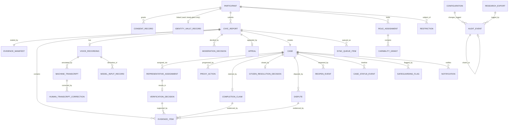

## 14.2 Data dictionary

> **Sensitivity:** `P` personal · `E` evidence · `O` operational · `S` security. **Enc** = encryption required at rest beyond the database default. **Audit** = changes must produce an audit event.

### Participant and identity

| Entity.field | Type | Req | Validation / default | Visibility | Sens | Enc | Audit |
|---|---|:--:|---|---|:--:|:--:|:--:|
| `Participant.id` | UUID | ✓ | Generated. **The only participant reference in reporting data** | All operational actors | O | — | ✓ |
| `Participant.track` | enum | ✓ | `adult` \| `student`; **`student` disabled in the prototype** | Admin | O | — | ✓ |
| `Participant.status` | enum | ✓ | `pending` \| `active` \| `restricted` \| `suspended` \| `withdrawn`; default `pending` | Admin, Moderator | O | — | ✓ |
| `Participant.language` | enum | ✓ | `ur` \| `en`; default `ur` | Self, Admin | O | — | — |
| `Participant.created_at` | timestamp | ✓ | Server time | Admin | O | — | ✓ |
| `IdentityVaultRecord.participant_id` | UUID | ✓ | FK to Participant. **Vault schema only** | **Break-glass only** | P | ✓ | ✓ |
| `IdentityVaultRecord.display_name` | string | ✓ | 1–120 chars | **Break-glass only** | P | ✓ | ✓ |
| `IdentityVaultRecord.phone` | string | ✓ | E.164; unique | **Break-glass only** | P | ✓ | ✓ |
| `IdentityVaultRecord.attestation_ref` | UUID | ✓ | FK | **Break-glass only** | P | ✓ | ✓ |
| `AttestationRecord.attesting_party` | string | ✓ | 1–200 chars | Admin | P | ✓ | ✓ |
| `AttestationRecord.method` | string | ✓ | Free text, ≤ 500 | Admin | P | ✓ | ✓ |
| `AttestationRecord.recorded_by` | UUID | ✓ | Admin participant id | Admin | O | — | ✓ |
| `ConsentRecord.participant_id` | UUID | ✓ | FK | Self, Admin | P | — | ✓ |
| `ConsentRecord.version` | string | ✓ | Consent text version | Self, Admin | O | — | ✓ |
| `ConsentRecord.granting_party` | enum | ✓ | `self` (only value in the prototype) | Admin | O | — | ✓ |
| `ConsentRecord.granted_at` | timestamp | ✓ | — | Self, Admin | O | — | ✓ |
| `ConsentRecord.withdrawn_at` | timestamp | — | Null until withdrawal | Self, Admin | O | — | ✓ |
| `ConsentRecord.language` | enum | ✓ | Language in which consent was given | Admin | O | — | ✓ |

### Roles and permissions

| Entity.field | Type | Req | Validation / default | Visibility | Sens | Enc | Audit |
|---|---|:--:|---|---|:--:|:--:|:--:|
| `RoleAssignment.participant_id` | UUID | ✓ | FK | Admin | O | — | ✓ |
| `RoleAssignment.role` | enum | ✓ | `citizen` \| `representative` \| `moderator` \| `administrator` | Admin | O | — | ✓ |
| `CapabilityGrant.capability` | enum | ✓ | `F1` \| `F2` \| `F3` \| `CAP_PROXY_COMPLETION` | Admin | O | — | ✓ |
| `CapabilityGrant.scope` | string | ✓ | Site or ward identifier. **Mandatory** | Admin | O | — | ✓ |
| `CapabilityGrant.expires_at` | timestamp | ✓ | **Mandatory, must be in the future** | Admin, holder | O | — | ✓ |
| `CapabilityGrant.revoked_at` | timestamp | — | Null unless revoked. **Never deleted** | Admin | O | — | ✓ |
| `DeclaredConflict.participant_id` | UUID | ✓ | FK | Admin, assignment engine | O | — | ✓ |
| `DeclaredConflict.description` | string | ✓ | ≤ 500 chars | Admin | P | — | ✓ |

### Report and evidence

| Entity.field | Type | Req | Validation / default | Visibility | Sens | Enc | Audit |
|---|---|:--:|---|---|:--:|:--:|:--:|
| `CivicReport.id` | UUID | ✓ | — | All operational | O | — | ✓ |
| `CivicReport.tracking_ref` | string | ✓ | Unique, human-readable, non-guessable | Reporter, operators | O | — | ✓ |
| `CivicReport.reporter_participant_id` | UUID | ✓ | FK. **Excluded from Representative queries** | Moderator, Admin | O | — | ✓ |
| `CivicReport.state` | enum | ✓ | §10.2 values | All operational | O | — | ✓ |
| `CivicReport.state_version` | int | ✓ | Increments per transition; default 0 | All operational | O | — | — |
| `CivicReport.captured_at` | timestamp | ✓ | Device time. **Operative time** | All operational | O | — | ✓ |
| `CivicReport.received_at` | timestamp | ✓ | Server time | All operational | O | — | ✓ |
| `CivicReport.category` | enum | — | Human-entered on acceptance | All operational | O | — | ✓ |
| `CivicReport.severity` | enum | — | Human-entered on acceptance | All operational | O | — | ✓ |
| `CivicReport.citizen_note` | text | — | ≤ 1,000 chars | All operational | P | — | ✓ |
| `CivicReport.idempotency_key` | string | ✓ | Client-generated, unique per participant per endpoint | System | O | — | ✓ |
| `EvidenceItem.id` | UUID | ✓ | Assigned on device | All operational | E | — | ✓ |
| `EvidenceItem.kind` | enum | ✓ | `report_photo` \| `verification_photo` \| `completion_photo` \| `dispute_photo` | All operational | E | — | ✓ |
| `EvidenceItem.content_hash` | string | ✓ | **Immutable** | All operational | E | — | ✓ |
| `EvidenceItem.hash_algorithm` / `.hash_version` | string | ✓ | Recorded for algorithm agility | System | O | — | ✓ |
| `EvidenceItem.storage_key` | string | ✓ | Content-addressed, write-once bucket | System | E | ✓ | ✓ |
| `EvidenceItem.byte_size` | int | ✓ | > 0 | System | O | — | — |
| `EvidenceItem.captured_at` | timestamp | ✓ | Device time | All operational | E | — | ✓ |
| `EvidenceItem.time_confidence` | enum | ✓ | `verified` \| `time_unverified` | All operational | O | — | ✓ |
| `EvidenceItem.sync_age_seconds` | int | ✓ | ≥ 0 | System | O | — | — |
| `EvidenceItem.location` | geography(Point) | — | PostGIS SRID 4326 | Operators; **coarsened in exports** | P | ✓ | ✓ |
| `EvidenceItem.accuracy_m` | float | — | ≥ 0 | Operators | O | — | — |
| `EvidenceItem.location_confidence` | enum | ✓ | `gps` \| `location_unverified` | All operational | O | — | ✓ |
| `EvidenceItem.integrity_flags` | json | — | Array of flag codes; default `[]` | Operators | O | — | ✓ |
| `EvidenceManifest.manifest_version` | string | ✓ | Canonical rule version | System | O | — | ✓ |
| `EvidenceManifest.manifest_hash` | string | ✓ | Immutable | System | O | — | ✓ |
| `VoiceRecording.duration_s` | float | ✓ | 3 ≤ d ≤ 90 | All operational | E | — | ✓ |
| `VoiceRecording.content_hash` | string | ✓ | Immutable | All operational | E | — | ✓ |

### Annotations

| Entity.field | Type | Req | Validation / default | Visibility | Sens | Enc | Audit |
|---|---|:--:|---|---|:--:|:--:|:--:|
| `MachineTranscript.text` | text | — | Null where unavailable | Operators, reporter | P | — | ✓ |
| `MachineTranscript.confidence` | float | — | 0–1 or null | Operators | O | — | ✓ |
| `MachineTranscript.model_id` | string | ✓ | **Non-null. A null is invalid** | Operators | O | — | ✓ |
| `MachineTranscript.model_version` | string | ✓ | **Non-null** | Operators | O | — | ✓ |
| `MachineTranscript.provider` | string | ✓ | **Non-null** | Operators | O | — | ✓ |
| `MachineTranscript.low_confidence` | bool | ✓ | Default false | Operators | O | — | ✓ |
| `MachineTranscript.status` | enum | ✓ | `ok` \| `unavailable` \| `failed` | Operators | O | — | ✓ |
| `HumanTranscriptCorrection.text` | text | ✓ | Non-empty | Operators | P | — | ✓ |
| `HumanTranscriptCorrection.actor_id` | UUID | ✓ | FK | Operators | O | — | ✓ |
| `ModelInputRecord.derivative_hash` | string | ✓ | Hash of what was sent | System | O | — | ✓ |
| `ModelInputRecord.transformations` | json | ✓ | e.g. downsample rate, metadata stripped | System | O | — | ✓ |

### Decisions and lifecycle

| Entity.field | Type | Req | Validation / default | Visibility | Sens | Enc | Audit |
|---|---|:--:|---|---|:--:|:--:|:--:|
| `ModerationDecision.actor_id` | UUID | ✓ | FK. **Never shown to the citizen** | Operators | O | — | ✓ |
| `ModerationDecision.action` | enum | ✓ | `accept` \| `needs_info` \| `reject` | Operators | O | — | ✓ |
| `ModerationDecision.reason_code` | enum | ✓ | **Mandatory** | Operators, reporter (code only) | O | — | ✓ |
| `ModerationDecision.reason_note` | text | — | ≤ 1,000 chars | Operators | O | — | ✓ |
| `ModerationDecision.transcript_annotation_ref` | UUID | — | FK to the annotation version displayed | Operators | O | — | ✓ |
| `RepresentativeAssignment.representative_id` | UUID | ✓ | FK | Operators | O | — | ✓ |
| `RepresentativeAssignment.conflict_basis` | json | ✓ | Records why the assignee was eligible | Operators | O | — | ✓ |
| `RepresentativeAssignment.expires_at` | timestamp | ✓ | From configuration | Operators | O | — | ✓ |
| `VerificationDecision.outcome` | enum | ✓ | `validated` \| `not_validated` | Operators | O | — | ✓ |
| `VerificationDecision.note` | text | ✓ | **Mandatory, ≥ 20 chars** | Operators | O | — | ✓ |
| `VerificationDecision.unsafe_to_verify` | bool | ✓ | Default false | Operators | O | — | ✓ |
| `RecusalRecord.reason` | text | ✓ | Mandatory | Operators | O | — | ✓ |
| `ProxyAction.on_behalf_of` | string | ✓ | **Mandatory, ≥ 3 chars** | All | O | — | ✓ |
| `ProxyAction.proxy_reason` | text | ✓ | **Mandatory** | Operators | O | — | ✓ |
| `CompletionClaim.note` | text | ✓ | **Mandatory, ≥ 20 chars** | All | O | — | ✓ |
| `CompletionClaim.distance_from_origin_m` | float | — | Computed, **displayed not enforced** | All | O | — | ✓ |
| `CitizenResolutionDecision.decision` | enum | ✓ | `confirmed` \| `disputed` | All | O | — | ✓ |
| `Dispute.reason` | text | ✓ | Mandatory | Operators | O | — | ✓ |
| `ReopenEvent.reason` | text | ✓ | Mandatory | Operators | O | — | ✓ |
| `Case.state` | enum | ✓ | §10.3 values | All operational | O | — | ✓ |
| `Case.state_version` | int | ✓ | Optimistic concurrency | All operational | O | — | — |
| `Case.closure_snapshot` | json | — | Recurrence-support fields (BR-018) | Operators | O | — | ✓ |
| `CaseStatusEvent.from_state` / `.to_state` | enum | ✓ | — | All operational | O | — | ✓ |
| `CaseStatusEvent.actor_type` | enum | ✓ | `human` \| `system`. **Never `ai`** | All operational | O | — | ✓ |

### Audit, telemetry, administration

| Entity.field | Type | Req | Validation / default | Visibility | Sens | Enc | Audit |
|---|---|:--:|---|---|:--:|:--:|:--:|
| `AuditEvent.sequence` | bigint | ✓ | Gapless within a chain segment | Operators | O | — | n/a |
| `AuditEvent.actor_id` / `.actor_type` | UUID / enum | ✓ | `human` \| `system` | Operators | O | — | n/a |
| `AuditEvent.action` | string | ✓ | From a fixed registry | Operators | O | — | n/a |
| `AuditEvent.object_type` / `.object_id` | string / UUID | ✓ | — | Operators | O | — | n/a |
| `AuditEvent.prev_state` / `.new_state` | string | — | Where applicable | Operators | O | — | n/a |
| `AuditEvent.reason` | text | — | **Mandatory where BR-025 applies** | Operators | O | — | n/a |
| `AuditEvent.correlation_id` | UUID | ✓ | Request or session correlation | Operators | O | — | n/a |
| `AuditEvent.model_id` / `.model_version` | string | — | Where AI is involved | Operators | O | — | n/a |
| `AuditEvent.payload_hash` / `.prev_hash` / `.chain_hash` | string | ✓ | DR-8 | Operators | O | — | n/a |
| `AnalyticsEvent.name` | string | ✓ | From the registry; **no free text** | Admin | O | — | — |
| `AnalyticsEvent.properties` | json | ✓ | Typed only; **no personal data, no location** | Admin | O | — | — |
| `Restriction.type` | enum | ✓ | `temporary` \| `permanent` | Operators | O | — | ✓ |
| `Restriction.applied_by` | UUID | ✓ | Permanent requires an Administrator | Operators | O | — | ✓ |
| `Restriction.reason_code` | enum | ✓ | Mandatory | Operators, subject | O | — | ✓ |
| `Appeal.statement_text` / `.statement_audio_id` | text / UUID | ✓ | One of the two required | Operators | P | — | ✓ |
| `Configuration.key` / `.value` | string | ✓ | Bounded per key | Operators | O | — | ✓ |
| `ResearchExport.checklist` | json | ✓ | All items confirmed | Admin | O | — | ✓ |
| `ResearchExport.salt` | string | ✓ | Per export; **not reused** | System | S | ✓ | ✓ |
| `SyncQueueItem.state` | enum | ✓ | §12.3 values | Own device | O | — | — |
| `Notification.body_key` | string | ✓ | Localisation key; **no media reference** | Recipient | O | — | ✓ |


### 14.2.1 Entity definitions added in v1.2 (CR-27)

v1.1's data dictionary referenced twelve entities without defining their fields. All twelve are now either defined or explicitly mapped.

| Entity | Rel | Definition | Key fields |
|---|:--:|---|---|
| **`AuthChallenge`** | **P0** | A single-use passcode challenge | `id` UUID · `participant_id` FK · `passcode_hash` string · `expires_at` ts · `attempts` int ≤ 5 · `consumed_at` ts? |
| **`Session`** | **P0** | An issued token pair and its family | `id` UUID · `participant_id` FK · `device_id` string · `family_id` UUID · `refresh_hash` string · `issued_at` · `expires_at` · `revoked_at` ts? · `mfa_satisfied` bool |
| **`RoleAssignment`** | **P0** | Binds a participant to a role | `id` · `participant_id` FK · `role` enum(`citizen`,`representative`,`moderator`,`administrator`) · `assigned_by` · `assigned_at` · `revoked_at` ts? |
| **`MfaEnrolment`** | **P0** | A privileged account's second factor | `id` · `participant_id` FK · `method` enum(`totp`,`passkey`) · `secret_encrypted` bytes · `enrolled_at` · `disabled_at` ts? |
| **`MfaRecoveryCode`** | **P0** | Single-use recovery codes, stored hashed | `id` · `enrolment_id` FK · `code_hash` string · `consumed_at` ts? |
| **`DevicePreference`** | **P0** | Device-local language and UI preference | `device_id` · `language` enum(`ur`,`en`) · `updated_at`. **Client-local; mirrored to `Participant.language` on first sync** |
| **`UploadSession`** | **P0** | A chunked resumable upload | `id` · `owner_participant_id` FK · `manifest_json` · `chunks_received` int[] · `state` enum(`open`,`verified`,`quarantined`,`expired`) · `expires_at` |
| **`IdempotencyRecord`** | **P0** | Binds a client key to a payload hash and a stored result | `key` string · `participant_id` FK · `endpoint` string · `payload_hash` string · `result_json` · `created_at`. Unique on `(participant_id, endpoint, key)` |
| **`DeclaredConflict`** | **P0** | A Representative's declared interest, used at assignment | `id` · `participant_id` FK · `description` text · `declared_at` · `withdrawn_at` ts?. **P0 because the Release 0 demonstration proves conflict-based exclusion** |
| **`RepresentativeProfile`** | **P0** | Representative-specific attributes | `participant_id` PK/FK · `endorsing_body` string · `training_completed_at` ts? · `conflict_declaration_at` ts |
| **`ReopenEvent`** | **P0** | A reopening of a case, and the basis for `reopen_event_id` returned by API-041 | `id` · `case_id` FK · `origin` enum(`citizen_dispute`,`moderator_reopen`) · `reason` text · `created_by` · `created_at` · `dispute_id` FK? |
| **`SafeguardingFlag`** | **P0** | Restricts a case to the safeguarding queue and suppresses external transcription | `id` · `case_id` FK · `raised_by` FK · `description` text · `raised_at` · `resolved_at` ts? |
| **`CompletionEvidence`** | — | **Mapped, not a separate table.** Completion evidence is `EvidenceItem` rows with `kind = completion_photo`, linked to `CompletionClaim`. The v1.1 references are corrected to that mapping | — |
| **`VaultAccessRecord`** | **P1** | Break-glass access register surfaced on AD-02 | `id` · `actor_id` FK · `participant_id` FK · `justification` text ≥ 40 chars · `accessed_at` · `reviewed_at` ts? |
| **`EscalationRecord`** | **P1** | A safeguarding escalation and its outcome | `id` · `flag_id` FK · `escalated_to` string · `escalated_at` · `outcome` text? |
| **`AppealAssignment`** | **P1** | Routes an appeal to an independent decider | `id` · `appeal_id` FK · `decider_id` FK · `is_fallback` bool · `assigned_at` |
| **`AttestationRecord`** | **P0** | Already defined in §14.2 — retained | see §14.2 |
| **`ModelInputRecord`** | **P0** | Already defined in §14.2 — retained | see §14.2 |

**Entity totals — stated once, here.**

| Category | Count | Meaning |
|---|---|---|
| **P0 entities** | **34** | Defined in this dictionary **and** required by at least one P0 requirement. Every one is justified in the Release 0 specification §9.1 |
| **P1/P2-only entities** | **11** | Defined here, referenced only by P1 or P2 requirements. `ConsentRecord · WithdrawalRecord · Restriction · Appeal · AppealAssignment · Notification · AnalyticsEvent · ResearchExport · Configuration · EscalationRecord · VaultAccessRecord` |
| **Master total** | **45** | Every entity defined in §14.2 and §14.2.1. There is no third category |

The 38 P0 entities are: ``OperatorCredential` · `EnrolmentToken` · `AuthTicket` · `AuthFlowSession` · `Participant · IdentityVaultRecord · AttestationRecord · RoleAssignment · CapabilityGrant · DeclaredConflict · RepresentativeProfile · AuthChallenge · Session · MfaEnrolment · MfaRecoveryCode · DevicePreference · CivicReport · EvidenceItem · EvidenceManifest · UploadSession · IdempotencyRecord · VoiceRecording · MachineTranscript · HumanTranscriptCorrection · ModelInputRecord · ModerationDecision · Case · RepresentativeAssignment · VerificationDecision · ProxyAction · CompletionClaim · CitizenResolutionDecision · Dispute · ReopenEvent · SafeguardingFlag · CaseStatusEvent · AuditEvent · SyncQueueItem`.

**The v1.1 figure of 19 and the v1.2 sentence "P0 entity count: 24" were both wrong.** The v1.2 sentence contradicted its own following clause, which said 34. The figure is **34**, and it is stated in exactly one place in this document.


### 14.2.2 Credential and enrolment entities — *historical provenance: added in v1.3.2*

**Nothing below is stored in plaintext.**

| Entity.field | Type | Req | Validation / default | Visibility | Sens | Enc | Audit |
|---|---|:--:|---|---|:--:|:--:|:--:|
| `OperatorCredential.operator_id` | UUID | ✓ | FK to `Participant`. One row per operator | Admin | S | — | ✓ |
| `OperatorCredential.credential_hash` | text | ✓ | **Hash only.** Algorithm and parameters stored beside it. **Never the credential itself** | **None — no read path exists** | S | ✓ | ✓ |
| `OperatorCredential.algorithm` | text | ✓ | Hash algorithm identifier, e.g. `argon2id`. Recorded so the hash can be verified after an algorithm change | Admin | S | — | ✓ |
| `OperatorCredential.params` | text | ✓ | Recorded so the hash can be verified after an algorithm change | Admin | S | — | ✓ |
| `OperatorCredential.status` | enum | ✓ | `awaiting_credential` \| `credentialled` \| `enrolled` \| `locked` \| `deactivated`; default `awaiting_credential` | Admin | O | — | ✓ |
| `OperatorCredential.failed_attempts` | integer | ✓ | Default 0; reset on success | Admin | O | — | ✓ |
| `OperatorCredential.locked_until` | timestamp | — | Set on the fifth failure; duration is **TBD-052** | Admin | O | — | ✓ |
| `OperatorCredential.updated_at` | timestamp | ✓ | Server time on every credential change | Admin | O | — | ✓ |
| `EnrolmentToken.id` | UUID | ✓ | Generated | Admin | S | — | ✓ |
| `EnrolmentToken.operator_id` | UUID | ✓ | **Account binding — a token valid for one account is invalid for every other** | Admin | S | — | ✓ |
| `EnrolmentToken.token_hash` | text | ✓ | **Hash only.** The plaintext is returned once and never stored | **None** | S | ✓ | ✓ |
| `EnrolmentToken.purpose` | enum | ✓ | `initial` \| `reset` | Admin | O | — | ✓ |
| `EnrolmentToken.expires_at` | timestamp | ✓ | Issued + 24 h | Admin | O | — | ✓ |
| `EnrolmentToken.consumed_at` | timestamp | — | Set by `API-104`. **A non-null value makes the token permanently invalid** | Admin | O | — | ✓ |
| `EnrolmentToken.issued_by` | UUID | ✓ | The Administrator who called `API-098` or `API-102` | Admin | O | — | ✓ |
| `AuthTicket.id` | UUID | ✓ | Generated | **None** | S | — | ✓ |
| `AuthTicket.operator_id` | UUID | ✓ | Account binding | **None** | S | — | ✓ |
| `AuthTicket.ticket_hash` | text | ✓ | **Hash only** | **None** | S | ✓ | ✓ |
| `AuthTicket.kind` | enum | ✓ | `mfa_enrolment` \| `login` | **None** | O | — | ✓ |
| `AuthTicket.expires_at` | timestamp | ✓ | 600 s for `mfa_enrolment`, 240 s for `login` | **None** | O | — | ✓ |
| `OperatorCredential.username_normalised` | text | ✓ | NFKC + casefold + trim. **Unique index.** Duplicate creation returns `409 E_USERNAME_UNAVAILABLE` to the Administrator only; **no unauthenticated route ever reveals whether a username exists** | Admin | O | — | ✓ |
| `MfaEnrolment.reenrolment_required` | boolean | ✓ | Default false; set true by `API-101`; cleared by a completed `API-099` | Admin | S | — | ✓ |
| `AuthTicket.consumed_at` | timestamp | — | **Single use.** A consumed ticket is permanently invalid | **None** | O | — | ✓ |
| `AuthFlowSession.id` | UUID | ✓ | **Internal primary key. Never returned to a client** | **None** | S | — | ✓ |
| `AuthFlowSession.client_token_hash` | text | ✓ | Hash of the **opaque client token** returned once as `enrolment_session_id` or `challenge_id`. **The plaintext is never stored** | **None** | S | ✓ | ✓ |
| `AuthFlowSession.type` | enum | ✓ | `mfa_enrolment` \| `mfa_challenge` | **None** | O | — | ✓ |
| `AuthFlowSession.operator_id` | UUID | ✓ | **Account binding.** A session for one operator is invalid for every other | Admin | S | — | ✓ |
| `AuthFlowSession.source_ticket_id` | UUID | ✓ | FK to `AuthTicket`. **`UNIQUE` — at most one flow session per ticket, so a consumed ticket can never open a second session** | Admin | S | — | ✓ |
| `AuthFlowSession.expires_at` | timestamp | ✓ | 600 s for `mfa_enrolment`, 180 s for `mfa_challenge` | **None** | O | — | ✓ |
| `AuthFlowSession.attempt_count` | integer | ✓ | Default 0. **At 5 the row becomes `locked` and `OperatorCredential.locked_until` is set (`TBD-052`)** | Admin | O | — | ✓ |
| `AuthFlowSession.status` | enum | ✓ | `open` \| `consumed` \| `expired` \| `locked`; default `open` | Admin | O | — | ✓ |
| `AuthFlowSession.consumed_at` | timestamp | — | Set on success. **A row that is not `open`, or whose `expires_at` has passed, is rejected with `401 E_AUTH_FAILED` and `mfa_session_replayed` is written** | Admin | O | — | ✓ |
| `Session.mfa_assurance` | enum | ✓ | **`none` \| `mfa` \| `recovery`.** `API-100` verify creates `mfa`; `API-101` creates `recovery`; every citizen session is `none` | Admin | S | — | ✓ |
| `Session.assurance_expires_at` | timestamp | — | **Set only on a `recovery` session: issued + 24 h, and `API-003` refresh may not extend it beyond that instant.** When it passes, the session is revoked and only the `mfa_reenrolment` path remains, so re-enrolment cannot be postponed indefinitely | Admin | O | — | ✓ |
| `AuthTicket.kind` *(extended)* | enum | ✓ | `mfa_enrolment` \| `login` \| **`mfa_reenrolment`** | **None** | O | — | ✓ |
| `MfaEnrolment.revoked_at` | timestamp | — | Set by `API-102`; a revoked enrolment cannot satisfy `API-100` | Admin | S | — | ✓ |
| `MfaRecoveryCode.consumed_at` | timestamp | — | Single use; the code itself is stored only as `code_hash` | **None** | S | ✓ | ✓ |

**Four P0 entities are added: `OperatorCredential`, `EnrolmentToken`, `AuthTicket`, `AuthFlowSession`.** The P0 entity total is **38** and the Master total **49**.

**Required indexes and replay protections.**

| Index / constraint | Purpose |
|---|---|
| `UNIQUE (OperatorCredential.username_normalised)` | One account per normalised username |
| `UNIQUE (EnrolmentToken.token_hash)` · partial index on `consumed_at IS NULL` | Single-use lookup by hash |
| `UNIQUE (AuthTicket.ticket_hash)` | Single-use lookup by hash |
| **`UNIQUE (AuthFlowSession.source_ticket_id)`** | **At most one flow session per ticket — the structural guarantee that a ticket is consumed exactly once** |
| `UNIQUE (AuthFlowSession.client_token_hash)` | Opaque client token lookup |
| `INDEX (AuthFlowSession.operator_id, status, expires_at)` | Attempt counting and lockout |
| `INDEX (Session.mfa_assurance, assurance_expires_at)` | Recovery-session expiry sweep |

## 14.3 Indexes and uniqueness

| Table | Index / constraint | Purpose |
|---|---|---|
| `CivicReport` | unique `(reporter_participant_id, idempotency_key)` | Duplicate prevention |
| `CivicReport` | unique `tracking_ref` | Reference integrity |
| `CivicReport` | index `(state, captured_at)` | Queue ordering |
| `EvidenceItem` | index `report_id`; index GIST on `location` | Packet assembly; spatial queries |
| `EvidenceItem` | unique `(report_id, id)` | Manifest integrity |
| `Case` | index `(state, created_at)`; index GIST on `location` | Queue and future clustering |
| `RepresentativeAssignment` | index `(representative_id, state)`; unique `(case_id, representative_id, active)` | Scoped queue; no double assignment |
| `AuditEvent` | unique `sequence`; index `(object_type, object_id, sequence)` | Chain integrity; case history |
| `CapabilityGrant` | index `(participant_id, capability, expires_at)` | Authorisation checks |
| `MachineTranscript` | index `voice_recording_id` | Packet assembly |
| `IdentityVaultRecord` | unique `phone`; **separate schema, separate role** | Vault isolation |

---
# 15. API Specification

> **Status.** These are **logical contracts**, not a final implementation. SRC-1 DR-7 approves REST + JSON with an OpenAPI specification as the authoritative artefact; the OpenAPI file becomes authoritative once written, and this section is its input. All paths sit under `/api/v1/`. Every mutating call requires `X-Idempotency-Key` scoped per DR-7 decision 6. Every endpoint performs the full check set from SRC-1 Appendix A: `authenticated · capability · scope · object-level · action-level · conflict-of-interest`.

## 15.1 Cross-cutting contract

| Aspect | Rule |
|---|---|
| Auth header | `Authorization: Bearer <access_token>` |
| Idempotency | `X-Idempotency-Key: <uuid>` on every mutating call; bound to a payload hash |
| Correlation | `X-Correlation-Id` echoed in every response and every audit row |
| Language | `Accept-Language: ur \| en` governs human-readable message text |
| Errors | `{"error_code": "...", "message": "<localised>", "correlation_id": "...", "details": {...}}` |
| Pagination | Cursor-based: `?cursor=&limit=` with `next_cursor` in the response |
| Rate limits | `429` with `Retry-After`; per-participant and per-IP buckets |
| Audit | **Every mutating call writes an audit row in the same transaction** |
| Media | Never returned inline; always a short-lived authenticated reference |

## 15.2 Endpoint catalogue

> **What this catalogue is.** It is a **logical contract catalogue**: one row per endpoint giving method, path, actor, purpose, authentication, authorisation, request shape, response shape, status codes, idempotency, audit event, privacy note and owning requirement. **It is not a complete per-endpoint contract document** — it does not carry full JSON Schema, exhaustive field-level validation rules, pagination limits or rate-limit values for every endpoint. Where a developer needs those, the P0 subset is expanded in the Release 0 Build Specification §10 and the remainder is P1 work. **v1.3 described this section as holding "full per-endpoint contracts". It does not, and that claim is withdrawn.**

### 15.2.1 How the P1 extensions of the three narrowed endpoints will arrive

The P0 schemas of `API-052`, `API-055` and `API-062` are **strictly accepted-path-only** and must stay that way. The later behaviour is additive and is specified here so that no developer invents it:

| Endpoint | P0 schema today | P1 extension | Owning requirement | Introduced together with |
|---|---|---|---|---|
| `API-052` | `action:"accept"` — a one-value enum | Enum widens to `accept` \| `needs_info` \| `reject`. `needs_info` requires a specific written request; `reject` requires a reason code from the rejection enumeration | `FR-MOD-004`, `FR-MOD-006` | The appeal route `FR-ADM-104`/`FR-ADM-105` and `API-033`/`API-034`. **A rejection path must not ship before the appeal path** |
| `API-055` | `outcome:"validated"` — a one-value enum | Enum widens to `validated` \| `not_validated`, applying **T6** | `FR-REP-109` | `API-062`'s extension, in the same release |
| `API-062` | `outcome:"validated"`, no `unsafe_to_verify` field | Enum widens to `validated` \| `not_validated`; the optional boolean `unsafe_to_verify` is **added to the schema** with its own refusal path | `FR-REP-108`, `FR-REP-103` | `FR-REP-104` recusal |

**Rule for the P0 build:** each of the three endpoints validates its enum server-side and returns `E_VALIDATION_FAILED` naming the field for any other value. **Widening an enum is a P1 change with its own tests; it is never a configuration flag in a P0 build.**

| API ID | **Rel** | Method · Path | Actor | Purpose | Auth | Authorisation | Request | Response | Codes | Idem. | Audit | Privacy | Requirements |
|---|:--:|---|---|---|---|---|---|---|---|:--:|---|---|---|
| **API-001** | **P0** | `POST /auth/challenge` | CZ | Begin authentication | none | public, rate-limited | `{phone}` | `{challenge_id, expires_at}` | 200, 429, 503 | ✓ | `auth_challenge_issued` | No enumeration; passcode never logged | FR-AUTH-001 |
| **API-002** | **P0** | `POST /auth/verify` | CZ | Complete authentication | none | public | `{challenge_id, passcode}` | `{access_token, refresh_token, participant_id, roles, language}` | 200, 401, 403, 429 | ✓ | `auth_succeeded` / `auth_failed` | Pseudonym only | FR-AUTH-002 |
| **API-003** | **P0** | `POST /auth/refresh` | any | Rotate tokens | **refresh token only — no access bearer required** | Refresh token valid, unconsumed, family not revoked | `{refresh_token, device_id}` | `{access_token, refresh_token, expires_in}` | 200, **401 `E_AUTH_REUSE_DETECTED`** | ✓ | `session_refreshed`, `token_family_revoked` | Tokens never logged | FR-AUTH-003 |
| **API-004** | **P0** | `POST /auth/logout` | any | Revoke session | bearer | own session | `{}` | `204` | 204, 401 | ✓ | `session_revoked` | Device queue retained | FR-AUTH-003 |
| **API-005** | **P0** | `POST /auth/console/login` | REP/MOD/ADM | **First factor only.** Returns a short-lived login ticket carrying **no privileged scope**. It never returns an access token and never accepts a second factor | none | public, rate-limited | `{username, password}` | `{ticket, ticket_kind:"login"\|"mfa_reenrolment", next_action:"mfa_verify"\|"mfa_reenrol", mfa_required:true, mfa_enrolled:bool, expires_at}` | 200, **401 `E_AUTH_FAILED`**, 429 | ✓ | `privileged_first_factor` | Password never logged | FR-AUTH-006 |
| **API-010** | **P1** | `POST /consent` | CZ | Record consent | bearer | own | `{version, language, granted}` | `{consent_id}` | 201, 400 | ✓ | `consent_granted` | — | FR-CIT-003 |
| **API-011** | **P1** | `POST /consent/withdraw` | CZ | Withdraw consent | bearer | own | `{confirm:true}` | `204` | 204, 400 | ✓ | `consent_withdrawn` | Triggers exclusion from exports | FR-CIT-005 |
| **API-020** | **P0** | `POST /uploads/session` | **CZ, REP, MOD, ADM** | Open an upload session | bearer | role + own | `{manifest}` | `{session_id, chunk_size}` | 201, 400, 401 | ✓ | `upload_session_opened` | — | FR-OFF-007 |
| **API-021** | **P0** | `PUT /uploads/session/{id}/chunk/{n}` | CZ, REP, MOD, ADM | Upload a chunk | bearer | session owner | binary | `{received:[n]}` | 200, 401, 404, 409 | ✓ | — | — | FR-OFF-007 |
| **API-022** | **P0** | `POST /uploads/session/{id}/complete` | CZ, REP, MOD, ADM | Finalise and verify | bearer | session owner | `{manifest}` | `{evidence_ids[], verified:true}` | 200, 401, 409, **422 `E_CAPTURE_INTEGRITY`** | ✓ | `manifest_verified` / `manifest_mismatch` | Quarantine on mismatch | FR-EVD-201 |
| **API-030** | **P0** | `POST /reports` | CZ | Create a report | bearer | active participant | `{session_id, captured_at, client_report_id}` | `{report_id, tracking_ref, state}` | 201, 400, 401, **403 `E_IDENTITY_REQUIRED`**, 409 | ✓ | `report_submitted` | Participant reference only | FR-EVD-202 |
| **API-031** | **P0** | `GET /reports` | CZ | Own reports | bearer | own | — | `{items[], next_cursor}` | 200, 401 | — | — | Own only | FR-CASE-101 |
| **API-032** | **P0** | `GET /reports/{id}` | CZ | Own report detail and timeline | bearer | author | — | `{report, case, timeline[], evidence_refs[], transcript}` | 200, 401, 403, 404 | — | `case_viewed` | **No reviewer identity** | FR-CASE-101 |
| **API-033** | **P1** | `POST /reports/{id}/resubmit` | CZ | Respond to needs-info | bearer | author | `{session_id}` | `{state}` | 200, 400, 403, 409 | ✓ | `needs_info_response` | — | FR-MOD-004 |
| **API-034** | **P1** | `POST /reports/{id}/appeal` | CZ | File an appeal | bearer | author | `{statement_text? , statement_audio_id?, session_id?}` | `{appeal_id, state}` | 201, 403, 409 | ✓ | `appeal_filed` | — | FR-ADM-101 |
| **API-040** | **P0** | `POST /cases/{id}/confirm` | CZ | Confirm the fix | bearer | reporter | `{expected_state_version, comment?}` | `{state}` | 200, 403, **409 `E_STALE_STATE`** | ✓ | `resolution_confirmed` | — | FR-FIX-102 |
| **API-041** | **P0** | `POST /cases/{id}/dispute` | CZ | Dispute the fix. **Returns `REOPENED`, not `IN_PROGRESS`** — the intermediate state is auditable and must not be skipped | bearer | reporter only, and never the completion submitter | `{expected_state_version, reason, session_id}` | `{state:"REOPENED", state_version, reopen_event_id}` | 200, **400 `E_EVIDENCE_REQUIRED`**, 403, 409 | ✓ | `resolution_disputed`, `case_reopened` | Evidence mandatory | FR-FIX-103 |
| **API-078** | **P0** | `POST /cases/{id}/proxy/rework` | MOD, ADM | **T11d.** Move `REOPENED` → `IN_PROGRESS` as a separate, separately audited decision | bearer + MFA | `F2`/admin + `CAP_PROXY_COMPLETION` | `{expected_state_version, on_behalf_of, proxy_reason, rework_note}` | `{state:"IN_PROGRESS", state_version}` | 200, **400 `E_PROXY_FIELDS_REQUIRED`**, 403, 409 | ✓ | `rework_started` | No reporter identity | FR-CASE-104 |
| **API-050** | **P0** | `GET /moderation/queue` | MOD | Moderation queue | bearer | `F2` | filters | `{items[], next_cursor}` | 200, 401, 403 | — | `queue_viewed` | **No identity field in the schema** | FR-MOD-001 |
| **API-051** | **P0** | `GET /moderation/reports/{id}` | MOD | Review packet | bearer | `F2` + object | — | `{evidence_refs[], audio_ref, transcript{...provenance}, location, flags, history}` | 200, 403, 404 | — | `packet_viewed` | **No reporter identity** | FR-MOD-002 |
| **API-052** | **P0** | `POST /moderation/reports/{id}/decision` **— `action` enum is `accept` only in P0 (§3.7.7)** | MOD | **Record the P0 accept decision** | bearer | `F2` + conflict | `{expected_state_version, action:"accept", reason_code, category, severity, reason_note?, transcript_annotation_ref?}` | `{state}` | 200, **400 `E_REASON_REQUIRED`**, **403 `E_CONFLICT_OF_INTEREST`**, 409 | ✓ | `moderation_decision` | Reviewer identity never returned to the citizen | FR-MOD-003 |
| **API-053** | **P0** | `POST /moderation/cases/{id}/assign` | MOD | Assign a Representative | bearer | `F2` | `{representative_id, expected_state_version}` | `{assignment_id, expires_at}` | 201, **409 `E_NO_ELIGIBLE_ASSIGNEE`**, 403 | ✓ | `assignment_created` | Eligibility basis stored | FR-REP-002 |
| **API-054** | **P0** | `GET /moderation/cases/{id}/eligible-representatives` | MOD | Eligible set | bearer | `F2` | — | `{eligible[], excluded_count}` | 200, 403 | — | `assignment_eligibility_computed` | Excluded parties are counted, not named | FR-REP-001 |
| **API-055** | **P0** | `POST /moderation/cases/{id}/close-verification` **— `outcome` enum is `validated` only in P0 (§3.7.7)** | MOD | **Apply T5 only in P0** | bearer | `F2` | `{expected_state_version, outcome:"validated", departure_reason?}` | `{state}` | 200, 400, 403, 409 | ✓ | `verification_closed` | — | FR-REP-105 |
| **API-056** | **P1** | `GET /moderation/safeguarding` | MOD, ADM | **Read the restricted safeguarding queue.** Owns *viewing* restricted items, not creating flags | bearer + MFA | `F2`/admin | — | `{items[]}` | 200, 403 | — | `safeguarding_restricted_view` | Narrowed visibility; no reporter identity | FR-SAF-001, FR-SAF-006 |
| **API-057** | **P1** | `POST /moderation/cases/{id}/safeguarding-flag` | MOD, REP, ADM | **Raise a concern and record the escalation.** Owns flag *creation*; the Representative path is `FR-SAF-002`, the Moderator/Administrator path is `FR-SAF-006` | bearer + MFA | `F1`/`F2`/admin | `{description}` | `{flag_id, escalation_id}` | 201, **400** *(description missing)*, **409** *(no escalation contact configured — TBD-030)*, 403 | ✓ | `safeguarding_flagged`, `safeguarding_escalated` | **Blocks external AI dispatch** | FR-SAF-002, FR-SAF-006 |
| **API-058** | **P1** | `GET /moderation/appeals` · `POST /moderation/appeals/{id}` | MOD | Appeal queue and decision | bearer | `F2` + not prior actor | `{outcome, reason}` | `{state}` | 200, **403 `E_CONFLICT_OF_INTEREST`** | ✓ | `appeal_decided` | Independence enforced | FR-ADM-102 |
| **API-059** | **P1** | `POST /moderation/participants/{id}/restrict` | MOD, ADM | Temporary restriction | bearer | `F2`/admin | `{reason_code, duration}` | `{restriction_id}` | 201, 400, 403 | ✓ | `restriction_applied` | Subject sees the reason | FR-ADM-104 |
| **API-060** | **P0** | `GET /validations` | REP | Assigned queue | bearer | `F1` + scope | — | `{items[]}` | 200, 403 | — | `rep_queue_viewed` | **No identity field** | FR-REP-005 |
| **API-061** | **P0** | `GET /validations/{case_id}/packet` | REP | Validation packet | bearer | `F1` + object + scope | — | `{evidence_refs[], audio_ref, transcript{...}, location, history}` | 200, 403, 404 | — | `rep_packet_viewed` | **Schema contains no identity field** | FR-REP-006 |
| **API-062** | **P0** | `POST /validations/{case_id}/outcome` **— `outcome` enum is `validated` only in P0; `unsafe_to_verify` is absent from the P0 schema (§3.7.7)** | REP | Record an outcome | bearer | `F1` + conflict | `{outcome:"validated", note, session_id?}` | `{verification_id}` | 201, **400 `E_NOTE_REQUIRED`**, 403 | ✓ | `verification_recorded` | — | FR-REP-101 |
| **API-063** | **P1** | `POST /validations/{case_id}/recuse` | REP | Recuse | bearer | `F1` | `{reason}` | `204` | 204, 400, 403 | ✓ | `recusal_recorded` | Neutral record | FR-REP-104 |
| **API-070** | **P0** | `POST /cases/{id}/proxy/acknowledge` | MOD, ADM | Record acknowledgement by proxy | bearer | `F2`/admin + **`CAP_PROXY_COMPLETION`** | `{expected_state_version, on_behalf_of, proxy_reason}` | `{state}` | 200, **400 `E_PROXY_FIELDS_REQUIRED`**, 403, 409 | ✓ | `proxy_acknowledgement` | Labelled as proxy in every view | FR-FIX-001 |
| **API-071** | **P0** | `POST /cases/{id}/proxy/completion` | MOD, ADM | Submit completion evidence | bearer | `F2`/admin + **`CAP_PROXY_COMPLETION`** | `{expected_state_version, session_id, note, on_behalf_of}` | `{state, distance_from_origin_m}` | 200, **400 `E_LIVE_CAPTURE_REQUIRED`**, 403, 409 | ✓ | `completion_evidence_submitted` | — | FR-FIX-002 |
| **API-072** | **P0** | `GET /cases/{id}/comparison` | CZ, REP, MOD, ADM | Before/after data | bearer | own / assigned / `F2` | — | `{before[], after[], distance_m, no_automated_check:true}` | 200, 403, 404 | — | `comparison_viewed` | No identity | FR-FIX-003 |
| **API-080** | **P0** | `GET /cases/{id}/history` | MOD, ADM | Full audit history | bearer | `F2`/admin | — | `{events[{actor, action, reason, prev_state, new_state, ts, chain_hash}]}` | 200, 403 | — | `history_viewed` | Pseudonyms only | FR-CASE-102 |
| **API-090a** | **P0** | `POST /admin/participants` | ADM | **Create a synthetic demonstration participant.** Refused outside `local`, `ci` and `demo` | bearer + MFA | admin | `{display_name, phone, track:"adult"}` | `{participant_id, status:"pending"}` | 201, **400 `E_VALIDATION_FAILED`** *(missing field, or `track` ≠ `adult`)*, 403 | ✓ scoped to the phone value | `participant_created` | `display_name` and `phone` written to the vault schema only | FR-ADM-001, FR-SAF-005 |
| **API-090b** | **P0** | `POST /admin/participants/{id}/activate` | ADM | **Activate a synthetic participant** with a synthetic attestation. **Refused outside `local`, `ci` and `demo` with `403 E_PERMISSION_DENIED`; real-participant activation is `FR-CIT-002`, P1, behind the §35 gate** | bearer + MFA | admin | `{attesting_party, method, notes}` | `{participant_id, status:"active", attestation_id}` | 200, **400 `E_VALIDATION_FAILED`** *(incomplete attestation)*, **409 `E_INVALID_TRANSITION`** *(not `pending` or `deactivated`)*, 403 | ✓ | `participant_attested`, `participant_activated` | Attestation stored beside the vault record | FR-ADM-001, FR-AUTH-004 |
| **API-090c** | **P0** | `POST /admin/participants/{id}/deactivate` | ADM | **Deactivate** — stop further submission without deleting anything | bearer + MFA | admin | `{reason}` | `{participant_id, status:"deactivated"}` | 200, **400 `E_REASON_REQUIRED`**, **409 `E_INVALID_TRANSITION`** *(not `active`)*, 403 | ✓ | `participant_deactivated` | Existing reports are retained and remain attributable | FR-ADM-001 |
| **API-090d** | **P0** | `POST /admin/participants/{id}/reactivate` | ADM | **Reactivate** — restore an earlier attestation | bearer + MFA | admin | `{reason, attestation_id?}` | `{participant_id, status:"active"}` | 200, **400 `E_REASON_REQUIRED`**, **409 `E_INVALID_TRANSITION`** *(not `deactivated`)*, 403 | ✓ | `participant_reactivated` | A prior attestation is referenced, never re-created silently | FR-ADM-001 |
| **API-091** | **P0** | `POST /admin/grants` | ADM | Create a grant | bearer + MFA | admin | `{participant_id, capability, scope, expires_at}` | `{grant_id}` | 201, 400, 403 | ✓ | `grant_created` | — | FR-ADM-002 |
| **API-091b** | **P0** | `POST /admin/grants/{id}/revoke` | ADM | **Revoke a grant non-destructively.** `DELETE` is not offered: BR-022 forbids erasing grant history | bearer + MFA | admin | `{reason}` | `{grant_id, revoked_at}` | 200, 400, 403 | ✓ | `grant_revoked` | **The grant row is marked revoked and retained; no history is erased** | FR-ADM-004 |
| **API-092** | **P1** | `GET /admin/config` · `PUT /admin/config` | ADM | Configuration | bearer | admin | `{key, value, reason}` | `{applied}` | 200, 400, 403 | ✓ | `config_changed` | Timing keys labelled proposed benchmarks | FR-ADM-005 |
| **API-093** | **P1** | `GET /admin/metrics` | ADM, MOD | Metrics | bearer | admin/`F2` | range | `{metrics{...}}` | 200, 403 | — | `metrics_viewed` | Aggregates only | FR-OBS-001 |
| **API-094** | **P2** | `POST /admin/exports` | ADM | Research export | bearer | admin | `{range, checklist{...}}` | `{export_id, download_ref}` | 202, **400 `E_EXPORT_BLOCKED`**, 403 | ✓ | `export_generated` | De-identification enforced | FR-OBS-005 |
| **API-095** | **P1** | `POST /admin/vault/access` | ADM | Break-glass | bearer | admin | `{participant_id, justification}` | `{identity{...}}` | 200, **400 `E_JUSTIFICATION_REQUIRED`**, 403 | ✓ | `vault_access` (dual-logged) | **The most sensitive endpoint in the system** | FR-PRV-005 |
| **API-096** | **P1** | `POST /admin/participants/{id}/suspend` | **ADM only** | Permanent suspension | bearer | **admin only** | `{reason}` | `{restriction_id}` | 201, **403 for MOD**, 400 | ✓ | `suspension_applied` | Appealable | FR-ADM-105 |
| **API-064** | **P1** | `GET /validations/history` | REP | Own past verification outcomes | bearer + MFA | `F1`, own records only | — | `{items[{case_ref, outcome, note, decided_at}], next_cursor}` | 200, 403 | — | `rep_history_viewed` | **No reporter identity; no other Representative's records** | FR-REP-107 |
| **API-073** | **P1** | `POST /cases/{id}/completion/{claim_id}/reject` | MOD | Reject a completion claim and return the case to `IN_PROGRESS` | bearer + MFA | `F2` | `{expected_state_version, reason}` | `{state}` | 200, **400 `E_REASON_REQUIRED`**, 403, 409 | ✓ | `completion_rejected`, `case_reopened` | Rejected evidence is retained, never deleted | FR-FIX-007 |
| **API-074** | **P0** | `POST /transcripts/{id}/correction` | MOD | **Record a human correction to a machine transcript.** The machine row is never edited | bearer + MFA | `F2` + object | `{corrected_text, reason?}` | `{correction_id, created_at}` | 201, 400, 403, 404 | ✓ | `transcript_corrected` | Correction text is treated as transcript content and is de-identified before export | FR-AI-003 |
| **API-075** | **P1** | `GET /notifications` · `POST /notifications/{id}/read` | CZ, REP, MOD, ADM | Retrieve in-app notifications and mark them read | bearer | own recipient records only | — / `{}` | `{items[{id, type, body_key, params, created_at, read_at}], unread_count}` | 200, 403 | ✓ | `notification_read` | **Status only. No media reference, no reviewer identity, no precise location** | FR-CASE-201 |
| **API-076** | **P1** | `GET /me/settings` · `PATCH /me/settings` | CZ, REP, MOD, ADM | Read and change permitted settings *(language only in P0)* | bearer | own | `{language}` | `{language}` | 200, 400, 403 | ✓ | `settings_changed` | No other participant's settings are reachable | FR-LOC-001, FR-CIT-005 |
| **API-098** | **P0** | `POST /admin/operators` · `POST /admin/operators/{id}/deactivate` | ADM | Create and deactivate console accounts. **The Administrator supplies the `username`; the server normalises it (NFKC, casefold, trim) and enforces uniqueness on the normalised form. The plaintext `enrolment_token` is returned exactly once, stored only as a hash, and consumed by `API-104`** | bearer + MFA | admin | `{username, display_name, role, contact}` | `{operator_id, username, username_normalised, enrolment_token, enrolment_expires_at}` | 201, **400 `E_VALIDATION_FAILED`** *(format)*, **409 `E_USERNAME_UNAVAILABLE`** *(normalised collision)*, 403 | ✓ | `operator_account_created`, `enrolment_token_issued`, `operator_account_deactivated` | Operator contact details are written to the vault schema only | FR-ADM-003 |
| **API-099** | **P0** | `POST /auth/mfa/enrol` *(consumes the ticket, returns `enrolment_session_id` + `provisioning_uri`, **no recovery codes**)* · `POST /auth/mfa/enrol/confirm` *(consumes the session, returns `enrolled:true` + one-time recovery codes)* | REP, MOD, ADM | Provision and confirm the second factor. **Enrol accepts an `mfa_enrolment` ticket from `API-104`, or a `login` ticket from `API-005` where `OperatorCredential.status = credentialled`. Confirm accepts `{enrolment_session_id, code}`. It never accepts a bearer token** | **ticket-bound — `mfa_enrolment` or `login`; no `Authorization` header** | own account, ticket-bound | `{ticket, method}` *(ticket kind `mfa_enrolment`, or `login` where status is `credentialled`, **or `mfa_reenrolment` at any status**)* / `{enrolment_session_id, code}` | `{enrolment_session_id, provisioning_uri, expires_at}` / `{enrolled:true, recovery_codes[], previous_enrolment_revoked:true}` | 200, 400, 403, 429 | ✓ | `mfa_enrolled` | **Recovery codes are shown once, stored only as hashes, and never logged** | FR-AUTH-007 |
| **API-100** | **P0** | `POST /auth/mfa/challenge` *(consumes the `login` ticket, returns `challenge_id`)* · `POST /auth/mfa/verify` *(consumes the challenge, returns tokens)* | REP, MOD, ADM | Issue and verify the second factor. **With `API-101`, one of the two operations that issue a privileged access and refresh token pair** | **ticket-bound — `login` ticket; no `Authorization` header** | account with MFA enrolled | `{login_ticket}` *(kind `login` only — an `mfa_reenrolment` ticket is rejected `401 E_AUTH_FAILED`)* / `{challenge_id, code}` | `{challenge_id, expires_at, attempts_remaining}` / `{access_token, refresh_token, mfa_assurance:"mfa"}` | 200, **401 `E_AUTH_FAILED`**, **403 `E_MFA_REQUIRED`**, 429 | ✓ | `mfa_challenge`, `mfa_failed` | Codes never logged; lockout after 5 failures | FR-AUTH-007 |
| **API-101** | **P0** | `POST /auth/mfa/recover` | REP, MOD, ADM | Consume a `login` ticket plus one unused recovery code. **Issues fully privileged tokens for the recovery session — they are never refused with `E_MFA_REQUIRED` — and sets `reenrolment_required`, which blocks the *next* `API-100` sign-in until `API-099` is completed again** | **ticket-bound — `login` ticket; no `Authorization` header** | account with unused recovery codes | `{login_ticket, recovery_code}` *(kind `login` only)* | `{access_token, refresh_token, remaining_codes, mfa_assurance:"recovery", assurance_expires_at, reenrolment_required:true}` | 200, 401, 429 | ✓ | `mfa_recovery_used` | **Consumes the code; notifies the account; rate-limited to 3 attempts per hour** | FR-AUTH-008 |
| **API-102** | **P0** | `POST /admin/operators/{id}/mfa/reset` | ADM | Administrator-initiated MFA reset after verified device loss. **Revokes the existing enrolment and issues a reset token that feeds the same `API-104` path — it is not a dead output** | bearer + MFA | **admin only; never self-service** | `{reason}` | `{reset:true, enrolment_token, enrolment_expires_at}` | 200, **400 `E_REASON_REQUIRED`**, 403 | ✓ | `mfa_reset_by_admin`, `enrolment_token_issued` | **Dual-recorded: audit entry plus an entry in the Administrator dashboard security register** | FR-AUTH-008 |
| **API-104** | **P0** | `POST /auth/console/enrol` | REP, MOD, ADM | **Consume an enrolment or reset token, set the first-factor credential, and return an `mfa_enrolment` ticket.** Issues no access token and no refresh token | **token-bound — plaintext enrolment token in the body; no `Authorization` header** | token must be unconsumed, unexpired and bound to this account | `{enrolment_token, new_credential}` | `{mfa_enrolment_ticket, expires_at}` | 200, **400 `E_ENROLMENT_TOKEN_INVALID`**, **400 `E_VALIDATION_FAILED`**, 429 | ✓ single-use by construction | `operator_credential_established`, `enrolment_token_consumed`, `enrolment_token_rejected` | — | — |
| **API-103** | **P1** | `POST /consent/withdraw/offline-intent` | CZ | Deliver a consent-withdrawal instruction that was created while offline | bearer *(or withdrawal ticket)* | own | `{withdrawal_id, created_at, signature}` | `{accepted:true, processed_at}` | 200, 401, 409 | ✓ | `consent_withdrawn` | **Carried outside the evidence queue and independent of the destroyed evidence key** | FR-CIT-006 |
| **API-077** | **P1** | `POST /cases/{id}/reconsideration` | CZ | **Conditional on TBD-056 — specified, not built.** Request reconsideration of a final case rejection with fresh live evidence | bearer | reporter of the originating report | `{reason, session_id}` | `{state}` | 201, 400, 403, 409 | ✓ | `case_reconsideration_filed` | Blocked on **TBD-056**; no implementation in Release 0 or P1 until the owner decides | §10.9.2 |
| **API-097** | **P0** | `POST /admin/integrity/verify` | ADM, MOD | Run the verifier | bearer | admin/`F2` | `{scope}` | `{result, mismatches[]}` | 200, 403 | ✓ | `integrity_check_run` | Identifiers only, never content | FR-AUD-005 |

---


## 15.3 Privileged authentication protocol — the complete reachable path

***Historical provenance — introduced in v1.3.2.*** v1.3.1 described five endpoints that did not compose into a working flow. This section is the authoritative statement of the protocol; where any row in §15.2 appears to differ, this section governs.

### 15.3.1 Credential, token and flow-session kinds

| Artefact | Issued by | Consumed by | Lifetime | Storage | Carries privilege? |
|---|---|---|---|---|---|
| **`enrolment_token`** | `API-098` on creation · `API-102` on reset | **`API-104`** | 24 h, **single use** | Hash only | No |
| **`mfa_enrolment` ticket** | `API-104` | **`API-099` enrol step** | 600 s, **single use** | Hash only | No |
| **`login` ticket** | `API-005` | **`API-100` challenge step** · `API-101` · `API-099` enrol step *(credentialled-but-unenrolled account only)* | 240 s, **single use** | Hash only | No |
| **`enrolment_session_id`** *(`AuthFlowSession`, type `mfa_enrolment`)* | `API-099` enrol step | **`API-099` confirm step** | 600 s, **single use**, ≤ 5 attempts | Hash only | No |
| **`challenge_id`** *(`AuthFlowSession`, type `mfa_challenge`)* | `API-100` challenge step | **`API-100` verify step** | 180 s, **single use on success**, ≤ 5 attempts | Hash only | No |
| **`access_token`** | **`API-100` verify · `API-101`** | Every bearer-protected endpoint | 1800 s | Not stored | **Yes** |
| **`refresh_token`** | `API-100` verify · `API-101` · `API-003` | `API-003` | Rotating family | Hash only | Rotation only |

**Every artefact has at least one named consumer.** A ticket is consumed **exactly once**, by the first step of a two-step operation; the second step is carried by an `AuthFlowSession`, which resolves the contradiction *historically* carried in v1.3.2 between *"single-use ticket"* and *"challenge then verify"*.

### 15.3.1.1 `AuthFlowSession` — P0 entity

| Field | Rule |
|---|---|
| `id` | UUID returned to the client as `enrolment_session_id` or `challenge_id` |
| `session_hash` | **Hash only.** The plaintext identifier is returned once |
| `type` | enum `mfa_enrolment` \| `mfa_challenge` |
| `operator_id` | **Account binding.** A session for one operator is invalid for every other |
| `source_ticket_id` | The `AuthTicket` consumed to create it — one session per ticket, never two |
| `expires_at` | 600 s for `mfa_enrolment`, 180 s for `mfa_challenge` |
| `attempt_count` | Incremented on every wrong code. **At 5 the session is `locked` and `OperatorCredential.locked_until` is set (`TBD-052`)** |
| `status` | enum `open` \| `consumed` \| `expired` \| `locked` |
| `consumed_at` | Set on success. **A consumed or expired session is permanently invalid; replay returns `401 E_AUTH_FAILED`** |

**Audit events:** `mfa_enrolment_session_opened` · `mfa_enrolment_confirmed` · `mfa_challenge_opened` · `mfa_failed` · `mfa_session_replayed` · `mfa_lockout`.

### 15.3.2 The path from nothing to a privileged token

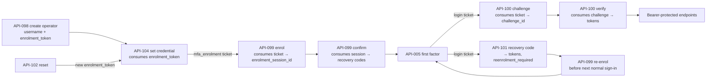

**No state is unreachable and no edge is undefined.**

### 15.3.2.1 Recovery — precisely defined

`API-101` consumes a `login` ticket plus one unused recovery code and **issues access and refresh tokens for that recovery session**. It sets `MfaEnrolment.reenrolment_required = true`.

- **The recovery session itself is fully privileged and must not be refused.** The bearer predicate in §15.3.4 is satisfied by **`Session.mfa_assurance ∈ {mfa, recovery}`**; `API-101` issues a session with `mfa_assurance = recovery`, which therefore **never** returns `E_MFA_REQUIRED`. **`MfaEnrolment.status` is not consulted** — recovery describes a session, not an enrolment.
- **The obligation binds the *next* sign-in.** While `MfaEnrolment.reenrolment_required` is true, a `login` ticket presented to `API-100` or `API-101` is **refused** with `403 E_MFA_REENROLMENT_REQUIRED` and the operator must complete `API-099` again. `API-101` remains available while unused codes remain.
- Re-enrolment clears the flag and revokes the previous `MfaEnrolment`.

### 15.3.3 Transport-authentication classes — four, mutually exclusive

**Every endpoint belongs to exactly one.**

| Class | Endpoints | Credential | Refusal |
|---|---|---|---|
| **Public** | `API-001`, `API-002`, **`API-005`** | None | `400` / `429`. **Never `401`** |
| **Token-bound** | `API-104` | Enrolment token **in the body** | `400 E_ENROLMENT_TOKEN_INVALID` |
| **Ticket-bound** | `API-099`, `API-100`, `API-101` | A ticket or flow-session id **in the body** | `401 E_AUTH_FAILED` |
| **Bearer-protected** | **Every other endpoint** | `Authorization: Bearer <access_token>` | **`401 E_AUTH_REQUIRED`** — a ticket or session id presented here is not a bearer credential |

### 15.3.4 MFA assurance — an authorisation predicate on the session, not a transport class

Applied **after** bearer authentication succeeds, on privileged business endpoints only:

> **`Session.mfa_assurance ∈ {mfa, recovery}`** for the token's session. Otherwise **`403 E_MFA_REQUIRED`**.

| Session origin | `mfa_assurance` | Privileged access | Lifetime |
|---|---|---|---|
| `API-100` verify | **`mfa`** | Granted | Normal token and refresh lifetimes |
| **`API-101` recovery code** | **`recovery`** | **Granted — a recovery session is never refused with `E_MFA_REQUIRED`** | `Session.assurance_expires_at` = issued + **24 h**. `API-003` may refresh within that window and **never beyond it**. At expiry the session is revoked and the operator has only the `mfa_reenrolment` path |
| Any other privileged token | `none` | **Refused** `403 E_MFA_REQUIRED` | — |

**`MfaEnrolment.status` is not used for this predicate.** "Recovery" describes a *session*, not an enrolment, and v1.3.3 conflated the two.

### 15.3.5 Re-enrolment after recovery — a reachable path, not a dead end

`API-101` sets `MfaEnrolment.reenrolment_required = true` and returns `reenrolment_required:true`.

1. At the **next** `API-005` sign-in the server sees the flag and returns a ticket of kind **`mfa_reenrolment`**, together with `next_action:"mfa_reenrol"`.
2. **That ticket is accepted only by `API-099`.** `API-100` and `API-101` reject it with `401 E_AUTH_FAILED`.
3. **`API-099` accepts an `mfa_reenrolment` ticket even though the account is already `enrolled`.** The enrol step is admitted when the ticket kind is `mfa_enrolment`, or `login` with `OperatorCredential.status = credentialled`, **or `mfa_reenrolment` with any status**.
4. Successful confirmation **revokes the previous `MfaEnrolment` and every unused recovery code**, issues a fresh secret and a fresh set of codes, clears `reenrolment_required`, and revokes any live `recovery` session.
5. The next `API-005` then returns an ordinary `login` ticket and normal sign-in resumes.

**`E_MFA_REENROLMENT_REQUIRED` is returned by `API-100` and `API-101` only when a caller presents a `login` ticket while the flag is set** — it is never the response to `API-005`, which hands back the re-enrolment ticket instead.


# 16. Security and Privacy Requirements

| ID | **Rel** | Requirement | Test |
|---|:--:|---|---|
| **NFR-SEC-001** | **P0** | The system shall require authentication on every endpoint except `POST /auth/challenge`, `POST /auth/verify` and `POST /auth/console/login`, and shall return `401` without disclosing whether a resource exists | TEST-SEC-001 |
| **NFR-SEC-002** | **P0** | The system shall enforce the full check set (`authenticated · capability · scope · object · action · conflict`) server-side on every endpoint, and shall not rely on any client-side check | TEST-SEC-005 |
| **NFR-SEC-003** | **P0** | The system shall grant each role the minimum capabilities required, and shall present no interface control for an action the role cannot perform | TEST-SEC-012 |
| **NFR-SEC-004** | **P0** | The system shall hold identity data in a **separate schema with separate database credentials and separate encryption keys**, and no reporting query shall join it | TEST-PRV-003 |
| **NFR-SEC-005** | **P0** | The system shall use TLS 1.2 or higher for all transport and shall reject plaintext HTTP | TEST-SEC-013 |
| **NFR-SEC-006** | **P1** | The system shall encrypt identity-vault fields, evidence-storage credentials and export salts at rest beyond the database default | TEST-SEC-014 |
| **NFR-SEC-007** | **P0** | The mobile client shall store the offline queue encrypted with a key held in the platform keystore, and shall store tokens only in the platform keystore | TEST-SEC-007 |
| **NFR-SEC-008** | **P0** | The system shall hold no secret in source control; all secrets shall be supplied by environment configuration | TEST-SEC-015 |
| **NFR-SEC-009** | **P0** | The system shall expire access tokens, rotate refresh tokens, and invalidate a token family on reuse detection | TEST-SEC-003 |
| **NFR-SEC-010** | **P0** | The system shall require MFA for every Representative, Moderator and Administrator session | TEST-AUTH-006 |
| **NFR-SEC-011** | **P0** | The system shall lock an authentication challenge after five failed attempts and shall rate-limit per participant and per IP address | TEST-SEC-002 |
| **NFR-SEC-012** | **P0** | The system shall validate and bound every input: string lengths, numeric ranges, enumerations, and payload size | TEST-SEC-016 |
| **NFR-SEC-013** | **P0** | The system shall validate uploaded media by declared type, magic-byte inspection and size bound, and shall reject anything not matching the declared type | TEST-SEC-017 |
| **NFR-SEC-014** | **P1** | The system shall never execute, render inline as HTML, or serve with an executable content type any uploaded file. **Malware scanning is not implemented in the prototype; this is a stated residual risk** — TBD-035 | TEST-SEC-017 |
| **NFR-SEC-015** | **P0** | The system shall grant the application database role `INSERT` and `SELECT` only on the audit table, and shall grant no `DELETE` on evidence or audit tables to any application role | TEST-AUD-004 |
| **NFR-SEC-016** | **P1** | The system shall encrypt backups, store them off-host in a separate failure domain, restrict backup credentials, and verify restore before field testing | TEST-DR-001 |
| **NFR-SEC-017** | **P0** | The system shall exclude from all logs: passcodes, tokens, identity values, transcript text, evidence bytes, and precise coordinates | TEST-SEC-018 |
| **NFR-SEC-018** | **P1** | The system shall permit identity access only through the break-glass endpoint with a justification of at least 40 characters, dual-logged, and shall surface every such access in the Administrator dashboard | TEST-PRV-009 |
| **NFR-SEC-019** | **P0** | The system shall collect only data required by an approved requirement, and shall collect none of the identifiers prohibited by DR-16 | TEST-PRV-005 |
| **NFR-SEC-020** | **P1** | The project shall maintain a documented breach-response procedure naming who is informed, within what period, and what is recorded — **not yet written** → TBD-036 | — |
| **NFR-SEC-021** | **P1** | The project shall run dependency vulnerability scanning in CI and shall triage findings before each field-test release | TEST-SEC-019 |
| **NFR-SEC-022** | **P1** | The system shall support account deactivation and data flagging; **it shall not support hard deletion** (BR-022) | TEST-CIT-002 |
| **NFR-SEC-023** | **P1** | Retention periods and the lawful-request procedure are **unresolved** and shall be recorded as `TBD-006` and `TBD-007`; until they are approved, the system records retention fields and performs no automatic deletion, and any legal request is escalated to the Administrator and logged without disclosure | — |
| **NFR-SEC-024** | **P1** | The system shall address, and be tested against, the OWASP Mobile Top 10 categories of improper credential usage, insecure data storage, insufficient cryptography, insecure authentication and authorisation, and insufficient input validation; and the OWASP API Top 10 categories of broken object-level authorisation, broken authentication, broken object-property-level authorisation, unrestricted resource consumption, and broken function-level authorisation | TEST-SEC-020 |

## 16.25 Honest security position

<blockquote>

**This is a student prototype and it is not fully secure.** The controls above are real and testable, but the following residual risks are accepted and stated rather than concealed:

1. **No independent security audit** has been performed. TBD-002.
2. **No malware scanning** of uploaded media. TBD-035.
3. **A rooted or compromised device** can expose the offline queue key. Not mitigable at this level.
4. **Off-host signed audit checkpoints are deferred**, so an attacker with full database and host control could rewrite history and recompute the chain. TBD-004.
5. **GPS spoofing is undetectable** by the system.
6. **Social identification of a reporter** in a small community is possible regardless of technical protection. This is a design limit, not a defect.
7. **No penetration testing** before field testing. TBD-002.

Any external claim about Parakh's security must include these limitations.

</blockquote>

---

# 17. Safety, Ethics and Safeguarding

| # | Risk | Prototype control | Residual |
|---|---|---|---|
| 17.1 | **Reporter retaliation** | Identity excluded from every reviewer query; no public surface; no map; notifications carry no identity | **High and not closable by software.** Stated in consent; participants are told plainly |
| 17.2 | **Identity inference in a small community** | Aggregation and coarsening in exports; no public case list | **High.** A design limit |
| 17.3 | **Political misuse** | No public output; aggregate-only; nonpartisan operating rule; no endorsements sought | Medium |
| 17.4 | **Allegations against named individuals** | Reviewer guidance and a specific rejection reason code (FR-SAF-004) | Medium |
| 17.5 | **Fabricated evidence** | Live capture, hashing, location, time, independent verification | Low-medium; staged scenes remain possible |
| 17.6 | **Minors** | **Excluded entirely from the prototype.** Student track disabled by configuration; adult attestation required; no minor is enrolled, interviewed or asked to capture evidence | Low, **provided the configuration flag is never enabled without an approved safeguarding protocol** |
| 17.7 | **Social pressure on verifiers** | Conflict checks at assignment, recusal, mandatory notes, dissent recorded | **Medium-high.** Social obligation may still compromise verification; the field research is designed to test this |
| 17.8 | **Unsafe locations** | `unsafe_to_verify`; explicit guidance never to enter a hazardous site; consent statement repeats it | Low-medium |
| 17.9 | **Harassment through the platform** | No participant-to-participant messaging exists | Low |
| 17.10 | **Faces, plates and identifying houses in evidence** | Reviewer flags and restricts visibility; **no automated redaction** (§11.16) | Medium — TBD-033 |
| 17.11 | **Emergency content** | Not-an-emergency-service statement (FR-SAF-003) | Medium |
| 17.12 | **Threats, illegal content, self-harm or welfare concerns** | Safeguarding flag → restricted queue → immediate escalation; **Parakh staff route, they do not investigate** | Medium — TBD-030 for the escalation contact and runbook |
| 17.13 | **Expectation gap** | Status disclosure at consent and in settings; no promise of a fix; a written commitment to return and tell participants what happened | Medium |

## 17.14 Stop and pause conditions

The field test **pauses immediately**, by decision of Hassan Jalal, if any of the following occurs:

1. A participant reports pressure, intimidation or retaliation connected to a report.
2. A safeguarding concern arises with no functioning escalation route.
3. A reporter's identity is disclosed to any downstream actor by any means.
4. The integrity verifier reports a mismatch that cannot be explained.
5. A participant under 18 is discovered to have been enrolled.
6. Any data leaves the system in a form that was not de-identified as specified.

Each pause is recorded as an incident with date, description, decision, action taken and resumption criteria.

---

# 18. Localisation, Accessibility and Usability

| ID | **Rel** | Requirement |
|---|:--:|---|
| **NFR-USA-001** | **P0** | Every citizen-facing string exists in Urdu and English; the build fails on a missing key (FR-LOC-001) |
| **NFR-USA-002** | **P0** | Urdu renders right-to-left correctly, including mixed Urdu–English lines, numerals, dates and form layout |
| **NFR-USA-003** | **P1** | **Urdu–English code-switching is supported** in speech and in typed input. **Punjabi is Future and shall not be claimed anywhere** |
| **NFR-USA-004** | **P1** | A font supporting the full Urdu character set is bundled with the application; the system does not depend on a device font being present |
| **NFR-USA-005** | **P1** | Content uses plain language: short sentences, common vocabulary, no bureaucratic or technical register in citizen-facing text |
| **NFR-USA-006** | **P0** | The complete report flow is achievable by voice and camera alone (FR-CIT-101) |
| **NFR-USA-007** | **P1** | Every icon carries a text label; no action is conveyed by icon alone |
| **NFR-USA-008** | **P1** | Audio playback exists for consent, every status label, every citizen-path error and every step instruction (FR-LOC-002) |
| **NFR-USA-009** | **P0** | Primary touch targets are at least 48 dp; the capture and record controls are at least 64 dp |
| **NFR-USA-010** | **P1** | Body text is at least 16 sp and respects the device font-scale setting up to 200% without loss of function |
| **NFR-USA-011** | **P0** | Error messages state what happened, whether anything was lost, and what to do next — in that order |
| **NFR-USA-012** | **P1** | Destructive or irreversible actions require a second confirmation with a plain-language description of the consequence |
| **NFR-USA-013** | **P1** | Text contrast is at least 4.5:1; **no status is conveyed by colour alone** |
| **NFR-USA-014** | **P1** | Screens are navigable with the platform screen reader; every interactive element has a content description |
| **NFR-USA-015** | **P0** | The application functions on intermittent connectivity, with every network-dependent action showing progress and a manual retry |
| **NFR-USA-016** | **P1** | The application runs on low-cost Android devices; the minimum version is **TBD-005**, to be set from the devices actually used in field testing |
| **NFR-USA-017** | **P0** | Every operation longer than one second shows a progress indicator with a text description, not a bare spinner |
| **NFR-USA-018** | **P1** | Usability testing shall be conducted with at least **20 real target users across two rounds with different participants**, recording unassisted task completion, drop-off point and every failure (SRC-2 §4.2) |

---

# 19. Non-Functional Requirements
> **Release classification.** Every non-functional requirement below carries an explicit `P0`/`P1`/`P2` value in the **Rel** column, added in v1.3. §3.7.4 is generated from these rows and from the §16 security table; where the two ever disagree, **these rows govern**. A release classification is not a target: `P0` means the requirement is in force for Release 0, it does not mean a numeric target has been approved. The three states a value may hold are kept distinct throughout — **implemented measurement** (the system records the figure), **provisional benchmark** (a figure exists in a source but has not been approved as pass/fail), and **approved pass/fail target** (a figure Hassan Jalal has approved as a gate). **No `TBD` row below has an approved target, and none may be reported as though it had one.**


> **No numerical target below is invented.** Where SRC-1 gives a value it is marked as an approved benchmark or a proposed benchmark. Where no value exists, a `TBD` is assigned with a proposed test method and an approver.

## 19.1 Performance

| ID | **Rel** | Requirement | Value status | Test method | Approver | Required by |
|---|:--:|---|---|---|---|---|
| **NFR-PERF-001** | **P1** | Camera preview shall be ready within a target measured on the reference low-cost device | **TBD-040** | Median and 90th percentile over 30 cold starts on the reference device | Hassan | Before Week 8 field testing |
| **NFR-PERF-002** | **P1** | Capture-to-sealed (hash computed, metadata attached) shall complete within a target | **TBD-041** | Instrumented timing, 50 captures | Hassan | Before Week 8 |
| **NFR-PERF-003** | **P1** | Report payload shall not exceed a size target | SRC-1 FR-104 gives **8 MB as a benchmark, not an approved limit** | Median payload over 50 field reports | Hassan | Before Week 8 |
| **NFR-PERF-004** | **P1** | Moderation packet shall render within a target on a typical console connection | **TBD-042** | 30 loads, median and 90th percentile | Hassan | Before Week 9 |
| **NFR-PERF-005** | **P1** | Transcription end-to-end latency target | SRC-1 T2 gives **≤ 5 minutes as a pilot benchmark** | Measured per job | Hassan | Reported, not enforced |

## 19.2 Reliability and offline

| ID | **Rel** | Requirement | Value status | Test method |
|---|:--:|---|---|---|
| **NFR-REL-001** | **P0** | No captured evidence shall be lost as a result of any error path | **Absolute requirement, no target needed** | Every §20 error injected; evidence present afterwards |
| **NFR-REL-002** | **P1** | Offline sync success rate, once connectivity is available for a sustained period | **TBD-043** | Measured across ≥ 50 field syncs |
| **NFR-REL-003** | **P0** | A queued report shall survive app termination, device restart and an operating-system update | Absolute | Explicit test |
| **NFR-REL-004** | **P0** | Duplicate cases created by retry shall be zero | Absolute | TEST-OFF-001, TEST-OFF-007 |
| **NFR-REL-005** | **P0** | AI unavailability shall not block any workflow | Absolute | Kill-switch test |
| **NFR-REL-006** | **P1** | Availability target for the prototype backend | **TBD-044** — a single small VPS has no meaningful availability guarantee | Uptime monitoring during the field-test window |

## 19.3 Scalability

| ID | **Rel** | Requirement | Value status |
|---|:--:|---|---|
| **NFR-PERF-006** | **P2** | The prototype shall support the field-test volume: participants, reports and concurrent operators | **TBD-045** — expected order is tens of participants and low hundreds of reports; the figure must be set from the field-test plan |
| **NFR-PERF-007** | **P2** | The architecture shall permit later extraction of the worker tier without redesign | Structural, per DR-5 |

## 19.4 Compatibility, maintainability, operations

| ID | **Rel** | Requirement | Value status |
|---|:--:|---|---|
| **NFR-COMP-001** | **P0** | Android minimum supported version | **TBD-005** |
| **NFR-COMP-002** | **P0** | The console shall function on current versions of at least two major desktop browsers | **TBD-046** for the exact list |
| **NFR-COMP-003** | **P1** | The application shall function on devices with ≤ 2 GB RAM | Derived from SRC-2 field requirement; threshold **TBD-005** |
| **NFR-MNT-001** | **P0** | Every requirement in this SRS shall be traceable to at least one test (§29) | Absolute |
| **NFR-MNT-002** | **P0** | Configuration shall be externalised; no timing value shall be hard-coded | Absolute |
| **NFR-MNT-003** | **P1** | Feature flags shall gate every Should and Could requirement so that Musts are never delayed (DR-3) | Absolute |
| **NFR-MNT-004** | **P0** | Code shall be version-controlled with meaningful commit messages, and **contribution attribution shall be preserved** so that founder and developer work can be distinguished (§30.4) | Absolute |
| **NFR-OPS-001** | **P0** | Environments shall be separated with no shared credentials (§24) | Absolute |
| **NFR-OPS-002** | **P0** | Releases shall be versioned and tagged; every field-test build shall be reproducible from a tag | Absolute |
| **NFR-OPS-003** | **P0** | A rollback path shall exist for every deployment | Absolute |
| **NFR-DR-001** | **P1** | Backups shall run at a defined frequency, encrypted, off-host, in a separate failure domain | Frequency **TBD-047** |
| **NFR-DR-002** | **P1** | A restore of the **protected `field-test` environment from an encrypted off-host backup** shall be rehearsed and integrity-verified **before any real participant data is collected**, with the rehearsal signed as part of the §35 gate. **Distinct from `NFR-DR-005`, which covers only synthetic demonstration data** | Absolute, per SRC-1 §9.9.1 |
| **NFR-DR-003** | **P1** | Recovery point and recovery time objectives | **TBD-048** — SRC-1 §9.9.2 records these as proposed pilot benchmarks, not approved values |
| **NFR-OPS-004** | **P1** | Data portability: the research export and a full database dump shall be producible on demand | Absolute |
| **NFR-OPS-005** | **P1** | Auditability: every consequential action reconstructable from the audit log alone | Absolute |

---

# 20. Error Catalogue

> **Catalogue size: 49 error codes.** Urdu strings below are the **specified message intent**; final wording requires native review before field testing (**TBD-037**). Every message states what happened, whether anything was lost, and what to do next.

| ID | Trigger | English message | Urdu message | System behaviour | Retry | Data preserved | Logged | Escalation | Requirements |
|---|---|---|---|---|:--:|:--:|---|---|---|
| **E_PERMISSION_CAMERA** | Camera permission denied | "Parakh needs the camera because photos must be taken here, in the app. Nothing you have done is lost." | «پرکھ کو کیمرے کی اجازت درکار ہے کیونکہ تصویر یہیں ایپ میں لینا ضروری ہے۔ آپ کا کوئی کام ضائع نہیں ہوا۔» | Blocks capture; offers a settings shortcut | Manual | ✓ | Warn | — | FR-EVD-001 |
| **E_CAMERA_UNAVAILABLE** | Camera in use or failed | "The camera is not available right now. Please try again." | «کیمرہ ابھی دستیاب نہیں۔ دوبارہ کوشش کریں۔» | Returns to the capture screen | Manual | ✓ | Warn | — | FR-EVD-001 |
| **E_PERMISSION_MIC** | Microphone permission refused | "Parakh needs the microphone so you can describe the problem out loud. Please allow it and try again." | «پارکھ کو مائیکروفون چاہیے تاکہ آپ مسئلہ بول کر بتا سکیں۔ اجازت دے کر دوبارہ کوشش کریں۔» | **Every completed step is preserved; the flow does not advance and no typed alternative is offered** | Manual | ✓ | Warn | — | FR-VOI-001 |
| **E_LOCATION_DENIED** | Location denied | "Location is off. You can still report — place the spot on the map yourself." | «مقام بند ہے۔ آپ پھر بھی اطلاع دے سکتے ہیں — نقشے پر خود نشان لگائیں۔» | Manual pin path; `location_unverified` | — | ✓ | Info | — | FR-EVD-102 |
| **E_LOCATION_TIMEOUT** | No fix in time | "We could not find your location. Place it on the map yourself." | «آپ کا مقام نہیں مل سکا۔ نقشے پر خود نشان لگائیں۔» | Manual pin path | Manual | ✓ | Info | — | FR-EVD-102 |
| **E_LOCATION_INACCURATE** | Accuracy above threshold | "Your location is only approximate. You can adjust it on the map." | «آپ کا مقام تقریبی ہے۔ نقشے پر درست کر سکتے ہیں۔» | Accepts with accuracy recorded | — | ✓ | Info | — | FR-EVD-101 |
| **E_NO_CONNECTIVITY** | No reachability | "You are offline. Your report is saved and will send by itself when there is signal." | «آپ آف لائن ہیں۔ رپورٹ محفوظ ہے، سگنل آتے ہی خود چلی جائے گی۔» | Queues | Auto | ✓ | Info | — | FR-OFF-001 |
| **E_UPLOAD_INCOMPLETE** | Interrupted upload | "Sending was interrupted. It will continue from where it stopped." | «بھیجنا رک گیا۔ جہاں سے رکا وہیں سے جاری رہے گا۔» | Resumes | Auto | ✓ | Warn | — | FR-OFF-007 |
| **E_CAPTURE_INTEGRITY** | Hash mismatch at ingest | "Something changed in this file before it reached us, so it has been set aside for a person to check. Nothing is deleted." | «یہ فائل ہم تک پہنچنے سے پہلے تبدیل ہوئی، اس لیے جانچ کے لیے الگ رکھی گئی ہے۔ کچھ حذف نہیں ہوا۔» | Quarantines, flags for review | — | ✓ | **Error** | Moderator | FR-EVD-201 |
| **E_HASH_MISMATCH_LOCAL** | Local corruption | "This item could not be checked and was not sent. You can take it again." | «یہ چیز جانچی نہ جا سکی اور بھیجی نہیں گئی۔ آپ دوبارہ لے سکتے ہیں۔» | Quarantines locally | Manual | ✓ | Warn | — | FR-OFF-010 |
| **E_IDEMPOTENCY_MISMATCH** | Key reused, different payload | "This report has already been sent. Nothing new was created." | «یہ رپورٹ پہلے ہی بھیجی جا چکی ہے۔ کوئی نئی نہیں بنی۔» | Returns the original result | — | ✓ | **Error** | Admin | FR-OFF-006 |
| **E_TRANSCRIPT_UNAVAILABLE** | Transcription failed | "We could not turn your voice into text this time. Your recording is safe and a person will listen to it." | «اس بار آپ کی آواز متن میں نہ بدل سکی۔ آپ کی ریکارڈنگ محفوظ ہے، ایک شخص اسے سنے گا۔» | Report continues | Auto ×3 | ✓ | Warn | — | FR-VOI-101 |
| **E_AI_TIMEOUT** | Provider timeout | *(internal, no citizen message)* | — | Retries then marks unavailable | Auto | ✓ | Warn | — | FR-VOI-101 |
| **E_AUTH_EXPIRED** | Session expired | "Please sign in again. Nothing you captured has been lost." | «دوبارہ سائن ان کریں۔ آپ کا لیا ہوا کچھ ضائع نہیں ہوا۔» | Prompts once, then resumes | Manual | ✓ | Info | — | FR-OFF-009 |
| **E_PERMISSION_DENIED** | Role or grant insufficient | "You do not have permission for this action." | «آپ کو اس عمل کی اجازت نہیں۔» | Refuses | — | ✓ | **Warn** | Admin if repeated | NFR-SEC-002 |
| **E_ROLE_REVOKED** | Grant revoked mid-session | "Your access to this area has ended." | «اس حصے تک آپ کی رسائی ختم ہو گئی ہے۔» | Closes the view read-only | — | ✓ | Warn | Admin | FR-ADM-004 |
| **E_CONFLICT_OF_INTEREST** | Conflict rule triggered | "You cannot act on this case. Please recuse." | «آپ اس کیس پر عمل نہیں کر سکتے۔ براہِ کرم دستبردار ہوں۔» | Refuses; offers recusal | — | ✓ | **Warn** | Moderator | FR-REP-101 |
| **E_REASON_REQUIRED** | Decision without a reason | "A reason is required before this can be saved." | «محفوظ کرنے سے پہلے وجہ لکھنا ضروری ہے۔» | Refuses | — | ✓ | Info | — | FR-MOD-003 |
| **E_NOTE_REQUIRED** | Outcome without a note | "Please write what you actually checked." | «براہِ کرم لکھیں کہ آپ نے اصل میں کیا جانچا۔» | Refuses | — | ✓ | Info | — | FR-REP-101 |
| **E_INVALID_TRANSITION** | Disallowed transition | "This case has already moved on. Here is its current state." | «یہ کیس آگے بڑھ چکا ہے۔ اس کی موجودہ حالت یہ ہے۔» | Returns the current state | Manual | ✓ | Warn | — | FR-CASE-001 |
| **E_STALE_STATE** | Version mismatch | "Someone else acted on this case. Please refresh and check." | «کسی اور نے اس کیس پر عمل کیا ہے۔ تازہ کریں اور دیکھیں۔» | Rejects; prompts refresh | Manual | ✓ | Info | — | FR-CASE-004 |
| **E_LIVE_CAPTURE_REQUIRED** | Completion without live capture | "Completion evidence must be photographed here, at the place." | «تکمیل کا ثبوت یہیں، موقع پر لینا ضروری ہے۔» | Refuses | — | ✓ | Info | — | FR-FIX-002 |
| **E_EVIDENCE_REQUIRED** | Dispute without evidence | "To dispute, please take a photo of what you see now." | «اختلاف کے لیے، جو اب نظر آ رہا ہے اس کی تصویر لیں۔» | Refuses | — | ✓ | Info | — | FR-FIX-103 |
| **E_ACCOUNT_RESTRICTED** | Restricted participant submits | "Your account is temporarily restricted. Here is the reason and how to appeal." | «آپ کا اکاؤنٹ عارضی طور پر محدود ہے۔ وجہ اور اپیل کا طریقہ یہ ہے۔» | Blocks submission, allows reading | — | ✓ | Warn | — | FR-AUTH-005 |
| **E_ACCOUNT_SUSPENDED** | Suspended participant | "Your account is suspended. Here is the reason and how to appeal." | «آپ کا اکاؤنٹ معطل ہے۔ وجہ اور اپیل کا طریقہ یہ ہے۔» | No session | — | ✓ | Warn | — | FR-ADM-105 |
| **E_IDENTITY_REQUIRED** | Unverified participant submits | "Your account is not active yet. Your report is saved and will send once it is." | «آپ کا اکاؤنٹ ابھی فعال نہیں۔ رپورٹ محفوظ ہے، فعال ہوتے ہی چلی جائے گی۔» | Queues, blocks upload | Auto | ✓ | Info | Admin | FR-AUTH-004 |
| **E_STORAGE_FULL** | A storage write for a new capture fails | "There is not enough space on this phone to save another photograph. Nothing you have already recorded has been lost." | «اس فون میں مزید تصویر محفوظ کرنے کی جگہ نہیں۔ جو کچھ آپ نے پہلے ریکارڈ کیا وہ محفوظ ہے۔» | **Refuses the new capture and preserves every queued item — never evicts** | Manual | ✓ | Warn | — | FR-EVD-001, FR-OFF-002 |
| **E_SERVER_UNAVAILABLE** | Backend unreachable | "Parakh is not responding right now. Your work is saved." | «پرکھ ابھی جواب نہیں دے رہا۔ آپ کا کام محفوظ ہے۔» | Queues or shows cached data | Auto | ✓ | **Error** | Admin | NFR-REL-006 |
| **E_RATE_LIMITED** | Too many requests | "Too many attempts. Please wait a moment." | «بہت زیادہ کوششیں۔ ذرا انتظار کریں۔» | 429 with retry metadata | Auto | ✓ | Warn | Admin if sustained | NFR-SEC-011 |
| **E_APPEAL_WINDOW_CLOSED** | Appeal too late | "The time to appeal has passed. You can send a new report." | «اپیل کا وقت گزر چکا۔ آپ نئی رپورٹ بھیج سکتے ہیں۔» | Refuses; offers a new report | — | ✓ | Info | — | FR-ADM-101 |
| **E_DISPUTE_WINDOW_CLOSED** | Dispute too late | "The time to dispute has passed. You can send a new report." | «اختلاف کا وقت گزر چکا۔ آپ نئی رپورٹ بھیج سکتے ہیں۔» | Refuses; offers a new report | — | ✓ | Info | — | FR-CASE-002 |
| **E_NO_ELIGIBLE_ASSIGNEE** | No eligible Representative | *(operator-facing)* "No eligible representative. Escalate." | — | Offers escalation | — | ✓ | **Warn** | Moderator | FR-REP-001 |
| **E_PROXY_FIELDS_REQUIRED** | Proxy fields missing | *(operator-facing)* "Record who this is on behalf of, and why." | — | Refuses | — | ✓ | Info | — | FR-FIX-001 |
| **E_JUSTIFICATION_REQUIRED** | Break-glass without justification | *(operator-facing)* "A written justification is required." | — | Refuses | — | ✓ | **Error** | Admin | FR-PRV-005 |
| **E_EXPORT_BLOCKED** | Checklist incomplete | *(operator-facing)* "Complete the de-identification checklist." | — | Refuses | — | ✓ | Warn | — | FR-OBS-005 |
| **E_CHAIN_VERIFICATION_FAILED** | Integrity mismatch | *(operator-facing)* "Integrity check failed. See the affected records." | — | Reports; **repairs nothing** | — | ✓ | **CRITICAL** | Administrator immediately | FR-AUD-005 |
| **E_AUTH_REQUIRED** | No or invalid session on a protected endpoint | "Please sign in to continue. Nothing you captured has been lost." | «جاری رکھنے کے لیے سائن ان کریں۔ آپ کا لیا ہوا کچھ ضائع نہیں ہوا۔» | `401`. Client prompts sign-in once and preserves all local work | Manual | ✓ | Warn | — | FR-AUTH-003, NFR-SEC-001 |
| **E_AUTH_FAILED** | Wrong passcode or credential | "That code was not correct. You have {n} attempts left." | «یہ کوڈ درست نہیں۔ آپ کے پاس {n} کوششیں باقی ہیں۔» | `401`. Attempt counter incremented; challenge invalidated after 5 | Manual | ✓ | Warn | Admin if sustained per account | FR-AUTH-002, NFR-SEC-011 |
| **E_AUTH_REUSE_DETECTED** | A rotated refresh token is presented again | "For your safety you have been signed out on all devices. Please sign in again." | «آپ کی حفاظت کے لیے آپ کو تمام آلات سے سائن آؤٹ کر دیا گیا ہے۔ دوبارہ سائن ان کریں۔» | `401`. **The entire refresh-token family is revoked**; all sessions for the participant end | Manual | ✓ | **Error** | Administrator — possible token theft | FR-AUTH-003, NFR-SEC-009 |
| **E_USERNAME_UNAVAILABLE** | Normalised username already in use | *(administrator-facing only)* "That username is already taken. Choose another." | — | Refused; nothing written. **Returned only to an authenticated Administrator, so it discloses nothing publicly** | Manual | ✓ | Warn | Admin | FR-ADM-003 |
| **E_MFA_REENROLMENT_REQUIRED** | Sign-in attempted while `reenrolment_required` is set | *(operator-facing)* "You signed in with a recovery code last time. Please set up your authenticator again." | — | `API-100` refused; `API-099` offered | Manual | ✓ | Warn | — | FR-AUTH-008 |
| **E_ENROLMENT_TOKEN_INVALID** | Enrolment or reset token unknown, expired, already consumed, or bound to another account | *(operator-facing)* "This enrolment link is no longer valid. Ask your administrator for a new one." | — | Refused; nothing written | Manual | ✓ | **Warn** | Admin | FR-AUTH-009 |
| **E_MFA_REQUIRED** | Privileged action without a satisfied second factor, or MFA not yet enrolled | *(operator-facing)* "Multi-factor authentication is required before this action." | — | `403`. Redirects to enrolment or challenge | Manual | ✓ | Warn | — | FR-AUTH-006, FR-AUTH-007, FR-ADM-003 |
| **E_CONSENT_REQUIRED** | Onboarding continued without an explicit accept | "Please listen to or read the consent statement and choose Accept or Decline." | «براہِ کرم رضامندی کا بیان سنیں یا پڑھیں، پھر منظور یا انکار منتخب کریں۔» | Blocks progression; no data stored | Manual | ✓ | Info | — | FR-CIT-003 |
| **E_MIC_UNAVAILABLE** | Microphone unavailable or in use | "The microphone is not available right now. Your photographs are saved. Please try again." | «مائیکروفون ابھی دستیاب نہیں۔ آپ کی تصاویر محفوظ ہیں۔ دوبارہ کوشش کریں۔» | **Retry recording. No typed fallback exists in P0 — `FR-VOI-005` is P1** | Manual | ✓ | Warn | — | FR-VOI-001 |
| **E_SYNC_FAILED** | A queued item reached its permanent-failure condition | "This report could not be sent. It is still saved on your phone. You can try again." | «یہ رپورٹ نہیں بھیجی جا سکی۔ یہ اب بھی آپ کے فون میں محفوظ ہے۔ دوبارہ کوشش کریں۔» | Item moves to `FAILED_PERMANENT`; **retained, never deleted**; manual retry offered | Manual | ✓ | **Error** | Admin if a pattern appears | FR-OFF-003, FR-OFF-004, FR-OFF-005 |
| **E_TIME_UNVERIFIED** | Device clock could not be confirmed against a trusted server time | "Your phone's clock could not be checked, so the time is marked as unconfirmed. Your report is still accepted." | «آپ کے فون کا وقت جانچا نہ جا سکا، اس لیے وقت غیر تصدیق شدہ درج ہے۔ آپ کی رپورٹ پھر بھی قبول ہے۔» | **Informational flag, not a rejection.** `time_confidence = time_unverified`; visible to reviewers | — | ✓ | Info | — | FR-EVD-103, FR-EVD-105 |
| **E_VALIDATION_FAILED** | A request failed field validation | "{named missing or invalid item} — please check and try again." | «{مطلوبہ چیز} — براہِ کرم دیکھ کر دوبارہ کوشش کریں۔» | `400`. **The specific failing field is always named**; a generic message is never shown | Manual | ✓ | Info | — | FR-CIT-103, NFR-SEC-012 |
| **E_UNEXPECTED** | Unhandled failure | "Something went wrong. Your work is saved. Please try again." | «کچھ غلط ہو گیا۔ آپ کا کام محفوظ ہے۔ دوبارہ کوشش کریں۔» | Captures a correlation ID | Manual | ✓ | **Error** | Admin | NFR-REL-001 |

---

# 21. Audit and Observability

## 21.1 Auditable events

Every event carries: `sequence · actor_id · actor_type · action · object_type · object_id · prev_state · new_state · reason · timestamp · correlation_id · payload_hash · prev_hash · chain_hash`, plus `model_id` and `model_version` where AI was involved, and a success or failure indicator.

| Group | Events |
|---|---|
| Authentication | `auth_challenge_issued`, `auth_succeeded`, `auth_failed`, `privileged_login`, `mfa_failed`, `session_refreshed`, `session_revoked` |
| Identity and consent | `participant_attested`, `participant_activated`, `participant_deactivated`, `consent_granted`, `consent_declined`, `consent_withdrawn`, `vault_access` |
| Evidence | `evidence_captured`, `manifest_verified`, `manifest_mismatch`, `evidence_stored`, `integrity_flag_raised` |
| Reports and cases | `report_submitted`, `annotation_created`, `ai_unavailable`, `moderation_decision`, `needs_info_requested`, `needs_info_expired`, `case_created`, `assignment_created`, `assignment_expired`, `verification_recorded`, `recusal_recorded`, `verification_closed`, `proxy_acknowledgement`, `proxy_work_started`, `completion_evidence_submitted`, `resolution_confirmed`, `resolution_disputed`, `confirmation_window_lapsed`, `case_reopened`, `case_archived`, `case_rejected_final` |
| Appeals and restrictions | `appeal_filed`, `appeal_assigned`, `appeal_fallback_used`, `appeal_decided`, `restriction_applied`, `restriction_lifted`, `restriction_expired`, `suspension_applied` |
| Safeguarding | `safeguarding_flagged`, `safeguarding_escalated` |
| Administration | `grant_created`, `grant_revoked`, `config_changed`, `export_generated`, `integrity_check_run` |
| Security | `unauthorised_access_attempt`, `idempotency_key_reused`, `stale_state_rejected`, `ai_write_denied`, `chain_verification_failed` |


### 21.1.1 Audit outcomes — the only four

| Outcome | Domain audit row | Security audit row | Example |
|---|---|---|---|
| **Success** | The action's own event with actor, timestamp and reason | — | `moderation_decision` |
| **Input-validation failure** | **None** | **None** | A decision submitted with no `reason_code` returns `400 E_REASON_REQUIRED` and is not recorded as an attack |
| **Permission or authorisation refusal** | None | **One `unauthorised_access_attempt`** naming caller, object and time | A Representative calling `API-055` |
| **Optimistic-concurrency refusal** | None | None — `stale_state_rejected` as an operational event | `409 E_STALE_STATE` |

**No other combination exists.** In particular, *"no audit row is written"* and *"the attempt is logged as `unauthorised_access_attempt`"* are **different outcomes** and must never be asserted about the same event. v1.3's test registry asserted both about every refusal; §25.2 is corrected.

## 21.2 Access, retention and integrity

| Aspect | Rule |
|---|---|
| Access | Moderators and Administrators may read the audit log. **Nobody may modify or delete it** |
| Retention | **TBD-038** — not approved. Until then nothing is deleted |
| Integrity | Row and chain hashing (FR-AUD-002); off-host signed checkpoints deferred (TBD-004) |
| Monitoring | Chain verification runnable on demand and scheduled; a failure raises a critical alert |
| Alerting | `chain_verification_failed`, `vault_access`, repeated `unauthorised_access_attempt`, sustained `E_SERVER_UNAVAILABLE` |
| **Prohibited in logs** | Passcodes · tokens · identity values · transcript text · evidence bytes · precise coordinates · any free-text note content in telemetry |

---

# 22. Research and Evaluation Instrumentation

| ID | Release | Measure | Derived from | Export form |
|---|:--:|---|---|---|
| **FR-OBS-101** | **P2** | Report completion rate, and unassisted completion rate stratified by literacy where consented | `capture_started`, `report_submitted`, session records | Aggregate + per-session row |
| **FR-OBS-102** | **P2** | Drop-off point distribution across the report flow | Step events | Aggregate |
| **FR-OBS-103** | **P2** | Task completion time per step and end to end | Step timings | Aggregate + per-session |
| **FR-OBS-104** | **P2** | Evidence completeness: proportion with live media, usable location and audio ≥ 3 s | Evidence records | Aggregate |
| **FR-OBS-105** | **P2** | Verification rate: verified ÷ accepted | Case states | Aggregate |
| **FR-OBS-106** | **P2** | **Verification disagreement rate**: outcomes contradicting or downgrading the report | Verification decisions | Aggregate — **a near-zero rate is a warning signal, not a success** |
| **FR-OBS-107** | **P2** | Moderation decision distribution and time-to-decision | Decisions | Aggregate |
| **FR-OBS-108** | **P2** | Median and 90th-percentile time from acceptance to verification | Case events | Aggregate |
| **FR-OBS-109** | **P2** | Offline sync success rate and sync delay distribution | Sync events | Aggregate |
| **FR-OBS-110** | **P2** | Transcription support: per-recording confidence, and export of transcript-with-reference-transcript pairs for WER, CER and **task-level actionability** analysis | Annotations + human corrections | Per-recording, de-identified |
| **FR-OBS-111** | **P2** | **Transcript correction rate**: proportion of transcripts a human corrected, and the size of the correction | `transcript_annotation_ref` versus human correction | Aggregate, stratified where consented |
| **FR-OBS-112** | **P2** | Claimed-fix confirmation rate: confirmed ÷ claimed | Case states | Aggregate |
| **FR-OBS-113** | **P2** | Dispute and reopen rate | Dispute and reopen events | Aggregate |
| **FR-OBS-114** | **P2** | **Privacy incidents**: any occurrence of reporter identity reaching a downstream actor | Incident register + `vault_access` | Count, **reported even when zero, with the method of checking** |
| **FR-OBS-115** | **P2** | **Safeguarding incidents** | Safeguarding events | Count, **reported honestly regardless of effect on the narrative** |

**Export privacy rules** (binding on all of the above): per-export salted identifiers; coordinates coarsened to the configured cell (TBD-029); no raw audio; no reviewer identity; withdrawn participants excluded; free-text notes excluded unless separately approved. **No export may permit re-identification of a reporter**, and this is verified by TEST-OBS-002 before any export leaves the system.

---
# 23. Integrations and External Dependencies

> **No vendor is selected.** SRC-1 DR-6 approves a **stack** (Flutter, Django/DRF, PostgreSQL/PostGIS, Celery/Redis, HTMX, S3-compatible storage, Docker, GitHub Actions); it does not name a hosting company, a speech provider, a map provider or a notification provider. Naming one here would be an invention. Each dependency below therefore carries its approval status and a selection criterion.

| ID | Dependency | Purpose | Data transmitted | Failure behaviour | Privacy concern | Cost concern | Lock-in | Replacement strategy | Approval status |
|---|---|---|---|---|---|---|---|---|---|
| **INT-001** | Speech-to-text provider | Urdu/English code-switched transcription | **Downsampled audio derivative only.** No identity, no credentials, no roster data, no location. Safeguarding-flagged content **never** sent | 3 retries with backoff, then `transcript_unavailable`; workflow continues (BR-027) | **High** — a voice is identifying. Provider retention must be disabled or documented | Per-minute cost; the benchmark corpus is the main consumer | Medium — mitigated by the §9.6 provider interface | Behind a single interface with a self-hosted comparator required before any claim (DR-10, DR-11) | **NOT SELECTED — TBD-012** |
| **INT-002** | Map tiles / geocoding | Location confirmation and the assisted pin-drop | Map viewport coordinates | Manual coordinate entry or a coarse area description; report still accepted | Medium — viewport requests reveal approximate interest area | Usage-tier cost | Low | Offline tile pack, or a coarse non-map fallback | **NOT SELECTED — TBD-020** |
| **INT-003** | Object storage, S3-compatible | Write-once evidence store | Evidence bytes | Upload session stays open; client retries; queue item retained | High — this holds all evidence | Storage + egress | Medium — mitigated by S3 compatibility, but SRC-1 §9.7 records that provider change requires a **controlled migration with checksum reconciliation**, not a simple copy | Documented migration procedure with post-migration integrity verification | **Stack approved (DR-6); provider TBD-018** |
| **INT-004** | Database — PostgreSQL with PostGIS | Operational data and the identity vault schema | All operational data | Hard dependency; no degraded mode | High | Hosting cost | Low | — | **APPROVED (DR-6)** |
| **INT-005** | Queue and worker — Celery with Redis | Asynchronous transcription | Job references only | Jobs retry; workflow unaffected | Low | Hosting cost | Low | — | **APPROVED (DR-6)** |
| **INT-006** | Authentication dispatch (passcode delivery) | Deliver the one-time passcode | Phone number, passcode | Authentication unavailable; capture and queueing continue | **High** — the phone number leaves the system | Per-message cost | Medium | Institution-issued credential path required by DR-9 for adults without a phone | **NOT SELECTED — TBD-013** |
| **INT-007** | Push notification service | Not used in the prototype | — | — | — | — | — | In-app surface only (SC-LIM-02) | **NOT USED — TBD-028** |
| **INT-008** | Analytics | Prototype metrics | Structured events, pseudonymous, no free text | Metrics degrade; product unaffected | Medium | Low | Low | **Self-hosted within the application database is the default**, to avoid sending any participant-linked event to a third party | **Self-hosted assumed — TBD-039 to confirm** |
| **INT-009** | Hosting | Run the application | All | Total outage; devices queue | High | Monthly cost, SRC-1 §9.14 records a **non-binding USD 30–100/month planning range** | Medium | Containerised per DR-6, so relocation is a redeploy | **Stack approved; provider TBD-049** |
| **INT-010** | Backup target | Off-host encrypted backups | Encrypted database and audit dumps | Backup failure alerts; primary unaffected | High | Storage cost | Low | Separate failure domain required (SRC-1 §9.9.1) | **Requirement approved; target TBD-050** |
| **INT-011** | Monitoring and alerting | Uptime, error rate, chain-verification alerts | Operational metrics, no personal data | Blind operation; a manual check substitutes | Low | Low | Low | Any provider or self-hosted | **TBD-051** |

**Selection criteria to apply to every unselected dependency, in order:** (1) does it permit disabling provider-side retention of participant data? (2) can the data sent be reduced to a derivative with no identity? (3) is there a documented exit path? (4) does it work from Pakistan with acceptable latency on a small budget? (5) is the cost bounded at prototype volume? A provider failing (1) or (3) is not eligible.

---

# 24. Environments, Configuration and Deployment

| ID | **Rel** | Requirement |
|---|:--:|---|
| **NFR-OPS-006** | **P0** | Four environments shall exist: **local development**, **automated test (CI)**, **field-test**, and **demonstration**. There is no production environment, because the prototype is not deployed to the public |
| **NFR-OPS-007** | **P0** | Environments shall be fully separated: separate databases, separate object-storage buckets, separate credentials, separate signing keys. **No credential shall be shared between environments** |
| **NFR-OPS-008** | **P0** | Local development and CI shall use **synthetic data only** (C-7). No real participant data shall exist outside the field-test environment |
| **NFR-OPS-009** | **P1** | The field-test environment shall hold real participant data and shall be treated with the full security and privacy requirements of §16 |
| **NFR-OPS-010** | **P0** | The demonstration environment shall contain a **seeded synthetic case set** sufficient to run §26 without exposing any real participant, and shall be visually labelled as demonstration data |
| **NFR-OPS-011** | **P0** | Database schema changes shall be applied by versioned, reversible migrations, tested against a restored backup before being applied to the field-test environment |
| **NFR-OPS-012** | **P0** | All tunable behaviour shall be configuration, not code (FR-ADM-005); no timing value shall be hard-coded |
| **NFR-OPS-013** | **P1** | Every Should and Could requirement shall sit behind a feature flag defaulting to off, so that a Must is never delayed by an optional feature (DR-3) |
| **NFR-OPS-014** | **P0** | Releases shall use semantic versioning with a build number, and every field-test session shall record the exact build tag in its session record |
| **NFR-OPS-015** | **P0** | Every deployment shall have a tested rollback: the previous container image plus a reversible migration |
| **NFR-DR-004** | **P0** | Backups shall run on a defined schedule (**TBD-047**), be encrypted, be stored off-host in a separate failure domain, and use restricted credentials |
| **NFR-DR-005** | **P0** | A restore of the **synthetic demonstration backup** shall be rehearsed and integrity-verified — record counts **and** evidence hashes — **before any external demonstration**, and the rehearsal recorded. **This is a `demo`-environment obligation and does not cover real participant data** |
| **NFR-OPS-016** | **P0** | Deployment ownership: the **backend developer** deploys; **Hassan Jalal** authorises any deployment to the field-test environment; no deployment occurs during an active field-test session |
| **NFR-OPS-017** | **P1** | An incident procedure shall exist naming severity levels, who is informed, and what is recorded. A `chain_verification_failed` event is automatically the highest severity — **procedure not yet written → TBD-036** |

---

# 25. Testing Strategy

## 25.1 Test levels

| Level | Scope | Owner | Gate |
|---|---|---|---|
| **Unit** | State-machine guards, hash computation, manifest canonicalisation, conflict rules, idempotency, validation | Developer | Every commit |
| **Integration** | Upload session → manifest verify → report create → transcription enqueue → annotation write | Developer | Every merge |
| **API contract** | Every endpoint in §15: status codes, error codes, schema shape, **schema-level absence of identity fields** | Developer | Every merge |
| **End-to-end** | The §26 scenario, automated as far as device capture allows | Developer + QA | Before each field-test build |
| **Role and permission** | Every cell of the §5.4 matrix asserted positively and negatively | QA | Before each field-test build |
| **Privacy and identity leakage** | Automated scan of every Representative-facing response against vault values | Developer | **Every merge — blocking** |
| **Offline and sync** | The ten scenarios in §12.24 | QA | Before each field-test build |
| **Media integrity and tamper** | Deliberate alteration of stored evidence and audit rows; verifier must detect | QA | Before each field-test build |
| **Localisation** | Catalogue completeness, RTL rendering, mixed-direction strings, audio coverage | QA | Before each field-test build |
| **Accessibility** | Target size, text size, contrast, non-colour status, screen reader | QA | Before each field-test build |
| **Security** | OWASP Mobile and API categories in NFR-SEC-024; dependency scanning | Developer | Every merge (scanning); before field test (review) |
| **Usability** | ≥ 20 unassisted sessions across two rounds with different participants | **Hassan Jalal** | Weeks 8 and 10 of the SRC-2 sprint |
| **Field** | Real devices, real village, real connectivity, failure log | **Hassan Jalal** | Continuous from Week 8 |
| **Regression** | Full suite | CI | Every merge |
| **Backup and restore** | Restore into a clean environment, verify counts and hashes | Developer | Before field testing, then monthly |
| **User acceptance** | Hassan accepts each requirement against its Given/When/Then | **Hassan Jalal** | Per requirement |

## 25.2 Canonical acceptance-test registry

**Rewritten a third time in v1.3.1.** v1.3 claimed 122 "executable" P0 rows. **They were not executable.** All 122 carried the same sentence — *"Perform the action the requirement names"* — 78 truncated the requirement text with an ellipsis, the citizen authentication tests told the tester to complete privileged MFA, and every row asserted both that no audit row is written on a refused attempt **and** that the refusal is logged as `unauthorised_access_attempt`. **That claim is withdrawn and every P0 row has been rewritten individually.**

### Audit policy assumed by every row — stated once, applied consistently

| Outcome | Domain audit row | Security audit row |
|---|---|---|
| **Success** | **Yes** — the requirement's own event, with actor, timestamp and reason | No |
| **Input-validation failure** *(missing field, bad enum, note too short)* | **No** | **No.** A malformed request is not an attack, and is not recorded as one |
| **Permission or authorisation refusal** *(wrong role, missing capability, conflict of interest, object out of scope)* | **No** | **Yes — one `unauthorised_access_attempt`** naming the caller, the object and the time |
| **Optimistic-concurrency refusal** *(`E_STALE_STATE`)* | No | No — `stale_state_rejected` is recorded as an operational event |

**These four rows are the only audit outcomes.** No test may assert a combination outside them, and none now does.

### What each release band means

| Release | Rows | Status |
|---|---|---|
| **P0** | **129** | **Individually written.** Each names its own fixture, actor and authentication state, numbered actions against a named route, endpoint or device function, the exact input, the exact expected result, the exact negative case and error code, the domain audit event, the security-refusal assertion, and any state, version or idempotency assertion |
| **P1** | **55** | **Deferred test specification — placeholder rows, not implementation-ready.** Writing them is P1 work before the field-test gate |
| **P2** | **19** | **Deferred test specification — placeholder rows, not implementation-ready** |
| **Total** | **203** | — |

| Test ID | Rel | Requirement(s) | Actor & auth state | Steps | Expected result | Negative case & exact error | Domain audit event on success | Security audit on refusal | State / version / idempotency | Automation | Execution gate |
|---|:--:|---|---|---|---|---|---|---|---|---|---|
| `TEST-ADM-001` | **P0** | `FR-ADM-001` | Administrator `adm1`, first factor via API-005 then MFA via API-100 | 1. **`POST /api/v1/admin/participants` (API-090a) with `{"display_name":"Demo Participant 07","phone":"+9230000000007","track":"adult"}`.** 2. **`POST /api/v1/admin/participants/{id}/activate` (API-090b) with `{"attesting_party":"Project team — synthetic fixture","method":"Seed script","notes":"Release 0 demonstration data"}`.** 3. Repeat step 2 with `notes` omitted. 4. **`POST /deactivate` (API-090c) with a reason**, then **`/reactivate` (API-090d)**. | Step 1 returns `status:"pending"`; step 2 returns `status:"active"` and an `attestation_id`; step 4 returns `deactivated` then `active`. | Step 3 returns `400 E_VALIDATION_FAILED` naming `notes`. No domain audit row is written. **This is an input-validation failure, not a permission attack, so no `unauthorised_access_attempt` is written either.** | `participant_created`, `participant_attested`, `participant_activated`, `participant_deactivated`, `participant_reactivated` — each naming the Administrator, the time and the attestation reference. | Repeat the action as a role that §5.4 refuses. Expect `403 E_PERMISSION_DENIED`, no domain audit row, **and one `unauthorised_access_attempt` row naming the caller, the object and the time.** | `display_name` and `phone` are written to the vault schema only; a query on the reporting schema returns the UUID and no identity value. | Automated | Every merge · Release 0 gate |
| `TEST-ADM-002` | **P0** | `FR-ADM-002` | Administrator `adm1`, first factor via API-005 then MFA via API-100 | 1. **`POST /api/v1/admin/grants` (API-091) with `{"participant_id":"p-221","capability":"F1","scope":"site-A","expires_at":"2027-08-09T00:00:00Z"}`.** 2. Repeat with `scope` omitted. 3. Repeat with `expires_at` in the past. 4. Repeat with `capability":"P1"`. | Step 1 returns `201` with a `grant_id` and the stored scope and expiry. | Steps 2 and 3 return `400 E_VALIDATION_FAILED` naming the field. **Step 4 returns `400 E_VALIDATION_FAILED` — `P1` is not a capability; the enum is `F1` \| `F2` \| `F3` \| `CAP_PROXY_COMPLETION`.** No domain audit row is written. **This is an input-validation failure, not a permission attack, so no `unauthorised_access_attempt` is written either.** | `grant_created` with the capability, scope and expiry. | Repeat the action as a role that §5.4 refuses. Expect `403 E_PERMISSION_DENIED`, no domain audit row, **and one `unauthorised_access_attempt` row naming the caller, the object and the time.** | — | Automated | Every merge · Release 0 gate |
| `TEST-ADM-003` | **P1** | `FR-ADM-101`, `FR-ADM-102`, `FR-ADM-103` | To be specified with the fixture set for this release | **Deferred test specification.** Steps, inputs and assertions are **not yet written**; this row is a placeholder and is **not implementation-ready** | To be specified | To be specified | To be specified | To be specified | — | To be specified | Before field test |
| `TEST-ADM-004` | **P0** | `FR-ADM-004` | Administrator `adm1`, first factor via API-005 then MFA via API-100 | 1. Create a grant with API-091. 2. **`POST /api/v1/admin/grants/{id}/revoke` (API-091b) with `{"reason":"Field test concluded for this scope"}`.** 3. Read the grant row directly. 4. Have the holder attempt an action that needed the capability. 5. Search the API surface for a `DELETE /admin/grants` route. | Step 2 returns `revoked_at` and `retained:true`. **Step 3 finds the row still present with `revoked_at` set** — revocation marks and never deletes. Step 4 is refused on the holder's next action. | Step 2 with no reason returns `400 E_REASON_REQUIRED`. **Step 5 finds no delete route; BR-022 forbids erasing grant history.** | `grant_revoked` with the actor and the reason. | Repeat the action as a role that §5.4 refuses. Expect `403 E_PERMISSION_DENIED`, no domain audit row, **and one `unauthorised_access_attempt` row naming the caller, the object and the time.** | — | Automated | Every merge · Release 0 gate |
| `TEST-ADM-005` | **P1** | `FR-ADM-005` | To be specified with the fixture set for this release | **Deferred test specification.** Steps, inputs and assertions are **not yet written**; this row is a placeholder and is **not implementation-ready** | To be specified | To be specified | To be specified | To be specified | — | To be specified | Before field test |
| `TEST-ADM-006` | **P1** | `FR-ADM-104` | To be specified with the fixture set for this release | **Deferred test specification.** Steps, inputs and assertions are **not yet written**; this row is a placeholder and is **not implementation-ready** | To be specified | To be specified | To be specified | To be specified | — | To be specified | Before field test |
| `TEST-ADM-007` | **P1** | `FR-ADM-105` | To be specified with the fixture set for this release | **Deferred test specification.** Steps, inputs and assertions are **not yet written**; this row is a placeholder and is **not implementation-ready** | To be specified | To be specified | To be specified | To be specified | — | To be specified | Before field test |
| `TEST-ADM-008` | **P0** | `FR-ADM-003` | Administrator `adm1`, first factor via API-005 then MFA via API-100 | 1. **`POST /api/v1/admin/operators` (API-098) with `{"username":"demo.mod.02","display_name":"Moderator 2","role":"moderator"}`** using an admin bearer; capture `username` and `enrolment_token`. 2. Read `OperatorCredential.status` and `username_normalised`. 3. Attempt API-005 with the returned username and a guessed credential. 4. Complete API-104, API-099 enrol, API-099 confirm, then API-005, API-100 challenge and verify, then API-050. | Step 1 echoes `username` and returns `enrolment_token` with `enrolment_expires_at`. **Step 2 reads `awaiting_credential` and `demo.mod.02`.** Step 4 succeeds. | **Step 3 returns `401 E_AUTH_FAILED` because no credential exists yet** — it does not return a ticket, and it does not reveal that the account exists. | `operator_account_created`, `enrolment_token_issued`; later `operator_credential_established` and `mfa_enrolment_confirmed`. | Repeat the action as a role that §5.4 refuses. Expect `403 E_PERMISSION_DENIED`, no domain audit row, **and one `unauthorised_access_attempt` row naming the caller, the object and the time.** | — | Automated | Every merge · Release 0 gate |
| `TEST-ADM-009` | **P2** | `FR-ADM-103` | To be specified with the fixture set for this release | **Deferred test specification.** Steps, inputs and assertions are **not yet written**; this row is a placeholder and is **not implementation-ready** | To be specified | To be specified | To be specified | To be specified | — | To be specified | Before pilot evaluation |
| `TEST-AI-001` | **P0** | `FR-AI-001` | Moderator `mod1`, first factor via API-005 then MFA via API-100 | 1. Grant the transcription worker its own database role. 2. Attempt `UPDATE civic_report SET state='ACCEPTED'` as that role. 3. Attempt the same as the application role with `actor_type="ai"`. | Both attempts are refused — step 2 by a missing table grant, step 3 by the transition guard that requires `actor_type="human"` (T2 excepted). | Any success is a build failure. **This test is a blocking merge gate.** | `ai_write_denied` naming the role and the target table. | The worker role holds `INSERT`/`SELECT` on annotation tables only. A static grant audit runs in CI. | — | Automated | Every merge · Release 0 gate |
| `TEST-AI-002` | **P0** | `FR-AI-001` | Moderator `mod1`, first factor via API-005 then MFA via API-100 | 1. Search the compiled server and client artefacts for fields named `ai_recommendation`, `ai_decision`, `ai_score`, `ai_priority`, `ai_category`, `risk_score`, `fraud_score`. 2. Search every response schema for the same. 3. Search log output produced during TEST-E2E-001. | No such field exists in any artefact, schema or log line. | Any hit fails the build. | None — this is a static assertion. | Not applicable; no runtime action is performed. | — | Automated | Every merge · Release 0 gate |
| `TEST-AI-003` | **P0** | `FR-VOI-101`, `FR-VOI-102` | Moderator `mod1`, first factor via API-005 then MFA via API-100 | 1. Seed a `VoiceRecording` and a stub provider returning `{"text":"school ke bahar drain collapse ho gaya","confidence":0.71,"model_id":"stt-a","model_version":"3.2","provider":"demo-stt"}`. 2. Open `/moderation/:id` and read the transcript panel. 3. Read the API-051 payload. | The panel is labelled **machine-generated** and shows model, version and confidence. The payload carries `kind:"machine_annotation"` with all three provenance fields populated. | Writing a `MachineTranscript` with a null `model_id`, `model_version` or `provider` is refused at write time. | `annotation_created` with the model identifiers. | Repeat the action as a role that §5.4 refuses. Expect `403 E_PERMISSION_DENIED`, no domain audit row, **and one `unauthorised_access_attempt` row naming the caller, the object and the time.** | — | Automated | Every merge · Release 0 gate |
| `TEST-AI-004` | **P0** | `FR-VOI-002` | Moderator `mod1`, first factor via API-005 then MFA via API-100 | 1. Record a 21 s clip. 2. Compute its hash on device. 3. After transcription completes, re-read the stored audio object and recompute the hash. | The two hashes are identical — **transcription creates a derivative and never alters the original**. | Any difference raises `E_CAPTURE_INTEGRITY` and quarantines the item. | `evidence_stored`; a separate `ModelInputRecord` records the derivative. | Repeat the action as a role that §5.4 refuses. Expect `403 E_PERMISSION_DENIED`, no domain audit row, **and one `unauthorised_access_attempt` row naming the caller, the object and the time.** | — | Automated | Every merge · Release 0 gate |
| `TEST-AI-005` | **P0** | `FR-VOI-101` | Moderator `mod1`, first factor via API-005 then MFA via API-100 | 1. Disable the transcription provider entirely. 2. Submit a report through API-030. 3. Open `/moderation`. | The report advances `SUBMITTED → AI_PROCESSED` by **T2 on failure** and appears in the queue with `transcript_status:"unavailable"`. The audio remains the evidence. | After three attempts the item carries `E_TRANSCRIPT_UNAVAILABLE`; **no workflow is blocked**. | `ai_unavailable` — the report still reaches a human. | Not applicable; no permission boundary is exercised. | — | Automated | Every merge · Release 0 gate |
| `TEST-AI-006` | **P1** | `FR-VOI-103` | To be specified with the fixture set for this release | **Deferred test specification.** Steps, inputs and assertions are **not yet written**; this row is a placeholder and is **not implementation-ready** | To be specified | To be specified | To be specified | To be specified | — | To be specified | Before field test |
| `TEST-AI-007` | **P0** | `FR-AI-002` | Moderator `mod1`, first factor via API-005 then MFA via API-100 | 1. Open `/moderation/:id` for a report whose transcript confidence is 0.71. 2. Record an accept decision via API-052. 3. Read the stored `ModerationDecision`. | `transcript_annotation_ref` records **which transcript version the human saw**. No field states or implies that the machine proposed the outcome. | Attempting to set a decision field from an AI-derived value is refused. | `moderation_decision` naming the human actor. | Repeat the action as a role that §5.4 refuses. Expect `403 E_PERMISSION_DENIED`, no domain audit row, **and one `unauthorised_access_attempt` row naming the caller, the object and the time.** | — | Automated | Every merge · Release 0 gate |
| `TEST-AI-008` | **P0** | `FR-AI-003` | Moderator `mod1`, first factor via API-005 then MFA via API-100 | 1. **`POST /api/v1/transcripts/{id}/correction` (API-074) with `{"corrected_text":"school ke bahar nali collapse ho gayi","reason":"Location word mis-transcribed"}`.** 2. Re-read the `MachineTranscript` row. 3. Submit a correction identical to the machine text. | A new `HumanTranscriptCorrection` row is created. **The machine row is byte-identical to before** — corrections append, never overwrite. | Step 3 returns `400 E_VALIDATION_FAILED`. No domain audit row is written. **This is an input-validation failure, not a permission attack, so no `unauthorised_access_attempt` is written either.** | `transcript_corrected` with the actor and the time. | Repeat the action as a role that §5.4 refuses. Expect `403 E_PERMISSION_DENIED`, no domain audit row, **and one `unauthorised_access_attempt` row naming the caller, the object and the time.** | — | Automated | Every merge · Release 0 gate |
| `TEST-AUD-001` | **P0** | `FR-AUD-001` | Moderator `mod1`, first factor via API-005 then MFA via API-100 | 1. Perform one of each consequential action: API-052 accept, API-062 outcome, API-055 closure, API-070, API-071, API-040, API-041, API-078. 2. Count audit rows before and after each. 3. Force the audit insert to fail inside API-052. | Each action produces exactly one domain audit row **in the same transaction**. | When the audit insert fails, **the whole action rolls back** and the report state is unchanged. | Each action's own event, listed in §21.1. | Repeat the action as a role that §5.4 refuses. Expect `403 E_PERMISSION_DENIED`, no domain audit row, **and one `unauthorised_access_attempt` row naming the caller, the object and the time.** | — | Automated | Every merge · Release 0 gate |
| `TEST-AUD-002` | **P0** | `FR-AUD-003`, `FR-CASE-102`, `FR-MOD-003` | Moderator `mod1`, first factor via API-005 then MFA via API-100 | 1. Accept a report with API-052. 2. Read `GET /api/v1/cases/{id}/history` (API-080). 3. Inspect the row for the decision. | The row carries `sequence`, `actor_id`, `actor_type:"human"`, `action`, `prev_state`, `new_state`, `reason`, `timestamp`, `correlation_id` and `chain_hash`. | A decision saved with no reason is refused at API-052 with `400 E_REASON_REQUIRED`, and **no audit row exists for the refused attempt**. No domain audit row is written. **This is an input-validation failure, not a permission attack, so no `unauthorised_access_attempt` is written either.** | `moderation_decision`; reading the history writes `audit_read`. | Repeat the action as a role that §5.4 refuses. Expect `403 E_PERMISSION_DENIED`, no domain audit row, **and one `unauthorised_access_attempt` row naming the caller, the object and the time.** | — | Automated | Every merge · Release 0 gate |
| `TEST-AUD-003` | **P0** | `FR-AUD-002`, `FR-AUD-005`, `FR-EVD-003` | Administrator `adm1`, first factor via API-005 then MFA via API-100 | 1. Run `POST /api/v1/admin/integrity/verify` (API-097) with `{"scope":{"all":true}}` and record `result:"pass"`. 2. Using the **session-scoped tamper harness credential only**, alter one byte of a stored evidence row and one `reason` value in an audit row. 3. Re-run API-097. 4. Reset the environment from the clean seed. | Step 3 returns `result:"fail"` and names both mismatches — one `evidence_hash`, one `audit_chain` with its `sequence`. | **The verifier repairs nothing.** A failure raises `E_CHAIN_VERIFICATION_FAILED` as a critical alert. | `integrity_check_run`; `chain_verification_failed`. | The application credential cannot perform step 2 — it holds no `UPDATE` on either table. The harness credential does not exist outside `local`, `ci` and `demo`. | — | Automated | Every merge · Release 0 gate |
| `TEST-AUD-004` | **P0** | `FR-AUD-001`, `FR-AUD-004`, `FR-EVD-005` | Administrator `adm1`, first factor via API-005 then MFA via API-100 | 1. Enumerate the grants held by the application database role. 2. Attempt `DELETE FROM audit_event`, `DELETE FROM evidence_item`, `DELETE FROM civic_report`, `DELETE FROM "case"` as that role. 3. Attempt `UPDATE audit_event SET reason=`. | Every attempt is refused by the database, not by application code. | Any success fails the build. **This test is a blocking merge gate.** | `delete_denied` where the attempt reaches the application layer. | No product role, including the Administrator, has a delete capability — BR-022. | — | Automated | Every merge · Release 0 gate |
| `TEST-AUD-005` | **P0** | `FR-AUD-005` | Moderator `mod1`, first factor via API-005 then MFA via API-100 | 1. Seed 41 audit rows with a known chain head. 2. Run API-097 scoped to one case. 3. Remove one row from the middle of the sequence using the harness credential. 4. Re-run API-097. | Step 2 returns `pass` with `rows_checked:41`. Step 4 reports a gap at the removed `sequence` — **the chain is gapless by construction**. | The tool reports identifiers only, never evidence content. | `integrity_check_run`. | Repeat the action as a role that §5.4 refuses. Expect `403 E_PERMISSION_DENIED`, no domain audit row, **and one `unauthorised_access_attempt` row naming the caller, the object and the time.** | — | Automated | Every merge · Release 0 gate |
| `TEST-AUD-006` | **P0** | `FR-AUD-002` | Moderator `mod1`, first factor via API-005 then MFA via API-100 | 1. Perform an accept, a verification outcome and a proxy completion. 2. For each, assert the audit row carries a non-null `actor_id`, `timestamp` and `reason`. 3. Attempt each action with the reason field empty. | All three rows carry all three fields. Reason columns are `NOT NULL` at the schema level. | Each empty-reason attempt returns `400 E_REASON_REQUIRED` or `400 E_NOTE_REQUIRED`. No domain audit row is written. **This is an input-validation failure, not a permission attack, so no `unauthorised_access_attempt` is written either.** | The action's own event. | Repeat the action as a role that §5.4 refuses. Expect `403 E_PERMISSION_DENIED`, no domain audit row, **and one `unauthorised_access_attempt` row naming the caller, the object and the time.** | — | Automated | Every merge · Release 0 gate |
| `TEST-AUD-007` | **P0** | `FR-AUD-003` | Moderator `mod1`, first factor via API-005 then MFA via API-100 | 1. Open `/moderation/:id/history`. 2. Search the rendered page and the API-080 response for an edit, amend or delete control. 3. Attempt `PATCH` and `DELETE` on the history path. | The surface is read-only. No mutating route exists on the history path. | `PATCH` and `DELETE` return `405`. | `audit_read` — **every read of the audit log is itself audited**. | Repeat the action as a role that §5.4 refuses. Expect `403 E_PERMISSION_DENIED`, no domain audit row, **and one `unauthorised_access_attempt` row naming the caller, the object and the time.** | — | Automated | Every merge · Release 0 gate |
| `TEST-AUTH-001` | **P0** | `FR-AUTH-001` | **unauthenticated** | 1. Seed `Demo Participant 01` with phone `+9230000000001`, status `active`. 2. **Send `POST /api/v1/auth/challenge` (API-001) with `{"phone":"+9230000000001"}`. Send no `Authorization` header.** 3. Repeat with the unseeded number `+9230000000099`. 4. Send six challenges for the same number inside one hour. | Both step 2 and step 3 return `200` with a `challenge_id` and an `expires_at`, and **the two response bodies are indistinguishable in shape and timing class** — no user enumeration. | The sixth challenge in step 4 returns `429 E_RATE_LIMITED` with `retry_after_s`. | `auth_challenge_issued` with the challenge id and the time. **The passcode never appears in any log line.** | No permission boundary applies — the endpoint is public and rate-limited. A refusal here is a validation or rate-limit outcome, never `unauthorised_access_attempt`. | — | Automated | Every merge · Release 0 gate |
| `TEST-AUTH-002` | **P0** | `FR-AUTH-002` | **unauthenticated** | 1. Obtain challenge `3f0a-7c21` from API-001 and read the fixture passcode `418205` from the demo dispatcher. 2. **Send `POST /api/v1/auth/verify` (API-002) with `{"challenge_id":"3f0a-7c21","passcode":"418205"}`.** 3. Replay the identical request. 4. On a fresh challenge, submit a wrong passcode six times. | Step 2 returns `200` with `access_token`, `refresh_token`, `expires_in`, a pseudonymous `participant_id`, `roles:["citizen"]` and `language`. | Step 3 returns `401 E_AUTH_EXPIRED` — a passcode is single-use. Step 4 returns `401 E_AUTH_FAILED` with a decreasing `attempts_left`, and on the fifth failure the challenge is invalidated. | `auth_succeeded` on step 2; `auth_failed` on each step-4 attempt. | No permission boundary applies — the endpoint is public and rate-limited. A refusal here is a validation or rate-limit outcome, never `unauthorised_access_attempt`. | — | Automated | Every merge · Release 0 gate |
| `TEST-AUTH-003` | **P0** | `FR-AUTH-003` | Citizen `Demo Participant 01`, authenticated by API-002, **no MFA — the citizen path has no second factor** | 1. Capture the `refresh_token` issued by API-002. 2. **Send `POST /api/v1/auth/refresh` (API-003) with that token and `device_id":"dev-01"`.** 3. Send API-003 again with the **now-rotated** original token. 4. Call API-004 logout, then attempt an API-031 read. | Step 2 returns a new access and refresh token pair; the old refresh token is consumed. | Step 3 returns `401 E_AUTH_REUSE_DETECTED` and **the entire refresh-token family for `dev-01` is revoked**. Step 4 returns `401 E_AUTH_REQUIRED`. | `session_refreshed` on step 2; `token_family_revoked` on step 3; `session_revoked` on step 4. | No permission boundary applies — the endpoint is public and rate-limited. A refusal here is a validation or rate-limit outcome, never `unauthorised_access_attempt`. | After step 4 the encrypted device queue is still present and resumes for the same participant. | Automated | Every merge · Release 0 gate |
| `TEST-AUTH-004` | **P0** | `FR-AUTH-004` | Citizen `Demo Participant 01`, authenticated by API-002, **no MFA — the citizen path has no second factor** | 1. Seed `Demo Participant 05` with status `pending` (created by API-090a, **not** activated). 2. Authenticate as that participant. 3. **Submit a report via `POST /api/v1/reports` (API-030).** 4. Activate the participant with API-090b and retry the queued item. | Step 4 succeeds and the report is created with `captured_at` unchanged. | Step 3 returns `403 E_IDENTITY_REQUIRED`, **the queue item remains `QUEUED`, and no evidence is discarded.** | `participant_activated` on step 4; `report_submitted` on the successful retry. | Repeat the action as a role that §5.4 refuses. Expect `403 E_PERMISSION_DENIED`, no domain audit row, **and one `unauthorised_access_attempt` row naming the caller, the object and the time.** | — | Automated | Every merge · Release 0 gate |
| `TEST-AUTH-005` | **P1** | `FR-ADM-104`, `FR-AUTH-005` | To be specified with the fixture set for this release | **Deferred test specification.** Steps, inputs and assertions are **not yet written**; this row is a placeholder and is **not implementation-ready** | To be specified | To be specified | To be specified | To be specified | — | To be specified | Before field test |
| `TEST-AUTH-006` | **P0** | `FR-ADM-003`, `FR-AUTH-006`, `FR-AUTH-007` | Moderator `mod1`, **first factor only** | 1. **`POST /api/v1/auth/console/login` (API-005) with `{"username":"mod1","password":"<credential>"}`**; read `ticket`, `ticket_kind` and `next_action`. 2. Inspect the response body and any `Set-Cookie` header. 3. Present the ticket as **`Authorization: Bearer <ticket>`** to `GET /api/v1/moderation/queue` (API-050). 4. Wait 241 s and present the ticket to `API-100` challenge. | Step 1 returns `200` with `ticket_kind:"login"` and `next_action:"mfa_verify"`. **Step 2 finds no `access_token`, no `refresh_token` and no session cookie.** | **Step 3 returns `401 E_AUTH_REQUIRED` — a ticket is not a bearer credential, so this is a transport failure.** Step 4 returns `401 E_AUTH_FAILED` | `privileged_first_factor`. The credential never appears in any log line. | Step 3 writes one `unauthorised_access_attempt`. The assurance refusal `403` applies only after a **valid access token** authenticates and `Session.mfa_assurance` is `none` — see `TEST-SEC-005` | — | Automated | Every merge · Release 0 gate |
| `TEST-AUTH-007` | **P0** | `FR-AUTH-007` | Moderator `mod2`, created by API-098 and credentialled by API-104 | 1. **`POST /api/v1/auth/mfa/enrol` (API-099) with `{"ticket":"<mfa_enrolment_ticket>","method":"totp"}`**; capture `enrolment_session_id` and `provisioning_uri`. **Assert no recovery codes are present.** 2. **`POST /api/v1/auth/mfa/enrol/confirm` (API-099) with `{"enrolment_session_id":"<id>","code":"<TOTP>"}`**; capture the ten recovery codes. 3. Sign out. **`POST /api/v1/auth/console/login` (API-005)** → `ticket_kind:"login"`. 4. **`POST /api/v1/auth/mfa/challenge` (API-100) with `{"login_ticket":"<ticket>"}`** → `challenge_id`. 5. **`POST /api/v1/auth/mfa/verify` (API-100) with `{"challenge_id":"<id>","code":"<TOTP>"}`.** 6. Read `Session.mfa_assurance` for the issued token. | Step 1 returns a session id and provisioning URI only. Step 2 returns `enrolled:true` and exactly **ten** codes, shown once. Step 5 returns `access_token`, `refresh_token` and `mfa_assurance:"mfa"`. **Step 6 reads `mfa`.** | Replaying the ticket at step 1 or the session id at step 2, 4 or 5 returns `401 E_AUTH_FAILED`. | `mfa_enrolment_session_opened`, `mfa_enrolment_confirmed`, `mfa_challenge_opened`, `privileged_login`. **Neither the TOTP secret nor any recovery code is logged.** | Re-requesting the recovery codes returns nothing — they are stored only as hashes. | — | Automated | Every merge · Release 0 gate |
| `TEST-AUTH-008` | **P0** | `FR-AUTH-008` | Moderator `mod2`, enrolled, second-factor device unavailable | 1. API-005 → `login` ticket. 2. **`POST /api/v1/auth/mfa/recover` (API-101) with `{"login_ticket":"<ticket>","recovery_code":"<code>"}`.** 3. Read the full response body. 4. As `adm1`, **`POST /api/v1/admin/operators/{id}/mfa/reset` (API-102) with `{"reason":"Verified device loss reported in person"}`**. 5. Repeat step 4 with an empty reason. | Step 2 returns exactly `{access_token, refresh_token, remaining_codes:9, mfa_assurance:"recovery", assurance_expires_at, reenrolment_required:true}` — **the assertion matches the API-101 schema field for field, including `reenrolment_required:true`.** Step 4 returns `reset:true` and an `enrolment_token`. | Reusing the consumed code returns `401 E_AUTH_FAILED`. Step 5 returns `400 E_REASON_REQUIRED`. | `mfa_recovery_used`; `mfa_reset_by_admin` with actor, target and reason. | Run step 4 as `mod1` → `403 E_PERMISSION_DENIED`, no reset, one `unauthorised_access_attempt`. **The Administrator can reset a factor and can never read one.** | — | Automated | Every merge · Release 0 gate |
| `TEST-AUTH-009` | **P1** | `FR-CIT-002` | To be specified with the fixture set for this release | **Deferred test specification.** Steps, inputs and assertions are **not yet written**; this row is a placeholder and is **not implementation-ready** | To be specified | To be specified | To be specified | To be specified | — | To be specified | Before field test |
| `TEST-AUTH-010` | **P0** | `FR-AUTH-009`, `FR-ADM-003`, `FR-AUTH-006`, `FR-AUTH-007` | Administrator `adm1`, first factor via API-005 then MFA via API-100 for step 1; the **created operator** for steps 2–7 | 1. As `adm1`, **`POST /api/v1/admin/operators` (API-098) with `{"username":"demo.mod.03","display_name":"Moderator 3","role":"moderator"}`**; capture `operator_id`, the echoed `username` and the one-time `enrolment_token`. 2. **`POST /api/v1/auth/console/enrol` (API-104) with `{"enrolment_token":"<token>","new_credential":"<policy-compliant value>"}`, no `Authorization` header**; capture `mfa_enrolment_ticket`. 3. **`POST /api/v1/auth/mfa/enrol` (API-099) with `{"ticket":"<mfa_enrolment_ticket>","method":"totp"}`**; capture `enrolment_session_id` and `provisioning_uri`. **Assert no recovery codes are present in this response.** 4. **`POST /api/v1/auth/mfa/enrol/confirm` (API-099) with `{"enrolment_session_id":"<id>","code":"<TOTP>"}`**; capture the ten recovery codes. 5. Sign out. **`POST /api/v1/auth/console/login` (API-005) with `{"username":"<the username returned in step 1>","password":"<credential>"}`.** 6. **`POST /api/v1/auth/mfa/challenge` (API-100) with `{"login_ticket":"<ticket>"}`** → `challenge_id`; then **`POST /api/v1/auth/mfa/verify` (API-100) with `{"challenge_id":"<id>","code":"<TOTP>"}`**. 7. `GET /api/v1/moderation/queue` (API-050) with `Authorization: Bearer <access_token>`. | Step 1 echoes the `username` the Administrator supplied — **the test uses that value in step 5 and invents no name.** Step 3 returns a session id and provisioning URI **and no recovery codes**. Step 4 returns `enrolled:true` and ten codes. Step 5 returns `200` with a `login_ticket` and no tokens. Step 6 verify returns tokens. Step 7 returns `200`. | API-050 before step 6 returns `401 E_AUTH_REQUIRED`. **Any step returning a privileged token earlier than step 6 fails the build.** | `operator_account_created`, `enrolment_token_issued`, `operator_credential_established`, `enrolment_token_consumed`, `mfa_enrolment_session_opened`, `mfa_enrolment_confirmed`, `privileged_first_factor`, `mfa_challenge_opened`, `privileged_login`. | **Blocking merge gate.** If the path cannot run end to end the authentication design is not implementable. | `EnrolmentToken.consumed_at` set after step 2; `AuthTicket.consumed_at` set after steps 3 and 6a; `AuthFlowSession.consumed_at` set after steps 4 and 6b. | Automated | Every merge · Release 0 gate |
| `TEST-AUTH-011` | **P0** | `FR-AUTH-009` | A new operator plus a second, unrelated operator — **`EnrolmentToken` scope only** | 1. Call API-104 with an `enrolment_token` whose `expires_at` has passed. 2. Call API-104 twice with the same valid token. 3. Call API-104 with operator A's token while naming operator B. 4. Call API-104 with a token string that was never issued. 5. Read `EnrolmentToken.consumed_at` after the one successful call. | Only a fresh, unconsumed, correctly bound token is accepted, exactly once. | Steps 1–4 all return `400 E_ENROLMENT_TOKEN_INVALID` and **the four causes are indistinguishable in the response**. No domain audit row is written. **This is an input-validation failure, not a permission attack, so no `unauthorised_access_attempt` is written either.** | `enrolment_token_rejected` on each refusal; `enrolment_token_consumed` on the success. **No credential is written on any refused call.** | No `unauthorised_access_attempt`: an invalid enrolment token is a validation outcome on a token-bound endpoint. **`AuthTicket` and `AuthFlowSession` replay are covered by `TEST-AUTH-013`, not here.** | — | Automated | Every merge · Release 0 gate |
| `TEST-AUTH-012` | **P0** | `FR-ADM-003` | Administrator `adm1`, first factor via API-005 then MFA via API-100 | 1. Create `{"username":"demo.mod.04",...}` via API-098. 2. Create a second account with `"demo.mod.04"`. 3. Create with `"Demo.Mod.04 "` — different case and trailing space. 4. Create with `"a"` and with a 200-character value. 5. As an **unauthenticated** caller, probe `API-005` with `demo.mod.04` and with `no.such.user`. | Step 1 succeeds. Normalisation is NFKC + casefold + trim, so step 3 collides with step 1. | Steps 2 and 3 return `409 E_USERNAME_UNAVAILABLE`; step 4 returns `400 E_VALIDATION_FAILED`. **Step 5 returns responses indistinguishable in shape and timing class for both values — `401 E_AUTH_FAILED` either way. No unauthenticated route reveals whether a username exists.** | `operator_account_created` on step 1 only. | `E_USERNAME_UNAVAILABLE` is returned **only** to an authenticated Administrator; it is never reachable unauthenticated. | — | Automated | Every merge · Release 0 gate |
| `TEST-AUTH-013` | **P0** | `FR-AUTH-009` | A credentialled operator plus a second, unrelated operator — **`AuthTicket` and `AuthFlowSession` scope only** | 1. Call API-099 enrol twice with the same `mfa_enrolment_ticket`. 2. Call API-099 confirm twice with the same `enrolment_session_id`. 3. Call API-100 challenge twice with the same `login_ticket`. 4. Call API-100 verify twice with the same `challenge_id`. 5. Present operator A's `login_ticket` while naming operator B. 6. Present an `mfa_enrolment` ticket whose `expires_at` has passed, and a `challenge_id` older than 180 s. 7. Attempt to open a second `AuthFlowSession` from an already-consumed ticket by direct insert. | Each ticket and each flow session is accepted exactly once and is account-bound. | Steps 1–6 return `401 E_AUTH_FAILED` on the second or invalid call. **Step 7 is refused by the `UNIQUE (source_ticket_id)` constraint — one flow session per ticket is a database guarantee, not application logic.** | `mfa_session_replayed` on steps 2 and 4. **No session is opened and no token is issued on any refused call.** | No `unauthorised_access_attempt`: these are validation outcomes on ticket-bound endpoints. **`EnrolmentToken` expiry, replay and binding are covered by `TEST-AUTH-011`, not here.** | — | Automated | Every merge · Release 0 gate |
| `TEST-AUTH-014` | **P0** | `FR-AUTH-007`, `FR-AUTH-006` | An enrolled Moderator | 1. API-005 → `login_ticket`. 2. API-100 challenge → `challenge_id`. 3. Submit five wrong codes to API-100 verify. 4. Submit the correct code. 5. Read `AuthFlowSession.status` and `OperatorCredential.locked_until`. 6. After the lockout expires, repeat steps 1–2 and verify correctly. | Attempts are counted on the session, not the ticket. Step 6 succeeds. | Attempts 1–4 return `401 E_AUTH_FAILED` with a decreasing `attempts_remaining`; the fifth returns `429 E_RATE_LIMITED`. **Step 4 also fails — the session is `locked` and cannot be revived.** | `mfa_challenge_opened`, `mfa_failed` ×5, `mfa_lockout`. | Presenting the locked `challenge_id` to any bearer-protected endpoint returns `401 E_AUTH_REQUIRED` and writes one `unauthorised_access_attempt`. | — | Automated | Every merge · Release 0 gate |
| `TEST-AUTH-015` | **P0** | `FR-AUTH-008` | An enrolled Moderator whose authenticator device is unavailable | 1. API-005 → `login` ticket. 2. API-101 with a recovery code → tokens, `mfa_assurance:"recovery"`, `assurance_expires_at`, `reenrolment_required:true`. 3. Immediately call `GET /api/v1/moderation/queue` (API-050) with that access token. 4. Sign out. **`POST /api/v1/auth/console/login` (API-005)** and read `ticket_kind` and `next_action`. 5. Present that ticket to `API-100` challenge and to `API-101`. 6. Present the same ticket to **`API-099` enrol**, then confirm with a new TOTP code. 7. Sign out and repeat API-005. 8. Advance the clock past `assurance_expires_at` on a separate recovery session and call API-050. | **Step 3 returns `200` — the recovery session is fully privileged.** **Step 4 returns `ticket_kind:"mfa_reenrolment"` and `next_action:"mfa_reenrol"`.** Step 6 succeeds **even though the account is already `enrolled`**, revokes the old enrolment and all unused codes, and clears the flag. Step 7 returns an ordinary `login` ticket. | **Step 3 must not return `E_MFA_REQUIRED`.** Step 5 returns `401 E_AUTH_FAILED` at both endpoints — an `mfa_reenrolment` ticket is accepted only by `API-099`. **Step 8 returns `401 E_AUTH_REQUIRED`: the recovery session is revoked at `assurance_expires_at` and `API-003` cannot extend it, so re-enrolment cannot be postponed indefinitely.** | `mfa_recovery_used`, `mfa_enrolment_session_opened`, `mfa_enrolment_confirmed`, `recovery_session_expired`. | `API-101` is one of **two** operations that issue privileged tokens. | — | Automated | Every merge · Release 0 gate |
| `TEST-CASE-001` | **P0** | `FR-EVD-202`, `FR-MOD-005` | Moderator `mod1`, first factor via API-005 then MFA via API-100 | 1. Submit a report via API-030. 2. Accept it via API-052. 3. Count `Case` rows for that report. 4. Replay API-052 with the same `X-Idempotency-Key`. | Step 2 creates **exactly one** case in `OPEN_UNVALIDATED`, in the same transaction as the accept. | Step 4 returns the original result and creates no second case. | `report_submitted`, `moderation_decision`, `case_created`. | Repeat the action as a role that §5.4 refuses. Expect `403 E_PERMISSION_DENIED`, no domain audit row, **and one `unauthorised_access_attempt` row naming the caller, the object and the time.** | `Case.state_version` starts at 1. | Automated | Every merge · Release 0 gate |
| `TEST-CASE-002` | **P0** | `FR-REP-101`, `FR-REP-105` | Moderator `mod1`, first factor via API-005 then MFA via API-100 | 1. As `rep1`, record `{"outcome":"validated","note":"Visited at 14:10. Drain cover collapsed across the full width."}` via API-062. 2. Read `Case.state`. 3. As `mod1`, close via API-055 with `{"expected_state_version":2,"outcome":"validated"}`. 4. Attempt step 3 as `rep1`. | **Step 2 leaves the case in `OPEN_UNVALIDATED`** — a Representative alone cannot reach `VERIFIED`. Step 3 sets `VERIFIED` and increments `state_version`. | Step 4 returns `403 E_PERMISSION_DENIED`. | `verification_recorded`, then `verification_closed` naming a different human. | Repeat the action as a role that §5.4 refuses. Expect `403 E_PERMISSION_DENIED`, no domain audit row, **and one `unauthorised_access_attempt` row naming the caller, the object and the time.** | `expected_state_version` mismatch returns `409 E_STALE_STATE`. | Automated | Every merge · Release 0 gate |
| `TEST-CASE-004` | **P0** | `FR-FIX-101` | Citizen `Demo Participant 01`, authenticated by API-002, **no MFA — the citizen path has no second factor** | 1. Drive a case to `PENDING_CONFIRMATION` via API-071. 2. Advance the demonstration clock by 30 days with no citizen action. 3. Read `Case.state`. 4. Search the P0 build for a scheduled confirmation-expiry job. | The state is still `PENDING_CONFIRMATION`. **A claimed fix never becomes a resolved fix without a human action.** | **No expiry job exists in P0** — `FR-FIX-104` is P1. Any automatic transition here fails the test. | No event — nothing happened, and nothing is recorded as though it had. | Not applicable; no action is attempted. | — | Automated | Every merge · Release 0 gate |
| `TEST-CASE-005` | **P0** | `FR-FIX-103` | Citizen `Demo Participant 01`, authenticated by API-002, **no MFA — the citizen path has no second factor** | 1. From `PENDING_CONFIRMATION`, call API-041 with a reason and a session containing one live photo. 2. Read the response and `Case.state`. 3. Call API-041 with no `session_id`. | The response is `{"state":"REOPENED","reopen_event_id":""}`. **`IN_PROGRESS` is not reached by this call.** | Step 3 returns `400 E_EVIDENCE_REQUIRED`. No domain audit row is written. **This is an input-validation failure, not a permission attack, so no `unauthorised_access_attempt` is written either.** | `resolution_disputed` and `case_reopened` — two rows. | Repeat the action as a role that §5.4 refuses. Expect `403 E_PERMISSION_DENIED`, no domain audit row, **and one `unauthorised_access_attempt` row naming the caller, the object and the time.** | — | Automated | Every merge · Release 0 gate |
| `TEST-CASE-006` | **P0** | `FR-CASE-001` | Moderator `mod1`, first factor via API-005 then MFA via API-100 | 1. Accept two different reports. 2. Assert each produced its own case. 3. Attempt to create a case directly by any route. | Exactly one case per accepted report; no shared or merged case. | **No direct case-creation route exists.** Merging is not available in the prototype. | `case_created` twice, each naming its report. | Repeat the action as a role that §5.4 refuses. Expect `403 E_PERMISSION_DENIED`, no domain audit row, **and one `unauthorised_access_attempt` row naming the caller, the object and the time.** | — | Automated | Every merge · Release 0 gate |
| `TEST-CASE-007` | **P0** | `FR-CASE-001` | Moderator `mod1`, first factor via API-005 then MFA via API-100 | 1. Accept a report. 2. Read the created case. 3. Attempt to write `Case.state` directly through any endpoint or field update. | The case is created only as a consequence of T3a/T4. | Every direct state write is refused — `409 E_INVALID_TRANSITION`. | `case_created`. | Repeat the action as a role that §5.4 refuses. Expect `403 E_PERMISSION_DENIED`, no domain audit row, **and one `unauthorised_access_attempt` row naming the caller, the object and the time.** | — | Automated | Every merge · Release 0 gate |
| `TEST-CASE-008` | **P1** | `FR-CASE-003` | To be specified with the fixture set for this release | **Deferred test specification.** Steps, inputs and assertions are **not yet written**; this row is a placeholder and is **not implementation-ready** | To be specified | To be specified | To be specified | To be specified | — | To be specified | Before field test |
| `TEST-CASE-009` | **P0** | `FR-CASE-004` | Moderator `mod1`, first factor via API-005 then MFA via API-100 | 1. Read a case at `state_version:3`. 2. In a second session, advance it to 4. 3. Submit the first session's action with `expected_state_version:3`. | The second session's action succeeds and increments the version. | Step 3 returns `409 E_STALE_STATE` carrying `current_state` and `current_version`, and **nothing is written**. | Only the successful action is audited; `stale_state_rejected` records the refusal. | Repeat the action as a role that §5.4 refuses. Expect `403 E_PERMISSION_DENIED`, no domain audit row, **and one `unauthorised_access_attempt` row naming the caller, the object and the time.** | — | Automated | Every merge · Release 0 gate |
| `TEST-CASE-010` | **P0** | `FR-CASE-101`, `FR-CASE-103` | Citizen `Demo Participant 01`, authenticated by API-002, **no MFA — the citizen path has no second factor** | 1. Call `GET /api/v1/reports/{id}` (API-032) for a case in `PENDING_CONFIRMATION`. 2. Read the timeline and `status_text`. 3. Search the payload for `reviewer_id`, `reviewer_name`, `moderator`, `representative`. | The payload carries `status_text` in Urdu and English in plain language, and a timeline of `from_state`/`to_state` with `by_role` only. | **None of the four identity keys is present.** Any occurrence fails the test. | `case_viewed`. | Calling API-032 for a report the caller did not author returns `403 E_PERMISSION_DENIED` and writes `unauthorised_access_attempt`. | — | Automated | Every merge · Release 0 gate |
| `TEST-CASE-011` | **P1** | `FR-CASE-201` | To be specified with the fixture set for this release | **Deferred test specification.** Steps, inputs and assertions are **not yet written**; this row is a placeholder and is **not implementation-ready** | To be specified | To be specified | To be specified | To be specified | — | To be specified | Before field test |
| `TEST-CASE-012` | **P0** | `FR-CASE-103` | Citizen `Demo Participant 01`, authenticated by API-002, **no MFA — the citizen path has no second factor** | 1. Drive one case through every P0 state. 2. After each transition read API-032 and record `status_text.en`. 3. Assert no raw enum name appears. | Each state renders a plain-language sentence — for example `PENDING_CONFIRMATION` renders "A fix has been claimed — please check". | A raw enum leaking into `status_text` fails the test. | `case_viewed` per read. | Repeat the action as a role that §5.4 refuses. Expect `403 E_PERMISSION_DENIED`, no domain audit row, **and one `unauthorised_access_attempt` row naming the caller, the object and the time.** | — | Automated | Every merge · Release 0 gate |
| `TEST-CASE-013` | **P1** | `FR-CASE-002` | To be specified with the fixture set for this release | **Deferred test specification.** Steps, inputs and assertions are **not yet written**; this row is a placeholder and is **not implementation-ready** | To be specified | To be specified | To be specified | To be specified | — | To be specified | Before field test |
| `TEST-CASE-014` | **P1** | `FR-CASE-003` | To be specified with the fixture set for this release | **Deferred test specification.** Steps, inputs and assertions are **not yet written**; this row is a placeholder and is **not implementation-ready** | To be specified | To be specified | To be specified | To be specified | — | To be specified | Before field test |
| `TEST-CASE-015` | **P0** | `FR-CASE-104` | Moderator `mod1`, first factor via API-005 then MFA via API-100 | 1. Reach `REOPENED` via API-041. 2. **`POST /api/v1/cases/{id}/proxy/rework` (API-078) with `{"expected_state_version":7,"on_behalf_of":"Pilot-site authority","proxy_reason":"Rework agreed","rework_note":"Returning to reinstate the surface"}`.** 3. Read the audit rows. | Step 2 sets `IN_PROGRESS`. **Two separate audit rows exist with two timestamps — `case_reopened` from the dispute and `rework_started` from this decision.** | Calling API-078 on a case that is not `REOPENED` returns `409 E_INVALID_TRANSITION`. | `rework_started`. | Repeat the action as a role that §5.4 refuses. Expect `403 E_PERMISSION_DENIED`, no domain audit row, **and one `unauthorised_access_attempt` row naming the caller, the object and the time.** | — | Automated | Every merge · Release 0 gate |
| `TEST-CASE-016` | **P0** | `FR-CASE-104` | Moderator `mod1`, first factor via API-005 then MFA via API-100 | 1. Call API-078 with `on_behalf_of` omitted. 2. Call it with `proxy_reason` omitted. 3. Call it as a Moderator without `CAP_PROXY_COMPLETION`. | Neither call in steps 1–2 changes any state. | Steps 1 and 2 return `400 E_PROXY_FIELDS_REQUIRED`. No domain audit row is written. **This is an input-validation failure, not a permission attack, so no `unauthorised_access_attempt` is written either.** | None on the refused attempts. | Step 3 returns `403 E_PERMISSION_DENIED` and writes one `unauthorised_access_attempt`. | — | Automated | Every merge · Release 0 gate |
| `TEST-CIT-001` | **P1** | `FR-CIT-003` | To be specified with the fixture set for this release | **Deferred test specification.** Steps, inputs and assertions are **not yet written**; this row is a placeholder and is **not implementation-ready** | To be specified | To be specified | To be specified | To be specified | — | To be specified | Before field test |
| `TEST-CIT-002` | **P1** | `FR-CIT-005`, `FR-CIT-006` | To be specified with the fixture set for this release | **Deferred test specification.** Steps, inputs and assertions are **not yet written**; this row is a placeholder and is **not implementation-ready** | To be specified | To be specified | To be specified | To be specified | — | To be specified | Before field test |
| `TEST-CIT-003` | **P0** | `FR-CIT-101` | Citizen `Demo Participant 01` on the reference low-cost Android device | 1. Open `/home` with two seeded cases. 2. Measure the primary action target. 3. Disconnect the network and reopen `/home`. | The "Report a problem" control is ≥ 64 dp with an icon and a text label; the case list renders; an offline badge appears when unreachable. | With the server unreachable the cached list renders and `E_SERVER_UNAVAILABLE` is not shown as a blocking error. | `home_viewed`. | An unauthenticated caller of API-031 receives `401 E_AUTH_REQUIRED`. | — | Automated | Every merge · Release 0 gate |
| `TEST-CIT-004` | **P0** | `FR-CIT-103` | Citizen `Demo Participant 01` on the reference low-cost Android device | 1. On `/report/review`, remove the voice recording. 2. Press Submit. 3. Restore the recording, remove all photos, press Submit. | Both attempts are blocked **on the device, before any network call**. | Each refusal names the missing item specifically — "a spoken description is needed", "at least one photograph is needed" — never a generic failure. | None — nothing was submitted. | Not applicable; the check is device-local. | — | Automated | Every merge · Release 0 gate |
| `TEST-CIT-005` | **P0** | `FR-CIT-104` | Citizen `Demo Participant 01` on the reference low-cost Android device | 1. Complete capture and press Submit on `/report/review`. 2. Inspect the manifest built on the device. 3. Compare the manifest hash with the value the server recomputes at API-022. | The manifest lists every evidence item with its own hash, `captured_at`, location and confidence values, and a `manifest_hash` over the canonical serialisation. | A single altered byte makes the server-side recomputation differ and returns `422 E_CAPTURE_INTEGRITY`. | `manifest_verified` on success; `manifest_mismatch` on failure. | Repeat the action as a role that §5.4 refuses. Expect `403 E_PERMISSION_DENIED`, no domain audit row, **and one `unauthorised_access_attempt` row naming the caller, the object and the time.** | — | Automated | Every merge · Release 0 gate |
| `TEST-CIT-006` | **P0** | `FR-CIT-105` | Citizen `Demo Participant 01` on the reference low-cost Android device | 1. Submit a report. 2. Read the confirmation surface `/report/review` success state. 3. Note the tracking reference and find the same case on `/home`. | A human-readable tracking reference such as `PK-4T7-92B` is shown and is the same reference the case list uses. | If the submission is queued offline the surface says the report is saved and will send by itself, and still shows the reference. | `report_submitted`. | Repeat the action as a role that §5.4 refuses. Expect `403 E_PERMISSION_DENIED`, no domain audit row, **and one `unauthorised_access_attempt` row naming the caller, the object and the time.** | — | Automated | Every merge · Release 0 gate |
| `TEST-CIT-007` | **P0** | `FR-CIT-102` | Citizen `Demo Participant 01` on the reference low-cost Android device | 1. Begin a report, complete capture and location, then force-stop the application. 2. Reboot the device. 3. Reopen the application. | The draft is restored with every captured item, the location and the recording intact. | No draft is lost at any step of the flow. | None — the draft is device-local until submission. | Another participant signing in on the same device cannot see the draft; queues are isolated per participant. | — | Automated | Every merge · Release 0 gate |
| `TEST-DAT-003` | **P1** | `FR-CASE-005` | To be specified with the fixture set for this release | **Deferred test specification.** Steps, inputs and assertions are **not yet written**; this row is a placeholder and is **not implementation-ready** | To be specified | To be specified | To be specified | To be specified | — | To be specified | Before field test |
| `TEST-DAT-004` | **P0** | `FR-AUD-004` | Administrator `adm1`, first factor via API-005 then MFA via API-100 | 1. Enumerate grants for the application role on `audit_event`, `evidence_item`, `civic_report`, `case`, `capability_grant`. 2. Assert `DELETE` is absent on all five and `UPDATE` is absent on `audit_event` and `evidence_item`. | The grant set matches the append-only model exactly. | Any extra grant fails the build. **Blocking merge gate.** | None — static grant inspection. | Not applicable. | — | Automated | Every merge · Release 0 gate |
| `TEST-DR-001` | **P1** | `FR-AUD-005` | To be specified with the fixture set for this release | **Deferred test specification.** Steps, inputs and assertions are **not yet written**; this row is a placeholder and is **not implementation-ready** | To be specified | To be specified | To be specified | To be specified | — | To be specified | Before field test |
| `TEST-E2E-001` | **P0** | `FR-EVD-202`, `FR-MOD-003`, `FR-REP-101`, `FR-FIX-002`, `FR-FIX-102` | Citizen `Demo Participant 01` on the reference low-cost Android device | 1. Load the §18 seed set on a real low-cost Android device and **enable airplane mode**. 2. Run the §26 scenario end to end: language → citizen authentication → live photo → manual pin → voice with playback → submit to queue → reconnect and Retry now → console MFA sign-in → transcript correction → accept with reason, category and severity → assign with a conflicted Representative excluded → identity-stripped packet → validated outcome with note → T5 closure → proxy acknowledgement → live completion evidence with note → citizen confirmation → history and integrity verification. | The whole scenario completes in one unbroken run, on synthetic data, starting offline. | Any step failing fails the release gate. **`captured_at` must be unchanged after sync and exactly one case must exist.** | Every event listed in §21.1 for the steps performed, in sequence, with a verifiable chain. | The Representative packet is inspected as raw JSON and contains no identity-capable key. | — | Automated | Every merge · Release 0 gate |
| `TEST-EVD-001` | **P0** | `FR-EVD-001` | Citizen `Demo Participant 01` on the reference low-cost Android device | 1. Open `/report/capture`. 2. Search the surface for a gallery, file-picker, document-provider or share-target control. 3. Send an Android `ACTION_SEND` image intent to the application. 4. Inspect the manifest for a declared receive filter on the evidence path. | The camera opens directly. No import affordance exists anywhere on the evidence path. | **The share intent is rejected, not queued.** Any accepted import fails the test. | `evidence_captured` only for in-app captures. | Not applicable; the constraint is device-local. | — | Automated | Every merge · Release 0 gate |
| `TEST-EVD-002` | **P0** | `FR-EVD-001`, `FR-FIX-002` | Citizen `Demo Participant 01` on the reference low-cost Android device | 1. Capture one photo on `/report/capture`. 2. Capture a completion photo through `/moderation/:id`. 3. For each, assert the bytes originate from the in-app camera session. | Both paths use the same live-capture pipeline and record a `capture_session_id`. | Neither path exposes an import route. | `evidence_captured` with the kind — `report_photo` or `completion_photo`. | Repeat the action as a role that §5.4 refuses. Expect `403 E_PERMISSION_DENIED`, no domain audit row, **and one `unauthorised_access_attempt` row naming the caller, the object and the time.** | — | Automated | Every merge · Release 0 gate |
| `TEST-EVD-003` | **P0** | `FR-EVD-002` | Citizen `Demo Participant 01` on the reference low-cost Android device | 1. Capture a photo. 2. Read the stored object and its `content_hash`. 3. Attempt to modify the stored object through any application route. | The stored bytes equal the captured bytes; compression, where applied, happened **before** hashing. | No route modifies a stored evidence object. Storage is write-once and content-addressed. | `evidence_stored`. | Repeat the action as a role that §5.4 refuses. Expect `403 E_PERMISSION_DENIED`, no domain audit row, **and one `unauthorised_access_attempt` row naming the caller, the object and the time.** | — | Automated | Every merge · Release 0 gate |
| `TEST-EVD-004` | **P0** | `FR-EVD-003` | Citizen `Demo Participant 01` on the reference low-cost Android device | 1. Capture a photo **with the device in airplane mode**. 2. Read `content_hash`, `hash_algorithm` and `hash_version` from the local record before any network call. 3. Later, compare with the value the server recomputes. | All three fields are populated **at capture, offline**, and the server recomputation matches exactly. | A mismatch quarantines, retains and flags the item; it is never deleted and never silently accepted. | `evidence_captured` locally; `manifest_verified` server-side. | Repeat the action as a role that §5.4 refuses. Expect `403 E_PERMISSION_DENIED`, no domain audit row, **and one `unauthorised_access_attempt` row naming the caller, the object and the time.** | — | Automated | Every merge · Release 0 gate |
| `TEST-EVD-005` | **P0** | `FR-EVD-004`, `FR-EVD-201` | Moderator `mod1`, first factor via API-005 then MFA via API-100 | 1. Open an upload session with API-020 carrying a valid manifest. 2. Upload chunks with API-021. 3. Complete with API-022. 4. Repeat with one evidence hash deliberately altered in the manifest. | Step 3 returns `verified:true` and the evidence ids. | Step 4 returns `422 E_CAPTURE_INTEGRITY` naming `failing_evidence_id`, `expected`, `computed` and `disposition:"quarantined_retained_flagged"`. | `manifest_verified`; `manifest_mismatch` with `evidence_stored` still recorded for the retained item. | Repeat the action as a role that §5.4 refuses. Expect `403 E_PERMISSION_DENIED`, no domain audit row, **and one `unauthorised_access_attempt` row naming the caller, the object and the time.** | — | Automated | Every merge · Release 0 gate |
| `TEST-EVD-006` | **P0** | `FR-EVD-005` | Moderator `mod1`, first factor via API-005 then MFA via API-100 | 1. Complete an upload. 2. Read the storage key and confirm it is content-addressed. 3. Attempt to overwrite the object with different bytes at the same key. | The key derives from the content hash. | The overwrite is refused — the bucket is write-once and the application role holds no delete grant. | `evidence_stored`. | Repeat the action as a role that §5.4 refuses. Expect `403 E_PERMISSION_DENIED`, no domain audit row, **and one `unauthorised_access_attempt` row naming the caller, the object and the time.** | — | Automated | Every merge · Release 0 gate |
| `TEST-EVD-007` | **P1** | `FR-EVD-006` | To be specified with the fixture set for this release | **Deferred test specification.** Steps, inputs and assertions are **not yet written**; this row is a placeholder and is **not implementation-ready** | To be specified | To be specified | To be specified | To be specified | — | To be specified | Before field test |
| `TEST-EVD-008` | **P0** | `FR-EVD-101` | Citizen `Demo Participant 01` on the reference low-cost Android device | 1. On `/report/location`, allow location. 2. Read `lat`, `lon`, `accuracy_m` and `location_confidence`. 3. Deny location and repeat. | With permission the item carries a GPS fix and `location_confidence:"gps"`. | With permission denied the flow continues to manual pin placement; it is **never blocked**. | `evidence_captured` carrying the location fields. | Repeat the action as a role that §5.4 refuses. Expect `403 E_PERMISSION_DENIED`, no domain audit row, **and one `unauthorised_access_attempt` row naming the caller, the object and the time.** | — | Automated | Every merge · Release 0 gate |
| `TEST-EVD-009` | **P0** | `FR-EVD-102`, `FR-EVD-105` | Citizen `Demo Participant 01` on the reference low-cost Android device | 1. Deny location. 2. Drag the pin to a chosen point and continue. 3. Read the stored confidence. 4. Open the same case at `/validations/:id`. | The item stores `location_confidence:"manual"` and the coordinates chosen. | The Representative packet **displays the confidence flag** so a human can weigh it. | `evidence_captured`. | Repeat the action as a role that §5.4 refuses. Expect `403 E_PERMISSION_DENIED`, no domain audit row, **and one `unauthorised_access_attempt` row naming the caller, the object and the time.** | — | Automated | Every merge · Release 0 gate |
| `TEST-EVD-010` | **P0** | `FR-EVD-103` | Citizen `Demo Participant 01` on the reference low-cost Android device | 1. Capture with the device clock correct. 2. Capture with the clock set five hours ahead and no network time available. 3. Read `time_confidence` for both. | The first is `verified`; the second is recorded as unverified with the device value retained. | **An unverifiable clock is an informational flag, not a rejection** — `E_TIME_UNVERIFIED` never blocks a report. | `evidence_captured` carrying `time_confidence` and `sync_age_seconds`. | Repeat the action as a role that §5.4 refuses. Expect `403 E_PERMISSION_DENIED`, no domain audit row, **and one `unauthorised_access_attempt` row naming the caller, the object and the time.** | — | Automated | Every merge · Release 0 gate |
| `TEST-EVD-011` | **P0** | `FR-EVD-202` | Moderator `mod1`, first factor via API-005 then MFA via API-100 | 1. Submit a report through API-030. 2. Read `captured_at` and `received_at`. 3. Attempt to update `captured_at` through any route. | The two timestamps are separate columns with different values when the report was queued offline. | **`captured_at` is immutable** — no route updates it, and sync never overwrites it. | `report_submitted` recording both timestamps and the manifest hash. | Repeat the action as a role that §5.4 refuses. Expect `403 E_PERMISSION_DENIED`, no domain audit row, **and one `unauthorised_access_attempt` row naming the caller, the object and the time.** | — | Automated | Every merge · Release 0 gate |
| `TEST-EVD-012` | **P0** | `FR-EVD-105` | Representative `rep1` (scope `site-A`), first factor via API-005 then MFA via API-100 | 1. Open `/validations/:id` for a case with one GPS item and one manually placed item. 2. Read the map and the per-item confidence indicators. | Each item shows its accuracy and its confidence source distinctly. | No item is presented as verified when its confidence is manual or unverified. | `rep_packet_viewed`. | Repeat the action as a role that §5.4 refuses. Expect `403 E_PERMISSION_DENIED`, no domain audit row, **and one `unauthorised_access_attempt` row naming the caller, the object and the time.** | — | Automated | Every merge · Release 0 gate |
| `TEST-FIELD-001` | **P1** | `FR-LOC-002` | To be specified with the fixture set for this release | **Deferred test specification.** Steps, inputs and assertions are **not yet written**; this row is a placeholder and is **not implementation-ready** | To be specified | To be specified | To be specified | To be specified | — | To be specified | Before field test |
| `TEST-FIX-001` | **P0** | `FR-FIX-001` | Moderator `mod1`, first factor via API-005 then MFA via API-100 | 1. From `VERIFIED`, call API-070 with `{"expected_state_version":3,"on_behalf_of":"Pilot-site authority — school administration","proxy_reason":"No institutional actor exists in the prototype"}`. 2. Read the citizen timeline via API-032. 3. Repeat step 1 with `on_behalf_of` omitted. | The case moves to `IN_PROGRESS` and **every view, including the citizen timeline, labels the entry "recorded by proxy — prototype"**. | Step 3 returns `400 E_PROXY_FIELDS_REQUIRED`. No domain audit row is written. **This is an input-validation failure, not a permission attack, so no `unauthorised_access_attempt` is written either.** | `proxy_acknowledgement` with the actor, the on-behalf-of value and the reason. | Repeat the action as a role that §5.4 refuses. Expect `403 E_PERMISSION_DENIED`, no domain audit row, **and one `unauthorised_access_attempt` row naming the caller, the object and the time.** | — | Automated | Every merge · Release 0 gate |
| `TEST-FIX-002` | **P0** | `FR-FIX-002`, `FR-FIX-004` | Moderator `mod1`, first factor via API-005 then MFA via API-100 | 1. From `IN_PROGRESS`, capture one completion photo live and call API-071 with a 60-character note. 2. Read the state. 3. Repeat with no photo. 4. Repeat with a 12-character note. | Step 1 sets `PENDING_CONFIRMATION` and returns `distance_from_origin_m` and a `completion_claim_id`. | Step 3 returns `400 E_LIVE_CAPTURE_REQUIRED`; step 4 returns `400 E_NOTE_REQUIRED`. No domain audit row is written. **This is an input-validation failure, not a permission attack, so no `unauthorised_access_attempt` is written either.** | `completion_evidence_submitted`. | Repeat the action as a role that §5.4 refuses. Expect `403 E_PERMISSION_DENIED`, no domain audit row, **and one `unauthorised_access_attempt` row naming the caller, the object and the time.** | — | Automated | Every merge · Release 0 gate |
| `TEST-FIX-003` | **P0** | `FR-FIX-003` | Citizen `Demo Participant 01`, authenticated by API-002, **no MFA — the citizen path has no second factor** | 1. Call `GET /api/v1/cases/{id}/comparison` (API-072). 2. Read `before`, `after`, `distance_m` and `no_automated_check`. 3. Read the on-screen text at `/case/:ref`. | `no_automated_check` is `true` and the screen states that the comparison is human judgement. | No similarity score, match percentage or automated verdict appears anywhere. | `comparison_viewed`. | Repeat the action as a role that §5.4 refuses. Expect `403 E_PERMISSION_DENIED`, no domain audit row, **and one `unauthorised_access_attempt` row naming the caller, the object and the time.** | — | Automated | Every merge · Release 0 gate |
| `TEST-FIX-004` | **P0** | `FR-FIX-101` | Citizen `Demo Participant 01`, authenticated by API-002, **no MFA — the citizen path has no second factor** | 1. Open `/case/:ref` in `PENDING_CONFIRMATION`. 2. Assert the before and after images render side by side with their capture times. 3. Assert the Confirm and Dispute controls are present and no countdown is shown. | Both panels render with capture times, and no deadline, countdown or expiry warning appears. | Any expiry surface fails the test — `FR-FIX-104` is P1. | `case_viewed`. | Repeat the action as a role that §5.4 refuses. Expect `403 E_PERMISSION_DENIED`, no domain audit row, **and one `unauthorised_access_attempt` row naming the caller, the object and the time.** | — | Automated | Every merge · Release 0 gate |
| `TEST-FIX-005` | **P0** | `FR-FIX-102` | Citizen `Demo Participant 01`, authenticated by API-002, **no MFA — the citizen path has no second factor** | 1. As the reporter, call API-040 with `{"expected_state_version":6}`. 2. Read the state. 3. Repeat as a different citizen. | Step 1 sets `RESOLVED_CONFIRMED` and increments the version. | Step 3 returns `403 E_PERMISSION_DENIED` — **only the reporter may confirm**. | `resolution_confirmed`. | Repeat the action as a role that §5.4 refuses. Expect `403 E_PERMISSION_DENIED`, no domain audit row, **and one `unauthorised_access_attempt` row naming the caller, the object and the time.** | — | Automated | Every merge · Release 0 gate |
| `TEST-FIX-006` | **P0** | `FR-FIX-103` | Citizen `Demo Participant 01`, authenticated by API-002, **no MFA — the citizen path has no second factor** | 1. As the reporter, call API-041 with a reason and one live dispute photo. 2. Read the state and the `reopen_event_id`. 3. Repeat with a reason but no evidence. | Step 1 returns `REOPENED` with a `reopen_event_id`. | Step 3 returns `400 E_EVIDENCE_REQUIRED`. No domain audit row is written. **This is an input-validation failure, not a permission attack, so no `unauthorised_access_attempt` is written either.** | `resolution_disputed` and `case_reopened`. | Repeat the action as a role that §5.4 refuses. Expect `403 E_PERMISSION_DENIED`, no domain audit row, **and one `unauthorised_access_attempt` row naming the caller, the object and the time.** | — | Automated | Every merge · Release 0 gate |
| `TEST-FIX-007` | **P0** | `FR-FIX-004` | Moderator `mod1`, first factor via API-005 then MFA via API-100 | 1. Call API-071 with a live photo and a note of exactly 19 characters. 2. Retry with 20 characters. 3. Read the stored `CompletionClaim`. | The 20-character note is accepted and stored with the claim. | The 19-character note returns `400 E_NOTE_REQUIRED`. No domain audit row is written. **This is an input-validation failure, not a permission attack, so no `unauthorised_access_attempt` is written either.** | `completion_evidence_submitted`. | Repeat the action as a role that §5.4 refuses. Expect `403 E_PERMISSION_DENIED`, no domain audit row, **and one `unauthorised_access_attempt` row naming the caller, the object and the time.** | — | Automated | Every merge · Release 0 gate |
| `TEST-FIX-008` | **P0** | `FR-FIX-006` | Moderator `mod1`, first factor via API-005 then MFA via API-100 | 1. As `mod1`, submit completion evidence via API-071. 2. Sign in as the citizen who is also, in this fixture, the completion submitter. 3. Call API-040. | The server compares the confirming actor with the completion submitter. | The confirmation is refused with `403 E_PERMISSION_DENIED` — **the submitter of completion evidence can never confirm it** (BR-029). | None on the refusal. | One `unauthorised_access_attempt` is written naming the caller and the case. | — | Automated | Every merge · Release 0 gate |
| `TEST-FIX-009` | **P1** | `FR-FIX-005` | To be specified with the fixture set for this release | **Deferred test specification.** Steps, inputs and assertions are **not yet written**; this row is a placeholder and is **not implementation-ready** | To be specified | To be specified | To be specified | To be specified | — | To be specified | Before field test |
| `TEST-FIX-010` | **P1** | `FR-FIX-007` | To be specified with the fixture set for this release | **Deferred test specification.** Steps, inputs and assertions are **not yet written**; this row is a placeholder and is **not implementation-ready** | To be specified | To be specified | To be specified | To be specified | — | To be specified | Before field test |
| `TEST-LOC-001` | **P0** | `FR-CASE-103`, `FR-CIT-001`, `FR-LOC-001` | Citizen `Demo Participant 01` on the reference low-cost Android device | 1. Launch the application with no stored language. 2. Choose Urdu on `/language`. 3. Walk the whole citizen path and inspect every string. 4. Repeat in English. | Both languages render completely; Urdu renders right-to-left with correct numeral and date presentation. | A missing translation key renders as a visible failure in CI, never as an English fallback in the Urdu build. | None — the preference is stored device-locally in `DevicePreference`. | Not applicable. | — | Automated | Every merge · Release 0 gate |
| `TEST-LOC-002` | **P0** | `FR-LOC-001` | Citizen `Demo Participant 01` on the reference low-cost Android device | 1. Select Urdu. 2. Close and relaunch the application. 3. Sign in as a different seeded participant on the same device. | The chosen language persists across relaunch. | **Language is device-local in P0** — no `API-076` settings call is made, and none exists in the build. | None. | Not applicable. | — | Automated | Every merge · Release 0 gate |
| `TEST-LOC-003` | **P1** | `FR-LOC-002` | To be specified with the fixture set for this release | **Deferred test specification.** Steps, inputs and assertions are **not yet written**; this row is a placeholder and is **not implementation-ready** | To be specified | To be specified | To be specified | To be specified | — | To be specified | Before field test |
| `TEST-LOC-005` | **P0** | `FR-CIT-001` | Citizen `Demo Participant 01` on the reference low-cost Android device | 1. Complete the whole citizen path using **only** the camera, the microphone and large controls. 2. Assert no step requires typing. | A complete report is produced without any keyboard input. | Any mandatory typed field on the P0 citizen path fails the test. | `report_submitted`. | Not applicable. | — | Automated | Every merge · Release 0 gate |
| `TEST-LOC-006` | **P1** | `FR-CIT-004` | To be specified with the fixture set for this release | **Deferred test specification.** Steps, inputs and assertions are **not yet written**; this row is a placeholder and is **not implementation-ready** | To be specified | To be specified | To be specified | To be specified | — | To be specified | Before field test |
| `TEST-MOD-001` | **P0** | `FR-MOD-001` | Moderator `mod1`, first factor via API-005 then MFA via API-100 | 1. Seed three unflagged reports of different ages and one carrying a seeded `SafeguardingFlag`. 2. Call `GET /api/v1/moderation/queue` (API-050). 3. Read the order and the response schema. | **The flagged item is first regardless of age**; the remainder are ordered oldest first. | The schema carries no identity-capable field. Any such key fails the test. | `queue_viewed`. | Repeat the action as a role that §5.4 refuses. Expect `403 E_PERMISSION_DENIED`, no domain audit row, **and one `unauthorised_access_attempt` row naming the caller, the object and the time.** | — | Automated | Every merge · Release 0 gate |
| `TEST-MOD-002` | **P0** | `FR-MOD-002` | Moderator `mod1`, first factor via API-005 then MFA via API-100 | 1. Call `GET /api/v1/moderation/reports/{id}` (API-051). 2. Assert the payload carries the photographs, the audio reference, the transcript with provenance, the location with confidence and the history — **on one screen, without a second request**. | Everything the Moderator needs to decide is present in one packet. | No reporter identity appears anywhere in the payload. | `packet_viewed`. | Repeat the action as a role that §5.4 refuses. Expect `403 E_PERMISSION_DENIED`, no domain audit row, **and one `unauthorised_access_attempt` row naming the caller, the object and the time.** | — | Automated | Every merge · Release 0 gate |
| `TEST-MOD-003` | **P0** | `FR-MOD-003` | Moderator `mod1`, first factor via API-005 then MFA via API-100 | 1. Call API-052 with `{"expected_state_version":1,"action":"accept","reason_code":"VALID_CIVIC_ISSUE","reason_note":"Drain collapse visible in all three photographs","category":"drainage","severity":"high"}`. 2. Repeat with `reason_code` omitted. 3. Repeat with `category` omitted. 4. Repeat with `severity` omitted. | Step 1 returns `ACCEPTED` with a `case_id` and `OPEN_UNVALIDATED`. | Step 2 returns `400 E_REASON_REQUIRED`; steps 3 and 4 return `400 E_VALIDATION_FAILED` naming the field. No domain audit row is written. **This is an input-validation failure, not a permission attack, so no `unauthorised_access_attempt` is written either.** | `moderation_decision` with both states, the actor and the reason. | Repeat the action as a role that §5.4 refuses. Expect `403 E_PERMISSION_DENIED`, no domain audit row, **and one `unauthorised_access_attempt` row naming the caller, the object and the time.** | — | Automated | Every merge · Release 0 gate |
| `TEST-MOD-004` | **P1** | `FR-MOD-004` | To be specified with the fixture set for this release | **Deferred test specification.** Steps, inputs and assertions are **not yet written**; this row is a placeholder and is **not implementation-ready** | To be specified | To be specified | To be specified | To be specified | — | To be specified | Before field test |
| `TEST-MOD-005` | **P1** | `FR-MOD-006` | To be specified with the fixture set for this release | **Deferred test specification.** Steps, inputs and assertions are **not yet written**; this row is a placeholder and is **not implementation-ready** | To be specified | To be specified | To be specified | To be specified | — | To be specified | Before field test |
| `TEST-MOD-007` | **P0** | `FR-VOI-102` | Moderator `mod1`, first factor via API-005 then MFA via API-100 | 1. Open `/moderation/:id`. 2. Read the transcript panel label and the API-051 `transcript` object. 3. Confirm the audio player is present beside it. | The panel states that the text is machine-generated and shows `model_id`, `model_version`, `provider` and `confidence`. **The audio, not the text, is the evidence.** | A transcript presented without provenance fails the test. | `packet_viewed`. | Repeat the action as a role that §5.4 refuses. Expect `403 E_PERMISSION_DENIED`, no domain audit row, **and one `unauthorised_access_attempt` row naming the caller, the object and the time.** | — | Automated | Every merge · Release 0 gate |
| `TEST-MOD-008` | **P0** | `FR-MOD-003`, `FR-MOD-005` | Moderator `mod1`, first factor via API-005 then MFA via API-100 | 1. Call API-052 with `{"action":"reject","reason_code":"OUT_OF_SCOPE"}`. 2. Call it with `{"action":"needs_info"}`. 3. Inspect the `/moderation/:id` surface for Reject and Needs-info controls. 4. Accept normally and count cases created. | Step 4 creates exactly one case. | **Steps 1 and 2 both return `400 E_VALIDATION_FAILED` naming `action`** — the P0 enum has one value. **Step 3 finds no such control: absent, not hidden and not disabled.** No domain audit row is written. **This is an input-validation failure, not a permission attack, so no `unauthorised_access_attempt` is written either.** | `moderation_decision` and `case_created` on step 4 only. | Repeat the action as a role that §5.4 refuses. Expect `403 E_PERMISSION_DENIED`, no domain audit row, **and one `unauthorised_access_attempt` row naming the caller, the object and the time.** | — | Automated | Every merge · Release 0 gate |
| `TEST-OBS-001` | **P1** | `FR-OBS-001`, `FR-OBS-002` | To be specified with the fixture set for this release | **Deferred test specification.** Steps, inputs and assertions are **not yet written**; this row is a placeholder and is **not implementation-ready** | To be specified | To be specified | To be specified | To be specified | — | To be specified | Before field test |
| `TEST-OBS-002` | **P2** | `FR-OBS-005`, `FR-OBS-007` | To be specified with the fixture set for this release | **Deferred test specification.** Steps, inputs and assertions are **not yet written**; this row is a placeholder and is **not implementation-ready** | To be specified | To be specified | To be specified | To be specified | — | To be specified | Before pilot evaluation |
| `TEST-OBS-003` | **P1** | `FR-CIT-005`, `FR-OBS-005`, `FR-OBS-006` | To be specified with the fixture set for this release | **Deferred test specification.** Steps, inputs and assertions are **not yet written**; this row is a placeholder and is **not implementation-ready** | To be specified | To be specified | To be specified | To be specified | — | To be specified | Before field test |
| `TEST-OBS-004` | **P1** | `FR-FIX-104`, `FR-OBS-003` | To be specified with the fixture set for this release | **Deferred test specification.** Steps, inputs and assertions are **not yet written**; this row is a placeholder and is **not implementation-ready** | To be specified | To be specified | To be specified | To be specified | — | To be specified | Before field test |
| `TEST-OBS-005` | **P1** | `FR-OBS-002` | To be specified with the fixture set for this release | **Deferred test specification.** Steps, inputs and assertions are **not yet written**; this row is a placeholder and is **not implementation-ready** | To be specified | To be specified | To be specified | To be specified | — | To be specified | Before field test |
| `TEST-OBS-006` | **P1** | `FR-OBS-003` | To be specified with the fixture set for this release | **Deferred test specification.** Steps, inputs and assertions are **not yet written**; this row is a placeholder and is **not implementation-ready** | To be specified | To be specified | To be specified | To be specified | — | To be specified | Before field test |
| `TEST-OBS-007` | **P1** | `FR-OBS-004` | To be specified with the fixture set for this release | **Deferred test specification.** Steps, inputs and assertions are **not yet written**; this row is a placeholder and is **not implementation-ready** | To be specified | To be specified | To be specified | To be specified | — | To be specified | Before field test |
| `TEST-OBS-008` | **P2** | `FR-OBS-007` | To be specified with the fixture set for this release | **Deferred test specification.** Steps, inputs and assertions are **not yet written**; this row is a placeholder and is **not implementation-ready** | To be specified | To be specified | To be specified | To be specified | — | To be specified | Before pilot evaluation |
| `TEST-OBS-901` | **P2** | `FR-OBS-101` | To be specified with the fixture set for this release | **Deferred test specification.** Steps, inputs and assertions are **not yet written**; this row is a placeholder and is **not implementation-ready** | To be specified | To be specified | To be specified | To be specified | — | To be specified | Before pilot evaluation |
| `TEST-OBS-902` | **P2** | `FR-OBS-102` | To be specified with the fixture set for this release | **Deferred test specification.** Steps, inputs and assertions are **not yet written**; this row is a placeholder and is **not implementation-ready** | To be specified | To be specified | To be specified | To be specified | — | To be specified | Before pilot evaluation |
| `TEST-OBS-903` | **P2** | `FR-OBS-103` | To be specified with the fixture set for this release | **Deferred test specification.** Steps, inputs and assertions are **not yet written**; this row is a placeholder and is **not implementation-ready** | To be specified | To be specified | To be specified | To be specified | — | To be specified | Before pilot evaluation |
| `TEST-OBS-904` | **P2** | `FR-OBS-104` | To be specified with the fixture set for this release | **Deferred test specification.** Steps, inputs and assertions are **not yet written**; this row is a placeholder and is **not implementation-ready** | To be specified | To be specified | To be specified | To be specified | — | To be specified | Before pilot evaluation |
| `TEST-OBS-905` | **P2** | `FR-OBS-105` | To be specified with the fixture set for this release | **Deferred test specification.** Steps, inputs and assertions are **not yet written**; this row is a placeholder and is **not implementation-ready** | To be specified | To be specified | To be specified | To be specified | — | To be specified | Before pilot evaluation |
| `TEST-OBS-906` | **P2** | `FR-OBS-106` | To be specified with the fixture set for this release | **Deferred test specification.** Steps, inputs and assertions are **not yet written**; this row is a placeholder and is **not implementation-ready** | To be specified | To be specified | To be specified | To be specified | — | To be specified | Before pilot evaluation |
| `TEST-OBS-907` | **P2** | `FR-OBS-107` | To be specified with the fixture set for this release | **Deferred test specification.** Steps, inputs and assertions are **not yet written**; this row is a placeholder and is **not implementation-ready** | To be specified | To be specified | To be specified | To be specified | — | To be specified | Before pilot evaluation |
| `TEST-OBS-908` | **P2** | `FR-OBS-108` | To be specified with the fixture set for this release | **Deferred test specification.** Steps, inputs and assertions are **not yet written**; this row is a placeholder and is **not implementation-ready** | To be specified | To be specified | To be specified | To be specified | — | To be specified | Before pilot evaluation |
| `TEST-OBS-909` | **P2** | `FR-OBS-109` | To be specified with the fixture set for this release | **Deferred test specification.** Steps, inputs and assertions are **not yet written**; this row is a placeholder and is **not implementation-ready** | To be specified | To be specified | To be specified | To be specified | — | To be specified | Before pilot evaluation |
| `TEST-OBS-910` | **P2** | `FR-OBS-110` | To be specified with the fixture set for this release | **Deferred test specification.** Steps, inputs and assertions are **not yet written**; this row is a placeholder and is **not implementation-ready** | To be specified | To be specified | To be specified | To be specified | — | To be specified | Before pilot evaluation |
| `TEST-OBS-911` | **P2** | `FR-OBS-111` | To be specified with the fixture set for this release | **Deferred test specification.** Steps, inputs and assertions are **not yet written**; this row is a placeholder and is **not implementation-ready** | To be specified | To be specified | To be specified | To be specified | — | To be specified | Before pilot evaluation |
| `TEST-OBS-912` | **P2** | `FR-OBS-112` | To be specified with the fixture set for this release | **Deferred test specification.** Steps, inputs and assertions are **not yet written**; this row is a placeholder and is **not implementation-ready** | To be specified | To be specified | To be specified | To be specified | — | To be specified | Before pilot evaluation |
| `TEST-OBS-913` | **P2** | `FR-OBS-113` | To be specified with the fixture set for this release | **Deferred test specification.** Steps, inputs and assertions are **not yet written**; this row is a placeholder and is **not implementation-ready** | To be specified | To be specified | To be specified | To be specified | — | To be specified | Before pilot evaluation |
| `TEST-OBS-914` | **P2** | `FR-OBS-114` | To be specified with the fixture set for this release | **Deferred test specification.** Steps, inputs and assertions are **not yet written**; this row is a placeholder and is **not implementation-ready** | To be specified | To be specified | To be specified | To be specified | — | To be specified | Before pilot evaluation |
| `TEST-OBS-915` | **P2** | `FR-OBS-115` | To be specified with the fixture set for this release | **Deferred test specification.** Steps, inputs and assertions are **not yet written**; this row is a placeholder and is **not implementation-ready** | To be specified | To be specified | To be specified | To be specified | — | To be specified | Before pilot evaluation |
| `TEST-OFF-001` | **P0** | `FR-OFF-006` | Citizen `Demo Participant 01` on the reference low-cost Android device | 1. Enable airplane mode. 2. Capture and submit a report; note the client idempotency key. 3. Restore connectivity and allow sync. 4. Force a duplicate delivery of the same payload and key. | The report syncs once. `captured_at` is unchanged by the sync. | **Exactly one case exists.** The duplicate delivery returns the original `tracking_ref` and creates nothing. | `report_submitted` once; `idempotency_key_reused` on the duplicate. | Repeat the action as a role that §5.4 refuses. Expect `403 E_PERMISSION_DENIED`, no domain audit row, **and one `unauthorised_access_attempt` row naming the caller, the object and the time.** | Reusing the key with a **different** payload returns `409 E_IDEMPOTENCY_MISMATCH`. | Automated | Every merge · Release 0 gate |
| `TEST-OFF-002` | **P0** | `FR-OFF-001` | Citizen `Demo Participant 01` on the reference low-cost Android device | 1. Put the device on a network with no route to the server. 2. Observe the offline indicator. 3. Restore the route. | Offline state is derived from **server reachability**, not from radio state — the indicator is correct in both conditions. | A device with signal but no server route is treated as offline. | None — detection is device-local. | Not applicable. | — | Automated | Every merge · Release 0 gate |
| `TEST-OFF-003` | **P0** | `FR-OFF-002` | Citizen `Demo Participant 01` on the reference low-cost Android device | 1. Queue two reports offline. 2. Inspect the on-device storage location and the file contents. 3. Sign in as a second seeded participant on the same device. | The queue is encrypted at rest with a keystore-held key and is **not in shared storage**. | The second participant sees none of the first participant's queued items — queues are isolated per participant. | None. | Not applicable. | — | Automated | Every merge · Release 0 gate |
| `TEST-OFF-004` | **P0** | `FR-OFF-003` | Citizen `Demo Participant 01` on the reference low-cost Android device | 1. Queue three items. 2. Open `/queue` and read each item's state. 3. Interrupt an upload mid-transfer. | States progress `DRAFT → QUEUED → UPLOADING → SYNCED`, and the interrupted item shows `FAILED_RETRYABLE`. | No item is silently dropped or overwritten. | `upload_session_opened` per attempt. | Not applicable. | — | Automated | Every merge · Release 0 gate |
| `TEST-OFF-005` | **P0** | `FR-OFF-004`, `FR-OFF-005` | Citizen `Demo Participant 01` on the reference low-cost Android device | 1. Force three consecutive sync failures and record the retry intervals. 2. Press **Retry now** on one item. 3. Press it again within 10 s. | Intervals follow exponential backoff with jitter from a 5 s base to a 30 min cap, and **there is no attempt limit for retryable failures**. | The second manual retry inside 10 s is rate-limited and does not issue a request. | None until an upload succeeds. | Not applicable. | — | Automated | Every merge · Release 0 gate |
| `TEST-OFF-006` | **P0** | `FR-CIT-105`, `FR-EVD-104` | Citizen `Demo Participant 01` on the reference low-cost Android device | 1. Capture wholly offline at a known wall-clock time. 2. Sync six hours later. 3. Compare `captured_at` with `received_at` on the server record. | `captured_at` equals the capture time; `received_at` is six hours later; both are stored. | **Sync never rewrites `captured_at`.** Any drift fails the test. | `report_submitted` recording both. | Repeat the action as a role that §5.4 refuses. Expect `403 E_PERMISSION_DENIED`, no domain audit row, **and one `unauthorised_access_attempt` row naming the caller, the object and the time.** | — | Automated | Every merge · Release 0 gate |
| `TEST-OFF-007` | **P0** | `FR-OFF-006` | Citizen `Demo Participant 01` on the reference low-cost Android device | 1. Submit a report and drop the server acknowledgement in transit. 2. Allow the client to retry with the same key. 3. Count cases. | The retry returns the original result. Exactly one case exists. | The client releases local media **only after** an acknowledgement carrying the report id and hash confirmation. | `idempotency_key_reused`. | Repeat the action as a role that §5.4 refuses. Expect `403 E_PERMISSION_DENIED`, no domain audit row, **and one `unauthorised_access_attempt` row naming the caller, the object and the time.** | — | Automated | Every merge · Release 0 gate |
| `TEST-OFF-008` | **P0** | `FR-OFF-007` | Citizen `Demo Participant 01` on the reference low-cost Android device | 1. Open an upload session for a five-chunk payload. 2. Interrupt after chunk 3. 3. Resume. 4. Re-send chunk 2. | Resumption continues from chunk 4; `received` lists the acknowledged indices. | Re-sending an already-received chunk is a no-op returning the same list, not an error. | `upload_session_opened`, then `evidence_stored` on completion. | Repeat the action as a role that §5.4 refuses. Expect `403 E_PERMISSION_DENIED`, no domain audit row, **and one `unauthorised_access_attempt` row naming the caller, the object and the time.** | — | Automated | Every merge · Release 0 gate |
| `TEST-OFF-009` | **P0** | `FR-OFF-008` | Citizen `Demo Participant 01` on the reference low-cost Android device | 1. Begin a report and advance through capture, location and voice. 2. Force-stop after each step and relaunch. | The draft survives every step and is restored intact. | No captured evidence is lost on any error path — `NFR-REL-001`. | None until submission. | Not applicable. | — | Automated | Every merge · Release 0 gate |
| `TEST-OFF-010` | **P1** | `FR-OFF-012` | To be specified with the fixture set for this release | **Deferred test specification.** Steps, inputs and assertions are **not yet written**; this row is a placeholder and is **not implementation-ready** | To be specified | To be specified | To be specified | To be specified | — | To be specified | Before field test |
| `TEST-OFF-011` | **P1** | `FR-OFF-009` | To be specified with the fixture set for this release | **Deferred test specification.** Steps, inputs and assertions are **not yet written**; this row is a placeholder and is **not implementation-ready** | To be specified | To be specified | To be specified | To be specified | — | To be specified | Before field test |
| `TEST-OFF-012` | **P1** | `FR-OFF-010` | To be specified with the fixture set for this release | **Deferred test specification.** Steps, inputs and assertions are **not yet written**; this row is a placeholder and is **not implementation-ready** | To be specified | To be specified | To be specified | To be specified | — | To be specified | Before field test |
| `TEST-OFF-013` | **P1** | `FR-OBS-004`, `FR-OFF-011` | To be specified with the fixture set for this release | **Deferred test specification.** Steps, inputs and assertions are **not yet written**; this row is a placeholder and is **not implementation-ready** | To be specified | To be specified | To be specified | To be specified | — | To be specified | Before field test |
| `TEST-OFF-014` | **P1** | `FR-CIT-006` | To be specified with the fixture set for this release | **Deferred test specification.** Steps, inputs and assertions are **not yet written**; this row is a placeholder and is **not implementation-ready** | To be specified | To be specified | To be specified | To be specified | — | To be specified | Before field test |
| `TEST-OPS-001` | **P0** | `FR-ADM-001` | Administrator `adm1`, first factor via API-005 then MFA via API-100 | 1. Read the environment manifests for `demo`, `field-test` and `pilot`. 2. Assert the seeded participants, the seeded cases and the fixed test TOTP secret appear only in `local`, `ci` and `demo`. 3. Set `DEV_FIXTURE_AUTH` in a `demo` build and start it. | No fixture identity, seeded record or test secret exists in an environment configured to hold real data. | **The `demo` build refuses to start with `DEV_FIXTURE_AUTH` present.** Blocking merge gate. | Fixture sessions are audited with `actor_type:"fixture"`. | Not applicable — static configuration assertion. | — | Automated | Every merge · Release 0 gate |
| `TEST-OPS-002` | **P0** | `FR-AUD-004` | Administrator `adm1`, first factor via API-005 then MFA via API-100 | 1. Enumerate credentials in `field-test` and `pilot` manifests. 2. Assert the tamper-harness credential is absent. 3. Attempt the §23 tamper procedure in `field-test`. | The credential exists only in `local`, `ci` and `demo` and is provisioned per demonstration session. | **Step 3 is technically impossible — the credential does not exist.** Blocking merge gate. | None. | Not applicable. | — | Automated | Every merge · Release 0 gate |
| `TEST-PRV-001` | **P0** | `FR-PRV-002`, `FR-REP-006` | Representative `rep1` (scope `site-A`), first factor via API-005 then MFA via API-100 | 1. Generate the response schema for `GET /api/v1/validations/{case_id}/packet` (API-061) and API-060. 2. Assert no key named `reporter`, `participant_id`, `phone`, `name`, `roster`, `display_name` or `reporter_participant_id` exists. 3. Inspect the SQL the endpoint issues. | The schema contains no identity-capable key, and the query never selects `reporter_participant_id`. | **Any such key fails the build. Blocking merge gate.** Identity is absent from the query, not filtered from the response. | `rep_packet_viewed`. | A Representative requesting a case outside their assignment receives `403 E_PERMISSION_DENIED` and one `unauthorised_access_attempt`. | — | Automated | Every merge · Release 0 gate |
| `TEST-PRV-002` | **P0** | `FR-PRV-002`, `FR-REP-006` | Representative `rep1` (scope `site-A`), first factor via API-005 then MFA via API-100 | 1. Run the full §26 scenario. 2. Capture every live Representative-facing payload. 3. Grep each for the seeded vault values `+9230000000001` and `Demo Participant 01`. | No payload contains any vault value. | Any hit fails the build. **Blocking merge gate.** | `rep_queue_viewed`, `rep_packet_viewed`. | Repeat the action as a role that §5.4 refuses. Expect `403 E_PERMISSION_DENIED`, no domain audit row, **and one `unauthorised_access_attempt` row naming the caller, the object and the time.** | — | Automated | Every merge · Release 0 gate |
| `TEST-PRV-003` | **P0** | `FR-PRV-001` | Administrator `adm1`, first factor via API-005 then MFA via API-100 | 1. Enumerate every column written during the §26 scenario. 2. Assert each maps to an approved requirement in §9. 3. Assert the reporting schema holds no identity value. | Every stored field is justified by a requirement; identity lives only in the vault schema. | An unjustified column fails the test — BR-009. | None — static assertion. | Repeat the action as a role that §5.4 refuses. Expect `403 E_PERMISSION_DENIED`, no domain audit row, **and one `unauthorised_access_attempt` row naming the caller, the object and the time.** | — | Automated | Every merge · Release 0 gate |
| `TEST-PRV-004` | **P0** | `FR-AUTH-004` | Citizen `Demo Participant 01`, authenticated by API-002, **no MFA — the citizen path has no second factor** | 1. Attempt API-030 as an unauthenticated caller. 2. Attempt it as a `pending` participant. 3. Attempt it as an `active` participant. | Only step 3 succeeds; every report is linked to a verified participant — BR-007. | Step 1 returns `401 E_AUTH_REQUIRED`; step 2 returns `403 E_IDENTITY_REQUIRED`. **No anonymous report is possible.** | `report_submitted` on step 3. | Steps 1 and 2 are refused; step 2 writes `unauthorised_access_attempt`. | — | Automated | Every merge · Release 0 gate |
| `TEST-PRV-005` | **P0** | `FR-PRV-003` | Citizen `Demo Participant 01` on the reference low-cost Android device | 1. Run the application through the §26 scenario. 2. Capture every outbound request and every permission the manifest declares. 3. Search for device fingerprint, hardware serial, advertising ID, contact list, installed-app list, background location and cross-app identifiers. | None of the seven is collected, requested or transmitted. | Any occurrence fails the test — `FR-PRV-003`. | None — static and runtime assertion. | Not applicable. | — | Automated | Every merge · Release 0 gate |
| `TEST-PRV-006` | **P0** | `FR-PRV-004` | **unauthenticated** | 1. Enumerate every route in the OpenAPI document. 2. Call each without credentials. 3. Search for any route serving case, evidence or map data publicly. | Every data route requires authentication. | **No public surface exists.** Any route returning data unauthenticated fails the test — BR-021. | `unauthorised_access_attempt` where a protected route is reached without credentials. | This test *is* the permission assertion. | — | Automated | Every merge · Release 0 gate |
| `TEST-PRV-007` | **P0** | `FR-CASE-101` | Citizen `Demo Participant 01`, authenticated by API-002, **no MFA — the citizen path has no second factor** | 1. Read API-032 for a case that a Moderator and a Representative have both acted on. 2. Search the timeline for any identifier of either reviewer. | The timeline shows `by_role` only — `moderator`, `representative`, `moderator_proxy`. | No reviewer id, name or contact appears anywhere in the citizen view. | `case_viewed`. | Repeat the action as a role that §5.4 refuses. Expect `403 E_PERMISSION_DENIED`, no domain audit row, **and one `unauthorised_access_attempt` row naming the caller, the object and the time.** | — | Automated | Every merge · Release 0 gate |
| `TEST-PRV-008` | **P1** | `FR-PRV-006` | To be specified with the fixture set for this release | **Deferred test specification.** Steps, inputs and assertions are **not yet written**; this row is a placeholder and is **not implementation-ready** | To be specified | To be specified | To be specified | To be specified | — | To be specified | Before field test |
| `TEST-PRV-009` | **P1** | `FR-PRV-005` | To be specified with the fixture set for this release | **Deferred test specification.** Steps, inputs and assertions are **not yet written**; this row is a placeholder and is **not implementation-ready** | To be specified | To be specified | To be specified | To be specified | — | To be specified | Before field test |
| `TEST-REP-001` | **P0** | `FR-REP-001` | Moderator `mod1`, first factor via API-005 then MFA via API-100 | 1. Call `GET /api/v1/moderation/cases/{id}/eligible-representatives` (API-054) for a case in `site-A` where `rep2` holds a `DeclaredConflict`. 2. Read `eligible` and `excluded_count`. | `rep1` is listed; **`rep2` is absent and the response reports `excluded_count:1` without naming anyone.** | Naming an excluded Representative would disclose a conflict and fails the test. | `assignment_eligibility_computed` storing the `conflict_basis`. | Repeat the action as a role that §5.4 refuses. Expect `403 E_PERMISSION_DENIED`, no domain audit row, **and one `unauthorised_access_attempt` row naming the caller, the object and the time.** | — | Automated | Every merge · Release 0 gate |
| `TEST-REP-002` | **P0** | `FR-REP-002` | Moderator `mod1`, first factor via API-005 then MFA via API-100 | 1. Call `POST /api/v1/moderation/cases/{id}/assign` (API-053) with `{"representative_id":"p-221","expected_state_version":1}`. 2. Read the returned `conflict_basis`. 3. Call it with `rep2`, the conflicted Representative. | Step 1 returns an `assignment_id`, an `expires_at` and a `conflict_basis` showing scope match, not-author and no-declared-conflict. | Step 3 returns `403 E_CONFLICT_OF_INTEREST` — **eligibility is recomputed at submit, never trusted from the render**. | `assignment_created`. | Repeat the action as a role that §5.4 refuses. Expect `403 E_PERMISSION_DENIED`, no domain audit row, **and one `unauthorised_access_attempt` row naming the caller, the object and the time.** | — | Automated | Every merge · Release 0 gate |
| `TEST-REP-003` | **P0** | `FR-REP-004` | Moderator `mod1`, first factor via API-005 then MFA via API-100 | 1. Attempt to assign a Representative whose grant expired yesterday. 2. Attempt to assign one whose scope is `site-B` for a `site-A` case. 3. Attempt to assign the report author. | All three are refused before any assignment row is created. | Each returns `403 E_CONFLICT_OF_INTEREST` or `409 E_NO_ELIGIBLE_ASSIGNEE` with an escalation action. | `assignment_eligibility_computed` recording why. | Repeat the action as a role that §5.4 refuses. Expect `403 E_PERMISSION_DENIED`, no domain audit row, **and one `unauthorised_access_attempt` row naming the caller, the object and the time.** | — | Automated | Every merge · Release 0 gate |
| `TEST-REP-004` | **P0** | `FR-FIX-006`, `FR-REP-001` | Moderator `mod1`, first factor via API-005 then MFA via API-100 | 1. Configure a fixture in which the only in-scope Representative is the report author. 2. Call API-054, then API-053. | The eligible set is empty. | API-053 returns `409 E_NO_ELIGIBLE_ASSIGNEE` **with an escalation action**, never a silent assignment to the author. | `assignment_eligibility_computed`. | Repeat the action as a role that §5.4 refuses. Expect `403 E_PERMISSION_DENIED`, no domain audit row, **and one `unauthorised_access_attempt` row naming the caller, the object and the time.** | — | Automated | Every merge · Release 0 gate |
| `TEST-REP-005` | **P0** | `FR-REP-101` | Representative `rep1` (scope `site-A`), first factor via API-005 then MFA via API-100 | 1. Call API-062 with `{"outcome":"validated","note":"Visited at 14:10. Drain cover collapsed across the full width; water standing outside the school gate.","session_id":"us-4501"}`. 2. Repeat with a 15-character note. 3. Repeat with `{"outcome":"not_validated"}`. 4. Send `{"outcome":"validated","unsafe_to_verify":true}`. | Step 1 stores a `VerificationDecision` and **leaves `Case.state` unchanged**. | Step 2 returns `400 E_NOTE_REQUIRED`. **Step 3 returns `400 E_VALIDATION_FAILED` naming `outcome` — the P0 enum has one value. Step 4 returns `400 E_VALIDATION_FAILED` — `unsafe_to_verify` is absent from the P0 schema.** No domain audit row is written. **This is an input-validation failure, not a permission attack, so no `unauthorised_access_attempt` is written either.** | `verification_recorded` with the actor, the outcome and the note. | Repeat the action as a role that §5.4 refuses. Expect `403 E_PERMISSION_DENIED`, no domain audit row, **and one `unauthorised_access_attempt` row naming the caller, the object and the time.** | — | Automated | Every merge · Release 0 gate |
| `TEST-REP-006` | **P0** | `FR-EVD-102`, `FR-REP-005` | Representative `rep1` (scope `site-A`), first factor via API-005 then MFA via API-100 | 1. Call `GET /api/v1/validations` (API-060) as `rep1`. 2. Assert only cases assigned to `rep1` and within `site-A` appear. 3. Call API-061 for a case assigned to `rep2`. | The queue is filtered **in the query** by assignment and scope. | Step 3 returns `403 E_PERMISSION_DENIED`. | `rep_queue_viewed`. | Step 3 writes one `unauthorised_access_attempt` naming `rep1` and the case. | — | Automated | Every merge · Release 0 gate |
| `TEST-REP-007` | **P1** | `FR-REP-102` | To be specified with the fixture set for this release | **Deferred test specification.** Steps, inputs and assertions are **not yet written**; this row is a placeholder and is **not implementation-ready** | To be specified | To be specified | To be specified | To be specified | — | To be specified | Before field test |
| `TEST-REP-008` | **P1** | `FR-REP-103` | To be specified with the fixture set for this release | **Deferred test specification.** Steps, inputs and assertions are **not yet written**; this row is a placeholder and is **not implementation-ready** | To be specified | To be specified | To be specified | To be specified | — | To be specified | Before field test |
| `TEST-REP-009` | **P0** | `FR-REP-004` | Representative `rep1` (scope `site-A`), first factor via API-005 then MFA via API-100 | 1. Seed a `DeclaredConflict` between `rep1` and the site of case `k-3312`. 2. Assign `rep1` before the conflict is declared. 3. Have `rep1` attempt API-062 after the declaration. | The conflict is re-checked at submit time, not only at assignment. | The outcome is refused with `403 E_CONFLICT_OF_INTEREST` and `rep1` is directed to recuse. | None on the refusal. | One `unauthorised_access_attempt` is written. | — | Automated | Every merge · Release 0 gate |
| `TEST-REP-010` | **P0** | `FR-REP-105` | Moderator `mod1`, first factor via API-005 then MFA via API-100 | 1. As `mod1`, call API-055 with `{"expected_state_version":2,"outcome":"validated"}` on a case `rep1` validated. 2. Send `{"outcome":"not_validated"}`. 3. Have `rep1` attempt API-055. | Step 1 sets `VERIFIED`. | **Step 2 returns `400 E_VALIDATION_FAILED` — the P0 closure enum has one value and T6 is `FR-REP-109`, P1.** Step 3 returns `403 E_PERMISSION_DENIED`. | `verification_closed`. | Step 3 writes one `unauthorised_access_attempt`. **The Moderator who closes must not be the Representative who recorded.** | — | Automated | Every merge · Release 0 gate |
| `TEST-REP-011` | **P0** | `FR-REP-004` | Moderator `mod1`, first factor via API-005 then MFA via API-100 | 1. Have `mod1` accept a report. 2. Have `mod1` attempt to close the verification of the case created from that report where `mod1` also recorded the outcome. 3. Read the refusal. | Separation of recommending and deciding is enforced server-side. | The attempt returns `403 E_CONFLICT_OF_INTEREST` — BR-013 and BR-029. | None on the refusal. | One `unauthorised_access_attempt` is written. | — | Automated | Every merge · Release 0 gate |
| `TEST-REP-012` | **P1** | `FR-REP-108` | To be specified with the fixture set for this release | **Deferred test specification.** Steps, inputs and assertions are **not yet written**; this row is a placeholder and is **not implementation-ready** | To be specified | To be specified | To be specified | To be specified | — | To be specified | Before field test |
| `TEST-REP-013` | **P1** | `FR-REP-109` | To be specified with the fixture set for this release | **Deferred test specification.** Steps, inputs and assertions are **not yet written**; this row is a placeholder and is **not implementation-ready** | To be specified | To be specified | To be specified | To be specified | — | To be specified | Before field test |
| `TEST-REP-014` | **P1** | `FR-REP-104` | To be specified with the fixture set for this release | **Deferred test specification.** Steps, inputs and assertions are **not yet written**; this row is a placeholder and is **not implementation-ready** | To be specified | To be specified | To be specified | To be specified | — | To be specified | Before field test |
| `TEST-REP-015` | **P1** | `FR-REP-003` | To be specified with the fixture set for this release | **Deferred test specification.** Steps, inputs and assertions are **not yet written**; this row is a placeholder and is **not implementation-ready** | To be specified | To be specified | To be specified | To be specified | — | To be specified | Before field test |
| `TEST-REP-016` | **P1** | `FR-REP-107` | To be specified with the fixture set for this release | **Deferred test specification.** Steps, inputs and assertions are **not yet written**; this row is a placeholder and is **not implementation-ready** | To be specified | To be specified | To be specified | To be specified | — | To be specified | Before field test |
| `TEST-SAF-001` | **P0** | `FR-SAF-001` | Moderator `mod1`, first factor via API-005 then MFA via API-100 | 1. Seed one `SafeguardingFlag` with `origin:"seed_fixture"` on a background case and three unflagged cases of greater age. 2. Call API-050. 3. Search every P0 surface and every P0 endpoint for a control or route that creates a flag. | The flagged case is first regardless of age. | **No P0 interface or endpoint creates a flag** — `API-057` is P1. Any such affordance fails the test. | `safeguarding_restricted_view` on each restricted read. | Repeat the action as a role that §5.4 refuses. Expect `403 E_PERMISSION_DENIED`, no domain audit row, **and one `unauthorised_access_attempt` row naming the caller, the object and the time.** | — | Automated | Every merge · Release 0 gate |
| `TEST-SAF-002` | **P0** | `FR-SAF-001` | Representative `rep1` (scope `site-A`), first factor via API-005 then MFA via API-100 | 1. As `rep1`, call API-060 and API-061 for the seeded flagged case. 2. Run the transcription worker over that case. 3. Inspect outbound provider requests. | The flagged case is **absent from every Representative-facing response**. | **No external transcription request is dispatched for it.** | `ai_suppressed_safeguarding`; `safeguarding_restricted_view` for permitted readers. | A Representative requesting it directly receives `403 E_PERMISSION_DENIED` and one `unauthorised_access_attempt`. | — | Automated | Every merge · Release 0 gate |
| `TEST-SAF-003` | **P0** | `FR-SAF-003` | Citizen `Demo Participant 01` on the reference low-cost Android device | 1. Walk the citizen reporting flow from `/report/capture` to `/report/review`. 2. Assert the not-an-emergency-service statement appears **before submission**, in the selected language. 3. Repeat in the other language. | The statement is present as text on the reporting path in both languages. | **The statement does not depend on the consent screen** — consent is `FR-CIT-003`, P1, and is absent from this build. | None — display assertion. | Not applicable. | — | Automated | Every merge · Release 0 gate |
| `TEST-SAF-004` | **P1** | `FR-SAF-004` | To be specified with the fixture set for this release | **Deferred test specification.** Steps, inputs and assertions are **not yet written**; this row is a placeholder and is **not implementation-ready** | To be specified | To be specified | To be specified | To be specified | — | To be specified | Before field test |
| `TEST-SAF-005` | **P0** | `FR-SAF-005` | Administrator `adm1`, first factor via API-005 then MFA via API-100 | 1. Read the configuration value `student_track_enabled`. 2. Call API-090a with `{"track":"student"}`. 3. Inspect the `/admin` participant form for a student option. 4. Attempt to set `student_track_enabled=true` in the `demo` manifest. | `student_track_enabled` is `false` and adult attestation is required for every activation. | **Step 2 returns `400 E_VALIDATION_FAILED`; step 3 finds no student option. Minors cannot be enrolled — BR-008.** | `participant_created` only for `track:"adult"`. | Repeat the action as a role that §5.4 refuses. Expect `403 E_PERMISSION_DENIED`, no domain audit row, **and one `unauthorised_access_attempt` row naming the caller, the object and the time.** | — | Automated | Every merge · Release 0 gate |
| `TEST-SAF-006` | **P1** | `FR-SAF-002` | To be specified with the fixture set for this release | **Deferred test specification.** Steps, inputs and assertions are **not yet written**; this row is a placeholder and is **not implementation-ready** | To be specified | To be specified | To be specified | To be specified | — | To be specified | Before field test |
| `TEST-SAF-007` | **P1** | `FR-SAF-006` | To be specified with the fixture set for this release | **Deferred test specification.** Steps, inputs and assertions are **not yet written**; this row is a placeholder and is **not implementation-ready** | To be specified | To be specified | To be specified | To be specified | — | To be specified | Before field test |
| `TEST-SEC-001` | **P0** | `FR-PRV-004` | **unauthenticated**, plus a valid privileged access token for the fourth class | 1. Enumerate every route in the OpenAPI document and assign each to **exactly one of the four transport classes** in §15.3.3. 2. **Public** — `API-001`, `API-002`, `API-005`: call with no credential. 3. **Token-bound** — `API-104`: call with no token in the body. 4. **Ticket-bound** — `API-099`, `API-100`, `API-101`: call with no ticket or session id in the body. 5. **Bearer-protected** — every other route: call with no `Authorization` header. 6. Assert the fixture classification matches §15.3.3 route for route, and that **no route appears in two classes**. | Step 2 returns `200`/`400`/`429` — **never `401`; `API-005` is deliberately public.** Step 3 returns `400 E_ENROLMENT_TOKEN_INVALID`. Step 4 returns `401 E_AUTH_FAILED`. Step 5 returns `401 E_AUTH_REQUIRED`. | A route whose observed behaviour disagrees with its declared class, or which falls into two classes, fails the build. **Blocking merge gate.** **MFA assurance is not a transport class and is not asserted here — `TEST-SEC-005` and `TEST-AUTH-014` cover it.** | `unauthorised_access_attempt` for step-5 routes only. | This test *is* the transport permission assertion; it is a runtime HTTP test. | — | Automated | Every merge · Release 0 gate |
| `TEST-SEC-002` | **P0** | `FR-AUTH-001` | **unauthenticated** | 1. Send 5 API-001 challenges for one number inside an hour, then a sixth. 2. Send 20 challenges from one IP, then a twenty-first. 3. Compare responses for a known and an unknown number. | Limits apply per number and per IP. | The sixth and twenty-first return `429 E_RATE_LIMITED` with `retry_after_s`. **Known and unknown numbers are indistinguishable.** | `auth_challenge_issued` up to the limit. | No permission boundary applies — the endpoint is public and rate-limited. A refusal here is a validation or rate-limit outcome, never `unauthorised_access_attempt`. | — | Automated | Every merge · Release 0 gate |
| `TEST-SEC-003` | **P0** | `FR-AUTH-002` | **unauthenticated** | 1. Obtain a challenge. 2. Submit five wrong passcodes, then the correct one. 3. Measure comparison timing across correct and incorrect passcodes. | The challenge is invalidated after five failures; the correct passcode then fails too. | Comparison is constant-time; timing does not distinguish a correct prefix. | `auth_failed` per attempt. | No permission boundary applies — the endpoint is public and rate-limited. A refusal here is a validation or rate-limit outcome, never `unauthorised_access_attempt`. | — | Automated | Every merge · Release 0 gate |
| `TEST-SEC-004` | **P0** | `FR-AUTH-003` | Citizen `Demo Participant 01`, authenticated by API-002, **no MFA — the citizen path has no second factor** | 1. Rotate a refresh token via API-003. 2. Replay the consumed token. 3. Attempt any authenticated call with any token from that family. | Rotation issues a new pair and consumes the old. | Replay returns `401 E_AUTH_REUSE_DETECTED` and **the whole family is revoked**; every family token then fails. | `token_family_revoked`. | Repeat the action as a role that §5.4 refuses. Expect `403 E_PERMISSION_DENIED`, no domain audit row, **and one `unauthorised_access_attempt` row naming the caller, the object and the time.** | — | Automated | Every merge · Release 0 gate |
| `TEST-SEC-005` | **P0** | `FR-AUTH-006`, `FR-AUTH-007` | Moderator `mod1`, enrolled, holding **only** a `login` ticket | 1. API-005 → `login` ticket. 2. Call API-050 with **`Authorization: Bearer <login_ticket>`**. 3. Call API-050 with no header. 4. API-100 challenge → `challenge_id`; call API-050 with **`Authorization: Bearer <challenge_id>`**. 5. API-100 verify → `access_token`; read **`Session.mfa_assurance`**; call API-050. 6. Mint a valid access token on a session whose **`Session.mfa_assurance = none`** and call API-050. 7. Repeat step 6 with `mfa_assurance = recovery`. | Step 5 reads **`mfa`** and returns `200`. **Step 7 returns `200` — `recovery` satisfies the predicate.** | **Steps 2, 3 and 4 return `401 E_AUTH_REQUIRED`** — transport failure, no bearer credential. **Step 6 returns `403 E_MFA_REQUIRED`** — bearer authentication succeeded and the **`Session.mfa_assurance ∈ {mfa, recovery}`** predicate failed. **The two refusals are different and must never be conflated.** | `privileged_first_factor`, `mfa_challenge_opened`, `privileged_login`. | Steps 2, 3, 4 and 6 each write one `unauthorised_access_attempt`. | — | Automated | Every merge · Release 0 gate |
| `TEST-SEC-006` | **P0** | `FR-EVD-001` | Citizen `Demo Participant 01` on the reference low-cost Android device | 1. Send `ACTION_SEND` and `ACTION_SEND_MULTIPLE` image intents to the application. 2. Attempt a document-provider pick from within the report flow. 3. Inspect the manifest intent filters. | No import path exists on the evidence flow. | Every attempt is rejected. **Blocking assertion for `FR-EVD-001`.** | None — nothing is captured. | Not applicable. | — | Automated | Every merge · Release 0 gate |
| `TEST-SEC-007` | **P0** | `FR-OFF-002` | Citizen `Demo Participant 01` on the reference low-cost Android device | 1. Queue two items offline. 2. Read the queue file from an adb shell on a non-rooted device. 3. Read the keystore alias. | The file is ciphertext; the key is keystore-held and non-exportable. | Plaintext evidence in shared storage fails the test. | None. | Not applicable. | — | Automated | Every merge · Release 0 gate |
| `TEST-SEC-008` | **P0** | `FR-REP-005` | Representative `rep1` (scope `site-A`), first factor via API-005 then MFA via API-100 | 1. Call API-060 and API-061 for cases outside `rep1`'s scope and outside their assignments. 2. Vary the case id directly in the path. | Scope and object checks are applied server-side on every call. | Every out-of-scope call returns `403 E_PERMISSION_DENIED`; **no enumeration is possible from the response**. | None on refusal. | Each attempt writes one `unauthorised_access_attempt`. | — | Automated | Every merge · Release 0 gate |
| `TEST-SEC-009` | **P0** | `FR-ADM-002` | Administrator `adm1`, first factor via API-005 then MFA via API-100 | 1. Create a grant with a one-hour expiry via API-091. 2. Use the capability successfully. 3. Advance the clock past the expiry and retry. 4. Revoke a live grant and retry immediately. | Grants are scoped and expiring; expiry is enforced server-side. | The expired grant returns `403 E_PERMISSION_DENIED`; the revoked grant takes effect on the holder's **next action**. | `grant_created`, `grant_revoked`. | Repeat the action as a role that §5.4 refuses. Expect `403 E_PERMISSION_DENIED`, no domain audit row, **and one `unauthorised_access_attempt` row naming the caller, the object and the time.** | — | Automated | Every merge · Release 0 gate |
| `TEST-SEC-010` | **P1** | `FR-PRV-005` | To be specified with the fixture set for this release | **Deferred test specification.** Steps, inputs and assertions are **not yet written**; this row is a placeholder and is **not implementation-ready** | To be specified | To be specified | To be specified | To be specified | — | To be specified | Before field test |
| `TEST-SEC-011` | **P1** | `FR-ADM-101` | To be specified with the fixture set for this release | **Deferred test specification.** Steps, inputs and assertions are **not yet written**; this row is a placeholder and is **not implementation-ready** | To be specified | To be specified | To be specified | To be specified | — | To be specified | Before field test |
| `TEST-SEC-012` | **P1** | `FR-ADM-105` | To be specified with the fixture set for this release | **Deferred test specification.** Steps, inputs and assertions are **not yet written**; this row is a placeholder and is **not implementation-ready** | To be specified | To be specified | To be specified | To be specified | — | To be specified | Before field test |
| `TEST-SEC-013` | **P0** | `FR-PRV-004` | **unauthenticated** | 1. Attempt a plaintext HTTP request to every route. 2. Attempt a TLS 1.0 and a TLS 1.1 handshake. | Only TLS 1.2 or higher is negotiated. | Plaintext is refused, not redirected. Older TLS handshakes are rejected. | None. | Not applicable — transport-level assertion. | — | Automated | Every merge · Release 0 gate |
| `TEST-SEC-014` | **P1** | `FR-OBS-007` | To be specified with the fixture set for this release | **Deferred test specification.** Steps, inputs and assertions are **not yet written**; this row is a placeholder and is **not implementation-ready** | To be specified | To be specified | To be specified | To be specified | — | To be specified | Before field test |
| `TEST-SEC-015` | **P0** | `FR-AUD-004` | Administrator `adm1`, first factor via API-005 then MFA via API-100 | 1. Run a secret scanner over the repository, the built artefacts and the CI logs. 2. Run it over the log output produced during TEST-E2E-001. | No credential, token, TOTP secret, recovery code or passcode appears in source, artefacts or logs. | Any hit fails the build. | None — static scan. | Not applicable. | — | Automated | Every merge · Release 0 gate |
| `TEST-SEC-016` | **P0** | `FR-CIT-103` | Citizen `Demo Participant 01`, authenticated by API-002, **no MFA — the citizen path has no second factor** | 1. Submit API-030 with a `client_report_id` of 10,000 characters. 2. Submit a `captured_at` of `"not-a-date"`. 3. Submit `max_photos + 1` items in a manifest. | Every input is bounded and typed server-side. | Each returns `400 E_VALIDATION_FAILED` **naming the specific field**. No domain audit row is written. **This is an input-validation failure, not a permission attack, so no `unauthorised_access_attempt` is written either.** | None on refusal. | Repeat the action as a role that §5.4 refuses. Expect `403 E_PERMISSION_DENIED`, no domain audit row, **and one `unauthorised_access_attempt` row naming the caller, the object and the time.** | — | Automated | Every merge · Release 0 gate |
| `TEST-SEC-017` | **P0** | `FR-EVD-201` | Citizen `Demo Participant 01`, authenticated by API-002, **no MFA — the citizen path has no second factor** | 1. Upload a payload declared `image/jpeg` whose bytes are a ZIP archive. 2. Upload a 200 MB item. 3. Upload a zero-byte item. | Media type and size are validated server-side against the declared manifest. | All three return `400 E_VALIDATION_FAILED` or `422 E_CAPTURE_INTEGRITY`; **nothing is stored as evidence**. | `manifest_mismatch` where the hash check fails. | Repeat the action as a role that §5.4 refuses. Expect `403 E_PERMISSION_DENIED`, no domain audit row, **and one `unauthorised_access_attempt` row naming the caller, the object and the time.** | — | Automated | Every merge · Release 0 gate |
| `TEST-SEC-018` | **P0** | `FR-PRV-001` | Administrator `adm1`, first factor via API-005 then MFA via API-100 | 1. Run the §26 scenario with debug logging at its most verbose. 2. Grep the output for passcodes, tokens, recovery codes, phone numbers, display names, transcript text, evidence bytes and precise coordinates. | None of the eight classes appears in any log line. | Any hit fails the build. | None — log assertion. | Not applicable. | — | Automated | Every merge · Release 0 gate |
| `TEST-SEC-019` | **P1** | `FR-ADM-102` | To be specified with the fixture set for this release | **Deferred test specification.** Steps, inputs and assertions are **not yet written**; this row is a placeholder and is **not implementation-ready** | To be specified | To be specified | To be specified | To be specified | — | To be specified | Before field test |
| `TEST-SEC-020` | **P2** | `FR-OBS-005` | To be specified with the fixture set for this release | **Deferred test specification.** Steps, inputs and assertions are **not yet written**; this row is a placeholder and is **not implementation-ready** | To be specified | To be specified | To be specified | To be specified | — | To be specified | Before pilot evaluation |
| `TEST-SEC-021` | **P0** | `FR-AUTH-008` | **Three separate fixture operators** and a controlled clock | 1. **Fixture A** — consume all ten recovery codes across ten separate sign-ins, **advancing the controlled clock by one hour between each group of three** so the rate limit never masks the exhaustion assertion. Attempt an eleventh. 2. **Fixture B** — from a single unadvanced clock, attempt four recoveries inside one hour. 3. **Fixture C** — re-present an already-consumed code. 4. Inspect storage for all three. | **Fixture A** exhausts exactly ten codes, `remaining_codes` decreasing from 9 to 0. **Fixture B** proves the three-per-hour limit independently. The two assertions never share a fixture or a clock. | Fixture A's eleventh attempt returns `401 E_AUTH_FAILED`. Fixture B's fourth returns `429 E_RATE_LIMITED`. Fixture C returns `401 E_AUTH_FAILED`. | `mfa_recovery_used` per success. **Codes are stored only as `code_hash`; no plaintext appears in storage or logs.** | v1.3.3 asserted exhaustion and the hourly limit against one fixture on one clock, which cannot both hold. The fixtures are now separate. | — | Automated | Every merge · Release 0 gate |
| `TEST-SEC-022` | **P0** | `FR-AUTH-006` | A credentialled operator holding a `login_ticket`, and one holding an `mfa_enrolment_ticket` | 1. Obtain a `login_ticket` from API-005 and an `mfa_enrolment_ticket` from API-104. 2. Present each as `Authorization: Bearer <ticket>` to every **bearer-protected** endpoint enumerated from the OpenAPI document. 3. Present each in the body of an endpoint of the wrong class — a `login_ticket` to API-099 on an already-enrolled account, and an `mfa_enrolment_ticket` to API-100. | A ticket is never a bearer credential anywhere in the system. | **Every call in step 2 returns `401 E_AUTH_REQUIRED`.** Step 3 returns `401 E_AUTH_FAILED`. **Any `200` fails the build.** | `unauthorised_access_attempt` for each step-2 call, naming the caller and the route. | This test *is* the permission assertion. **Blocking merge gate.** | — | Automated | Every merge · Release 0 gate |
| `TEST-USA-001` | **P0** | `FR-CIT-101` | Citizen `Demo Participant 01` on the reference low-cost Android device | 1. Measure every interactive target on `/home`, `/report/capture`, `/report/voice` and `/report/review` on the reference device. 2. Assert primary actions are ≥ 64 dp and secondary actions ≥ 48 dp. | Every P0 target meets the size rule of `NFR-USA-009`. | A target below the threshold fails the test. | None — presentation assertion. **This is a static/measurement assertion, not an HTTP negative case, and returns no error code.** | Not applicable. **Body-text size, contrast ratio and non-colour status are `NFR-USA-010` and `NFR-USA-013`, both P1, and are tested by `TEST-USA-004`, not here.** | — | Automated | Every merge · Release 0 gate |
| `TEST-USA-002` | **P1** | `FR-CIT-003`, `FR-LOC-002` | To be specified with the fixture set for this release | **Deferred test specification.** Steps, inputs and assertions are **not yet written**; this row is a placeholder and is **not implementation-ready** | To be specified | To be specified | To be specified | To be specified | — | To be specified | Before field test |
| `TEST-USA-003` | **P0** | `FR-VOI-001` | Citizen `Demo Participant 01` on the reference low-cost Android device | 1. Start a recording on `/report/voice`. 2. Observe the timer and the progress indication. 3. Stop, play back, then re-record. | Recording state, elapsed time and playback are all visible and operable with large controls. | Progress is described, not conveyed by an unlabelled spinner alone. | None. | Not applicable. | — | Automated | Every merge · Release 0 gate |
| `TEST-USA-004` | **P1** | `FR-LOC-002` | To be specified with the fixture set for this release | **Deferred test specification.** Steps, inputs and assertions are **not yet written**; this row is a placeholder and is **not implementation-ready** | To be specified | To be specified | To be specified | To be specified | — | To be specified | Before field test |
| `TEST-VOI-001` | **P0** | `FR-VOI-001`, `FR-VOI-004` | Citizen `Demo Participant 01` on the reference low-cost Android device | 1. Record a 21 s clip on `/report/voice`. 2. Play it back. 3. Re-record and play back again. 4. Attempt a 2 s clip and a 95 s clip. | Recording, playback and re-recording all work before submission. | The 2 s clip is refused as too short and the 95 s clip is bounded at 90 s; neither loses the earlier recording. | None until submission. | Not applicable. | — | Automated | Every merge · Release 0 gate |
| `TEST-VOI-002` | **P0** | `FR-VOI-002` | Citizen `Demo Participant 01` on the reference low-cost Android device | 1. Record a clip and hash it on device. 2. Submit and allow transcription. 3. Re-download the stored audio and re-hash. | The stored audio is byte-identical to the recording. | **Transcription never alters the original.** Any difference quarantines the item. | `evidence_stored`. | Repeat the action as a role that §5.4 refuses. Expect `403 E_PERMISSION_DENIED`, no domain audit row, **and one `unauthorised_access_attempt` row naming the caller, the object and the time.** | — | Automated | Every merge · Release 0 gate |
| `TEST-VOI-003` | **P1** | `FR-VOI-003`, `FR-VOI-005` | To be specified with the fixture set for this release | **Deferred test specification.** Steps, inputs and assertions are **not yet written**; this row is a placeholder and is **not implementation-ready** | To be specified | To be specified | To be specified | To be specified | — | To be specified | Before field test |
| `TEST-VOI-004` | **P0** | `FR-VOI-101` | Moderator `mod1`, first factor via API-005 then MFA via API-100 | 1. Submit a report with audio. 2. Read the created `MachineTranscript`. 3. Attempt to insert one with a null `provider`. | The transcript is stored as an **annotation** linked to the recording, with all three provenance fields set. | Step 3 is refused at write time — provenance is `NOT NULL`. | `annotation_created`. | Repeat the action as a role that §5.4 refuses. Expect `403 E_PERMISSION_DENIED`, no domain audit row, **and one `unauthorised_access_attempt` row naming the caller, the object and the time.** | — | Automated | Every merge · Release 0 gate |
| `TEST-VOI-005` | **P0** | `FR-VOI-004` | Citizen `Demo Participant 01` on the reference low-cost Android device | 1. Record a clip. 2. Play it back on `/report/voice` before continuing. 3. Play it again on `/report/review` before pressing Submit. | Playback is available at both points, so the citizen hears what she said before it becomes evidence. | If playback is unavailable the flow does not proceed silently — the failure is shown. | None until submission. | Not applicable. | — | Automated | Every merge · Release 0 gate |
| `TEST-VOI-006` | **P1** | `FR-VOI-005` | To be specified with the fixture set for this release | **Deferred test specification.** Steps, inputs and assertions are **not yet written**; this row is a placeholder and is **not implementation-ready** | To be specified | To be specified | To be specified | To be specified | — | To be specified | Before field test |
**Canonical total: 203 tests.** Every active requirement maps to at least one. **`TEST-E2E-001` is a row in this registry**, not an external identifier. **No test identifier is cited anywhere in this document or in the Release 0 specification without a row above.**

### 25.2.1 Blocking gates — run on every merge, failure blocks the build

| Test | Asserts |
|---|---|
| `TEST-PRV-001` | No identity-capable field exists in any Representative-facing response schema |
| `TEST-PRV-002` | No live Representative payload contains any identity-vault value |
| `TEST-AI-001` | No AI or worker identity can change a case or report state; denied at the database grant |
| `TEST-AUD-004` | No `DELETE` grant exists on the audit, evidence, report or case tables |
| `TEST-LOC-006` | No string asserts government adoption, partnership, deployment or impact |
| `TEST-OPS-001` | No fixture identity or seeded demo record exists in an environment holding real data |
| `TEST-OPS-002` | The tamper-test harness credential does not exist outside `local`, `ci` and `demo` |
| `TEST-DAT-004` | The application database role holds no `DELETE` grant on any immutable table |

**Eight blocking gates.** Each is a P0 row in §25.2. **Failure blocks the build; there is no override.**


---

# 26. Critical End-to-End Acceptance Scenario

**TEST-E2E-001 — the six-minute demonstration.** Executed on a real low-cost Android device, in the field, starting offline. Every step has a pass or fail result; **any fail fails the scenario**.

| # | Step | Expected data | State before → after | Permission asserted | Audit event | Pass criterion |
|---|---|---|---|---|---|---|
| 1 | Citizen opens Parakh on a low-cost Android device | Session valid; language Urdu | — | Citizen | `session_opened` | App opens in ≤ the TBD-040 target; Urdu renders RTL correctly |
| 2 | **Airplane mode is enabled** | Offline indicator visible on the home screen | — | — | — | Offline indicator shown; "Report a problem" remains enabled |
| 3 | Citizen starts a report; camera opens directly | Camera preview | — → report `DRAFT` (local) | Camera | — | **Camera opens with no intermediate chooser** |
| 4 | **Attempt gallery import** | — | — | — | — | **No gallery, file-picker or share path exists.** Parakh does not appear as a share target from another app |
| 5 | Citizen captures one live photograph | Bytes, `content_hash`, `hash_algorithm`, `hash_version` | — | Citizen | — | Hash present **before any network call** |
| 6 | GPS and time recorded | `lat`, `lon`, `accuracy_m`, `location_confidence`, `captured_at`, `time_confidence`, `sync_age_seconds` | — | Location | — | All nine fields present; if GPS is unavailable the pin-drop path runs and `location_unverified` is set |
| 7 | Citizen records an Urdu description containing English words | Audio 3–90 s, hashed | — | Microphone | — | Audio sealed and playable before submission |
| 8 | Citizen submits while offline | Manifest built; idempotency key generated on device | `DRAFT` → queue `QUEUED` | Citizen | — | Provisional tracking reference shown; item visible on CZ-14 with a plain-language state |
| 9 | **Connectivity restored** | Reachability probe succeeds | `QUEUED` → `UPLOADING` | — | — | Sync begins automatically within the backoff window |
| 10 | Report syncs | Chunks uploaded; manifest re-verified server-side | `UPLOADING` → `SYNCED`; report `SUBMITTED` | Citizen | `manifest_verified`, `report_submitted` | **`captured_at` is unchanged**; `received_at` is later; the tracking reference matches step 8 |
| 11 | Transcription runs | `MachineTranscript` with text, confidence, `model_id`, `model_version`, `provider` | `SUBMITTED` → `AI_PROCESSED` | System | `annotation_created` | Transcript exists **or** `transcript_unavailable` is set — **either result passes**, because AI must never block |
| 12 | Moderator opens the review packet | Media, audio player, transcript panel, map, flags | — | `F2` + object | `packet_viewed` | **Transcript is visually separated and labelled machine-generated with model, version and confidence, beside the original audio player** |
| 13 | Moderator accepts with a coded reason | `ModerationDecision` with reason, category, severity, `transcript_annotation_ref` | `AI_PROCESSED` → `ACCEPTED`; case `OPEN_UNVALIDATED` | `F2` + conflict | `moderation_decision`, `case_created` | Acceptance **cannot** be saved without a reason code |
| 14 | Case assigned to a Representative | `RepresentativeAssignment` with `conflict_basis`, expiry | — | `F2` | `assignment_created` | A Representative who reported the case is **absent** from the eligible list |
| 15 | **Representative opens the validation packet** | Media, audio, transcript, location, history | — | `F1` + object + scope | `rep_packet_viewed` | **The response schema contains no field capable of holding reporter identity, and a full-text scan of the payload against vault values finds no match** |
| 16 | Representative visits the site, captures a supplementary live photo, records `VALIDATED` with a note | `VerificationDecision` with note ≥ 20 chars; sealed supplementary evidence | — | `F1` + conflict | `verification_recorded` | Save is **refused** if the note is empty; supplementary photo carries hash, location and time |
| 17 | Moderator closes the verification | — | `OPEN_UNVALIDATED` → `VERIFIED` | `F2` | `verification_closed` | **The Representative alone could not reach `VERIFIED`** |
| 18 | Moderator with `P1` records acknowledgement by proxy | `on_behalf_of`, `proxy_reason` | `VERIFIED` → `IN_PROGRESS` | `F2` + `CAP_PROXY_COMPLETION` | `proxy_acknowledgement` | Refused without both proxy fields; the timeline entry is labelled **"recorded by proxy — prototype"** |
| 19 | Completion evidence captured live, with the before-photo shown as reference | Sealed completion evidence; note; `distance_from_origin_m` | `IN_PROGRESS` → `PENDING_CONFIRMATION` | `F2` + `CAP_PROXY_COMPLETION` | `completion_evidence_submitted` | **No import path exists**; distance is displayed, not enforced |
| 20 | Before/after comparison displayed | Both sets with times, locations, distance | — | Citizen / `F1` / `F2` | `comparison_viewed` | The view states plainly that **no automated similarity check** was performed |
| 21 | **State check** | — | `PENDING_CONFIRMATION` | — | — | **No view, label, metric or export presents this as resolved** |
| 22a | Citizen confirms | `CitizenResolutionDecision` | `PENDING_CONFIRMATION` → `RESOLVED_CONFIRMED` | reporter | `resolution_confirmed` | Only the reporter can perform this |
| 22b | *(alternate)* Citizen disputes with a fresh live photo and a reason | `Dispute` + sealed evidence | `PENDING_CONFIRMATION` → `REOPENED` → `IN_PROGRESS` | reporter | `resolution_disputed`, `case_reopened` | Dispute is **refused without evidence**; the earlier completion evidence is **retained** |
| 23 | Complete history displayed | Every event: actor, action, reason, both states, time, chain hash | — | `F2` / admin | `history_viewed` | Every consequential step in this scenario appears; **no edit or delete control exists** |
| 24 | **Tamper test — controlled harness only.** A dedicated `tamper-test` harness, using a **test-only privileged credential that the application never holds**, alters one stored evidence row and one audit row in an **isolated disposable synthetic dataset**. The verifier is then run | Verification report naming the affected identifiers | — | tamper-test harness credential *(never an application credential)* | `chain_verification_failed` | **The alteration is detected and named.** The tool repairs nothing. A critical alert is raised. **The environment is reset from a clean seed immediately afterwards.** This procedure is technically impossible in the field-test environment because the harness credential does not exist there, asserted by `TEST-OPS-002` |
| 25 | **Prohibition sweep** | — | — | — | — | The build contains no money field, no gallery path, no AI state-change path, no delete capability, and no Punjab Government branding |

---

# 27. Edge-Case Matrix

| # | Actor | Screen | Action | State | Connectivity | Permission | Failure injected | Expected behaviour |
|---|---|---|---|---|---|---|---|---|
| 1 | CZ | CZ-08 | Repeated rapid taps on Submit | Draft complete | Offline | ok | — | Exactly one queue item; idempotency key generated once |
| 2 | CZ | CZ-05 | App force-stopped mid-capture | Draft | Offline | ok | Process kill | Draft restored on relaunch with all captured items |
| 3 | CZ | any | Device restart with 3 queued items | Queued | Offline | ok | Reboot | All 3 items present, encrypted, states preserved |
| 4 | CZ | CZ-14 | Same account on two devices, same report queued | Queued | Online | ok | — | Exactly one case; second sync returns the original result |
| 5 | CZ | CZ-14 | Duplicate sync of one item | Queued | Flapping | ok | Ack lost | One case; local media released only after a confirmed ack |
| 6 | MOD | MO-03 | Decide from a screen opened 20 minutes ago | Already decided | Online | `F2` | Concurrent decision | `E_STALE_STATE` with the current state and a refresh prompt |
| 7 | MOD | MO-04 | Two moderators decide simultaneously | `AI_PROCESSED` | Online | `F2` | Race | One succeeds; the other receives `E_STALE_STATE`; one decision recorded |
| 8 | REP | RP-03 | Assignment reassigned while the packet is open | `OPEN_UNVALIDATED` | Online | `F1` | Reassignment | Next action returns `E_PERMISSION_DENIED`; packet closes read-only |
| 9 | REP | RP-04 | Grant revoked between render and submit | Open | Online | revoked | Revocation | `E_ROLE_REVOKED`; nothing persisted |
| 10 | CZ | CZ-15 | Withdraw consent with 3 queued items | Queued | Offline | ok | — | Queue key destroyed; items unreadable; withdrawal syncs later; already-submitted records retained and flagged |
| 11 | CZ | CZ-05 | Photograph exceeds the size ceiling after compression | Draft | Offline | ok | Large file | Retake requested with an explanation; **item not silently dropped** |
| 12 | CZ | CZ-06 | Device clock set two years in the past | Draft | Offline | ok | Clock skew | `time_unverified`; flagged at ingest; **report still accepted** |
| 13 | CZ | CZ-06 | Location provided by a mock-location app | Draft | Offline | ok | Spoofing | **Not detectable.** Recorded with method and accuracy; limitation stated in §11.21 and to reviewers |
| 14 | CZ | CZ-14 | Sync after 30 days offline | Queued | Restored | expired session | Token expiry | One re-authentication prompt; upload proceeds; `captured_at` unchanged |
| 15 | CZ | CZ-10 | Case advanced by operators while the device was offline | Stale local | Restored | ok | — | Server state authoritative; timeline refreshes; queued actions against a stale state are surfaced, not auto-applied |
| 16 | CZ | — | Reporter never opens the app during the confirmation window | `PENDING_CONFIRMATION` | — | — | Silence | `RESOLVED_UNCONFIRMED` via an **explicitly logged system lapse**; still disputable within the dispute window |
| 17 | CZ | CZ-11 | Dispute submitted with no photo | `PENDING_CONFIRMATION` | Online | reporter | — | `E_EVIDENCE_REQUIRED`; state unchanged |
| 18 | REP | RP-06 | Recusal after an outcome was already recorded | Outcome exists | Online | `F1` | — | Recusal refused with an explanation; the outcome stands |
| 19 | MOD | MO-04 | Moderator realises an acceptance was wrong | `ACCEPTED` | Online | `F2` | — | **No deletion.** Correction is a forward action: reopen with a reason, or route through the appeal path. The original decision remains visible |
| 20 | ADM | AD-* | Administrator attempts to delete a case | Any | Online | admin | — | **No such capability exists**; any direct attempt is denied at the database grant and logged |
| 21 | MOD | MO-03 | Transcription absent | `AI_PROCESSED` | Online | `F2` | AI outage | Packet renders with `transcript_unavailable`; audio present; decision proceeds |
| 22 | CZ | CZ-07 | Speech the provider cannot process | `SUBMITTED` | Online | ok | Unsupported audio | `transcript_unavailable`; **audio remains the evidence**; report continues |
| 23 | MOD | MO-* | Moderator attempts to read the identity vault | Any | Online | `F2` | — | `E_PERMISSION_DENIED`; attempt logged; **vault access is Administrator-only via break-glass** |
| 24 | ADM | AD-08 | Break-glass without a justification | Any | Online | admin | — | `E_JUSTIFICATION_REQUIRED`; no identity returned |
| 25 | — | — | A database row is altered directly | Any | — | DB access | Tamper | Verifier detects and names it; critical alert; **no repair** |
| 26 | REP | RP-02 | Representative requests a case outside their scope by identifier | Any | Online | `F1` other scope | — | `E_PERMISSION_DENIED`; `unauthorised_access_attempt` logged |
| 27 | MOD | MO-10 | Only moderator attempts to decide their own appeal | `APPEALED` | Online | `F2` | — | Refused; routed to the Administrator; if the Administrator was the original decider, flagged **unresolvable** (TBD-011) |
| 28 | CZ | CZ-03 | Six authentication attempts in an hour | — | Online | — | Brute force | `E_RATE_LIMITED` with retry metadata; challenge invalidated after 5 failures |
| 29 | CZ | CZ-05 | Storage below the hard floor | Draft | Offline | ok | Full disk | Capture refused with an explanation; **no queued item evicted** |
| 30 | ADM | AD-07 | Export attempted with an incomplete checklist | — | Online | admin | — | `E_EXPORT_BLOCKED`; nothing generated |
| 31 | MOD/ADM | MO-09 | The person who submitted completion evidence tries to confirm it | `PENDING_CONFIRMATION` | Online | `F2`+`P1` | — | **Refused (PRH-10).** Only the reporter confirms |
| 32 | ADM | AD-03 | Activation of a participant under 18 | — | Online | admin | — | Refused while the student track is disabled; attempt logged |

---

# 28. Open Questions and Decision Register

| TBD | Question | Why it matters | Options | Recommended | Source conflict | Owner | Required by | Consequence of delay | Status |
|---|---|---|---|---|---|---|---|---|---|
| **TBD-001** | Who are the named developers for each role? | Sign-off, estimation and accountability are impossible without names | — | — | — | Hassan | Before development starts | No accountable owner per area | Open |
| **TBD-002** | Will an external security or technical review occur before field testing? | §16.25 residual risks stay unassessed otherwise | Peer review · academic review · none | Academic review via the SRC-2 Week 9 approach | — | Hassan | Before field testing | Unassessed vulnerabilities with real participant data | Open |
| **TBD-003** | Who is the external technical reviewer? | Independent validation is the highest-value evidence (SRC-2 §17) | — | LUMS TPI approach per SRC-2 §11.3 | — | Hassan | Week 9 of the SRC-2 sprint | No independent critique before field testing | Open |
| **TBD-004** | Off-host signed audit checkpoints — build now or defer? | DR-8 requires them in Phase 1; SRC-2 defers them | Build now · defer to pilot | **Defer, and state the limitation** | **SC-06** | Hassan | Before pilot | An attacker with full host control could rewrite history undetected | **Deferred, recorded** |
| **TBD-005** | Minimum Android version and RAM floor | Determines device compatibility and test devices | 8.0 benchmark · set from field devices | Set from the actual devices in Ladheywala Virkan | **SC-09** | Hassan | Week 4 of the sprint | Wrong devices bought; wasted budget | Open |
| **TBD-006** | Retention periods per data class | Legally and ethically required before holding real data | — | Set with legal review | — | Hassan + legal | **Before field testing** | Data held with no defined limit | **Blocking** |
| **TBD-007** | Lawful-request procedure for identity access | An unplanned request would be handled ad hoc | — | Written procedure with approval authority and notification rules | — | Hassan + legal | **Before field testing** | Improvised handling of a legal demand | **Blocking** |
| **TBD-008** | **CLOSED — do not resolve.** Client platform, settled by approved DR-6 | Historic | Flutter mobile + HTMX console *(DR-6)* · browser-only · hybrid | — | — | Hassan | — | — | **CLOSED — resolved by SRC-1 DR-6.** DR-6 approves Flutter as the Android citizen client and HTMX for the console, as MVP defaults *"replaceable only after a documented blocking spike"*. An unanswered proposal to depart from an approved decision does not reopen it. **v1.1 states the platform as approved and consistent throughout.** A departure requires a documented spike and a new DR |
| **TBD-009** | **CLOSED — do not resolve.** It settled the **four-actor demonstration boundary** only. **It did not approve the current 84-requirement scope or the 18-route count — those are `R-6` and `R-7`, both still awaiting Hassan Jalal's approval** | Historic | Four prototype actors only · plus simulated future screens | Four prototype actors only | — | Hassan | — | — | **CLOSED — resolved by the Release 0 Build Specification v1.0**, which fixes the demo to Citizen, Moderator, Representative and Administrator with the proxy capability, over synthetic data, with no future portal shown |
| **TBD-010** | Confirm or change the proposed timing benchmarks | They are proposed, not approved; hard-coding them would misrepresent them | Keep proposed defaults · set new · remove | Keep as configuration labelled proposed | **SC-02** | Hassan | Before field testing | Benchmarks harden into apparent guarantees | Open |
| **TBD-011** | Operational stop condition where no independent appeal reviewer exists | Appeal independence is otherwise unachievable | Recruit a second moderator · pause appeals · external reviewer | Recruit a second moderator (ASM-04) | — | Hassan | Before field testing | An appeal cannot be decided fairly | Open |
| **TBD-012** | Speech-to-text provider | The only AI dependency; privacy and cost both hinge on it | Managed provider · self-hosted · both | Interface first, provider chosen against §23 criteria | — | Hassan | Week 3 of the sprint | Transcription cannot be built or benchmarked | Open |
| **TBD-013** | Passcode dispatch channel | Authentication cannot function without it | SMS gateway · institution-issued credential · both | Both, per DR-9's credential path for adults without a phone | — | Hassan | Week 2 | Participants cannot authenticate | Open |
| **TBD-014** | Access and refresh token lifetimes | Security and field usability trade-off | — | 30 min / 14 days as a starting proposal, measured in the field | — | Hassan | Before field testing | Either poor security or constant re-authentication in the field | Open |
| **TBD-015** | Second-factor mechanism for privileged roles | DR-9 prefers TOTP or passkey over SMS | TOTP · passkey · SMS | TOTP | — | Hassan | Week 5 | Privileged accounts are single-factor | Open |
| **TBD-016** | Final consent wording in Urdu and English | Consent that is not understood is not consent | — | Native review plus a comprehension check with two participants | — | Hassan | **Before field testing** | Consent is not informed | **Blocking** |
| **TBD-017** | On-device transcript preview before submission | SRC-1 FR-301 implies an AI preview step; the prototype transcribes server-side | On-device model · server preview · none | None in the prototype | — | Hassan | Week 7 | Citizens cannot correct a transcript before submitting | Open |
| **TBD-018** | Object-storage provider and write-once mechanism | Immutability depends on the mechanism | — | S3-compatible with object-lock or an equivalent deny policy | — | Hassan | Week 4 | Write-once cannot be enforced by the substrate | Open |
| **TBD-019** | Accuracy threshold above which a reviewer warning is shown | Reviewers need a consistent signal | — | Set from observed field accuracy distribution | — | Hassan | Week 8 | Inconsistent reviewer judgement | Open |
| **TBD-020** | Offline map tiles for the assisted pin-drop | Without them the pin-drop fails exactly where GPS fails | Bundled tile pack · coarse text fallback · none | Bundled tile pack for the field-test area | — | Hassan | Week 6 | The fallback fails in the field | Open |
| **TBD-021** | Sync-age threshold for `time_unverified` | Determines how often time confidence degrades | — | 24 hours as a starting proposal | — | Hassan | Week 6 | Arbitrary confidence labelling | Open |
| **TBD-022** | Transcription low-confidence threshold | Drives reviewer attention | — | Set from the first 40 benchmark recordings | — | Hassan | Week 11 | Threshold set by guess | Open |
| **TBD-023** | Retry backoff parameters | Battery and connectivity trade-off | — | Base 5 s, factor 2, cap 30 min, jitter ±20%, measured in the field | — | Hassan | Week 6 | Either battery drain or slow sync | Open |
| **TBD-024** | Idempotency-record retention window | Too short reintroduces duplicates | — | 30 days | — | Hassan | Week 5 | Duplicate cases after long offline periods | Open |
| **TBD-025** | Upload-session lifetime | Too short breaks long resumptions | — | 7 days | — | Hassan | Week 5 | Interrupted uploads fail permanently | Open |
| **TBD-026** | Device storage warning and hard-floor thresholds | Determines when capture is refused | — | Warn at 500 MB, refuse at 100 MB, as a starting proposal | — | Hassan | Week 6 | Capture fails without warning | Open |
| **TBD-027** | Final moderation reason-code enumeration | Reasons are shown to citizens and drive metrics | — | Draft with the first 20 real reports, then fix | — | Hassan | Week 7 | Free-text reasons that cannot be analysed | Open |
| **TBD-028** | Is push notification required before field testing? | In-app only may be sufficient at prototype scale | In-app only · add push | In-app only | — | Hassan | Week 8 | Participants may not notice status changes | Open |
| **TBD-029** | Export coordinate-coarsening cell size | Determines re-identification risk in exports | — | Set with a re-identification check on the actual dataset | — | Hassan | Before the first export | Export could enable re-identification | **Blocking for export** |
| **TBD-030** | Safeguarding escalation contact and runbook | Escalation has nowhere to go without it | — | Named contact agreed with the community liaison | — | Hassan | **Before field testing** | A welfare concern with no route | **Blocking** |
| **TBD-031** | Pre-recorded audio versus device text-to-speech | Affects quality and offline behaviour | — | Pre-recorded for the fixed key set | — | Hassan | Week 6 | Audio prompts unavailable offline | Open |
| **TBD-032** | Is video evidence required in the prototype? | Adds cost and payload; not required by the hypothesis | Yes · no | No | — | Hassan | Week 3 | Scope creep | Open |
| **TBD-033** | Redaction of faces, plates and identifying features | Currently manual visibility restriction only | Manual · automated · none | Manual in the prototype | — | Hassan | Before field testing | Identifying content circulates in packets | Open |
| **TBD-034** | Consent granularity for external transcription | A participant may consent to reporting but not to external processing | Single consent · separate opt-in | Separate opt-in, with transcription skipped on refusal | — | Hassan | **Before field testing** | Processing without specific consent | **Blocking** |
| **TBD-035** | Malware scanning of uploaded media | Currently absent | Add · accept the risk | Accept and state it, at prototype scale | — | Hassan | Before pilot | Malicious payload stored | Open |
| **TBD-036** | Breach-response and incident procedure | Improvised response in a real incident | — | Written before field testing | — | Hassan | **Before field testing** | Unmanaged incident with real data | **Blocking** |
| **TBD-037** | Native review of every Urdu string | Poor Urdu makes the product unusable and disrespectful | — | Native reviewer plus a field comprehension check | — | Hassan | Before field testing | Unusable interface for the target user | Open |
| **TBD-038** | Audit-log retention | Not approved | — | Retain for the project duration; decide with TBD-006 | — | Hassan | Before pilot | Undefined retention | Open |
| **TBD-039** | Self-hosted versus third-party analytics | Third-party analytics would send participant-linked events externally | Self-hosted · third-party | **Self-hosted** | — | Hassan | Week 5 | Participant events leave the system | Open |
| **TBD-040** | Camera-ready performance target | Cannot pass or fail NFR-PERF-001 without a value | Measure then set · adopt an industry figure | Measure on the reference device over 30 cold starts | — | Hassan | P0 · Stage 10 gate | Performance untestable | Open · non-blocking P0 |
| **TBD-041** | Capture-to-sealed performance target | NFR-PERF-002 has no pass condition | Measure then set | Instrumented timing over 50 captures | — | Hassan | P0 · Stage 10 gate | Performance untestable | Open · non-blocking P0 |
| **TBD-042** | Moderation packet render target | NFR-PERF-004 has no pass condition | Measure then set | 30 loads, median and 90th percentile | — | Hassan | P1 | Console responsiveness unmeasured | Deferred to P1 |
| **TBD-043** | Offline sync success-rate target | Reliability cannot be assessed without one | — | Measure across ≥ 50 field syncs, then set | — | Hassan | Week 10 | Reliability unmeasurable | Open |
| **TBD-044** | Availability target | A single small VPS has no meaningful guarantee | — | Monitor and report; set no target for the prototype | — | Hassan | Week 8 | False expectation of uptime | Open |
| **TBD-045** | Expected field-test volume | Drives capacity and cost | — | Set from the field-test plan | — | Hassan | Week 7 | Under- or over-provisioned | Open |
| **TBD-046** | Supported console browsers | QA scope | — | Two current major browsers | — | Hassan | Week 5 | Untested console environments | Open |
| **TBD-047** | Backup frequency | Data-loss exposure | — | Daily during field testing | — | Hassan | Before field testing | Unbounded data-loss window | Open |
| **TBD-048** | Recovery point and time objectives | SRC-1 §9.9.2 records these as proposed only | — | Set after the restore rehearsal | — | Hassan | Before field testing | No recovery expectation | Open |
| **TBD-049** | Hosting provider | Cannot deploy without one | Any container host meeting §23 criteria | Choose against the §23 criteria in order | — | Hassan | P0 · Stage 1 | Cannot deploy | **Open · blocking P0** |
| **TBD-050** | Backup target | NFR-DR-004 cannot be satisfied | Off-host encrypted store in a separate failure domain | Same provider family, different region, or a separate provider | — | Hassan | P0 · Stage 1 | No recovery path | **Open · blocking P0** |
| **TBD-051** | Monitoring and alerting | `chain_verification_failed` would go unnoticed | Self-hosted · managed | Minimal self-hosted alerting to a single channel | — | Hassan | P0 · Stage 10 | Integrity failure unnoticed | Open · non-blocking P0 |

| **TBD-052** | MFA lockout duration after five failed second-factor attempts | Too short invites brute force; too long locks out the only Moderator | 15 min · 60 min · manual unlock | 15 minutes with an Administrator unlock path | — | Hassan | P1 · before real data | Operators lock themselves out, or the factor is brute-forceable | Open · deferred to P1 |
| **TBD-053** | Contingency if the sole Administrator loses their second factor | With one Administrator, MFA reset has no independent actor | Second administrator · sealed offline recovery code · accept the risk | **Appoint a second Administrator** | — | Hassan | P1 · before real data | Total lockout from the field-test instance | **Open · blocking P1** |
| **TBD-054** | Server behaviour where an offline consent withdrawal never arrives | The participant believes they withdrew; the server does not know | Periodic inactivity review · accept · out-of-band withdrawal route | Provide an out-of-band withdrawal route in the consent statement | — | Hassan | P1 · before real data | A withdrawal is never honoured server-side | **Open · blocking P1** |
| **TBD-055** | Rename `RESOLVED_UNCONFIRMED` to `CLOSED_UNCONFIRMED` | The approved name reads as a resolution when it is an expiry | Keep and rely on RS-1…RS-5 · rename with a Master Document amendment | Rename, via a new DR in SRC-1 | SC-02 style naming authority | Hassan | P1 | Continued risk of misreading in reports | Open · non-blocking P0 |
| **TBD-056** | Is final case rejection reconsiderable, and by whom? | v1.0 claimed appealability that the state machine does not support | No reconsideration · citizen reconsideration with fresh evidence *(§10.9.2)* · moderator-initiated reopen only | Citizen reconsideration with mandatory fresh evidence | **Yes — corrected at CR-13** | Hassan | P1 · before real rejections occur | A citizen has no route after a final case rejection | **Open · blocking P1** |
| **TBD-057** | Who is the data controller, and what happens to the data when the project ends? | Cannot lawfully hold real participant data without an answer | Hassan personally · a partner institution · a constituted body | Decide with legal review before Stage 3 | — | Hassan + legal | **Before field testing** | Real data held with no accountable controller | **Open · blocking field test** |
| **TBD-058** | Operator first-factor credential policy — minimum length, composition, rotation and reuse rules | `FR-AUTH-009` sets a credential but the strength policy is a security decision, not a specification decision | NIST-style length-only · length + composition · passphrase minimum | — | — | **Hassan Jalal** | **Before the first operator account is created outside `local`** | **Blocks: field test.** Consequence if unresolved — the `demo` build uses a documented minimum and **no `field-test` operator account may be created** |

**Decision register totals — recomputed from the rows above in v1.3.**

| Measure | Value |
|---|---|
| Rows in the register | **58** |
| **Closed** | **2** — `TBD-008` (client platform, settled by approved DR-6) and `TBD-009` (the **four-actor demonstration boundary** only — **not** the 84-requirement scope or the 18-route count, which remain `R-6` and `R-7`, unapproved) |
| **Open** | **56** |
| **Blocking**, across four gates | **14** |

**`TBD-008` and `TBD-009` are closed. No section of this document asks for either to be resolved, and no work is blocked on either.** The v1.2 sentence replaced here claimed *"8 are marked blocking"* and then listed `TBD-008` among them, which was wrong twice over.

The canonical list of the 14 blocking decisions, grouped by the gate each one blocks, is **§37.6, and it is the only such list.** Any other count of blockers appearing anywhere in this document or in the Release 0 specification is stale and is superseded by §37.6.

---

# 29. Requirements Traceability Matrix

**Rebuilt a second time in v1.3.1, semantically rather than structurally.** v1.3 had the right row count and unreliable contents: **20 rows truncated their source quotation mid-sentence**, business rules were assigned by family rather than by meaning — `FR-AUTH-001…003` to `BR-001`, `FR-AUTH-006…008` to the retention rule `BR-023`, `FR-ADM-001` to the live-capture rule `BR-002`, `FR-SAF-005` to the self-approval rule `BR-029` — and a few rows listed **case states as data entities**.

**How every cell below was produced.**

- **Source** — the requirement block's own *Source* field, **complete**. Where it was long it was shortened by dropping a trailing clause at a punctuation boundary, **never by cutting a sentence and adding an ellipsis. Zero rows contain `…`.**
- **Business rule** — read from the §8 rule text against the requirement statement. Where no rule governs the requirement the cell says ***No direct business-rule mapping*** rather than borrowing a neighbour's. **43 of 148 rows** say exactly that, and that is the honest answer for them.
- **Screens** — the §7.8 inventory's requirement column, or the block's *Linked screens*.
- **APIs** — the §15.2 catalogue's requirement column, or the block's *Linked APIs*. The `API-090` family is now four paths — `API-090a`, `API-090b`, `API-090c`, `API-090d` — and each row names the ones it uses.
- **Entities** — the block's *Data* field, with **case and report states removed** where they had been written as entities.
- **Transitions** — the §10.4 table, and only where that table names the requirement.
- **Tests** — the §25.2 registry.
- Where a requirement has **no screen** or **no endpoint**, the cell states why — server-side invariant, device-local, or enforced by database grants.

**149 rows, one per active requirement, zero orphans in either direction.**

| Requirement | Source | Business rule | Rel | Pri | Screen(s) | API(s) | Data entities | Transitions | Tests | Owner | Status |
|---|---|---|:--:|:--:|---|---|---|---|---|---|---|
| `FR-ADM-001` | SRC-1 FR-201, DR-9 | `BR-007` | **P0** | Must | `AD-03` | `API-090a` · `API-090b` · `API-090c` · `API-090d` | `Participant` · `IdentityVaultRecord` · `AttestationRecord` · `AuditEvent` | — | `TEST-ADM-001` | Hassan Jalal | Specified |
| `FR-ADM-002` | SRC-1 FR-205, Appendix A | *No direct business-rule mapping* | **P0** | Must | `AD-04` | `API-091` | `CapabilityGrant` · `AuditEvent` | — | `TEST-ADM-002` · `TEST-SEC-009` | Hassan Jalal | Specified |
| `FR-ADM-003` | SRC-1 FR-205 · Derived requirement — SRC-1 assumes privileged accounts without specifying their creation | *No direct business-rule mapping* | **P0** | Must | `AD-04` · `AD-11` | `API-098` | `Participant` · `RoleAssignment` · `OperatorCredential` · `EnrolmentToken` | — | `TEST-ADM-008` · `TEST-AUTH-006` | Hassan Jalal | Specified |
| `FR-ADM-004` | SRC-1 FR-205 — revoked grants take effect on the next action and grant history is retained | `BR-022` | **P0** | Must | `AD-04` | `API-091b` | `CapabilityGrant` · `AuditEvent` | — | `TEST-ADM-004` | Hassan Jalal | Specified |
| `FR-ADM-005` | SRC-1 §6 benchmark ruling; SRC-4 §4.3 as corrected | *No direct business-rule mapping* | **P1** | Must | `AD-05` | `API-092` | `Configuration` · `AuditEvent` | — | `TEST-ADM-005` | Hassan Jalal | Specified |
| `FR-ADM-101` | SRC-1 §6.1.3, FR-307; SC-08 | `BR-025` | **P1** | Must | `CZ-03` · `CZ-13` | `API-034` | `Appeal` · `CivicReport` | — | `TEST-ADM-003` | Hassan Jalal | Specified |
| `FR-ADM-102` | SRC-1 FR-206; SRC-2 §12.3 | `BR-025` | **P1** | Must | `CZ-03` · `MO-10` | `API-058` | `AppealAssignment` | — | `TEST-ADM-003` | Hassan Jalal | Specified |
| `FR-ADM-103` | SRC-1 §6.1.3, FR-804 | `BR-030` | **P2** | Must | `MO-10` | *No endpoint — server-side or device-local behaviour* | `Appeal` · `AppealAssignment` · `AuditEvent` | — | `TEST-ADM-003` · `TEST-ADM-009` | Hassan Jalal | Specified |
| `FR-ADM-104` | SRC-1 FR-805 | `BR-030` | **P1** | Must | `MO-12` | `API-059` | `Appeal` · `CivicReport` · `AuditEvent` | `T12a` | `TEST-AUTH-005` · `TEST-ADM-006` | Hassan Jalal | Specified |
| `FR-ADM-105` | SRC-1 A4, FR-805; SRC-5 | `BR-030` | **P1** | Must | `AD-10` | `API-096` | `Appeal` · `CivicReport` · `CaseStatusEvent` · `AuditEvent` | `T12b/c` | `TEST-ADM-007` · `TEST-SEC-012` | Hassan Jalal | Specified |
| `FR-AI-001` | SRC-1 DR-1 principle 4, FR-504, DR-16; SRC-3 §13 | `BR-004` | **P0** | Must | *No screen — server-side authorisation invariant* | *No endpoint — cross-cutting constraint asserted on every mutating endpoint* | *No entity — invariant only* | — | `TEST-AI-001` · `TEST-AI-002` | Hassan Jalal | Specified |
| `FR-AI-002` | SRC-1 NFR-AU2, FR-506; SRC-2 §6.1 | `BR-004` · `BR-028` | **P0** | Should | *No screen — server-side behaviour* | *No endpoint — server-side or device-local behaviour* | `ModerationDecision` | — | `TEST-AI-007` | Hassan Jalal | Specified |
| `FR-AI-003` | SRC-1 FR-506, §17.3; SRC-3 §13 | `BR-028` | **P0** | Must | *No screen — server-side behaviour* | `API-074` | `HumanTranscriptCorrection` | — | `TEST-AI-008` | Hassan Jalal | Specified |
| `FR-AUD-001` | SRC-1 DR-8 baseline A, FR-807, §13.4 | `BR-005` | **P0** | Must | *No screen — server-side transaction invariant* | *No endpoint — written in the same transaction as every mutating endpoint* | `AuditEvent` | — | `TEST-AUD-001` · `TEST-AUD-004` | Hassan Jalal | Specified |
| `FR-AUD-002` | SRC-1 DR-8 requirement 1, Appendix C | `BR-005` · `BR-025` | **P0** | Must | *No screen — server-side record-content invariant* | *No endpoint — record-content invariant* | `AuditEvent` | — | `TEST-AUD-003` | Hassan Jalal | Specified |
| `FR-AUD-003` | SRC-1 §13.4, FR-807 | `BR-022` | **P0** | Must | *No screen — server-side behaviour* | *No endpoint — server-side or device-local behaviour* | `AuditEvent` | — | `TEST-AUD-002` · `TEST-AUD-007` | Hassan Jalal | Specified |
| `FR-AUD-004` | SRC-1 DR-8; BR-022 | `BR-022` | **P0** | Must | *No screen — database-grant invariant* | *No endpoint — enforced by database grants, not by an API* | `AuditEvent` · `EvidenceItem` · `CivicReport` · `Case` | — | `TEST-AUD-004` | Hassan Jalal | Specified |
| `FR-AUD-005` | SRC-1 DR-8 requirement 3 ("verification tool") | `BR-034` | **P0** | Must | `AD-02` · `AD-09` | `API-097` | `AuditEvent` · `EvidenceItem` · `EvidenceManifest` | — | `TEST-AUD-003` · `TEST-AUD-005` | Hassan Jalal | Specified |
| `FR-AUTH-001` | SRC-1 FR-201; DR-9 dual-track identity | *No direct business-rule mapping* | **P0** | Must | `CZ-03` | `API-001` | `AuthChallenge` · `Participant` | — | `TEST-AUTH-001` · `TEST-SEC-002` | Hassan Jalal | Specified |
| `FR-AUTH-002` | SRC-1 Appendix B `POST /auth/verify`, §13.6 | *No direct business-rule mapping* | **P0** | Must | `CZ-03` | `API-002` | `Session` · `AuthChallenge` · `Participant` · `RoleAssignment` | — | `TEST-AUTH-002` · `TEST-SEC-003` | Hassan Jalal | Specified |
| `FR-AUTH-003` | SRC-1 §13.6; Appendix B `/auth/refresh`, `/auth/logout` | *No direct business-rule mapping* | **P0** | Must | `CZ-03` | `API-003` · `API-004` | `Session` | — | `TEST-AUTH-003` · `TEST-SEC-004` | Hassan Jalal | Specified |
| `FR-AUTH-004` | SRC-1 C-6, FR-201, DR-9 | `BR-007` | **P0** | Must | `AD-03` · `CZ-03` | `API-090b` | `Participant` · `AttestationRecord` | — | `TEST-AUTH-004` | Hassan Jalal | Specified |
| `FR-AUTH-005` | SRC-1 FR-805; SRC-4 §5.17 | *No direct business-rule mapping* | **P1** | Must | `CZ-03` | *No endpoint — server-side or device-local behaviour* | `Restriction` | — | `TEST-AUTH-005` | Hassan Jalal | Specified |
| `FR-AUTH-006` | SRC-1 DR-9 ("Privileged roles require MFA, TOTP/passkey preferred over SMS") | *No direct business-rule mapping* | **P0** | Must | `AD-01` · `AD-12` · `MO-01` · `MO-14` · `RP-01` · `RP-09` | `API-005` | `AuthTicket` · `AuthFlowSession` · `Session` | — | `TEST-AUTH-006` · `TEST-SEC-005` | Hassan Jalal | Specified |
| `FR-AUTH-007` | DR-9 — MFA mandatory for privileged roles; TOTP or passkey preferred over SMS | *No direct business-rule mapping* | **P0** | Must | `MO-14` · `RP-09` · `AD-12` | `API-099` · `API-100` | `MfaEnrolment` · `MfaRecoveryCode` · `AuthTicket` · `AuthFlowSession` | — | `TEST-AUTH-006` · `TEST-AUTH-007` · `TEST-SEC-005` | Hassan Jalal | Specified |
| `FR-AUTH-008` | DR-9 — privileged-account recovery | *No direct business-rule mapping* | **P0** | Must | `MO-14` · `RP-09` · `AD-12` | `API-101` · `API-102` | `MfaRecoveryCode` · `EnrolmentToken` · `MfaEnrolment` | — | `TEST-AUTH-008` · `TEST-SEC-021` | Hassan Jalal | Specified |
| `FR-AUTH-009` | Derived requirement — DR-9 requires MFA and therefore a specified path to an enrolled account | *No direct business-rule mapping* | **P0** | Must | `MO-14` · `RP-09` · `AD-12` | `API-104` | `OperatorCredential` · `EnrolmentToken` · `AuthTicket` · `AuditEvent` | — | `TEST-AUTH-010` · `TEST-AUTH-011` · `TEST-AUTH-013` · `TEST-SEC-022` | Hassan Jalal | **New in v1.3** |
| `FR-CASE-001` | SRC-1 FR-901, §6.1.2 | `BR-010` | **P0** | Must | *No screen — server-side case-creation invariant* | *No endpoint — executed inside API-052* | `Case` · `CivicReport` · `AuditEvent` | — | `TEST-CASE-006` · `TEST-CASE-007` | Hassan Jalal | Specified |
| `FR-CASE-002` | SRC-1 T11 ("Window 14 days [proposed]") | `BR-017` | **P1** | Must | *No screen — server-side behaviour* | *No endpoint — server-side or device-local behaviour* | *No entity — invariant only* | `T11b/c` | `TEST-CASE-005` | Hassan Jalal | Specified |
| `FR-CASE-003` | SRC-1 §6.1.1 (`ARCHIVED`) | `BR-018` | **P1** | Must | *No screen — server-side behaviour* | *No endpoint — server-side or device-local behaviour* | `Case` | `T13` | `TEST-CASE-008` | Hassan Jalal | Specified |
| `FR-CASE-004` | SRC-1 §10.4; DR-7 scoped idempotency | `BR-024` | **P0** | Must | *No screen — server-side optimistic-concurrency invariant* | *No endpoint — `expected_state_version` on every mutating endpoint* | `Case` | — | `TEST-CASE-009` | Hassan Jalal | Specified |
| `FR-CASE-005` | SC-FUT-07; SRC-1 §6.7.5 (future) | `BR-018` | **P1** | Should | *No screen — server-side behaviour* | *No endpoint — server-side or device-local behaviour* | `Case` | — | `TEST-DAT-003` | Hassan Jalal | Specified |
| `FR-CASE-101` | SRC-1 FR-305; SRC-4 §5.12 | `BR-015` | **P0** | Must | `CZ-04` · `CZ-10` | `API-031` · `API-032` | `CaseStatusEvent` | — | `TEST-CASE-010` · `TEST-PRV-007` | Hassan Jalal | Specified |
| `FR-CASE-102` | SRC-1 §13.4, FR-807, DR-8 | `BR-022` | **P0** | Must | `CZ-10` · `MO-11` | `API-080` | `AuditEvent` | — | `TEST-AUD-002` | Hassan Jalal | Specified |
| `FR-CASE-103` | SRC-4 §5.12; SRC-1 §6.1.1 state names | `BR-015` | **P0** | Must | `CZ-10` | *No endpoint — server-side or device-local behaviour* | `Case` · `CaseStatusEvent` | — | `TEST-CASE-010` · `TEST-CASE-012` · `TEST-LOC-001` | Hassan Jalal | Specified |
| `FR-CASE-104` | SRC-1 T11; split from the dispute path in v1.2 | `BR-017` · `BR-035` | **P0** | Must | *No screen — server-side behaviour* | `API-078` | `Case` · `ProxyAction` · `CaseStatusEvent` · `AuditEvent` | `T11d` | `TEST-CASE-015` · `TEST-CASE-016` | Hassan Jalal | Specified |
| `FR-CASE-201` | SRC-1 FR-902, Appendix D ("No evidence media in any notification") | *No direct business-rule mapping* | **P1** | Must | *No screen — server-side behaviour* | `API-075` | `Notification` | — | `TEST-CASE-011` · `TEST-PRV-008` | Hassan Jalal | Specified |
| `FR-CIT-001` | SRC-1 FR-102, C-4; SRC-4 §5.2 | `BR-007` | **P0** | Must | *No screen — server-side eligibility invariant* | *No endpoint — evaluated inside API-030* | `DevicePreference` · `Participant` | — | `TEST-LOC-001` · `TEST-LOC-005` | Hassan Jalal | Specified |
| `FR-CIT-002` | SRC-1 DR-9, FR-201 | `BR-007` | **P1** | Must | *No screen — server-side behaviour* | `API-090b` | `IdentityVaultRecord` · `AttestationRecord` · `Participant` | — | `TEST-AUTH-009` | Hassan Jalal | Specified |
| `FR-CIT-003` | SRC-1 FR-203, C-8; SRC-2 §7.4 | *No direct business-rule mapping* | **P1** | Must | `CZ-02` · `CZ-03` | `API-010` | `ConsentRecord` | — | `TEST-CIT-001` · `TEST-USA-002` | Hassan Jalal | Specified |
| `FR-CIT-004` | SRC-2 §14 R-15; SRC-1 §0.7 | *No direct business-rule mapping* | **P1** | Must | `CZ-03` | *No endpoint — server-side or device-local behaviour* | *No entity — invariant only* | — | `TEST-LOC-006` | Hassan Jalal | Specified |
| `FR-CIT-005` | SRC-1 FR-203, §10.4 ("device queue cryptographically erased") | *No direct business-rule mapping* | **P1** | Must | `CZ-03` · `CZ-15` | `API-011` · `API-076` | `ConsentRecord` · `Participant` · `AuditEvent` | — | `TEST-CIT-002` · `TEST-OBS-003` | Hassan Jalal | Specified |
| `FR-CIT-006` | SRC-1 FR-203, §10.4 | *No direct business-rule mapping* | **P1** | Must | `CZ-03` | `API-103` | *No entity — invariant only* | — | `TEST-CIT-002` · `TEST-CIT-007` · `TEST-OFF-014` | Hassan Jalal | Specified |
| `FR-CIT-101` | SRC-1 FR-301, NFR-A1; SRC-2 §5.2 | *No direct business-rule mapping* | **P0** | Must | `CZ-04` | *No endpoint — server-side or device-local behaviour* | `CivicReport` · `EvidenceItem` · `VoiceRecording` | — | `TEST-CIT-003` · `TEST-USA-001` | Hassan Jalal | Specified |
| `FR-CIT-102` | SRC-4 §14 E-13; SRC-2 §5.2 | *No direct business-rule mapping* | **P0** | Must | `CZ-14` | *No endpoint — device-local draft persistence* | `SyncQueueItem` | — | `TEST-CIT-007` | Hassan Jalal | Specified |
| `FR-CIT-103` | SRC-4 §5.11; SRC-1 FR-301 | *No direct business-rule mapping* | **P0** | Must | `CZ-08` | *No endpoint — device-local pre-submit validation* | `CivicReport` · `EvidenceItem` · `VoiceRecording` | — | `TEST-CIT-004` | Hassan Jalal | Specified |
| `FR-CIT-104` | SRC-1 FR-403 ("re-record before submit"); SRC-4 §5.11 | `BR-003` | **P0** | Must | `CZ-08` | *No endpoint — server-side or device-local behaviour* | `CivicReport` · `EvidenceManifest` | — | `TEST-CIT-005` | Hassan Jalal | Specified |
| `FR-CIT-105` | SRC-1 FR-305, T1 | *No direct business-rule mapping* | **P0** | Must | `CZ-09` | *No endpoint — server-side or device-local behaviour* | `CivicReport` | — | `TEST-CIT-006` · `TEST-OFF-006` | Hassan Jalal | Specified |
| `FR-EVD-001` | SRC-1 C-6, FR-401 ("OS share/import intents into report flow are rejected") | `BR-002` | **P0** | Must | `CZ-05` · `CZ-14` | *No endpoint — device-local capture* | `EvidenceItem` | — | `TEST-EVD-002` · `TEST-SEC-006` | Hassan Jalal | Specified |
| `FR-EVD-002` | SRC-1 FR-402 ("1–5 photos per report") | `BR-002` | **P0** | Must | `CZ-05` | *No endpoint — device-local capture* | `EvidenceItem` | — | `TEST-EVD-003` | Hassan Jalal | Specified |
| `FR-EVD-003` | SRC-1 FR-405, §10.2.1 ("canonical evidence hashing with versioned manifest and algorithm agility") | `BR-003` | **P0** | Must | `CZ-05` | *No endpoint — device-local hashing* | `EvidenceItem` | — | `TEST-EVD-004` · `TEST-AUD-003` | Hassan Jalal | Specified |
| `FR-EVD-004` | SRC-1 §10.2.1, Appendix B `/uploads/session/{id}/complete` | `BR-003` | **P0** | Must | `CZ-05` | *No endpoint — server-side or device-local behaviour* | `EvidenceManifest` | — | `TEST-EVD-005` | Hassan Jalal | Specified |
| `FR-EVD-005` | SRC-1 §9.7, §12.2, DR-8 | `BR-003` | **P0** | Must | `CZ-05` | *No endpoint — server-side or device-local behaviour* | `EvidenceItem` | — | `TEST-EVD-006` · `TEST-AUD-004` | Hassan Jalal | Specified |
| `FR-EVD-006` | SRC-1 §10.2, Appendix D `E_CAPTURE_INTEGRITY`; SRC-4 §14 E-03 | `BR-003` | **P1** | Must | `CZ-05` | *No endpoint — server-side or device-local behaviour* | `EvidenceItem` | — | `TEST-EVD-007` | Hassan Jalal | Specified |
| `FR-EVD-101` | SRC-1 FR-302, Appendix C `EvidenceArtifact.location` | *No direct business-rule mapping* | **P0** | Must | `CZ-06` | *No endpoint — device-local location acquisition* | `EvidenceItem` | — | `TEST-EVD-008` | Hassan Jalal | Specified |
| `FR-EVD-102` | SRC-1 DR-17 (APPROVED with conditions), FR-302 | *No direct business-rule mapping* | **P0** | Must | `CZ-06` | *No endpoint — device-local manual pin placement* | `EvidenceItem` | — | `TEST-EVD-009` · `TEST-REP-006` | Hassan Jalal | Specified |
| `FR-EVD-103` | SRC-1 §10.2.2, Appendix C `time_confidence`, `sync_age_seconds` | `BR-026` | **P0** | Must | `CZ-06` | *No endpoint — device-local time-confidence classification* | `EvidenceItem` | — | `TEST-EVD-010` | Hassan Jalal | Specified |
| `FR-EVD-104` | SRC-1 §10.2.2; SRC-3 §4 Stage 2; SRC-4 §9 STEP 011 | `BR-026` | **P0** | Must | `CZ-06` | *No endpoint — device-local metadata capture* | `CivicReport` | — | `TEST-OFF-006` | Hassan Jalal | Specified |
| `FR-EVD-105` | SRC-1 DR-17 condition ("no location-sensitive decisions without additional validation"); §10.2.2 | `BR-026` | **P0** | Must | `CZ-06` | *No endpoint — server-side or device-local behaviour* | `EvidenceItem` | — | `TEST-EVD-009` · `TEST-EVD-012` | Hassan Jalal | Specified |
| `FR-EVD-201` | SRC-1 §10.2.1, FR-405, Appendix B | `BR-003` | **P0** | Must | *No screen — server-side manifest verification* | `API-022` | `EvidenceItem` · `EvidenceManifest` · `AuditEvent` | — | `TEST-EVD-005` | Hassan Jalal | Specified |
| `FR-EVD-202` | SRC-1 T1, Appendix B `POST /reports` | `BR-001` · `BR-003` | **P0** | Must | `CZ-08` | `API-030` | `CivicReport` · `CaseStatusEvent` · `AuditEvent` | `T1` | `TEST-EVD-011` · `TEST-CASE-001` | Hassan Jalal | Specified |
| `FR-FIX-001` | SRC-1 FR-309, T7; SRC-2 §5.2; SC-03 | `BR-035` | **P0** | Must | `MO-08` | `API-070` | `ProxyAction` · `CaseStatusEvent` · `AuditEvent` · `Case` | `T7` | `TEST-FIX-001` | Hassan Jalal | Specified |
| `FR-FIX-002` | SRC-1 FR-309; SRC-3 §4 Stage 10; SRC-4 §8.7 | `BR-014` | **P0** | Must | `MO-08` · `MO-09` | `API-071` | `CompletionClaim` · `CompletionEvidence` · `EvidenceItem` | `T8` | `TEST-FIX-002` · `TEST-EVD-002` | Hassan Jalal | Specified |
| `FR-FIX-003` | SRC-3 §4 Stage 10; SRC-2 §5.2 | `BR-034` | **P0** | Must | `MO-08` | `API-072` | `EvidenceItem` · `CompletionClaim` | — | `TEST-FIX-003` | Hassan Jalal | Specified |
| `FR-FIX-004` | SRC-1 FR-309; SRC-3 §4 Stage 10 | `BR-014` · `BR-025` | **P0** | Must | `MO-09` | *No endpoint — server-side or device-local behaviour* | `CompletionClaim` · `EvidenceItem` | — | `TEST-FIX-002` · `TEST-FIX-007` | Hassan Jalal | Specified |
| `FR-FIX-005` | SRC-1 FR-402 bounds applied to completion evidence | `BR-014` | **P1** | Should | `MO-09` | *No endpoint — server-side or device-local behaviour* | *No entity — invariant only* | — | `TEST-FIX-009` | Hassan Jalal | Specified |
| `FR-FIX-006` | SRC-4 §10.4 separation of duties; PRH-10 | `BR-029` | **P0** | Must | *No screen — server-side behaviour* | *No endpoint — server-side or device-local behaviour* | `CitizenResolutionDecision` · `CompletionClaim` | — | `TEST-REP-004` · `TEST-FIX-008` | Hassan Jalal | Specified |
| `FR-FIX-007` | SRC-4 §8.8; SRC-3 §14.1 | `BR-025` | **P1** | Should | `MO-09` | `API-073` | *No entity — invariant only* | — | `TEST-FIX-010` | Hassan Jalal | Specified |
| `FR-FIX-101` | SRC-1 T8, FR-306; SRC-3 §4 Stage 11 | `BR-015` | **P0** | Must | `CZ-11` | *No endpoint — server-side or device-local behaviour* | `Case` · `CompletionClaim` · `EvidenceItem` | — | `TEST-FIX-004` · `TEST-CASE-004` | Hassan Jalal | Specified |
| `FR-FIX-102` | SRC-1 T9, FR-306 | `BR-016` | **P0** | Must | `CZ-11` | `API-040` | `CitizenResolutionDecision` · `CaseStatusEvent` · `AuditEvent` · `Case` | `T9` | `TEST-FIX-005` | Hassan Jalal | Specified |
| `FR-FIX-103` | SRC-1 FR-306 ("dispute requires current photo or voice note"), T11 | `BR-016` · `BR-017` | **P0** | Must | `CZ-11` · `CZ-12` | `API-041` | `Dispute` · `EvidenceItem` · `ReopenEvent` · `AuditEvent` · `Case` | `T11a` | `TEST-FIX-006` · `TEST-CASE-005` | Hassan Jalal | Specified |
| `FR-FIX-104` | SRC-1 T10; SRC-4 §14 E-43 records that whether silence should close a case is an open policy question | `BR-015` | **P1** | Must | `CZ-11` | *No endpoint — server-side or device-local behaviour* | `Case` · `CaseStatusEvent` · `AuditEvent` | `T10` | `TEST-CASE-004` · `TEST-OBS-004` | Hassan Jalal | Specified |
| `FR-LOC-001` | SRC-1 FR-102, C-4 | `BR-033` | **P0** | Must | `CZ-01` · `CZ-15` | `API-076` | `DevicePreference` · `Participant` | — | `TEST-LOC-001` · `TEST-LOC-002` | Hassan Jalal | Specified |
| `FR-LOC-002` | SRC-1 NFR-A4 ("Audio prompts on core flow"), NFR-A1 | `BR-033` | **P1** | Must | `CZ-01` · `CZ-04` · `CZ-05` · `CZ-09` · `CZ-10` | *No endpoint — server-side or device-local behaviour* | *No entity — invariant only* | — | `TEST-LOC-003` · `TEST-USA-002` | Hassan Jalal | Specified |
| `FR-LOC-003` | SRC-1 NFR-A1; SRC-2 §5.2 | `BR-033` | **P1** | Must | *No screen — server-side behaviour* | *No endpoint — server-side or device-local behaviour* | *No entity — invariant only* | — | `TEST-USA-004` | Hassan Jalal | Specified |
| `FR-MOD-001` | SRC-1 FR-801; SRC-4 §4.3 as corrected | `BR-031` | **P0** | Must | `MO-02` | `API-050` | `CivicReport` · `SafeguardingFlag` | — | `TEST-MOD-001` · `TEST-PRV-001` | Hassan Jalal | Specified |
| `FR-MOD-002` | SRC-1 FR-802 | *No direct business-rule mapping* | **P0** | Must | `MO-03` | `API-051` | `CivicReport` · `EvidenceItem` · `VoiceRecording` · `MachineTranscript` | — | `TEST-MOD-002` · `TEST-PRV-001` | Hassan Jalal | Specified |
| `FR-MOD-003` | SRC-1 FR-803, T3 | `BR-010` · `BR-025` | **P0** | Must | `MO-04` | `API-052` | `ModerationDecision` · `CaseStatusEvent` · `AuditEvent` · `CivicReport` | `T3a` | `TEST-MOD-003` · `TEST-MOD-008` | Hassan Jalal | Specified |
| `FR-MOD-004` | SRC-1 FR-803, T3, report state machine; SRC-3 §6 | `BR-025` | **P1** | Must | `MO-04` | `API-033` | `CivicReport` · `ModerationDecision` | `T3b` | `TEST-MOD-004` | Hassan Jalal | Specified |
| `FR-MOD-005` | SRC-1 T4, §6.1.1 | `BR-010` | **P0** | Must | `MO-04` | *No endpoint — server-side or device-local behaviour* | `Case` · `CaseStatusEvent` · `AuditEvent` | `T4` | `TEST-CASE-001` | Hassan Jalal | Specified |
| `FR-MOD-006` | SRC-1 T3, FR-803, §6.1.3 | `BR-010` · `BR-025` | **P1** | Must | `MO-04` | *No endpoint — server-side or device-local behaviour* | `CivicReport` · `ModerationDecision` | `T3c` | `TEST-MOD-005` | Hassan Jalal | Specified |
| `FR-OBS-001` | SRC-1 FR-1001 ("dashboard values reproducible from raw logs") | *No direct business-rule mapping* | **P1** | Must | `AD-06` | `API-093` | `AnalyticsEvent` | — | `TEST-OBS-001` | Hassan Jalal | Specified |
| `FR-OBS-002` | SRC-1 FR-1001 ("dashboard values reproducible from raw logs") | *No direct business-rule mapping* | **P1** | Must | `AD-02` · `AD-06` | *No endpoint — server-side or device-local behaviour* | *No entity — invariant only* | — | `TEST-OBS-001` · `TEST-OBS-005` | Hassan Jalal | Specified |
| `FR-OBS-003` | SRC-1 FR-1002; §10.8 | `BR-015` · `BR-032` | **P1** | Must | `AD-02` · `AD-06` | *No endpoint — server-side or device-local behaviour* | *No entity — invariant only* | — | `TEST-OBS-004` · `TEST-OBS-006` | Hassan Jalal | Specified |
| `FR-OBS-004` | Derived requirement | *No direct business-rule mapping* | **P1** | Should | `AD-06` | *No endpoint — server-side or device-local behaviour* | *No entity — invariant only* | — | `TEST-OBS-007` · `TEST-OFF-013` | Hassan Jalal | Specified |
| `FR-OBS-005` | SRC-1 FR-1004, C-7; SRC-2 §22 | `BR-009` | **P2** | Must | `AD-07` | `API-094` | `ResearchExport` | — | `TEST-OBS-002` · `TEST-OBS-003` | Hassan Jalal | Specified |
| `FR-OBS-006` | SRC-1 FR-203; C-7 | `BR-009` | **P2** | Must | `AD-07` | *No endpoint — server-side or device-local behaviour* | *No entity — invariant only* | — | `TEST-OBS-003` | Hassan Jalal | Specified |
| `FR-OBS-007` | SRC-1 FR-1004; Appendix A | `BR-021` | **P2** | Must | `AD-02` · `AD-07` | *No endpoint — server-side or device-local behaviour* | *No entity — invariant only* | — | `TEST-OBS-002` · `TEST-OBS-008` | Hassan Jalal | Specified |
| `FR-OBS-101` | SRC-1 FR-1001; SRC-2 §22 | `BR-021` | **P2** | Should | `AD-06` | `API-093` | `AnalyticsEvent` · `ResearchExport` | — | `TEST-OBS-901` | Hassan Jalal | Specified |
| `FR-OBS-102` | SRC-1 FR-1001; SRC-2 §22 | `BR-021` | **P2** | Should | `AD-06` | `API-093` | `AnalyticsEvent` · `ResearchExport` | — | `TEST-OBS-901` | Hassan Jalal | Specified |
| `FR-OBS-103` | SRC-1 FR-1001; SRC-2 §22 | `BR-021` | **P2** | Should | `AD-06` | `API-093` | `AnalyticsEvent` · `ResearchExport` | — | `TEST-OBS-901` | Hassan Jalal | Specified |
| `FR-OBS-104` | SRC-1 FR-1001; SRC-2 §22 | `BR-021` | **P2** | Should | `AD-06` | `API-093` | `AnalyticsEvent` · `ResearchExport` | — | `TEST-OBS-901` | Hassan Jalal | Specified |
| `FR-OBS-105` | SRC-1 FR-1001; SRC-2 §22 | `BR-021` | **P2** | Should | `AD-06` | `API-093` | `AnalyticsEvent` · `ResearchExport` | — | `TEST-OBS-901` | Hassan Jalal | Specified |
| `FR-OBS-106` | SRC-1 FR-1001; SRC-2 §22 | `BR-021` | **P2** | Should | `AD-06` | `API-093` | `AnalyticsEvent` · `ResearchExport` | — | `TEST-OBS-901` | Hassan Jalal | Specified |
| `FR-OBS-107` | SRC-1 FR-1001; SRC-2 §22 | `BR-021` | **P2** | Should | `AD-06` | `API-093` | `AnalyticsEvent` · `ResearchExport` | — | `TEST-OBS-901` | Hassan Jalal | Specified |
| `FR-OBS-108` | SRC-1 FR-1001; SRC-2 §22 | `BR-021` | **P2** | Should | `AD-06` | `API-093` | `AnalyticsEvent` · `ResearchExport` | — | `TEST-OBS-901` | Hassan Jalal | Specified |
| `FR-OBS-109` | SRC-1 FR-1001; SRC-2 §22 | `BR-021` | **P2** | Should | `AD-06` | `API-093` | `AnalyticsEvent` · `ResearchExport` | — | `TEST-OBS-901` | Hassan Jalal | Specified |
| `FR-OBS-110` | SRC-1 FR-1001; SRC-2 §22 | `BR-021` | **P2** | Should | `AD-06` | `API-093` | `AnalyticsEvent` · `ResearchExport` | — | `TEST-OBS-901` | Hassan Jalal | Specified |
| `FR-OBS-111` | SRC-1 FR-1001; SRC-2 §22 | `BR-021` | **P2** | Should | `AD-06` | `API-093` | `AnalyticsEvent` · `ResearchExport` | — | `TEST-OBS-901` | Hassan Jalal | Specified |
| `FR-OBS-112` | SRC-1 FR-1001; SRC-2 §22 | `BR-021` | **P2** | Should | `AD-06` | `API-093` | `AnalyticsEvent` · `ResearchExport` | — | `TEST-OBS-901` | Hassan Jalal | Specified |
| `FR-OBS-113` | SRC-1 FR-1001; SRC-2 §22 | `BR-021` | **P2** | Should | `AD-06` | `API-093` | `AnalyticsEvent` · `ResearchExport` | — | `TEST-OBS-901` | Hassan Jalal | Specified |
| `FR-OBS-114` | SRC-1 FR-1001; SRC-2 §22 | `BR-021` | **P2** | Should | `AD-06` | `API-093` | `AnalyticsEvent` · `ResearchExport` | — | `TEST-OBS-901` | Hassan Jalal | Specified |
| `FR-OBS-115` | SRC-1 FR-1001; SRC-2 §22 | `BR-021` | **P2** | Should | `AD-06` | `API-093` | `AnalyticsEvent` · `ResearchExport` | — | `TEST-OBS-901` | Hassan Jalal | Specified |
| `FR-OFF-001` | SRC-1 FR-103, §6.8; SRC-2 §5.2 | *No direct business-rule mapping* | **P0** | Must | `CZ-14` | *No endpoint — device-local reachability detection* | `SyncQueueItem` | — | `TEST-OFF-002` | Hassan Jalal | Specified |
| `FR-OFF-002` | SRC-1 §10.4, §9.3 ("encrypted offline-device storage requirements") | *No direct business-rule mapping* | **P0** | Must | `CZ-14` | *No endpoint — device-local encrypted queue* | `SyncQueueItem` · `EvidenceItem` | — | `TEST-OFF-003` · `TEST-SEC-007` | Hassan Jalal | Specified |
| `FR-OFF-003` | SRC-1 §6.8; SRC-4 §5.14 · Derived requirement | *No direct business-rule mapping* | **P0** | Must | `CZ-14` | *No endpoint — device-local queue state* | `SyncQueueItem` | — | `TEST-OFF-004` | Hassan Jalal | Specified |
| `FR-OFF-004` | SRC-1 §6.8, FR-103 | *No direct business-rule mapping* | **P0** | Must | `CZ-14` | *No endpoint — device-local backoff scheduler* | `SyncQueueItem` | — | `TEST-OFF-005` | Hassan Jalal | Specified |
| `FR-OFF-005` | SRC-4 §5.14 · Derived requirement | *No direct business-rule mapping* | **P0** | Must | `CZ-14` | *No endpoint — device-local manual retry trigger* | `SyncQueueItem` | — | `TEST-OFF-005` | Hassan Jalal | Specified |
| `FR-OFF-006` | SRC-1 DR-7 decision 6 ("mandatory scoped idempotency with payload-hash binding and audit-logged key reuse") | *No direct business-rule mapping* | **P0** | Must | `CZ-14` | *No endpoint — server-side or device-local behaviour* | `IdempotencyRecord` | — | `TEST-OFF-001` · `TEST-OFF-007` | Hassan Jalal | Specified |
| `FR-OFF-007` | SRC-1 DR-7 decision 8, Appendix B upload endpoints | *No direct business-rule mapping* | **P0** | Must | `CZ-14` | `API-020` · `API-021` | `UploadSession` | — | `TEST-OFF-008` | Hassan Jalal | Specified |
| `FR-OFF-008` | SRC-1 §10.5 · Derived requirement | *No direct business-rule mapping* | **P0** | Must | `CZ-14` | *No endpoint — device-local draft persistence* | `SyncQueueItem` | — | `TEST-OFF-009` | Hassan Jalal | Specified |
| `FR-OFF-009` | SRC-4 §14 E-11 · Derived requirement — for the exact behaviour | *No direct business-rule mapping* | **P1** | Must | `CZ-14` | *No endpoint — server-side or device-local behaviour* | `SyncQueueItem` | — | `TEST-OFF-011` | Hassan Jalal | Specified |
| `FR-OFF-010` | SRC-4 §14 E-06 · Derived requirement — for the quarantine state | `BR-003` | **P1** | Must | `CZ-14` | *No endpoint — server-side or device-local behaviour* | `SyncQueueItem` | — | `TEST-OFF-012` | Hassan Jalal | Specified |
| `FR-OFF-011` | SRC-4 §14 E-08 · Derived requirement — for the eviction prohibition | *No direct business-rule mapping* | **P1** | Must | `CZ-14` | *No endpoint — server-side or device-local behaviour* | *No entity — invariant only* | — | `TEST-OFF-013` | Hassan Jalal | Specified |
| `FR-OFF-012` | SRC-1 §10.4A shared-device isolation · Derived requirement — for multi-device sync semantics | `BR-026` | **P1** | Should | `CZ-14` | *No endpoint — server-side or device-local behaviour* | `SyncQueueItem` | — | `TEST-OFF-010` | Hassan Jalal | Specified |
| `FR-PRV-001` | SRC-1 DR-9, §9.2 ("logical + cryptographic isolation for MVP"), FR-204 | `BR-009` | **P0** | Must | *No screen — data-minimisation invariant* | *No endpoint — data-minimisation invariant* | *No entity — invariant only* | — | `TEST-PRV-003` | Hassan Jalal | Specified |
| `FR-PRV-002` | SRC-1 DR-18, FR-702 | `BR-006` | **P0** | Must | `RP-03` | *No endpoint — server-side or device-local behaviour* | `CivicReport` · `Participant` | — | `TEST-PRV-001` · `TEST-PRV-002` | Hassan Jalal | Specified |
| `FR-PRV-003` | SRC-1 DR-16 | `BR-009` | **P0** | Must | *No screen — prohibited-collection invariant* | *No endpoint — prohibited-collection invariant* | *No entity — invariant only* | — | `TEST-PRV-005` | Hassan Jalal | Specified |
| `FR-PRV-004` | SRC-1 DR-4; SRC-2 §5.2 | `BR-021` | **P0** | Must | *No screen — no-public-surface invariant* | *No endpoint — authentication required on every endpoint* | *No entity — invariant only* | — | `TEST-PRV-006` | Hassan Jalal | Specified |
| `FR-PRV-005` | SRC-1 Appendix A ("administrator only · justification string required · dual-logged") | `BR-006` | **P1** | Must | `AD-02` · `AD-08` | `API-095` | `IdentityVaultRecord` · `AuditEvent` · `VaultAccessRecord` | — | `TEST-PRV-009` | Hassan Jalal | Specified |
| `FR-PRV-006` | SRC-1 Appendix D ("no reviewer identity"); SRC-3 §6 | `BR-006` | **P1** | Must | *No screen — server-side behaviour* | *No endpoint — server-side or device-local behaviour* | *No entity — invariant only* | — | `TEST-PRV-008` | Hassan Jalal | Specified |
| `FR-REP-001` | SRC-1 FR-701, Appendix A conflict rules | `BR-011` | **P0** | Must | `MO-06` | `API-054` | `RepresentativeProfile` · `CapabilityGrant` · `DeclaredConflict` | — | `TEST-REP-001` · `TEST-REP-004` | Hassan Jalal | Specified |
| `FR-REP-002` | SRC-1 T4, FR-701, FR-704 | `BR-011` | **P0** | Must | `MO-06` | `API-053` | `RepresentativeAssignment` · `AuditEvent` | — | `TEST-REP-002` | Hassan Jalal | Specified |
| `FR-REP-003` | SRC-1 FR-704; SRC-4 §14 E-26 | `BR-011` | **P1** | Should | `MO-06` | *No endpoint — server-side or device-local behaviour* | `RepresentativeAssignment` · `AuditEvent` | — | `TEST-REP-015` | Hassan Jalal | Specified |
| `FR-REP-004` | SRC-1 FR-704; SRC-3 §6 | `BR-011` · `BR-029` | **P0** | Must | `MO-06` | *No endpoint — server-side or device-local behaviour* | `DeclaredConflict` · `RepresentativeAssignment` | — | `TEST-REP-009` | Hassan Jalal | Specified |
| `FR-REP-005` | SRC-1 Appendix A scope check; FR-701 | *No direct business-rule mapping* | **P0** | Must | `RP-02` | `API-060` | `RepresentativeAssignment` · `Case` | — | `TEST-REP-006` · `TEST-SEC-008` | Hassan Jalal | Specified |
| `FR-REP-006` | SRC-1 DR-18, FR-702 ("packet rendering contains no name, phone, or roster data") | `BR-006` | **P0** | Must | `RP-03` | `API-061` | `Case` · `EvidenceItem` · `MachineTranscript` | — | `TEST-PRV-001` · `TEST-PRV-002` | Hassan Jalal | Specified |
| `FR-REP-101` | SRC-1 FR-703 ("outcome cannot be saved without note") | `BR-012` | **P0** | Must | `RP-04` | `API-062` | `VerificationDecision` · `AuditEvent` | — | `TEST-REP-005` | Hassan Jalal | Specified |
| `FR-REP-102` | SRC-1 FR-703 ("photos carry the same capture metadata") | `BR-014` | **P1** | Must | `RP-04` · `RP-05` | *No endpoint — server-side or device-local behaviour* | `EvidenceItem` · `VerificationDecision` | — | `TEST-REP-007` | Hassan Jalal | Specified |
| `FR-REP-103` | SRC-3 §6; SRC-4 §6.6, §14 | *No direct business-rule mapping* | **P1** | Must | `RP-04` | *No endpoint — server-side or device-local behaviour* | `Case` · `AuditEvent` | — | `TEST-REP-008` | Hassan Jalal | Specified |
| `FR-REP-104` | SRC-3 §6; SRC-4 §6.8 | `BR-029` | **P1** | Must | `RP-06` | `API-063` | `AuditEvent` · `RecusalRecord` | — | `TEST-REP-014` | Hassan Jalal | Specified |
| `FR-REP-105` | SRC-1 T5 ("Representative (R), Moderator (A)"). T6 closure is owned by FR-REP-109 (P1) | `BR-013` | **P0** | Must | `MO-07` | `API-055` | `Case` · `CaseStatusEvent` · `AuditEvent` | `T5` | `TEST-CASE-002` · `TEST-REP-010` | Hassan Jalal | Specified |
| `FR-REP-107` | SRC-1 FR-806 calibration intent; SRC-3 §6.11 | *No direct business-rule mapping* | **P1** | Should | `RP-08` | `API-064` | *No entity — invariant only* | — | `TEST-REP-016` | Hassan Jalal | Specified |
| `FR-REP-108` | SRC-1 FR-703; split from FR-REP-101 in v1.3 | `BR-012` | **P1** | Must | `RP-04` | `API-062` | `VerificationDecision` · `AuditEvent` | — | `TEST-REP-012` | Hassan Jalal | **New in v1.3** |
| `FR-REP-109` | SRC-1 T6; split from FR-REP-105 in v1.3 | `BR-013` | **P1** | Must | `MO-07` | `API-055` | `Case` · `CaseStatusEvent` · `AuditEvent` | `T6` | `TEST-REP-013` | Hassan Jalal | **New in v1.3** |
| `FR-SAF-001` | SRC-1 FR-808 | `BR-031` | **P0** | Must | `MO-02` | `API-050` · `API-056` | `SafeguardingFlag` · `Case` | — | `TEST-SAF-001` · `TEST-SAF-002` | Hassan Jalal | Specified |
| `FR-SAF-002` | SRC-1 FR-808; SRC-3 §6.10 | `BR-031` | **P1** | Must | `RP-07` | `API-057` | `SafeguardingFlag` · `EscalationRecord` · `AuditEvent` | — | `TEST-SAF-006` | Hassan Jalal | Specified |
| `FR-SAF-003` | SRC-3 §4 Stage 1; SRC-4 §2.5 | *No direct business-rule mapping* | **P0** | Must | `CZ-05` | *No endpoint — server-side or device-local behaviour* | *No entity — invariant only* | — | `TEST-SAF-003` | Hassan Jalal | Specified |
| `FR-SAF-004` | SRC-3 §13.2 S-C6; SRC-4 §2.5 | `BR-031` | **P1** | Must | `MO-05` | *No endpoint — server-side or device-local behaviour* | *No entity — invariant only* | — | `TEST-SAF-004` | Hassan Jalal | Specified |
| `FR-SAF-005` | SRC-1 C-8; SRC-2 §7.4 ("Do not interview anyone under 18 for this research") | `BR-008` | **P0** | Must | `AD-03` | `API-090a` · `API-090b` | `Participant` · `Configuration` | — | `TEST-SAF-005` | Hassan Jalal | Specified |
| `FR-SAF-006` | SRC-1 FR-808; SRC-3 §6.10; split from FR-SAF-001 in v1.3 | `BR-031` | **P1** | Must | `MO-05` | `API-056` · `API-057` | `SafeguardingFlag` · `EscalationRecord` · `AuditEvent` | — | `TEST-SAF-007` | Hassan Jalal | **New in v1.3** |
| `FR-VOI-001` | SRC-1 FR-403, C-4; SRC-2 §6.2 | *No direct business-rule mapping* | **P0** | Must | `CZ-07` | *No endpoint — device-local recording* | `VoiceRecording` | — | `TEST-VOI-001` · `TEST-USA-003` | Hassan Jalal | Specified |
| `FR-VOI-002` | SRC-1 DR-11 ("transcripts are annotations only"); SRC-4 §16 | `BR-003` | **P0** | Must | `CZ-07` | *No endpoint — device-local duration bounds* | `VoiceRecording` · `ModelInputRecord` | — | `TEST-VOI-002` · `TEST-AI-004` | Hassan Jalal | Specified |
| `FR-VOI-003` | SRC-1 FR-404 | *No direct business-rule mapping* | **P1** | Should | `CZ-07` · `CZ-08` | *No endpoint — server-side or device-local behaviour* | `CivicReport` | — | `TEST-VOI-003` | Hassan Jalal | Specified |
| `FR-VOI-004` | SRC-1 FR-403 ("re-record before submit") | *No direct business-rule mapping* | **P0** | Must | `CZ-07` | *No endpoint — device-local playback* | `VoiceRecording` | — | `TEST-VOI-001` · `TEST-VOI-005` | Hassan Jalal | Specified |
| `FR-VOI-005` | SRC-1 FR-404; SRC-4 §14 E-07 | *No direct business-rule mapping* | **P1** | Must | `CZ-07` · `CZ-08` | *No endpoint — server-side or device-local behaviour* | *No entity — invariant only* | — | `TEST-VOI-003` · `TEST-VOI-006` | Hassan Jalal | Specified |
| `FR-VOI-101` | SRC-1 DR-5, DR-11, FR-501, §11.2.1 | `BR-027` · `BR-028` | **P0** | Must | *No screen — asynchronous worker behaviour* | *No endpoint — server-side or device-local behaviour* | `MachineTranscript` · `ModelInputRecord` · `CivicReport` | `T2` | `TEST-AI-003` · `TEST-AI-005` · `TEST-VOI-004` | Hassan Jalal | Specified |
| `FR-VOI-102` | SRC-1 DR-11, DR-13, NFR-AI2; SRC-3 §2.1 | `BR-028` | **P0** | Must | `MO-03` | *No endpoint — server-side or device-local behaviour* | `MachineTranscript` | — | `TEST-AI-003` · `TEST-MOD-007` | Hassan Jalal | Specified |
| `FR-VOI-103` | SRC-1 DR-11, FR-501; SRC-4 §16.1 | `BR-028` | **P1** | Must | `CZ-07` | *No endpoint — server-side or device-local behaviour* | `MachineTranscript` | — | `TEST-AI-006` | Hassan Jalal | Specified |

## 29.1 Non-functional and integration traceability

| Group | Count | Release split | Verification |
|---|---|---|---|
| `NFR-SEC-###` | 24 | 15 P0 · 9 P1 | §16, TEST-SEC-* |
| `NFR-PERF-###` | 7 | 0 P0 *(measured, not gated)* · 5 P1 · 2 P2 | §19.1, targets TBD-040…042 |
| `NFR-REL-###` | 6 | 4 P0 · 2 P1 | §19.2 |
| `NFR-USA-###` | 18 | 7 P0 · 11 P1 | §18, TEST-USA-* |
| `NFR-COMP-###` | 3 | 2 P0 · 1 P1 | §19.4 |
| `NFR-MNT-###` | 4 | 3 P0 · 1 P1 | §19.4 |
| `NFR-OPS-###` | 17 | 12 P0 · 5 P1 | §24 |
| `NFR-DR-###` | 5 | 2 P0 · 3 P1 | §24, TEST-DR-001 |
| `INT-###` | 11 | INT-003, INT-004, INT-005, INT-009, INT-010 required for P0; the rest P1 | §23 |


---

# 30. Implementation Sequence

Aligned with the SRC-2 twelve-week sprint from 9 August 2026.

## 30.1 Vertical slice order

> **Corrected in v1.1 (CR-08).** v1.0 placed upload and report creation at S2, before authentication and identity at S3 — yet FR-AUTH-004 requires an authenticated, identity-attested, active participant before a report can be created. The order below puts the foundation first.

| Stage | Build | Depends on | Demonstration gate |
|---|---|---|---|
| **S1 — Foundation** | Repository, CI, four environments, schema, **audit table with `INSERT`/`SELECT`-only grants**, no-delete grants on evidence/report/case, TLS, secrets handling | — | `UPDATE` and `DELETE` on the audit table are refused by the database; `DELETE` on evidence is refused |
| **S2 — Identity and access** | Authentication *(FR-AUTH-001…003)*, MFA enrolment and challenge *(FR-AUTH-007…008)*, console account creation *(FR-ADM-003)*, roles, scoped and time-bounded grants, identity vault with separate credentials, participant attestation and activation | S1 | No privileged action is possible without MFA; the reporting role cannot read the vault; an inactive participant cannot submit |
| **S3 — Protected capture and offline queue** | Live camera capture, hashing at capture, GPS and time confidence, encrypted local queue, queue states, backoff, manual retry | S2 | A photo is captured offline by an **authenticated** participant, hashed, and stored encrypted |
| **S4 — Report creation and submission** | Upload session, chunked resumable upload, **server-side manifest re-verification**, idempotency, report creation, tracking reference, capture-time preservation | S3 | An offline capture syncs and appears server-side with `captured_at` unchanged and no duplicate |
| **S5 — Voice and assistive transcription** | Voice capture, derivative creation, worker tier, transcript annotation with mandatory provenance, degraded-AI continuity | S4 | A transcript appears beside the audio, labelled machine-generated; with the provider disabled the report still reaches the queue |
| **S6 — Human moderation and review** | Queue with safeguarding first, review packet, decision with mandatory reason, needs-info, rejection, **moderator transcript correction** | S5 | No decision can be saved without a reason; a correction appends and never edits the machine row |
| **S7 — Case creation and assignment** | Case creation, eligibility computation, conflict exclusion, assignment, expiry, reassignment, **identity-stripped Representative packet** | S6 | **CI proves no identity field exists in any Representative-facing schema or payload** |
| **S8 — Work and action recording** | Verification with mandatory note, recusal, `unsafe_to_verify`, moderator closure, proxy acknowledgement, completion evidence, before/after comparison | S7 | A Representative alone cannot reach `VERIFIED`; completion evidence is live-capture only |
| **S9 — Verification, closure and expiry** | Citizen confirmation, dispute with mandatory evidence, reopen, **scheduled expiry job with system actor and reporting exclusion**, archival, case history | S8 | `PENDING_CONFIRMATION` is never displayed or counted as resolved; expiry is audited as a system action |
| **S10 — Transparency and metrics** | Citizen timeline with plain-language status, operator history view, metrics computed from raw events with confirmed and unconfirmed reported separately, integrity verifier | S9 | A deliberate alteration is detected; the dashboard shows no combined "resolved" figure |
| **S11 — Hardening and release validation** | Localisation completeness, audio prompts, accessibility, performance measurement, error catalogue completion, restriction and suspension, **feature freeze** | S10 | §26 passes in the field on a low-cost device starting offline; CI fails on a missing Urdu key |

### 30.1.1 Development fixtures — permitted, and strictly bounded

Because S2 precedes S3, a developer may need a stand-in identity before authentication is complete.

| Rule | Statement |
|---|---|
| **DF-1** | Seeded fixture participants and a `DEV_FIXTURE_AUTH` bypass **may** exist, and shall be enabled **only** by an environment variable that is absent in every non-development configuration |
| **DF-2** | The bypass shall be **compiled out or hard-failed** in the field-test and demonstration environments; a build for those environments shall refuse to start if the variable is present |
| **DF-3** | Every fixture-authenticated session shall be marked in the audit log with `actor_type = fixture` so that fixture-generated data can never be mistaken for participant data |
| **DF-4** | **No fixture identity, fixture participant or fixture case shall ever exist in an environment holding real participant data** |
| **DF-5** | A CI test shall assert DF-2 and DF-4 and shall fail the build otherwise |

## 30.2 Milestones and testing gates

| Milestone | Sprint week (SRC-2) | Gate |
|---|---|---|
| M1 — S0–S1 complete | Weeks 1–2 | Capture works offline on a real device |
| M2 — S2–S3 complete | Weeks 3–4 | **First vertical slice syncs from the village on 3G** |
| M3 — S4–S5 complete | Weeks 5–6 | Transcript and moderation working end to end |
| M4 — S6 complete | Week 6 | **Identity-leakage test passing in CI** |
| M5 — S7 complete | Week 7 | **Demo loop closes in under six minutes** |
| M6 — S8–S9 complete | Weeks 8–9 | Tamper detection demonstrated; export de-identified |
| M7 — S10 complete | Week 10 | Localisation and accessibility gates pass |
| M8 — **Feature freeze** | Week 12 | §26 passes in the field; release tagged; no further features |

## 30.3 Integration order

Client capture → server ingest → identity → worker → console moderation → console verification → proxy completion → citizen confirmation → audit and integrity → administration → localisation. **Nothing later than S7 is integrated before S7 passes.**

## 30.4 Responsibility split

| Responsibility | Hassan Jalal | Developers | Shared | External review |
|---|---|---|---|---|
| Requirements, scope, prioritisation, acceptance | **R/A** | C | — | — |
| Workflows, state machine definition, business rules | **R/A** | C | — | C |
| UX flow definition and screen intent | **R/A** | C | — | — |
| Mobile client implementation | I | **R/A** | — | — |
| Backend and database implementation | I | **R/A** | — | — |
| Transcription integration | C | **R** | — | — |
| **Integrity verifier** | **R/A** | C | — | — |
| **Evaluation harness for transcription accuracy** | **R/A** | — | — | C |
| Security implementation | A | **R** | — | **R** *(TBD-002)* |
| Privacy design decisions | **R/A** | C | — | C |
| Test protocol design | **R/A** | C | — | — |
| Field testing and failure logging | **R/A** | I | — | — |
| Fix prioritisation from field failures | **R/A** | R | — | — |
| Community access and consent | **R/A** | — | — | — |
| Deployment | A | **R** | — | — |
| Technical critique | I | I | — | **R/A** |

**Contribution attribution is a requirement, not a courtesy.** Commit history shall preserve authorship so that Hassan's contributions and the developers' contributions can be distinguished on inspection (NFR-MNT-004).

---


## 30.5 Wave 0A — Core Demonstration Slice

**This is an implementation sequence, not a release classification.** It does **not** reduce, rephase or replace Release 0: every requirement named here is `P0` in §3.7.3 and stays `P0`. It is **not a release, a deployment or a field test**, and completing it authorises no field activity whatsoever.

**Corrected in v1.3.1.** *(Historical: at v1.3 the P0 set numbered 83; it is **84** today.)* The v1.3 Wave 0A covered 66 of those 83 P0 requirements — close enough to the whole of Release 0 that it was not an early vertical slice at all, and the accompanying claim of "41" was itself wrong. **Wave 0A Core is now 47 requirements across 8 slices**, chosen as the smallest set that carries one synthetic report from offline capture to citizen confirmation. **Nothing security-relevant was moved out:** mandatory privileged MFA, the reporter-identity boundary, on-device hashing with server-side re-verification, human-only decision authority, the minors exclusion and the append-only audit chain are all inside the Core.

| # | Slice | Depends on | Requirements | Routes / screens | APIs | Entities | Tests | Definition of done |
|---|---|---|---|---|---|---|---|---|
| **0A-1** | Foundation and append-only storage | — | `FR-AUD-001` · `FR-AUD-002` · `FR-AUD-004` | — | — | `AuditEvent` · `EvidenceItem` · `CivicReport` · `Case` | `TEST-DAT-004` · `TEST-AUD-001` · `TEST-AUD-006` | The database refuses `UPDATE` and `DELETE` on the audit table to the application role, proven by a failing-by-design CI test. Every mutating action writes its audit row in the same transaction, and a forced audit-write failure rolls the action back |
| **0A-2** | Citizen identity and language | 0A-1 | `FR-AUTH-001` · `FR-AUTH-002` · `FR-AUTH-003` · `FR-AUTH-004` · `FR-CIT-001` · `FR-LOC-001` | `/language` ← CZ-01 · `/auth` ← CZ-03 | `API-001` · `API-002` · `API-003` · `API-004` | `Participant` · `AuthChallenge` · `Session` · `DevicePreference` · `IdentityVaultRecord` | `TEST-AUTH-001` · `TEST-AUTH-002` · `TEST-AUTH-003` · `TEST-AUTH-004` · `TEST-LOC-002` | A seeded synthetic citizen signs in in Urdu; a known and an unknown number are indistinguishable; a `pending` participant cannot submit and loses nothing |
| **0A-3** | Privileged identity — **the whole bootstrap, MFA included** | 0A-1 | `FR-AUTH-006` · `FR-AUTH-007` · `FR-AUTH-008` · **`FR-AUTH-009`** · `FR-ADM-001` · `FR-ADM-003` · `FR-SAF-005` | `/login` ← MO-01, RP-01, AD-01 · `/mfa` ← MO-14, RP-09, AD-12 · `/admin` ← AD-03 | `API-098` · **`API-104`** · `API-099` · `API-005` · `API-100` · `API-101` · `API-090a` · `API-090b` | `OperatorCredential` · `EnrolmentToken` · `AuthTicket` · **`AuthFlowSession`** · `MfaEnrolment` · `MfaRecoveryCode` · `AttestationRecord` · `Session` | **`TEST-AUTH-010`** · `TEST-AUTH-006` · `TEST-AUTH-007` · `TEST-AUTH-008` · **`TEST-AUTH-011`** · **`TEST-AUTH-012`** · **`TEST-AUTH-013`** · **`TEST-AUTH-014`** · **`TEST-AUTH-015`** · **`TEST-SEC-022`** · `TEST-ADM-001` · `TEST-SAF-005` | **`TEST-AUTH-010` runs end to end: Administrator creates the operator → operator sets the first factor → operator enrols MFA → signs out → first factor returns only a ticket → second factor returns tokens → a privileged endpoint succeeds.** No privileged token is issued on a first factor alone, no token is returned that nothing consumes, and the student track cannot be enabled |
| **0A-4** | Live capture and on-device sealing | 0A-2 | `FR-EVD-001` · `FR-EVD-002` · `FR-EVD-003` · `FR-EVD-101` · `FR-VOI-001` · `FR-VOI-002` | `/capture` ← CZ-05 · `/location` ← CZ-06 · `/voice` ← CZ-07 | *device-local* | `EvidenceItem` · `VoiceRecording` | `TEST-EVD-001` · `TEST-EVD-004` · `TEST-EVD-008` · `TEST-VOI-001` · `TEST-VOI-002` · `TEST-SEC-006` | The camera opens directly with **no gallery, file picker or share target on any evidence path**, and the hash is computed at capture over the exact bytes that will be sent |
| **0A-5** | Offline queue, idempotent resumable sync, manifest verification | 0A-4, 0A-3 | `FR-OFF-002` · `FR-OFF-006` · `FR-OFF-007` · `FR-EVD-004` · `FR-EVD-201` · `FR-EVD-202` | `/queue` ← CZ-14 · `/review` ← CZ-08, CZ-09 | `API-020` · `API-021` · `API-022` · `API-030` | `SyncQueueItem` · `UploadSession` · `IdempotencyRecord` · `EvidenceManifest` | `TEST-OFF-001` · `TEST-OFF-006` · `TEST-OFF-008` · `TEST-EVD-005` · `TEST-CIT-005` | A report captured wholly in airplane mode syncs later with `captured_at` unchanged, resumes from the last acknowledged chunk, creates **no duplicate case**, and the server recomputes and matches every hash |
| **0A-6** | Machine transcript as annotation, and human acceptance | 0A-5 | `FR-VOI-101` · `FR-AI-001` · `FR-MOD-002` · `FR-MOD-003` · `FR-MOD-005` · `FR-CASE-001` | `/moderation` ← MO-02 · `/moderation/:id` ← MO-03, MO-04 | `API-050` · `API-051` · `API-052` | `MachineTranscript` · `ModelInputRecord` · `ModerationDecision` · `Case` · `CaseStatusEvent` | `TEST-AI-001` · `TEST-AI-005` · `TEST-MOD-002` · `TEST-MOD-003` · `TEST-MOD-008` · `TEST-CASE-001` | With the provider disabled the report still reaches the queue; **no AI output changes any state**; no decision saves without reason, category and severity; **the Reject and Needs-info controls do not exist in the build** |
| **0A-7** | Assignment behind the identity boundary, and verification | 0A-6 | `FR-REP-001` · `FR-REP-002` · `FR-REP-004` · `FR-REP-006` · `FR-REP-101` · `FR-REP-105` · `FR-PRV-002` | `/moderation/:id` ← MO-06, MO-07 · `/validations/:id` ← RP-03, RP-04 | `API-053` · `API-054` · `API-061` · `API-062` · `API-055` | `RepresentativeAssignment` · `DeclaredConflict` · `VerificationDecision` | `TEST-PRV-001` · `TEST-PRV-002` · `TEST-REP-001` · `TEST-REP-002` · `TEST-REP-005` · `TEST-REP-010` · `TEST-CASE-002` | **A schema-level test fails the build if any Representative-facing response can carry an identity field.** A conflicted Representative is absent from the eligible list; a Representative alone cannot reach `VERIFIED`; `not_validated` is refused by both endpoints |
| **0A-8** | Proxy completion, citizen confirmation, integrity verification | 0A-7 | `FR-FIX-001` · `FR-FIX-002` · `FR-FIX-006` · `FR-FIX-102` · `FR-AUD-003` · `FR-AUD-005` | `/moderation/:id` ← MO-08, MO-09 · `/moderation/:id/history` ← MO-11 · `/case/:ref` ← CZ-10, CZ-11 | `API-070` · `API-071` · `API-032` · `API-040` · `API-080` · `API-097` | `ProxyAction` · `CompletionClaim` · `CitizenResolutionDecision` | `TEST-FIX-001` · `TEST-FIX-002` · `TEST-FIX-005` · `TEST-FIX-008` · `TEST-AUD-003` · `TEST-PRV-007` | `on_behalf_of` and `proxy_reason` are mandatory and every view labels the entry **"recorded by proxy — prototype"**; the completion submitter cannot confirm; a deliberate alteration is detected and named by the verifier, which repairs nothing |

**Wave 0A Core = 47 of the 84 P0 requirements, across 8 slices.** It is complete when one synthetic report has travelled **offline capture → sealed manifest → idempotent sync → machine annotation → human acceptance → independent verification → Moderator closure → proxy completion → citizen confirmation**, with the identity boundary asserted at schema level, every privileged session behind MFA, and the audit chain verifiable.

> **Wave 0B composition is specified once, in §30.6.** This section defines the Core only. §30.6 is the single authoritative source for the complete Wave 0B set.

## 30.6 Wave 0B — Remaining Release 0 Scope

**This is the one authoritative Wave 0B list.** It carries **exactly the 37 P0 functional requirements that Wave 0A Core does not**, and it is the **only authoritative requirement-membership list** for Wave 0B in either document.

**The arithmetic, computed from the two tables rather than asserted:** Wave 0A Core holds **47** unique P0 functional requirements, Wave 0B holds **37**, **the intersection is empty**, and **47 + 37 = 84**, which is exactly the Master's P0 functional-requirement set. `FR-LOC-001` and `FR-ADM-003` are in **0A** and therefore do not appear below.

Nothing here is optional and nothing is rephased: every requirement below is `P0` in §3.7.3. It is sequenced after the Core only because the end-to-end demonstration path does not depend on it.

| Slice | Requirements | Count | Why it follows the Core |
|---|---|:--:|---|
| **0B-1 · Citizen report surfaces** | `FR-CIT-101` · `FR-CIT-102` · `FR-CIT-103` · `FR-CIT-104` · `FR-CIT-105` | 5 | The Core submits a report; 0B completes the home, draft-persistence, pre-submit validation, review and confirmation surfaces around it |
| **0B-2 · Evidence, location and voice refinements** | `FR-EVD-005` · `FR-EVD-102` · `FR-EVD-103` · `FR-EVD-104` · `FR-EVD-105` · `FR-VOI-004` | 6 | Manual pin placement, time-confidence classification, capture metadata, confidence display and playback-before-submit refine surfaces the Core already stands up |
| **0B-3 · Offline hardening** | `FR-OFF-001` · `FR-OFF-003` · `FR-OFF-004` · `FR-OFF-005` · `FR-OFF-008` | 5 | The Core proves sync works; 0B proves it fails safely — reachability detection, queue state, backoff, manual retry and draft survival |
| **0B-4 · Moderation queue and transcript handling** | `FR-MOD-001` · `FR-AI-002` · `FR-AI-003` · `FR-VOI-102` | 4 | The Core accepts a report; 0B adds queue ordering, annotation labelling and human transcript correction |
| **0B-5 · Representative queue** | `FR-REP-005` | 1 | The Core assigns and verifies; 0B adds the scoped assigned-work queue |
| **0B-6 · Case lifecycle, history and dispute** | `FR-CASE-004` · `FR-CASE-101` · `FR-CASE-102` · `FR-CASE-103` · `FR-CASE-104` · `FR-FIX-003` · `FR-FIX-101` · `FR-FIX-103` | 8 | The Core proves the loop closes; 0B proves it reopens — optimistic concurrency, citizen timeline, operator history, plain-language status, dispute and the T11d rework decision |
| **0B-7 · Completion detail** | `FR-FIX-004` | 1 | The mandatory completion note is additive to the completion capture already in the Core |
| **0B-8 · Administration lifecycle** | `FR-ADM-002` · `FR-ADM-004` | 2 | The Core seeds grants directly; 0B adds scoped expiring grant creation and non-destructive revocation |
| **0B-9 · Privacy invariants** | `FR-PRV-001` · `FR-PRV-003` · `FR-PRV-004` | 3 | `FR-PRV-002`, the identity boundary, is in the Core; these three are asserted by static, schema and log checks across the whole build |
| **0B-10 · Safeguarding ordering and the emergency warning** | `FR-SAF-001` · `FR-SAF-003` | 2 | Display and ordering behaviour over a seeded fixture; no new pipeline |
| | **Total** | **37** | |

### 30.6.1 Cross-cutting P0 non-functional work — **not part of the 37-requirement arithmetic**

The items below are **non-functional requirements**, not functional ones. They are `P0` and must be satisfied before Release 0 is complete, but they are **excluded from the 47 + 37 = 84 count above**, which counts functional requirements only.

| Cross-cutting item | Non-functional requirements |
|---|---|
| Localisation completeness across every P0 string | `NFR-USA-001` · `NFR-USA-002` |
| Accessibility rules in force on every screen built in 0A and 0B | `NFR-USA-006` · `NFR-USA-009` · `NFR-USA-011` · `NFR-USA-015` · `NFR-USA-017` |
| Error-catalogue completeness in both languages | `NFR-USA-011` |
| Operational readiness — backup, restore rehearsal, log hygiene, environment separation | `NFR-OPS-001…003` · `NFR-OPS-006…008` · `NFR-OPS-010…012` · `NFR-OPS-014…016` · `NFR-DR-004` · `NFR-DR-005` |

#### 30.6.2 Related P1 work — **not P0, and not part of Release 0's mandatory scope**

Listed for planning context only. **These requirements are `P1` in the authoritative §19 catalogue and are not promoted here.**

| Item | Non-functional requirements | Release |
|---|---|---|
| Performance **measurement**, gated on nothing | `NFR-PERF-001` · `NFR-PERF-002` · `NFR-PERF-003` · `NFR-PERF-004` · `NFR-PERF-005` | **P1** — Release 0 may record figures, but no target is approved and none is a Release 0 obligation |

**Neither wave changes any requirement's release classification.**


# 31. Definition of Ready

A requirement may enter development only when **all** of the following are true:

- [ ] It has a unique ID and a "The system shall…" statement.
- [ ] Its source document and section are stated, or it is marked `Source: Derived requirement` with a rationale.
- [ ] Its priority and prototype phase are set.
- [ ] Its acceptance criteria are written in Given/When/Then form and are testable without asking a question.
- [ ] Its permissions, audit event and privacy implications are specified.
- [ ] Its offline behaviour is specified, or explicitly marked not applicable.
- [ ] Its error and failure paths are specified and appear in the §20 error catalogue.
- [ ] Its localisation and accessibility behaviour is specified.
- [ ] Its dependencies are identified and are either complete or scheduled earlier.
- [ ] **No blocking `TBD` prevents it.** Where a non-blocking `TBD` exists, a documented default is recorded.
- [ ] Screens, API contracts and data entities it touches are identified.
- [ ] Hassan Jalal has confirmed the requirement is understood as written.

---

# 32. Definition of Done

A requirement is **not** done because a screen exists. It is done when **every applicable item** is true:

- [ ] Code implemented and merged.
- [ ] Code reviewed by a second person.
- [ ] Unit and integration tests written and passing.
- [ ] **Permission checks asserted positively and negatively**, including the prohibited case.
- [ ] Every error state in §20 implemented with the specified message in both languages.
- [ ] Offline behaviour implemented and tested, or explicitly not applicable.
- [ ] **Audit events verified to be written, with actor, time and reason**, and verified absent when the action fails.
- [ ] **Privacy reviewed**: no identity leak, no prohibited data collected, no personal data in logs.
- [ ] **Localisation reviewed**: both languages, RTL correct, audio present where required.
- [ ] Accessibility rules checked: target size, text size, contrast, non-colour status.
- [ ] **All Given/When/Then acceptance criteria pass**, demonstrated to Hassan.
- [ ] Telemetry events emitted and visible in the metrics view.
- [ ] Documentation updated where behaviour differs from this SRS, **with an SRS change request raised**.
- [ ] Requirement linked to a release tag.
- [ ] **Hassan Jalal has recorded product acceptance.**

---

# 33. Developer Handoff Checklist

| Role | Confirms | ☐ | Name | Date |
|---|---|:--:|---|---|
| **Product owner** *(Hassan Jalal)* | Scope, priorities, business rules, acceptance criteria and the TBD register are understood and owned | ☐ | | |
| **Mobile developer** | Capture, hashing, offline queue, sync, idempotency, localisation, accessibility and error handling are understood and estimable; TBD-005, TBD-020, TBD-031 are noted | ☐ | | |
| **Backend developer** | State machine, transitions, guards, authorisation, audit chain, worker tier, API contracts and integrity verification are understood; TBD-012, TBD-013, TBD-018, TBD-049 are noted | ☐ | | |
| **Database owner** | Schema, indexes, uniqueness, **grants that make the audit table append-only and the evidence store non-deletable**, and vault separation are understood | ☐ | | |
| **Security / privacy reviewer** | §16 controls, §16.25 residual risks, §17 safeguarding, and the blocking TBDs (006, 007, 016, 029, 030, 034, 036) are understood | ☐ | | |
| **QA tester** | §25 strategy, the 203 canonical acceptance tests, §26 scenario, §27 edge cases and the §20 error catalogue are sufficient to test without asking what the expected behaviour is | ☐ | | |
| **Field-testing owner** *(Hassan Jalal)* | Field protocol, consent, device plan, failure logging and stop conditions are ready | ☐ | | |

---

# 34. Completeness Audit — current as of v1.3.7

**This section describes v1.3.7 and is itself inside the scope of the §37 verification run. No section is exempt from verification, including this one.**

## 34.0 Verified current structural totals

**Every figure below was recounted from the final saved v1.3.7 bytes by `gen/audit137.py`. None was carried forward from an earlier release.**

| Dimension | Current value |
|---|---|
| Functional requirements | **149** |
| — priority distribution | **84 P0 · 46 P1 · 19 P2** |
| — defined by a §9 block · by the §22 metric table | 134 · 15 |
| Non-functional requirements | **84** — 45 P0 · 37 P1 · 2 P2 |
| Screens | **51** — 34 P0 · 16 P1 · 1 P2 |
| API contract IDs | **61** — 41 P0 · 19 P1 · 1 P2 |
| Acceptance tests | **203** — 129 P0 · 55 P1 · 19 P2 |
| RTM mappings | **149** |
| Data entities | **49** — 38 P0 · 11 later-release |
| Error codes | **49** |
| Decisions | **58** — **56 open · 2 closed** |
| Build blockers | **14** |
| Wave 0A / Core | **47 FRs** |
| Wave 0B | **37 FRs** |
| **Total P0 implementation scope** | **84 FRs** |
| §35 gate rows | **18** |
| Field-test blocking decisions | **10** |
| Business rules · source conflicts | 35 · 10 |
| State transitions | 18 — 10 P0 |

## 34.1 Coverage questions

| # | Question | Answer | Evidence |
|---|---|---|---|
| 1 | Is every actor covered? | **Yes** | §5.1 defines four actors plus the `CAP_PROXY_COMPLETION` capability; §5.4 gives the permission matrix |
| 2 | Is every screen covered? | **Yes** | §7.8: **51 screens**, each with a Release column, entry condition, controls, validation, errors and requirement mapping |
| 3 | Is every requirement classified? | **Yes** | **149 of 149** carry exactly one release in §3.7.3, with zero conflicts against their own blocks |
| 4 | Is every API covered? | **Yes** | §15.2: **61 API contract IDs**, each with method, path, actor, authentication class, request and response shape, status codes, idempotency, audit event and owning requirement |
| 5 | Is every data entity covered? | **Yes** | §14.2, §14.2.1 and §14.2.2 define **49 entities**, of which **38** are P0 |
| 6 | Is every state transition covered? | **Yes** | §10.4: 18 transitions with actor, guard, API, audit event and test; 10 are P0 |
| 7 | Is traceability complete? | **Yes** | §29: **149 RTM rows**, one per active requirement, zero orphans in either direction |
| 8 | Is every requirement tested? | **Yes** | §25.2: **203 canonical tests**; every active requirement maps to at least one |
| 9 | Is every active requirement testable? | **Yes, in two acceptance formats** | **134** detailed §9 blocks carry **Given/When/Then** criteria; the **15** `FR-OBS-1xx` metric requirements carry **external-verification records** in §22 — a named event source, a computation and a reporting rule. **134 + 15 = 149** |
| 10 | Are failure paths covered? | **Yes** | §20: **49 error codes** |
| 11 | Are non-functional requirements classified? | **Yes** | **84 of 84** carry an explicit release in their own authoritative table |
| 12 | Are open decisions tracked? | **Yes** | §28: **58 decisions — 56 open, 2 closed**; §37.6 lists the **14** blockers by gate |
| 13 | Is the build sequence complete? | **Yes** | §30.5 Wave 0A Core **47 FRs**; §30.6 Wave 0B **37 FRs**; disjoint; union **84** |
| 14 | Could a developer estimate the build? | **Yes** | Screen inventory with releases, 61 API contract IDs, a 38-entity P0 model, a ten-stage sequence and the Wave 0A Core |
| 15 | Could QA test without asking what the expected behaviour is? | **Yes for every specified requirement** | 129 P0 tests are individually written; 74 P1/P2 rows are labelled deferred specifications. Unset numeric targets are marked TBD with a proposed method, so QA measures rather than passes or fails |

## 34.2 Honest statement of completeness

<blockquote>

**This document is internally consistent. It is not a decided document, and it is not evidence about the world.**

**What is true.** Every actor, screen, state, transition, permission, entity, API action, error code and prohibited capability inside the prototype scope is specified, phased and testable. Every active requirement carries exactly one release classification, and that classification agrees across the requirement block, the phase register, the screen inventory, the endpoint catalogue, the transition table, the traceability matrix, the test registry and the Release 0 specification. The privileged authentication path is reachable end to end, every token has a named consumer, and Wave 0A and Wave 0B are disjoint and together equal the full P0 set.

**What is not complete.** **56 decisions are open and 14 of them block a gate**, of which **10 block field testing**. No independent security review and no independent privacy review has taken place. **14 non-functional requirements have no approved numeric target** and must be measured rather than claimed. **74 of the 203 test rows are deferred specifications**, explicitly not implementation-ready. **All 18 rows of the §35 gate are unsigned**, and `R-6` and `R-7` are unapproved, so the 84-requirement scope and the 18-route count are **proposed, not frozen**.

**What this document does not establish.** It does not establish that Parakh has a government or NGO partnership, that any authority has approved or adopted it, that anything has been deployed, that any real person has used it, or that any social impact has been demonstrated. **None of those things has happened.**

**The correct next action is not to write more specification.** It is to resolve `TBD-001`, then `TBD-049` and `TBD-050`, which block deployment but not development, and then to begin the Wave 0A Core in §30.5.

</blockquote>


# 35. Field-Test Readiness Gate

**Introduced in v1.1 (CR-14).** v1.0 listed blocking decisions but provided no gate. This section defines the boundary between building on synthetic data — which may proceed now — and collecting evidence from a real human being, which may not.

## 35.1 The five operating and data-use stages, and what each may hold

| Stage | Data | May proceed today? | Authorising role |
|---|---|---|---|
| **1 · Local development** | **Synthetic only.** Fixture identities permitted under DF-1…DF-5 | **Yes** | Developer |
| **2 · Controlled usability testing** | **Synthetic only.** A real person may operate the app, but supplies **no real report about a real place**, and no personal data is stored beyond a pseudonymous test account | **Yes** | Hassan Jalal |
| **3 · Controlled field testing** | **Real participants, real evidence, real locations** | **No — blocked by §35.2** | Hassan Jalal + named privacy reviewer |
| **4 · Government pilot** | Real data under an institutional agreement | **No — no partnership exists** | Institutional partner + Hassan Jalal |
| **5 · Production** | Institutional operation | **No — out of scope entirely** | — |

<blockquote>

**The boundary rule.** Stages 1 and 2 may begin immediately. **Stage 3 may not begin until every row of §35.2 is signed.** Building is not blocked by unresolved policy; *collecting a real person's evidence* is.

</blockquote>

## 35.2 Gate checklist — all rows must be signed before any real participant data is collected

| # | Requirement | Related TBD | Accountable role | Signed | Date |
|---|---|---|---|:--:|---|
| G-01 | **Retention periods** defined per data class, implemented as configuration, and disclosed in the consent statement | TBD-006 | Hassan Jalal + legal reviewer | ☐ | |
| G-02 | **Consent statement** finalised in Urdu and English, audio-recorded, comprehension-checked with at least two participants outside the project | TBD-016 | Hassan Jalal | ☐ | |
| G-03 | **Consent-withdrawal consequences** documented, including that already-submitted records are retained and flagged rather than deleted, and that a device which never reconnects leaves the server uninformed | TBD-006, TBD-054 | Hassan Jalal | ☐ | |
| G-04 | **Lawful-request procedure** written: who may receive a request, who approves disclosure, what is recorded, whether the participant is notified | TBD-007 | Hassan Jalal + legal reviewer | ☐ | |
| G-05 | **Safeguarding escalation route** established with a named contact and a written runbook | TBD-030 | Hassan Jalal + community liaison | ☐ | |
| G-06 | **Minors excluded**, adult attestation enforced, student track disabled by configuration and verified by test | — | Hassan Jalal | ☐ | |
| G-07 | **Data-controller responsibility** stated: who is accountable for this data, under what basis, and what happens to it when the project ends | TBD-057 | Hassan Jalal + legal reviewer | ☐ | |
| G-08 | **Breach-response procedure** written, naming severity levels, who is informed, and within what period | TBD-036 | Hassan Jalal | ☐ | |
| G-09 | **Identity-vault access** procedure operating: break-glass implemented, justification enforced, dual-logged, and reviewed | — | Privacy reviewer | ☐ | |
| G-10 | **Reporter-protection review** completed: the identity-leakage test suite passes, and the residual social-identification risk is disclosed to participants in the consent statement | — | Privacy reviewer | ☐ | |
| G-11 | **Evidence-visibility rules** agreed: who may view media, whether faces or plates are present, how visibility is restricted | TBD-033 | Hassan Jalal | ☐ | |
| G-12 | **Complaint and appeal procedure** available to participants, including how to complain about Parakh itself | TBD-011 | Hassan Jalal | ☐ | |
| G-13 | **Jurisdiction and legal review** completed for holding this data in this place under this basis | TBD-007 | Legal reviewer | ☐ | |
| G-14 | **Consent granularity for external transcription** implemented: a participant may decline external processing and still report | TBD-034 | Hassan Jalal | ☐ | |
| G-15 | **Backup and restore rehearsed** with integrity verification, before any real evidence exists | TBD-047, TBD-050 | Backend developer | ☐ | |
| G-16 | **MFA live** for every privileged account; no fixture authentication present in the build | — | Backend developer | ☐ | |
| G-17 | **Stop conditions** from §17.14 circulated to everyone operating the field test | — | Hassan Jalal | ☐ | |
| G-18 | **Independent technical or privacy review** obtained, or its absence explicitly accepted and recorded as a residual risk | TBD-002, TBD-003 | Hassan Jalal | ☐ | |

**All eighteen rows are unsigned. No row carries a name or a date, and none can be signed by this document.**

---

# 36. Change Report — v1.0 → v1.1

Every material correction, traceable to the sections and identifiers it affects.

| CR | Correction | Cause | Affected sections | Affected identifiers |
|---|---|---|---|---|
| **CR-01** | **20 undefined functional requirements defined**; 2 stale cross-references corrected | Automated ID audit found 22 referenced-but-undefined FRs | §9.1–§9.24 | Added: FR-VOI-004, FR-VOI-005, FR-EVD-105, FR-REP-004, FR-REP-107, FR-SAF-002, FR-FIX-004…007, FR-CASE-103, FR-ADM-003, FR-ADM-103, FR-AUD-003, FR-AUD-004, FR-OBS-002, FR-OBS-003, FR-OBS-004, FR-OBS-006, FR-OBS-007. Corrected: `FR-AI-004` → FR-VOI-102; `FR-REP-106` → FR-REP-102 |
| **CR-02** | **9 undefined error codes defined**; catalogue recounted from 35 claimed / 37 actual to **46 actual** | Audit found 9 codes referenced with no catalogue entry, and a stated total that matched neither | §20 | E_AUTH_REQUIRED, E_AUTH_FAILED, E_AUTH_REUSE_DETECTED, E_MFA_REQUIRED, E_CONSENT_REQUIRED, E_MIC_UNAVAILABLE, E_SYNC_FAILED, E_TIME_UNVERIFIED, E_VALIDATION_FAILED |
| **CR-03** | **4 undefined screens added** to the inventory; count corrected 37 → 46 | RP-01, AD-01, AD-02 were referenced in navigation diagrams but absent from the inventory; AD-11 was required by the new FR-ADM-003 | §7.8 | RP-01, AD-01, AD-02, AD-11 |
| **CR-04** | **12 APIs added**, closing every P0 screen that had no endpoint | Screen-to-API audit found gaps for transcript correction, notifications, settings, Representative history, completion rejection, MFA and offline withdrawal | §15.2 | API-064, API-073, API-074, API-075, API-076, API-091b, API-098, API-099, API-100, API-101, API-102, API-103 |
| **CR-05** | **`DELETE /admin/grants/{id}` removed** and replaced with `POST /admin/grants/{id}/revoke` | The DELETE verb contradicted BR-022 and FR-ADM-004, which require grant history to remain reconstructable | §15.2 | API-091 split into API-091 and API-091b |
| **CR-06** | **Release model introduced.** Every requirement, NFR, API and screen now carries P0, P1 or P2 | v1.0 specified one undifferentiated prototype too large to be a first release | §3.7 *(new)* | All 144 FRs, 84 NFRs, 55 APIs, 46 screens |
| **CR-07** | **AI terminology corrected throughout.** `ai_suggestion_ref` → `transcript_annotation_ref`; "AI override rate" → "transcript correction rate"; "AI suggestion" language removed | v1.0 language implied the AI proposed civic outcomes, contradicting the approved principle that the prototype AI produces only a transcript | §9.7, §13, §14.2, §15.2, §22 | FR-AI-002, FR-AI-003, FR-OBS-111, `ModerationDecision.transcript_annotation_ref`, API-074 |
| **CR-08** | **Implementation sequence reordered.** Identity and access now precede capture and report creation | v1.0 placed upload at S2 and authentication at S3, contradicting FR-AUTH-004 | §30.1 | Stages renamed S1…S11 |
| **CR-09** | **Development fixtures explicitly permitted and bounded** | The reordering created a legitimate need for a pre-authentication stand-in, which must never reach a real-data environment | §30.1.1 *(new)* | DF-1…DF-5 |
| **CR-10** | **TBD-008 closed.** The client platform is Flutter for the Android citizen client and HTMX for the console, per approved DR-6 | v1.0 treated an unanswered proposal to depart from an approved decision as though it reopened that decision | §6, §28 | TBD-008 |
| **CR-11** | **Offline consent withdrawal redesigned.** The withdrawal instruction now lives in a separate store under a distinct key | v1.0 destroyed the queue key **and** queued the withdrawal inside that queue, making the withdrawal undeliverable | §9.2, §12 | **FR-CIT-006 (new)**, API-103, OFF-S9, OFF-S11 |
| **CR-12** | **Human closure separated from administrative expiry**, with five binding reporting rules and a full job specification | v1.0 asserted both "only humans close cases" and an automatic transition, without reconciling them | §10.8 *(new)* | RS-1…RS-5, FR-CASE-103, FR-OBS-003 |
| **CR-13** | **Appeal inconsistency corrected.** The claim that `REJECTED_FINAL_CASE` is appealable at report level is removed as factually wrong | The report appeal machine permits appeal only from report state `REJECTED`; a rejected case descends from an **accepted** report | §10.3, §10.9 *(new)* | **TBD-056 raised**; §10.9.2 specifies a P1 flow without building it |
| **CR-14** | **Field-Test Readiness Gate added** with 18 signed rows | v1.0 listed blocking decisions but defined no gate separating synthetic-data building from real-participant collection | §35 *(new)* | G-01…G-18 |
| **CR-15** | **MFA made implementable.** Enrolment, challenge, verification, recovery codes and administrator reset specified | v1.0 mandated MFA but specified no flow, so it could not be built | §9.1 | **FR-AUTH-007, FR-AUTH-008 (new)**, API-099…API-102 |
| **CR-16** | **Refresh-token flow corrected.** `POST /auth/refresh` no longer requires a valid access bearer token | A refresh endpoint that requires a live access token cannot refresh an expired session | §15.2 | API-003 |
| **CR-17** | **Six grouped TBD rows split into individual rows** with owner, phase, gate, blocking status and recommendation | v1.0 grouped TBD-040…042 and TBD-049…051, contradicting one-row-per-decision traceability | §28 | TBD-040, 041, 042, 049, 050, 051 |
| **CR-18** | **TBD-009 closed** by the Release 0 Build Specification | Demo scope is now explicitly established | §28 | TBD-009 |
| **CR-19** | **Duplicate section 34.1 corrected** to 34.1 and 34.2 | Editorial defect | §34 | — |
| **CR-20** | **All counts recomputed programmatically** from the final text | v1.0 stated 35 errors against 37 actual, 37 screens against 37 defined but 40 referenced, and 138 tests against 146 defined | §25.2, §34.1 | All totals |
| **CR-21** | **Six new TBDs raised** rather than assuming a policy | Owner decisions surfaced by this correction pass | §28 | TBD-052 (MFA lockout), TBD-053 (sole-administrator lockout), TBD-054 (withdrawal never arrives), TBD-055 (state rename), TBD-056 (case reconsideration), TBD-057 (data controller) |

## 36.0 Retired identifier register

Identifiers that existed as references in v1.0 and are **deliberately retired**. They are recorded here so that no reference in this document is undefined.

| Retired ID | Status | Replacement | Reason |
|---|---|---|---|
| **FR-AI-004** | **RETIRED — never defined** | **FR-VOI-102** | v1.0 screen MO-03 referenced it for transcript display, which FR-VOI-102 already specifies. No separate requirement was needed |
| **FR-REP-106** | **RETIRED — never defined** | **FR-REP-102** | v1.0 screen RP-05 referenced it for supplementary Representative capture, which FR-REP-102 already specifies |

**These two identifiers shall not be reused.**

## 36.1 Nothing removed

No requirement, control, privacy rule, safeguarding rule, accessibility rule or audit rule present in v1.0 has been deleted. Items not in Release 0 are **classified as P1 or P2 and scheduled** in §3.7.5, not discarded.

## 36.2 v1.1 recommendation register — superseded, retained for traceability

> **This table is closed. It is not a live decision list.** The live list is **§36.4**. Nothing here is awaiting approval.

| # | v1.1 recommendation | Disposition in v1.2 |
|---|---|---|
| R-1 | Accept 62 P0 requirements | **Superseded by R-6.** *Historical intermediate figure:* **83** at v1.3. **The current `R-6` figure is 84**, recomputed in §3.7.1. The 62 was wrong before MFA and screen-alignment promotions |
| R-2 | Accept P1 rather than P0 for MFA | **Withdrawn — not open, not deferred, not awaiting approval.** It conflicts with binding **DR-9**, which mandates MFA for privileged roles. **MFA is P0.** FR-AUTH-006, FR-AUTH-007 and FR-AUTH-008 are implemented in Release 0 |
| R-3 | `CLOSED_UNCONFIRMED` naming | **Carried forward unchanged** to §36.4 — TBD-055 |
| R-4 | Reconsiderability of final case rejection | **Carried forward unchanged** to §36.4 — TBD-056 |
| R-5 | Name the data controller | **Carried forward unchanged** to §36.4 — TBD-057 |


## 36.3 Change Report — v1.1 → v1.2

| CR | Correction | Cause | Affected sections | Affected identifiers |
|---|---|---|---|---|
| **CR-22** | **§34 replaced.** v1.1's completeness audit still carried v1.0 figures (121 FRs, 43 APIs, 37 screens, 35 errors, 51 decisions, 150 tests), still called TBD-008 unresolved and blocking, and still said the Release 0 document did not exist | Stale content survived the v1.1 pass | §34 | All §34 rows |
| **CR-23** | **Canonical test registry built.** v1.1 stated 150 in §25.2 and 174 in §37.2 while the text expanded to 175, with 24 IDs outside the declared ranges | Three conflicting totals | §25.2 | **167 canonical tests**, each with release, requirement, data, steps, expected result, error/state, audit event, negative permission assertion, automation and gate |
| **CR-24** | **§29 rebuilt as one row per active requirement.** v1.1 omitted 24 active requirements | Grouped matrix | §29 | All 145 active FRs |
| **CR-25** | **Explicit release on every requirement block.** v1.1 had 106 blocks with no phase and **18 blocks contradicting the register** | "Must / Prototype" used as a substitute for a release | §9 | FR-VOI-004/005, FR-AUTH-007/008, FR-CIT-006, FR-EVD-105, FR-REP-004/107, FR-FIX-004/005, FR-ADM-003/103, FR-AUD-003, FR-OBS-002/003/006/007, FR-SAF-002 |
| **CR-26** | **MFA restored to P0.** v1.1 deferred it to P1 as a recommendation, contradicting binding DR-9 | An approved decision was treated as negotiable | §3.7, §9.1, §15.2 | FR-AUTH-006, FR-AUTH-007, FR-AUTH-008, FR-ADM-003, API-005, API-099…102 |
| **CR-27** | **Twelve undefined entities defined; `CompletionEvidence` mapped; P0 entity count corrected 19 → 34** | Data dictionary referenced entities it never defined | §14.2.1 | AuthChallenge, Session, RoleAssignment, MfaEnrolment, MfaRecoveryCode, DevicePreference, UploadSession, IdempotencyRecord, DeclaredConflict, RepresentativeProfile, ReopenEvent, SafeguardingFlag, VaultAccessRecord, EscalationRecord, AppealAssignment |
| **CR-28** | **Capability `P1` renamed `CAP_PROXY_COMPLETION`** | The capability name collided with the release-phase name | §5, §9.13, §10.4, §14, §15 | `P1 act-as-action-owner-proxy` retained only as a documented source alias |
| **CR-29** | **"Captured, not uploaded" replaced** with "captured live in-app and cannot be imported from pre-existing device media" | The original phrasing was technically false — evidence *is* uploaded after capture | §2.1, §11, §12 | BR-002, P-1, FR-EVD-001 |
| **CR-30** | **API-005 reconciled with API-099/100.** API-005 now returns a login ticket with no privileged scope and never accepts a second factor | Two incompatible login protocols coexisted | §15.2 | API-005, API-099, API-100 |
| **CR-31** | **`REOPENED` no longer skipped.** API-041 returns `REOPENED`; **API-078 and FR-CASE-104 added** for the separately audited T11d rework transition | v1.1's API returned `IN_PROGRESS` directly from a dispute, losing an auditable state | §9.15, §10.4, §15.2 | **FR-CASE-104 (new)**, API-041, API-078, T11d |
| **CR-32** | **Direct-database identity access removed as a product permission** | v1.1 §5.4 allowed the Administrator to see identity "direct DB only in P0" | §5.4 | Row 35 |
| **CR-33** | **Release 0 totals corrected** — 12→**18** physical routes, 21→37 APIs, 24→**37** errors, 19→34 entities — with an explicit logical-to-physical screen mapping that accounts for all 31 logical P0 IDs term by term | Every stated Release 0 total was wrong | SRC-6 §5.1 | — |
| **CR-34** | **Release 0 hypothesis rewritten** as a technical demonstration hypothesis; success criteria split P0/P1/P2 | Synthetic data cannot prove real low-literacy usability | SRC-6 §1 | S-1…S-8 re-scoped |
| **CR-35** | **Tamper demonstration secured** — disposable synthetic dataset, dedicated harness credential the application never holds, clean-seed reset, impossible in field-test | v1.1 instructed a presenter to alter a database row with no constraint | §26 step 24, SRC-6 §23 | `TEST-OPS-002` |
| **CR-36** | **CR-21 corrected** from "five new TBDs" to six; **§35 corrected** from "sixteen of eighteen unsigned" to all eighteen unsigned; **§37 blocking count recomputed** to 13 across four gates | Three arithmetic errors | §35, §36, §37 | TBD-052…057 |
| **CR-37** | **Residual AI language removed** — "suggestion pairing" → transcript-annotation provenance association | Stale terminology in the test register | §22, §25 | FR-AI-002 |

## 36.4 Recommendations awaiting Hassan Jalal's approval — **none of them approved**

**These are open. v1.3.1 does not mark any of them approved, and no part of this document may be read as though it had.**

| # | Recommendation | Status |
|---|---|---|
| **R-6** | Accept **84 P0 requirements**, driven by binding DR-9 MFA, screen-to-requirement alignment and dispute-path auditability | **Awaiting approval — not approved** |
| **R-7** | Accept **18 physical Release 0 routes** rather than 8–12 | **Awaiting approval — not approved** |
| R-3 | Adopt `CLOSED_UNCONFIRMED` in place of `RESOLVED_UNCONFIRMED` | **TBD-055** |
| R-4 | Decide whether final case rejection is reconsiderable | **TBD-056** |
| R-5 | Name the data controller before any real participant data is collected | **TBD-057** |

> **Superseded:** v1.1's R-2 recommended deferring MFA to P1. **It is withdrawn** as conflicting with binding DR-9.

### 36.4.1 What may proceed while R-6 and R-7 are unapproved

| May proceed | May not proceed |
|---|---|
| **Architecture and repository scaffolding** — repository, CI, the four environments, the database schema, append-only grants, TLS and secret handling. None of this depends on the final requirement count | **Describing the Release 0 scope as frozen.** 84 requirements and 18 routes are **proposed**, not agreed |
| Building the Wave 0A Core slices in §30.5, each of which implements requirements that are P0 under every scope option currently on the table | **Publishing a scope-dependent backlog, sprint plan, cost or delivery estimate as approved.** Any such artefact is a draft until R-6 and R-7 are decided |
| Writing tests against those requirements | **Treating a completed Wave 0A as evidence that the scope is settled** |

**If Hassan reduces the scope, work already done on the Core remains valid** — the Core was chosen from requirements that carry the security, privacy and integrity guarantees, which are not candidates for removal. **If he enlarges it, Wave 0B absorbs the difference.**


## 36.5 Change Report — v1.2 → v1.3

| # | Change | Why it was needed | Where | Recomputed |
|---|---|---|---|---|
| **CR-38** | **§3.7.5 regenerated from the phase register** | v1.2 listed MFA, assisted pin-drop, playback-before-submit, manual retry, the mandatory completion note, safeguarding routing, minors exclusion, the emergency warning, the prohibited-data rule and the no-public-surface rule as *excluded from P0* while §3.7.3 classified all of them **P0** | §3.7.5 | P1+P2 coverage 65/65 |
| **CR-39** | **§3.7.4 regenerated from the authoritative catalogues** | v1.2's table predated MFA, listed the consent endpoint `API-010` as P0, omitted eleven P0 endpoints, and carried the v1.1 screen set | §3.7.4 | NFR/API/screen totals |
| **CR-40** | **`FR-MOD-003` narrowed to the P0 `ACCEPT` decision** | It required the Moderator to choose among `ACCEPT`, `NEEDS_INFO` and `REJECT` in a **P0** requirement, while `FR-MOD-004` and `FR-MOD-006` already owned the other two paths as **P1** | §9.10, §3.7.6 | — |
| **CR-41** | **`FR-REP-101` narrowed to `VALIDATED`; `FR-REP-108` created (P1)** | One P0 requirement carried both the positive and the negative verification outcome | §9.12, §3.7.6 | FR total 145 → 148 |
| **CR-42** | **`FR-REP-105` narrowed to T5; `FR-REP-109` created (P1)** | One P0 requirement carried both T5 and T6 closure | §9.12, §10.4 | Transitions phased |
| **CR-43** | **`FR-SAF-001` narrowed to the seeded-flag boundary; `FR-SAF-006` created (P1)** | v1.2 claimed reviewer flag creation, escalation recording and contact notification as **P0** with no P0 screen, no P0 endpoint and no `EscalationRecord` in the P0 data model — on synthetic data where no real welfare concern can arise | §9.22, §3.7.6 | — |
| **CR-44** | **Accepted-path-only rule made binding at requirement, enum and control level** | v1.2 applied it in Release 0 screen text only, so `NOT_VALIDATED` and `REJECT` remained reachable through P0 requirements and endpoints | **new §3.7.7**, §7.8, §15.2 | 10 of 18 transitions are P0 |
| **CR-45** | **All 84 non-functional requirements explicitly phased** | v1.2 phased 24; the §18, §19 and §24 tables had no Release column | §18, §19, §24, §3.7.4 | P0 45 · P1 35 · P2 4 |
| **CR-46** | **`CZ-16`, `MO-13`, `API-077` corrected P2 → P1 conditional on TBD-056** | Three artefacts of one capability disagreed with each other and with §10.9.2 | §7.8, §15.2 | Screen and API totals |
| **CR-47** | **Three console MFA screens added — `MO-14`, `RP-09`, `AD-12`** | `FR-AUTH-007` and `FR-AUTH-008` are P0 and had no screen anywhere in the inventory | §7.8 | Screens 48 → 51 |
| **CR-48** | **P0 screen contracts stripped of later-release controls** | `CZ-03` was entered "after consent" (P1); `CZ-04` promised an audio prompt (P1); `CZ-07` offered a typed note (P1); `CZ-11` implied an expiry window (P1); `AD-02` exposed the break-glass and export registers (P1/P2); `MO-04`, `MO-06`, `MO-07`, `MO-09` and `RP-04` exposed P1 actions | §7.8 | — |
| **CR-49** | **RTM rebuilt semantically** | Rows carried copied mappings — `Restriction · Appeal · Configuration`, `T12a–T12c` — onto requirements that use none of them, and source text truncated mid-sentence | §29 | 148 rows |
| **CR-50** | **Test registry rebuilt** | 21 fully-qualified identifiers were cited with no row, falsifying the registry's own closing claim; six tests mixed P0 and P1 requirements; `TEST-PRV-001` ended in `FR-`; every P0 row was a template | §25.2 | 167 → 196 |
| **CR-51** | **Entity totals stated once** | v1.2 said "P0 entity count: 24" in a sentence whose next clause said 34, and "34 defined + 3 P1-only" in §3.7.1 | §14.2, §3.7.1 | **Historical figure, correct as at v1.3:** 34 P0 · 11 later-only · **45 total**. *(The current figures are 38 P0 · 11 later-only · 49 total — see §14.2.2.)* |
| **CR-52** | **§28 decision summary replaced** | It said 8 blockers and listed `TBD-008` — a closed decision — among them | §28, §37.6 | 13 blockers, 4 gates |
| **CR-53** | **§34.2 rewritten and the v1.1 footer corrected** | It claimed 51 open decisions, one blocker to development start, and instructed the reader to resolve the closed `TBD-008`; the footer still read v1.1 | §34.1, §34.2 | 55 open |
| **CR-54** | **Wave 0A / 0B implementation sequence added** | The document specified *what* Release 0 is without sequencing *how* it is first made to work end to end | **new §30.5, §30.6** | *Historical v1.3 figure:* 15 slices. **Current structure: 18 slices — 8 in Wave 0A, 10 in Wave 0B** |
| **CR-55** | **Screen-count paragraph corrected** | It said 43 while the inventory held 48 | §7.8 | 51 |

### 36.6 Nothing removed in v1.3

No requirement, control, privacy rule, safeguarding rule, accessibility rule, audit rule or state transition present in v1.2 has been deleted. The full future state machine remains in §10, marked by release. Capabilities moved out of P0 are **scheduled** in §3.7.5, not discarded. Three requirements were **added**.


# 37. Validation Report — v1.3.7

**Every result below was produced by running a script over the final saved bytes of this document and of the Release 0 Build Specification v1.2.7, after all v1.3.7 edits, with the files reopened from disk before the run. Nothing here is asserted from memory, and no number was copied from v1.2.** The results of that run are recorded in `Parakh_v1.3.7_Consistency_Audit.md`, which is the companion to this section and records the results of every check in full.

## 37.1 Reference-integrity checks

| # | Check | Result |
|---|---|---|
| V-01 | Every referenced active functional requirement is defined | **PASS** — 0 undefined |
| V-02 | Every referenced non-functional requirement is defined | **PASS** — 0 undefined |
| V-03 | Every referenced API identifier is defined exactly once in §15.2 | **PASS** — 0 undefined, 0 duplicate |
| V-04 | Every referenced screen identifier is defined exactly once in §7.8 | **PASS** — 0 undefined, 0 duplicate |
| V-05 | Every referenced test identifier has a row in the §25.2 registry | **PASS** — v1.2 had **21 identifiers outside it**; all 21 now have rows |
| V-06 | Every referenced state exists in §10.2 or §10.3 | **PASS** |
| V-07 | Every referenced error code exists in §20 | **PASS** — 0 undefined |
| V-08 | Every referenced `TBD-###` exists in §28 | **PASS** — 0 undefined |
| V-09 | Every referenced business rule exists in §8 | **PASS** — 0 undefined |
| V-10 | No duplicate active identifier in any catalogue | **PASS** |
| V-11 | No duplicate section number | **PASS** |
| V-12 | Markdown fences balanced | **PASS** |
| V-13 | Every table row opens and closes with a pipe and matches its header width | **PASS** |
| V-14 | Retired identifiers registered, not dangling, not counted as active | **PASS** — 2 in §36.0 |

## 37.2 Phase-model checks

| # | Check | Result |
|---|---|---|
| V-15 | Every active requirement carries **exactly one** explicit release classification | **PASS** — **149 of 149** |
| V-16 | Zero disagreement between a requirement block and §3.7.3 | **PASS** — 0 conflicts |
| V-17 | Screen inventory carries a Release column on every row | **PASS** — 51 of 51 |
| V-18 | API catalogue carries a Release column on every row | **PASS** — 61 of 61 |
| V-19 | **Every** non-functional requirement carries an explicit release | **PASS** — 84 of 84, each in its own authoritative table. **v1.2 phased only 24 of 84** |
| V-20 | Transition table carries a Release column | **PASS** — new in v1.3; 10 of 18 transitions are P0 |
| V-21 | Traceability matrix carries Release and Priority on every row | **PASS** — 149 rows |
| V-22 | Master P0 requirement set is identical to the Release 0 requirement set | **PASS** — 84 = 84, symmetric difference empty |
| V-23 | §3.7.5 contains **no** requirement classified P0 | **PASS** — v1.2 listed **11 P0 capabilities as excluded from P0** |
| V-24 | Every P1 and P2 requirement appears in §3.7.5 exactly once | **PASS** — 65 of 65 |
| V-25 | `CZ-16`, `MO-13` and `API-077` agree with §10.9.2 | **PASS** — all three are **P1, conditional on TBD-056**; v1.2 had all three as P2 |

## 37.3 Coverage checks

| # | Check | Result |
|---|---|---|
| V-26 | Every P0 requirement has Given/When/Then criteria | **PASS** — 84 of 84. Every P0 requirement is a detailed §9 block; **no P0 requirement is a metric definition** |
| V-27 | Every active requirement has at least one canonical test | **PASS** — **149 of 149**, in two acceptance formats: **134 Given/When/Then records + 15 external-verification records = 149** |
| V-28 | Every P0 test links **only** P0 requirements | **PASS** — six mixed tests were split in v1.3 |
| V-29 | Every P0 requirement has an actual screen or a stated server/device-local designation | **PASS** — no blank cells |
| V-30 | Every P0 requirement has an actual endpoint or a stated non-API designation | **PASS** — no blank cells |
| V-31 | Every P0 logical screen maps to a physical Release 0 route | **PASS** — 34 logical → 18 physical, mapped term by term in SRC-6 §5.1 |
| V-32 | Every P0 entity is defined once and justified by at least one P0 requirement | **PASS** — 38 of 38 |
| V-33 | Every state transition has an actor, guard, API, audit event and test | **PASS** |
| V-34 | Every requirement in §29 appears in §3.7.3 and vice versa | **PASS** — 0 orphans in either direction |

## 37.4 Policy and safety checks

| # | Check | Result |
|---|---|---|
| V-35 | Every consequential transition names a human or a clearly defined system actor | **PASS** — the only system transitions are T2 and T10, and T10 is P1 |
| V-36 | No AI output has decision authority anywhere in the specification | **PASS** — `FR-AI-001` at grant level; no residual "suggestion" language |
| V-37 | No P0 interface or endpoint can reach `REJECTED`, `NEEDS_INFO`, `EXPIRED`, `NOT_VALIDATED`, `REJECTED_FINAL`, `REJECTED_FINAL_CASE`, `RESOLVED_UNCONFIRMED` or `ARCHIVED` | **PASS** — enforced at requirement level (§3.7.6), enum level (API-052, API-055, API-062) and control level (MO-04, MO-07, RP-04) |
| V-38 | `PENDING_CONFIRMATION` never becomes a resolved state automatically in P0 | **PASS** — the expiry job is `FR-FIX-104`, P1 |
| V-39 | No identity-capable field in any Representative-facing schema | **PASS** — asserted at schema level in CI by `TEST-PRV-001` |
| V-40 | Direct database access is not presented as a product permission | **PASS** |
| V-41 | **MFA protects every privileged session in Release 0** | **PASS** — `FR-AUTH-006/007/008/009` are P0; `API-005` issues a scopeless ticket; **`API-100` verify and `API-101` are the only two operations that issue privileged tokens**, and a `recovery` session carries `Session.mfa_assurance = recovery` |
| V-42 | No P0 safeguarding interface claims a real escalation occurred | **PASS** — `FR-SAF-001` narrowed to the seeded-flag boundary; reviewer flag creation and escalation are `FR-SAF-002` and `FR-SAF-006`, both P1, both blocked on TBD-030 |
| V-43 | Minors remain excluded and the emergency-service warning remains in P0 | **PASS** — `FR-SAF-005` and `FR-SAF-003`, both P0 |
| V-44 | Tamper demonstration cannot run outside a disposable synthetic environment | **PASS** — harness credential, clean-seed reset, `TEST-OPS-002` |
| V-45 | No synthetic-data result is presented as real usability or impact | **PASS** — the Release 0 hypothesis is a technical demonstration hypothesis |
| V-46 | No claim of government partnership, approval, adoption, deployment or demonstrated impact | **PASS** |

## 37.5 Checks that do not pass

**These are honest failures. None of them can be closed by editing this document.**

| # | Check | Result | Disposition |
|---|---|---|---|
| V-47 | Every non-functional requirement has an approved numeric target | **FAIL** | **14** non-functional requirements carry a `TBD` value with a proposed test method and a named approver. Release 0 measures and reports; it passes or fails nothing. **No performance or reliability claim may be made** |
| V-48 | Every blocking decision resolved | **FAIL** | **14 open decisions block a gate** — §37.6. **None blocks the start of development** |
| V-49 | Independent security or privacy review performed | **FAIL** | `TBD-002`, `TBD-003`. §16.25 records seven accepted residual risks |
| V-50 | P1 and P2 test rows are implementation-ready | **FAIL, by design** | **74 rows are marked "Deferred test specification"** and are explicitly not implementation-ready. Writing them out is P1 work scheduled before the field-test gate. **The 122 P0 rows were rewritten individually in v1.3.1** — v1.3 claimed they were executable when all 122 shared one generic sentence |
| V-51 | Sign-off obtained | **FAIL** | §0.4 unsigned; §35 gate — **all 18 rows unsigned** |

## 37.6 Canonical blocking register — the only list

**14 blocking decisions across four gates.** This table is the single authority. Any other count appearing anywhere in this document, in the Release 0 specification, or in an earlier version is stale and superseded here.

| Gate | Count | TBD | Question | Owner |
|---|:--:|---|---|---|
| **Development start** | **0** | — | **Nothing blocks the start of development.** `TBD-008` and `TBD-009` are closed | — |
| **P0 deployment** | 2 | `TBD-049` | Hosting provider | Hassan Jalal |
| | | `TBD-050` | Backup target | Hassan Jalal |
| **P1 development** | 1 | `TBD-053` | Contingency if the sole Administrator loses their second factor | Hassan Jalal |
| **Field test** | 10 | `TBD-006` | Retention periods | Hassan Jalal + legal review |
| | | `TBD-007` | Lawful-request procedure | Hassan Jalal + legal review |
| | | `TBD-016` | Final consent wording, comprehension-checked | Hassan Jalal + ethics review |
| | | `TBD-030` | Safeguarding escalation contact and runbook — **blocks `FR-SAF-002` and `FR-SAF-006`** | Hassan Jalal |
| | | `TBD-034` | Consent granularity for external transcription | Hassan Jalal + ethics review |
| | | `TBD-036` | Breach-response procedure | Hassan Jalal |
| | | `TBD-054` | Server behaviour where an offline withdrawal never arrives | Hassan Jalal |
| | | `TBD-056` | Whether final case rejection is reconsiderable — **governs `CZ-16`, `MO-13`, `API-077`** | Hassan Jalal |
| | | `TBD-057` | Named data controller | Hassan Jalal + legal review |
| | | **`TBD-058`** | **Operator first-factor credential policy** | **Hassan Jalal** |
| **First research export** | 1 | `TBD-029` | Coordinate-coarsening cell size | Hassan Jalal |

**Gate independence — binding.** These four gates are separate permissions and are not earned in sequence by momentum:

| Activity | Permitted now? | Condition |
|---|---|---|
| **Development of Release 0 on synthetic data** | **Yes** | No blocking decision stands in the way |
| **Deployment of the demonstration environment** | **No** | `TBD-049` and `TBD-050` must be decided first |
| **Field testing with real participants** | **No** | All 10 field-test decisions decided **and** all 18 rows of the §35 gate signed |
| **Public launch** | **No** | Out of scope for this document entirely. No public surface exists in any release described here |

**Passing Release 0 permits no field activity.** A working demonstration is not a field-test authorisation, and §35 is not a formality.


## 37.7 Statement of completeness

<blockquote>

**Recomputed from the final saved bytes of v1.3.7. Every figure below was counted, not carried forward.**

| Measure | Verified value |
|---|---|
| Active functional requirements | **149** — P0 84 · P1 46 · P2 19 |
| Non-functional requirements, every one explicitly phased | **84** — P0 45 · P1 37 · P2 2 |
| Screens | **51** — P0 34 · P1 16 · P2 1 |
| API contracts | **61** — P0 41 · P1 19 · P2 1 |
| Error codes | **49** — 37 reachable in P0 |
| State transitions | **18** — 10 P0, 8 P1 |
| Data entities | **49** — 38 P0, 11 P1/P2-only |
| Canonical tests | **203** — P0 129 **individually written**; P1 55 + P2 19 **deferred placeholders, not implementation-ready** |
| Traceability rows | **149** — one per active requirement, zero orphans |
| Decision register | **58 rows** — 2 closed, 56 open, **14 blocking across four gates** |
| Business rules | **35** |
| Source conflicts recorded | **10** |

Zero undefined references. Zero duplicate active identifiers. Every active requirement states exactly one release and agrees with the register, the screen inventory, the endpoint catalogue, the transition table, the traceability matrix, the test registry and the Release 0 specification.

**Five checks fail and are disclosed rather than hidden:** 14 unset numeric targets · 14 blocking decisions · no independent security or privacy review · 74 deferred test specifications that are not implementation-ready · nothing signed.

**This document does not establish that Parakh has government approval, a formal partnership with any government body or NGO, a deployment, any real user, or any demonstrated social impact. None of those things has happened.** Release 0 may be **built** now, on synthetic data. Deployment, field testing and public launch are three further permissions, each with its own conditions in §37.6, and none of them is granted here.

</blockquote>

---

*Parakh — Prototype Software Requirements Specification **v1.3.7** · 9 August 2026 · Hassan Jalal, Founder & Project Lead. Supersedes v1.3.6; **all earlier versions are retained unchanged**. Companion: `Parakh_Release_0_Build_Specification_v1.2.7.md`. Audit: `Parakh_v1.3.7_Consistency_Audit.md`.*
