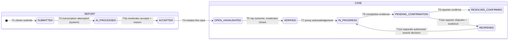

# Parakh — Release 0 Build Specification

**Version 1.1 · 9 August 2026 · Developer-facing extraction of the P0 scope**

> **Status.** Parakh is a **prototype/design-stage** civic-technology project. The application is **not built and not deployed**. **No Punjab Government, federal government, NGO or international-organisation partnership has been formally signed.** **No real-world social impact has been demonstrated.** Parakh is **evidence-first rather than complaint-only**, and reporting is **voice-first in Urdu and English**, with future language expansion treated separately. Punjab is the starting context, with possible future expansion elsewhere in Pakistan. Founder and Project Lead: **Hassan Jalal**.
>
> **Release 0 runs on synthetic or controlled test data only. It is a technical demonstration. It is not field-ready, proves no usability claim about real low-literacy users, and demonstrates no impact.**

**Parent document:** `Parakh_Prototype_SRS_v1.2.md` (SRC-6 governs where they differ). Registered there as the companion extraction.

## Revision history

| Version | Date | Change |
|---|---|---|
| 1.0 | 9 Aug 2026 | Initial extraction from Master SRS v1.1 |
| **1.1** | **9 Aug 2026** | **All four stated totals were wrong and are recomputed** (screens, APIs, errors, entities); **logical→physical screen mapping added**; **MFA restored to P0** per binding DR-9 and removed from non-goals and limitations; capability `P1` renamed **`CAP_PROXY_COMPLETION`**; **API-041 now returns `REOPENED`** and **API-078 added** for the T11d rework transition; every P0 API given an individual contract; P0 data model rebuilt to 34 entities; **hypothesis rewritten as a technical demonstration hypothesis** with success criteria split P0/P1/P2; *"captured, not uploaded"* replaced; **direct-database identity access removed as a product permission**; tamper demonstration restricted to a disposable harness; rejection and `NOT_VALIDATED` scope resolved |

---

## Contents

- [1. Purpose, hypothesis and demo boundary](#1-purpose-hypothesis-and-demo-boundary)
- [2. Explicit non-goals](#2-explicit-non-goals)
- [3. Actors and permissions](#3-actors-and-permissions)
- [4. The one end-to-end workflow](#4-the-one-end-to-end-workflow)
- [5. Screens — logical to physical](#5-screens--logical-to-physical)
- [6. P0 functional requirements](#6-p0-functional-requirements)
- [7. Essential P0 non-functional requirements](#7-essential-p0-non-functional-requirements)
- [8. P0 state machines](#8-p0-state-machines)
- [9. P0 data model](#9-p0-data-model)
- [10. P0 API contracts](#10-p0-api-contracts)
- [11. Offline behaviour](#11-offline-behaviour)
- [12. Evidence integrity and hashing](#12-evidence-integrity-and-hashing)
- [13. Human-review rules](#13-human-review-rules)
- [14. Privacy and safeguarding constraints](#14-privacy-and-safeguarding-constraints)
- [15. Audit events](#15-audit-events)
- [16. P0 error catalogue](#16-p0-error-catalogue)
- [17. Acceptance tests](#17-acceptance-tests)
- [18. Seed and demo data](#18-seed-and-demo-data)
- [19. Environment and configuration](#19-environment-and-configuration)
- [20. Implementation order](#20-implementation-order)
- [21. Definition of Ready](#21-definition-of-ready)
- [22. Definition of Done](#22-definition-of-done)
- [23. Demo script](#23-demo-script)
- [24. Known limitations](#24-known-limitations)
- [25. P1 and P2 exclusions — handoff table](#25-p1-and-p2-exclusions--handoff-table)

---

# 1. Purpose, hypothesis and demo boundary

## 1.1 The Release 0 hypothesis — corrected in v1.1

v1.0 carried the product hypothesis H1, which asserts that *a person with low literacy* can produce a verifiable report. **Release 0 cannot test that.** It runs on synthetic data, uses controlled operators, and defers full low-literacy accessibility to P1. Claiming otherwise would present a technical result as a human-factors result.

> **H0 — the Release 0 technical demonstration hypothesis.**
> The complete evidence-to-human-reviewed-outcome workflow can operate on a **low-cost Android device under intermittent connectivity, using synthetic or controlled test data**, such that evidence is sealed at capture, survives total loss of connectivity, is reviewed and independently verified by two different named humans without either seeing the reporter's identity, and produces a traceable record in which a deliberate alteration is detectable.

> **H1 — the product hypothesis, reserved for P1.**
> A person with low literacy, using a low-cost Android phone with poor or intermittent connectivity, can produce an evidence-based civic report that another independent person can verify. **H1 is tested only in controlled usability and field testing, after the Field-Test Readiness Gate (Master SRS §35) is signed.**

## 1.2 Success criteria, split by release

### P0 — technical demonstration success

| # | Criterion | Verified by |
|---|---|---|
| S0-1 | The §23 six-minute scenario passes **on a low-cost Android device**, starting in airplane mode, on synthetic data | `TEST-E2E-001` |
| S0-2 | Evidence is hashed on-device before any network call, and the server re-verifies every hash | `TEST-EVD-004`, `TEST-EVD-005` |
| S0-3 | A report captured fully offline syncs later with `captured_at` unchanged and no duplicate case | `TEST-OFF-001`, `TEST-OFF-006` |
| S0-4 | **No identity-capable field exists in any Representative-facing response schema**, proven by a build-failing test | `TEST-PRV-001`, `TEST-PRV-002` |
| S0-5 | No AI output changes any state; every consequential change carries a named human, a time and a reason | `TEST-AI-001`, `TEST-AUD-002` |
| S0-6 | `PENDING_CONFIRMATION` never becomes a resolved state without a human action | `TEST-CASE-004` |
| S0-7 | A dispute produces `REOPENED`, and a **separate** authorised action produces `IN_PROGRESS` — two audit events | `TEST-CASE-015`, `TEST-CASE-016` |
| S0-8 | A deliberate alteration of a stored evidence row or audit row is detected by the verifier | `TEST-AUD-003` |
| S0-9 | **Every privileged session is MFA-protected**; no privileged token is issued on a first factor alone | `TEST-AUTH-006`, `TEST-AUTH-007` |

### P1 — usability and controlled field-test success *(not Release 0)*

≥ 20 unassisted sessions with real target users across two rounds · real evidence captured in a real community · full accessibility validation including audio prompts and low-literacy interaction rules · consent lifecycle exercised · safeguarding route exercised · offline reliability measured across ≥ 50 real syncs.

### P2 — evaluation and government-scale readiness *(not Release 0)*

Research export · transcription accuracy benchmark · outcome measurement against a documented baseline · independent evaluation · institutional integration.

## 1.3 Demo boundary

One community-scale workflow · four actors plus one capability · **synthetic data only** · one Android device · one web console · one transcription provider · one database · six minutes end to end.

---

# 2. Explicit non-goals

| Not in Release 0 | Where it lives |
|---|---|
| Union Council Officer portal · Contractor portal · Mayor & Operations Command | Future — Master §3.4 |
| Government payments, escrow, procurement, contractor selection | **Prohibited** — Master §3.6 |
| Public heatmap, public case list, any public surface | P2 |
| AI categorisation, severity, duplicate detection, prioritisation, fraud scoring | **P2, research-only, subject to separate approval, bias evaluation, safety review and human oversight** |
| Model fine-tuning | Out of scope |
| Research export, broad analytics, metrics dashboard | P2 / P1 |
| Consent capture and withdrawal lifecycle | **P1** — Release 0 uses synthetic participants |
| Safeguarding escalation route and Representative-raised concerns | **P1 — mandatory before real participants** |
| Restriction, suspension, appeals, case reconsideration | P1 |
| Audio prompts and full low-literacy interaction rules | **P1 — mandatory before real users** |
| Notifications by push or SMS | P1 — in-app status only |
| Typed description fallback | P1 |
| Report rejection, `NEEDS_INFO`, `NOT_VALIDATED`, expiry, archival | **P1 — see §8.3** |
| iOS | Out of scope |
| Any language beyond Urdu and English. **Punjabi is a future extension and shall not be claimed** | Future |
| Blockchain, distributed ledger | **Prohibited** |
| Province-wide deployment | Out of scope |

> **Removed from this table in v1.1:** *"MFA enrolment and recovery — P1."* **MFA is P0.** DR-9 is binding and requires MFA for Representatives, Moderators and Administrators. See §3 and §10.

---

# 3. Actors and permissions

| Actor | Code | In Release 0 | Authentication |
|---|---|---|---|
| **Citizen** | `CZ` | Synthetic participants, seeded and activated by the Administrator | Phone + one-time passcode (fixture dispatch in the demo environment) |
| **Street Representative** | `REP` | Two seeded accounts, different scopes | **First factor + MFA. Mandatory** |
| **Moderator** | `MOD` | One seeded account | **First factor + MFA. Mandatory** |
| **Administrator** | `ADM` | One seeded account | **First factor + MFA. Mandatory** |
| **`CAP_PROXY_COMPLETION`** | capability | **Not a role and not a portal.** A capability flag held only by a Moderator or Administrator, used to record action-owner steps **by proxy**. Source alias in SRC-1: `P1 act-as-action-owner-proxy` — **the short form `P1` is never used for a capability in this document, because `P1` names a release phase** | — |

## 3.1 Release 0 permission matrix

| Resource · Action | CZ | REP | MOD | ADM |
|---|:--:|:--:|:--:|:--:|
| Authenticate (first factor) | ✓ | ✓ | ✓ | ✓ |
| **Complete MFA before any privileged action** | n/a | **required** | **required** | **required** |
| Create a report | ✓ | ✗ | ✗ | ✗ |
| Capture live media | ✓ | ✓ *(verification)* | ✓ *(proxy completion)* | ✓ *(proxy completion)* |
| **Import media from the gallery or any external source** | **✗** | **✗** | **✗** | **✗** |
| View own report and timeline | ✓ | — | — | — |
| View any report | ✗ | ⚑ assigned + in scope + **identity-stripped** | ✓ | ✓ |
| Moderate a report (accept) | ✗ | ✗ | ⚑ conflict-checked, reason mandatory | ⚑ |
| Assign to a Representative | ✗ | ✗ | ✓ | ✓ |
| Record a verification outcome | ✗ | ⚑ note mandatory | ✗ | ✗ |
| **Close a verification state** | ✗ | **✗** | ✓ | ✓ |
| Record acknowledgement by proxy | ✗ | ✗ | ⚑ `CAP_PROXY_COMPLETION` | ⚑ `CAP_PROXY_COMPLETION` |
| Submit completion evidence | ✗ | ✗ | ⚑ `CAP_PROXY_COMPLETION` | ⚑ `CAP_PROXY_COMPLETION` |
| **Start rework after a reopening (T11d)** | ✗ | ✗ | ⚑ `CAP_PROXY_COMPLETION` | ⚑ `CAP_PROXY_COMPLETION` |
| Confirm a fix | ⚑ reporter only, and never the completion submitter | ✗ | ✗ | ✗ |
| Dispute a fix | ⚑ reporter only, evidence mandatory | ✗ | ✗ | ✗ |
| **See reporter identity** | ✗ | **✗ never** | ✗ | **✗ in Release 0.** Break-glass is a **P1** procedure requiring justification, dual logging and the Field-Test Readiness Gate |
| Read the audit log | ✗ | ✗ | ✓ | ✓ |
| **Delete anything** | **✗** | **✗** | **✗** | **✗** |
| Activate a participant · create a grant · revoke a grant | ✗ | ✗ | ✗ | ✓ |
| Create and deactivate console accounts | ✗ | ✗ | ✗ | ✓ |
| Run the integrity verifier | ✗ | ✗ | ✓ | ✓ |
| Money, payment, contractor selection | **✗** | **✗** | **✗** | **✗** |

> **Corrected in v1.1 (CR-32).** v1.0 stated that the Administrator could see reporter identity "direct DB only in P0". **That is removed.** Direct database access is a **maintenance activity, not a product permission**, and shall never be used as an identity-viewing workflow. For Release 0, synthetic identities are provisioned by controlled seed scripts. For real data, identity access requires the P1 break-glass procedure.

---

# 4. The one end-to-end workflow

```mermaid
graph LR
    A["1 Citizen captures live<br/>photo + voice OFFLINE"] --> B["2 Encrypted device queue"]
    B --> C["3 Sync on reconnect<br/>capture time preserved"]
    C --> D["4 Manifest re-verified<br/>server-side"]
    D --> E["5 Transcription<br/>annotation only"]
    E --> F["6 Moderator accepts<br/>reason mandatory"]
    F --> G["7 Case OPEN_UNVALIDATED"]
    G --> H["8 Assigned<br/>conflict-excluded"]
    H --> I["9 Packet<br/>NO REPORTER IDENTITY"]
    I --> J["10 Outcome + mandatory note"]
    J --> K["11 Moderator closes<br/>VERIFIED"]
    K --> L["12 Proxy acknowledgement<br/>IN_PROGRESS"]
    L --> M["13 Completion evidence<br/>live capture + note"]
    M --> N["14 PENDING_CONFIRMATION<br/>NOT resolved"]
    N --> O["15 Before/after shown"]
    O --> P{"16 Citizen"}
    P -->|confirms| Q["17a RESOLVED_CONFIRMED"]
    P -->|disputes| R["17b REOPENED"]
    R --> S["18 Separate rework decision<br/>T11d → IN_PROGRESS"]
    Q --> T["19 Full history<br/>+ tamper detection"]
    S --> M
```

---

# 5. Screens — logical to physical

**Corrected in v1.1 (CR-33).** v1.0 said "twelve screens" beside a fourteen-row table and never explained the difference. The Master SRS classifies **31 logical screen IDs** as P0. Release 0 implements them as **18 physical routes** — 17 that consume logical IDs, plus one new MFA route — because several logical IDs are states or panels of one route, and the three console sign-in IDs collapse into one. The mapping below accounts for every one of the 31, and §5.1's closing paragraph shows the arithmetic term by term.

## 5.1 Mapping table — every P0 logical ID accounted for

| # | Physical route | Client | Logical IDs consolidated | How the difference arises |
|---|---|---|---|---|
| 1 | `/language` | Android | **CZ-01** | 1:1 |
| 2 | `/auth` | Android | **CZ-03** | 1:1 — citizen phone + passcode |
| 3 | `/home` | Android | **CZ-04** | 1:1 |
| 4 | `/report/capture` | Android | **CZ-05** | 1:1 |
| 5 | `/report/location` | Android | **CZ-06** | 1:1 |
| 6 | `/report/voice` | Android | **CZ-07** | 1:1 |
| 7 | `/report/review` | Android | **CZ-08**, **CZ-09** | CZ-09 is the **success state** of the review route, not a separate route |
| 8 | `/case/:ref` | Android | **CZ-10**, **CZ-11** | CZ-11 is a **panel** shown on the case route when the state is `PENDING_CONFIRMATION` |
| 9 | `/case/:ref/dispute` | Android | **CZ-12** | 1:1 — the dispute capture screen, which v1.0 left unmapped |
| 10 | `/queue` | Android | **CZ-14** | 1:1 |
| 11 | `/login` | Console | **MO-01**, **RP-01**, **AD-01** | One role-agnostic first-factor route; the landing page differs by role |
| 12 | `/mfa` | Console | *(new physical route)* | MFA enrolment, challenge, verification and recovery. No logical ID in the Master because v1.1 had no MFA screens; **added here and registered in the Master as part of FR-AUTH-007** |
| 13 | `/moderation` | Console | **MO-02** | 1:1 — queue |
| 14 | `/moderation/:id` | Console | **MO-03**, **MO-04**, **MO-06**, **MO-07**, **MO-08**, **MO-09** | One case-working surface with six **panels**: packet, decision, assignment, verification closure, proxy action-owner, completion capture |
| 15 | `/moderation/:id/history` | Console | **MO-11** | 1:1 |
| 16 | `/validations` | Console | **RP-02** | 1:1 |
| 17 | `/validations/:id` | Console | **RP-03**, **RP-04** | Packet and outcome form on one surface |
| 18 | `/admin` | Console | **AD-02**, **AD-03**, **AD-04**, **AD-09**, **AD-11** | One administration surface with five **panels**: participants, grants, operators, integrity, dashboard |

**The arithmetic, stated exactly.** 31 logical P0 screen IDs are consumed by **17** of these routes. Route 12, `/mfa`, consumes **no** logical ID because the Master had no MFA screen ID before v1.2; it is a new physical surface required by FR-AUTH-007 and FR-AUTH-008. **17 + 1 = 18 physical routes**, of which 10 are Android and 8 are console.

The 31 → 17 reduction arises in exactly four places and nowhere else: `/report/review` absorbs one **success state** (CZ-09); `/case/:ref` absorbs one **conditional panel** (CZ-11); `/login` absorbs **three role-specific sign-in IDs** into one role-agnostic route (MO-01, RP-01, AD-01 → 1, a reduction of 2); `/moderation/:id` absorbs **five panels** (MO-04, MO-06, MO-07, MO-08, MO-09), `/validations/:id` absorbs **one** (RP-04), and `/admin` absorbs **four** (AD-03, AD-04, AD-09, AD-11). Reductions: 1 + 1 + 2 + 5 + 1 + 4 = **14**. 31 − 14 = **17**. ✓

## 5.2 Screen specifications

| Route | Purpose | Key controls | Validation | Error states | Requirements |
|---|---|---|---|---|---|
| `/language` | Urdu or English, RTL correct | Two large buttons in native script | One must be chosen | — | FR-LOC-001 |
| `/auth` | Citizen authentication | Phone, passcode, resend | E.164; 6 digits; ≤ 5 attempts | `E_AUTH_FAILED`, `E_RATE_LIMITED` | FR-AUTH-001, FR-AUTH-002 |
| `/home` | Start a report; own cases | Large primary action; case list; **offline badge** | — | `E_SERVER_UNAVAILABLE` shows cached | FR-CIT-101 |
| `/report/capture` | Live photo | Camera opens **directly**; shutter; retake; counter 1–5 | ≥ 1, ≤ 5, live only | `E_PERMISSION_CAMERA`, `E_CAMERA_UNAVAILABLE`, `E_STORAGE_FULL` | FR-EVD-001, FR-EVD-002 |
| `/report/location` | Confirm position | Map, pin, **drag to adjust**, accuracy readout | Location present, verified or flagged | `E_LOCATION_DENIED`, `E_LOCATION_TIMEOUT` | FR-EVD-101, **FR-EVD-102** |
| `/report/voice` | Speak the problem | Large record; timer; **playback**; re-record | 3 s ≤ d ≤ 90 s | `E_MIC_UNAVAILABLE` | FR-VOI-001, **FR-VOI-004** |
| `/report/review` | Final check, then submit | Thumbnails; map; **audio playback**; Submit | All mandatory items | `E_VALIDATION_FAILED` *(names the field)* | FR-CIT-103, FR-CIT-104, FR-CIT-105 |
| `/case/:ref` | Follow the case; confirm or dispute | Status chip with **plain-language text**; timeline; before/after panel; Confirm; Dispute | Dispute requires reason + evidence | `E_INVALID_TRANSITION`, `E_STALE_STATE` | FR-CASE-101, FR-CASE-103, FR-FIX-101, FR-FIX-102 |
| `/case/:ref/dispute` | Capture fresh dispute evidence | Live camera; reason (typed or spoken) | ≥ 1 live photo; reason present | `E_EVIDENCE_REQUIRED` | FR-FIX-103 |
| `/queue` | Offline queue | Item list; per-item state; **Retry now**; storage indicator | — | `E_SYNC_FAILED`, `E_STORAGE_FULL` | FR-OFF-003, **FR-OFF-005** |
| `/login` | Console first factor | Username, password | — | `E_AUTH_FAILED`, `E_RATE_LIMITED` | FR-AUTH-006 |
| `/mfa` | **Enrol, challenge, verify, recover** | TOTP provisioning; code entry; recovery codes shown once; recovery-code entry | 6-digit code; ≤ 5 attempts then lockout | `E_MFA_REQUIRED`, `E_AUTH_FAILED`, `E_RATE_LIMITED` | **FR-AUTH-007, FR-AUTH-008** |
| `/moderation` | Triage queue | List ordered **flagged-first then by age** | — | `E_SERVER_UNAVAILABLE` | FR-MOD-001, FR-SAF-001 |
| `/moderation/:id` | Work the case | Media; **audio player**; transcript panel **labelled machine-generated with model, version, confidence**; **correct transcript**; Accept **(reason mandatory)**; assign; close verification; proxy acknowledge; **capture completion evidence + note**; **start rework** | Reason and notes mandatory; conflicts re-checked | `E_REASON_REQUIRED`, `E_CONFLICT_OF_INTEREST`, `E_STALE_STATE`, `E_LIVE_CAPTURE_REQUIRED`, `E_PROXY_FIELDS_REQUIRED` | FR-MOD-002, FR-MOD-003, FR-MOD-005, FR-VOI-102, FR-AI-003, FR-REP-002, FR-REP-105, FR-FIX-001, FR-FIX-002, FR-FIX-004, FR-CASE-104 |
| `/moderation/:id/history` | Full audit trail | Chronological events with actor, reason, both states, chain hash. **Read-only** | — | — | FR-CASE-102, FR-AUD-003 |
| `/validations` | Assigned queue | Scoped list, age indicator | — | `E_PERMISSION_DENIED` | FR-REP-005 |
| `/validations/:id` | Verify | Media; audio; transcript; map with **confidence flags**; outcome; **note mandatory** | Note ≥ 20 chars | `E_NOTE_REQUIRED`, `E_CONFLICT_OF_INTEREST` | FR-REP-006, FR-REP-101, FR-EVD-105 |
| `/admin` | Administration | Activate participant; **create and revoke grants**; create console accounts; **run integrity verifier**; dashboard | Grant expiry mandatory; reason mandatory on revoke | `E_PERMISSION_DENIED` | FR-ADM-001, FR-ADM-002, FR-ADM-003, **FR-ADM-004**, FR-AUD-005 |

---

# 6. P0 functional requirements

**83 requirements.** Full text at the same identifier in Master SRS §9. Every one states `P0` explicitly in its own block.

| Group | Requirements |
|---|---|
| **Authentication and identity (7)** | FR-AUTH-001 · FR-AUTH-002 · FR-AUTH-003 · FR-AUTH-004 · **FR-AUTH-006** · **FR-AUTH-007** · **FR-AUTH-008** |
| **Administration (4)** | FR-ADM-001 · FR-ADM-002 · **FR-ADM-003** · **FR-ADM-004** |
| **Citizen flow (6)** | FR-CIT-001 · FR-CIT-101 · FR-CIT-102 · FR-CIT-103 · FR-CIT-104 · FR-CIT-105 |
| **Evidence (12)** | FR-EVD-001 · FR-EVD-002 · FR-EVD-003 · FR-EVD-004 · FR-EVD-005 · FR-EVD-101 · **FR-EVD-102** · FR-EVD-103 · FR-EVD-104 · **FR-EVD-105** · FR-EVD-201 · FR-EVD-202 |
| **Voice and transcription (5)** | FR-VOI-001 · FR-VOI-002 · **FR-VOI-004** · FR-VOI-101 · FR-VOI-102 |
| **AI boundary (3)** | FR-AI-001 · FR-AI-002 · FR-AI-003 |
| **Offline (8)** | FR-OFF-001 · FR-OFF-002 · FR-OFF-003 · FR-OFF-004 · **FR-OFF-005** · FR-OFF-006 · FR-OFF-007 · FR-OFF-008 |
| **Moderation (4)** | FR-MOD-001 · FR-MOD-002 · FR-MOD-003 · FR-MOD-005 |
| **Assignment and verification (7)** | FR-REP-001 · FR-REP-002 · **FR-REP-004** · FR-REP-005 · FR-REP-006 · FR-REP-101 · FR-REP-105 |
| **Completion and confirmation (8)** | FR-FIX-001 · FR-FIX-002 · FR-FIX-003 · **FR-FIX-004** · FR-FIX-006 · FR-FIX-101 · FR-FIX-102 · FR-FIX-103 |
| **Case lifecycle (6)** | FR-CASE-001 · FR-CASE-004 · FR-CASE-101 · **FR-CASE-102** · FR-CASE-103 · **FR-CASE-104** |
| **Audit and integrity (5)** | FR-AUD-001 · FR-AUD-002 · **FR-AUD-003** · FR-AUD-004 · FR-AUD-005 |
| **Privacy (4)** | FR-PRV-001 · FR-PRV-002 · **FR-PRV-003** · **FR-PRV-004** |
| **Safeguarding (3)** | **FR-SAF-001** · FR-SAF-003 · FR-SAF-005 |
| **Localisation (1)** | FR-LOC-001 |

**Bold entries were promoted into P0 in v1.1** because a P0 screen, API or state transition depends on them. The Master §3.7.2 records the justification.

---

# 7. Essential P0 non-functional requirements

`NFR-SEC-001` authentication on every endpoint · `NFR-SEC-002` full server-side check set · `NFR-SEC-003` least privilege · `NFR-SEC-004` vault separation · `NFR-SEC-005` TLS 1.2+ · `NFR-SEC-007` keystore-held device keys and tokens · `NFR-SEC-008` no secrets in source · `NFR-SEC-009` refresh rotation and family invalidation · **`NFR-SEC-010` MFA on every privileged session** · `NFR-SEC-011` lockout and rate limiting · `NFR-SEC-012` input validation · `NFR-SEC-013` media validation · `NFR-SEC-015` append-only grants · `NFR-SEC-017` no sensitive data in logs · `NFR-SEC-019` data minimisation · `NFR-REL-001` **no captured evidence lost on any error path** · `NFR-REL-003` queue survives restart · `NFR-REL-004` zero duplicate cases · `NFR-REL-005` AI failure never blocks · `NFR-USA-001` both languages complete · `NFR-USA-002` Urdu RTL correct · `NFR-USA-006` voice-and-camera-only path · `NFR-USA-009` 48 dp / 64 dp targets · `NFR-USA-011` errors state what happened and what to do · `NFR-USA-015` progress and manual retry · `NFR-USA-017` described progress indicators · `NFR-COMP-001` reference low-cost Android *(minimum version TBD-005)* · `NFR-COMP-002` two desktop browsers · `NFR-MNT-001` traceability · `NFR-MNT-002` externalised configuration · `NFR-MNT-004` commit attribution preserved · `NFR-OPS-001…003`, `NFR-OPS-006…008`, `NFR-OPS-010…012`, `NFR-OPS-014…016` · `NFR-DR-004`, `NFR-DR-005`.

**Performance targets are measured, not gated, in Release 0** — TBD-040, TBD-041, TBD-042.

---

# 8. P0 state machines

## 8.1 Transition table — complete for Release 0

| T | From → To | Actor | Capability | Guard | API | Requirement | Audit event | Test |
|---|---|---|---|---|---|---|---|---|
| **T1** | — → `SUBMITTED` | Citizen | base | Active attested participant; manifest verifies; idempotency key | API-030 | FR-EVD-202 | `report_submitted` | TEST-CASE-001 |
| **T2** | `SUBMITTED` → `AI_PROCESSED` | **System** (worker) | worker role | Advances on success **or** failure | — *(internal)* | FR-VOI-101 | `annotation_created` / `ai_unavailable` | TEST-AI-005 |
| **T3a** | `AI_PROCESSED` → `ACCEPTED` | Moderator | `F2` | Not the author; not conflicted; **reason mandatory**; state version matches | API-052 | FR-MOD-003 | `moderation_decision` | TEST-MOD-003 |
| **T4** | `ACCEPTED` → case `OPEN_UNVALIDATED` | System | — | Exactly one case per accepted report | *(same transaction as T3a)* | FR-MOD-005 | `case_created` | TEST-CASE-001 |
| **T5** | `OPEN_UNVALIDATED` → `VERIFIED` | Moderator on a Representative outcome | `F2` | Representative was eligible; note present | API-055 | FR-REP-105 | `verification_closed` | TEST-CASE-002 |
| **T7** | `VERIFIED` → `IN_PROGRESS` | Moderator / Administrator | `F2` + **`CAP_PROXY_COMPLETION`** | Both proxy fields present | API-070 | FR-FIX-001 | `proxy_acknowledgement` | TEST-FIX-001 |
| **T8** | `IN_PROGRESS` → `PENDING_CONFIRMATION` | Moderator / Administrator | `F2` + **`CAP_PROXY_COMPLETION`** | ≥ 1 live completion photo **and** a note ≥ 20 chars | API-071 | FR-FIX-002, FR-FIX-004 | `completion_evidence_submitted` | TEST-FIX-002 |
| **T9** | `PENDING_CONFIRMATION` → `RESOLVED_CONFIRMED` | Citizen | reporter | Caller is the reporter **and is not the completion submitter** | API-040 | FR-FIX-102, FR-FIX-006 | `resolution_confirmed` | TEST-FIX-005 |
| **T11a** | `PENDING_CONFIRMATION` → **`REOPENED`** | Citizen | reporter | Reason **and** ≥ 1 live photo | API-041 | FR-FIX-103 | `resolution_disputed`, `case_reopened` | TEST-FIX-006 |
| **T11d** | **`REOPENED` → `IN_PROGRESS`** | Moderator / Administrator | `F2` + **`CAP_PROXY_COMPLETION`** | Both proxy fields **and** a rework note | **API-078** | **FR-CASE-104** | `rework_started` | TEST-CASE-015, TEST-CASE-016 |

> **Corrected in v1.1 (CR-31).** v1.0's API-041 example returned `IN_PROGRESS` directly, silently skipping `REOPENED`. **API-041 now returns `REOPENED`.** The move to `IN_PROGRESS` is a **separate authorised decision** (T11d), so the reopening and the decision to rework are two independently attributable events with two audit rows and two timestamps.

## 8.2 Refused in Release 0

Any transition skipping verification · `PENDING_CONFIRMATION` → archive · a Representative reaching `VERIFIED` alone · self-confirmation by the completion submitter · **any transition initiated by an AI or worker identity other than T2** · any direct state write · `REOPENED` → `PENDING_CONFIRMATION` without a fresh completion submission.

## 8.3 Rejection and `NOT_VALIDATED` — resolved in v1.1

v1.0's state diagram exposed `REJECTED` and `NOT_VALIDATED` while appeals were P1, leaving a citizen with a rejection and no route.

**Decision: Release 0 implements only the accepted path.** `REJECTED`, `NEEDS_INFO`, `EXPIRED`, `NOT_VALIDATED`, `REJECTED_FINAL`, `REJECTED_FINAL_CASE`, `RESOLVED_UNCONFIRMED` and `ARCHIVED` are **not implemented and not reachable in Release 0**. The Moderator interface offers **Accept only**; the Representative interface offers **`VALIDATED` only**.

**Rationale.** Release 0 runs on synthetic data with controlled operators, so no real person can be rejected. Exposing a rejection path with no appeal would be worse than omitting it. **The full set of states, with rejection and appeals, is implemented in P1 together with FR-ADM-101…103.** The database enum carries every state from the outset so that no migration is needed.

---

# 9. P0 data model

**Corrected in v1.1 (CR-27, CR-33).** v1.0 claimed 19 entities beside a 24-item list and omitted twelve entities that P0 requirements depend on. **The verified P0 count is 34.**

```mermaid
erDiagram
    PARTICIPANT ||--o| IDENTITY_VAULT_RECORD : "vault only"
    PARTICIPANT ||--o| ATTESTATION_RECORD : attested_by
    PARTICIPANT ||--o{ ROLE_ASSIGNMENT : holds
    PARTICIPANT ||--o{ CAPABILITY_GRANT : granted
    PARTICIPANT ||--o{ AUTH_CHALLENGE : requests
    PARTICIPANT ||--o{ SESSION : owns
    PARTICIPANT ||--o| MFA_ENROLMENT : enrols
    MFA_ENROLMENT ||--o{ MFA_RECOVERY_CODE : issues
    PARTICIPANT ||--o| REPRESENTATIVE_PROFILE : profile
    PARTICIPANT ||--o{ DECLARED_CONFLICT : declares
    PARTICIPANT ||--o{ CIVIC_REPORT : submits
    CIVIC_REPORT ||--|| EVIDENCE_MANIFEST : sealed_by
    CIVIC_REPORT ||--o{ EVIDENCE_ITEM : contains
    CIVIC_REPORT ||--o| UPLOAD_SESSION : uploaded_via
    CIVIC_REPORT ||--o| VOICE_RECORDING : has
    VOICE_RECORDING ||--o{ MACHINE_TRANSCRIPT : annotated_by
    MACHINE_TRANSCRIPT ||--o{ HUMAN_TRANSCRIPT_CORRECTION : corrected_by
    VOICE_RECORDING ||--o{ MODEL_INPUT_RECORD : derivative_of
    CIVIC_REPORT ||--o{ MODERATION_DECISION : decided_by
    CIVIC_REPORT ||--|| CASE : creates
    CASE ||--o{ REPRESENTATIVE_ASSIGNMENT : assigned_via
    REPRESENTATIVE_ASSIGNMENT ||--o| VERIFICATION_DECISION : results_in
    CASE ||--o{ PROXY_ACTION : progressed_by
    CASE ||--o| COMPLETION_CLAIM : claimed_by
    COMPLETION_CLAIM ||--o{ EVIDENCE_ITEM : evidenced_by
    CASE ||--o| CITIZEN_RESOLUTION_DECISION : closed_by
    CASE ||--o{ DISPUTE : disputed_by
    DISPUTE ||--o| REOPEN_EVENT : produces
    CASE ||--o{ REOPEN_EVENT : reopened_by
    CASE ||--o{ SAFEGUARDING_FLAG : flagged_by
    CASE ||--o{ CASE_STATUS_EVENT : timeline
    CIVIC_REPORT ||--o{ SYNC_QUEUE_ITEM : queued_as
    IDEMPOTENCY_RECORD ||--o| CIVIC_REPORT : dedupes
    AUDIT_EVENT ||--o| AUDIT_EVENT : chains_to
```

## 9.1 The 34 P0 entities

| # | Entity | Why P0 |
|---|---|---|
| 1 | `Participant` | Every actor |
| 2 | `IdentityVaultRecord` | Vault separation is demonstrated |
| 3 | `AttestationRecord` | FR-ADM-001 activation |
| 4 | `RoleAssignment` | Role checks |
| 5 | `CapabilityGrant` | Scoped, expiring grants; revocation demonstrated |
| 6 | `DeclaredConflict` | **The demo proves conflict-based Representative exclusion** |
| 7 | `RepresentativeProfile` | Scope and endorsement |
| 8 | `AuthChallenge` | FR-AUTH-001 |
| 9 | `Session` | FR-AUTH-003, refresh families |
| 10 | `MfaEnrolment` | **FR-AUTH-007** |
| 11 | `MfaRecoveryCode` | **FR-AUTH-008** |
| 12 | `DevicePreference` | FR-LOC-001 language persistence, device-local |
| 13 | `CivicReport` | Core |
| 14 | `EvidenceItem` | Core. **`CompletionEvidence` is not a separate table — completion evidence is `EvidenceItem` with `kind = completion_photo` linked to `CompletionClaim`** |
| 15 | `EvidenceManifest` | FR-EVD-004 |
| 16 | `UploadSession` | FR-OFF-007 |
| 17 | `IdempotencyRecord` | FR-OFF-006 |
| 18 | `VoiceRecording` | FR-VOI-001 |
| 19 | `MachineTranscript` | FR-VOI-101 |
| 20 | `HumanTranscriptCorrection` | FR-AI-003 |
| 21 | `ModelInputRecord` | Derivative provenance |
| 22 | `ModerationDecision` | FR-MOD-003 |
| 23 | `Case` | Core |
| 24 | `RepresentativeAssignment` | FR-REP-002 |
| 25 | `VerificationDecision` | FR-REP-101 |
| 26 | `ProxyAction` | FR-FIX-001, FR-CASE-104 |
| 27 | `CompletionClaim` | FR-FIX-002 |
| 28 | `CitizenResolutionDecision` | FR-FIX-102 |
| 29 | `Dispute` | FR-FIX-103 |
| 30 | `ReopenEvent` | **Required — API-041 returns `reopen_event_id`, so the entity must exist** |
| 31 | `SafeguardingFlag` | **FR-SAF-001 — the queue orders flagged items first, so the flag must exist** |
| 32 | `CaseStatusEvent` | Timeline |
| 33 | `AuditEvent` | Chain |
| 34 | `SyncQueueItem` | Device-side queue |

**Not in P0:** `ConsentRecord`, `Restriction`, `Appeal`, `AppealAssignment`, `Notification`, `AnalyticsEvent`, `ResearchExport`, `Configuration`, `EscalationRecord`, `VaultAccessRecord`, `WithdrawalRecord`. Field definitions for all of these are in Master SRS §14.2 and §14.2.1.

## 9.2 Critical field rules

| Field | Rule |
|---|---|
| `EvidenceItem.content_hash` / `.hash_algorithm` / `.hash_version` | Computed **on device at capture**. Immutable |
| `EvidenceItem.captured_at` vs `CivicReport.received_at` | **Separate columns. `captured_at` is never overwritten and is the operative time** |
| `EvidenceItem.kind` | enum `report_photo` \| `verification_photo` \| `completion_photo` \| `dispute_photo` |
| `EvidenceItem.storage_key` | Content-addressed, write-once bucket, **no delete grant** |
| `MachineTranscript.model_id` / `.model_version` / `.provider` | **`NOT NULL`. A null is invalid and rejected at write time** |
| `ModerationDecision.transcript_annotation_ref` | **Renamed from `ai_suggestion_ref`.** Records which transcript version the human saw — **not an AI recommendation** |
| `CivicReport.reporter_participant_id` | **Never selected in any Representative-facing query** |
| `Case.state_version` | Increments on every transition; optimistic concurrency |
| `CapabilityGrant.capability` | enum `F1` \| `F2` \| `F3` \| **`CAP_PROXY_COMPLETION`** |
| `CapabilityGrant.expires_at` / `.revoked_at` | Expiry `NOT NULL`; revocation **marks, never deletes** |
| `AuditEvent.payload_hash` / `.prev_hash` / `.chain_hash` / `.sequence` | Gapless; `INSERT`/`SELECT` grants only |
| `ProxyAction.on_behalf_of` / `.proxy_reason` | **`NOT NULL`** |
| `ReopenEvent.origin` | enum `citizen_dispute` \| `moderator_reopen` |
| `MfaRecoveryCode.code_hash` | Hashed. **Never logged, never displayed twice** |
| Any money, balance, wallet or payment field | **Must not exist** |

---

# 10. P0 API contracts

**37 endpoints.** All under `/api/v1/`. Every mutating call requires `X-Idempotency-Key`. Every response carries `X-Correlation-Id`. Every endpoint performs the full check set: `authenticated · capability · scope · object · action · conflict`.

## 10.0 Common contract

| Aspect | Value |
|---|---|
| Headers (all) | `Authorization: Bearer <token>` where authenticated · `X-Correlation-Id` · `Accept-Language: ur\|en` |
| Headers (mutating) | `X-Idempotency-Key: <uuid>` — **mandatory**, bound to a payload hash |
| Error body | `{"error_code":"…","message":"<localised>","correlation_id":"…","details":{…}}` |
| Rate limits | Per participant and per IP; `429` with `Retry-After` |
| Audit | **Every mutating call writes an audit row in the same transaction. A failed audit write rolls back the action** |
| Media | Never inline; always a short-lived authenticated reference |

## 10.1 Authentication — citizen

### API-001 · `POST /auth/challenge` · **P0**

| | |
|---|---|
| Purpose | Begin citizen authentication |
| Actors | Citizen · Auth: none · Authz: public, rate-limited |
| Params | none |
| Request | `{"phone":"+9230000000001"}` |
| Success `200` | `{"challenge_id":"3f0a…","expires_at":"2026-08-09T10:05:00Z"}` |
| Errors | `400 E_VALIDATION_FAILED` · `429 E_RATE_LIMITED` `{"retry_after_s":900}` · `503 E_SERVER_UNAVAILABLE` |
| Validation | E.164; ≤ 5 challenges per number per hour; ≤ 20 per IP |
| Idempotency | Same key returns the same `challenge_id` |
| Audit | `auth_challenge_issued` — **passcode never logged** |
| Privacy | **Identical response for known and unknown numbers.** No user enumeration |
| Links | FR-AUTH-001 · `/auth` · TEST-AUTH-001, TEST-SEC-002 |

### API-002 · `POST /auth/verify` · **P0**

| | |
|---|---|
| Purpose | Complete citizen authentication |
| Actors | Citizen · Auth: none · Authz: public |
| Request | `{"challenge_id":"3f0a…","passcode":"418205"}` |
| Success `200` | `{"access_token":"eyJ…","refresh_token":"rt_…","expires_in":1800,"participant_id":"b17c…","roles":["citizen"],"language":"ur"}` |
| Errors | `401 E_AUTH_FAILED` `{"attempts_left":3}` · `401 E_AUTH_EXPIRED` · `403 E_ACCOUNT_SUSPENDED` · `429 E_RATE_LIMITED` |
| Validation | Constant-time comparison; single use; ≤ 5 attempts then the challenge is invalidated |
| Audit | `auth_succeeded` / `auth_failed` |
| Privacy | Returns the pseudonymous participant id only |
| Links | FR-AUTH-002 · `/auth` · TEST-AUTH-002 · T—: no state transition |

### API-003 · `POST /auth/refresh` · **P0**

| | |
|---|---|
| Purpose | Rotate tokens |
| Actors | any · Auth: **refresh token only — no access bearer required** · Authz: token unconsumed, family not revoked |
| Request | `{"refresh_token":"rt_…","device_id":"dev_…"}` |
| Success `200` | `{"access_token":"eyJ…","refresh_token":"rt_new…","expires_in":1800}` |
| Errors | `401 E_AUTH_REQUIRED` · **`401 E_AUTH_REUSE_DETECTED`** — the **entire refresh-token family is revoked** |
| Idempotency | A replayed rotated token is a reuse event, not a retry |
| Audit | `session_refreshed` · `token_family_revoked` |
| Security | **Tokens never logged.** Multi-device: one family per `device_id` |
| Links | FR-AUTH-003 · all authenticated routes · TEST-AUTH-003, TEST-SEC-003 |

### API-004 · `POST /auth/logout` · **P0**

| | |
|---|---|
| Purpose | Revoke the current session |
| Actors | any authenticated · Authz: own session |
| Request | `{}` · Success `204` no body |
| Errors | `401 E_AUTH_REQUIRED` |
| Behaviour | **The encrypted offline queue is retained** and resumes for the same participant |
| Audit | `session_revoked` |
| Links | FR-AUTH-003 · `/home`, `/admin` · TEST-AUTH-003 |

## 10.2 Authentication — privileged, multi-step

> **Reconciled in v1.1 (CR-30).** v1.0 had API-005 accepting a second factor in one request while API-100 defined a separate ticket flow. **API-005 now performs the first factor only and returns a login ticket carrying no privileged scope. No privileged token exists until API-100 succeeds.**

### API-005 · `POST /auth/console/login` · **P0**

| | |
|---|---|
| Purpose | **First factor only** |
| Actors | REP, MOD, ADM · Auth: none · Authz: public, rate-limited |
| Request | `{"username":"mod1","password":"…"}` |
| Success `200` | `{"login_ticket":"lt_…","mfa_required":true,"mfa_enrolled":false,"expires_at":"2026-08-09T10:04:00Z"}` |
| Errors | `401 E_AUTH_FAILED` · `429 E_RATE_LIMITED` |
| Security | **Returns no access token and no refresh token.** The ticket carries no privileged scope and expires in 240 s |
| Audit | `privileged_first_factor` — password never logged |
| Links | FR-AUTH-006 · `/login` · TEST-AUTH-006 |

### API-099 · `POST /auth/mfa/enrol` and `POST /auth/mfa/enrol/confirm` · **P0**

| | |
|---|---|
| Purpose | Enrol a second factor. **Forced when `mfa_enrolled:false`** |
| Actors | REP, MOD, ADM · Auth: valid `login_ticket` · Authz: own account, unenrolled |
| Request (enrol) | `{"login_ticket":"lt_…","method":"totp"}` |
| Success `200` | `{"provisioning_uri":"otpauth://totp/Parakh:mod1?secret=…","enrolment_id":"me_…"}` |
| Request (confirm) | `{"login_ticket":"lt_…","enrolment_id":"me_…","code":"492013"}` |
| Success `200` | `{"enrolled":true,"recovery_codes":["…","…"]}` — **ten codes, shown once** |
| Errors | `400 E_VALIDATION_FAILED` · `401 E_AUTH_FAILED` · `403 E_MFA_REQUIRED` · `429 E_RATE_LIMITED` |
| Security | Secret encrypted at rest; **recovery codes stored only as hashes and never logged or re-displayed** |
| Audit | `mfa_enrolled` |
| Links | FR-AUTH-007 · `/mfa` · TEST-AUTH-007 |

### API-100 · `POST /auth/mfa/challenge` and `POST /auth/mfa/verify` · **P0**

| | |
|---|---|
| Purpose | Issue and verify the second factor. **This is the only endpoint that issues a privileged token** |
| Actors | REP, MOD, ADM · Auth: valid `login_ticket` · Authz: account with MFA enrolled |
| Request (challenge) | `{"login_ticket":"lt_…"}` → `200 {"challenge_issued":true,"method":"totp"}` |
| Request (verify) | `{"login_ticket":"lt_…","code":"492013"}` |
| Success `200` | `{"access_token":"eyJ…","refresh_token":"rt_…","expires_in":1800,"roles":["moderator"],"capabilities":["F2","CAP_PROXY_COMPLETION"]}` |
| Errors | `401 E_AUTH_FAILED` `{"attempts_left":n}` · `403 E_MFA_REQUIRED` · `429 E_RATE_LIMITED` — **lockout after 5 failures** |
| Audit | `mfa_challenge` · `mfa_failed` · `mfa_lockout` · `privileged_login` |
| Security | **No privileged token is issued before this call succeeds**, asserted by TEST-AUTH-006 |
| Links | FR-AUTH-007 · `/mfa` · TEST-AUTH-006, TEST-AUTH-007 |

### API-101 · `POST /auth/mfa/recover` · **P0**

| | |
|---|---|
| Purpose | Authenticate after device loss using a single-use recovery code |
| Actors | REP, MOD, ADM · Auth: valid `login_ticket` · Authz: unused codes remain |
| Request | `{"login_ticket":"lt_…","recovery_code":"a7f2-91bc"}` |
| Success `200` | `{"access_token":"eyJ…","refresh_token":"rt_…","remaining_codes":9,"reenrolment_required":true}` |
| Errors | `401 E_AUTH_FAILED` · `429 E_RATE_LIMITED` — **3 attempts per hour** |
| Behaviour | Consumes the code; **notifies the account**; forces re-enrolment before the next sign-in |
| Audit | `mfa_recovery_used` |
| Links | FR-AUTH-008 · `/mfa` · TEST-AUTH-008 |

### API-102 · `POST /admin/operators/{id}/mfa/reset` · **P0**

| | |
|---|---|
| Purpose | Administrator-initiated reset after verified device loss with no codes remaining |
| Actors | **Administrator only** · Auth: bearer + MFA satisfied · Authz: admin |
| Path | `id` — operator participant id |
| Request | `{"reason":"Verified device loss reported in person on 12 Sep; no recovery codes remained"}` |
| Success `200` | `{"reset":true,"enrolment_token":"et_…"}` |
| Errors | `400 E_REASON_REQUIRED` · `403 E_PERMISSION_DENIED` |
| Security | **The Administrator can reset a factor but can never read one.** Dual-recorded: audit row plus an entry in the `/admin` security register |
| Residual risk | **A sole Administrator who loses their own factor cannot be reset by anyone.** Recorded as **TBD-053, blocking P1**. Mitigation pending approval: appoint a second Administrator |
| Audit | `mfa_reset_by_admin` |
| Links | FR-AUTH-008 · `/admin` · TEST-AUTH-008 |

## 10.3 Evidence upload

### API-020 · `POST /uploads/session` · **P0**

| | |
|---|---|
| Purpose | Open a chunked upload session |
| Actors | **CZ, REP, MOD, ADM** — all four, because Representatives upload verification photos and Moderators/Administrators upload completion evidence · Auth: bearer (+MFA for privileged) · Authz: own session |
| Request | `{"manifest":{"manifest_version":"1","report_client_id":"c-9f2…","items":[{"evidence_id":"e-11","kind":"report_photo","type":"image/jpeg","byte_size":812344,"content_hash":"sha256:7d9…","hash_algorithm":"sha256","hash_version":"1","captured_at":"2026-08-09T09:02:11Z","time_confidence":"verified","sync_age_seconds":640,"lat":31.9412,"lon":74.1187,"accuracy_m":12.4,"location_confidence":"gps","capture_session_id":"cs-77"}],"manifest_hash":"sha256:aa1…"}}` |
| Success `201` | `{"session_id":"us-4412","chunk_size":1048576,"expires_at":"2026-08-16T09:02:11Z"}` |
| Errors | `400 E_VALIDATION_FAILED` · `401 E_AUTH_REQUIRED` |
| Validation | Manifest well-formed; every hash present; kind in the enum |
| Idempotency | Same key returns the same `session_id` |
| Audit | `upload_session_opened` |
| Links | FR-OFF-007 · `/report/review`, `/moderation/:id`, `/validations/:id` · TEST-OFF-008 |

### API-021 · `PUT /uploads/session/{id}/chunk/{n}` · **P0**

| | |
|---|---|
| Purpose | Upload one chunk |
| Actors | CZ, REP, MOD, ADM · Auth: bearer · Authz: **session owner only** |
| Path | `id` session · `n` zero-based chunk index |
| Headers | `Content-Type: application/octet-stream` · `Content-Length` |
| Request | Raw binary chunk body |
| Success `200` | `{"received":[0,1,2],"next_expected":3}` |
| Errors | `401 E_AUTH_REQUIRED` · `403 E_PERMISSION_DENIED` · `404` unknown session · `409 E_UPLOAD_INCOMPLETE` on an out-of-range index |
| Validation | Index within range; chunk size ≤ declared `chunk_size` |
| Idempotency | **Re-uploading an already-received chunk is a no-op returning the same list** |
| Rate limit | Per session, generous; per IP, standard |
| Audit | None per chunk *(volume)*; the session completion is audited |
| Links | FR-OFF-007 · same routes as API-020 · TEST-OFF-008 |

### API-022 · `POST /uploads/session/{id}/complete` · **P0**

| | |
|---|---|
| Purpose | Finalise and re-verify the manifest server-side |
| Actors | CZ, REP, MOD, ADM · Authz: session owner |
| Request | `{"manifest":{ … the identical canonical manifest … }}` |
| Success `200` | `{"evidence_ids":["e-11","e-12"],"verified":true}` |
| Errors | **`422 E_CAPTURE_INTEGRITY`** `{"failing_evidence_id":"e-12","expected":"sha256:aa…","computed":"sha256:bb…","disposition":"quarantined_retained_flagged"}` · `409` incomplete chunks |
| Validation | **Server recomputes every hash and the manifest hash.** Exact match required |
| Audit | `manifest_verified` / `manifest_mismatch` · `evidence_stored` |
| Privacy | The citizen sees a neutral, non-accusatory message |
| Links | FR-EVD-201, FR-EVD-004 · TEST-EVD-005 |

## 10.4 Report and case — citizen

### API-030 · `POST /reports` · **P0** — transition **T1**

| | |
|---|---|
| Purpose | Create a report from a verified upload session |
| Actors | Citizen · Authz: **active attested participant** |
| Request | `{"session_id":"us-4412","captured_at":"2026-08-09T09:02:11Z","client_report_id":"c-9f2…"}` |
| Success `201` | `{"report_id":"r-8801","tracking_ref":"PK-4T7-92B","state":"SUBMITTED","captured_at":"2026-08-09T09:02:11Z","received_at":"2026-08-09T17:31:04Z"}` |
| Errors | `403 E_IDENTITY_REQUIRED` · `409 E_IDEMPOTENCY_MISMATCH` · `400 E_VALIDATION_FAILED` |
| Idempotency | **Mandatory.** Same key returns the original `tracking_ref` |
| Audit | `report_submitted` — both timestamps and the manifest hash |
| Links | FR-EVD-202, FR-AUTH-004 · `/report/review` · TEST-CASE-001, TEST-OFF-001 |

### API-031 · `GET /reports` · **P0**

| | |
|---|---|
| Purpose | List the caller's own reports |
| Actors | Citizen · Authz: own records only |
| Query | `?cursor=&limit=20&state=` |
| Success `200` | `{"items":[{"report_id":"r-8801","tracking_ref":"PK-4T7-92B","captured_at":"…","state":"ACCEPTED","case_state":"PENDING_CONFIRMATION"}],"next_cursor":null}` |
| Errors | `401 E_AUTH_REQUIRED` |
| Pagination | Cursor-based, default 20, max 50 |
| Audit | None *(read)* |
| Privacy | Own records only, enforced in the query |
| Links | FR-CASE-101 · `/home` · TEST-CASE-010 |

### API-032 · `GET /reports/{id}` · **P0**

| | |
|---|---|
| Purpose | Report detail, case state and full citizen timeline |
| Actors | Citizen · Authz: **author only** |
| Success `200` | `{"report":{"tracking_ref":"PK-4T7-92B","captured_at":"…","received_at":"…","state":"ACCEPTED"},"case":{"id":"k-3312","state":"PENDING_CONFIRMATION","state_version":6,"status_text":{"ur":"…","en":"A fix has been claimed — please check"}},"timeline":[{"at":"…","from_state":"IN_PROGRESS","to_state":"PENDING_CONFIRMATION","description_key":"case.fix_claimed","by_role":"moderator_proxy","proxy_label":"recorded by proxy — prototype"}],"evidence_refs":[{"evidence_id":"e-11","url":"…","expires_at":"…"}],"transcript":{"text":"…","confidence":0.71,"model_id":"…","model_version":"…","provider":"…","kind":"machine_annotation"}}` |
| Errors | `403 E_PERMISSION_DENIED` · `404` |
| Privacy | **No `reviewer_id`, `reviewer_name` or any identity field.** Roles only |
| Audit | `case_viewed` |
| Links | FR-CASE-101, FR-CASE-103 · `/case/:ref` · TEST-CASE-010, TEST-PRV-007 |

### API-040 · `POST /cases/{id}/confirm` · **P0** — transition **T9**

| | |
|---|---|
| Purpose | Reporter confirms the claimed fix |
| Actors | Citizen · Authz: **reporter only, and never the completion submitter** |
| Request | `{"expected_state_version":6,"comment":null}` |
| Success `200` | `{"state":"RESOLVED_CONFIRMED","state_version":7}` |
| Errors | `403 E_PERMISSION_DENIED` · `409 E_STALE_STATE` `{"current_state":"REOPENED","current_version":7}` · `409 E_INVALID_TRANSITION` |
| Audit | `resolution_confirmed` |
| Links | FR-FIX-102, FR-FIX-006 · `/case/:ref` · TEST-FIX-005, TEST-FIX-008 |

### API-041 · `POST /cases/{id}/dispute` · **P0** — transition **T11a**

| | |
|---|---|
| Purpose | Reporter disputes the claimed fix with fresh live evidence |
| Actors | Citizen · Authz: reporter only |
| Request | `{"expected_state_version":6,"reason":"Gravel was tipped in; the hole is still there","session_id":"us-4490"}` |
| Success `200` | **`{"state":"REOPENED","state_version":7,"reopen_event_id":"ro-14"}`** |
| Errors | `400 E_EVIDENCE_REQUIRED` · `403 E_PERMISSION_DENIED` · `409 E_STALE_STATE` |
| Validation | ≥ 1 live photo in the session; reason present |
| Audit | `resolution_disputed` **and** `case_reopened` — two rows |
| **Corrected** | **Returns `REOPENED`, not `IN_PROGRESS`.** The move to `IN_PROGRESS` is API-078 |
| Links | FR-FIX-103 · `/case/:ref/dispute` · TEST-FIX-006, TEST-CASE-015 |

## 10.5 Moderation and assignment

### API-050 · `GET /moderation/queue` · **P0**

| | |
|---|---|
| Purpose | Triage queue, **safeguarding-flagged first, then by age** |
| Actors | Moderator · Auth: bearer + MFA · Authz: `F2` |
| Query | `?cursor=&limit=25&state=AI_PROCESSED` |
| Success `200` | `{"items":[{"report_id":"r-8801","tracking_ref":"PK-4T7-92B","captured_at":"…","age_hours":4.2,"benchmark_hours":48,"benchmark_status":"proposed_pilot_benchmark","safeguarding_flagged":false,"transcript_status":"ok","integrity_flags":[]}],"next_cursor":null}` |
| Errors | `403 E_PERMISSION_DENIED` |
| Privacy | **No identity field in the response schema** |
| Audit | `queue_viewed` |
| Links | FR-MOD-001, FR-SAF-001 · `/moderation` · TEST-MOD-001, TEST-PRV-001 |

### API-051 · `GET /moderation/reports/{id}` · **P0**

| | |
|---|---|
| Purpose | Full review packet on one screen |
| Actors | Moderator · Authz: `F2` + object |
| Success `200` | `{"report":{…},"evidence_refs":[{"evidence_id":"e-11","url":"…","captured_at":"…","lat":31.9412,"lon":74.1187,"accuracy_m":12.4,"location_confidence":"gps","time_confidence":"verified","integrity_flags":[]}],"audio_ref":{"url":"…","duration_s":21.4},"transcript":{"id":"mt-551","text":"…","confidence":0.71,"low_confidence":false,"model_id":"…","model_version":"…","provider":"…","kind":"machine_annotation"},"corrections":[],"history":[…]}` |
| Errors | `403` · `404` |
| Privacy | **No reporter identity anywhere in the payload** |
| Audit | `packet_viewed` |
| Links | FR-MOD-002, FR-VOI-102, FR-EVD-105 · `/moderation/:id` · TEST-MOD-002, TEST-PRV-001 |

### API-052 · `POST /moderation/reports/{id}/decision` · **P0** — transitions **T3a, T4**

| | |
|---|---|
| Purpose | Accept a report and create the case |
| Actors | Moderator · Authz: `F2` + conflict checks |
| Request | `{"expected_state_version":1,"action":"accept","reason_code":"VALID_CIVIC_ISSUE","reason_note":"Drain collapse visible in all three photographs; location matches the transcript","category":"drainage","severity":"high","transcript_annotation_ref":"mt-551"}` |
| Success `200` | `{"report_state":"ACCEPTED","case_id":"k-3312","case_state":"OPEN_UNVALIDATED"}` |
| Errors | `400 E_REASON_REQUIRED` · `403 E_CONFLICT_OF_INTEREST` · `409 E_STALE_STATE` |
| Validation | **`action` accepts only `"accept"` in Release 0** (§8.3). Reason code from the enumeration; category and severity required |
| Audit | `moderation_decision` · `case_created` |
| Links | FR-MOD-003, FR-MOD-005, FR-AI-002 · `/moderation/:id` · TEST-MOD-003, TEST-AUD-002 |

### API-053 · `POST /moderation/cases/{id}/assign` · **P0**

| | |
|---|---|
| Purpose | Assign an eligible Representative |
| Actors | Moderator · Authz: `F2` |
| Request | `{"representative_id":"p-221","expected_state_version":1}` |
| Success `201` | `{"assignment_id":"a-77","representative_id":"p-221","expires_at":"2026-08-12T09:00:00Z","conflict_basis":{"scope_match":true,"not_author":true,"no_declared_conflict":true}}` |
| Errors | `403 E_CONFLICT_OF_INTEREST` · `409 E_NO_ELIGIBLE_ASSIGNEE` · `409 E_STALE_STATE` |
| Validation | **Eligibility re-computed at submit, not trusted from the render** |
| Audit | `assignment_created` |
| Links | FR-REP-002 · `/moderation/:id` · TEST-REP-002 |

### API-054 · `GET /moderation/cases/{id}/eligible-representatives` · **P0**

| | |
|---|---|
| Purpose | The eligible set, with exclusions counted but never named |
| Actors | Moderator · Authz: `F2` |
| Success `200` | `{"eligible":[{"representative_id":"p-221","scope":"site-A","open_assignments":1}],"excluded_count":2}` |
| Errors | `403 E_PERMISSION_DENIED` |
| Privacy | **Excluded Representatives are counted, not identified**, so a conflict is not disclosed |
| Audit | `assignment_eligibility_computed` — stores `conflict_basis` |
| Links | FR-REP-001, FR-REP-004 · `/moderation/:id` · TEST-REP-001, TEST-REP-004 |

### API-055 · `POST /moderation/cases/{id}/close-verification` · **P0** — transition **T5**

| | |
|---|---|
| Purpose | Apply T5 on a Representative's outcome |
| Actors | Moderator · Authz: `F2`, **and never the Representative who recorded the outcome** |
| Request | `{"expected_state_version":2,"outcome":"validated","departure_reason":null}` |
| Success `200` | `{"state":"VERIFIED","state_version":3}` |
| Errors | `400 E_REASON_REQUIRED` when departing from the recommendation · `409 E_INVALID_TRANSITION` |
| Validation | **`outcome` accepts only `"validated"` in Release 0** (§8.3) |
| Audit | `verification_closed` |
| Links | FR-REP-105 · `/moderation/:id` · TEST-CASE-002 |

### API-074 · `POST /transcripts/{id}/correction` · **P0**

| | |
|---|---|
| Purpose | **Moderator corrects a machine transcript. The machine row is never edited** |
| Actors | Moderator · Authz: `F2` + object |
| Request | `{"corrected_text":"…","reason":"Location word mis-transcribed"}` |
| Success `201` | `{"correction_id":"hc-9","created_at":"…","machine_transcript_id":"mt-551"}` |
| Errors | `400 E_VALIDATION_FAILED` — empty or identical to the machine text · `403` · `404` |
| Audit | `transcript_corrected` — actor and time |
| Privacy | Correction text is treated as transcript content |
| Links | FR-AI-003 · `/moderation/:id` · TEST-AI-008 |

## 10.6 Verification — Representative

### API-060 · `GET /validations` · **P0**

| | |
|---|---|
| Purpose | The Representative's assigned queue |
| Actors | Representative · Auth: bearer + MFA · Authz: `F1` + scope |
| Query | `?cursor=&limit=25` |
| Success `200` | `{"items":[{"case_id":"k-3312","category":"drainage","severity":"high","assigned_at":"…","expires_at":"…","age_hours":6.1}],"next_cursor":null}` |
| Errors | `403 E_PERMISSION_DENIED` |
| Privacy | **Filtered in the query by assignment and scope. No identity field** |
| Audit | `rep_queue_viewed` |
| Links | FR-REP-005 · `/validations` · TEST-REP-006, TEST-PRV-001 |

### API-061 · `GET /validations/{case_id}/packet` · **P0**

| | |
|---|---|
| Purpose | The validation packet |
| Actors | Representative · Authz: `F1` + object + scope |
| Success `200` | `{"case_id":"k-3312","category":"drainage","severity":"high","evidence_refs":[{"evidence_id":"e-11","url":"…","captured_at":"…","lat":31.9412,"lon":74.1187,"accuracy_m":12.4,"location_confidence":"gps","time_confidence":"verified"}],"audio_ref":{"url":"…","duration_s":21.4},"transcript":{"text":"…","confidence":0.71,"model_id":"…","model_version":"…","provider":"…","kind":"machine_annotation"},"history":[{"at":"…","to_state":"OPEN_UNVALIDATED"}]}` |
| Errors | `403 E_PERMISSION_DENIED` — logged as `unauthorised_access_attempt` |
| **Privacy** | **The response schema contains no `reporter`, `participant_id`, `phone`, `name` or `roster` key, and must never contain one. `TEST-PRV-001` asserts this at schema level and fails the build otherwise** |
| Audit | `rep_packet_viewed` |
| Links | FR-REP-006, FR-PRV-002, FR-EVD-105 · `/validations/:id` · TEST-PRV-001, TEST-PRV-002 |

### API-062 · `POST /validations/{case_id}/outcome` · **P0**

| | |
|---|---|
| Purpose | Record a verification outcome |
| Actors | Representative · Authz: `F1` + conflict checks |
| Request | `{"outcome":"validated","note":"Visited at 14:10. Drain cover collapsed across the full width; water standing about 15 cm deep outside the school gate.","session_id":"us-4501"}` |
| Success `201` | `{"verification_id":"v-63","case_state":"OPEN_UNVALIDATED"}` — **the state does not change until a Moderator closes it** |
| Errors | `400 E_NOTE_REQUIRED` — note < 20 chars · `403 E_CONFLICT_OF_INTEREST` |
| Validation | **`outcome` accepts only `"validated"` in Release 0.** The `unsafe_to_verify` field is **not present in the P0 schema** — it belongs to FR-REP-103, which is P1 |
| Audit | `verification_recorded` — actor, outcome, note, time |
| Links | FR-REP-101 · `/validations/:id` · TEST-REP-005, TEST-CASE-002 |

## 10.7 Proxy action-owner and completion

### API-070 · `POST /cases/{id}/proxy/acknowledge` · **P0** — transition **T7**

| | |
|---|---|
| Purpose | Record acknowledgement on behalf of the pilot-site authority |
| Actors | Moderator, Administrator · Authz: `F2`/admin **+ `CAP_PROXY_COMPLETION`** |
| Request | `{"expected_state_version":3,"on_behalf_of":"Pilot-site authority — school administration","proxy_reason":"No institutional actor exists in the prototype; recorded under audit per FR-309"}` |
| Success `200` | `{"state":"IN_PROGRESS","state_version":4,"proxy":true}` |
| Errors | `400 E_PROXY_FIELDS_REQUIRED` · `403 E_PERMISSION_DENIED` · `409 E_STALE_STATE` |
| Audit | `proxy_acknowledgement` — actor, on-behalf-of, reason |
| UI rule | Every view of this event, including the citizen timeline, displays **"recorded by proxy — prototype"** |
| Links | FR-FIX-001 · `/moderation/:id` · TEST-FIX-001 |

### API-071 · `POST /cases/{id}/proxy/completion` · **P0** — transition **T8**

| | |
|---|---|
| Purpose | Submit live-captured completion evidence with a mandatory note |
| Actors | Moderator, Administrator · Authz: `F2`/admin **+ `CAP_PROXY_COMPLETION`** |
| Request | `{"expected_state_version":4,"session_id":"us-4520","note":"Drain cover replaced and the road surface reinstated across the full width.","on_behalf_of":"Pilot-site authority — school administration"}` |
| Success `200` | `{"state":"PENDING_CONFIRMATION","state_version":5,"distance_from_origin_m":6.2,"completion_claim_id":"cc-8"}` |
| Errors | `400 E_LIVE_CAPTURE_REQUIRED` · `400 E_NOTE_REQUIRED` — note < 20 chars · `403` · `409` |
| Validation | ≥ 1 evidence item with `kind = completion_photo` · note ≥ 20 chars. **Distance is computed and displayed, never enforced** |
| Audit | `completion_evidence_submitted` |
| Links | FR-FIX-002, FR-FIX-004 · `/moderation/:id` · TEST-FIX-002, TEST-FIX-007 |

### API-072 · `GET /cases/{id}/comparison` · **P0**

| | |
|---|---|
| Purpose | Before/after data for the side-by-side view |
| Actors | Citizen (own), Representative (assigned), Moderator, Administrator |
| Success `200` | `{"before":[{"evidence_id":"e-11","url":"…","captured_at":"…","lat":31.9412,"lon":74.1187}],"after":[{"evidence_id":"e-31","url":"…","captured_at":"…","lat":31.9413,"lon":74.1188}],"distance_m":6.2,"no_automated_check":true}` |
| Errors | `403` · `404` |
| Contract note | **`no_automated_check` is always `true` in Release 0** and the UI must state it |
| Audit | `comparison_viewed` |
| Links | FR-FIX-003 · `/case/:ref`, `/moderation/:id` · TEST-FIX-003 |

### API-078 · `POST /cases/{id}/proxy/rework` · **P0** — transition **T11d**

| | |
|---|---|
| Purpose | **Move `REOPENED` → `IN_PROGRESS` as a separate, separately audited decision** |
| Actors | Moderator, Administrator · Authz: `F2`/admin **+ `CAP_PROXY_COMPLETION`** |
| Request | `{"expected_state_version":7,"on_behalf_of":"Pilot-site authority — school administration","proxy_reason":"Rework agreed after resident dispute","rework_note":"Returning to reinstate the surface properly rather than backfilling"}` |
| Success `200` | `{"state":"IN_PROGRESS","state_version":8}` |
| Errors | `400 E_PROXY_FIELDS_REQUIRED` · `403 E_PERMISSION_DENIED` · `409 E_INVALID_TRANSITION` — the case is not `REOPENED` · `409 E_STALE_STATE` |
| Audit | `rework_started` — **distinct from `case_reopened`, with its own timestamp** |
| Rationale | Without this endpoint the `REOPENED` state would be unreachable-through and therefore untraceable |
| Links | FR-CASE-104 · `/moderation/:id` · TEST-CASE-015, TEST-CASE-016 |

## 10.8 History, administration and integrity

### API-080 · `GET /cases/{id}/history` · **P0**

| | |
|---|---|
| Purpose | Full audit history of a case |
| Actors | Moderator, Administrator · Auth: bearer + MFA · Authz: `F2`/admin |
| Success `200` | `{"events":[{"sequence":4412,"at":"…","actor_id":"p-330","actor_type":"human","action":"moderation_decision","object_type":"report","object_id":"r-8801","prev_state":"AI_PROCESSED","new_state":"ACCEPTED","reason":"VALID_CIVIC_ISSUE","correlation_id":"…","chain_hash":"sha256:…"}]}` |
| Errors | `403 E_PERMISSION_DENIED` — logged |
| Contract note | **Read-only. No edit or delete route exists.** Every read is itself audited |
| Audit | `audit_read` |
| Links | **FR-CASE-102, FR-AUD-003 — both P0 in v1.2**, resolving v1.0's P1/P0 mismatch · `/moderation/:id/history` · TEST-AUD-002, TEST-AUD-007 |

### API-090 · `POST /admin/participants` and `POST /admin/participants/{id}/activate` · **P0**

| | |
|---|---|
| Purpose | Record attestation and activate a synthetic participant |
| Actors | **Administrator only** · Auth: bearer + MFA |
| Request (create) | `{"display_name":"Demo Participant 01","phone":"+9230000000001","track":"adult"}` |
| Request (activate) | `{"attesting_party":"Project team — synthetic fixture","method":"Seed script, demonstration data","notes":"Synthetic participant for Release 0"}` |
| Success `201` / `200` | `{"participant_id":"b17c…","status":"active"}` |
| Errors | `400 E_VALIDATION_FAILED` — incomplete attestation · `403 E_PERMISSION_DENIED` |
| Validation | **`track` must be `adult`; the student track is disabled by configuration** (FR-SAF-005) |
| Privacy | `display_name` and `phone` are written **only** to the vault schema; the reporting schema receives the UUID |
| Audit | `participant_attested` · `participant_activated` |
| Links | FR-ADM-001, FR-SAF-005 · `/admin` · TEST-ADM-001, TEST-PRV-003, TEST-SAF-005 |

### API-091 · `POST /admin/grants` · **P0**

| | |
|---|---|
| Purpose | Create a scoped, expiring capability grant |
| Actors | Administrator only · Auth: bearer + MFA |
| Request | `{"participant_id":"p-221","capability":"F1","scope":"site-A","expires_at":"2027-08-09T00:00:00Z"}` |
| Success `201` | `{"grant_id":"g-18","capability":"F1","scope":"site-A","expires_at":"2027-08-09T00:00:00Z"}` |
| Errors | `400 E_VALIDATION_FAILED` — **missing scope or expiry, or an expiry in the past** · `403` |
| Validation | `capability` ∈ `{F1, F2, F3, CAP_PROXY_COMPLETION}`; scope resolves; expiry mandatory and future |
| Audit | `grant_created` |
| Links | FR-ADM-002 · `/admin` · TEST-ADM-002, TEST-SEC-009 |

### API-091b · `POST /admin/grants/{id}/revoke` · **P0**

| | |
|---|---|
| Purpose | **Non-destructive revocation.** `DELETE` is not offered because BR-022 forbids erasing grant history |
| Actors | Administrator only · Auth: bearer + MFA |
| Request | `{"reason":"Field test concluded for this scope"}` |
| Success `200` | `{"grant_id":"g-18","revoked_at":"…","retained":true}` |
| Errors | `400 E_REASON_REQUIRED` · `403 E_PERMISSION_DENIED` |
| Behaviour | The grant row is **marked revoked and retained**. Effective on the holder's **next action** |
| Audit | `grant_revoked` |
| Links | FR-ADM-004 · `/admin` · TEST-ADM-004 |

### API-098 · `POST /admin/operators` and `POST /admin/operators/{id}/deactivate` · **P0**

| | |
|---|---|
| Purpose | Create and deactivate console accounts |
| Actors | Administrator only · Auth: bearer + MFA |
| Request | `{"display_name":"Moderator 1","role":"moderator","contact":"…"}` |
| Success `201` | `{"operator_id":"p-330","enrolment_token":"et_…","mfa_enrolled":false}` |
| Errors | `400 E_VALIDATION_FAILED` · `403 E_PERMISSION_DENIED` |
| Behaviour | **The account can perform no privileged action until MFA enrolment completes** — every privileged call returns `E_MFA_REQUIRED` until then |
| Privacy | Operator contact details written to the vault schema only |
| Audit | `operator_account_created` · `operator_account_deactivated` |
| Links | FR-ADM-003, FR-AUTH-007 · `/admin` · TEST-ADM-008, TEST-AUTH-006 |

### API-097 · `POST /admin/integrity/verify` · **P0**

| | |
|---|---|
| Purpose | Recompute evidence hashes and the audit chain |
| Actors | Moderator, Administrator · Auth: bearer + MFA |
| Request | `{"scope":{"case_id":"k-3312"}}` or `{"scope":{"all":true}}` |
| Success `200` — pass | `{"result":"pass","rows_checked":41,"mismatches":[]}` |
| Success `200` — fail | `{"result":"fail","rows_checked":41,"mismatches":[{"type":"evidence_hash","evidence_id":"e-11"},{"type":"audit_chain","sequence":4409}]}` |
| Errors | `403 E_PERMISSION_DENIED` |
| Contract note | **Read-only. The tool repairs nothing.** A failure raises `E_CHAIN_VERIFICATION_FAILED` as a critical alert |
| Audit | `integrity_check_run` · `chain_verification_failed` |
| Privacy | Reports identifiers only, never content |
| Links | FR-AUD-005 · `/admin` · TEST-AUD-003, TEST-AUD-005 |

## 10.9 Endpoints deliberately excluded from Release 0

| API | Master phase | Why excluded |
|---|---|---|
| **API-010** `POST /consent` | **P1** | Consent lifecycle is P1. **v1.0 wrongly listed it as P0 as a "language/settings" endpoint — it is a consent endpoint and is removed from Release 0** |
| **API-011** consent withdrawal · **API-103** offline withdrawal intent | P1 | Consent lifecycle |
| **API-076** `GET/PATCH /me/settings` | **P1** | **Language persistence in Release 0 is device-local** via `DevicePreference` and is mirrored to `Participant.language` at activation by API-090. No settings endpoint is required for P0 |
| API-033, API-034, API-058 | P1 | Needs-info, appeals |
| API-056, API-057 | P1 | Safeguarding queue and flag-raising UI. **`SafeguardingFlag` exists in P0 as a seedable field so that queue ordering is demonstrable, but no endpoint sets it** |
| API-059, API-096 | P1 | Restriction and suspension |
| API-063, API-064, API-073, API-075 | P1 | Recusal, Representative history, completion rejection, notifications |
| API-092, API-093 | P1 | Configuration UI and metrics |
| API-094, API-095, API-077 | P1 / P2 | Export, break-glass, reconsideration |

---

# 11. Offline behaviour

| Behaviour | Rule |
|---|---|
| Detection | Server **reachability**, not radio state |
| Capture offline | The **entire** flow works: camera, GPS, time, voice, playback, review, submit-to-queue |
| Storage | Encrypted at rest, keystore-held key, **never in shared storage**, isolated per participant |
| Queue states | `DRAFT → QUEUED → UPLOADING → SYNCED`, plus `FAILED_RETRYABLE`, `FAILED_PERMANENT` |
| Retry | Exponential backoff with jitter, base 5 s, factor 2, cap 30 min *(configurable, TBD-023)*. **No attempt limit for retryable failures** |
| **Manual retry** | Per item and whole-queue **"Retry now"**, rate-limited to one per item per 10 s — **FR-OFF-005, P0** |
| Idempotency | Client key generated **at capture**, persisted across restarts, bound to a payload hash |
| Resume | Chunked upload resumes at the last acknowledged chunk |
| Capture time | **Never altered by sync.** `received_at` is a separate server-set field |
| Local release | Media released **only** after a server acknowledgement carrying the report id and hash confirmation |
| Draft survival | Preserved after every step; restored after force-stop or device restart |

**Test scenarios that must pass:** full capture in airplane mode then sync 6 h later · interruption at chunk 3 of 5 · force-stop mid-capture then reboot · lost acknowledgement · same report queued on two devices · manual retry with connectivity present.

---

# 12. Evidence integrity and hashing

1. **Evidence is captured live in the application and cannot be imported from pre-existing device media.** No gallery, file picker, document provider, share target or receive intent exists on any evidence path. *(Terminology corrected in v1.1 — CR-29. The previous phrase "captured, not uploaded" was misleading: evidence **is** uploaded to the server after live capture; what cannot happen is **import of pre-existing media**.)*
2. The hash is computed **on device, at capture**, over the exact bytes that will be transmitted. Compression, where applied, happens **before** hashing.
3. The manifest is canonically serialised with a versioned rule and hashed.
4. The server **recomputes every hash** and accepts only on exact match.
5. A mismatch **quarantines, retains and flags** for human review. It never deletes and never silently accepts.
6. Storage is write-once and content-addressed; the application role has no delete permission.
7. The audit log is append-only with a row payload hash and a previous-row chain hash, gapless in sequence.
8. The verifier recomputes both and **repairs nothing**.

<blockquote>

**Limitation, to be stated in the interface and in any demonstration:** hashing can demonstrate that a **stored record changed**. It does **not** prove that the original photograph or statement was truthful. It does not detect a staged scene, a misleading framing, a spoofed GPS position, or a photograph of a photograph.

**Deferred in Release 0:** off-host signed checkpoints and documented key custody *(TBD-004)*. An attacker with full database and host control could rewrite history and recompute the chain. **This must be said aloud whenever integrity is demonstrated.**

</blockquote>

---

# 13. Human-review rules

| Rule | Enforcement |
|---|---|
| **The AI produces a transcript and nothing else** | No categorisation, severity, duplicate detection, prioritisation or scoring exists in the build. No field, response or log implies the AI proposes an outcome |
| **No AI output changes a state** | Transition functions require `actor_type = human`, except T2 which is `system`; the worker database role can write only to annotation tables |
| **No AI output labels a person** | No such field exists |
| **Every consequential decision has a name, a time and a reason** | Reason columns are `NOT NULL` on moderation decisions, verification outcomes, proxy actions and rework |
| **A Representative recommends; a Moderator closes** | The Representative endpoint cannot change `Case.state` |
| **The submitter of completion evidence cannot confirm it** | Server-side actor comparison, FR-FIX-006 |
| **Only the reporter confirms** | Server-side reporter check |
| **A claimed fix is not a resolved fix** | `PENDING_CONFIRMATION` has no automatic path to a resolved state in Release 0; the expiry job is P1 |
| **A dispute and a decision to rework are two events** | API-041 → `REOPENED`; API-078 → `IN_PROGRESS`; two audit rows |
| **Corrections append, never overwrite** | `HumanTranscriptCorrection` is a separate table; the machine row is immutable |

---

# 14. Privacy and safeguarding constraints

| Constraint | Rule in Release 0 |
|---|---|
| **Reporter identity** | Excluded **in the query that builds every Representative-facing response**. The schema contains no identity-capable field. `TEST-PRV-001` fails the build otherwise |
| **Reviewer identity** | Never shown to the citizen. Proxy entries name the organisation, never the operator |
| **Identity vault** | Separate schema, separate credentials, separate keys. No reporting query joins it |
| **Administrator identity access** | **None in Release 0.** Break-glass is P1. **Direct database access is maintenance, not a product permission** |
| **Prohibited collection** | No device fingerprint, hardware serial, advertising ID, contact list, installed-app list, background location or cross-app identifier — FR-PRV-003 |
| **Logs** | No passcode, token, recovery code, identity value, transcript text, evidence byte or precise coordinate |
| **Public surface** | None. Every data endpoint requires authentication — FR-PRV-004 |
| **Media** | Short-lived authenticated references only, never a public URL |
| **Minors** | **Excluded entirely.** Student track disabled by configuration; adult attestation required — FR-SAF-005 |
| **Safeguarding** | The `SafeguardingFlag` entity and flagged-first queue ordering are **P0** so the ordering is demonstrable. **The escalation route, the flag-raising UI and the runbook are P1 and mandatory before any real participant.** Do not run a real-participant session on Release 0 |
| **Emergency content** | The not-an-emergency-service statement appears in the report flow — FR-SAF-003 |

---

# 15. Audit events

Every row carries: `sequence · actor_id · actor_type · action · object_type · object_id · prev_state · new_state · reason · timestamp · correlation_id · payload_hash · prev_hash · chain_hash`, plus `model_id`/`model_version` where a transcript is involved.

`auth_challenge_issued · auth_succeeded · auth_failed · privileged_first_factor · mfa_enrolled · mfa_challenge · mfa_failed · mfa_lockout · mfa_recovery_used · mfa_reset_by_admin · privileged_login · session_refreshed · token_family_revoked · session_revoked · participant_attested · participant_activated · operator_account_created · operator_account_deactivated · grant_created · grant_revoked · evidence_captured · upload_session_opened · manifest_verified · manifest_mismatch · evidence_stored · report_submitted · annotation_created · ai_unavailable · transcript_corrected · moderation_decision · case_created · assignment_eligibility_computed · assignment_created · verification_recorded · verification_closed · proxy_acknowledgement · completion_evidence_submitted · resolution_confirmed · resolution_disputed · case_reopened · rework_started · comparison_viewed · audit_read · integrity_check_run · chain_verification_failed · unauthorised_access_attempt · idempotency_key_reused · stale_state_rejected · ai_write_denied · delete_denied`

**Rule: an action that cannot be audited does not happen.** The audit write is in the same transaction as the state change.

---

# 16. P0 error catalogue

**37 codes.** Full bilingual text in Master SRS §20. This is the complete set reachable in P0: every code referenced by a §5.2 screen, a §10 API contract or §11 offline behaviour appears here, and no code appears here that no P0 surface can reach.

| Code | HTTP | Trigger | Retry | Data preserved | UI state |
|---|---|---|:--:|:--:|---|
| `E_PERMISSION_CAMERA` | — | Camera permission refused | Manual | ✓ | Explain why live capture is required; settings shortcut |
| `E_CAMERA_UNAVAILABLE` | — | Camera busy or failed | Manual | ✓ | Return to capture |
| `E_MIC_UNAVAILABLE` | — | Microphone unavailable | Manual | ✓ | **Retry recording. No typed fallback is offered in Release 0** — FR-VOI-005 is P1 |
| `E_LOCATION_DENIED` | — | Location refused | — | ✓ | **Manual pin placement on the map** — FR-EVD-102 is P0 |
| `E_LOCATION_TIMEOUT` | — | No fix in time | Manual | ✓ | As above |
| `E_LOCATION_INACCURATE` | — | Accuracy above threshold | — | ✓ | Accepted with accuracy recorded and shown |
| `E_NO_CONNECTIVITY` | — | No reachability | Auto | ✓ | "Saved — will send by itself" |
| `E_UPLOAD_INCOMPLETE` | 409 | Interrupted upload | Auto | ✓ | Resumes from the last chunk |
| `E_CAPTURE_INTEGRITY` | 422 | Server hash mismatch | — | ✓ | Quarantined, flagged, **never deleted** |
| `E_HASH_MISMATCH_LOCAL` | — | Local corruption | Manual | ✓ | Quarantined locally; replacement offered |
| `E_IDEMPOTENCY_MISMATCH` | 409 | Key reused with a different payload | — | ✓ | Returns the original result; **audit-logged** |
| `E_TRANSCRIPT_UNAVAILABLE` | — | Transcription failed after 3 attempts | Auto ×3 | ✓ | Report continues; audio remains the evidence |
| `E_TIME_UNVERIFIED` | — | Clock unverifiable | — | ✓ | **Informational flag, not a rejection** |
| `E_IDENTITY_REQUIRED` | 403 | An inactive or unattested participant attempts to submit | Auto | ✓ | **The item stays queued and retries after activation. Nothing is lost** |
| `E_NO_ELIGIBLE_ASSIGNEE` | 409 | No Representative satisfies scope, grant and conflict rules | — | ✓ | Operator-facing. Offers escalation |
| `E_AUTH_REQUIRED` | 401 | No or invalid session | Manual | ✓ | Sign-in prompt; local work preserved |
| `E_AUTH_FAILED` | 401 | Wrong passcode, password or MFA code | Manual | ✓ | Attempts remaining shown |
| `E_AUTH_EXPIRED` | 401 | Session or ticket expired | Manual | ✓ | One prompt, then sync resumes |
| `E_AUTH_REUSE_DETECTED` | 401 | Rotated refresh token replayed | Manual | ✓ | **Whole token family revoked** |
| `E_MFA_REQUIRED` | 403 | Privileged action without a satisfied second factor | Manual | ✓ | Redirect to `/mfa` |
| `E_ACCOUNT_SUSPENDED` | 403 | Suspended participant | — | ✓ | Reason and appeal route |
| `E_PERMISSION_DENIED` | 403 | Role, grant or capability insufficient | — | ✓ | Refuse; log |
| `E_CONFLICT_OF_INTEREST` | 403 | Conflict rule triggered | — | ✓ | Refuse |
| `E_REASON_REQUIRED` | 400 | Decision or revocation without a reason | — | ✓ | Refuse |
| `E_NOTE_REQUIRED` | 400 | Verification or completion without a note | — | ✓ | Refuse |
| `E_PROXY_FIELDS_REQUIRED` | 400 | `on_behalf_of` or `proxy_reason` missing | — | ✓ | Refuse |
| `E_LIVE_CAPTURE_REQUIRED` | 400 | Completion without live capture | — | ✓ | Refuse |
| `E_EVIDENCE_REQUIRED` | 400 | Dispute without evidence | — | ✓ | Refuse |
| `E_INVALID_TRANSITION` | 409 | Disallowed transition | Manual | ✓ | Return the current state |
| `E_STALE_STATE` | 409 | Version mismatch | Manual | ✓ | Prompt refresh |
| `E_VALIDATION_FAILED` | 400 | Field validation failure | Manual | ✓ | **Always names the specific field** |
| `E_STORAGE_FULL` | — | Device storage below floor | Manual | ✓ | Refuse capture; **never evict a queued item** |
| `E_SYNC_FAILED` | — | Queue item permanently failed | Manual | ✓ | Retained; manual retry offered |
| `E_SERVER_UNAVAILABLE` | 5xx | Backend unreachable | Auto | ✓ | Queue or cached view |
| `E_RATE_LIMITED` | 429 | Too many requests | Auto | ✓ | Retry metadata |
| `E_CHAIN_VERIFICATION_FAILED` | — | Integrity mismatch | — | ✓ | **Critical alert; repairs nothing** |
| `E_UNEXPECTED` | 500 | Unhandled | Manual | ✓ | Correlation id shown |

> **Removed from the P0 catalogue in v1.1:** the typed-fallback and manual-pin-drop offers attached to `E_MIC_UNAVAILABLE` and `E_LOCATION_DENIED` in v1.0. **`E_LOCATION_DENIED` now genuinely offers manual pin placement because FR-EVD-102 was promoted to P0. `E_MIC_UNAVAILABLE` no longer offers a typed fallback, because FR-VOI-005 remains P1** — a P0 error message must never promise a P1 interface.

---

# 17. Acceptance tests

Every test is in the Master SRS §25.2 canonical registry at the same identifier. **Every P0 requirement has at least one.**

**Blocking on every merge:** `TEST-PRV-001` · `TEST-PRV-002` · `TEST-AI-001` · `TEST-AUD-004` · `TEST-LOC-006` · `TEST-OPS-001` · `TEST-OPS-002`.

| Group | Tests |
|---|---|
| Authentication and MFA | TEST-AUTH-001…008, TEST-SEC-002…005 |
| Citizen flow | TEST-CIT-003…006, TEST-USA-001 |
| Evidence | TEST-EVD-002…005, TEST-EVD-008…012 |
| Voice and transcription | TEST-VOI-001, TEST-VOI-002, TEST-VOI-004, TEST-VOI-005 |
| AI boundary | TEST-AI-001, TEST-AI-003, TEST-AI-005, TEST-AI-007, TEST-AI-008 |
| Offline | TEST-OFF-001…009 |
| Moderation | TEST-MOD-001…003, TEST-MOD-007 |
| Assignment and verification | TEST-REP-001, TEST-REP-002, TEST-REP-004…006, TEST-REP-010, TEST-REP-011 |
| Completion and confirmation | TEST-FIX-001…008 |
| Case lifecycle | TEST-CASE-001, 002, 004, 006, 007, 009, 010, 012, **015, 016** |
| Audit and integrity | TEST-AUD-001…005, TEST-AUD-007 |
| Privacy | TEST-PRV-001…004 |
| Localisation | TEST-LOC-001, 002, 005, 006 |
| Security and operations | TEST-SEC-001…009, TEST-SEC-013, TEST-SEC-016…018, **TEST-OPS-001, TEST-OPS-002** |
| End to end | **TEST-E2E-001** |

---

# 18. Seed and demo data

**Synthetic only.** No real person, no real report.

| Seed | Content |
|---|---|
| Participants | 6 synthetic citizens, adult track, activated, named `Demo Participant 01…06` |
| Operators | 1 Moderator, 2 Representatives *(scopes `site-A`, `site-B`)*, 1 Administrator — **each with MFA enrolled by the seed script using a fixed test TOTP secret that exists only in the demo environment** |
| Capabilities | `F1`+`F3` scoped, expiring in 12 months · `F2` for the Moderator · **`CAP_PROXY_COMPLETION` on the Moderator** |
| Conflicts | One `DeclaredConflict` linking Representative 2 to a synthetic party, so the eligibility exclusion is demonstrable |
| Safeguarding | One seeded `SafeguardingFlag` on a background case, so flagged-first queue ordering is visible |
| Cases | 4 pre-seeded across `OPEN_UNVALIDATED`, `VERIFIED`, `IN_PROGRESS`, `RESOLVED_CONFIRMED` |
| Live case | **Created live during the demo. Not seeded** |
| Media | Team-captured photographs of a public drain and road surface, containing **no person, no vehicle plate and no identifiable house** |
| Audio | Team-recorded Urdu with English words. No third-party voice |
| Labelling | Every seeded record carries `is_demo_data = true`; the console shows a persistent **"DEMONSTRATION DATA"** banner |

**Rule:** seeded data and the fixed test TOTP secret must never exist in an environment holding real participant data — `TEST-OPS-001`.

---

# 19. Environment and configuration

| Environment | Data | Fixtures | Tamper harness | Notes |
|---|---|---|---|---|
| **local** | Synthetic | `DEV_FIXTURE_AUTH` permitted | Permitted | Developer machines |
| **ci** | Synthetic | Permitted | Permitted | Automated tests |
| **demo** | Seeded synthetic | **Forbidden — the build refuses to start if the variable is present** | **Permitted, credential provisioned per session and destroyed after** | The Release 0 target |
| **field-test** | Real — **P1 only** | **Forbidden** | **Forbidden — the credential does not exist** | Not used in Release 0 |

**Configuration keys:** `max_photos` (5) · `audio_min_s` (3) · `audio_max_s` (90) · `assignment_expiry_h` (72, proposed benchmark) · `sync_backoff_base_s` (5) · `sync_backoff_cap_s` (1800) · `manual_retry_min_interval_s` (10) · `storage_warn_mb` · `storage_floor_mb` · `access_token_ttl_s` · `refresh_token_ttl_s` · `login_ticket_ttl_s` (240) · `mfa_max_attempts` (5) · `mfa_lockout_s` (TBD-052) · `transcription_confidence_threshold` · `student_track_enabled` (**false**). **No timing value may be hard-coded.**

**Deployment:** containerised per DR-6 · single small VPS · encrypted off-host backups · **restore rehearsed and hash-verified before the first demonstration**. Provider selection is blocked on TBD-049 and TBD-050.

---

# 20. Implementation order

| Stage | Build | Gate |
|---|---|---|
| **S1 · Foundation** | Repo, CI, 3 environments, schema, **audit table with `INSERT`/`SELECT` grants only**, no-`DELETE` grants on evidence/report/case, TLS, secrets | `UPDATE`/`DELETE` on audit refused by the database |
| **S2 · Identity and access** | Citizen auth, **console first factor, MFA enrolment, challenge, verification, recovery, lockout**, operator accounts, roles, scoped expiring grants, revocation, vault schema, participant activation | **No privileged action is possible without MFA.** An inactive participant cannot submit. The reporting role cannot read the vault |
| **S3 · Capture and queue** | Live camera, hashing at capture, GPS with pin-drop, time confidence, voice with playback, encrypted queue, queue states, backoff, **manual retry** | A photo is captured offline **by an authenticated participant**, hashed, stored encrypted |
| **S4 · Report submission** | Upload session, chunked resumable upload, **server-side manifest re-verification**, idempotency, report creation, tracking reference | Offline capture syncs with `captured_at` unchanged, no duplicate |
| **S5 · Transcription** | Derivative creation, worker tier, annotation with mandatory provenance, degraded-AI continuity | With the provider disabled the report still reaches the queue |
| **S6 · Moderation** | Queue with flagged-first ordering, packet, accept with mandatory reason, **transcript correction** | No decision saves without a reason; a correction appends |
| **S7 · Case and assignment** | Case creation, eligibility computation with `DeclaredConflict`, assignment, **identity-stripped packet** | **CI proves no identity field in any Representative schema or payload** |
| **S8 · Verification and completion** | Outcome with mandatory note, Moderator closure, proxy acknowledgement, live completion capture with note, before/after view | A Representative alone cannot reach `VERIFIED` |
| **S9 · Confirmation, dispute and rework** | Citizen confirmation, dispute with mandatory evidence → **`REOPENED`**, **separate rework decision → `IN_PROGRESS`**, timeline with plain-language status, operator history, integrity verifier | Two distinct audit events for reopening and rework; alteration detected |
| **S10 · Release validation** | Localisation completeness, error catalogue, performance measurement, **feature freeze** | **TEST-E2E-001 passes on a real low-cost device starting offline** |

### 20.1 Development fixtures

**DF-1** `DEV_FIXTURE_AUTH` may exist, enabled only by an environment variable · **DF-2** the `demo` build **refuses to start** if it is present · **DF-3** every fixture session is audited with `actor_type = fixture` · **DF-4** no fixture identity may exist where real data lives · **DF-5** a CI test asserts DF-2 and DF-4.

---

# 21. Definition of Ready

- [ ] Unique ID with a "The system shall…" statement in Master SRS §9.
- [ ] Classified **P0** in the Master §3.7.3 register **and** in its own requirement block.
- [ ] Source or `Source: Derived requirement` rationale stated.
- [ ] Given/When/Then criteria testable without asking a question.
- [ ] Permissions, audit event and privacy implications specified.
- [ ] Offline behaviour specified or explicitly not applicable.
- [ ] Error paths present in §16.
- [ ] Physical route in §5.1 and API contract in §10 identified.
- [ ] Dependencies complete or scheduled earlier.
- [ ] **No blocking TBD prevents it.** TBD-049 and TBD-050 block deployment, not development.
- [ ] Hassan Jalal has confirmed the requirement is understood as written.

---

# 22. Definition of Done

- [ ] Code implemented, merged and reviewed by a second person.
- [ ] Unit and integration tests written and passing.
- [ ] **Permission checks asserted positively and negatively**, including the prohibited case.
- [ ] Every listed error state implemented, message in both languages.
- [ ] Offline behaviour implemented and tested, or explicitly not applicable.
- [ ] **Audit events verified present with actor, time and reason — and verified absent when the action fails.**
- [ ] **Privacy reviewed:** no identity leak, no prohibited data, no personal data in logs.
- [ ] **Localisation reviewed:** both languages, RTL correct.
- [ ] Accessibility rules checked: 48/64 dp targets, 16 sp text, contrast, non-colour status.
- [ ] **All Given/When/Then criteria demonstrated to Hassan.**
- [ ] Linked to a release tag.
- [ ] **Hassan Jalal has recorded product acceptance.**

---

# 23. Demo script

Six minutes, real low-cost Android device, starting in airplane mode, **demonstration environment with synthetic data**.

| Time | Action | The sentence that lands |
|---|---|---|
| 0:00 | Show the site. **Enable airplane mode.** Open Parakh | *"There is no signal here. That is the normal condition, not the edge case."* |
| 0:40 | Start a report. Camera opens directly. **Look for a gallery option — there isn't one** | *"You cannot bring in a photograph you already had. Evidence is captured here, live."* |
| 1:20 | Deny location once — **place the pin manually.** Then capture | *"A weak signal never blocks a report. It is recorded as unverified and the reviewer sees that."* |
| 1:50 | Speak in Urdu with English words. **Play it back** | *"She never types. She hears what she said before it becomes evidence."* |
| 2:20 | Submit. Show the queue entry. **Reconnect and press Retry now.** Show `captured_at` unchanged | *"The record says when it was taken, not when it was uploaded."* |
| 2:50 | Console: **sign in — password alone is refused.** Complete MFA | *"Every privileged session is two-factor. That is not optional."* |
| 3:20 | Transcript beside the audio, labelled with model, version and confidence. **Correct one word** | *"The machine read it. It did not decide anything — and a person just corrected it, without changing the machine's record."* |
| 3:50 | Accept with a reason. **Try to save without one — refused.** Assign; show one Representative is absent from the list | *"Every decision has a reason. A conflicted verifier never sees the case."* |
| 4:20 | Open the Representative packet. **Scroll it. Then open the raw JSON — there is no identity field** | *"The verifier cannot see who reported it. Not hidden — absent from the query."* |
| 4:50 | Record the outcome — **refused without a note.** Add it. Moderator closes → `VERIFIED` | *"They recommend. A second person decides."* |
| 5:10 | Proxy acknowledgement, then completion evidence captured live with a note. Before/after side by side | *"A claimed fix is not a fix."* |
| 5:30 | **Dispute it.** Show the state is `REOPENED`, not `IN_PROGRESS`. Then start rework as a **separate** decision. Show both audit rows | *"A complaint about the fix and a decision to redo it are two different events, and both are on the record."* |
| 5:50 | **Tamper test — controlled harness.** Alter one stored row using the session-scoped tamper credential. Run the verifier. It fails and names the record. **Reset the environment from the clean seed** | *"And none of it can be quietly changed. Here is the proof — and here is what it does not prove."* |

### 23.1 Tamper-demonstration safety rules

| Rule | Statement |
|---|---|
| **TD-1** | The alteration occurs **only** in an isolated, disposable, synthetic demonstration dataset |
| **TD-2** | It uses a **dedicated tamper-test harness with a test-only privileged credential**, provisioned per demonstration session and destroyed afterwards |
| **TD-3** | **Application credentials never receive `UPDATE` or `DELETE` authority over immutable tables** — asserted by `TEST-AUD-004` |
| **TD-4** | The environment is **reset from a clean seed** immediately after the demonstration |
| **TD-5** | The harness credential **does not exist** in the field-test, pilot or any future production environment, so this procedure is technically impossible there — asserted by `TEST-OPS-002` |

**Say this at the end, every time:** *"This runs on synthetic data. It has not been used by a real community. No government or NGO partnership exists. Nothing here demonstrates usability for real low-literacy users, and nothing here demonstrates impact."*

---

# 24. Known limitations

| # | Limitation | Consequence |
|---|---|---|
| 1 | **Synthetic data only.** No real participant has used this | No usability, accessibility or impact claim may be made from Release 0. H1 is untested |
| 2 | **No consent lifecycle** | There is no real consent to take, and none is taken |
| 3 | **No safeguarding escalation route** | A welfare concern would have nowhere to go. **Do not run a real-participant session** |
| 4 | **No rejection, needs-info, expiry, appeal or archival path** | Only the accepted path is implemented (§8.3). A participant could not be rejected, and therefore could not need an appeal |
| 5 | **No audio prompts or full low-literacy interaction rules** | The voice-first path works; the accessibility scaffolding around it does not |
| 6 | **No off-host signed audit checkpoints** | An attacker with full host control could rewrite history and recompute the chain |
| 7 | **GPS spoofing is undetectable** | Location is recorded with method and accuracy, and judged by a human |
| 8 | **Hashing proves change, not truth** | A staged scene or a photograph of a photograph is not detected |
| 9 | **No automated before/after similarity check** | Comparison is human judgement; the screen and the API both say so |
| 10 | **No independent security or privacy review** | TBD-002, TBD-003 |
| 11 | **No malware scanning of uploaded media** | Accepted at prototype scale — TBD-035 |
| 12 | **A rooted device can expose the queue key** | Not mitigable at this level |
| 13 | **Social identification of a reporter in a small community remains possible** | A design limit, not a defect. Must be disclosed to any future participant |
| 14 | **Performance targets unset** | TBD-040…042. Measure, do not claim |
| 15 | **Hosting and backup providers unchosen** | TBD-049, TBD-050 block deployment, not development |
| 16 | **A sole Administrator who loses their second factor cannot be recovered** | **TBD-053, blocking P1.** Mitigation pending approval: appoint a second Administrator |

> **Removed from this table in v1.1:** *"No MFA on console accounts — Release 0 must never hold real data."* **MFA is implemented in Release 0.** The reason Release 0 must not hold real data is items 2, 3, 4 and 5, not authentication.

---

# 25. P1 and P2 exclusions — handoff table

Nothing is discarded. Everything below is specified in the Master SRS and scheduled.

| Capability | Master reference | Release |
|---|---|---|
| Consent capture, disclosure, withdrawal, offline withdrawal | FR-CIT-003…006, API-010, API-011, API-103 | **P1** |
| Typed description fallback | FR-VOI-005 | P1 |
| Low-confidence transcript marking | FR-VOI-103 | P1 |
| Integrity-flag surfacing to moderators | FR-EVD-006 | P1 |
| Corruption quarantine, storage exhaustion, expired-auth sync, multi-device | FR-OFF-009…012 | P1 |
| Needs-info cycle, rejection with appeal route | FR-MOD-004, FR-MOD-006 | P1 |
| Assignment expiry job, supplementary evidence, `unsafe_to_verify`, recusal, Representative history | FR-REP-003, 102, 103, 104, 107; API-063, API-064 | P1 |
| Multiple completion items, completion rejection and rework loop | FR-FIX-005, FR-FIX-007, API-073 | P1 |
| Confirmation-window expiry job and its reporting rules | FR-FIX-104, Master §10.8 | **P1 — RS-1…RS-5 binding** |
| Dispute window, archival, recurrence fields | FR-CASE-002, 003, 005 | P1 |
| Notifications | FR-CASE-201, API-075 | P1 |
| Language and settings endpoint | FR-LOC-001 server persistence, API-076 | P1 |
| Break-glass, reviewer-anonymity test | FR-PRV-005, FR-PRV-006, API-095 | P1 |
| Safeguarding escalation route, flag-raising UI, runbook | FR-SAF-002, FR-SAF-004, API-056, API-057 | **P1 — blocking for field test** |
| Audio prompts, low-literacy interaction rules | FR-LOC-002, FR-LOC-003 | **P1 — blocking for field test** |
| Configuration UI | FR-ADM-005, API-092 | P1 |
| Restriction, suspension, appeals | FR-ADM-101, 102, 104, 105; API-059, API-096 | P1 |
| Metrics computation and dashboard | FR-OBS-001…004, API-093 | P1 |
| Appeal decision recording | FR-ADM-103 | P2 |
| Research export and all research instrumentation | FR-OBS-005…007, FR-OBS-101…115, API-094 | **P2** |
| Case reconsideration | Master §10.9.2, API-077, CZ-16, MO-13 | **P1, conditional on TBD-056** |
| Duplicate detection, AI categorisation, severity, prioritisation, fraud scoring | Master §3.3, §3.5 | **P2, research-only, separate approval + bias evaluation + safety review + human oversight required** |
| UC Officer, Contractor, Mayor & Operations portals | Master §3.4 | Future |
| Commit–Verify–Release, payments, procurement, contractor selection | Master §3.6 | **Prohibited** |
| Public heatmap | Master §3.3 | P2 |
| Punjabi and other languages | Master §3.5 | Future |

---

*Parakh — Release 0 Build Specification v1.1 · 9 August 2026 · Hassan Jalal, Founder & Project Lead. Extracted from `Parakh_Prototype_SRS_v1.2.md`, which governs. v1.0 of this document is retained unchanged. **Synthetic data only. A technical demonstration. Not field-ready. No partnership, deployment, usability result or impact is claimed.***
