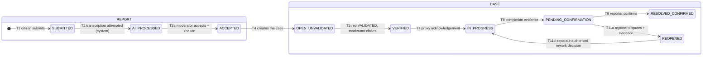

# Parakh — Release 0 Build Specification

**Version 1.2.7 · 9 August 2026 · Developer-facing extraction of the P0 scope**

> **Status.** Parakh is a **prototype/design-stage** civic-technology project. The application is **not built and not publicly deployed**. **No Punjab Government, federal government, NGO or international-organisation partnership has been formally signed.** **No real-world social impact has been demonstrated.** Parakh is **evidence-first rather than complaint-only**, and reporting is **voice-first in Urdu and English**. Punjab is the starting context. Founder and Project Lead: **Hassan Jalal**.
>
> **Release 0 runs on synthetic or controlled test data only. It is a technical demonstration. It is not field-ready, proves no usability claim about real low-literacy users, and demonstrates no impact.**

**Parent document:** `Parakh_Prototype_SRS_v1.3.7.md`. **The Master SRS governs wherever the two differ.** This document is a regenerated extraction of its P0 set, not an independent specification.

## Revision history

| Version | Date | Change |
|---|---|---|
| 1.0 | 9 Aug 2026 | Initial extraction from Master SRS v1.1 |
| 1.1 | 9 Aug 2026 | All four stated totals recomputed; logical→physical screen mapping added; MFA restored to P0 per DR-9; capability `P1` renamed `CAP_PROXY_COMPLETION`; API-041 corrected to return `REOPENED`, API-078 added; individual API contracts; 34-entity P0 model; technical-demonstration hypothesis; direct-database identity access removed as a product permission |
| **1.2** | **9 Aug 2026** | **Regenerated from the Master SRS v1.3 P0 set.** The accepted-path-only rule is now enforced by the Master **at requirement and enum level**, not only in this document's screen text — see §8.3. Three console MFA screens (`MO-14`, `RP-09`, `AD-12`) added, so **every physical route now maps to at least one logical ID** and the 34→18 arithmetic closes exactly. **Safeguarding boundary corrected**: `FR-SAF-001` narrowed to the seeded-flag behaviour that P0 can actually implement; reviewer flag creation and escalation moved to `FR-SAF-002`/`FR-SAF-006`, both P1, both blocked on TBD-030. Test references reconciled against the rebuilt 196-row canonical registry. **Wave 0A implementation sequence referenced (§26).** All totals recomputed from final text |
| **1.2.1** | **9 Aug 2026** | **Regenerated from Master SRS v1.3.1.** The `API-090` family was split into four explicit paths — **`API-090a` create, `API-090b` activate, `API-090c` deactivate, `API-090d` reactivate** — so every control on `AD-03` maps to a real method and path; **P0 endpoints 37 → 40, Master total 57 → 60**. `API-055` purpose corrected to *apply T5 only*; `unsafe_to_verify` removed from the `API-062` P0 schema; `API-070` and `API-071` now name **`CAP_PROXY_COMPLETION`** rather than the obsolete `P1`. `API-056` and `API-057` remapped to the requirements that actually own restricted viewing and flag creation. **How the P1 extensions of `API-052`, `API-055` and `API-062` will arrive is now stated explicitly.** `FR-SAF-003` narrowed to the reporting-flow emergency warning. The §15.2 reference is described as a **logical contract catalogue**, which is what it is. **All 122 P0 tests were rewritten individually in the Master** and the *"executable"* claim is now true; the P1/P2 rows are labelled deferred placeholders. **Wave 0A Core reduced to 45 requirements across 8 slices.** `R-6` and `R-7` remain unapproved |
| **1.2.2** | **9 Aug 2026** | **Regenerated from Master SRS v1.3.2.** The privileged bootstrap is now reachable: **`API-104` added** to consume the enrolment token and set the first factor, `API-099` made ticket-bound, `API-102` feeds the same path, and **new `FR-AUTH-009`** owns it. **P0 API contract IDs 41; Master total 61.** Counts are stated as **API contract IDs**, not physical HTTP operations. P0/P1 leakage removed: **no typed note or typed microphone fallback in P0**, **no proactive storage indicator on `/queue`**, `FR-SAF-003` is a **text-only warning on `CZ-05`**, and the `/admin` state and queue metrics are gone. `AD-08` P2→P1 · `FR-ADM-001` narrowed to **synthetic** provisioning · restore-rehearsal timing split between `NFR-DR-005` (demo) and `NFR-DR-002` (field test) · **four environments** stated consistently. Footer corrected |
| **1.2.3** | **9 Aug 2026** | **Authentication repair, regenerated from Master v1.3.3.** Operator **username** added to `API-098`; **`AuthFlowSession`** (P0) carries the second step of `API-099` and `API-100`, so a ticket is consumed exactly once; **recovery codes are returned only by the confirm step**; `API-101` issues fully privileged tokens and sets `reenrolment_required`, blocking only the next sign-in; **four mutually exclusive transport classes** replace the five overlapping ones, with MFA assurance restated as an authorisation predicate. **P0 entities 37 → 38, Master total 48 → 49; P0 tests 125 → 129.** |
| **1.2.4** | **9 Aug 2026** | **Regenerated from Master v1.3.4.** `AuthFlowSession` promoted into the authoritative entity dictionary and **§9.1 renumbered 1–38 with row `1b` removed**. `Session.mfa_assurance = none\|mfa\|recovery` replaces the undefined `MfaEnrolment.status`; a `recovery` session is fully privileged and expires at 24 h. **`AuthTicket.kind` gains `mfa_reenrolment`**, returned by `API-005` and accepted only by `API-099`, so recovery is no longer a dead end. Test summary corrected to the recomputed P0 count; the "only issuer" wording corrected to **"one of the two issuers"**; `MO-01`/`RP-01`/`AD-01` error cells aligned with `API-005`'s public contract |
| **1.2.5** | **9 Aug 2026** | **Surgical cleanup.** §10.1 sole-issuer wording corrected to **"`API-100` and `API-101` are the only two issuers of privileged tokens"**; the malformed §10.2 `API-100` row repaired to exactly two cells; §9.1 `AuthTicket` row now lists all three P0 kinds `mfa_enrolment` · `login` · `mfa_reenrolment`; Master §30.6 rewritten as the single authoritative Wave 0B list of **37** P0 functional requirements |
| **1.2.6** | **9 Aug 2026** | **Documentation-consistency cleanup only.** Version, heading, footer and companion references refreshed to v1.2.6 against Master SRS v1.3.6. **No architecture, authentication, privacy, evidence, API, role, entity, screen, workflow or scope change.** The v1.2.5 authentication corrections are preserved byte-identical: `AuthTicket` lists all three ticket kinds; `API-100` and `API-101` are described as the only two issuers of privileged tokens; the `API-100` table row is structurally valid; single-use ticket behaviour and the username-enumeration protections are unchanged |
| **1.2.7** | **9 Aug 2026** | **Documentation-integrity repair only, regenerated against Master SRS v1.3.7.** §26 replaced: it had stated fifteen slices, 45 of 83 P0 requirements, `0B-1 … 0B-6`, 38 remaining requirements, an `R-6` figure of 83, and performance measurement as mandatory Wave 0B work. It now states the verified **47 of 84 across `0A-1 … 0A-8`**, **37 across `0B-1 … 0B-10`**, **18 slices**, `R-6` at **84**, and that `NFR-PERF-001…005` are **P1 and not mandatory**. §26 no longer reproduces a competing membership list and points to Master §30.6. Version metadata refreshed. **No architecture, authentication, privacy, evidence, API, role, permission, entity, screen, workflow, priority, test or scope change; all v1.2.6 authentication corrections preserved** |

---

## Contents

- [1. Purpose, hypothesis and demo boundary](#1-purpose-hypothesis-and-demo-boundary)
- [2. Explicit non-goals](#2-explicit-non-goals)
- [3. Actors and permissions](#3-actors-and-permissions)
- [4. The one end-to-end workflow](#4-the-one-end-to-end-workflow)
- [5. Screens — logical to physical](#5-screens--logical-to-physical)
- [6. P0 functional requirements](#6-p0-functional-requirements)
- [7. P0 non-functional requirements](#7-p0-non-functional-requirements)
- [8. P0 state machine](#8-p0-state-machine)
- [9. P0 data model](#9-p0-data-model)
- [10. P0 API contracts](#10-p0-api-contracts)
- [11. Offline behaviour](#11-offline-behaviour)
- [12. Evidence integrity and hashing](#12-evidence-integrity-and-hashing)
- [13. Human-review rules](#13-human-review-rules)
- [14. Privacy and safeguarding boundary](#14-privacy-and-safeguarding-boundary)
- [15. Audit events](#15-audit-events)
- [16. P0 error catalogue](#16-p0-error-catalogue)
- [17. Acceptance tests](#17-acceptance-tests)
- [18. Seed and demo data](#18-seed-and-demo-data)
- [19. Environment and configuration](#19-environment-and-configuration)
- [20. Implementation order](#20-implementation-order)
- [21. Definition of Ready](#21-definition-of-ready)
- [22. Definition of Done](#22-definition-of-done)
- [23. Demo script](#23-demo-script)
- [24. Known limitations](#24-known-limitations)
- [25. P1 and P2 exclusions — handoff table](#25-p1-and-p2-exclusions--handoff-table)
- [26. Build sequence — Wave 0A and Wave 0B](#26-build-sequence--wave-0a-and-wave-0b)

---

# 1. Purpose, hypothesis and demo boundary

## 1.1 The Release 0 hypothesis

Release 0 runs on synthetic data with controlled operators and defers full low-literacy accessibility to P1. It therefore cannot test the product hypothesis, and does not claim to.

> **H0 — the Release 0 technical demonstration hypothesis.**
> The complete evidence-to-human-reviewed-outcome workflow can operate on a **low-cost Android device under intermittent connectivity, using synthetic or controlled test data**, such that evidence is sealed at capture, survives total loss of connectivity, is reviewed and independently verified by two different named humans without either seeing the reporter's identity, and produces a traceable record in which a deliberate alteration is detectable.

> **H1 — the product hypothesis, reserved for P1.**
> A person with low literacy, using a low-cost Android phone with poor or intermittent connectivity, can produce an evidence-based civic report that another independent person can verify. **H1 is tested only in controlled usability and field testing, after the Field-Test Readiness Gate (Master SRS §35) is signed.**

## 1.2 Success criteria, split by release

### P0 — technical demonstration success

| # | Criterion | Verified by |
|---|---|---|
| S0-1 | The §23 six-minute scenario passes **on a low-cost Android device**, starting in airplane mode, on synthetic data | `TEST-E2E-001` |
| S0-2 | Evidence is hashed on-device before any network call, and the server re-verifies every hash | `TEST-EVD-004`, `TEST-EVD-005` |
| S0-3 | A report captured fully offline syncs later with `captured_at` unchanged and no duplicate case | `TEST-OFF-001`, `TEST-OFF-006` |
| S0-4 | **No identity-capable field exists in any Representative-facing response schema**, proven by a build-failing test | `TEST-PRV-001`, `TEST-PRV-002` |
| S0-5 | No AI output changes any state; every consequential change carries a named human, a time and a reason | `TEST-AI-001`, `TEST-AUD-002` |
| S0-6 | `PENDING_CONFIRMATION` never becomes a resolved state without a human action | `TEST-CASE-004` |
| S0-7 | A dispute produces `REOPENED`, and a **separate** authorised action produces `IN_PROGRESS` — two audit events | `TEST-CASE-015`, `TEST-CASE-016` |
| S0-8 | A deliberate alteration of a stored evidence row or audit row is detected by the verifier | `TEST-AUD-003` |
| S0-9 | **Every privileged session is MFA-protected**; no privileged token is issued on a first factor alone | `TEST-AUTH-006`, `TEST-AUTH-007` |
| S0-10 | **No P0 interface or endpoint can reach a P1 outcome** — `reject`, `needs_info` and `not_validated` are refused by API-052, API-055 and API-062 | `TEST-MOD-008`, `TEST-REP-005`, `TEST-REP-010` |

### P1 — usability and controlled field-test success *(not Release 0)*

≥ 20 unassisted sessions with real target users across two rounds · real evidence captured in a real community · full accessibility validation including audio prompts and low-literacy interaction rules · consent lifecycle exercised · **safeguarding escalation route exercised with a named contact** · offline reliability measured across ≥ 50 real syncs.

### P2 — evaluation and government-scale readiness *(not Release 0)*

Research export · transcription accuracy benchmark · outcome measurement against a documented baseline · independent evaluation · institutional integration.

## 1.3 Demo boundary

One community-scale workflow · four actors plus one capability · **synthetic data only** · one Android device · one web console · one transcription provider · one database · six minutes end to end.

---

# 2. Explicit non-goals

| Not in Release 0 | Where it lives |
|---|---|
| Union Council Officer portal · Contractor portal · Mayor & Operations Command | Future — Master §3.4 |
| Government payments, escrow, procurement, contractor selection | **Prohibited** — Master §3.6 |
| Public heatmap, public case list, **any public surface at all** | P2 |
| AI categorisation, severity, duplicate detection, prioritisation, fraud scoring | **P2, research-only, subject to separate approval, bias evaluation, safety review and human oversight** |
| Model fine-tuning | Out of scope |
| Research export, broad analytics, metrics dashboard | P2 / P1 |
| Consent capture and withdrawal lifecycle *(FR-CIT-002…006)* | **P1 — blocking for field test** |
| **Reviewer-raised safeguarding concerns, escalation handling, contact notification** *(FR-SAF-002, FR-SAF-006)* | **P1 — blocking for field test, TBD-030** |
| Restriction, suspension, appeals, case reconsideration | P1 *(reconsideration conditional on TBD-056)* |
| Audio prompts and full low-literacy interaction rules *(FR-LOC-002, FR-LOC-003)* | **P1 — blocking for field test** |
| Notifications by push or SMS | P1 — in-app status only |
| Typed description fallback *(FR-VOI-005)* | P1 |
| **Report rejection, `NEEDS_INFO`, negative verification, expiry, archival** | **P1 — see §8.3** |
| iOS | Out of scope |
| Any language beyond Urdu and English. **Punjabi is a future extension and shall not be claimed** | Future |
| Blockchain, distributed ledger | **Prohibited** |
| Province-wide deployment, public launch | Out of scope |

> **MFA is not in this table.** DR-9 is binding and requires MFA for Representatives, Moderators and Administrators. **MFA is P0** — see §3, §5 and §10.2.

---

# 3. Actors and permissions

| Actor | Code | In Release 0 | Authentication |
|---|---|---|---|
| **Citizen** | `CZ` | Synthetic participants, seeded and activated by the Administrator | Phone + one-time passcode (fixture dispatch in the demo environment) |
| **Street Representative** | `REP` | Two seeded accounts, different scopes | **First factor + MFA. Mandatory** |
| **Moderator** | `MOD` | One seeded account | **First factor + MFA. Mandatory** |
| **Administrator** | `ADM` | One seeded account | **First factor + MFA. Mandatory** |
| **`CAP_PROXY_COMPLETION`** | capability | **Not a role and not a portal.** A capability flag held only by a Moderator or Administrator, used to record action-owner steps **by proxy**. **The short form `P1` is never used for a capability in this document, because `P1` names a release phase** | — |

## 3.1 Release 0 permission matrix

| Resource · Action | CZ | REP | MOD | ADM |
|---|:--:|:--:|:--:|:--:|
| Authenticate (first factor) | ✓ | ✓ | ✓ | ✓ |
| **Complete MFA before any privileged action** | n/a | **required** | **required** | **required** |
| Create a report | ✓ | ✗ | ✗ | ✗ |
| Capture live media | ✓ | ✓ *(verification)* | ✓ *(proxy completion)* | ✓ *(proxy completion)* |
| **Import media from the gallery or any external source** | **✗** | **✗** | **✗** | **✗** |
| View own report and timeline | ✓ | — | — | — |
| View any report | ✗ | ⚑ assigned + in scope + **identity-stripped** | ✓ | ✓ |
| **Accept** a report | ✗ | ✗ | ⚑ conflict-checked, reason + category + severity mandatory | ⚑ |
| **Reject a report or request more information** | **✗** | **✗** | **✗ — P1** | **✗ — P1** |
| Assign to a Representative | ✗ | ✗ | ✓ | ✓ |
| Record a **`VALIDATED`** verification outcome | ✗ | ⚑ note ≥ 20 chars mandatory | ✗ | ✗ |
| **Record `NOT_VALIDATED`** | ✗ | **✗ — P1 (FR-REP-108)** | ✗ | ✗ |
| **Close a verification into `VERIFIED` (T5)** | ✗ | **✗** | ✓ | ✓ |
| **Close a verification into `NOT_VALIDATED` (T6)** | ✗ | ✗ | **✗ — P1 (FR-REP-109)** | **✗ — P1** |
| Record acknowledgement by proxy | ✗ | ✗ | ⚑ `CAP_PROXY_COMPLETION` | ⚑ `CAP_PROXY_COMPLETION` |
| Submit completion evidence | ✗ | ✗ | ⚑ `CAP_PROXY_COMPLETION` | ⚑ `CAP_PROXY_COMPLETION` |
| **Start rework after a reopening (T11d)** | ✗ | ✗ | ⚑ `CAP_PROXY_COMPLETION` | ⚑ `CAP_PROXY_COMPLETION` |
| Confirm a fix | ⚑ reporter only, and never the completion submitter | ✗ | ✗ | ✗ |
| Dispute a fix | ⚑ reporter only, evidence mandatory | ✗ | ✗ | ✗ |
| **Raise a safeguarding flag** | ✗ | **✗ — P1 (FR-SAF-002)** | **✗ — P1 (FR-SAF-006)** | **✗ — P1** |
| See a case already carrying a seeded safeguarding flag | ✗ | **✗ never** | ✓ | ✓ |
| **See reporter identity** | ✗ | **✗ never** | ✗ | **✗ in Release 0.** Break-glass is a **P1** procedure |
| Read the audit log | ✗ | ✗ | ✓ | ✓ |
| **Delete anything** | **✗** | **✗** | **✗** | **✗** |
| Activate a participant · create a grant · revoke a grant | ✗ | ✗ | ✗ | ✓ |
| Create and deactivate console accounts · reset a second factor | ✗ | ✗ | ✗ | ✓ |
| Run the integrity verifier | ✗ | ✗ | ✓ | ✓ |
| Money, payment, contractor selection | **✗** | **✗** | **✗** | **✗** |

> **Direct database access is a maintenance activity, not a product permission**, and shall never be used as an identity-viewing workflow. Release 0 identities are provisioned by controlled seed scripts.

---

# 4. The one end-to-end workflow

```mermaid
graph LR
    A["1 Citizen captures live<br/>photo + voice OFFLINE"] --> B["2 Encrypted device queue"]
    B --> C["3 Sync on reconnect<br/>capture time preserved"]
    C --> D["4 Manifest re-verified<br/>server-side"]
    D --> E["5 Transcription<br/>annotation only"]
    E --> F["6 Moderator ACCEPTS<br/>reason + category + severity"]
    F --> G["7 Case OPEN_UNVALIDATED"]
    G --> H["8 Assigned<br/>conflict-excluded"]
    H --> I["9 Packet<br/>NO REPORTER IDENTITY"]
    I --> J["10 VALIDATED + mandatory note"]
    J --> K["11 Moderator closes T5<br/>VERIFIED"]
    K --> L["12 Proxy acknowledgement<br/>IN_PROGRESS"]
    L --> M["13 Completion evidence<br/>live capture + note"]
    M --> N["14 PENDING_CONFIRMATION<br/>NOT resolved"]
    N --> O["15 Before/after shown"]
    O --> P{"16 Citizen"}
    P -->|confirms| Q["17a RESOLVED_CONFIRMED"]
    P -->|disputes| R["17b REOPENED"]
    R --> S["18 Separate rework decision<br/>T11d → IN_PROGRESS"]
    Q --> T["19 Full history<br/>+ tamper detection"]
    S --> M
```

---

# 5. Screens — logical to physical

The Master SRS classifies **34 logical screen IDs** as P0. Release 0 implements them as **18 physical routes**, because several logical IDs are states or panels of one route, the three role-specific console sign-in IDs collapse into one route, and the three role-specific MFA IDs collapse into one route.

**Changed in v1.2.** v1.1 had 31 logical IDs and an 18th physical route (`/mfa`) that consumed no logical ID, because `FR-AUTH-007` and `FR-AUTH-008` were P0 with no screen anywhere in the Master. The Master v1.3 adds `MO-14`, `RP-09` and `AD-12`. **Every physical route below now maps to at least one logical ID, and every P0 logical ID maps to exactly one route.**

## 5.1 Mapping table — every P0 logical ID accounted for

| # | Physical route | Client | Logical IDs consolidated | How the difference arises |
|---|---|---|---|---|
| 1 | `/language` | Android | **CZ-01** | 1:1 |
| 2 | `/auth` | Android | **CZ-03** | 1:1 — citizen phone + passcode. **Not gated on consent; consent is P1** |
| 3 | `/home` | Android | **CZ-04** | 1:1 |
| 4 | `/report/capture` | Android | **CZ-05** | 1:1 |
| 5 | `/report/location` | Android | **CZ-06** | 1:1 |
| 6 | `/report/voice` | Android | **CZ-07** | 1:1 |
| 7 | `/report/review` | Android | **CZ-08**, **CZ-09** | CZ-09 is the **success state** of the review route, not a separate route |
| 8 | `/case/:ref` | Android | **CZ-10**, **CZ-11** | CZ-11 is a **panel** shown when the state is `PENDING_CONFIRMATION` |
| 9 | `/case/:ref/dispute` | Android | **CZ-12** | 1:1 |
| 10 | `/queue` | Android | **CZ-14** | 1:1 |
| 11 | `/login` | Console | **MO-01**, **RP-01**, **AD-01** | One role-agnostic first-factor route; the landing page differs by role |
| 12 | `/mfa` | Console | **MO-14**, **RP-09**, **AD-12** | One role-agnostic enrolment, challenge, verification and recovery route. The Administrator variant additionally exposes the API-102 reset |
| 13 | `/moderation` | Console | **MO-02** | 1:1 — queue |
| 14 | `/moderation/:id` | Console | **MO-03**, **MO-04**, **MO-06**, **MO-07**, **MO-08**, **MO-09** | One case-working surface with six **panels**: packet, accept decision, assignment, T5 closure, proxy action-owner, completion capture |
| 15 | `/moderation/:id/history` | Console | **MO-11** | 1:1 |
| 16 | `/validations` | Console | **RP-02** | 1:1 |
| 17 | `/validations/:id` | Console | **RP-03**, **RP-04** | Packet and outcome form on one surface |
| 18 | `/admin` | Console | **AD-02**, **AD-03**, **AD-04**, **AD-09**, **AD-11** | One administration surface with five **panels**: dashboard, participants, grants, integrity, operators |

**The arithmetic, stated exactly.** 34 logical IDs → 18 routes. The reduction of **16** arises in exactly seven places and nowhere else: `/report/review` absorbs one success state (CZ-09, −1); `/case/:ref` absorbs one conditional panel (CZ-11, −1); `/login` absorbs three sign-in IDs into one (−2); `/mfa` absorbs three MFA IDs into one (−2); `/moderation/:id` absorbs five panels (MO-04, MO-06, MO-07, MO-08, MO-09, −5); `/validations/:id` absorbs one (RP-04, −1); `/admin` absorbs four (AD-03, AD-04, AD-09, AD-11, −4). **1+1+2+2+5+1+4 = 16. 34 − 16 = 18.** ✓ Ten routes are Android, eight are console.

## 5.2 Screen specifications

**Every control below maps to a P0 requirement and, where it calls the server, to a P0 endpoint. A control belonging to a later release is absent from the build — not hidden, not disabled, not feature-flagged. A disabled future control would not be P0 behaviour.**

| Route | Purpose | Key controls | Validation | Error states | Requirements |
|---|---|---|---|---|---|
| `/language` | Urdu or English, RTL correct | Two large buttons in native script | One must be chosen | — | FR-LOC-001 |
| `/auth` | Citizen authentication | Phone, passcode, resend | E.164; 6 digits; ≤ 5 attempts | `E_AUTH_FAILED`, `E_RATE_LIMITED`, `E_IDENTITY_REQUIRED` | FR-AUTH-001, FR-AUTH-002, FR-AUTH-004 |
| `/home` | Start a report; own cases | Large primary action **with icon and text label**; case list; **offline badge**. *(The spoken prompt is FR-LOC-002, P1 — absent)* | — | `E_SERVER_UNAVAILABLE` shows cached | FR-CIT-101 |
| `/report/capture` | Live photo | Camera opens **directly**; shutter; retake; counter 1–5. **No gallery, file picker, document provider or share target** | ≥ 1, ≤ 5, live only | `E_PERMISSION_CAMERA`, `E_CAMERA_UNAVAILABLE`, `E_STORAGE_FULL` | FR-EVD-001, FR-EVD-002, FR-EVD-003 |
| `/report/location` | Confirm position | Map, pin, **drag to adjust**, accuracy readout | Location present, verified or flagged | `E_LOCATION_DENIED`, `E_LOCATION_TIMEOUT`, `E_LOCATION_INACCURATE` | FR-EVD-101, FR-EVD-102, FR-EVD-103, FR-EVD-104 |
| `/report/voice` | Speak the problem | Large record; timer; **playback**; re-record. **Voice is mandatory in P0 and no typed field exists.** *(`FR-VOI-003` is the **optional typed note added alongside a recording**; `FR-VOI-005` is the **typed fallback when the microphone is unavailable** — two different P1 capabilities.)* *(Typed note FR-VOI-005 and low-confidence marking FR-VOI-103 are P1 — absent)* | 3 s ≤ d ≤ 90 s | `E_MIC_UNAVAILABLE` | FR-VOI-001, FR-VOI-002, FR-VOI-004 |
| `/report/review` | Final check, then submit | Thumbnails; map; **audio playback**; Submit | All mandatory items | `E_VALIDATION_FAILED` *(names the field)* | FR-CIT-103, FR-CIT-104, FR-CIT-105, FR-EVD-202 |
| `/case/:ref` | Follow the case; confirm or dispute | Status chip with **plain-language text**; timeline; before/after panel; Confirm; Dispute. **No countdown, deadline or expiry warning — the confirmation-window job is FR-FIX-104, P1, and does not run** | Dispute requires reason + evidence | `E_INVALID_TRANSITION`, `E_STALE_STATE` | FR-CASE-101, FR-CASE-103, FR-FIX-101, FR-FIX-102 |
| `/case/:ref/dispute` | Capture fresh dispute evidence | Live camera; reason | ≥ 1 live photo; reason present | `E_EVIDENCE_REQUIRED` | FR-FIX-103 |
| `/queue` | Offline queue | Item list; per-item state; **Retry now**. **No storage indicator and no threshold warning — proactive storage monitoring is `FR-OFF-011`, P1.** *(Corruption quarantine, storage exhaustion, expired-auth sync and multi-device — FR-OFF-009…012 — are P1 and not surfaced)* | — | `E_SYNC_FAILED`, `E_NO_CONNECTIVITY` | FR-OFF-001…008, FR-CIT-102. **`E_STORAGE_FULL` is raised on the capture path (`/report/capture`), not here; proactive storage monitoring is `FR-OFF-011`, P1** |
| `/login` | Console first factor | Username, password | — | `E_AUTH_FAILED`, `E_RATE_LIMITED` | FR-AUTH-006 |
| `/mfa` | **Enrol, challenge, verify, recover** | TOTP provisioning; code entry; recovery codes shown once; recovery-code entry; **administrator reset (API-102), admin route only** | 6-digit code; ≤ 5 attempts then lockout; reset requires a written reason | `E_MFA_REQUIRED`, `E_AUTH_FAILED`, `E_RATE_LIMITED`, `E_REASON_REQUIRED` | FR-AUTH-007, FR-AUTH-008 |
| `/moderation` | Triage queue | List ordered **flagged-first then by age**. **No control raises a flag** | — | `E_SERVER_UNAVAILABLE`, `E_PERMISSION_DENIED` | FR-MOD-001, FR-SAF-001 |
| `/moderation/:id` | Work the case | Media; **audio player**; transcript panel **labelled machine-generated with model, version and confidence**; **correct transcript**; **Accept only** — no Needs-info and no Reject control; **reason, category and severity all required**; assign; **close to `VERIFIED` only**; proxy acknowledge; **capture completion evidence + note**; **start rework**. *(No expiry countdown, no return-to-pool, no multiple-item manager, no reject-completion control)* | Reason, category, severity and notes mandatory; conflicts re-checked server-side | `E_REASON_REQUIRED`, `E_CONFLICT_OF_INTEREST`, `E_STALE_STATE`, `E_LIVE_CAPTURE_REQUIRED`, `E_PROXY_FIELDS_REQUIRED`, `E_NO_ELIGIBLE_ASSIGNEE`, `E_VALIDATION_FAILED` | FR-MOD-002, FR-MOD-003, FR-MOD-005, FR-VOI-102, FR-AI-002, FR-AI-003, FR-REP-002, FR-REP-105, FR-FIX-001, FR-FIX-002, FR-FIX-004, FR-CASE-104 |
| `/moderation/:id/history` | Full audit trail | Chronological events with actor, reason, both states, chain hash. **Read-only** | — | `E_PERMISSION_DENIED` | FR-CASE-102, FR-AUD-003 |
| `/validations` | Assigned queue | Scoped list, age indicator | — | `E_PERMISSION_DENIED` | FR-REP-005 |
| `/validations/:id` | Verify | Media; audio; transcript; map with **confidence flags**; **`VALIDATED` only** — no `NOT_VALIDATED` control and no `unsafe_to_verify` flag; **note mandatory** | Note ≥ 20 chars; outcome validated against a one-value enum | `E_NOTE_REQUIRED`, `E_CONFLICT_OF_INTEREST`, `E_VALIDATION_FAILED` | FR-REP-006, FR-REP-101, FR-EVD-105 |
| `/admin` | Administration | **Create participant** (`API-090a`); **record attestation and activate** (`API-090b`); **deactivate** (`API-090c`); **reactivate** (`API-090d`); **create and revoke grants** (API-091, API-091b); **create and deactivate console accounts** (API-098); **run integrity verifier** (API-097); **integrity-check status and a link to run the verifier**. *(Counts by state and queue depth are `FR-OBS-002`/`FR-OBS-003`, P1, and are **absent, not merely unlabelled**; the break-glass register FR-PRV-005 is P1; the export register FR-OBS-007 is P2; the metrics view FR-OBS-003 is P1 — all three absent)* | Attestation fields required; `track` must be `adult`; grant scope and future expiry mandatory; revocation reason mandatory | `E_VALIDATION_FAILED`, `E_PERMISSION_DENIED`, `E_MFA_REQUIRED`, `E_REASON_REQUIRED` | FR-ADM-001, FR-ADM-002, FR-ADM-003, FR-ADM-004, FR-AUD-005, FR-SAF-005 |

---

# 6. P0 functional requirements

**84 requirements.** Full text at the same identifier in Master SRS §9. Every one is classified `P0` in its own block, in the §3.7.3 register and in the §29 traceability matrix. **This set is identical to the Master's P0 set — checked mechanically, symmetric difference empty.**

| Group | Requirements |
|---|---|
| **Authentication and identity (8)** | FR-AUTH-001 · FR-AUTH-002 · FR-AUTH-003 · FR-AUTH-004 · FR-AUTH-006 · FR-AUTH-007 · FR-AUTH-008 · **FR-AUTH-009** |
| **Administration (4)** | FR-ADM-001 · FR-ADM-002 · FR-ADM-003 · FR-ADM-004 |
| **Citizen flow (6)** | FR-CIT-001 · FR-CIT-101 · FR-CIT-102 · FR-CIT-103 · FR-CIT-104 · FR-CIT-105 |
| **Evidence (12)** | FR-EVD-001 · FR-EVD-002 · FR-EVD-003 · FR-EVD-004 · FR-EVD-005 · FR-EVD-101 · FR-EVD-102 · FR-EVD-103 · FR-EVD-104 · FR-EVD-105 · FR-EVD-201 · FR-EVD-202 |
| **Voice and transcription (5)** | FR-VOI-001 · FR-VOI-002 · FR-VOI-004 · FR-VOI-101 · FR-VOI-102 |
| **AI boundary (3)** | FR-AI-001 · FR-AI-002 · FR-AI-003 |
| **Offline (8)** | FR-OFF-001 · FR-OFF-002 · FR-OFF-003 · FR-OFF-004 · FR-OFF-005 · FR-OFF-006 · FR-OFF-007 · FR-OFF-008 |
| **Moderation (4)** | FR-MOD-001 · FR-MOD-002 · **FR-MOD-003 *(narrowed to `ACCEPT` in v1.3)*** · FR-MOD-005 |
| **Assignment and verification (7)** | FR-REP-001 · FR-REP-002 · FR-REP-004 · FR-REP-005 · FR-REP-006 · **FR-REP-101 *(narrowed to `VALIDATED`)*** · **FR-REP-105 *(narrowed to T5)*** |
| **Completion and confirmation (8)** | FR-FIX-001 · FR-FIX-002 · FR-FIX-003 · FR-FIX-004 · FR-FIX-006 · FR-FIX-101 · FR-FIX-102 · FR-FIX-103 |
| **Case lifecycle (6)** | FR-CASE-001 · FR-CASE-004 · FR-CASE-101 · FR-CASE-102 · FR-CASE-103 · FR-CASE-104 |
| **Audit and integrity (5)** | FR-AUD-001 · FR-AUD-002 · FR-AUD-003 · FR-AUD-004 · FR-AUD-005 |
| **Privacy (4)** | FR-PRV-001 · FR-PRV-002 · FR-PRV-003 · FR-PRV-004 |
| **Safeguarding (3)** | **FR-SAF-001 *(narrowed to the seeded-flag boundary)*** · FR-SAF-003 · FR-SAF-005 |
| **Localisation (1)** | FR-LOC-001 |

**4 + 3 + 5 + 8 + 6 + 6 + 12 + 8 + 1 + 4 + 8 + 4 + 7 + 3 + 5 = 84.**

> **Four requirements were narrowed in Master v1.3** because they combined P0 and P1 behaviour in a single block. The behaviour removed from each did not disappear: it moved to `FR-MOD-004`, `FR-MOD-006`, **`FR-REP-108`**, **`FR-REP-109`**, `FR-SAF-002` and **`FR-SAF-006`** — all P1. See Master §3.7.6.

---

# 7. P0 non-functional requirements

**45 of the Master's 84 non-functional requirements are P0** — the other 39 are P1 (37) or P2 (2). Every one of the 84 now carries an explicit release in its own authoritative table — v1.2 of this document inherited a Master in which only 24 did.

`NFR-SEC-001…005` · `NFR-SEC-007…013` · `NFR-SEC-015` · `NFR-SEC-017` · `NFR-SEC-019` — authentication on every endpoint, the full server-side check set, least privilege, vault separation, TLS floor, keystore-held keys, no secrets in source, refresh rotation with family invalidation, **MFA on every privileged session**, lockout and rate limiting, input validation, media validation, append-only grants, no sensitive data in logs, data minimisation.

`NFR-REL-001` **no captured evidence lost on any error path** · `NFR-REL-003` queue survives restart · `NFR-REL-004` zero duplicate cases · `NFR-REL-005` AI failure never blocks.

`NFR-USA-001` both languages complete · `NFR-USA-002` Urdu RTL correct · `NFR-USA-006` voice-and-camera-only path · `NFR-USA-009` 48 dp / 64 dp targets · `NFR-USA-011` errors state what happened and what to do · `NFR-USA-015` progress and manual retry · `NFR-USA-017` described progress indicators.

`NFR-COMP-001` reference low-cost Android *(minimum version TBD-005)* · `NFR-COMP-002` two desktop browsers · `NFR-MNT-001` traceability · `NFR-MNT-002` externalised configuration · `NFR-MNT-004` commit attribution preserved · `NFR-OPS-001…003`, `NFR-OPS-006…008`, `NFR-OPS-010…012`, `NFR-OPS-014…016` · `NFR-DR-004`, `NFR-DR-005`.

> **Every `NFR-PERF` requirement is P1.** Release 0 **measures** performance and reports the figures; it gates on none of them. Fourteen non-functional requirements across the Master carry a `TBD` value with a proposed test method and a named approver. **A `TBD` value is not an approved pass/fail target and must never be reported as one.** The three states are kept distinct throughout: *implemented measurement*, *provisional benchmark*, *approved pass/fail target*. **Release 0 has no approved pass/fail performance target.**

---

# 8. P0 state machine

## 8.1 Transition table — the ten P0 transitions

| T | From → To | Actor | Capability | Guard | API | Requirement | Audit event | Test |
|---|---|---|---|---|---|---|---|---|
| **T1** | — → `SUBMITTED` | Citizen | base | Active attested participant; manifest verifies; idempotency key | API-030 | FR-EVD-202 | `report_submitted` | TEST-CASE-001 |
| **T2** | `SUBMITTED` → `AI_PROCESSED` | **System** (worker) | worker role | Advances on success **or** failure | — *(internal)* | FR-VOI-101 | `annotation_created` / `ai_unavailable` | TEST-AI-005 |
| **T3a** | `AI_PROCESSED` → `ACCEPTED` | Moderator | `F2` | Not the author; not conflicted; **reason, category and severity mandatory**; state version matches | API-052 | FR-MOD-003 | `moderation_decision` | TEST-MOD-003 |
| **T4** | `ACCEPTED` → case `OPEN_UNVALIDATED` | System | — | Exactly one case per accepted report | *(same transaction as T3a)* | FR-MOD-005 | `case_created` | TEST-CASE-001 |
| **T5** | `OPEN_UNVALIDATED` → `VERIFIED` | Moderator on a Representative outcome | `F2` | Representative was eligible; note present; Moderator is not the Representative | API-055 | FR-REP-105 | `verification_closed` | TEST-CASE-002 |
| **T7** | `VERIFIED` → `IN_PROGRESS` | Moderator / Administrator | `F2` + **`CAP_PROXY_COMPLETION`** | Both proxy fields present | API-070 | FR-FIX-001 | `proxy_acknowledgement` | TEST-FIX-001 |
| **T8** | `IN_PROGRESS` → `PENDING_CONFIRMATION` | Moderator / Administrator | `F2` + **`CAP_PROXY_COMPLETION`** | ≥ 1 live completion photo **and** a note ≥ 20 chars | API-071 | FR-FIX-002, FR-FIX-004 | `completion_evidence_submitted` | TEST-FIX-002 |
| **T9** | `PENDING_CONFIRMATION` → `RESOLVED_CONFIRMED` | Citizen | reporter | Caller is the reporter **and is not the completion submitter** | API-040 | FR-FIX-102, FR-FIX-006 | `resolution_confirmed` | TEST-FIX-005 |
| **T11a** | `PENDING_CONFIRMATION` → **`REOPENED`** | Citizen | reporter | Reason **and** ≥ 1 live photo | API-041 | FR-FIX-103 | `resolution_disputed`, `case_reopened` | TEST-FIX-006 |
| **T11d** | **`REOPENED` → `IN_PROGRESS`** | Moderator / Administrator | `F2` + **`CAP_PROXY_COMPLETION`** | Both proxy fields **and** a rework note; case is `REOPENED` | **API-078** | **FR-CASE-104** | `rework_started` | TEST-CASE-015, TEST-CASE-016 |

## 8.2 The eight P1 transitions — specified, not reachable

`T3b` needs-info · `T3c` reject · **`T6` close as `NOT_VALIDATED`** · `T10` confirmation-window lapse · `T11b/c` reopen after resolution · `T12a` appeal filed · `T12b/c` appeal decided · `T13` archive.

**They remain fully specified in Master SRS §10.4, which carries a Release column.** Release 0 does not expose them: no control invokes them, no endpoint accepts their input values, and no P0 code path writes their target states.

## 8.3 Release 0 implements the accepted path only — authoritative

**This section is authoritative for P0 workflow behaviour, and Master SRS §3.7.7 now carries the same rule at requirement level.** v1.1 of this document stated the rule in screen text alone, which left `NOT_VALIDATED` and `REJECT` reachable through P0 *requirements* and *endpoints* even while the screens hid them. That gap is closed.

| Rule | Enforced at three levels |
|---|---|
| P0 moderation offers **`ACCEPT` only** | **Requirement:** `FR-MOD-003` is narrowed to the `ACCEPT` decision. **Enum:** `API-052` accepts only `action="accept"`. **Control:** the Needs-info and Reject buttons are **absent** from `/moderation/:id` |
| P0 verification offers **`VALIDATED` only** | **Requirement:** `FR-REP-101` is narrowed to `VALIDATED`. **Enum:** `API-062` accepts only `outcome="validated"` and has no `unsafe_to_verify` field. **Control:** the `NOT_VALIDATED` option is **absent** from `/validations/:id` |
| P0 closure applies **T5 only** | **Requirement:** `FR-REP-105` is narrowed to T5. **Enum:** `API-055` accepts only `outcome="validated"`. **Control:** the `NOT_VALIDATED` option and Return-to-pool are **absent** from `/moderation/:id` |
| `REJECTED`, `NEEDS_INFO`, `EXPIRED`, `NOT_VALIDATED`, `REJECTED_FINAL`, `REJECTED_FINAL_CASE`, `RESOLVED_UNCONFIRMED` and `ARCHIVED` are **not reachable** | The database enum carries every state from the outset so no migration is needed later, but **no P0 code path writes any of them**, and any attempt returns `E_VALIDATION_FAILED` |

**Rationale.** Release 0 runs on synthetic data with controlled operators. No real person can be rejected, so no real person needs an appeal — and the appeal route is itself P1. Shipping a rejection control with no route behind it would be worse than shipping none.

## 8.4 Refused in Release 0

Any transition skipping verification · `PENDING_CONFIRMATION` → archive · a Representative reaching `VERIFIED` alone · self-confirmation by the completion submitter · **any transition initiated by an AI or worker identity other than T2** · any direct state write · `REOPENED` → `PENDING_CONFIRMATION` without a fresh completion submission.

---

# 9. P0 data model

**38 P0 entities.** The Master defines **49** entities in total; the remaining **11 are P1/P2-only**. These three figures are stated once in Master SRS §14.2 and repeated nowhere else in either document except here.

```mermaid
erDiagram
    PARTICIPANT ||--o| IDENTITY_VAULT_RECORD : "vault only"
    PARTICIPANT ||--o| ATTESTATION_RECORD : attested_by
    PARTICIPANT ||--o{ ROLE_ASSIGNMENT : holds
    PARTICIPANT ||--o{ CAPABILITY_GRANT : granted
    PARTICIPANT ||--o{ AUTH_CHALLENGE : requests
    PARTICIPANT ||--o{ SESSION : owns
    PARTICIPANT ||--o| MFA_ENROLMENT : enrols
    MFA_ENROLMENT ||--o{ MFA_RECOVERY_CODE : issues
    PARTICIPANT ||--o| REPRESENTATIVE_PROFILE : profile
    PARTICIPANT ||--o{ DECLARED_CONFLICT : declares
    PARTICIPANT ||--o{ CIVIC_REPORT : submits
    CIVIC_REPORT ||--|| EVIDENCE_MANIFEST : sealed_by
    CIVIC_REPORT ||--o{ EVIDENCE_ITEM : contains
    CIVIC_REPORT ||--o| UPLOAD_SESSION : uploaded_via
    CIVIC_REPORT ||--o| VOICE_RECORDING : has
    VOICE_RECORDING ||--o{ MACHINE_TRANSCRIPT : annotated_by
    MACHINE_TRANSCRIPT ||--o{ HUMAN_TRANSCRIPT_CORRECTION : corrected_by
    VOICE_RECORDING ||--o{ MODEL_INPUT_RECORD : derivative_of
    CIVIC_REPORT ||--o{ MODERATION_DECISION : decided_by
    CIVIC_REPORT ||--|| CASE : creates
    CASE ||--o{ REPRESENTATIVE_ASSIGNMENT : assigned_via
    REPRESENTATIVE_ASSIGNMENT ||--o| VERIFICATION_DECISION : results_in
    CASE ||--o{ PROXY_ACTION : progressed_by
    CASE ||--o| COMPLETION_CLAIM : claimed_by
    COMPLETION_CLAIM ||--o{ EVIDENCE_ITEM : evidenced_by
    CASE ||--o| CITIZEN_RESOLUTION_DECISION : closed_by
    CASE ||--o{ DISPUTE : disputed_by
    DISPUTE ||--o| REOPEN_EVENT : produces
    CASE ||--o{ REOPEN_EVENT : reopened_by
    CASE ||--o{ SAFEGUARDING_FLAG : flagged_by
    CASE ||--o{ CASE_STATUS_EVENT : timeline
    CIVIC_REPORT ||--o{ SYNC_QUEUE_ITEM : queued_as
    IDEMPOTENCY_RECORD ||--o| CIVIC_REPORT : dedupes
    AUDIT_EVENT ||--o| AUDIT_EVENT : chains_to
```

## 9.1 The 38 P0 entities — each justified by a P0 requirement

| # | Entity | Justifying P0 requirement |
|---|---|---|
| 1 | **`OperatorCredential`** | **FR-AUTH-009** — first-factor credential and normalised username, hash only |
| 2 | **`AuthFlowSession`** | **FR-AUTH-006, FR-AUTH-007** — carries the second step of `API-099` and `API-100`; type, operator binding, source ticket, expiry, attempt count, status, `consumed_at` |
| 3 | **`EnrolmentToken`** | **FR-ADM-003, FR-AUTH-009** — single-use, hash-stored, account-bound |
| 4 | **`AuthTicket`** | **FR-AUTH-009, FR-AUTH-006** — `mfa_enrolment`, `login` and **`mfa_reenrolment`** tickets, hash only, single use |
| 5 | `Participant` | FR-AUTH-001, FR-ADM-001 |
| 6 | `IdentityVaultRecord` | FR-ADM-001, FR-PRV-002 |
| 7 | `AttestationRecord` | FR-ADM-001 |
| 8 | `RoleAssignment` | FR-ADM-003 |
| 9 | `CapabilityGrant` | FR-ADM-002, FR-ADM-004 |
| 10 | `DeclaredConflict` | FR-REP-004 |
| 11 | `RepresentativeProfile` | FR-REP-001 |
| 12 | `AuthChallenge` | FR-AUTH-001 |
| 13 | `Session` | FR-AUTH-003 |
| 14 | `MfaEnrolment` | FR-AUTH-007 |
| 15 | `MfaRecoveryCode` | FR-AUTH-008 |
| 16 | `DevicePreference` | FR-LOC-001 |
| 17 | `CivicReport` | FR-EVD-202 |
| 18 | `EvidenceItem` | FR-EVD-001. **Completion evidence is `EvidenceItem` with `kind = completion_photo`, not a separate table** |
| 19 | `EvidenceManifest` | FR-EVD-004, FR-EVD-201 |
| 20 | `UploadSession` | FR-OFF-007 |
| 21 | `IdempotencyRecord` | FR-OFF-006 |
| 22 | `VoiceRecording` | FR-VOI-001 |
| 23 | `MachineTranscript` | FR-VOI-101 |
| 24 | `HumanTranscriptCorrection` | FR-AI-003 |
| 25 | `ModelInputRecord` | FR-AI-002 |
| 26 | `ModerationDecision` | FR-MOD-003 |
| 27 | `Case` | FR-CASE-001 |
| 28 | `RepresentativeAssignment` | FR-REP-002 |
| 29 | `VerificationDecision` | FR-REP-101 |
| 30 | `ProxyAction` | FR-FIX-001, FR-CASE-104 |
| 31 | `CompletionClaim` | FR-FIX-002 |
| 32 | `CitizenResolutionDecision` | FR-FIX-102 |
| 33 | `Dispute` | FR-FIX-103 |
| 34 | `ReopenEvent` | FR-FIX-103 — API-041 returns `reopen_event_id` |
| 35 | `SafeguardingFlag` | **FR-SAF-001 — the queue orders flagged items first, so the flag must exist. In P0 it is written only by the seed fixture** |
| 36 | `CaseStatusEvent` | FR-CASE-103 |
| 37 | `AuditEvent` | FR-AUD-001 |
| 38 | `SyncQueueItem` | FR-OFF-002 |

**The 11 P1/P2-only entities:** `ConsentRecord` · `WithdrawalRecord` · `Restriction` · `Appeal` · `AppealAssignment` · `Notification` · `AnalyticsEvent` · `ResearchExport` · `Configuration` · **`EscalationRecord`** · `VaultAccessRecord`. Definitions are in Master SRS §14.2 and §14.2.1.

> **`EscalationRecord` is not in the P0 model.** It is created only by `FR-SAF-006`, which is P1. This is the concrete reason `FR-SAF-001` was narrowed: a P0 requirement cannot depend on an entity the P0 model does not contain.

## 9.2 Critical field rules

| Field | Rule |
|---|---|
| `EvidenceItem.content_hash` / `.hash_algorithm` / `.hash_version` | Computed **on device at capture**. Immutable |
| `EvidenceItem.captured_at` vs `CivicReport.received_at` | **Separate columns. `captured_at` is never overwritten and is the operative time** |
| `EvidenceItem.kind` | enum `report_photo` \| `verification_photo` \| `completion_photo` \| `dispute_photo` |
| `EvidenceItem.storage_key` | Content-addressed, write-once bucket, **no delete grant** |
| `MachineTranscript.model_id` / `.model_version` / `.provider` | **`NOT NULL`. A null is invalid and rejected at write time** |
| `ModerationDecision.action` | **P0 enum contains one value: `accept`** |
| `ModerationDecision.transcript_annotation_ref` | Records which transcript version the human saw — **not an AI recommendation** |
| `VerificationDecision.outcome` | **P0 enum contains one value: `validated`** |
| `CivicReport.reporter_participant_id` | **Never selected in any Representative-facing query** |
| `Case.state_version` | Increments on every transition; optimistic concurrency |
| `CapabilityGrant.capability` | enum `F1` \| `F2` \| `F3` \| **`CAP_PROXY_COMPLETION`** |
| `CapabilityGrant.expires_at` / `.revoked_at` | Expiry `NOT NULL`; revocation **marks, never deletes** |
| `AuditEvent.payload_hash` / `.prev_hash` / `.chain_hash` / `.sequence` | Gapless; `INSERT`/`SELECT` grants only |
| `ProxyAction.on_behalf_of` / `.proxy_reason` | **`NOT NULL`** |
| `SafeguardingFlag.origin` | **P0 enum contains one value: `seed_fixture`** |
| `MfaRecoveryCode.code_hash` | Hashed. **Never logged, never displayed twice** |
| Any money, balance, wallet or payment field | **Must not exist** |

---

# 10. P0 API contracts

**41 P0 API contract IDs**, identical to the Master's P0 set. **These are contract identifiers, not physical HTTP operations** — several IDs carry more than one method and path (`API-099` covers enrol and confirm; `API-100` covers challenge and verify; `API-098` covers create and deactivate). The Master totals **61 contract IDs**. The same unit is used everywhere in both documents; **the two meanings are never mixed**. **The `API-090` family became four explicit paths in v1.2.1**, so the P0 count moved from 37 to 40 and the Master total from 57 to 60. No capability was added — the same four administrator actions are now individually contracted. All under `/api/v1/`. Every mutating call requires `X-Idempotency-Key`. Every response carries `X-Correlation-Id`. Every endpoint performs the full check set: `authenticated · capability · scope · object · action · conflict`.

The authoritative catalogue is **Master SRS §15.2**. It is a **logical contract catalogue** — one row per endpoint giving method, path, actor, purpose, authentication, authorisation, request shape, response shape, status codes, idempotency, audit event, privacy note and owning requirement. **It is not a complete per-endpoint contract document**: it carries no full JSON Schema, no exhaustive field-level validation and no per-endpoint rate-limit values. v1.2 of this document called it "full per-endpoint contracts"; **that claim is withdrawn.** Where a developer needs the missing detail, this section expands the P0 constraints below and the remainder is P1 work. This section states the P0 set, the constraints unique to Release 0, and the three enum narrowings.

## 10.1 The 41 P0 API contract IDs

| Group | Endpoints | Requirement coverage |
|---|---|---|
| **Citizen authentication** | `API-001` challenge · `API-002` verify · `API-003` refresh · `API-004` logout | FR-AUTH-001…004 |
| **Privileged authentication and MFA** | **`API-104` consume the enrolment token and set the first factor** · `API-099` **enrol** *(consumes the ticket → `enrolment_session_id`, **no recovery codes**)* and **confirm** *(consumes the session → recovery codes)* · `API-005` first factor **(returns a scopeless `login_ticket`)** · `API-100` challenge and verify **(**`API-100` and `API-101` are the only two issuers of privileged tokens**)** · `API-101` recovery code · `API-102` administrator reset **(issues a new enrolment token that re-enters `API-104`)** | FR-AUTH-006, FR-AUTH-007, FR-AUTH-008, **FR-AUTH-009** |
| **Evidence upload** | `API-020` open session · `API-021` chunk · `API-022` complete and re-verify | FR-OFF-007, FR-EVD-004, FR-EVD-201 |
| **Report and case, citizen** | `API-030` create · `API-031` list own · `API-032` detail and timeline · `API-040` confirm · `API-041` dispute | FR-EVD-202, FR-CIT-101, FR-CASE-101/103, FR-FIX-102/103 |
| **Moderation and assignment** | `API-050` queue · `API-051` packet · **`API-052` decision** · `API-053` assign · `API-054` eligible representatives · **`API-055` close verification** · `API-074` transcript correction | FR-MOD-001…005, FR-REP-001/002/004/105, FR-AI-003 |
| **Verification** | `API-060` assigned queue · `API-061` packet · **`API-062` outcome** | FR-REP-005, FR-REP-006, FR-REP-101 |
| **Proxy and completion** | `API-070` acknowledge · `API-071` completion · `API-072` comparison · **`API-078` rework (T11d)** | FR-FIX-001…004, FR-CASE-104 |
| **History, administration, integrity** | `API-080` case history · **`API-090a` create · `API-090b` activate · `API-090c` deactivate · `API-090d` reactivate** · `API-091` grants · `API-091b` revoke · `API-097` integrity verify · `API-098` operators | FR-CASE-102, FR-AUD-003/005, FR-ADM-001…004 |

## 10.2 Constraints unique to Release 0

| Endpoint | Release 0 constraint |
|---|---|
| **`API-005`** | **Public and deliberately unauthenticated.** Returns `{ticket, ticket_kind, next_action, mfa_required, mfa_enrolled, expires_at}` and **no access token and no refresh token**. The ticket carries no privileged scope, expires in 240 s and is single-use. **A correct first factor returns `200`, not an error** |
| **`API-101`** | **Ticket-bound.** Consumes a `login` ticket plus one unused recovery code and returns `{access_token, refresh_token, remaining_codes, mfa_assurance:"recovery", assurance_expires_at, reenrolment_required:true}`. **The recovery session is fully privileged and is never refused with `E_MFA_REQUIRED`**; it expires at `assurance_expires_at` (24 h) and `API-003` cannot extend it. **The next `API-005` returns an `mfa_reenrolment` ticket with `next_action:"mfa_reenrol"`, accepted only by `API-099`** |
| **`API-098`** | Administrator supplies a `username`; the server normalises it (NFKC + casefold + trim) and holds it unique. A collision returns **`409 E_USERNAME_UNAVAILABLE` to the authenticated Administrator only — no unauthenticated route reveals whether a username exists** |
| **`API-104`** | **Token-bound.** Consumes a single-use, hash-stored, 24-hour enrolment token from `API-098` or `API-102`, sets the first-factor credential, and returns an `mfa_enrolment` ticket. **Issues no access token.** Unknown, expired, consumed or wrongly-bound token → `400 E_ENROLMENT_TOKEN_INVALID`, all four indistinguishable |
| **`API-100`** | **Ticket-bound, two steps.** Challenge consumes the `login` ticket → `challenge_id`; verify consumes the challenge → tokens with **`mfa_assurance:"mfa"`**. **One of the two operations that issue privileged tokens; `API-101` is the other.** An `mfa_reenrolment` ticket is rejected `401 E_AUTH_FAILED` **A `login_ticket` presented as a bearer to any business endpoint returns `401 E_AUTH_REQUIRED` — a ticket is never a bearer credential** (`TEST-SEC-022`) |
| **`API-052`** | `action` enum is **`accept` only**. Any other value → `400 E_VALIDATION_FAILED`. `reason_code`, `category` and `severity` are all mandatory |
| **`API-055`** | **Purpose is "apply T5 only in P0".** `outcome` enum is **`validated` only**; any other value → `400 E_VALIDATION_FAILED`. T6 arrives with `FR-REP-109` (P1) |
| **`API-062`** | `outcome` enum is **`validated` only**, and the `unsafe_to_verify` field is **absent from the P0 request schema — not optional, absent**. Both widen with `FR-REP-108` and `FR-REP-103` (P1) |
| **`API-041`** | Returns **`{"state":"REOPENED", ...}`**, never `IN_PROGRESS`. The move to `IN_PROGRESS` is the separate decision `API-078` |
| **`API-050`** | Orders safeguarding-flagged cases first. **No endpoint creates a flag in P0** |
| **`API-061`** | **The response schema contains no `reporter`, `participant_id`, `phone`, `name` or `roster` key, and must never contain one.** `TEST-PRV-001` asserts this at schema level and fails the build otherwise |
| **`API-090a`–`API-090d`** | Four explicit paths: create, activate, deactivate, reactivate, **for synthetic demonstration participants only — refused outside `local`, `ci` and `demo` with `403 E_PERMISSION_DENIED`. Real adult attestation before field testing is `FR-CIT-002`, P1.** **`track` must be `adult`**; the student track is disabled by configuration (`student_track_enabled=false`). Deactivation and reactivation each require a written reason and **delete nothing** |
| **`API-091b`** | **Non-destructive revocation.** `DELETE` is not offered, because BR-022 forbids erasing grant history |
| **`API-097`** | **Read-only. The verifier repairs nothing.** A failure raises `E_CHAIN_VERIFICATION_FAILED` as a critical alert |
| **`API-102`** | The Administrator can **reset** a second factor but can never **read** one. **Residual risk: a sole Administrator who loses their own factor cannot be reset by anyone — TBD-053, blocking P1** |

## 10.3 Endpoints deliberately excluded from Release 0

| API | Phase | Why excluded |
|---|---|---|
| `API-010`, `API-011`, `API-103` | P1 | Consent capture and withdrawal — no real consent exists in P0 |
| `API-033`, `API-034`, `API-058` | P1 | Needs-info and appeals — the P1 side of the accepted-path rule |
| **`API-056`** | **P1** | **Reading** the restricted safeguarding queue — owned by `FR-SAF-001` and `FR-SAF-006` |
| **`API-057`** | **P1** | **Creating** a flag and recording the escalation — owned by `FR-SAF-002` (Representative path) and `FR-SAF-006` (Moderator/Administrator path). `SafeguardingFlag` exists in the P0 model as a seedable row so queue ordering is demonstrable, **but no P0 endpoint writes one** |
| `API-059`, `API-096` | P1 | Restriction and suspension |
| `API-063`, `API-064`, `API-073`, `API-075` | P1 | Recusal, Representative history, completion rejection, notifications |
| `API-076` | P1 | Server-side language and settings. **P0 persists language device-locally in `DevicePreference`** |
| `API-092`, `API-093` | P1 | Configuration UI and metrics |
| `API-077` | **P1, conditional on TBD-056** | Case reconsideration. Corrected from P2 in v1.2 so it agrees with `CZ-16`, `MO-13` and Master §10.9.2 |
| `API-094`, `API-095` | P2 / P1 | Research export, break-glass |

---

# 11. Offline behaviour

| Behaviour | Rule |
|---|---|
| Detection | Server **reachability**, not radio state |
| Capture offline | The **entire** flow works: camera, GPS, time, voice, playback, review, submit-to-queue |
| Storage | Encrypted at rest, keystore-held key, **never in shared storage**, isolated per participant |
| Queue states | `DRAFT → QUEUED → UPLOADING → SYNCED`, plus `FAILED_RETRYABLE`, `FAILED_PERMANENT` |
| Retry | Exponential backoff with jitter, base 5 s, factor 2, cap 30 min *(configurable, TBD-023)*. **No attempt limit for retryable failures** |
| **Manual retry** | Per item and whole-queue **"Retry now"**, rate-limited to one per item per 10 s — FR-OFF-005 |
| Idempotency | Client key generated **at capture**, persisted across restarts, bound to a payload hash |
| Resume | Chunked upload resumes at the last acknowledged chunk |
| Capture time | **Never altered by sync.** `received_at` is a separate server-set field |
| Local release | Media released **only** after a server acknowledgement carrying the report id and hash confirmation |
| Draft survival | Preserved after every step; restored after force-stop or device restart — FR-CIT-102 |

**Test scenarios that must pass:** full capture in airplane mode then sync 6 h later · interruption at chunk 3 of 5 · force-stop mid-capture then reboot · lost acknowledgement · same report queued on two devices · manual retry with connectivity present.

---

# 12. Evidence integrity and hashing

1. **Evidence is captured live in the application and cannot be imported from pre-existing device media.** No gallery, file picker, document provider, share target or receive intent exists on any evidence path. Evidence **is** uploaded to the server after live capture; what cannot happen is **import of pre-existing media**.
2. The hash is computed **on device, at capture**, over the exact bytes that will be transmitted. Compression, where applied, happens **before** hashing.
3. The manifest is canonically serialised with a versioned rule and hashed.
4. The server **recomputes every hash** and accepts only on exact match.
5. A mismatch **quarantines, retains and flags** for human review. It never deletes and never silently accepts.
6. Storage is write-once and content-addressed; the application role has no delete permission.
7. The audit log is append-only with a row payload hash and a previous-row chain hash, gapless in sequence.
8. The verifier recomputes both and **repairs nothing**.

<blockquote>

**Limitation, to be stated in the interface and in any demonstration:** hashing can demonstrate that a **stored record changed**. It does **not** prove that the original photograph or statement was truthful. It does not detect a staged scene, a misleading framing, a spoofed GPS position, or a photograph of a photograph.

**Deferred in Release 0:** off-host signed checkpoints and documented key custody *(TBD-004)*. An attacker with full database and host control could rewrite history and recompute the chain. **This must be said aloud whenever integrity is demonstrated.**

</blockquote>

---

# 13. Human-review rules

| Rule | Enforcement |
|---|---|
| **The AI produces a transcript and nothing else** | No categorisation, severity, duplicate detection, prioritisation or scoring exists in the build. **No field, response or log implies the AI proposes an outcome.** AI may transcribe, annotate and assist presentation; it never recommends, approves, rejects, prioritises, verifies or closes |
| **No AI output changes a state** | Transition functions require `actor_type = human`, except T2 which is `system`; the worker database role can write only to annotation tables |
| **No AI output labels a person** | No such field exists |
| **Every consequential decision has a name, a time and a reason** | Reason columns are `NOT NULL` on moderation decisions, verification outcomes, proxy actions and rework |
| **A Representative recommends; a Moderator decides** | The Representative endpoint cannot change `Case.state` |
| **The submitter of completion evidence cannot confirm it** | Server-side actor comparison, FR-FIX-006 |
| **Only the reporter confirms** | Server-side reporter check |
| **A claimed fix is not a resolved fix** | `PENDING_CONFIRMATION` has no automatic path to a resolved state in Release 0; the expiry job is P1 |
| **A dispute and a decision to rework are two events** | API-041 → `REOPENED`; API-078 → `IN_PROGRESS`; two audit rows, two timestamps |
| **Corrections append, never overwrite** | `HumanTranscriptCorrection` is a separate table; the machine row is immutable |

---

# 14. Privacy and safeguarding boundary

## 14.1 Privacy

| Constraint | Rule in Release 0 |
|---|---|
| **Reporter identity** | Excluded **in the query that builds every Representative-facing response**. The schema contains no identity-capable field. `TEST-PRV-001` fails the build otherwise |
| **Reviewer identity** | Never shown to the citizen. Proxy entries name the organisation, never the operator |
| **Identity vault** | Separate schema, separate credentials, separate keys. No reporting query joins it |
| **Administrator identity access** | **None in Release 0.** Break-glass is P1. **Direct database access is maintenance, not a product permission** |
| **Prohibited collection** | No device fingerprint, hardware serial, advertising ID, contact list, installed-app list, background location or cross-app identifier — FR-PRV-003 |
| **Logs** | No passcode, token, recovery code, identity value, transcript text, evidence byte or precise coordinate |
| **Public surface** | **None.** Every data endpoint requires authentication — FR-PRV-004 |
| **Media** | Short-lived authenticated references only, never a public URL |

## 14.2 The P0 safeguarding boundary — stated honestly

**Release 0 is not a safeguarding operation.** It runs on synthetic data, so no real welfare concern can arise in it, and it has no named escalation contact and no runbook. Stating anything stronger would be a false claim about a subject where a false claim does real harm.

| In P0 — and it is a narrow boundary | Not in P0 |
|---|---|
| A **seeded synthetic `SafeguardingFlag`** exists on one background case | **No interface, anywhere, raises a flag** |
| The moderation queue **orders flagged cases first**, regardless of age | No contact is notified, because none is configured |
| A flagged case is **visible only to Moderators and the Administrator** and is absent from every Representative-facing response | No `EscalationRecord` is written — the entity is not in the P0 model |
| **No external transcription request is dispatched** for a flagged case; `ai_suppressed_safeguarding` is recorded | No escalation is handled, tracked or closed |
| The **emergency-service warning** stays in the citizen reporting flow, as text, before submission — `FR-SAF-003`, narrowed in v1.2.1 so that it no longer depends on the P1 consent screen | The same statement inside the consent text is `FR-CIT-003` (P1) |
| **Minors remain excluded** — student track disabled by configuration, adult attestation required — `FR-SAF-005` | — |

**What this demonstrates:** that the mechanism for restricting a sensitive case exists and works. **What it does not demonstrate:** that Parakh can safeguard anyone. **No P0 interface may state or imply that a safeguarding escalation has occurred.**

**Real reviewer flag creation, contact notification, escalation handling and runbook execution are `FR-SAF-002` and `FR-SAF-006`, both P1, both blocked on `TBD-030`.** Until that decision is made and the gate in Master §35 is signed, **do not run a session with a real participant on this build.**

---

# 15. Audit events

Every row carries: `sequence · actor_id · actor_type · action · object_type · object_id · prev_state · new_state · reason · timestamp · correlation_id · payload_hash · prev_hash · chain_hash`, plus `model_id`/`model_version` where a transcript is involved.

`auth_challenge_issued · auth_succeeded · auth_failed · privileged_first_factor · mfa_enrolled · mfa_challenge · mfa_failed · mfa_lockout · mfa_recovery_used · mfa_reset_by_admin · privileged_login · session_refreshed · token_family_revoked · session_revoked · participant_attested · participant_activated · participant_deactivated · operator_account_created · operator_account_deactivated · grant_created · grant_revoked · evidence_captured · upload_session_opened · manifest_verified · manifest_mismatch · evidence_stored · report_submitted · annotation_created · ai_unavailable · ai_suppressed_safeguarding · transcript_corrected · moderation_decision · case_created · assignment_eligibility_computed · assignment_created · verification_recorded · verification_closed · proxy_acknowledgement · completion_evidence_submitted · resolution_confirmed · resolution_disputed · case_reopened · rework_started · comparison_viewed · safeguarding_restricted_view · audit_read · integrity_check_run · chain_verification_failed · unauthorised_access_attempt · idempotency_key_reused · stale_state_rejected · ai_write_denied · delete_denied`

**Rule: an action that cannot be audited does not happen.** The audit write is in the same transaction as the state change; a failed audit write rolls the action back.

---

# 16. P0 error catalogue

**40 codes.** Full bilingual text in Master SRS §20. This is the complete set reachable in P0: every code referenced by a §5.2 screen, a §10 endpoint or §11 offline behaviour appears here, and no code appears here that no P0 surface can reach.

| Code | HTTP | Trigger | Retry | Data preserved | UI state |
|---|---|---|---|---|---|
| `E_USERNAME_UNAVAILABLE` | 409 | Normalised username already in use | — | ✓ | **Administrator-facing only; never reachable unauthenticated** |
| `E_MFA_REENROLMENT_REQUIRED` | 403 | Sign-in attempted while `reenrolment_required` is set | Manual | ✓ | `API-100` refused; `API-099` re-enrolment offered |
| `E_ENROLMENT_TOKEN_INVALID` | 400 | Enrolment or reset token unknown, expired, consumed or bound to another account | Manual | ✓ | Operator-facing; the four causes are **indistinguishable** in the response |
| `E_PERMISSION_CAMERA` | — | Camera permission refused | Manual | ✓ | Explain why live capture is required; settings shortcut |
| `E_CAMERA_UNAVAILABLE` | — | Camera busy or failed | Manual | ✓ | Return to capture |
| `E_MIC_UNAVAILABLE` | — | Microphone unavailable or in use | Manual | ✓ | **Retry recording. Voice is mandatory in P0 and no typed field exists** — the typed fallback is `FR-VOI-005` (P1) |
| `E_LOCATION_DENIED` | — | Location refused | — | ✓ | **Manual pin placement** — FR-EVD-102 is P0 |
| `E_LOCATION_TIMEOUT` | — | No fix in time | Manual | ✓ | As above |
| `E_LOCATION_INACCURATE` | — | Accuracy above threshold | — | ✓ | Accepted with accuracy recorded and shown |
| `E_NO_CONNECTIVITY` | — | No reachability | Auto | ✓ | "Saved — will send by itself" |
| `E_UPLOAD_INCOMPLETE` | 409 | Interrupted upload | Auto | ✓ | Resumes from the last chunk |
| `E_CAPTURE_INTEGRITY` | 422 | Server hash mismatch | — | ✓ | Quarantined, flagged, **never deleted** |
| `E_HASH_MISMATCH_LOCAL` | — | Local corruption | Manual | ✓ | Quarantined locally; replacement offered |
| `E_IDEMPOTENCY_MISMATCH` | 409 | Key reused with a different payload | — | ✓ | Returns the original result; **audit-logged** |
| `E_TRANSCRIPT_UNAVAILABLE` | — | Transcription failed after 3 attempts | Auto ×3 | ✓ | Report continues; audio remains the evidence |
| `E_TIME_UNVERIFIED` | — | Clock unverifiable | — | ✓ | **Informational flag, not a rejection** |
| `E_IDENTITY_REQUIRED` | 403 | An inactive or unattested participant attempts to submit | Auto | ✓ | **The item stays queued and retries after activation. Nothing is lost** |
| `E_NO_ELIGIBLE_ASSIGNEE` | 409 | No Representative satisfies scope, grant and conflict rules | — | ✓ | Operator-facing. Offers escalation |
| `E_AUTH_REQUIRED` | 401 | No or invalid session | Manual | ✓ | Sign-in prompt; local work preserved |
| `E_AUTH_FAILED` | 401 | Wrong passcode, password or MFA code | Manual | ✓ | Attempts remaining shown |
| `E_AUTH_EXPIRED` | 401 | Session or ticket expired | Manual | ✓ | One prompt, then sync resumes |
| `E_AUTH_REUSE_DETECTED` | 401 | Rotated refresh token replayed | Manual | ✓ | **Whole token family revoked** |
| `E_MFA_REQUIRED` | 403 | Privileged action without a satisfied second factor | Manual | ✓ | Redirect to `/mfa` |
| `E_ACCOUNT_SUSPENDED` | 403 | Suspended participant | — | ✓ | Reason shown |
| `E_PERMISSION_DENIED` | 403 | Role, grant or capability insufficient | — | ✓ | Refuse; log `unauthorised_access_attempt` |
| `E_CONFLICT_OF_INTEREST` | 403 | Conflict rule triggered | — | ✓ | Refuse |
| `E_REASON_REQUIRED` | 400 | Decision, revocation or MFA reset without a reason | — | ✓ | Refuse |
| `E_NOTE_REQUIRED` | 400 | Verification or completion without a note | — | ✓ | Refuse |
| `E_PROXY_FIELDS_REQUIRED` | 400 | `on_behalf_of` or `proxy_reason` missing | — | ✓ | Refuse |
| `E_LIVE_CAPTURE_REQUIRED` | 400 | Completion without live capture | — | ✓ | Refuse |
| `E_EVIDENCE_REQUIRED` | 400 | Dispute without evidence | — | ✓ | Refuse |
| `E_INVALID_TRANSITION` | 409 | Disallowed transition | Manual | ✓ | Return the current state |
| `E_STALE_STATE` | 409 | Version mismatch | Manual | ✓ | Prompt refresh |
| `E_VALIDATION_FAILED` | 400 | Field validation failure, **including any attempt to send `reject`, `needs_info` or `not_validated` to a P0 endpoint** | Manual | ✓ | **Always names the specific field** |
| `E_STORAGE_FULL` | — | **A storage write for a new capture fails** | Manual | ✓ | Refuses the new capture and **preserves every queued item — never evicts.** Reachable in P0 under `FR-EVD-001` and `FR-OFF-002`; **proactive thresholds and the indicator are `FR-OFF-011`, P1** |
| `E_SYNC_FAILED` | — | Queue item permanently failed | Manual | ✓ | Retained; manual retry offered |
| `E_SERVER_UNAVAILABLE` | 5xx | Backend unreachable | Auto | ✓ | Queue or cached view |
| `E_RATE_LIMITED` | 429 | Too many requests | Auto | ✓ | Retry metadata |
| `E_CHAIN_VERIFICATION_FAILED` | — | Integrity mismatch | — | ✓ | **Critical alert; repairs nothing** |
| `E_UNEXPECTED` | 500 | Unhandled | Manual | ✓ | Correlation id shown |

---

# 17. Acceptance tests

Every test below has a row in the **Master SRS §25.2 canonical registry**, which holds **203 rows** — 129 P0, 55 P1, 19 P2. **No test identifier is cited in this document without a row there**, including `TEST-E2E-001`, which is a registry row and not an external identifier.

**Corrected in v1.2.1.** v1.2 claimed the 122 P0 rows were executable. **They were not** — all 122 shared one generic sentence, 78 truncated the requirement text, the citizen authentication tests demanded privileged MFA, and every row asserted both "no audit row" and "logged as `unauthorised_access_attempt`" about the same refusal. **All 122 have been rewritten individually in Master SRS §25.2**, each with its own fixture, actor and authentication state, numbered actions against a named route, endpoint or device function, exact inputs, exact expected results, the exact negative case and error code, the domain audit event and the security-refusal assertion. **The four permitted audit outcomes are defined once in Master §21.1.1 and applied consistently.** **Every P1 and P2 row is a deferred placeholder and is not implementation-ready.**

**Blocking on every merge:** `TEST-PRV-001` · `TEST-PRV-002` · `TEST-AI-001` · `TEST-AUD-004` · `TEST-LOC-006` · `TEST-OPS-001` · `TEST-OPS-002` · `TEST-DAT-004` — **eight gates, identical to Master SRS §25.2.1**.

| Group | P0 tests |
|---|---|
| Authentication and MFA | TEST-AUTH-001, 002, 003, 004, 006, 007, 008 |
| Administration | TEST-ADM-001, 002, 004, 008 |
| Citizen flow | TEST-CIT-003…007 |
| Evidence | TEST-EVD-001…006, 008…012 |
| Voice | TEST-VOI-001, 002, 004, 005 |
| AI boundary | TEST-AI-001…005, 007, 008 |
| Offline | TEST-OFF-001…009 |
| Moderation | TEST-MOD-001, 002, 003, 007, **008** |
| Assignment and verification | TEST-REP-001…006, 009, 010, 011 |
| Completion and confirmation | TEST-FIX-001…008 |
| Case lifecycle | TEST-CASE-001, 002, 004…007, 009, 010, 012, **015, 016** |
| Audit and integrity | TEST-AUD-001…007 |
| Privacy | TEST-PRV-001…007 |
| Safeguarding | TEST-SAF-001, 002, 003, 005 |
| Localisation | TEST-LOC-001, 002, 005, 006 |
| Usability | TEST-USA-001, 003 |
| Security | TEST-SEC-001…009, 013, 015…018, 021 |
| Data and operations | TEST-DAT-004 · TEST-OPS-001 · TEST-OPS-002 |
| End to end | **TEST-E2E-001** |

**129 P0 tests.** Every P0 requirement has at least one, and **no P0 test links a P1 or P2 requirement** — six tests that previously mixed releases were split in v1.3.

---

# 18. Seed and demo data

**Synthetic only. No real person, no real report, no real location claim.**

| Seed | Content |
|---|---|
| Participants | 6 synthetic citizens, adult track, activated, named `Demo Participant 01…06` |
| Operators | 1 Moderator, 2 Representatives *(scopes `site-A`, `site-B`)*, 1 Administrator — **each with MFA enrolled by the seed script using a fixed test TOTP secret that exists only in the demo environment** |
| Capabilities | `F1`+`F3` scoped, expiring in 12 months · `F2` for the Moderator · **`CAP_PROXY_COMPLETION` on the Moderator** |
| Conflicts | One `DeclaredConflict` linking Representative 2 to a synthetic party, so the eligibility exclusion is demonstrable |
| Safeguarding | **One seeded `SafeguardingFlag` with `origin = seed_fixture`** on a background case, so flagged-first ordering, restricted visibility and transcription suppression are all visible. **No interface created it and none can** |
| Cases | 4 pre-seeded across `OPEN_UNVALIDATED`, `VERIFIED`, `IN_PROGRESS`, `RESOLVED_CONFIRMED` |
| Live case | **Created live during the demo. Not seeded** |
| Media | Team-captured photographs of a public drain and road surface, containing **no person, no vehicle plate and no identifiable house** |
| Audio | Team-recorded Urdu with English words. No third-party voice |
| Labelling | Every seeded record carries `is_demo_data = true`; the console shows a persistent **"DEMONSTRATION DATA"** banner |

**Rule:** seeded data and the fixed test TOTP secret must never exist in an environment holding real participant data — `TEST-OPS-001`.

---

# 19. Environment and configuration

| Environment | Data | Fixtures | Tamper harness | Notes |
|---|---|---|---|---|
| **local** | Synthetic | `DEV_FIXTURE_AUTH` permitted | Permitted | Developer machines |
| **ci** | Synthetic | Permitted | Permitted | Automated tests |
| **demo** | Seeded synthetic | **Forbidden — the build refuses to start if the variable is present** | **Permitted, credential provisioned per session and destroyed after** | The Release 0 target |
| **field-test** | Real — **P1 only, after the §35 gate is signed** | **Forbidden** | **Forbidden — the credential does not exist** | Not used in Release 0 |

**Configuration keys:** `max_photos` (5) · `audio_min_s` (3) · `audio_max_s` (90) · `assignment_expiry_h` (72, **provisional benchmark, not a gate**) · `sync_backoff_base_s` (5) · `sync_backoff_cap_s` (1800) · `manual_retry_min_interval_s` (10) · `storage_warn_mb` · `storage_floor_mb` · `access_token_ttl_s` · `refresh_token_ttl_s` · `login_ticket_ttl_s` (240) · `mfa_max_attempts` (5) · `mfa_lockout_s` (TBD-052) · `transcription_confidence_threshold` · `student_track_enabled` (**false**). **No timing value may be hard-coded.**

**Deployment:** containerised per DR-6 · single small VPS · encrypted off-host backups · **a synthetic-data restore rehearsed and hash-verified before the first external demonstration (`NFR-DR-005`, P0). Rehearsing restoration of the protected `field-test` environment is `NFR-DR-002` (P1) and is part of the §35 gate.** **Provider selection is blocked on TBD-049 and TBD-050. These block deployment; they do not block development.**

---

# 20. Implementation order

| Stage | Build | Gate |
|---|---|---|
| **S1 · Foundation** | Repo, CI, **the four technical environments `local`, `ci`, `demo` and `field-test`**, schema, **audit table with `INSERT`/`SELECT` grants only**, no-`DELETE` grants on evidence/report/case, TLS, secrets | `UPDATE`/`DELETE` on audit refused by the database |
| **S2 · Identity and access** | Citizen auth, **console first factor, MFA enrolment, challenge, verification, recovery, lockout**, operator accounts, roles, scoped expiring grants, revocation, vault schema, participant activation | **No privileged action is possible without MFA.** An inactive participant cannot submit. The reporting role cannot read the vault |
| **S3 · Capture and queue** | Live camera, hashing at capture, GPS with pin-drop, time confidence, voice with playback, encrypted queue, queue states, backoff, **manual retry** | A photo is captured offline by an authenticated participant, hashed, stored encrypted |
| **S4 · Report submission** | Upload session, chunked resumable upload, **server-side manifest re-verification**, idempotency, report creation, tracking reference | Offline capture syncs with `captured_at` unchanged, no duplicate |
| **S5 · Transcription** | Derivative creation, worker tier, annotation with mandatory provenance, degraded-AI continuity, **safeguarding suppression** | With the provider disabled the report still reaches the queue; a flagged case dispatches nothing |
| **S6 · Moderation** | Queue with flagged-first ordering, packet, **accept only** with mandatory reason, category and severity, **transcript correction** | No decision saves without all three; **no reject or needs-info control exists**; a correction appends |
| **S7 · Case and assignment** | Case creation, eligibility computation with `DeclaredConflict`, assignment, **identity-stripped packet** | **CI proves no identity field in any Representative schema or payload** |
| **S8 · Verification and completion** | **`VALIDATED`-only** outcome with mandatory note, **T5-only** Moderator closure, proxy acknowledgement, live completion capture with note, before/after view | A Representative alone cannot reach `VERIFIED`; `not_validated` is refused by both endpoints |
| **S9 · Confirmation, dispute and rework** | Citizen confirmation, dispute with mandatory evidence → **`REOPENED`**, **separate rework decision → `IN_PROGRESS`**, timeline with plain-language status, operator history, integrity verifier | Two distinct audit events for reopening and rework; a deliberate alteration is detected |
| **S10 · Release validation** | Localisation completeness, error catalogue, performance **measurement**, feature freeze | **TEST-E2E-001 passes on a real low-cost device starting offline** |

### 20.1 Development fixtures

**DF-1** `DEV_FIXTURE_AUTH` may exist, enabled only by an environment variable · **DF-2** the `demo` build **refuses to start** if it is present · **DF-3** every fixture session is audited with `actor_type = fixture` · **DF-4** no fixture identity may exist where real data lives · **DF-5** a CI test asserts DF-2 and DF-4.

---

# 21. Definition of Ready

- [ ] Unique ID with a "The system shall…" statement in Master SRS §9.
- [ ] Classified **P0** in the Master §3.7.3 register **and** in its own requirement block, with **no P1 behaviour inside the block**.
- [ ] Source or `Source: Derived requirement` rationale stated.
- [ ] Given/When/Then criteria testable without asking a question.
- [ ] Permissions, audit event and privacy implications specified.
- [ ] Offline behaviour specified or explicitly not applicable.
- [ ] Error paths present in §16.
- [ ] Physical route in §5.1 and endpoint in §10 identified, **or a stated server-side / device-local designation**.
- [ ] Dependencies complete or scheduled earlier.
- [ ] **No blocking TBD prevents it.** TBD-049 and TBD-050 block deployment, not development.
- [ ] Hassan Jalal has confirmed the requirement is understood as written.

---

# 22. Definition of Done

- [ ] Code implemented, merged and reviewed by a second person.
- [ ] Unit and integration tests written and passing.
- [ ] **Permission checks asserted positively and negatively**, including the prohibited case.
- [ ] **Every later-release value rejected at the enum boundary**, with a test proving it.
- [ ] Every listed error state implemented, message in both languages.
- [ ] Offline behaviour implemented and tested, or explicitly not applicable.
- [ ] **Audit events verified present with actor, time and reason — and verified absent when the action fails.**
- [ ] **Privacy reviewed:** no identity leak, no prohibited data, no personal data in logs.
- [ ] **Localisation reviewed:** both languages, RTL correct.
- [ ] Accessibility rules checked: 48/64 dp targets, 16 sp text, contrast, non-colour status.
- [ ] **All Given/When/Then criteria demonstrated to Hassan.**
- [ ] Linked to a release tag.
- [ ] **Hassan Jalal has recorded product acceptance.**

---

# 23. Demo script

Six minutes, real low-cost Android device, starting in airplane mode, **demonstration environment with synthetic data**.

| Time | Action | The sentence that lands |
|---|---|---|
| 0:00 | Show the site. **Enable airplane mode.** Open Parakh | *"There is no signal here. That is the normal condition, not the edge case."* |
| 0:40 | Start a report. Camera opens directly. **Look for a gallery option — there isn't one** | *"You cannot bring in a photograph you already had. Evidence is captured here, live."* |
| 1:20 | Deny location once — **place the pin manually.** Then capture | *"A weak signal never blocks a report. It is recorded as unverified and the reviewer sees that."* |
| 1:50 | Speak in Urdu with English words. **Play it back** | *"She never types. She hears what she said before it becomes evidence."* |
| 2:20 | Submit. Show the queue entry. **Reconnect and press Retry now.** Show `captured_at` unchanged | *"The record says when it was taken, not when it was uploaded."* |
| 2:50 | Console: **sign in — password alone is refused.** Complete MFA | *"Every privileged session is two-factor. That is not optional."* |
| 3:20 | Transcript beside the audio, labelled with model, version and confidence. **Correct one word** | *"The machine read it. It did not decide anything — and a person just corrected it without changing the machine's record."* |
| 3:50 | Accept with a reason, a category and a severity. **Try to save without the reason — refused.** **Point out that there is no Reject button** | *"Every decision has a reason. And in this build there is no rejection path at all, because there is no appeal behind it yet."* |
| 4:10 | Assign; show one Representative is absent from the list, with the exclusion counted but not named | *"A conflicted verifier never sees the case, and nobody is told who was excluded."* |
| 4:30 | Open the Representative packet. **Scroll it. Then open the raw JSON — there is no identity field** | *"The verifier cannot see who reported it. Not hidden — absent from the query."* |
| 4:50 | Record the outcome — **refused without a note.** Add it. Moderator closes → `VERIFIED` | *"They recommend. A second person decides."* |
| 5:10 | Proxy acknowledgement, then completion evidence captured live with a note. Before/after side by side | *"A claimed fix is not a fix."* |
| 5:30 | **Dispute it.** Show the state is `REOPENED`, not `IN_PROGRESS`. Then start rework as a **separate** decision. Show both audit rows | *"A complaint about the fix and a decision to redo it are two different events, and both are on the record."* |
| 5:50 | **Tamper test — controlled harness.** Alter one stored row using the session-scoped tamper credential. Run the verifier. It fails and names the record. **Reset the environment from the clean seed** | *"And none of it can be quietly changed. Here is the proof — and here is what it does not prove."* |

### 23.1 Tamper-demonstration safety rules

| Rule | Statement |
|---|---|
| **TD-1** | The alteration occurs **only** in an isolated, disposable, synthetic demonstration dataset |
| **TD-2** | It uses a **dedicated tamper-test harness with a test-only privileged credential**, provisioned per demonstration session and destroyed afterwards |
| **TD-3** | **Application credentials never receive `UPDATE` or `DELETE` authority over immutable tables** — asserted by `TEST-AUD-004` and `TEST-DAT-004` |
| **TD-4** | The environment is **reset from a clean seed** immediately after the demonstration |
| **TD-5** | The harness credential **does not exist** in the field-test, pilot or any future production environment, so this procedure is technically impossible there — asserted by `TEST-OPS-002` |

**Say this at the end, every time:** *"This runs on synthetic data. It has not been used by a real community. No government or NGO partnership exists. Nothing here demonstrates usability for real low-literacy users, and nothing here demonstrates impact."*

---

# 24. Known limitations

| # | Limitation | Consequence |
|---|---|---|
| 1 | **Synthetic data only.** No real participant has used this | No usability, accessibility or impact claim may be made from Release 0. H1 is untested |
| 2 | **No consent lifecycle** | There is no real consent to take, and none is taken |
| 3 | **No safeguarding escalation route, contact or runbook** | A welfare concern would have nowhere to go. **Do not run a real-participant session.** TBD-030 |
| 4 | **No rejection, needs-info, negative verification, expiry, appeal or archival path** | Only the accepted path is implemented (§8.3). A participant could not be rejected, and therefore could not need an appeal |
| 5 | **No audio prompts or full low-literacy interaction rules** | The voice-first path works; the accessibility scaffolding around it does not |
| 6 | **No off-host signed audit checkpoints** | An attacker with full host control could rewrite history and recompute the chain |
| 7 | **GPS spoofing is undetectable** | Location is recorded with method and accuracy, and judged by a human |
| 8 | **Hashing proves change, not truth** | A staged scene or a photograph of a photograph is not detected |
| 9 | **No automated before/after similarity check** | Comparison is human judgement; the screen and the API both say so |
| 10 | **No independent security or privacy review** | TBD-002, TBD-003 |
| 11 | **No malware scanning of uploaded media** | Accepted at prototype scale — TBD-035 |
| 12 | **A rooted device can expose the queue key** | Not mitigable at this level |
| 13 | **Social identification of a reporter in a small community remains possible** | A design limit, not a defect. Must be disclosed to any future participant |
| 14 | **No approved numeric performance or reliability target** | 14 non-functional requirements carry a TBD. **Measure; do not claim** |
| 15 | **Hosting and backup providers unchosen** | TBD-049, TBD-050 block deployment, not development |
| 16 | **A sole Administrator who loses their second factor cannot be recovered** | **TBD-053, blocking P1.** Mitigation pending approval: appoint a second Administrator |
| 17 | **The P1 and P2 test rows are deferred specifications, not written tests** | 74 of the 196 registry rows are templates and are labelled as such. Writing them out is P1 work before the field-test gate |

---

# 25. P1 and P2 exclusions — handoff table

Nothing is discarded. Everything below is specified in the Master SRS and scheduled. The authoritative version of this table is **Master SRS §3.7.5**, which is generated from the phase register and covers all 65 non-P0 requirements.

| Capability | Master reference | Release |
|---|---|---|
| Consent capture, disclosure, withdrawal, offline withdrawal | FR-CIT-002…006; API-010, API-011, API-103 | **P1 — blocking for field test** |
| Typed description fallback, low-confidence transcript marking | FR-VOI-003, FR-VOI-005, FR-VOI-103 | P1 |
| Integrity-flag surfacing to moderators | FR-EVD-006 | P1 |
| Offline edge cases — corruption, storage exhaustion, expired-auth sync, multi-device | FR-OFF-009…012 | P1 |
| **Needs-information cycle and report rejection** | FR-MOD-004, FR-MOD-006; API-033, API-034 | **P1** |
| **Negative verification outcome and its T6 closure** | **FR-REP-108, FR-REP-109** | **P1 — new in v1.3** |
| Assignment expiry, supplementary evidence, `unsafe_to_verify`, recusal, Representative history | FR-REP-003, 102, 103, 104, 107; API-063, API-064 | P1 |
| Multiple completion items, completion rejection and rework request | FR-FIX-005, FR-FIX-007; API-073 | P1 |
| Confirmation-window expiry job and its reporting rules | FR-FIX-104; Master §10.8, RS-1…RS-5 | **P1** |
| Dispute window, archival, recurrence fields, notifications | FR-CASE-002, 003, 005, 201; API-075 | P1 |
| Session-expiry warning | FR-AUTH-005 | P1 |
| Server-side language and settings | API-076 | P1 |
| Break-glass, reviewer-anonymity assertion | FR-PRV-005, FR-PRV-006; API-095 | P1 |
| **Reviewer-raised safeguarding concerns, escalation handling, runbook** | **FR-SAF-002, FR-SAF-006; API-056, API-057** | **P1 — blocking for field test, TBD-030** |
| Audio prompts, low-literacy interaction rules | FR-LOC-002, FR-LOC-003 | **P1 — blocking for field test** |
| Configuration user interface | FR-ADM-005; API-092 | P1 |
| Restriction, suspension, appeal filing and decision | FR-ADM-101, 102, 104, 105; API-059, API-096 | P1 |
| Metrics computation, metrics view, telemetry buffering | FR-OBS-001…004; API-093 | P1 |
| **Case reconsideration** | §10.9.2; CZ-16, MO-13, API-077 | **P1, conditional on TBD-056** |
| Appeal decision recording | FR-ADM-103 | P2 |
| Research export and all research instrumentation | FR-OBS-005…007, FR-OBS-101…115; API-094 | **P2** |
| Duplicate detection, AI categorisation, severity, prioritisation, fraud scoring | Master §3.3, §3.5 | **P2, research-only, separate approval + bias evaluation + safety review + human oversight required** |
| UC Officer, Contractor, Mayor & Operations portals | Master §3.4 | Future |
| Commit–Verify–Release, payments, procurement, contractor selection | Master §3.6 | **Prohibited** |
| Public heatmap, any public surface | Master §3.3 | P2 |
| Punjabi and other languages | Master §3.5 | Future |

---

# 26. Build sequence — Wave 0A and Wave 0B

**The authoritative tables — dependency order, requirement IDs, route IDs, API IDs, entities, tests and a definition of done for every slice — are in Master SRS §30.5 and §30.6.** **Master §30.6 is the only authoritative requirement-membership list for Wave 0B.** This section carries verified summary totals only and reproduces no membership list.

**Wave 0A is an implementation sequence, not a release classification.** It does not reduce, rephase or replace Release 0 — every requirement in it is `P0` and stays `P0`. It answers a different question: *in what order should the P0 scope be built so that the earliest coherent synthetic end-to-end demonstration exists?*

| Wave | Slices | Covers | Ends when |
|---|---|---|---|
| **0A — Core Demonstration Slice** | **`0A-1 … 0A-8`** *(8 slices)* | **47 of the 84 P0 functional requirements** | One synthetic report has travelled offline capture → sealed manifest → idempotent sync → machine annotation → human acceptance → independent verification → Moderator closure → proxy completion → citizen confirmation, with the identity boundary asserted at schema level, every privileged session behind MFA and the audit chain verifiable |
| **0B — Remaining Release 0 Scope** | **`0B-1 … 0B-10`** *(10 slices)* | **The remaining 37 P0 functional requirements** — enumerated in Master §30.6 and nowhere else | Release 0 is complete as specified in this document |

**Verified arithmetic:** **47 + 37 = 84**, the intersection is **empty**, and the union is exactly the Master's P0 functional-requirement set. **Total slices across both waves: 18.**

> **Cross-cutting non-functional work is not counted above.** Master §30.6.1 lists the P0 non-functional obligations — localisation completeness, accessibility rules, error-catalogue completeness and operational readiness. **`NFR-PERF-001` through `NFR-PERF-005` are `P1` and are not mandatory Release 0 or Wave 0B work**; Master §30.6.2 carries them separately, labelled P1. Release 0 may record performance figures, but no target is approved and none is an obligation.

**Passing Wave 0A is not a release, a pilot or a deployment, and it authorises no field activity whatsoever.** `R-6` (accept 84 P0 requirements) and `R-7` (accept 18 physical routes) **remain awaiting Hassan Jalal's approval**, so the Release 0 scope and route count are **proposed, not frozen**. Architecture and repository scaffolding may begin; a scope-dependent backlog or estimate must not be presented as approved. The Field-Test Readiness Gate in Master SRS §35 is a separate gate with its own **18 unsigned rows** and **14 open blocking decisions, 10 of which block field testing**.

---

*Parakh — Release 0 Build Specification **v1.2.7** · 9 August 2026 · Hassan Jalal, Founder & Project Lead. Regenerated from `Parakh_Prototype_SRS_v1.3.7.md`, which governs. **v1.0, v1.1, v1.2 and v1.2.1 of this document are retained unchanged.** Audit: `Parakh_v1.3.7_Consistency_Audit.md`.*

***Synthetic data only. A technical demonstration. Not built, not publicly deployed, not government-approved, not field-tested and not impact-proven. No formal government or NGO partnership exists.***
