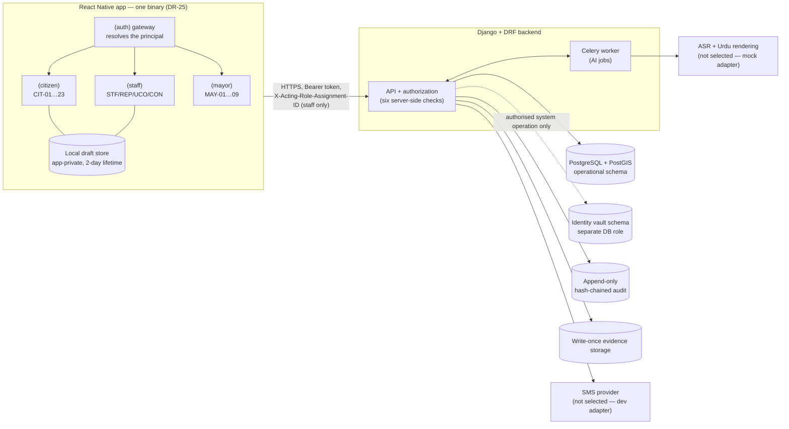

# Architecture Overview

| Field | Value |
|---|---|
| Created | 2026-10-03 (Asia/Karachi), task `T-009` |
| Status | **Design baseline. Nothing below is implemented yet.** Each component lists the task that builds it and the check that will prove it |
| Sources | Mobile SRS v2.3.0 §2–§4, §6, §7.4 (S-01); CR-61 rev 1.3 (S-02); decisions in [DECISIONS_AND_GAPS.md](../planning/DECISIONS_AND_GAPS.md) |

## 1. Shape of the system

Parakh has **two deployables and one database**: a React Native mobile app and a Django backend with a worker. It is a modular monolith, not a set of microservices. That is enough for one developer and a prototype-scale workload (S-01 `NFR-6`: tens of participants, hundreds of reports).

## 2. Components and why each exists

| Component | Responsibility | Requirement that justifies it | Built in | Proven by |
|---|---|---|---|---|
| **Mobile app** (Expo SDK 57, React Native 0.86, strict TypeScript) | Capture, queue, render. It decides nothing | DR-19, DR-25, `NFR-76` | `T-031` onward | Dev build on a device; `tsc`/ESLint/Jest in CI |
| `(auth)` gateway | Resolves `{subject_type, acting assignment, role}` before any route group mounts; fails closed | §3.3.1, `SC-02` | `T-031`, `T-089` | Instrumented navigation tests |
| Interceptor profiles (citizen · staff-pre-role · staff · mayor) | Exactly one active. The citizen profile never sends an acting-role header | §3.2.2, `SC-03`, `SC-04`, `DR-22` | `T-033`, `T-085` | Unit tests |
| Per-principal state + wipe protocol | No cached data crosses principals; queued drafts survive but stay unreadable | `FR-COMMON.23`–`.26`, `NFR-91`–`93` | `T-088` | Exit criteria 17–20 |
| Local draft store | Drafts (LDS-2) and their media (LDS-4) app-private and bound to the account, **not encrypted by the app**; the capture file is the evidence; an unsubmitted draft is deleted 2 days after creation. The 5 October encrypted drafts move once (`T-128`). *(Until 2026-10-06: encrypted at rest under DR-23, key in SecureStore)* | `DG-63`, `DG-64`, `NFR-48` as amended | `T-046`, `T-047`, `T-128` | Jest; emulator record `docs/testing/DRAFT_STORE_VERIFICATION.md`; device record (Android **and** iOS) still needed |
| **Backend API** (Django + DRF) | Every rule enforced here: authentication, ownership, capability, scope, conflict, step-up | `NFR-42`, `NFR-43`, `SC-01` | `T-027`, `T-087` | Integration tests incl. forged IDs and expired assignments |
| Identity vault (separate schema and DB role) | Phone numbers encrypted with HMAC lookup; the application role has no `SELECT` | §6.1.1, `NFR-45` | `T-028`, `T-037` | DB permission test |
| OTP service + SMS adapter boundary | Purpose-bound, hashed, single-use challenges; replaceable sender | `FR-AUTH.6`–`.8`, `NFR-52` | `T-038` | Unit + integration tests; real provider only in `T-065` |
| Draft pipeline + evidence upload | `ClientSubmission` states; chunked upload; the server recomputes hashes | §3.6.2, `FR-PUB.5`, `NFR-54` | `T-053`–`T-055` | Integrity-mismatch tests |
| AI worker (Celery + Redis) + provider adapter | Server-side ASR and Urdu rendering; versioned artifacts; failure creates nothing | `FR-PUB.14`–`.20`, `BR-004` | `T-056`, `T-057` | Mock-adapter tests; real provider only in `T-059` |
| Confirmation + report creation | Bind the exact rendering version and hash; one atomic transaction creates the report and its reference | `FR-PUB.21`–`.28`, `NFR-12` | `T-060`, `T-061` | Stale-version 409 and idempotent-replay tests |
| Audit service | Append-only, hash-chained; no phone, OTP or token in any event | `NFR-56`, `NFR-86` | `T-029` | Tamper-detection test |
| Evidence storage | Write-once objects, opaque keys, short-lived access URLs | `BR-003`, §6.2.9 | `T-054` (local substitute), `T-107` (real bucket) | Overwrite-refusal test |
| Notifications | In-app first; SMS only with consent; bodies carry no number or content | `FR-NOTIF.*` | `T-068`, `T-091` | Body-content tests |

## 3. Trust boundaries

| Boundary | Rule |
|---|---|
| Device ↔ backend | The device is **untrusted**. Route guards and interceptors are hygiene, not authorization. The server re-checks everything (`SC-01`). The compiled bundle is treated as published (`SC-12`) |
| Citizen ↔ staff ↔ Mayor/Ops principals in one app | Separate route groups, separate state trees, one `QueryClient` per principal, wipe on every transition (DR-25 cost, `R-22`) |
| Application ↔ identity vault | Only the authentication and notification services touch phone numbers, for an authorised system operation. No operational role ever receives a citizen number (§4.3.5) |
| Backend ↔ AI provider | Audio leaves only after a provider and processing location are decided (`DG-16`). The mock adapter never leaves the machine |
| Backend ↔ SMS provider | OTP bodies contain the code only. The development adapter writes to a local console and refuses to load outside development (`DG-48`) |
| Contractor responses | Filtered at the response layer: no original audio, no ASR text, no citizen identifier (§4.3.5, `T-096`) |
| Technical System Administrator | Out-of-band infrastructure access only; no civic role and no screen. It is not a superuser |

## 4. Data movement — the report path

1. **Capture on the device.** The device captures photo, voice or typed text, and location → hashes each item at capture → keeps the capture file itself, app-private → `LOCAL_DRAFT`. An unsubmitted draft is deleted 2 days after creation (`DG-64`).
2. **Upload when online.** Chunked upload → the server recomputes every hash → objects are written once → `UPLOADING`.
3. **Process on the server.** The worker runs ASR and Urdu rendering → artifact v1 with model metadata → `AWAITING_REPORTER_REVIEW`.
4. **Confirm.** The reporter reads or corrects (each correction creates a new version), then confirms version *n* together with its content hash → six server checks → `READY_TO_SUBMIT`.
5. **Submit — only when the reporter presses Submit** (`DG-65`). One transaction creates the `CivicReport` (`SUBMITTED`), the reference, the ownership record and an audit event. The device retries for 48 hours from the first attempt with one idempotency key, checks the draft's status before a retry after a lost response, and the server returns the same reference to every replay.
6. **After submission.** Staff workflow transitions T2–T12 are guarded by `state_version`, scope, capability and conflict exclusion.

A queued draft is **not** a report and shows no reference (§3.4.3).

## 5. Module layout (planned)

| Path | Contents | Created by |
|---|---|---|
| `backend/` | Django project: `accounts`, `identity_vault`, `auth`, `reports` (drafts, rendering, confirmation, CivicReport), `evidence`, `ai`, `audit`, `notifications`, later `staff`, `workflow` | `T-027` |
| `mobile/` | Expo app per S-01 §3.3: `app/(auth)`, `app/(citizen)` first; `(staff)` and `(mayor)` from Phase 2; `src/api`, `src/auth`, `src/domain`, `src/services`, `src/store`, `src/db`, `src/i18n` | `T-031` |
| `docs/api/` | PROPOSED Phase 1 contract (the authoritative v3.0 is missing — `DG-05`) | `T-036` |
| `apps/citizen/` | Superseded Flutter template — to be removed (`DG-03`) | `T-019` |

Folders are created when their first task starts, not before.

## 6. What this document does not claim

Components exist only as development builds: the backend on SQLite with **simulated** SMS and AI, and the mobile app on an Android **emulator**. No provider has been selected. Encryption at rest has been shown on an emulator only, not on a device (`DEP-08`, `VAL-034`). Server-side authorization rules are covered by automated tests only; there has been no security test of a running deployment. Each claim becomes true only when its "Proven by" evidence is recorded in `tracking/data/validation.csv`.
